# 两个物体已经撞上，下一步往哪走？

在游戏里放两个方盒子。左边的盒子向右滑，碰到右边那个原本不动的盒子。

如果正对着撞，两个盒子可能一起向前走。把左边盒子稍微抬高，让它偏着撞，事情就变了：盒子不仅向前走，还会转起来。

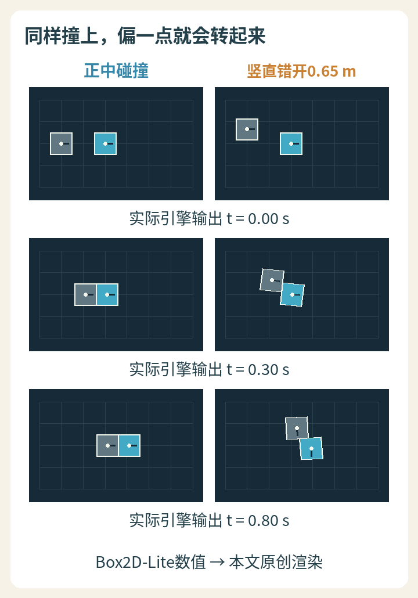

上图不是凭感觉画的结局。本文实际编译并运行了开源的 **Box2D-Lite** 物理代码，再把代码输出的位置和转角绘成图片。彩色方块、网格、白色中心点和朝向标记由本文的渲染程序绘制。它们是**真实引擎计算结果的可视化**，不是官方演示程序界面，也不是某款商业游戏的截图。

下面是同一组运行的连续帧。上方正中碰撞，下方偏心碰撞。图中文字给出模拟里的时间；动画为了便于看清而放慢播放，不代表现实秒表。

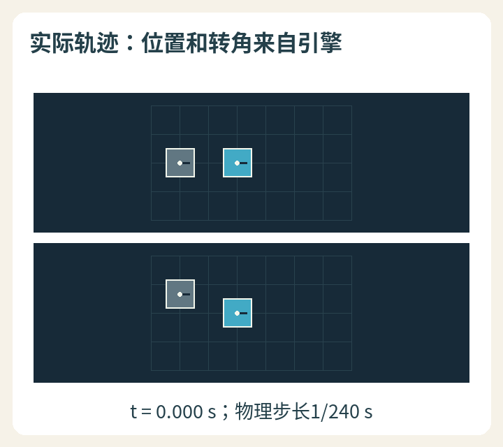

我们要解释的，就是从“发现两个物体接触”到“决定它们接下来怎样运动”之间的那一步。

不需要先学过力学。我们会从“每秒走多远”开始，一次只添一个新概念。先用能手算的两件小物体弄懂主要账目，再看旋转、摩擦和一堆箱子为什么让问题复杂起来。

## 1. 先分清三道题：撞没撞，何时撞，撞后怎样

做物理游戏时，下面三句话听起来相近，其实负责不同工作。

- **碰撞检测**：两件物体有没有接触或重叠？接触位置在哪里？
- **接触时间**：如果物体走得很快，这一小段时间里的哪个时刻最先撞上？
- **碰撞响应**：已有接触信息，应该怎样改变两件物体的运动？

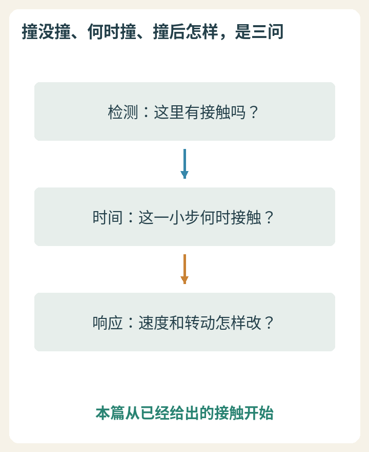

本库此前的[GJK文章](https://github.com/zyuanming/tech-articles/blob/a90f22c99bc1d2be5763ffc3fb3d608554f02b94/articles/2026-10-11-gjk-origin-collision/read.md)讨论第一类问题，[高速子弹文章](https://github.com/zyuanming/tech-articles/blob/a90f22c99bc1d2be5763ffc3fb3d608554f02b94/articles/2026-10-10-fast-bullets-thin-walls/read.md)讨论第二类。本文从第三类开始：假定检测程序已经交来一个接触点和接触方向。

这一区分很重要。即使响应公式非常正确，如果检测根本没发现子弹穿过墙，就没有人来调用这个公式。反过来，检测说“碰到了”，也没有自动告诉我们应当反弹多快。

## 2. 速度不是位置

想象你每隔半秒给盒子拍一张照片。三张照片里，盒子依次位于0米、1米、2米处。

它用1秒向右走了2米，我们就说它向右的速度是每秒2米，写成 `2 m/s`。

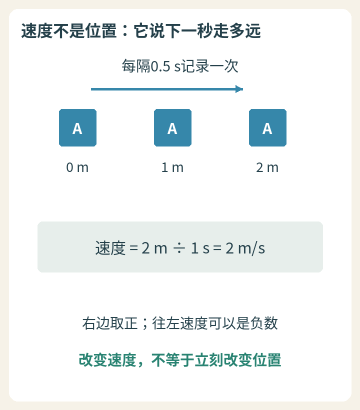

先约定向右为正方向。向右每秒2米是 `+2 m/s`，向左每秒2米就是 `−2 m/s`。负号没有说它“慢得不正常”，只是在说明方向。

位置回答“现在在哪里”，速度回答“如果暂时照这样走，接下来位置怎样变”。一个物理小步长为 `Δt`，忽略这一步中更细的变化，可以用：

`新位置 = 旧位置 + 速度 × Δt`

这里的 `Δ` 可以读成“变化量”或“一小段”。例如速度2米每秒，小步长0.1秒，这一小步的位置变化就是0.2米。

碰撞响应通常首先改的是速度，而不是把整个物体瞬间传送到别处。位置误差要不要另修，我们后面再说。

## 3. 为什么不能简单把两边的速度交换？

先把旋转、地面和空气都拿走，只留下沿一条直线运动的两件物体。

A质量2千克，以每秒3米向右运动。B质量1千克，原本不动。

“质量”在这里可以先理解为物体对改变运动的抵抗程度：同样一推，质量更大的物体，速度通常改变得更少。

力学给这笔运动账一个名字：**动量**。

`动量 p = 质量 m × 速度 v`

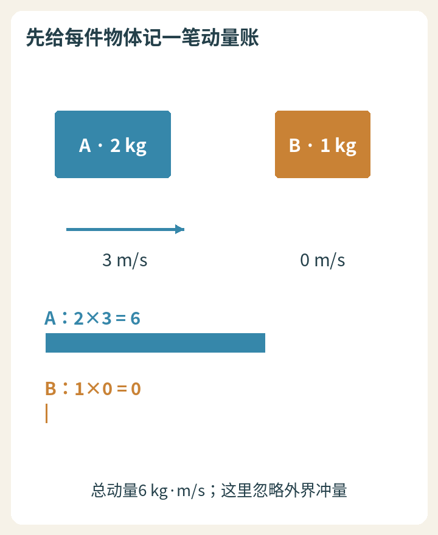

于是A的动量是 `2×3=6 kg·m/s`，B是0。两件物体的总动量是6。

如果这个碰撞过程里，外界没有给这对物体明显的额外冲量，那么碰撞后两者的**总动量仍然应当是6**。这就是这里使用的动量守恒。

注意，我们不是把速度直接相加。两件物体质量不同，`3+0`不能代替 `2×3+1×0`。

假如不管质量，直接交换两边速度，结果会变成A静止、B每秒3米。总动量只剩 `2×0+1×3=3`。另外3到哪儿去了？这个规则没有解释。

“交换速度”在某些特别条件下恰好成立，例如理想的一维、完全弹性的等质量碰撞。它不是通用程序。

## 4. 冲量：不用重放碰撞过程里的每一瞬间

真实物体接触时会变形，接触力会随时间变化。要模拟每一点形变、每一瞬间的力，远比让游戏里的箱子互相推开复杂。

一种常用的刚体近似，是把物体暂时当作形状不变的整体，先不细算全部形变过程，而是直接计算这次接触总共改变了多少动量。这个量叫**冲量**，用 `J` 表示。

`冲量 J = 动量变化 Δp`

因此，对质量不变的物体：

`速度变化 Δv = J / m`

如果你已经知道平均力和作用时间，也可以写成“冲量等于平均力乘以时间”。但我们现在走相反方向：先问希望碰撞后的速度满足什么条件，再反求需要多大的冲量。[OpenStax教材](https://openstax.org/books/university-physics-volume-1/pages/9-2-impulse-and-collisions)介绍了冲量与动量变化的关系。

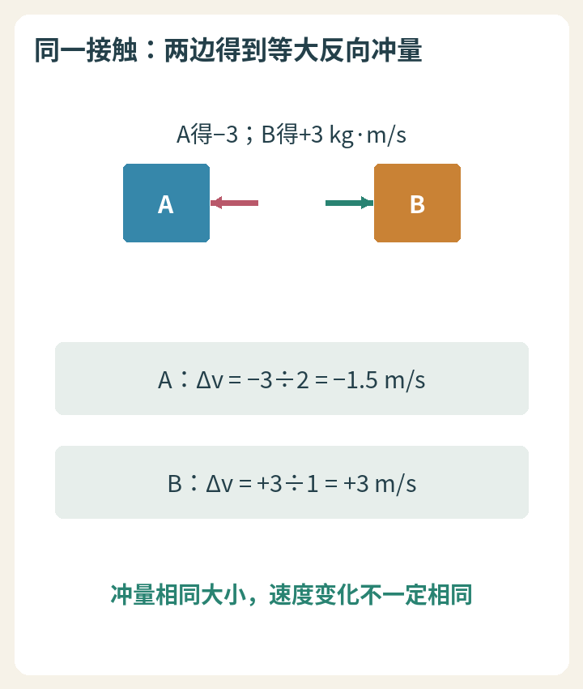

假设接触给A一个向左的冲量 `−3`，给B一个向右的冲量 `+3`，单位都是 `kg·m/s`。

A质量2，所以速度改变 `−3/2=−1.5 m/s`，由3变成1.5。B质量1，所以速度改变 `+3/1=+3 m/s`，由0变成3。

两边冲量等大反向，总动量的变化相互抵消；两边速度的变化却不必一样大。

到这里仍有一个缺口：**为什么挑3，而不是2或4？**

守恒条件只告诉我们不能乱记账，还没有告诉我们物体该反弹多厉害。

## 5. 弹不弹，看的是两边彼此远离的速度

A以每秒3米追近静止的B。它们之间的间距，每秒缩短3米。

刚才那组冲量之后，A向右每秒1.5米，B向右每秒3米。B跑得更快，两边间距开始每秒增大1.5米。

因此：

- 碰撞前，相对接近速度的大小是3。
- 碰撞后，相对分离速度的大小是1.5。

把后一个大小除以前一个，得到 `1.5/3=0.5`。这个比值叫**恢复系数**，通常记作 `e`。

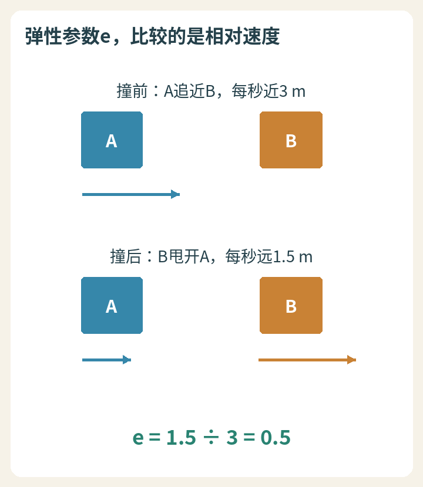

在本文采用的理想、无额外能量输入的碰撞模型里，让 `e` 位于0到1之间：

- `e=0`：碰撞后，这个接触方向上的相对速度为0。
- `e=0.5`：分离速度大小是接近速度大小的一半。
- `e=1`：沿该方向以同样大小的相对速度分离。

**`e=0`不等于永远用胶水把两个物体粘住。** 它只规定碰撞响应完成这一刻，垂直接触表面方向的相对速度；这个方向叫法向，第8节会把它画出来。之后另一股力、另一次碰撞，或者切向滑动，仍可能让它们分开。

现实中的恢复系数也不是每种材料都永远不变的神奇常数；它可能随碰撞速度等条件变化。我们用一个参数来做可理解、可计算的近似。[MIT的动力学课程讲义](https://ocw.mit.edu/courses/2-003j-dynamics-and-control-i-spring-2007/e12ed118aeb1eb716db972ab23f4b982_lec06.pdf)讨论了这个相对速度比值及其适用条件。

## 6. 三个结局，都能保持同一笔总动量

仍用A为2千克、速度3，B为1千克、速度0的初态。本文独立的解析脚本算出了三组结果：

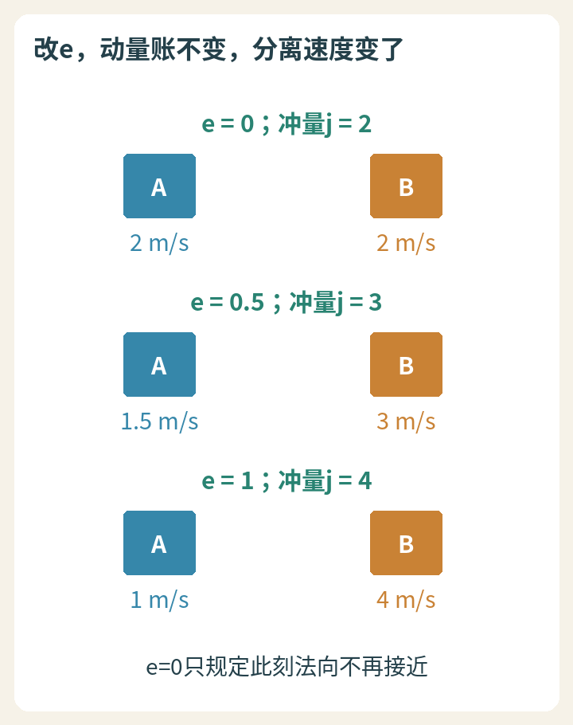

你可以逐个验算：

- `e=0`：A与B速度都为2，总动量 `2×2+1×2=6`。
- `e=0.5`：A速度1.5，B速度3，总动量 `2×1.5+1×3=6`。
- `e=1`：A速度1，B速度4，总动量 `2×1+1×4=6`。

为什么最后B能比碰撞前的A还快？这并没有凭空创造动量。A质量更大，它向较轻的B转移一部分动量，B每获得同样大小的冲量，会产生更大的速度变化。

这些带 `e` 的结果来自本文自己的小模型，**不是开头Box2D-Lite程序里某个恢复系数开关的输出**。本次实际使用的Lite源码没有这个参数。我们先用单次理想碰撞搭基础，后面再接回实际引擎的接触求解器。

## 7. 动量守恒，也不代表动能不变

物体由于运动而拥有的能量叫动能。只考虑平移时，它的公式是：

`动能 = 质量 × 速度² / 2`

速度要平方。向左的速度虽然带负号，平方后仍是正值，所以动能不是有正负方向的账目。

初态A的动能是 `2×3²/2=9 J`，B是0。这里 `J` 是焦耳的单位符号；不要与前面用字母 `J` 表示冲量混为一谈，具体含义要看上下文。

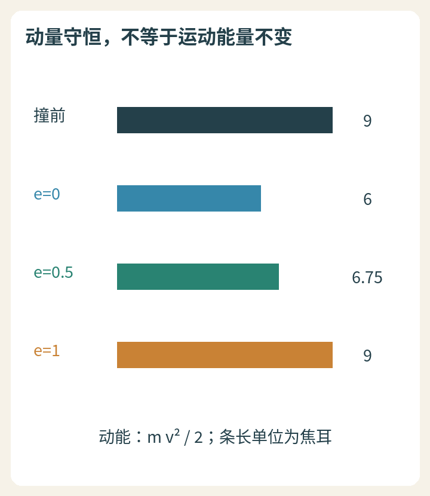

三种碰撞之后，总动能分别是6、6.75、9焦耳。

少掉的运动能量，在真实碰撞中可以转入形变、热和声音等形式。我们的简单刚体程序没有把这些形式一一模拟出来，而是让参数 `e` 表达这次碰撞保留多少相对运动。

因此检查物理程序时，要先说清楚该检查什么。无外界冲量时，动量应守恒；对于 `e<1` 的耗散碰撞，却不该强迫动能也维持不变。

## 8. 从一条直线，走到接触表面

二维游戏里，物体可能往右、往上，或斜着走。我们需要一个能描述接触方向的约定。

在接触点，垂直接触表面的方向叫**法线方向**。沿着接触表面的方向叫**切线方向**。

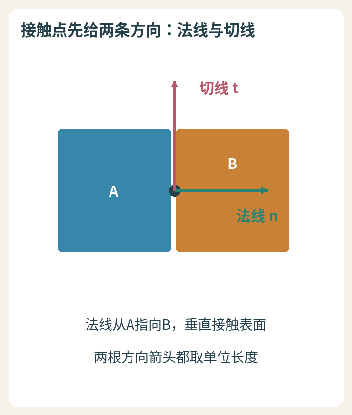

本文把法线 `n` 固定为从A指向B，并使用长度为1的方向向量。这种向量叫单位向量。“长度为1”不是说接触力只有1，而是先让这根箭头只负责方向，把大小留给另一个数。

此时冲量可以写成：

`冲量向量 = 大小 j × 单位法线 n`

B得到 `+j n`，A得到 `−j n`。

先只处理法线方向，解决“继续互相挤进去”的问题。切线上的滑动和摩擦留到后面。

## 9. 一个负号，告诉我们正在接近

取B相对A的速度，即“B的速度减去A的速度”，再看其中沿法线的部分，称为**相对法向速度**，记作 `v_n`。

在目前A在左、B在右、法线向右的一维例子里，它就是：

`v_n = v_B − v_A`

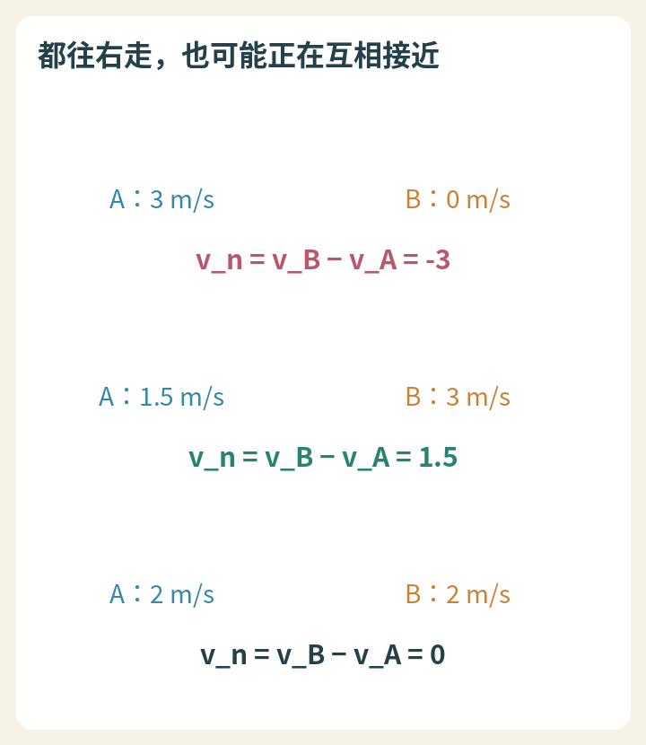

初态 `0−3=−3`，是负数，说明正在接近。碰撞后若 `3−1.5=1.5`，是正数，说明正在分离。若两边速度都为2，相减为0。

请特别留意：“两边都向右走”不能判断有没有接近。左边追得更快，就会接近；右边跑得更快，就会分开。我们要比较的是两边之间的运动，而不是某一件物体相对屏幕的方向。

有了带符号的速度，恢复系数的目标就可以简短写成：

`碰撞后 v_n = −e × 碰撞前 v_n`

前面的负号把“接近的负数”翻成“分离的正数”。

## 10. 不背公式，自己把冲量解出来

回到 `e=0.5` 的例子。我们要把相对法向速度从 `−3` 改成 `+1.5`。

假设给B向右大小为 `j` 的冲量，同时给A反向的冲量。

1. A质量2，新速度是 `3−j/2`。
2. B质量1，新速度是 `0+j/1`。
3. B减A，新相对速度是 `j−(3−j/2)=−3+1.5j`。
4. 让它等于目标1.5：`−3+1.5j=1.5`。
5. 两边加3，再除以1.5，得到 `j=3`。

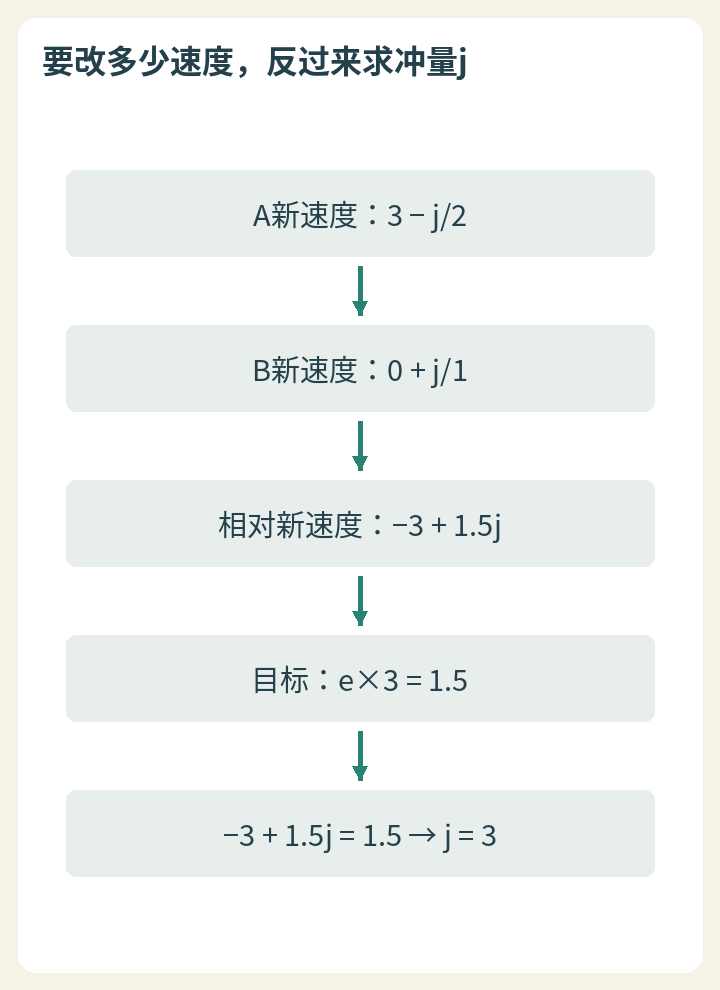

这就是前面没有解释的那个3。它不是拍脑袋选的，是为了达到目标相对速度反求出来的。

把这段算术换成一般字母，暂时不考虑旋转，可得到：

`j = −(1+e) v_n / (1/m_A + 1/m_B)`

为什么分母里有两个倒数？因为同一个大小的冲量，会同时让A和B改变速度。它对相对速度的总影响，要把两边的贡献加起来。

以后看到这个式子，先想到“需要改多少相对速度，除以单位冲量能改多少”，比只记括号和负号更有用。

## 11. 已经在分开，还需要再推吗？

假设A已经向左每秒1米，B向右每秒2米。它们明显正在分开，`v_n=2−(−1)=+3`。

如果不看条件，硬把这个正数塞进刚才的公式，会算出负的 `j`。那相当于把正在分开的物体又吸回来。

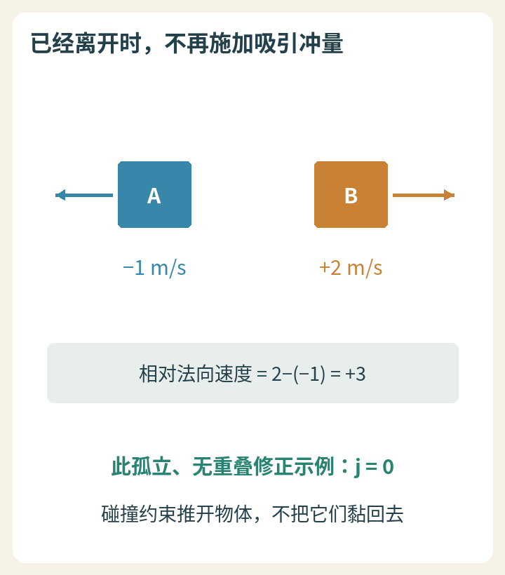

对这里的孤立单次碰撞、没有位置修正的简单模型，我们使用：

- `v_n<0`，正在接近，求一个把它们推开的冲量。
- `v_n≥0`，不施加这次碰撞冲量。

这表达了普通接触的一个性质：它可以顶住、推开，不能像胶水或绳子那样主动拉住对方。

稍后在多轮求解里，我们会遇到“本轮修正为负”的情况。那是在撤回之前多施加的一部分，和最终施加吸引性的接触总冲量不是一回事。请暂时留住这个区别。

## 12. 墙有多重？程序不必真的填一个天文数字

盒子撞上关卡墙壁，通常只希望盒子改速度，墙不动。

上面的式子真正反复使用的是质量的倒数 `1/m`，也叫**逆质量**。所以程序可以直接规定：静态墙的逆质量是0。

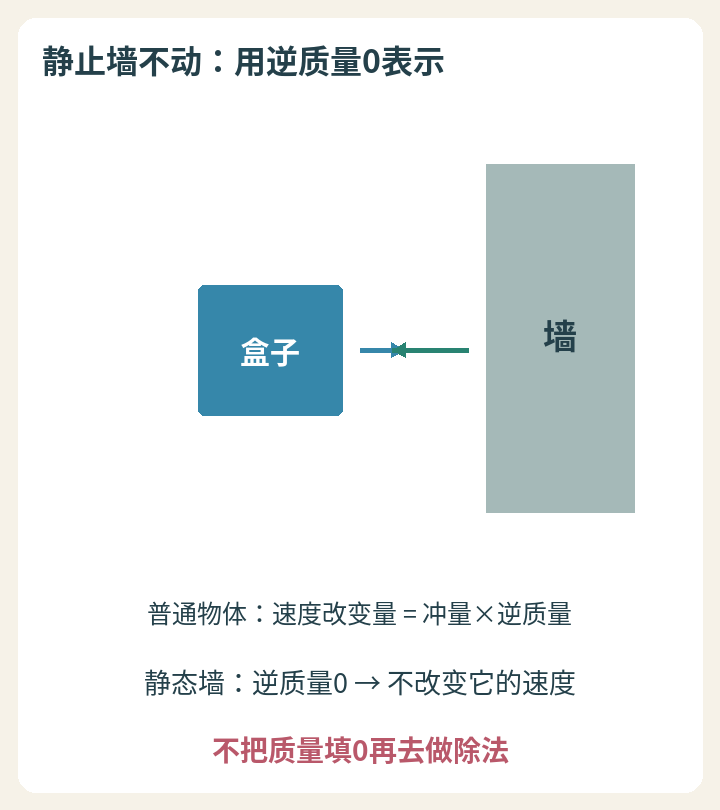

普通物体的速度变化为“冲量乘以逆质量”。乘以0，速度就不改变了。求相对速度响应时，墙那一边的贡献也就是0。

这不是说墙没有质量，更不是让程序去算 `1/0`。它是“这个物体在此模拟中不接受动力学运动更新”的一种数值表示。

静态墙背后还有关卡或更大的环境。如果只统计运动盒子的动量，它在撞墙前后当然可以改变；不能把墙排除在系统之外，又要求盒子独自保持总动量。

## 13. 为什么偏一点，就会转起来？

试着想象推一扇门。推的位置不同，转起来的感觉也不同。对于自由运动的刚体，接触冲量是否穿过中心同样重要。

“刚体”是说我们在这一层模型中，先忽略物体内部形状的改变。它可以整个平移，也可以整个转动。

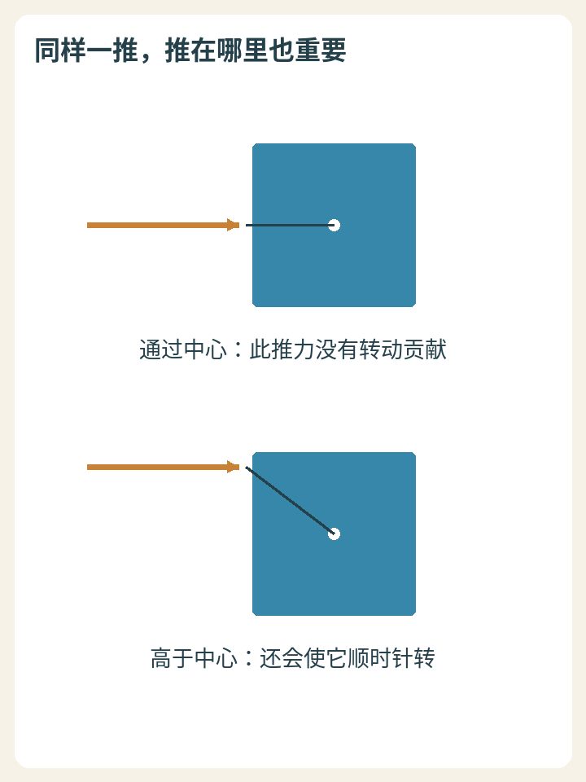

我们从物体的质心画一根箭头，指向接触点，记作 `r`。对本文这些质量均匀的矩形，质心就在几何中心。

冲量经过中心时，关于中心的转动贡献为0。偏离中心时，除了改变整体速度，还可能改变转动速度。

于是，完整的运动状态不能只存一个“向右速度”。至少还要区分：

- 质心的平移速度。
- 绕质心的转动速度，通常叫**角速度**，写成 `ω`，读作omega。

二维里可以用一个带正负号的数表示角速度。本文约定逆时针为正；单位是弧度每秒。弧度也是量角的方法，一整圈是 `2π` 弧度。读到每秒1弧度，可以先把它想成“每秒转过大约57度”。

## 14. 转动也有自己的“难改程度”

平移速度改变多少，与质量有关。角速度改变多少，则与**转动惯量**有关，通常写成 `I`。

质量相同的物体，如果更多质量分布在远离转轴的位置，对改变转动的抵抗也会不同。不能只看总质量。

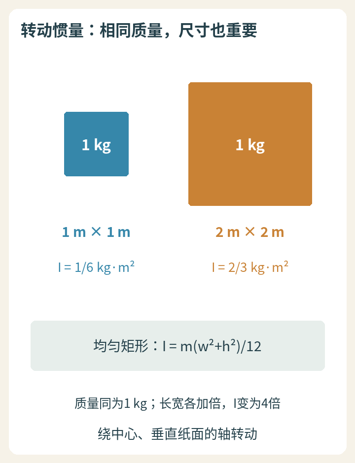

对于宽 `w`、高 `h`、质量 `m` 的均匀矩形，绕中心且垂直画面的轴转动，有：

`I = m(w²+h²)/12`

例如同为1千克，1米见方的矩形得到 `I=1/6 kg·m²`；2米见方的矩形得到 `I=2/3 kg·m²`，大了4倍。这里保持质量相同，不是在假定材料密度也相同。

Box2D-Lite的[Body.cpp](https://github.com/erincatto/box2d-lite/blob/227b71b6974ea57ab7e96d40f6374287bd6a0e77/src/Body.cpp)使用了这条矩形公式。面对其他形状和其他转轴，不能不加判断地照抄。

现在我们还不需要完整的角动量推导。先记住一句：**同样一份偏心冲量，转动惯量越大，角速度通常越不容易改变。**

## 15. 真正在接触的那个角，速度可能与中心不同

一个盒子一边向下落、一边转。它的中心向下，不代表盒子的每一个角都以同样速度向下。

接触点的速度，要把两部分加起来：

`接触点速度 = 质心平移速度 + 转动在这个点造成的速度`

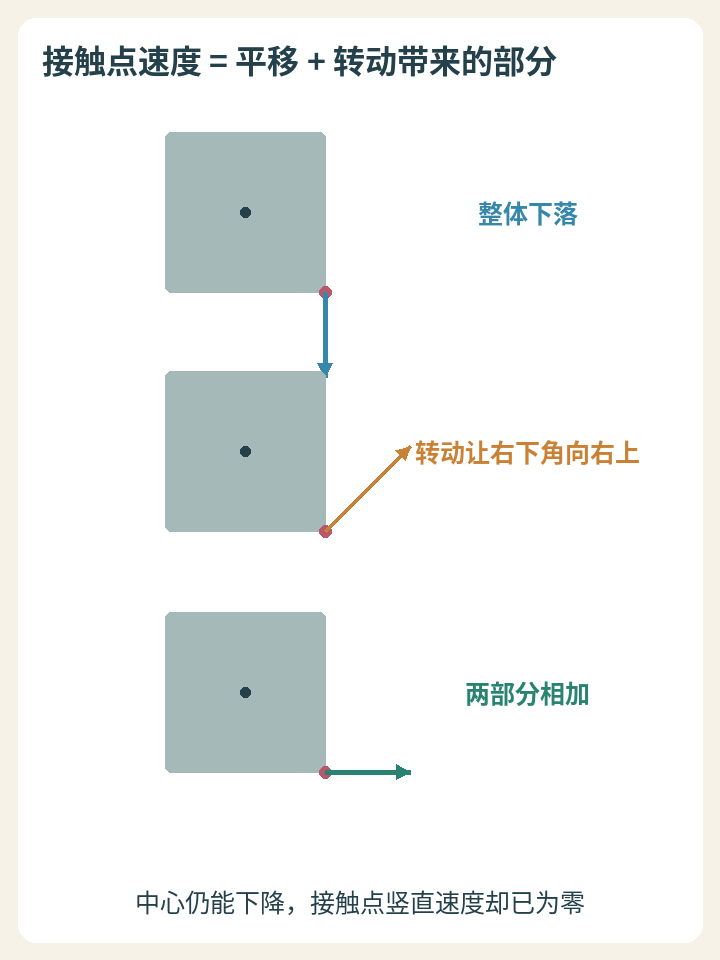

图里，整体平移让右下角向下；逆时针转动让同一个角向右上。如果两个竖直分量刚好抵消，那个角此刻就不再向下，但物体中心仍可以下降。

这就是为什么判断接触是否还在互相挤入，应该看**两边接触点的速度**，不能只看两边质心速度。

这里讨论的是这一瞬间。下一瞬间接触点位置、转角或接触集合可能改变，并不是说盒子能保持这个姿势永远往下穿。

## 16. 一个会让直觉停一下的小例子

放一个质量2千克、宽高都是2米的均匀盒子。它正以每秒3米竖直下落，没有转动。右下角刚好碰到一根很窄的小柱顶端。

注意是**窄柱只托住一个角**，不是整个宽地板同时托住两个角。我们先看这个单接触、无摩擦、`e=0` 的瞬间。

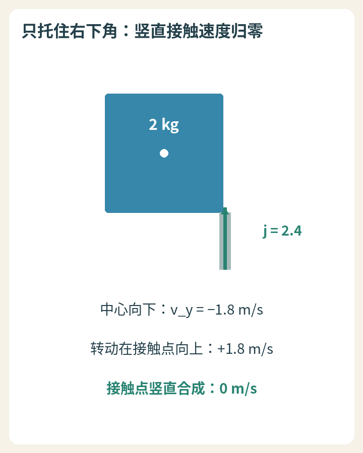

本文解析程序得到向上大小2.4的冲量。中心速度从 `−3` 变成 `−1.8 m/s`，角速度变成正的 `1.8 rad/s`。

如果只看中心，你也许会说：这不是没修好吗，盒子还往下走！

但右下角因为转动，额外获得了向上 `1.8 m/s` 的分量，刚好抵消中心的向下速度。该接触点的**竖直速度为0**。它还保留向右的切向速度，因为我们没有加入摩擦。

响应要满足的是接触方向的要求，并不总是让整个物体立刻停止。接下来一节把2.4也算出来；若你目前只想抓住物理图像，可以先记住这幅图，再往后看箱堆。

## 17. 公式里的叉乘，其实在这里只要做四个数的乘减

先约定横轴向右、纵轴向上。一个二维向量用两个分量表示，例如 `r=(1,−1)`，意思是从中心向右1米、向下1米。

窄柱的接触法线向上，因此 `n=(0,1)`。

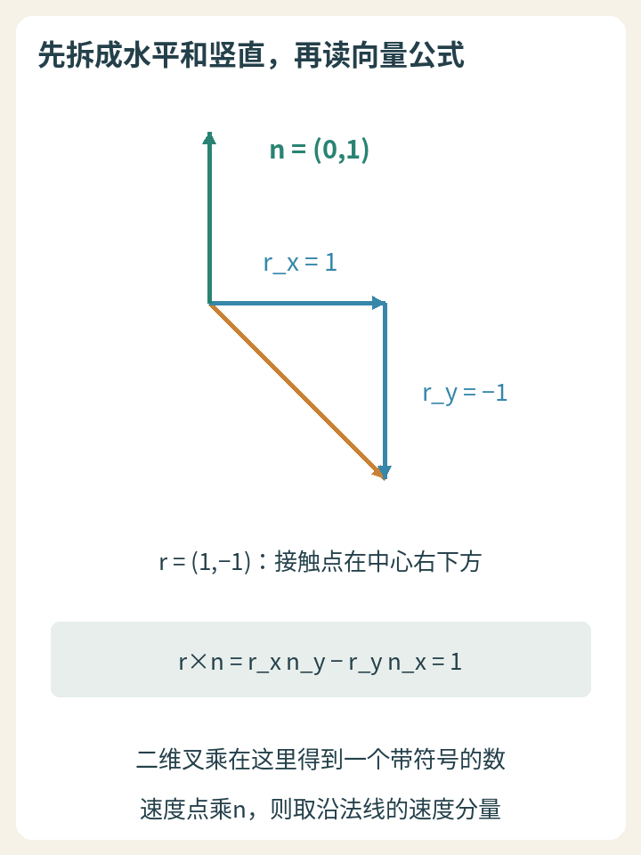

我们需要两种运算，先说它们在本文里各自负责什么。

**点乘**：`u·n = u_x n_x + u_y n_y`。当 `n` 是单位方向时，这会取出速度 `u` 沿该方向的分量。例如 `n=(0,1)` 时，结果就是 `u_y`，也就是竖直速度。

**二维叉乘**：本文写 `r×n = r_x n_y − r_y n_x`，结果是一个带符号的数。它帮助表示冲量对转动的影响。

窄柱例子里：`r×n = 1×1−(−1)×0=1`。

你不需要先掌握三维叉乘的全部几何。这里给出的分量算式，就足够复算接下来这一个例子。

角速度 `ω` 在位置 `r=(r_x,r_y)` 造成的点速度则是 `(-ω r_y, ω r_x)`。所以 `ω=1.8`、`r=(1,−1)` 时，转动带来的点速度为 `(1.8,1.8)`，正是向右、向上各1.8。

## 18. 一个接触点，要同时计算平移和转动的响应

只考虑平移时，我们用分母 `1/m_A+1/m_B` 表示“单位冲量能改变多少相对速度”。现在把转动也加入。

先不用总公式，拿刚才的盒子试一份向上的冲量：`j=1 kg·m/s`。柱子固定不动，只算盒子的变化。

- 平移：`Δv_y=j/m=1/2=0.5 m/s`。
- 转动的第一步：`I=2×(2²+2²)/12=4/3 kg·m²`；`r×n=1 m`，所以 `Δω=j(r×n)/I=0.75 rad/s`。
- 转动的第二步：把这个角速度放回接触点速度式，`r=(1,−1) m`，得到 `(-Δω r_y, Δω r_x)=(0.75,0.75) m/s`。取向上的分量，又得到 `0.75 m/s`。

因此，每1单位向上冲量，会让这个角的向上速度增加 `0.5+0.75=1.25 m/s`。要把原先的 `−3 m/s` 调到0，就需要 `3/1.25=2.4 kg·m/s`。

一般情况下，第一步用 `r×n` 把法线冲量换成角速度；第二步把转动带来的点速度沿n取分量，又出现一次同样的因子：`(-Δω r_y, Δω r_x)·n = Δω(r_x n_y−r_y n_x)=Δω(r×n)`。把 `Δω=j(r×n)/I` 代进去，得到 `j(r×n)²/I`。平方就来自这两次相继的换算。

把两边物体的平移与转动响应合在一起，记成 `K`。它表示单位法线冲量能改变多少接触点相对法线速度，量纲为每千克：

`K = 1/m_A + 1/m_B + (r_A×n)²/I_A + (r_B×n)²/I_B`

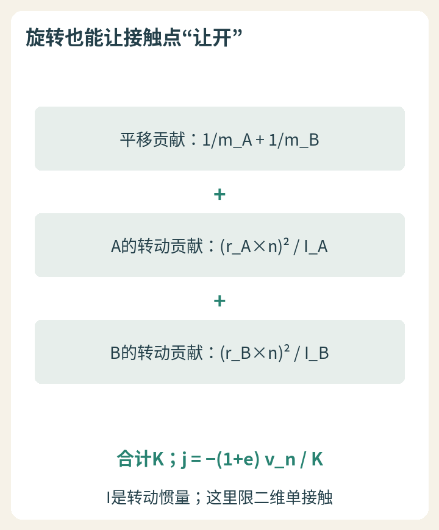

前两项来自平移。后两项来自“偏心冲量改变角速度，而角速度又改变接触点速度”。静态物体的逆质量、逆转动惯量都按0处理。

于是单接触的冲量大小写成：

`j = −(1+e) v_n / K`

这里的 `v_n` 必须来自**接触点相对速度**，不是漏掉旋转后的质心速度。还要保留前面“已经分离时不施加吸引冲量”的条件。

现在复算窄柱例子。柱子是静态物体，所有响应贡献为0。盒子质量2，所以平移贡献为 `1/2=0.5`。其转动惯量 `I=2×(2²+2²)/12=4/3`，而刚才算出 `r×n=1`，所以转动贡献为 `1²/(4/3)=0.75`。

总共 `K=0.5+0.75=1.25`。初始接触点向下速度为3，即 `v_n=−3`，并取 `e=0`：

`j = −(1+0)×(−3)/1.25 = 2.4`

中心速度变化为 `2.4/2=1.2`，所以从−3变成−1.8。角速度变化为 `(r×j n)/I=2.4/(4/3)=1.8`。图里的数字现在都有了来源。

这条公式的适用对象是本文这种二维、瞬时、单接触近似。存在多个接触和摩擦时，不能只对每个点独立算一次就宣布整个系统解决了。

## 19. 一个盒子有两个接触点，为什么不能各算各的？

把盒子放到宽地板上，可能同时有左右两个接触点。

你先在左角施加一个向上的冲量。盒子的中心速度变了，角速度也变了。于是右角的速度也跟着变了。

接下来修右角，又会反过来改变左角的速度。

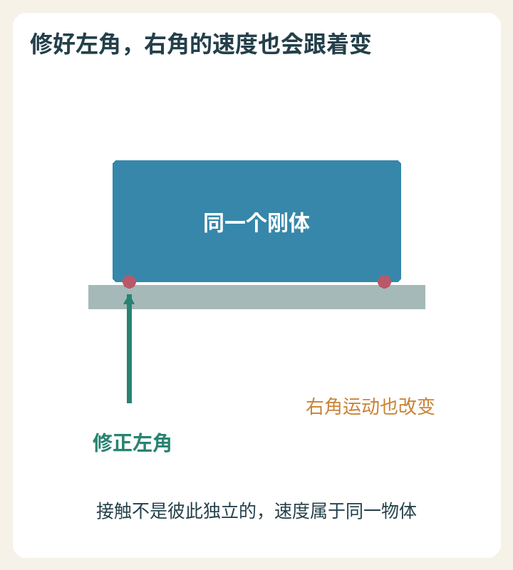

它们不是两个互不相干的小盒子。它们共享同一个刚体的运动状态。

一堆箱子更明显。下层要支撑上层，上层也会把冲量传回下层。每个接触都提了一个局部要求，而这些要求通过同一批物体彼此关联。

一种实时计算中常用的办法，是多次遍历接触：用当前最新的速度修一个点，再去修下一个点；修完一轮，再从头来。多轮通常能减小剩余误差，但不保证每个接触每一轮都单调变好。

这叫**顺序冲量**求解的一种基本思路。英文常写 Sequential Impulses。它不是“所有接触都各自猜完，最后一起改”，而是后一项会看见前一项刚改过的速度。

## 20. 两个点质量，就能看见为什么需要多轮

为了不让旋转遮住主要关系，我们先做一个比真实箱堆简单的速度账本。

有两个各1千克的点质量，竖直排列。“点质量”在这个小模型里，就是只记位置、速度和质量，暂时不考虑形状与转动的物体。下面一个受固定地面约束，两者之间也有“不再彼此接近”的约束。初始两个竖直速度都是 `−1 m/s`。

每轮先修地面接触，再修两者之间的接触。第一步把下方物体的速度从−1改成0。上方仍为−1，它相对下方又在接近，于是两者之间的修正让它们暂时都变成−0.5。

第一处接触刚刚修好，第二处接触又让它留下了一点误差。

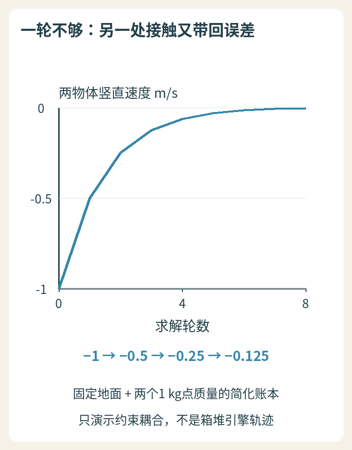

第二轮，同样过程使两者变成−0.25；第三轮是−0.125。经过8轮，剩余速度为 `−0.00390625 m/s`。

这张曲线来自本文独立的小账本计算，不是Box2D箱堆轨迹。它只隔离出一个现象：**局部修正会互相影响，多轮协调通常比只遍历一次更接近所有要求。**

真实场景不一定每轮恰好减半。接触顺序、质量比例、摩擦、形状和步长都会影响结果。“迭代10次”也不是数学上保证所有场景完全无误的承诺。

## 21. 为什么本轮冲量可以为负，却仍没有把物体吸在一起？

多轮求解时，我们为一个接触保存累计法向冲量，记作 `λ_n`。可以把它理解成“到目前为止，这个接触总共记了多少推开的冲量”。

假设前几轮累计记了1.0。由于其他接触也帮忙改变了速度，现在发现只需要0.8就够了，那么这一轮应该撤回0.2。

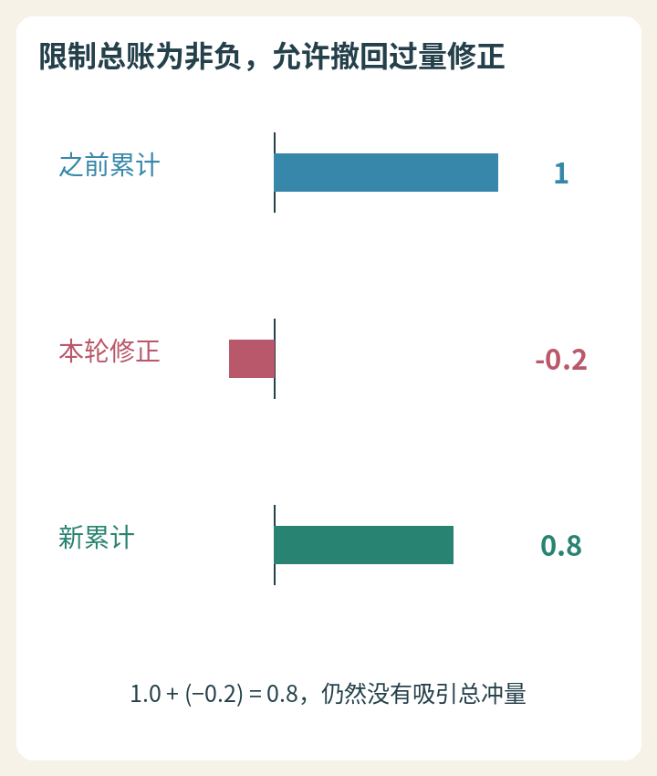

正确的限制施加在**新的总账**上：

`新累计 = max(旧累计 + 本轮建议修正, 0)`

然后真正应用的，是：

`本轮实际修正 = 新累计 − 旧累计`

因此本轮实际修正可以为负，但累计总冲量不能是负数。

如果每一轮都粗暴地把负修正截成0，那么已经多推的部分就撤不回来，求解会被自己早先的错误锁住。这是Erin Catto的[GDC 2006顺序冲量讲义](https://box2d.org/files/ErinCatto_SequentialImpulses_GDC2006.pdf)以及Box2D-Lite实现中强调的重要细节。

请把它与第11节区分开：那里是一次尚未施加过冲量的孤立碰撞，这里是在调整同一次求解里已经累计的结果。

## 22. 摩擦不是“横向速度每帧乘0.99”

法线冲量解决互相挤入，切线冲量则可以改变沿接触面的相对滑动。

例如盒子在地板上向右滑，摩擦会阻碍这种相对滑动。我们可以先计算一个希望减少切向相对速度的冲量，但不能让它任意大。

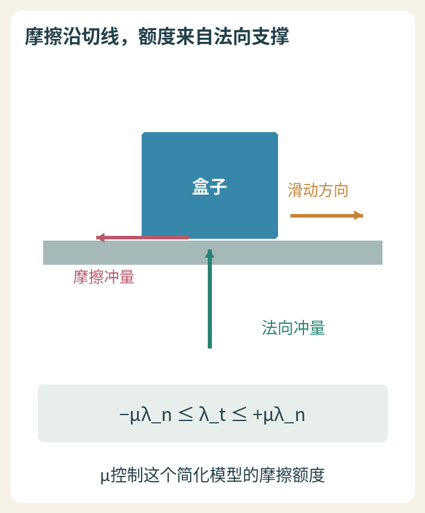

Box2D-Lite采用的简化摩擦范围是：

`−μ λ_n ≤ λ_t ≤ μ λ_n`

`μ`读作mu，是摩擦系数；`λ_n`是累计法向冲量，`λ_t`是累计切向冲量。实现会把切向总量限制在这个区间内。

这体现了一个关系：切向摩擦的可用范围，与法向接触的支撑有关。没有接触支撑时，不能让同一个接触凭空产生任意摩擦。

“每帧乘0.99”则是一种按比例减速的经验规则。它可能适合某种游戏手感，但仅凭这句话还没有描述接触方向、质量、支撑和步长，因此不能把它自动等同于这里的接触摩擦。

实际材料摩擦比这个模型复杂。我们讲的是引擎里可计算的一种近似，不是在宣称一个系数解释了所有表面现象。

## 23. 让真正的引擎滑一次

现在把概念接回实际输出。

同一个1千克方盒子，从水平位置−4米开始，初速度每秒5米。重力加速度向下每秒每秒10米，物理步长为1/60秒。地板足够长，四秒内不会滑出边缘。

我们运行两次：一次盒子和地板的摩擦系数都为0；另一次两者都为0.3。其余求解设置相同。

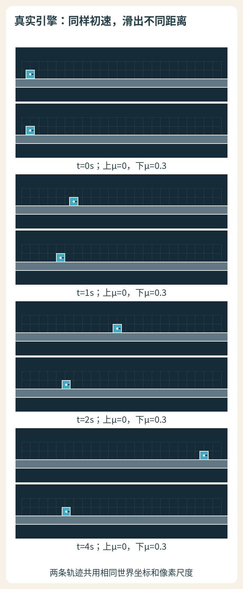

无摩擦的盒子四秒后到达约16米处，水平速度仍约为5。有摩擦的盒子最后停在约0.13米处，也就是向右滑出了约4.13米。

图中每个小盒子的中心位置来自CSV记录，没有为了做出对比而手动摆放结局。下面的速度曲线也直接从同一批记录绘出。

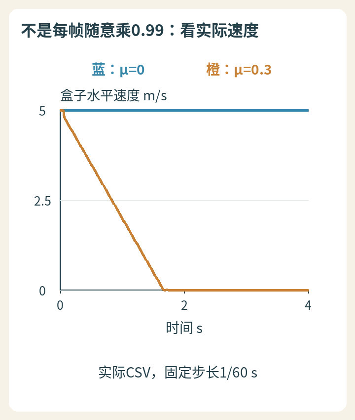

如果采用连续时间、恒定水平摩擦减速度 `μg=3 m/s²` 的更简单模型，停止距离是 `v²/(2μg)=25/6≈4.17 m`。实际离散求解的约4.13米接近这个估计，但并不逐位相等。

两者的差别可以提醒我们：图里的程序不是把连续公式抄成一个完美答案，而是在一个个有限时间小步里更新速度与位置。

## 24. 为什么箱堆比两个盒子难伺候？

把8个同样的方盒子叠起来，轻微留出初始间隔，再让它们落到地面上。

下面两幅图来自相同初态的实际运行。上面每个物理小步只做1轮求解，而且不启用热启动；下面做10轮，并启用热启动。时间都走到5秒。

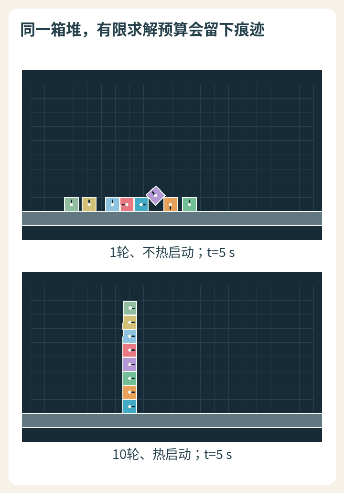

先别急着归功于某一个开关。这里同时改变了两件事，所以这对图片只能说明“这两个设置组合的结果不同”，不能单凭它证明差异全来自轮数或全来自热启动。

为了把这点讲清楚，本文保留了全部四种组合：1轮/10轮，热启动关/开。下面是同样运行到10秒的画面。

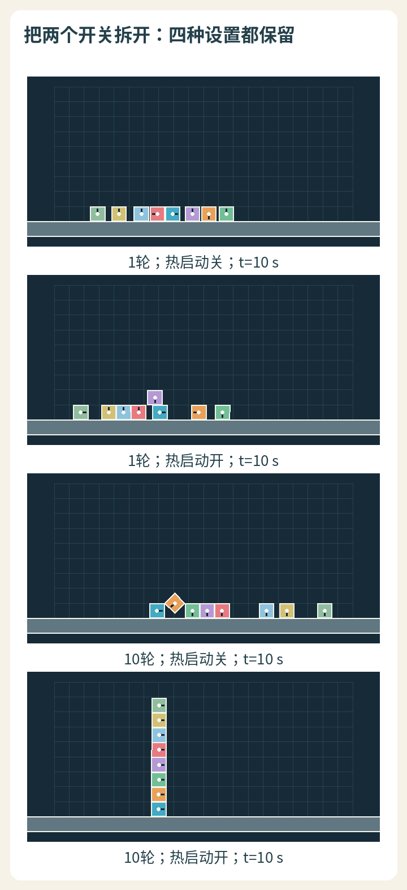

在这组特定场景里，10轮加热启动的组合保持了较完整的堆叠，其他组合明显散开。即便如此，前者也不是完全静止的数学雕塑：顶层仍有小幅速度与转动。我们只展示这10秒内的结果，不保证它在所有场景、所有持续时间里永远稳定。

这是一个理解求解预算的窗口，不是对不同引擎或算法做性能排名。没有测帧率，也没有把一次演示包装成普适基准。

## 25. 热启动：下一小步不必每次都从零猜

如果一个箱子上一小步正由地板稳稳托住，下一小步大概率还在接触同一块地板。上一次求解得到的冲量，可能是一个不错的初始猜测。

**热启动**就是利用这种连续性：匹配仍然存在的接触，把保存的累计冲量用于新一步的求解起点，再继续迭代修正。

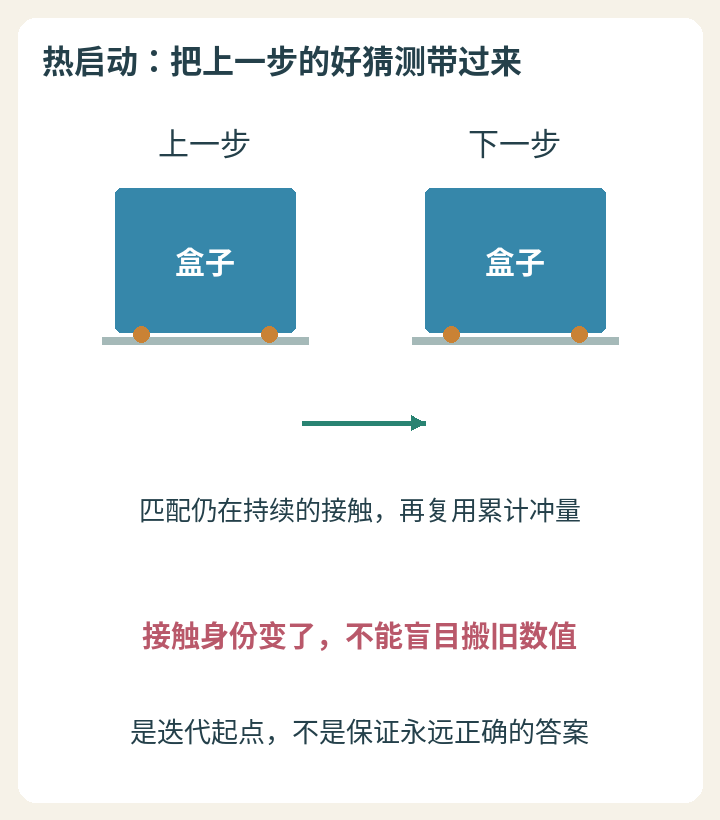

关键是“仍然存在的同一接触”。箱子转过一个角，接触特征可能已经变了，不能只因为它还是同一只箱子，就无条件把旧数值塞给新接触点。

Box2D-Lite会根据接触特征匹配旧记录。它复用的是求解起点，不是宣布“上一步答案以后永远正确”。质量、外力和邻居变化后，仍需要新一轮协调。

如果两小步跨度差得很大，也不能不加考虑地把相同冲量当成相同作用力。冲量与作用时间有关。本文所有对比都使用固定步长，避免混入这个额外变量。

## 26. 速度不再挤入，已经重叠的一小段怎么办？

离散模拟不是连续拍摄每一瞬间。等检测程序发现接触时，两个形状可能已经有一点点重叠。

若只把继续接近的速度改成0，那一点现有重叠不会因为速度修好了就自动消失。

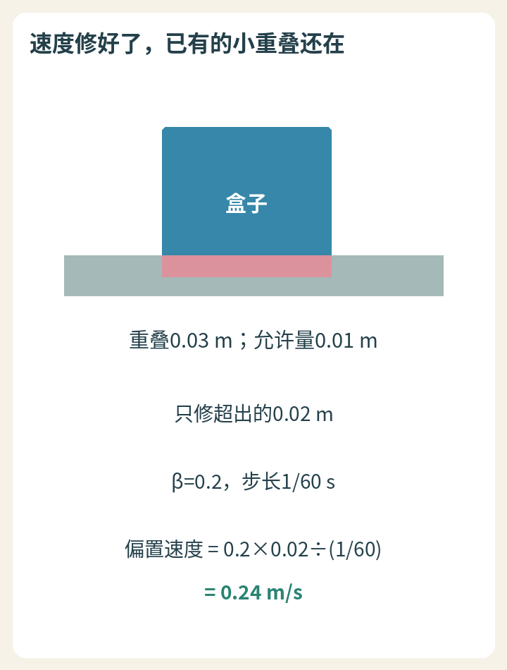

Box2D-Lite中的一种处理办法，是给目标相对速度加一点向外分开的**偏置速度**。可以把它理解为：除“不再继续挤入”以外，还让物体缓缓退开一小部分已经积累的重叠。

举个与源码参数一致的算术例子：重叠0.03米，允许忽略其中0.01米，剩余0.02米。取比例 `β=0.2`，步长1/60秒，则偏置速度为：

`0.2 × 0.02 ÷ (1/60) = 0.24 m/s`

这里没有要求“一小步把全部重叠瞬间消掉”。太猛烈的修正可能让物体弹跳，还可能引入额外能量；太弱则可能留下明显的下陷。允许量也不是说真实物体能互穿，而是在离散计算里容忍很小的误差，避免反复追赶微小抖动。

因此，前面单次无偏置碰撞的能量公式，不能不加条件地用于这里的整个箱堆运行。

原始CSV里的 `max_penetration` 记录的是本小步求解器所持有的接触重叠深度；同一行的位置则已经完成本小步推进。两者处于小步中的不同阶段，不应把这个字段冒充为图片当前姿态重新做几何检测得到的精确重叠量。

## 27. 迭代10轮，不等于时间走了10步

可以把一次物理小步看成一段明确的工作顺序：

1. 更新接触信息。
2. 把重力等外力在这一小段时间里的影响积进速度。
3. 准备接触参数、热启动，再多轮修正法向与切向速度。
4. 用得到的新速度更新位置和角度。

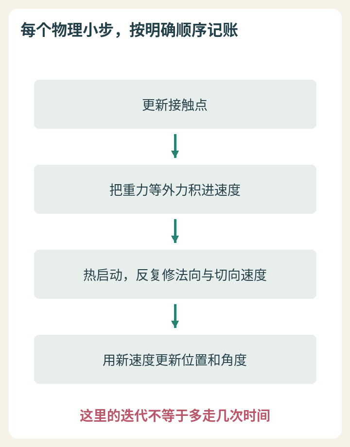

顺序冲量的10轮，是在同一个时间小步里协调约束，不是每修一个接触就把整个世界又往前走一次。

物理步长和迭代轮数也不是同一个旋钮。缩小步长，让我们更频繁地观察和更新世界；增加求解轮数，让同一步里的接触条件有更多机会互相协调。两者都可能增加计算量，但解决问题的方式不同。

本文运行的Box2D-Lite是教学规模的离散刚体代码，没有因此自动拥有高速运动的连续碰撞检测。前面说过的子弹穿墙问题，仍需要接触时间或其他专门处理。

## 28. 漂亮画面之外，还能查哪些数字？

物理演示很容易“看起来差不多”。所以我们还保留了数值账目。

开头那组偏心双盒运行没有重力、没有摩擦，并关闭位置修正。两个盒子各1千克，初始总水平动量为4，竖直总动量为0。

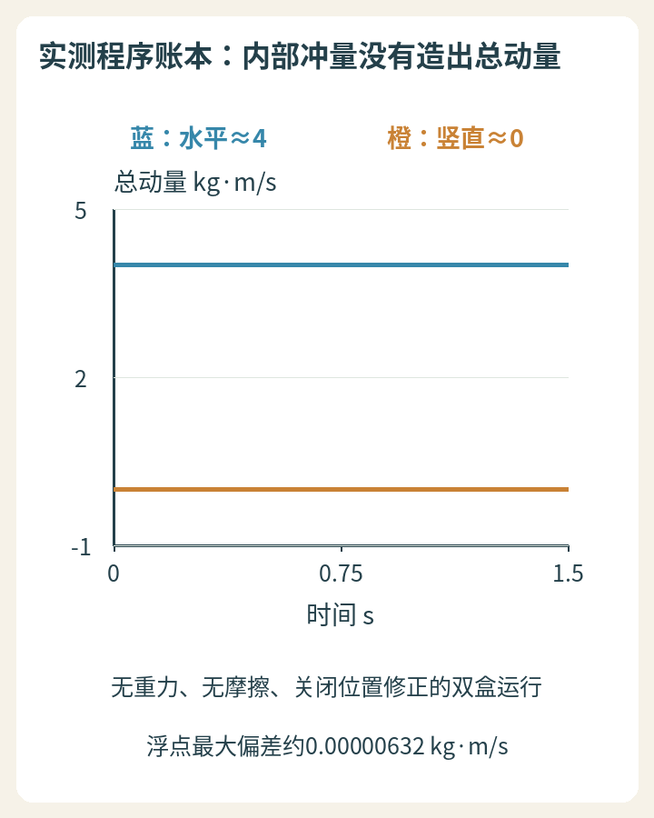

把每一帧的两件物体动量重新相加，最大线动量偏差约为 `0.00000632 kg·m/s`。这是浮点运算下的小误差，不是完全等于数学实数的证明。

我们还对独立的解析冲量程序做了4000组固定随机种子的代数检查，比较：

- 两边总线动量是否保持。
- 关于同一原点的总角动量是否保持。
- 接触点的法向相对速度是否达到恢复系数给出的目标。
- 单接触能量变化是否符合该模型的公式。

这些检查误差都低于设定的 `10⁻⁹` 容差。它们检验的是本例公式与实现的代数一致性，不是4000个真实几何场景的完整碰撞检测测试，也不是对生产引擎稳定性的保证。

随机检查不能替代可读的小例子。2千克撞1千克的结果、窄柱的2.4，以及累计冲量从1改成0.8，都应该能单独解释。

## 29. 这些方法是怎样进入游戏引擎视野的？

这里不把顺序冲量讲成某个人在某天凭空发明了全部刚体力学。动量、冲量和约束求解有更长的背景。

与本文实际程序直接相连的一条线索，是Erin Catto为GDC 2006准备的《Fast and Simple Physics using Sequential Impulses》讲义，以及官方Box2D-Lite仓库。仓库说明将Lite定位为2006年教程使用的轻量二维刚体引擎。

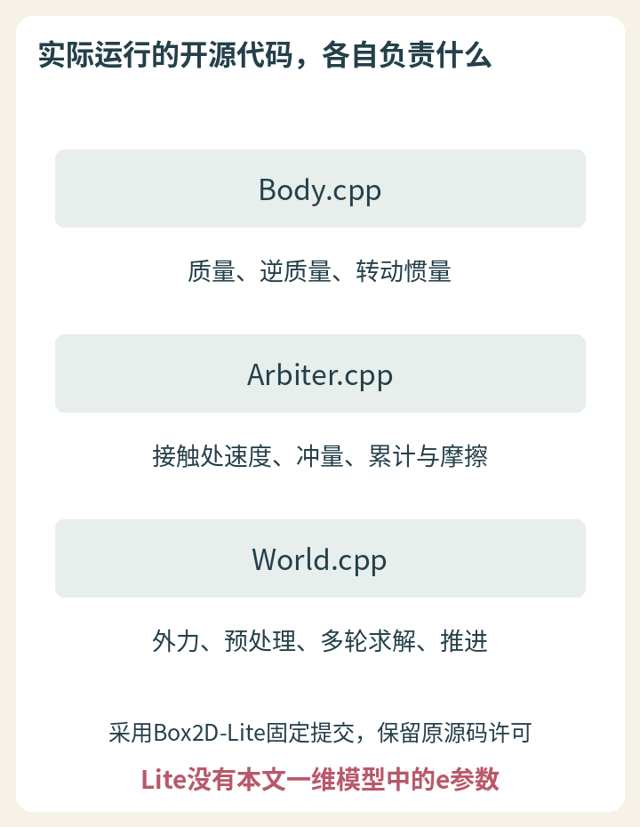

本文采用官方仓库的固定提交 `227b71b6974ea57ab7e96d40f6374287bd6a0e77`。这表示我们绑定了实际读取和运行的代码版本，**不表示这些文件的当前组织形式就是2006年会场上逐字不变的存档**。

你若愿意看代码，可以从三个文件开始：

- `Body.cpp`：质量、逆质量、矩形转动惯量。
- `Arbiter.cpp`：接触点速度、法向与切向冲量、累计限制、热启动和位置偏置。
- `World.cpp`：每个物理小步的调度顺序。

它们的角色，正好对应我们刚刚逐层搭起的概念。

也要保留版本边界。本文所用Lite源码没有恢复系数参数，正常法向接触主要追求不再接近，并可能加上位置偏置；前半篇的弹性碰撞来自独立解析模型。现代[Box2D 3.1模拟文档](https://box2d.org/documentation/md_simulation.html)则描述了恢复系数及低速碰撞等更多规则。不能因为项目名字相近，就把现代功能都算在这个教学版本头上。

## 30. 如果想亲手改，只改一个问题就够了

[示例目录](examples/README.md)提供两条可选路线。整篇静态图文已经包含主要结论，不运行代码也能继续理解。

**路线一：只跑小算术。** 用Python运行 `impulse_lab.py`，即可得到三种恢复系数、窄柱、分离接触与多轮小账本的结果。试着把A的质量由2改成4，先猜同样冲量会让它改变更多还是更少速度，再核算。

**路线二：重放真实引擎输出。** 示例保留了本次使用的官方源码、原许可、本文的驱动程序、8份CSV和渲染程序。你可以只用已有CSV重绘图片，也可以在有C++编译器的环境中重新运行引擎。

建议一次只改一件事，例如摩擦系数，或者求解轮数。保持同一初态、相同步长和相同观察时间，再看差别。若同时改质量、重力、轮数与摩擦，画面虽然变化很大，却很难知道是谁造成了变化。

如果结果与本文略有差别，先核对固定源码版本、编译方式、参数和浮点误差，再判断是否发现了算法问题。例子没有承诺跨所有编译器逐位相同。

## 31. 现在回看最开始那两个盒子

“撞上以后怎样走”不是一个单独的反弹开关，而是一条有明确职责的链：

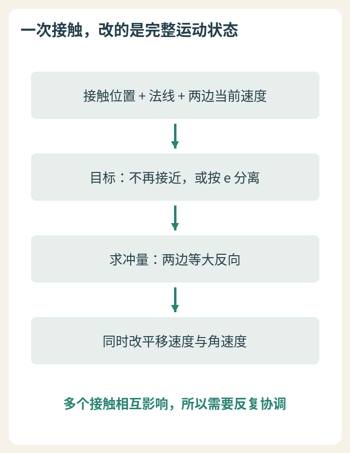

先知道接触发生在哪里、法线朝哪边，再计算两边**接触点**的相对速度。然后决定希望它们不再接近，还是按某个恢复系数分开，反求需要的冲量。

冲量成对、等大反向；它既能改变平移，也可能因为作用位置偏心而改变转动。多个接触共享物体状态，需要反复协调。摩擦限制切向运动，热启动提供较好的起点，位置偏置处理已有的小重叠。

所以，偏一点就会转起来，不是程序随机加了一个“旋转特效”。那个接触位置改变了冲量如何分配到平移和转动，而转动又改变了接触点的速度。

下一次在游戏里看见箱子落地、滑行、偏着撞上另一只箱子，你可以试着问三句话：

**接触点在哪里？它们正在怎样相对运动？这次修正怎样同时改变中心和转动？**

这三问，比先背下一长串公式，更接近引擎真正要完成的工作。

---

原创正文与原创解释图、结果渲染采用CC BY 4.0。Box2D-Lite源码遵循随附原许可；本文示例程序采用MIT。来源、素材身份、版本和复现边界见[来源与权利说明](sources.md)，运行方式见[示例说明](examples/README.md)。
