# 把词频统计分给一百台机器，最难的是哪一步？

假设你有很多很多篇短文，想知道每个词出现了多少次。

一台电脑能做：看见一次cat，就在cat的计数上加1。下面这份小语料，最后应该得到这样的答案。

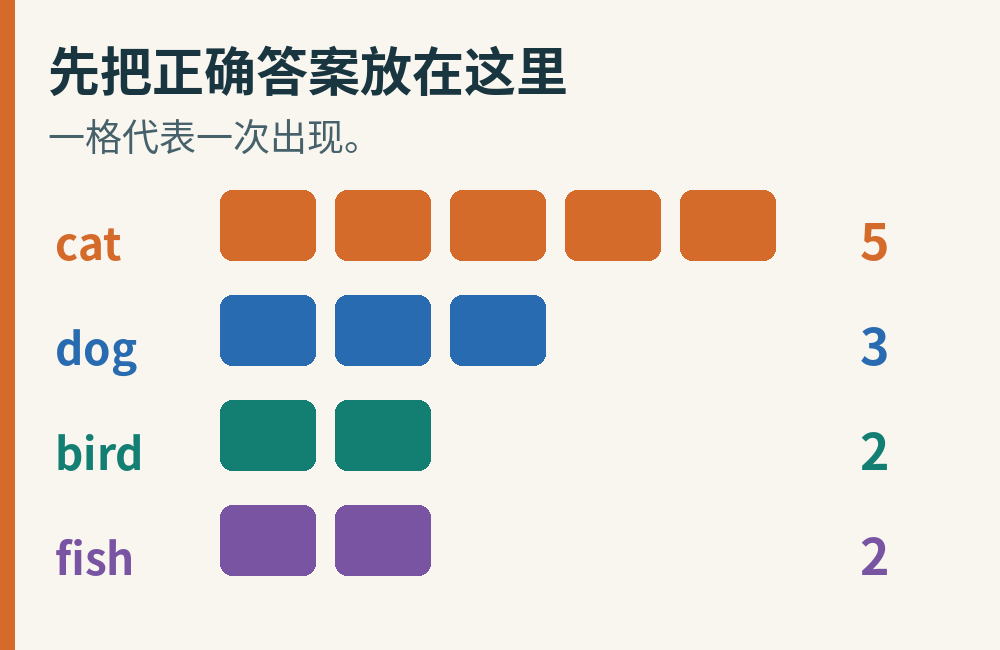

图1：先把正确答案摆出来。后面无论把工作分给多少个任务、让哪个任务重跑，答案都应该与这份基准一致。

可是，文章如果多到一台电脑处理不过来呢？

很自然的办法是请一百台电脑一起数。每台只拿一部分文章，工作量似乎马上缩成原来的百分之一。

麻烦恰好从“每台都数完了”开始：

- 第7台和第83台都遇到了cat，这两份贡献在哪里相遇？
- 第21台已经算完，却在别人取走结果之前掉线，怎么办？
- 同一份工作重做了一遍，cat会不会被多算？
- 九十九台早已结束，最后一台还没做完，整项工作算完成了吗？

**MapReduce的关键，不只是把工作拆开，而是让属于同一个答案的贡献，能够可靠地重新聚到一起。**

## 1. 一百台机器，首先真的是一百台机器

先看一件真实物品：计算机历史博物馆里的早期Google服务器机架。板卡一层层叠起来，很多线缆把它们连接起来。


图2：Google早期服务器机架，Photographing Travis摄于2012年8月12日，原图未修改。[照片来源与署名](https://commons.wikimedia.org/wiki/File:Google%27s_First_Server_Rack.jpg)，[CC BY 2.0](https://creativecommons.org/licenses/by/2.0/)。[博物馆的Google server assembly记录](https://www.computerhistory.org/revolution/the-web/20/391/2074)将该类馆藏设备标为1999年。这张照片帮助我们认识由普通PC组成的机架，不是2004年MapReduce论文实验集群的照片。

一组通过网络协作的电脑，叫**集群**。它们并不会因为接上网线，就突然共享同一张无限大、永不出错的桌子。

每台机器有自己的内存和存储设备。把数据从这一台交给另一台，需要发送、接收和等待。机器也可能失联；“暂时没回消息”和“真的坏掉了”，往往不能在第一时间区分。

Jeffrey Dean与Sanjay Ghemawat在2004年的OSDI论文中介绍了MapReduce的编程模型和Google当时的实现。他们把容易反复出现的工作组织方式抽出来，让程序员主要描述“每条记录怎么处理”以及“同类结果怎么合并”，由运行系统负责分配工作、搬运数据与处理失败。[原论文与作者信息](https://research.google/pubs/mapreduce-simplified-data-processing-on-large-clusters/)

接下来不需要真的租一百台机器。我们把语料缩到十二个词，先让每一份贡献都看得见。

## 2. 三份短文，十二个词，先把规则钉牢

全篇使用这三份输入：

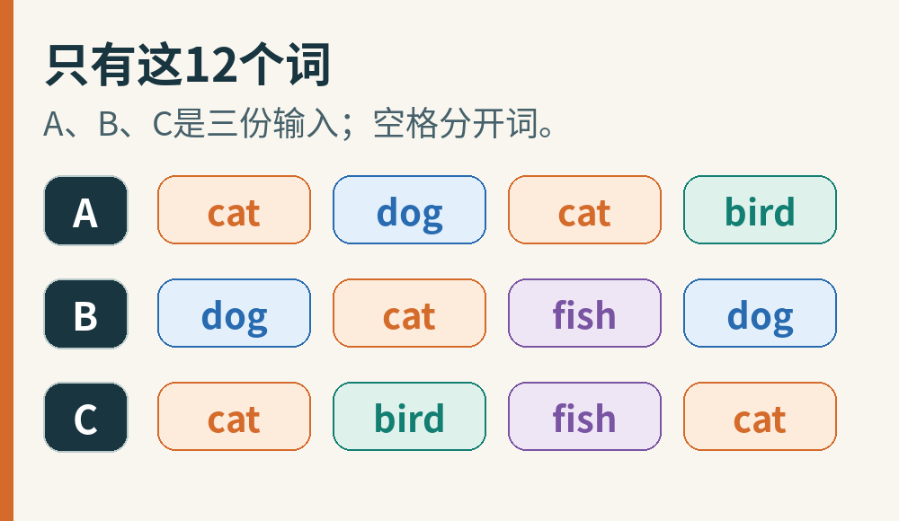

图3：A是cat dog cat bird；B是dog cat fish dog；C是cat bird fish cat。图中的A、B、C是输入身份，不是词的一部分。

我们的规则非常简单：

1. 空格把词分开。
2. 全部是小写字母，没有标点。
3. 每出现一次就计一次，重复也要保留。

于是A贡献cat两次、dog一次、bird一次；B贡献dog两次、cat一次、fish一次；C贡献cat两次、bird一次、fish一次。

cat合计2＋1＋2＝5，dog合计1＋2＝3，bird和fish各2次。所有计数相加是12，正好等于输入词数。

这个小检查很重要：**词频可以按不同方式分工，已经定义好的“什么算一个词”不能在不同机器上悄悄改变。**

真实文本还会遇到大小写、连字符、标点和中文分词。这些属于输入解释规则，不会因为用了MapReduce就自动获得唯一正确答案。我们暂时把它们拿开，专心看协作机制。

## 3. map：每看到一个词，就写一张贡献单

先把输入A交给一个处理程序。它读到cat，就写下这样一对东西：

（cat，1）。

前面的cat表示“这份贡献属于谁”，叫**键**；后面的1表示“贡献了多少”，叫**值**。合起来叫键值对。

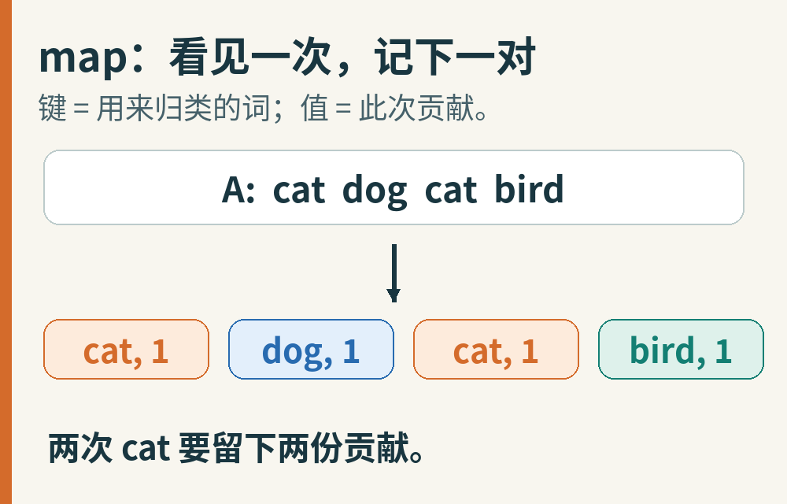

图4：map还不需要知道别的机器在干什么。它只根据手上的记录，产生若干份中间贡献。

这个步骤叫**map**，可以先把它理解成“把一条输入记录转换成若干条中间记录”。它不是地理地图，也不要求一条输入只能变成一条输出。

在我们的例子里，输入可以写成（文档名A，文本内容），输出却是（词，1）。输入的键是文档名，中间结果的键是词，两者用途不同。

对B、C做同样的事，得到完整的十二对：

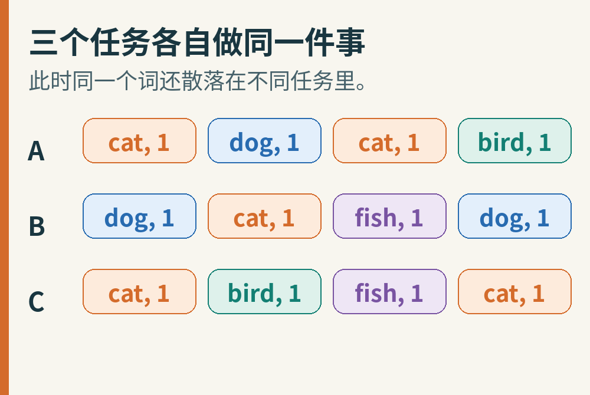

图5：cat已经有五份贡献，但它们还分别留在A、B、C的结果中。只把三个结果文件放在同一个目录，并没有完成词频统计。

这里为了看清楚，让每份短文对应一个map任务。**任务**是一包可以被安排执行的工作。真实系统通常把输入切成较大的片段，一项任务可以处理很多条记录；切片也必须配合读取规则，不能随意把一条记录的含义切坏。

## 4. 分区：先决定“这个词归谁管”

如果每个map都可以随意选一个接收者，A的cat去了第一处，B的cat去了第二处，最后还是凑不齐。

所以，我们先约定一张共同的路由表：

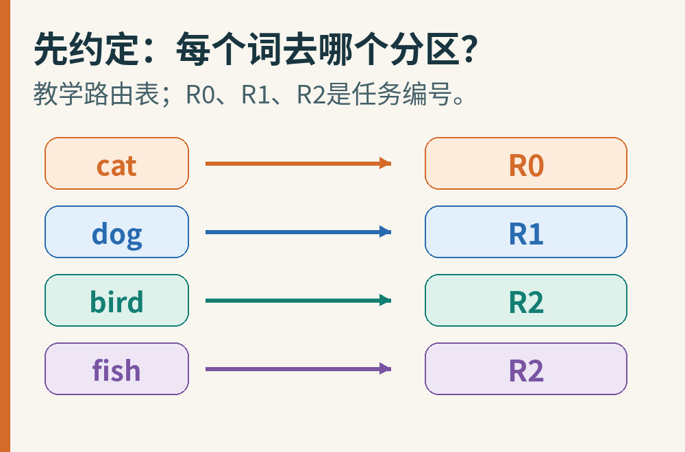

图6：R0、R1、R2是三个reduce任务的编号。这里使用显式表格，好让读者直接核对去向；它不是原论文规定的唯一分配方法。

把中间记录按目的地装进不同的工作包，叫**分区**。所有map都使用同一套规则：只要键相同，就一定分到同一个reduce分区。

但反过来不成立：同一分区里，完全可以有不同的键。图里的R2同时负责bird和fish。

实际实现常用“hash（键）对R取余数”。这里的**哈希函数**把键转换成一个数；R是reduce分区数；取余数就得到0到R－1之间的编号。重点不是神奇的公式，而是各处采用一致的规则，让同一个键不分家。

哈希也没有保证每个分区工作量完全相等。一个特别常见的词，仍可能把同一个分区塞得很满。我们稍后就让cat变成这种词。

## 5. shuffle：真正的搬家发生在这里

现在想象：处理A、B、C的工作程序，分别把自己的中间结果按R0、R1、R2整理好。

R0需要什么？它需要A结果里的所有cat、B结果里的所有cat，以及C结果里的所有cat。

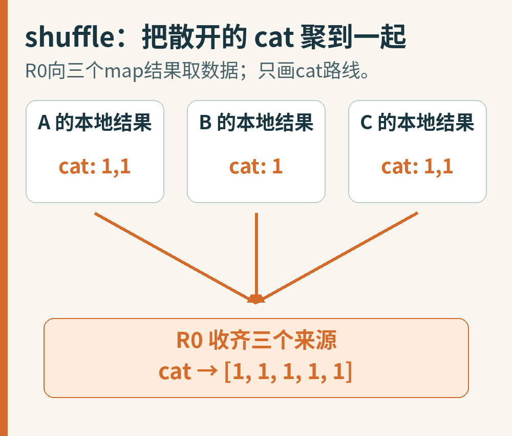

图7：这里单独追踪cat。A交出两个1，B交出一个1，C交出两个1；它们要跨越原先按输入划分的边界。

这次按键重新汇集数据，通常叫**shuffle**。英文词有“洗牌”的意思，但这里并不是把数据随机打乱：目的很明确，要让同键的贡献相遇。

在2004年论文的实现中，map的中间输出按分区写到本地磁盘。reduce工作程序获知文件位置后，从相应机器读取属于自己的部分，再按键整理。我们画成几条箭头，是为了表示去向；真实执行还包含缓冲、写盘、网络传输与排序。[原论文，第3.1节](https://storage.googleapis.com/gweb-research2023-media/pubtools/4449.pdf#page=4)

**“运到同一处”和“分成同一组”，仍是两个动作。**

看看R2。它从A、B、C收到了bird、fish、bird、fish。接着还要把它们整理成两组：

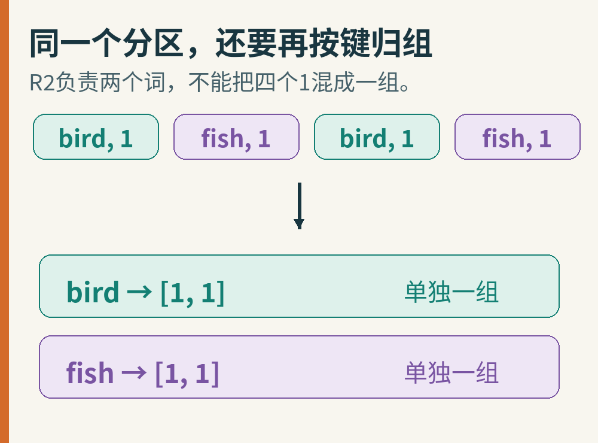

图8：不能把R2收到的四个1直接加成一个4。分区决定“谁处理”，归组决定“哪些记录属于同一个答案”。

按键排序，是让相同键挨在一起的一种常见做法。数据放不进内存时，可以借助磁盘分批排序、合并，而不是要求把整个分区硬塞进内存。

为便于讲解，我们把搬运和归组画成先后步骤。真实实现可以边取数据边合并；例如Apache Hadoop文档明确说明shuffle与排序合并可以重叠。[Hadoop MapReduce教程，Shuffle与Sort](https://hadoop.apache.org/docs/stable/hadoop-mapreduce-client/hadoop-mapreduce-client-core/MapReduceTutorial.html#Reducer)

## 6. reduce：现在，那个简单的加法才有足够材料

终于，处理cat的函数拿到了：

cat，以及属于它的所有值：[1，1，1，1，1]。

它只需要把这些值相加。

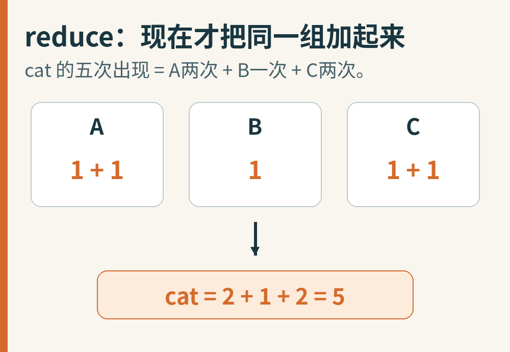

图9：reduce的输入不是“随便一批数”，而是同一个键对应的那一组值。

这个合并步骤叫**reduce**。词频的reduce是求和，但“reduce”不等于只能加法，也不保证所有任务最后都压缩成一个数字。具体要产生什么结果，取决于你写的合并规则。

我们的三项reduce任务最终留下三份结果文件：

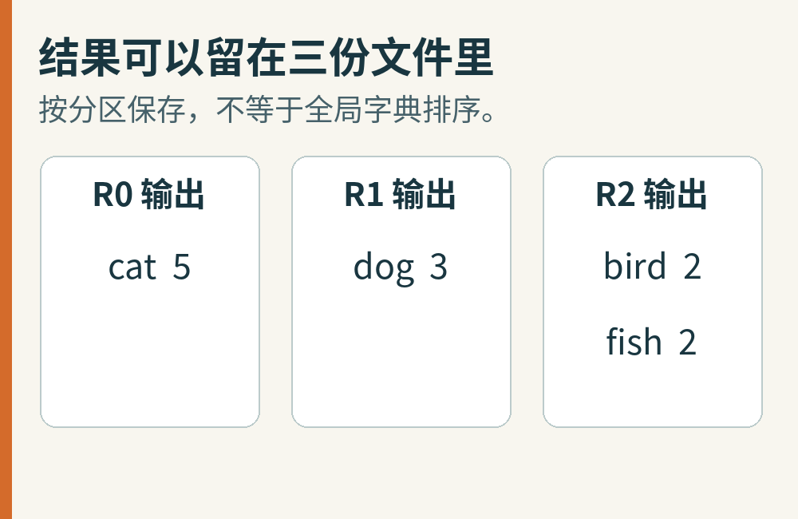

图10：合计仍是12次出现。R2输出两行，因为它负责两个不同的键。

结果不一定需要再合成一个大文件。下一项工作可以继续读取这几份文件。也别把它们按R0、R1、R2拼接以后，就宣称获得了全局字典顺序：cat、dog、bird、fish显然不是全局排序。

走到这里，最小模型已经完整了：

**按输入拆开 → 每条记录产生贡献 → 按键决定去向 → 收齐同键贡献 → 合并。**

## 7. 谁负责派活？所有词都要经过它吗？

为了知道哪些任务没开始、哪些正在运行、哪些已经结束，系统需要安排工作和记录进度。

2004年论文的实现有一个调度协调者，称为master；执行任务的工作程序称为worker。调度者还帮助reduce端知道中间数据在哪里。

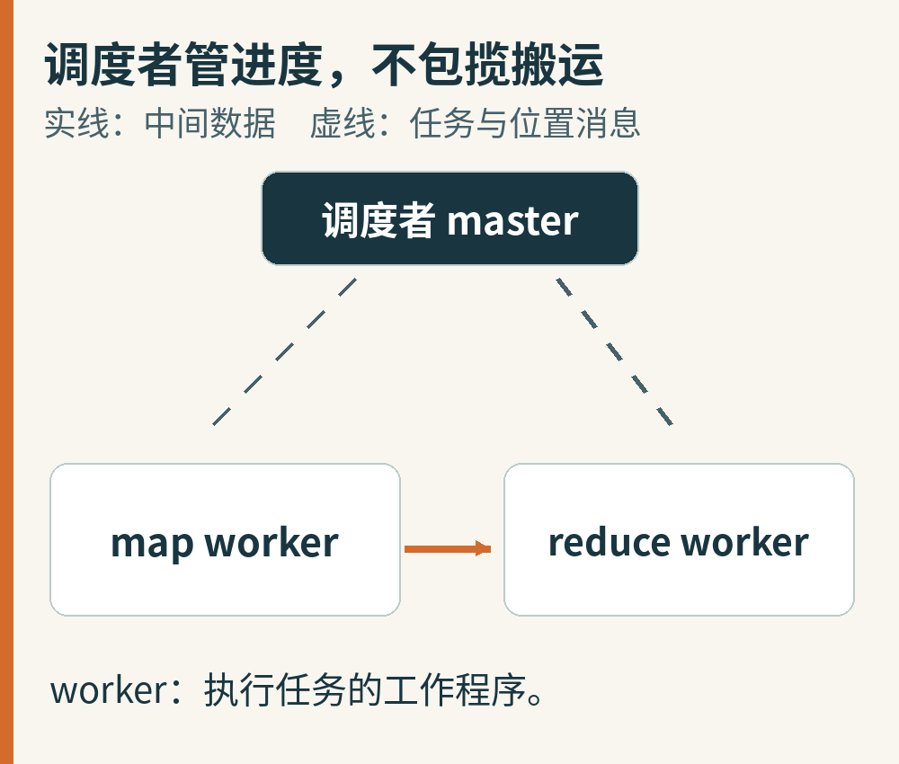

图11：控制消息和数据搬运是两条不同的线。图中的调度者不需要先收齐全部十二个词，再替大家做加法。

一台机器也不必终身绑定一个任务。更常见的想法是准备很多工作包，让有空的worker继续领取。这样，比较快的机器可以多做几包，机器失败后也能把未完成工作分给别处。

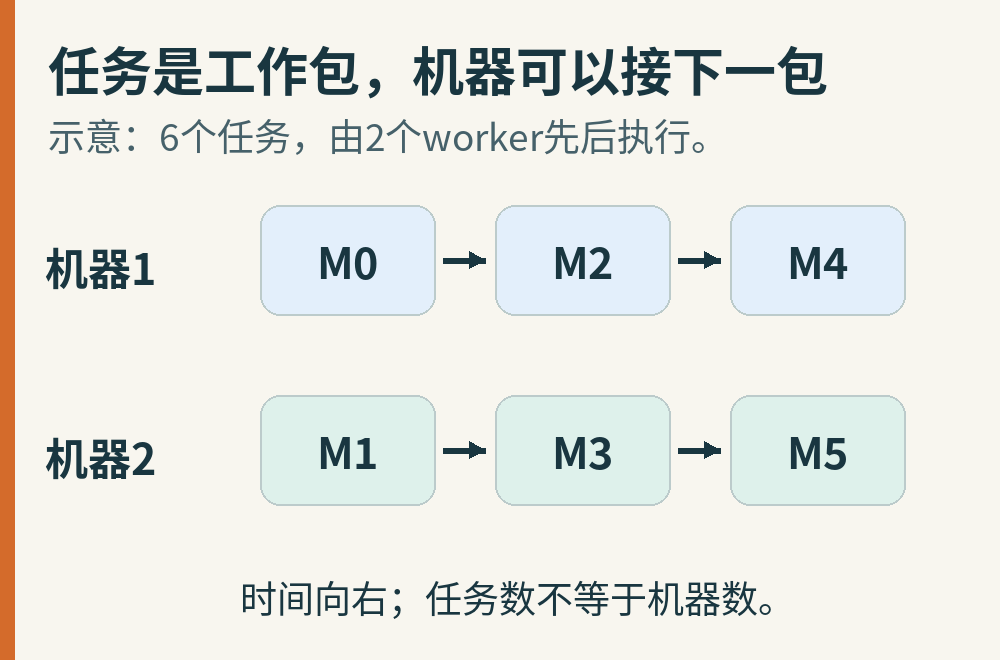

图12：六个任务由两个worker先后处理。这是任务与机器关系的示意，不是我们的三文档程序真的启动了六个任务。

还有一个直观的省钱办法：**尽量让计算靠近输入数据。**


图13：把map安排到有输入副本的机器上，可以少搬原始数据；这不意味着后续按键汇集也完全不用网络。

但任务也不是切得越碎越好。启动、分配和追踪工作都要成本。只有十二个词时，一台电脑直接数通常更合适；一百台机器并不会把沟通成本变成零。

## 8. 已经算完的任务，为什么还要重做？

假设处理A的机器做完了map，把四对结果写在自己的磁盘上。它报告“完成”，然后突然失联。

R0想取走那两个cat，发现连不上。

“完成”只说明计算做完了，不说明结果已经存在于任何地方都能取到的安全仓库。

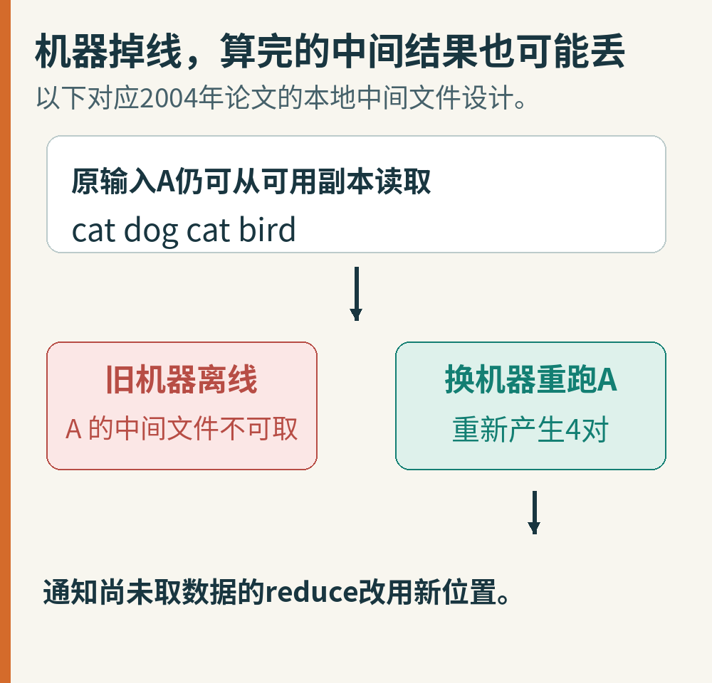

图14：这是原论文对应的故障情形。输入仍可读，才有重新生成中间结果的基础；重试不会凭空救回所有副本都已丢失的输入。

在这个设计中，中间map结果保存在执行机器的本地磁盘。机器失败后，已完成的map也可能重新变成待执行任务，由别的机器重做；尚未取到旧结果的reduce改去新位置读取。

相对地，已完成的reduce结果写在全局文件系统中，原论文不因为该worker随后失败就重跑它。这是**那份实现的存储设计带来的区别**，不能推广成“所有系统里map都不可靠、reduce都永远可靠”。[原论文，第3.3节](https://storage.googleapis.com/gweb-research2023-media/pubtools/4449.pdf#page=4)

故障还有边界。原论文说明，当时的实现遇到master失败会中止整项计算，客户端可以选择重试；它没有声称一切故障都能在原地自动恢复。

## 9. 重做可以，为什么不会多算？

先做一个会出错的实验。

A的正确贡献是cat2、dog1、bird1。如果A的第一次和第二次执行结果都加入总账，就会多出这四次出现：

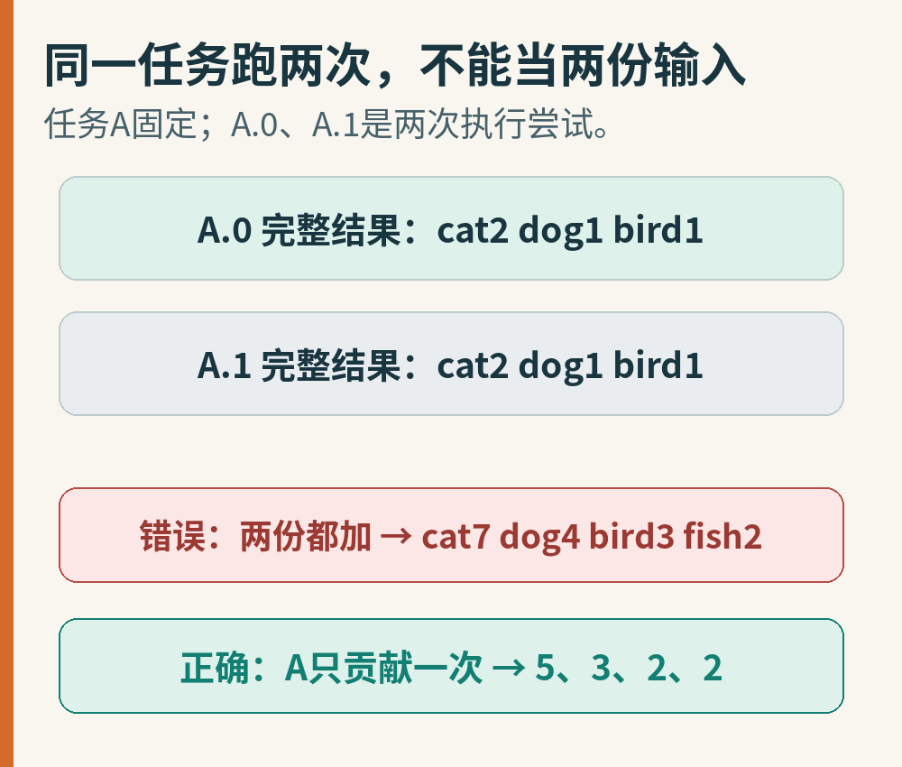

图15：错误答案的总和变成16。重复的是执行，不是原始输入中真的又多了四个词。

因此，要区分两种身份：

- **任务身份**：这包工作负责输入A。
- **执行尝试身份**：这是A的第一次尝试A.0，还是第二次尝试A.1。

系统可以执行多次，却不能把每次尝试都当成一份新的合法输入。

原论文让执行尝试先写自己的临时文件，再通过受控的方式提交输出。对于一个已记录完成的map任务，重复到来的完成消息会被忽略；若旧结果因机器失败而失效，则可以重新安排并登记替代结果。

reduce输出则依赖文件系统的**原子重命名**：把完整临时文件交到最终位置，不把半写完的文件当最终结果暴露出去。多个尝试竞争同一最终文件时，最终保留的是其中一次执行的完整内容。[原论文，第3.3节的失败语义](https://storage.googleapis.com/gweb-research2023-media/pubtools/4449.pdf#page=5)

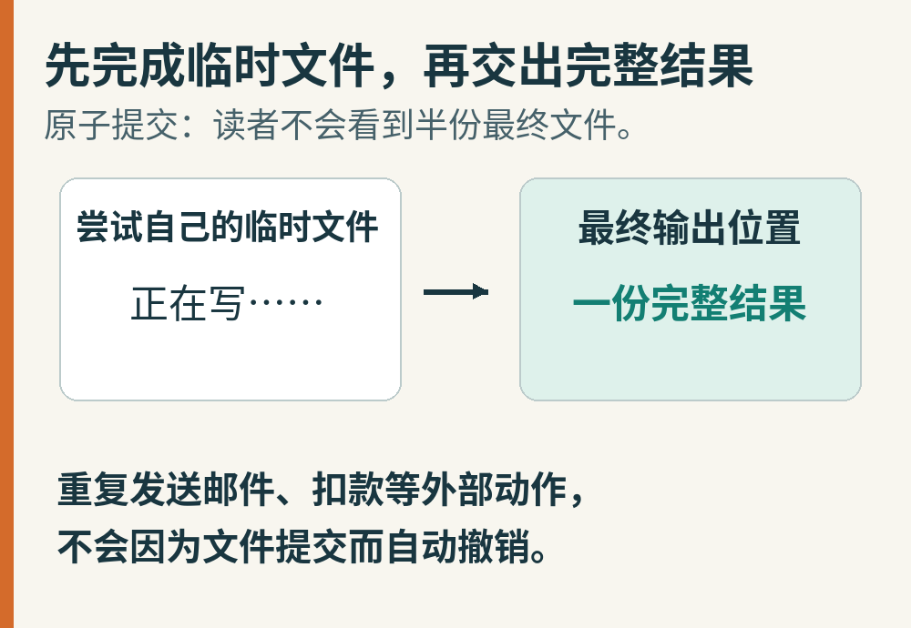

图16：原子在这里表示这个提交动作不会以“半份最终文件”的方式被观察到，不表示所有文件、所有外部服务会一起完成一个大事务。

这还依赖我们写的是**确定性计算**：相同输入，产生相同的逻辑结果。我们的计数没有随机数，没有读取不断变化的外部状态，因此重做A仍是那四份贡献。原论文给出的等价于无故障顺序执行的保证，带着这个前提。

如果map每读一个词就向外发送一封邮件，重跑A就可能再发一遍。输出文件只采用一份，并不能撤回已送出的邮件。

所以，别把“结果不重复计入”说成“程序在物理上恰好执行一次”。这里学到的是计算与输出管理的契约，不是任意外部副作用的免错通行证。

## 10. 机器没坏，只是特别慢呢？

有时所有任务都在继续运行，但最后一项迟迟结束不了。

比如别的任务已经完成，A的某次尝试却预计到第8秒才结束。如果第3秒找一台空闲机器启动备用尝试，而它只需2秒，就能在第5秒先给出完整结果。

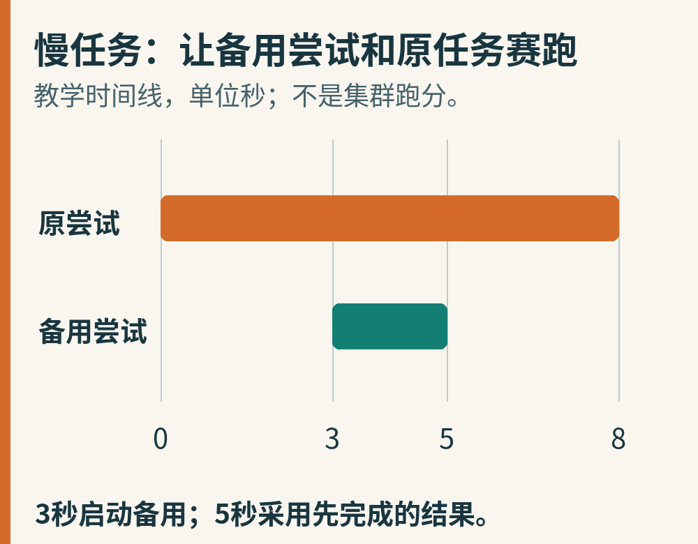

图17：所有数字都是便于手算的教学设定，不是Google或Hadoop性能测试。

原论文称这类拖住尾巴的慢任务为straggler，并在作业接近结束时使用备用执行。它不需要等待机器彻底被判定坏掉，便可以让两个尝试“赛跑”，用先完成者结束这项任务。

当然，备用尝试要消耗额外计算、存储和网络资源。它也不是万能药：如果每个尝试拿到的工作本来就特别多，再换一台同样快的机器，并不会神奇地少做那些工作。

这就轮到另一个问题了。

## 11. 热点：慢的可能不是机器，而是同一个词太多

现在只改原语料一处：在A的末尾追加100个cat。B、C保持不变。

原来三个reduce分区各收到5、3、4对。修改后，R0收到105对，R1仍是3对，R2仍是4对。

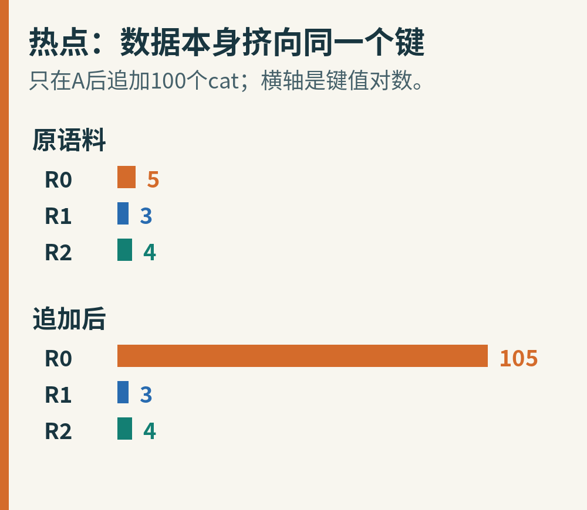

图18：这里比较的是未做局部小计时的记录条数，不是执行时间；一条记录的处理成本也未必处处相同。

这种特别繁忙的键叫**热点键**。数据负载分得很不均匀，叫**数据倾斜**。

对于这一次按键归组，所有cat都必须交给同一项reduce任务。即使又加了九十台空闲机器，只要不改变工作组织方式，它们也不能随便各取一部分cat后，就把多个不完整答案当作一个总数。

因此要分清：

- 某台机器受干扰、磁盘异常等导致慢，换一个执行位置可能有效。
- 某个键本来就承载了大量工作，复制同一任务仍要面对那份数据。

不过，词频恰好允许一个非常有用的优化。

## 12. combiner：别把每张“加一”小纸条都运出去

A里有两个cat。与其发送两对（cat，1），为什么不先在本地合并成一对（cat，2）？

B里的两个dog也可以这样做，C里的两个cat同样可以。

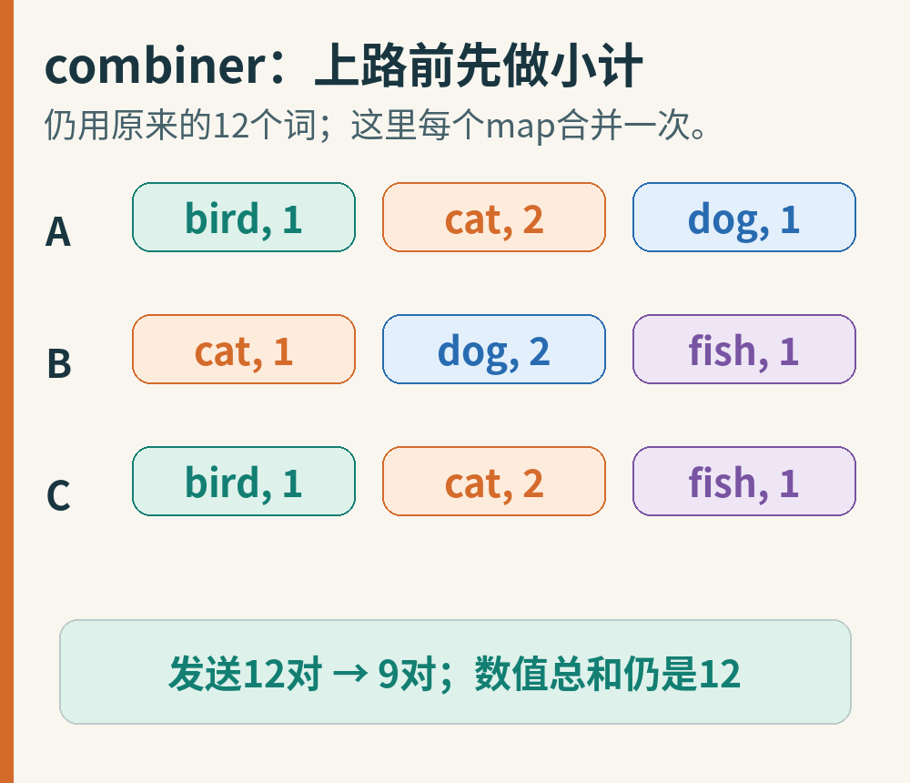

图19：原语料的12对变成9对。变化的是需要携带的记录条数；记录中数值的总和仍是12。

这类发送前的局部合并叫**combiner**。最终处理cat时，reduce拿到的是[2，1，2]，相加仍为5。

为什么允许这样做？因为整数加法的结果不受分组和相加顺序影响：

1＋1＋1＋1＋1 =（1＋1）＋1＋（1＋1）。

回到刚才追加100个cat的版本。A可以把102个cat先合成（cat，102）；B交（cat，1）；C交（cat，2）。R0只需收到三份局部计数，再算102＋1＋2＝105。

**在这个词频例子中，局部合并确实显著缓解了热点。**它不是每种问题都能使用的万能消除器。如果某个词要保留所有不同的出现位置，或每条记录都必须单独参与后续运算，就未必能压成一个整数。

本地合并还是优化，程序的正确性不应依赖它一定按某个固定次数、固定分组方式执行。应该能做到：不先合并也对，合并一部分也对，多级合并仍然对。本文程序为便于核对，固定在每个map输出上做一次。

### 一个可以跳读的小反例：平均值不能直接再平均

想象两批数据：A只有一个数4；B有五个1。两批各自平均是4和1，再平均得到2.5。

可全部六个数的平均明明是9÷6＝1.5。

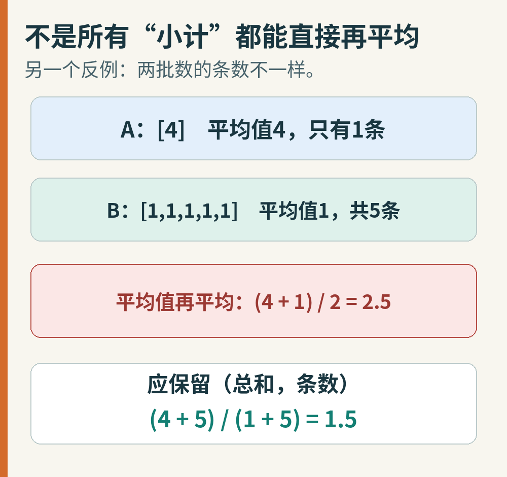

图20：坏掉的不是分布式计算，而是局部摘要丢了“这一批有几条”的信息。

正确做法可以保留（总和，条数），把两个量分别相加，到最后再除。这告诉我们：不是把任意reduce函数贴上combiner标签就安全，要检查合并之后保留的信息和数学规则。

## 13. 不租服务器，也能把这十二个词逐步复算

主线到这里已经完整。想看代码怎样对应每一步，可以读下面这两小段Python；不运行也不影响理解。

```python
def map_record(document, text):
    return [(word, 1) for word in text.split()]


def reduce_group(word, values):
    return word, sum(values)
```

第一段把每个词配上1；第二段把同一个词的值相加。名字叫map和reduce的两段代码很短，**中间“把同键的全部值交给第二段”那份责任，并没有因此消失。**

配套的[完整教学程序](examples/wordcount.py)使用Python标准库，读取[三份输入](examples/corpus.json)，明确列出分区和归组，并对照直接计数。它还演示重复合并会出错、如何选择一个完整执行尝试，以及局部合并前后的热点条数。

程序在一台电脑的一个进程里模拟这些规则。它没有真的启动集群，没有网络传输，没有实现生产级的故障检测或分布式提交协议。

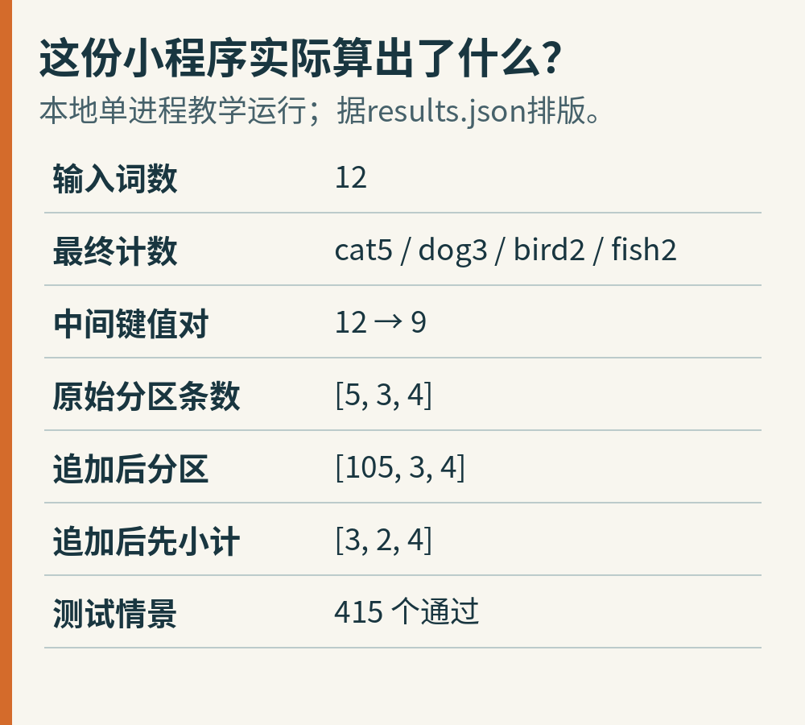

图21：实际运行结果的重新排版，数据来自[results.json](examples/results.json)，逐行输出见[output.txt](examples/output.txt)。这是结果图，不是终端截图，也不是分布式实测。

下载文章附属目录后，在examples目录运行：

```sh
python3 wordcount.py
```

这会重新生成results.json和output.txt。本文校验了415个情景，包括三份输入的不同处理顺序、开启或关闭局部合并、固定随机种子生成的200份小语料、两种重复尝试先后顺序和空输入。数字计算只需标准库；重新绘制教学图片才需要额外的Pillow和中文字体，说明见[复现指南](README.md)。

你也可以完全不用电脑，只拿图3的十二个词检查三件事：

1. cat的五份贡献，最终是不是都到了同一个键组？
2. bird和fish虽去了同一分区，有没有被错误合并？
3. A重做以后，它的贡献是不是仍只计入一次？

这三项比“程序最后打印了一个数字”更接近真正的正确性检查。

## 14. 回到开头：最难的究竟是哪一步？

对这份词频小例，最简单的是map里写下1，以及reduce里把数相加。

真正需要系统设计的，是中间和周围那些事情：

- 让同一个键的记录无论来自哪台机器，都能走向一致的目的地。
- 在网络、内存和磁盘之间搬运、整理数据。
- 机器失败后能重做工作，又不把重复执行变成重复贡献。
- 在最后一个慢任务和特别繁忙的键面前，判断该换机器，还是该改变数据的组织方式。

不同作业的瓶颈不同，不能断言shuffle永远最耗时。但它揭示了分布式计算最容易被“大家各做一点”遮住的那半句话：

**拆开以后，谁来保证大家说的是同一件事，交回来的又恰好是需要的那些贡献？**

MapReduce给出的一个办法，是把接口收紧：每个任务按约定产生键值对，系统围绕键来分工，再围绕任务身份来管理重执行。

学会看见这些边界以后，你得到的不只是一个词频程序，而是一种检查大规模协作的方法：先问工作怎么拆，再问结果怎么相遇，最后问失败发生时，哪一份结果仍然算数。

## 来源与使用说明

主要历史来源：Jeffrey Dean、Sanjay Ghemawat，2004年OSDI论文[MapReduce: Simplified Data Processing on Large Clusters](https://research.google/pubs/mapreduce-simplified-data-processing-on-large-clusters/)。本文区分该论文的实现、一般教学模型与后来的Hadoop说明，未将原论文性能曲线替换为自己的模拟结果。

原论文执行总览与性能图可在[官方PDF](https://storage.googleapis.com/gweb-research2023-media/pubtools/4449.pdf)查看；本文不重分发其图版。更详细的逐项事实范围、逐图权利和AI辅助说明见[sources.md](sources.md)。

正文、原创教学图及封面由zyuanming发布，采用[CC BY 4.0](https://creativecommons.org/licenses/by/4.0/)；原创配套代码另采用MIT许可。机架照片是独立第三方作品，按图2标示的CC BY 2.0使用，不因收在本文中改为CC BY 4.0。
