# 给一团数据拍“影子”，朝哪个方向最少丢东西？

四个点，要塞进一张只有一列的表。

原来，每个点用两个数记录位置：一个管左右，一个管上下。现在只能留一个数。最省事的办法是划掉一列，可下面这四个点斜着排，直接划掉横坐标或纵坐标，似乎都有点可惜。

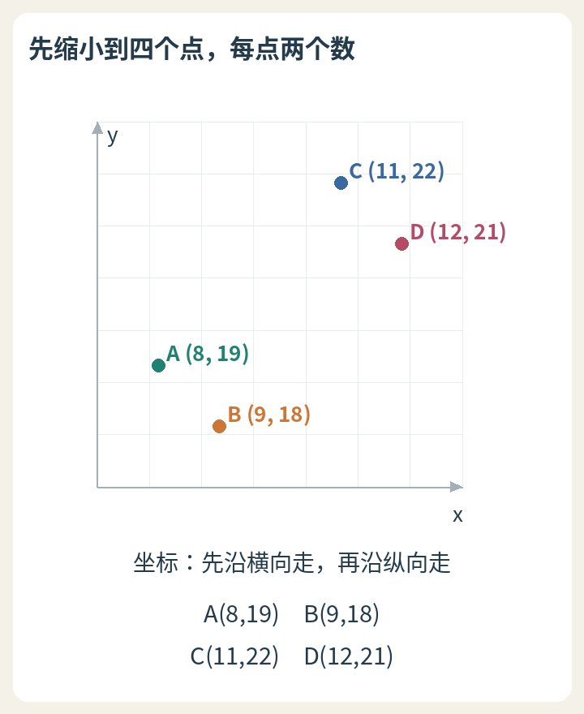

有没有一种记法，顺着它们斜长的方向记位置，把丢掉的部分留在窄边上？

PCA，主成分分析，做的就是这样的选择。我们会替这四个点找到一条很合算的方向：按稍后定义的平方距离计算，损失能从10降到2。但选对方向之后，仍然有东西再也找不回来。

## 把尺子的零点搬到点群中间

先把数字认清。横坐标x向右增加，纵坐标y向上增加；A=(8,19)表示横向位置是8，纵向位置是19。这里横纵用同样长的单位。四组数是特意选来方便手算的。

如果只存A的横坐标8，恢复时应该把它放在哪个高度？8本身没有提供答案。我们得另约一个公共高度，比如整团点的平均高度。

四个横坐标的平均是 `(8+9+11+12)/4=10`；纵坐标的平均是 `(19+18+22+21)/4=20`。所以点群中心在(10,20)。

把每个点都减去这个中心：

| 点 | 原坐标 | 减去(10,20)之后 |
|---|---|---|
| A | (8,19) | (−2,−1) |
| B | (9,18) | (−1,−2) |
| C | (11,22) | (1,2) |
| D | (12,21) | (2,1) |

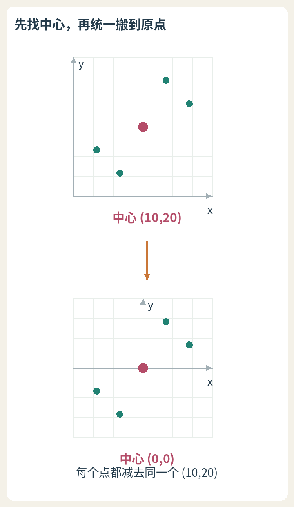

这一步叫**中心化**。以后说“偏了多少”，都是相对这团点自己的中心说的。把整个图搬到地图的另一端，点群形状不变，找出的方向也不该跟着地图原点跑。

下面沿用A、B、C、D的名字，但用表格最后一列的坐标。中心(10,20)也要存下来，最后恢复原位置时还需要它。

现在再试一次“删掉y”：保留x，把四个点都放回y=0的横轴上。

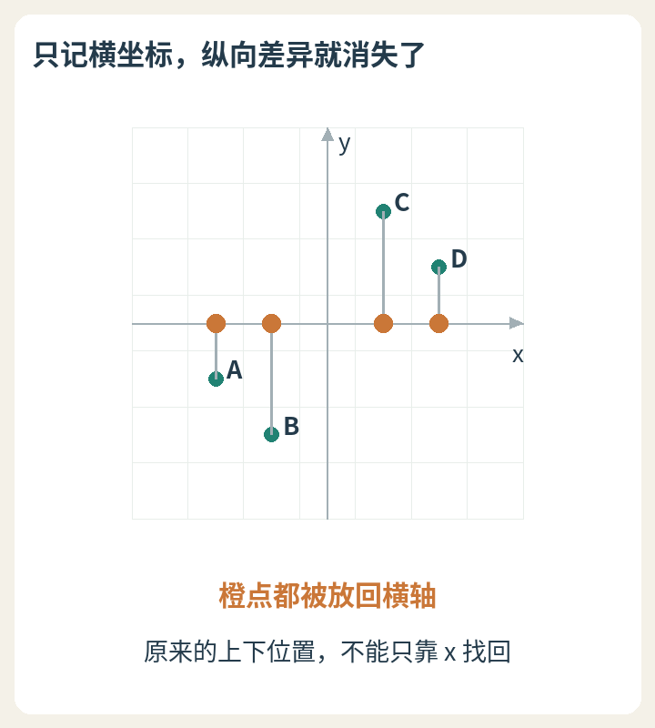

A丢了1格纵向距离，B丢了2格，C丢了2格，D丢了1格。把距离平方再相加，损失是 `1+4+4+1=10`。

之所以先平方，是为了让正负方向不会相互抵消；也意味着较远的偏离会受到更重的惩罚。我们从这里开始约定：**用重建位置与原位置之间的平方距离，给一种记法算损失。**

## 斜放直尺，先看D落在哪里

把尺子穿过中心，转到45°。每个点向尺子作垂线，把碰到尺子的位置留下来。

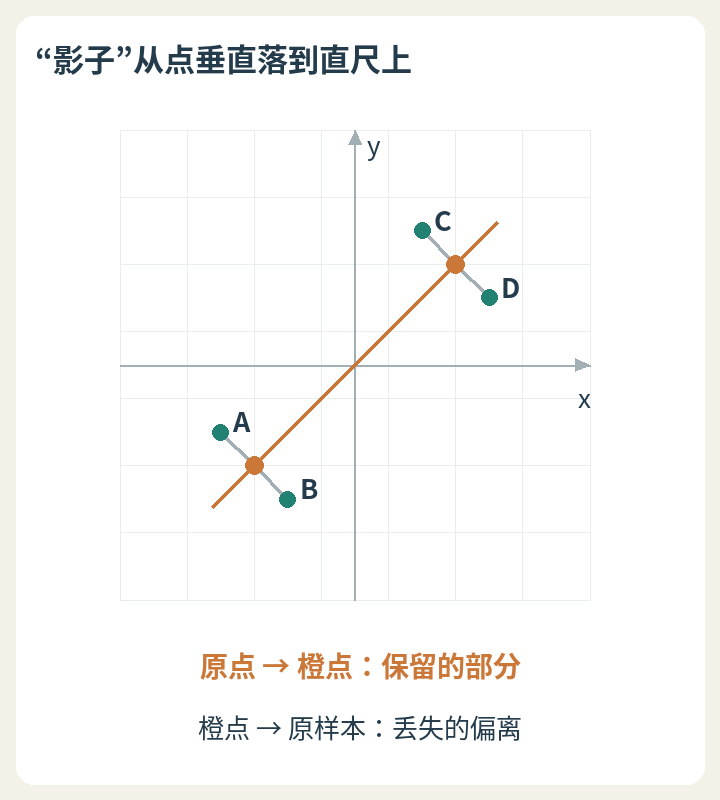

数学上，这叫**正交投影**。正交就是成直角，碰到尺子的点叫垂足。这里的“影子”按这个规则生成。

先只盯住D=(2,1)。它的垂足在(1.5,1.5)。恢复时把D放回那里，就会横向少0.5格、纵向多0.5格。

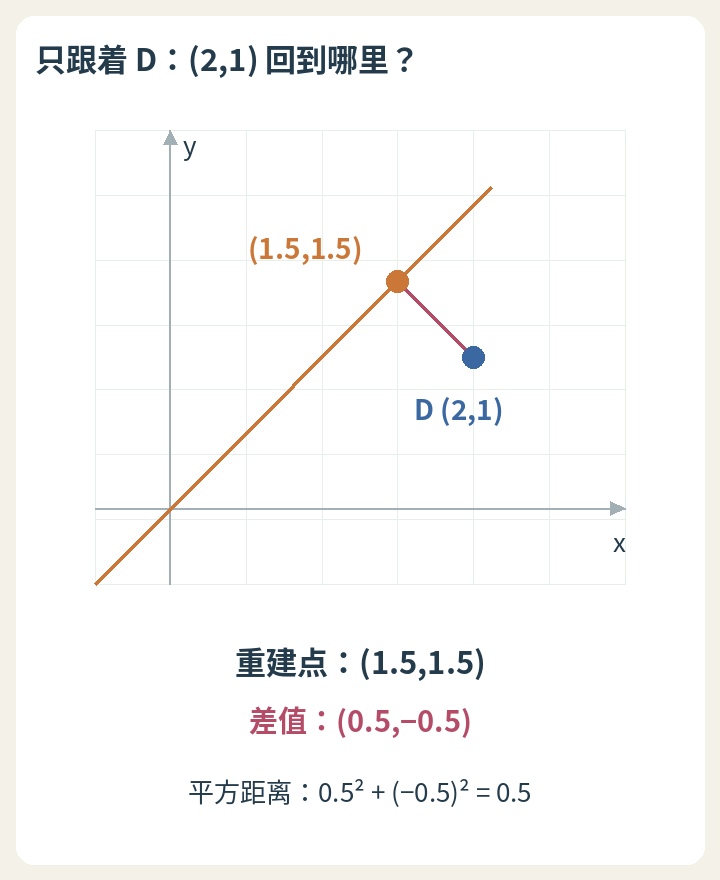

损失是 `0.5²+(−0.5)²=0.5`。刚才放回横轴时，D的损失是1。至少对这个点，斜尺已经好了一点。

不过，“垂足在(1.5,1.5)”还只是给了答案。要让程序算出来，得给这把斜尺规定刻度。

### 走一格，横纵分别走多少？

沿45°走，横纵增加得一样多。如果横走1、纵走1，实际走过的斜线长度是√2，约1.414，已经超过一格。

所以，沿斜尺走一格，横纵都只走 `1/√2`。根据勾股关系，两份平方相加正好是1。

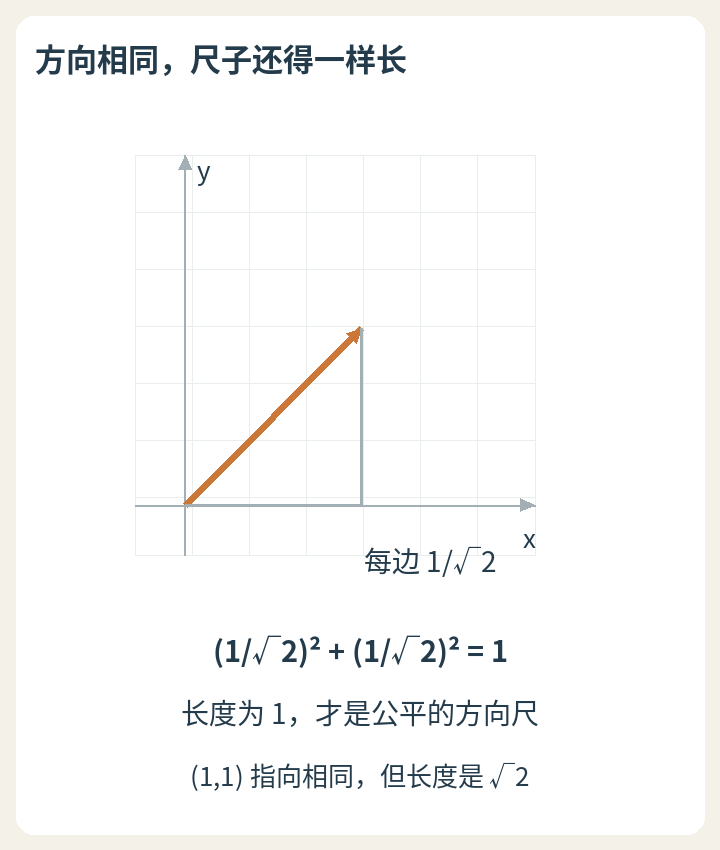

把这张方向说明写成 `u=(1/√2,1/√2)`。u叫**单位方向向量**：“向量”在这里就是横纵变化这一对数，“单位”说明它的长度为1。

这样定长度，是为了公平。否则把方向箭头放大十倍，读数也能跟着放大十倍，方向比较就没了意义。

对于一个点(x,y)，在单位方向u=(a,b)上的读数，用下面的规则计算：

`t=x×a+y×b`。

这项运算叫点积。它把横向、纵向对沿尺位置的贡献加起来；结果为正，点的影子在箭头一侧，为负则在另一侧。

D的读数是 `2/√2+1/√2=3/√2`。有了读数，再沿u走这么多步，就回到：

`(3/√2)×(1/√2,1/√2)=(1.5,1.5)`。

垂足的位置现在是算出来的了。再加回中心(10,20)，重建的D是(11.5,21.5)。

## 对四个点都好，才算选好了方向

同一把尺不能只照顾D。把另外三个点也算完，得到这张小账：

| 点 | 沿45°尺的读数 | 重建后的中心化坐标 | 平方距离损失 |
|---|---|---|---:|
| A | −3/√2 | (−1.5,−1.5) | 0.5 |
| B | −3/√2 | (−1.5,−1.5) | 0.5 |
| C | 3/√2 | (1.5,1.5) | 0.5 |
| D | 3/√2 | (1.5,1.5) | 0.5 |

四份损失合起来只有2，确实比横尺的10小。

表里还有一件事：A与B的记录完全一样，C与D也一样。读数压成一个数之后，每对原本不同的点已经无法区分。先记住这个结果，等会儿它会让一个看起来很漂亮的百分比露出另一面。

如果继续转动尺子，会不会出现更好的方向？

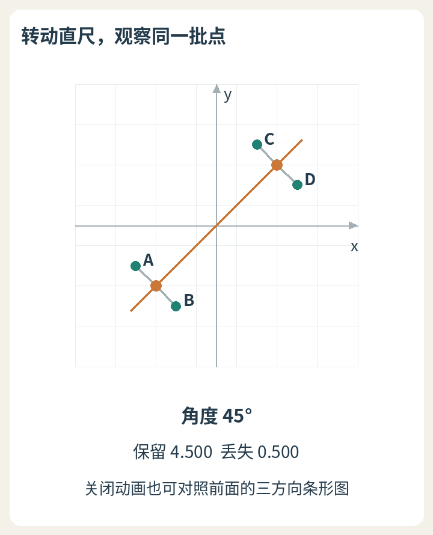

动画首帧为45°。下面用静态图里的数，把它为什么好说清楚。

## 直角三角形里的一笔账

D离中心的平方距离是 `2²+1²=5`。投影把从中心到D的位移分成两段：沿尺走的一段，以及从垂足到D的一段。它们互相垂直。

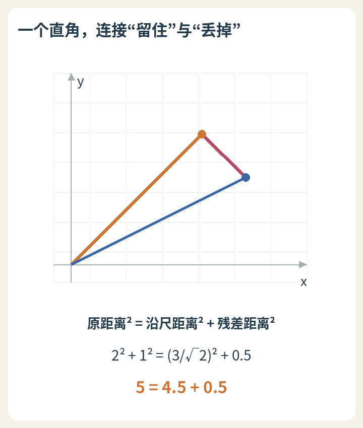

沿尺距离的平方是 `(3/√2)²=4.5`，剩下的平方距离是0.5。于是：

`5=4.5+0.5`。

转动尺子时，D离中心仍然那么远，左边的5固定不动。沿尺部分多拿一点，垂直残差就少一点。

每个点都有这笔账。把所有点的账加起来，就得到一条很有用的关系：**让投影留下的平方变化尽量大，和让重建损失尽量小，是同一件事。**

这里需要三个约定一直保持：同一批中心化数据，同一套坐标尺度，以及刚才的正交投影规则。

通常我们把平方读数相加后再除以点数，得到**方差**。这时读数平均值为0，方差就是它们离平均值的平均平方偏差。45°方向的方差是4.5，水平尺是2.5，朝另一侧倾斜的−45°尺只有0.5。

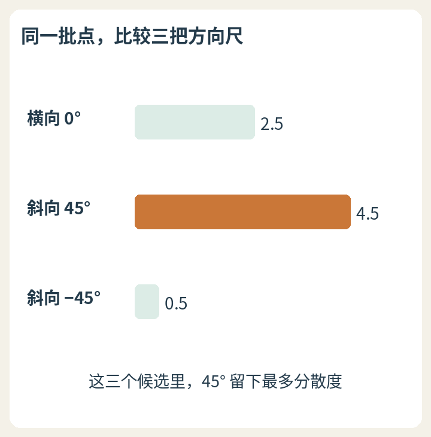

PCA要找的第一主方向，就是这个方差最大的方向。方差有单位：坐标用厘米，方差就用平方厘米。

### 为什么不是试中了一个不错的角度？

只比三个方向还不够。对这组四点，可以用很短的一段算式检查所有方向。

任取一支长度为1的方向(a,b)，因此 `a²+b²=1`。四个点的投影读数分别是：

`−2a−b、−a−2b、a+2b、2a+b`。

把它们平方后平均，正负成对，算式变成：

`[(2a+b)²+(a+2b)²]/2`。

展开两个平方，合并同类项，得到 `2.5a²+4ab+2.5b²`，再用单位长度的约定，化成 `2.5+4ab`。

而 `(a−b)²`不会小于0，所以 `a²+b²−2ab≥0`，也就是 `ab≤1/2`。方差最多只能到 `2.5+4×1/2=4.5`。

45°的a、b都等于1/√2，恰好碰到这个上限。它在全部方向中确实最好；把箭头反过来，是同一条轴，也一样好。

## 留下90%，却混掉了红蓝

四个点离中心的平方距离都是5，总计20。45°投影留下18，损失2，所以留下的比例是 `18/20=90%`。

现在给中心化后的四点加一种颜色规则：y>x涂蓝，y<x涂红。A、C是蓝色，B、D是红色。

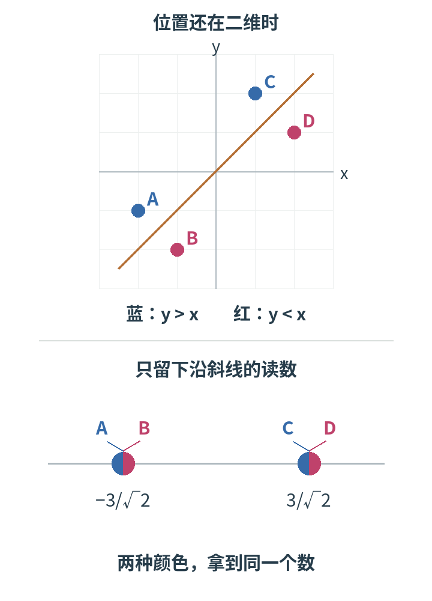

问题出现了：A和B一个蓝一个红，记录却一样；C和D也是。你只拿到投影后的那个数，就不可能准确恢复这四个点的颜色。

90%没有算错。只是颜色恰好取决于斜尺两侧那一点窄窄的差别，而PCA为了尽量保留位置变化，把它舍弃了。

如果任务只是分红蓝，甚至不需要保留两个数：换成短轴方向 `(−1/√2,1/√2)`，蓝点读数为正，红点读数为负，一个数就足够。可这个方向只能留下10%的方差。

这两个答案各有道理。一个要尽量重建位置，一个要辨别颜色；对“重要”的要求不同，应该选的方向也不同。

## 想把位置找回来，就再添一把尺

第一把尺遗漏的偏离，恰好在与它垂直的方向上。沿这个方向再记录一个数，就补齐了。

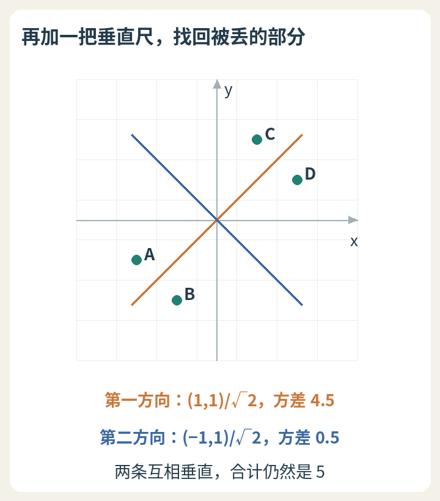

仍看D。第一方向的读数是3/√2，贡献位移(1.5,1.5)；第二方向的读数是−1/√2，贡献位移(0.5,−0.5)。把两段拼起来，正好回到(2,1)。

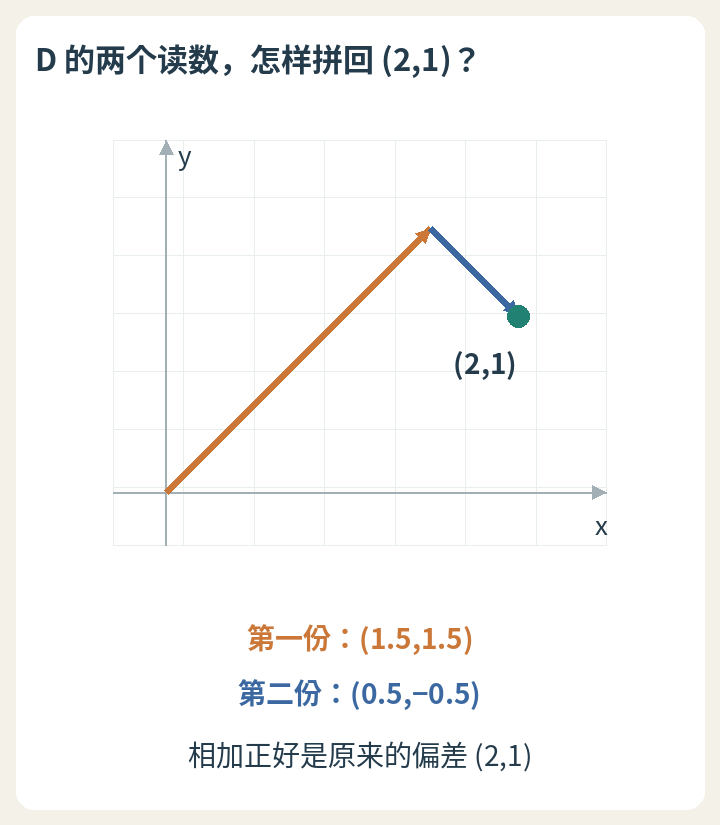

保留两条互相垂直的方向，只是换了一套坐标；丢掉其中一条，才产生这里的近似。计算机恢复时还会留下很小的浮点舍入误差。

更多列的数据也可以这样处理：先找第一方向，再在与它垂直的方向里寻找剩余方差最大的那一条，继续往下找。得到的新坐标是原来各列的组合。

方向箭头本身可以整体反过来。u变成−u，读数t同时变成−t，乘回去仍是同一位移：`t×u=(−t)×(−u)`。因此，一团点的长轴可以告诉你“沿哪里伸展”，但仅凭这条轴找不到物体的头尾。

## 换一把量尺，答案也会换

到这里，PCA的目标已经很明确了。但“距离”看似天经地义，实际也受输入方式影响。

如果x、y原来都用厘米，只把y换成毫米，那么y的数字会变成10倍。真实形状没变；如果程序还直接拿两列数字算平方距离，纵向差异的影响却变成了100倍。

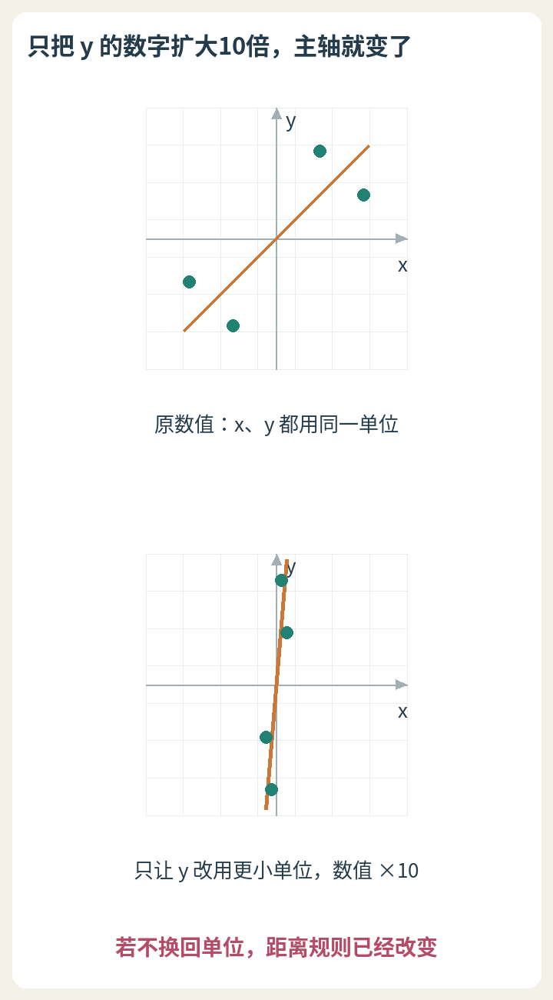

下图每一数值单位仍画得一样长，所以毫米数值和厘米数值被当作同一尺度比较。此时算出的方向回答的是一个已经改变的问题。

一种处理办法是每列先减平均，再除以本列标准差。标准差是方差的非负平方根，单位与原列相同；除完后，数字表示“离平均值多少个标准差”。这叫标准化，能消除上述正比例换单位的影响。

不过，对真实几何坐标，实际的长短往往正是我们想保留的。把每列都调到同样的分散程度，可能抹平它。是否标准化，要看各列的含义；完全不变的一列标准差为0，也得先处理，不能直接相除。

平方还会让远处的点很有影响力。给中心化后的四点加上(0,12)，中心和主方向都会移动：

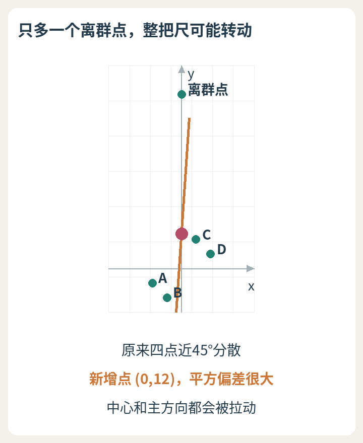

远点可能是错字，也可能是真实的极端样本。要回查它从哪里来，不能只因它把图转歪了就删掉。

还有相反的情形：点群根本没有更长的方向。把四点放在上下左右各一格，沿任何单位方向的方差都是0.5。

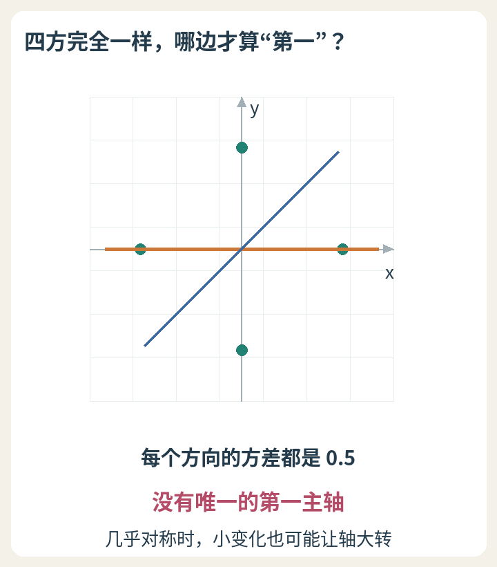

此时软件返回一条轴，并不表示数据中藏着一条唯一的轴。两方向方差很接近时，微小变化也可能让轴大幅转动。近圆的斑点就是一个容易想象的例子。

## 电脑不用真的转一圈尺子

四点例子里，不管方向(a,b)怎么选，需要的总是三份平均数：x²的平均2.5，y²的平均2.5，xy的平均2。

最后一份描述横纵偏差怎样一起变化，叫**协方差**。将它们排成表，就得到协方差矩阵：

| | x | y |
|---|---:|---:|
| x | 2.5 | 2 |
| y | 2 | 2.5 |

矩阵在这里是一张带计算规则的数表：用每行与输入箭头的各分量相乘，再相加。

例如输入(1,1)，第一行算 `2.5×1+2×1=4.5`，第二行也是4.5。输出(4.5,4.5)仍朝原方向，只被拉长4.5倍。输入(−1,1)，输出则是(−0.5,0.5)，只剩原长度的一半。

这些“经过计算后不转向”的非零箭头叫**特征向量**，长度倍率叫**特征值**。在这张协方差表里，将箭头定成单位长度后，相应特征值就是投影方差。找到最大的那个，就找到了第一主方向。

随文代码走另一条常用路线：对中心化数据做奇异值分解，直接得到同样的主方向。无需自己每隔一度试一次。代码和数值约定放在[运行说明](examples/README.md)，包括本篇除以n与scikit-learn报告方差时除以n−1的区别。

## 一朵花，到底朝哪里？

现在把点换成一张照片里的像素位置。它们不再只有四个，但“先决定谁算一个点，再找方向”的问题一点没变。

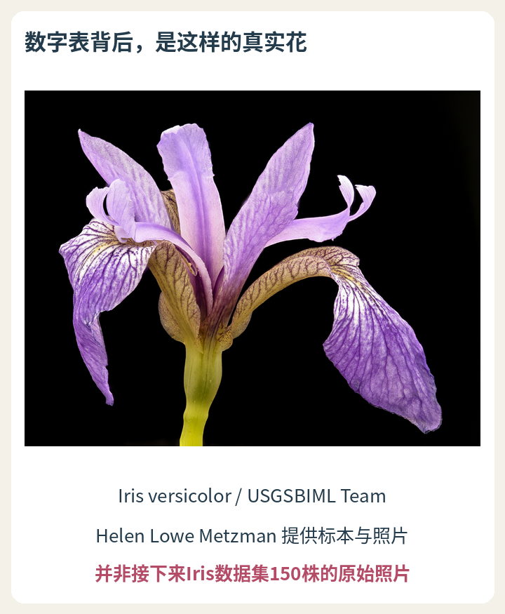

Iris versicolor。原照：USGSBIML Team；Helen Lowe Metzman提供标本与照片；Public Domain。这里等比展示，原件与处理记录见[图片说明](originals/RIGHTS.md)。

照片背景是黑色，很适合试一条简单的选点规则：把它缩到900×702像素后，每个像素比较红、绿、蓝三个通道的数值，只要最大值超过45，就选中它。白色表示选中，黑色表示不选，这张选择图叫**掩模**。

每个白像素交出自己的(x,y)位置，权重相同。把这团位置做PCA，就能画出它最分散的方向。

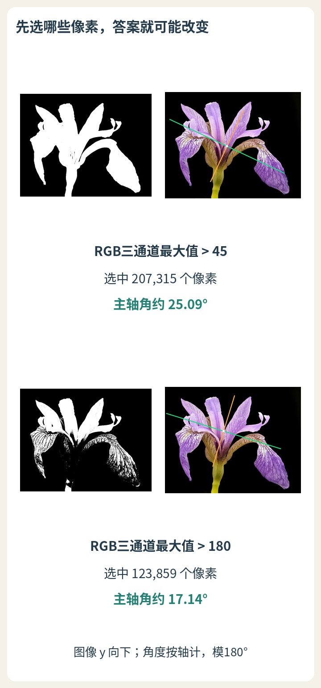

上面阈值45选中207,315个位置，第一主轴角度约25.09°；下面阈值180只选中123,859个位置，角度变成约17.14°。图像坐标x向右、y向下，角度按一条轴计，因此相差180°视为同一方向。

两次计算都认真找到了输入点群的长轴。变化发生在前一步：我们换了哪些像素有资格成为一个点。

这条绿线并没有沿着花茎。它概括的是被选中区域的位置分布；花瓣、花茎、明暗纹理都会影响这个分布。换背景、遮住一片花瓣、改照明，都可能改掉结果。

[OpenCV的官方教程](https://docs.opencv.org/4.13.0/d1/dee/tutorial_introduction_to_pca.html)也用PCA提取物体方向。这里的图由随文NumPy与Pillow代码生成，输入和选区都保留着，方便直接看出：预处理不是计算之前的一点杂事，它在规定计算要回答什么。

## 扩展：再往四维多走一步

同样是鸢尾花，还可以用完全不同的方式表示一个点。

[UCI的Iris数据集](https://archive.ics.uci.edu/dataset/53/iris)每行是一株花的四项厘米测量：萼片长、萼片宽、花瓣长、花瓣宽，另外记录物种。它共有150行。上面的USGS照片只是帮助认识这种植物，并非这150株的采样照片。

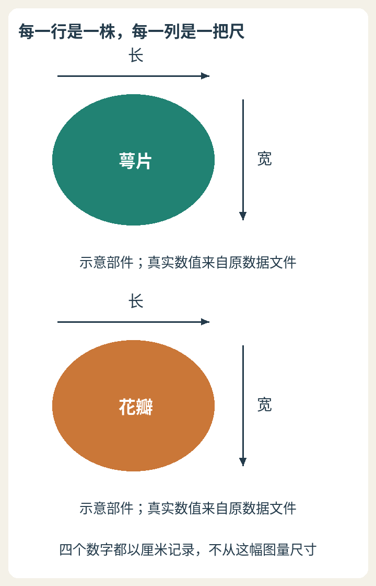

示意形状用来说明四把尺量什么，实际数值取自数据文件。

先挑花瓣长、花瓣宽两列画出来。每个点就是一行记录，颜色按已有物种标签添加：

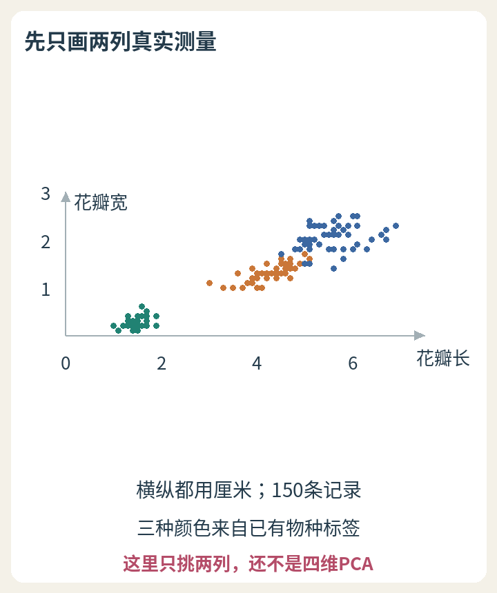

这是一张普通散点图。它只选了两列，另外两列尚未参与。

下面则让四列一起做PCA，再保留前两个坐标。每个新坐标都是四种尺寸的加权组合，不能把第一轴直接读成“花瓣长”。

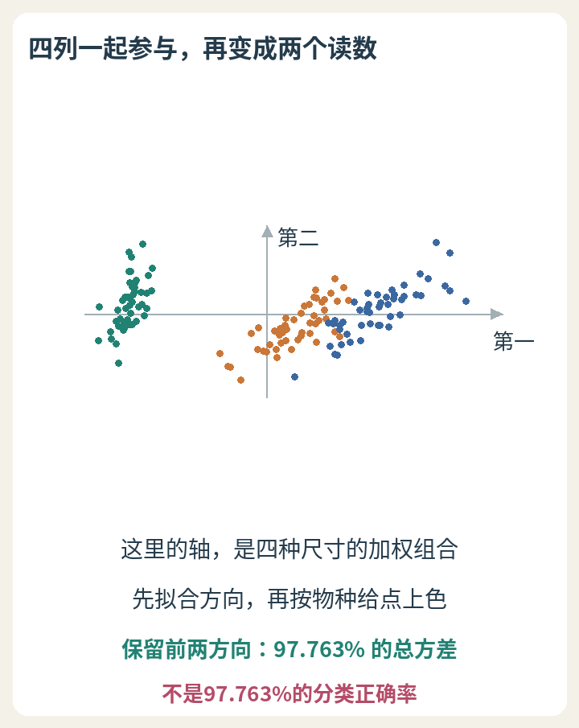

这里按原文件`iris.data`的150行拟合，保留厘米尺度，没有标准化。前两方向合计留下约97.763%的总方差。标签没有参与找方向，所以颜色分组是一项值得观察的结果，还需要另做预测检验，才能讨论识别准确率。

两个新坐标还能被放回去，近似恢复四项尺寸。原文件第一株的数值是5.1、3.5、1.4、0.2厘米，恢复后约为5.087、3.513、1.402、0.211厘米。

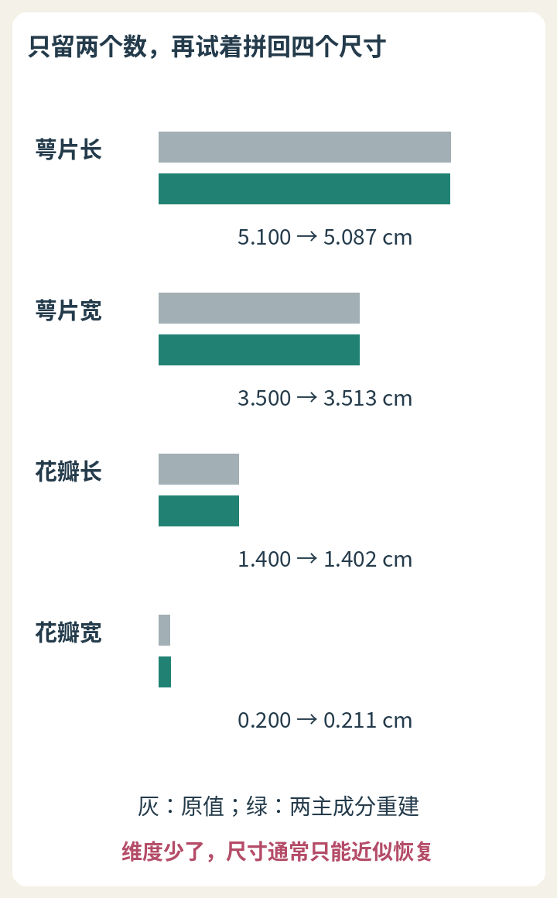

四项都接近，却没有原样回来。对全部150株，将每株四项残差平方相加、再对150株平均，结果约0.101526平方厘米。要判断某一项尺寸够不够准，还得回到那一列，查看具体误差。

数据版本也会影响末位数字。UCI的原说明指出两条记录与Fisher论文存在差异；这里保留下载文件，不与其他软件里的修订版混用。输入指纹和完整输出放在[计算附件](examples/README.md)。

第一株的花瓣宽从0.200变成了约0.211厘米，尺寸还能近似恢复。A和B共用的那个读数，却没法告诉你它原来是哪一种颜色。位置变化留下多少，与一项具体差别能否留下，终究是两道不同的题。

## 来源与附件

- [资料、逐图出处与许可](sources.md)
- [代码、数据、运算约定与完整结果](examples/README.md)

原创正文与图解采用CC BY 4.0，代码采用MIT；照片与数据保留各自权利。本文使用AI辅助研究、写作与制图代码制作。
