# 没有括号，程序怎样知道先乘后加？

假设你正在做一个很小的关卡工具。输入一个算式，程序就画出相应数量的砖块。

输入`2+3*4`，画出14块。加上一对括号，输入`(2+3)*4`，变成20块。

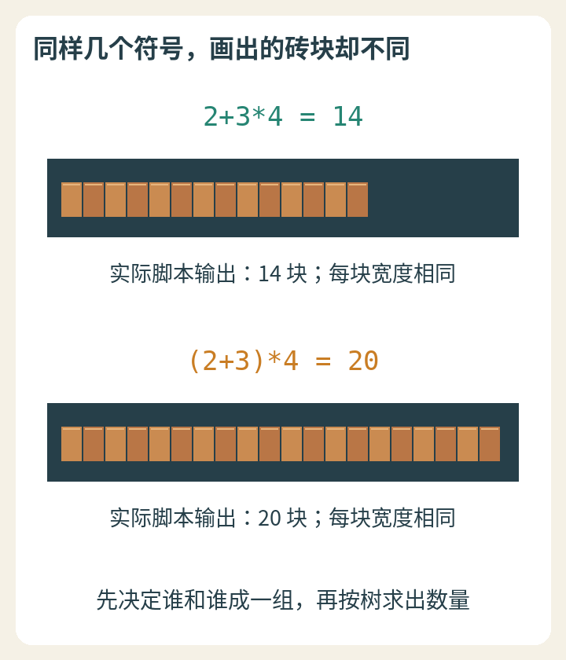

图里的砖排确实由本文脚本生成，数量来自脚本算出的结果；它们是教学程序输出，不是某款游戏的截图。原始两张图片和生成方法都在[示例目录](examples/README.md)。

你也许会说：这不是小学算术吗，先乘除、后加减。

但这句话对程序来说还不够具体。程序最开始拿到的，只是一串字符。它怎样把“先乘后加”变成一个能逐步执行的动作？是先扫完整行，把乘号圈出来？那遇到括号、负号、连续乘方时，又怎么办？

本文要拆开的就是这一小段工作。我们采用一种叫**Pratt解析**的方法。你暂时不必记住名字。先记住它要解决的问题：**把一串算式，搭成一棵分组清楚的树。**

等树搭好了，真正的计算反而很直接。

本库的[Hopper与编译器文章](https://github.com/zyuanming/tech-articles/blob/a93df95dec42846176ac05cb555f8fb656fd4e53/articles/2026-10-10-hopper-compilers/read.md)曾用同一个小算式介绍整条编译路线。这次只放大其中尚未拆开的那一步：树究竟怎样一项一项搭出来？没读过旧篇也不影响阅读。

## 1. 先认字块：12不是两个数字节点

先看稍长一点的输入：`12 + damage * 4`。

这里的`damage`可以是游戏工具中的一个变量名，意思是“去数据表里找一个叫damage的数”。本文求值时给它指定3，所以整个算式的结果是24。

现在先别算。只把输入分成程序能够辨认的小块：

`12`、`+`、`damage`、`*`、`4`。

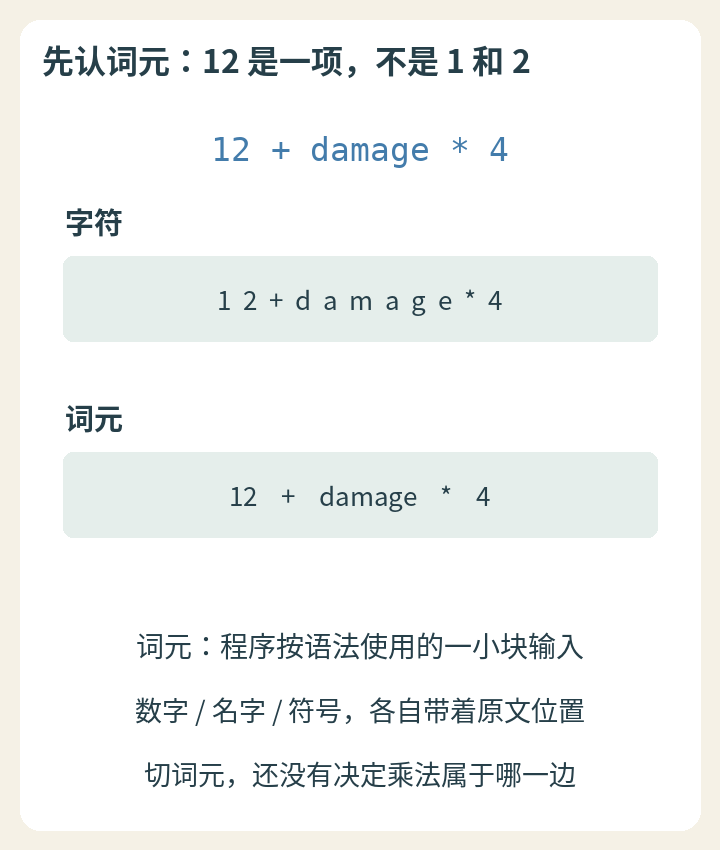

这样的一小块叫**词元**，英文token。把字符切成词元的工作叫**词法分析**，也常叫“切词”。空格在这个小语言里只是间隔，切词时可以跳过。

为什么不能每读到一个字符就直接计算？因为`12`的两个字符共同表示一个数，`damage`的六个字母共同表示一个名字。`**`还可以用两个星号一起表示乘方，不能把它误认成两个乘号。

本文的词元同时保留原文位置。以后遇到错误，程序就能指出“问题在第几个字符附近”，而不是只说一句“坏了”。

切出词元还没有解决先后分组。`2`、`+`、`3`、`*`、`4`这五项原封不动，仍然可能被搭成两种不同的结构。

## 2. 先搭树，不急着算

下面两棵树使用了同样的三个数、一个加号和一个乘号，形状却不一样。

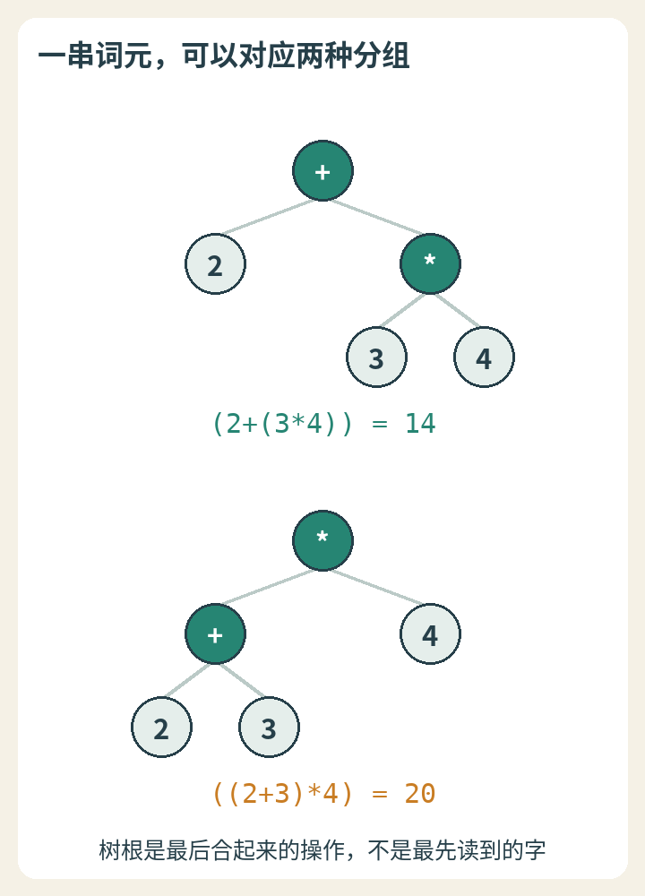

第一棵树顶部是加号。它的左边拿到2，右边拿到的是整个`3*4`。

第二棵树顶部是乘号。它的左边拿到整个`2+3`，右边拿到4。

树上的连线并不是“程序接下来往哪一秒走”，而是在说明：**这个运算要使用哪两个部分作为输入。**

第一棵树的意思是`2 + (3*4)`，算出14。第二棵的意思是`(2+3) * 4`，算出20。

把词元组织成这种结构，叫**语法分析**，简称解析。负责这件事的程序叫解析器。它要回答“谁和谁是一组”，不一定亲自算出结果。

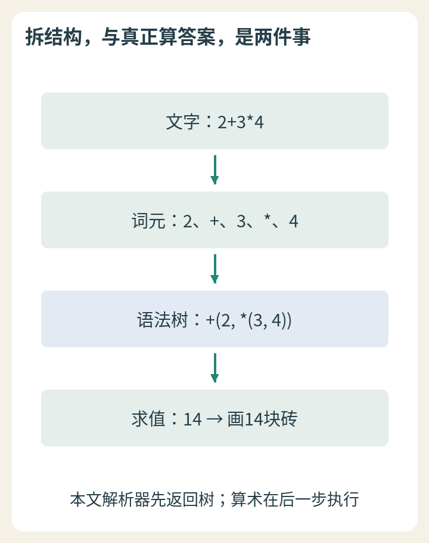

本文刻意把两项工作分开：

- 解析器返回一棵树。
- 求值器沿着树取数、做运算，得到数值。

因此，下面说“返回3”，有时容易引起误解。更准确的说法是：解析阶段返回的是**表示数字3的节点**，或者一棵更大的树；不是已经把整个算式算完。

## 3. 树的几个词，只要先认这四个

第一次看语法树，不需要先学完整的图论。

**节点**就是图上的一个点。这里的节点记录一个数字、一个名字，或者一种运算。

最顶上的节点叫**根**。向下直接连接的节点叫它的**孩子**。没有孩子的末端节点叫**叶子**。

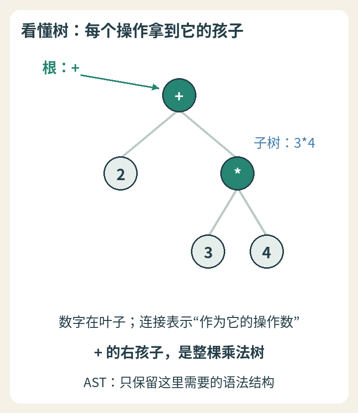

从某个节点开始，连同它下面的全部孩子看作一个整体，叫**子树**。

例如，`3*4`是一棵子树。它可以整体充当加法的右侧输入。以后我们说“把右边返回的子树接上”，就是把这样的整体接到新节点下面。

这类只保留必要语法结构的树，常叫**抽象语法树**，简称AST。这里“抽象”没有神秘含义：空格不用留下来；仅用于分组的括号也不必额外变成运算节点，因为分组效果已经体现在树形里。

## 4. 不把整行翻来覆去找，只盯住一个游标

回到贯穿全文的输入：`2+3*4`。

在词元队列末尾，我们额外放一个标记`EOF`，表示“输入结束”。它不是用户真的敲了三个字母，只是程序方便识别终点的记号。

再放一个**游标**，记录下一项还没处理的词元在哪里。你可以把游标想成手指，始终指着队列中的一个位置。

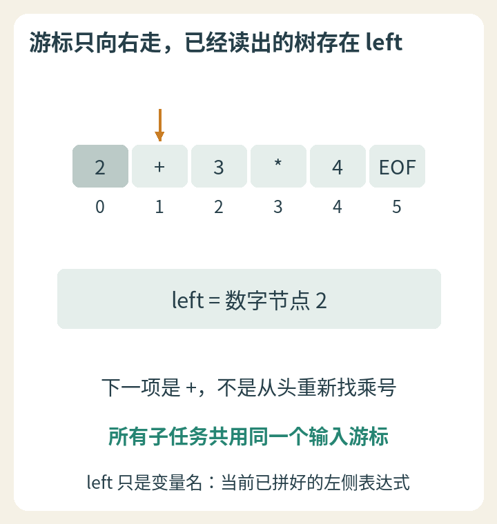

读出2之后，我们手里有一个数字节点，把它记为`left`。这个英文单词只是变量名，意思是“当前已经拼好的左侧表达式”。它不要求永远只是一片叶子，稍后也可能是一整棵树。

接下来游标指着`+`。现在的问题不是“这条算式最终是多少”，而是：

**这个加号是否归当前任务处理？如果归，它右边的那一组要拿多长？**

Pratt解析的大部分巧思，都集中在回答后一个问题。

## 5. 同一个减号，站的位置不同，工作也不同

在介绍门槛之前，先补一个很容易忽略的细节。

`-3`中的减号前面没有已经完成的表达式。它要做的是“把后面那组取负”。

`8-3`中的减号前面已经有8。它要做的是“拿左边那组减去右边那组”。

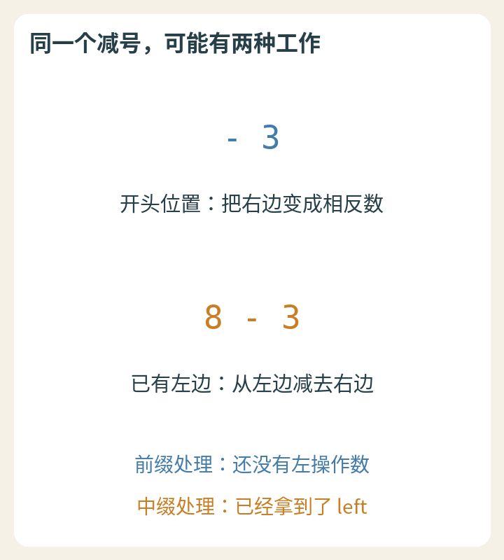

前一种角色叫**前缀**，符号站在它要处理的对象前面；后一种叫**中缀**，符号站在左右两部分中间。

因此，不能只建立一个“遇到减号就执行某固定动作”的表。程序还得知道：此刻有没有一个已经拼好的左侧表达式。

一个新任务刚开始时，还没有`left`，必须先读取能够开头的东西。数字可以开头，变量名可以开头，负号和左括号也可以开头。本文不允许乘号开头，所以`*3`应当报错。

等到`left`已经存在，才进入“看看后面要不要继续接运算”的阶段。

原论文使用两个名字区分这两类处理：`nud`负责没有左侧表达式时的角色，`led`负责已有左侧表达式时的角色。读主线时不用背缩写，记住**开头怎么读、已有左边以后怎么接**就够了。

## 6. 一个任务带一个门槛

假设加号已经读到左边的2，现在要找自己的右侧输入。

如果把剩下的`3*4`全部交给它，正好。如果剩下的是`3+4`，我们希望右侧先只拿3，让后一处加号留给外层处理，形成从左结合的结构。

怎样让同一个解析过程在不同位置自动停下来？

给每次任务一个数字，叫**右侧门槛**。再给队列里可能出现的中缀运算符一个数字，叫**左结合强度**。

它们的工作由下面一条比较决定：

**当前任务的门槛，小于下一个运算符的左强度，才继续把它接进来。**

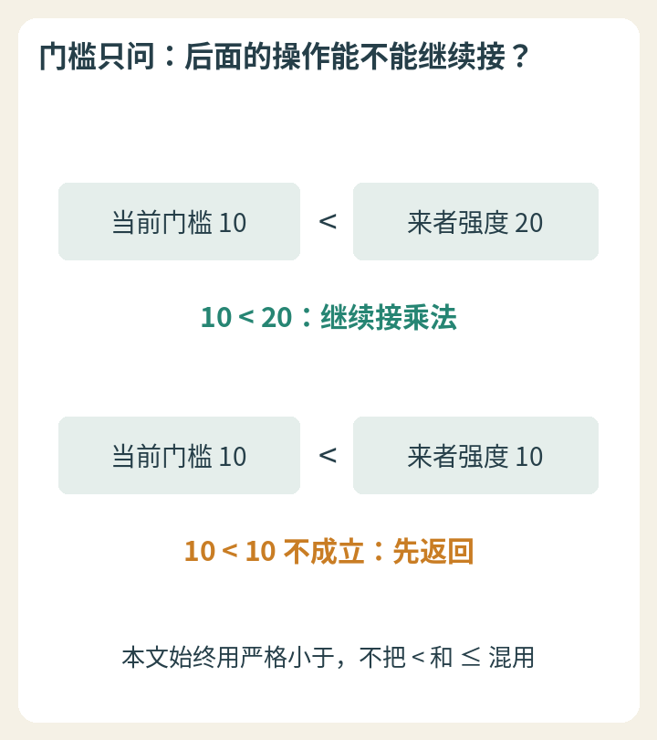

写成简短符号就是`rbp < lbp`。

- `rbp`是这一次任务带进来的门槛，任务运行期间保持不变。
- `lbp`是下一项运算符的左强度；游标移动后，下一项变了，它也可能变化。
- `<`是严格小于。两个数相等时，也要停。

这里的“强度”不是力，也不是实际运行时间。它只是程序用来比较分组关系的一个序号。

停止时，任务返回已经拼好的`left`。**触发停止的那个词元还没有被吃掉**，要留给外层任务继续决定。

## 7. 先把本文的小规则表摆好

我们为这个小算术语言选下面这组数。先读前两行就能看懂主例，乘方和前缀负号会在后面单独解释。

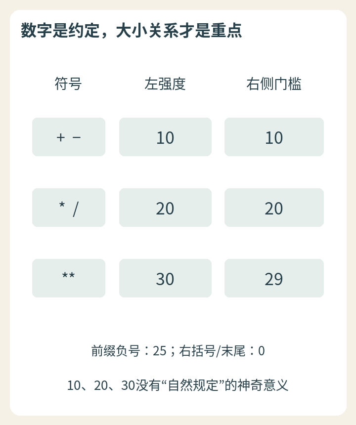

对于加法、减法：左强度10，寻找右侧时使用门槛10。

对于乘法、除法：左强度20，寻找右侧时使用门槛20。

整个算式最外层的门槛设为0。于是它愿意接纳10和20。右括号和输入结束标记的左强度都是0，遇到它们时`0 < 0`也不成立，任务会停下。

10和20并不是数学世界强制规定的常数。换成1和2，只要相关比较仍满足设计要求，也能工作。真正重要的是谁比谁大，以及相等时如何处理。

**注意不要只抄数字而漏抄比较符号。** 有的实现采用“不小于”继续，并给右侧传入高一级的门槛；那是另一套配套约定。本文始终用严格小于继续，因此左结合运算的右门槛取它自身的左强度。

## 8. 现在慢放2+3*4：先把任务分出来

解析开始，最外层任务的门槛是0。我们叫它任务A，便于叙述；程序中它们其实都是同一个函数的不同次调用。

A读出2，得到`left=2`。下一项是加号，左强度10。因为`0 < 10`成立，A接收这个加号。

但加号需要一个右侧表达式。A暂时保存好左边的2，把“读右边”交给新任务B。B的门槛是加号规定的10。

B从当前游标接着读，首先拿到3。下一项是乘号，强度20。因为`10 < 20`成立，B接收乘号。

乘号也需要右侧，于是B再请任务C帮忙，给C的门槛是20。C读出4，游标到达EOF。EOF的强度是0，`20 < 0`不成立，C返回数字节点4。

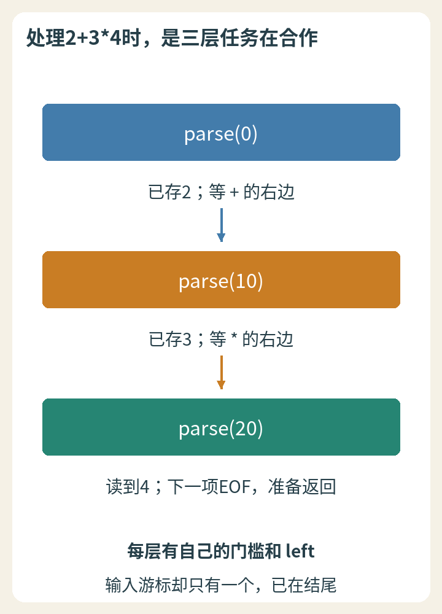

这里发生的就是**递归调用**：一个函数在处理问题时，又调用同一个函数，解决规模更小、边界不同的一部分问题。

“又调用自己”不等于“把一切清空重来”。每次调用保留自己的门槛、自己的`left`和返回后要接着做的位置。所有调用共用一个游标，所以C从4开始，绝不会突然回到开头的2。

可以把A和B理解成暂时放在桌旁的工作卡：A还记着“我拿着2，在等加号的右侧”；B还记着“我拿着3，在等乘号的右侧”。

## 9. 返回时，乘法先成为一个整体

C把数字节点4交回B。B现在同时有3、乘号、4，便创建一个乘法节点，把3和4接到它的左右两边。

B的`left`由单独的3变成了整棵`3*4`子树。

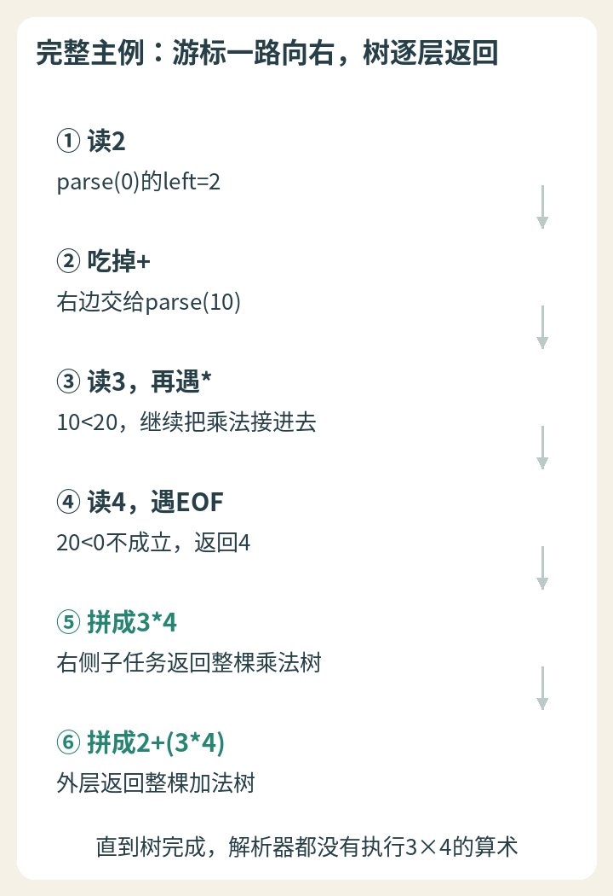

B继续检查下一项，仍然是EOF。注意：C刚才因EOF停止，没有把EOF消费掉。B的比较`10 < 0`也失败，于是B返回整棵乘法子树。

A终于等到了自己需要的右侧。它创建加法节点，左孩子是原来的2，右孩子是刚收到的乘法树。

A再看EOF，`0 < 0`失败，返回最终整棵树。解析结束。

下面的动画取自实际程序的事件记录。橙色箭头是下一项的位置，框中是当前任务已完成的`left`。即使动画不播放，上面的静态步骤也包含完整主线。

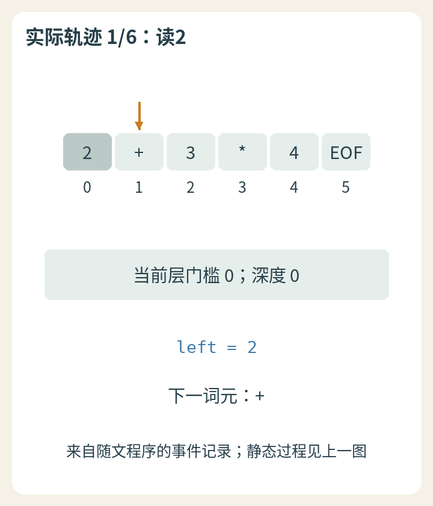

到这里，程序没有预先把整行中的乘号找出来，也没有把词元数组重新排序。它只是从左往右读，靠不同任务的门槛决定“这一段交给谁”。

## 10. 返回一棵树，不是把文字再塞回输入

这是第一次学习递归解析时很值得停一下的地方。

B返回`3*4`，不是把字符`3`、`*`、`4`重新写到词元队列里，也不是让A再读一遍。B返回的是已经建好的结构对象。

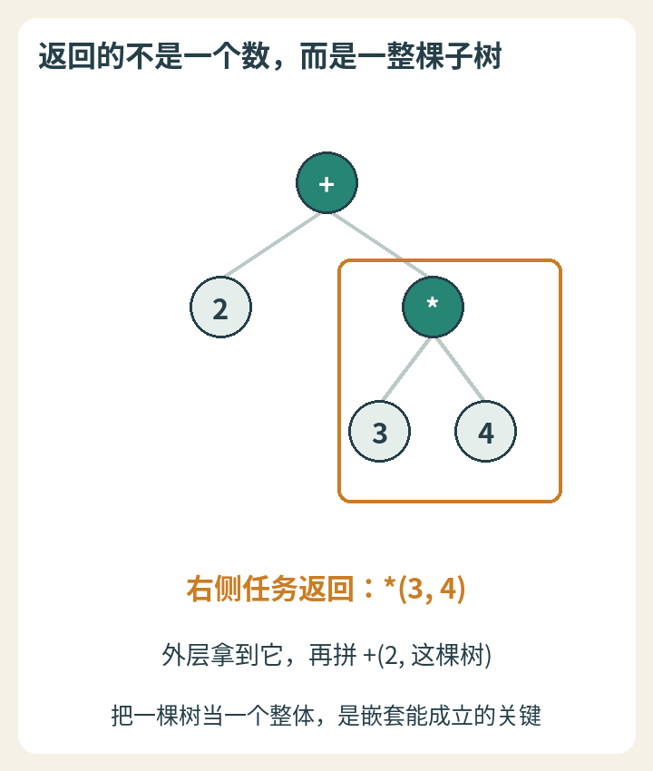

如果用最简单的数据记录方式表达，加法节点大致有三个字段：

- 运算是什么：`+`。
- 左孩子是谁：数字2的节点。
- 右孩子是谁：乘法节点，而那个乘法节点又持有3和4。

因此，A不需要了解B内部经历了几次调用，只需要拿到B承诺返回的一个表达式对象。这种“内部自己解决，外部拿到整体”的边界，是递归程序能够保持简洁的重要原因。

你现在已经可以回答开头的问题：程序之所以先把`3*4`分在一起，是因为在加号的右侧任务里，乘号的20高于门槛10，允许继续；最后返回给加号的是整棵乘法树。

## 11. 为什么8-3-1通常不是8-(3-1)？

优先级只告诉我们乘法和减法谁更紧。两个减号的优先级相同，还需要另一条规则：相同层级连续出现时，怎样分组？

这种规则叫**结合性**。本文的加、减、乘、除都采用左结合：尽量把已经读完的左侧整体，作为下一个同层运算的左孩子。

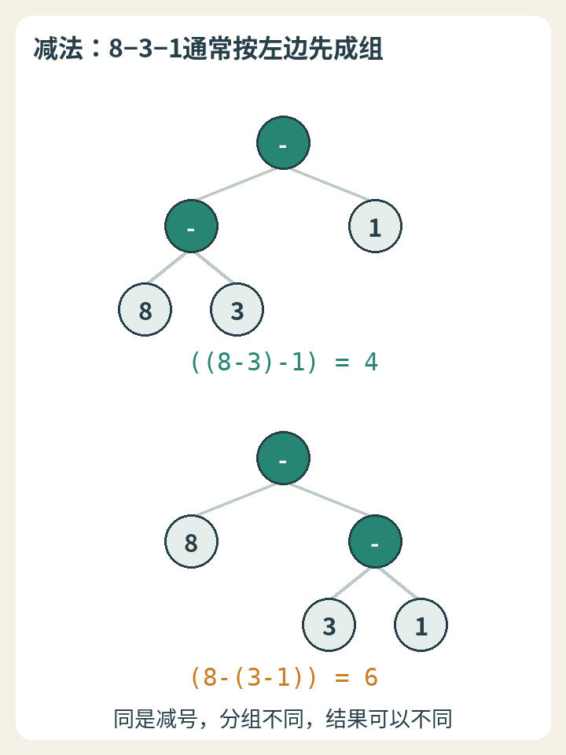

所以`8-3-1`表示`(8-3)-1`，结果是4；`8-(3-1)`则是6。

请特别留意：这里的“结合性”是**语言规定的分组方向**，不是声称减法满足数学上的结合律。恰恰因为减法一般不满足结合律，换树以后答案才可能变化。

用加法演示时，`(1+2)+3`和`1+(2+3)`在普通小整数下恰好相同，很容易掩盖结构错误。减法是更敏感的检查材料。

## 12. 相等时停下，左结合就出来了

现在手推`8-3-1`。

A读到8，接受第一个减号，把右侧交给门槛10的B。B读到3，发现下一项还是减号，左强度也等于10。

判断`10 < 10`不成立。B立即返回3，第二个减号仍在输入里。

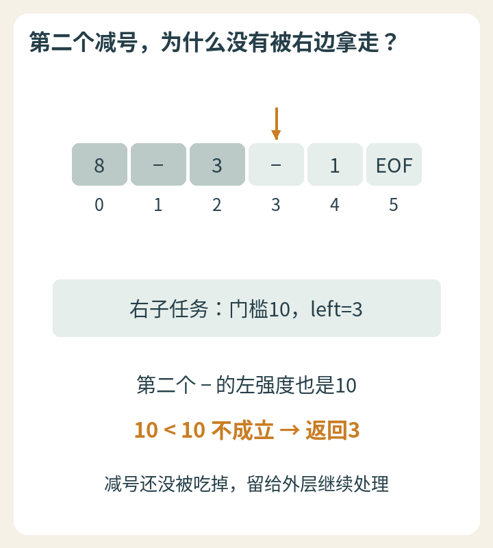

A收到3，先拼出`8-3`。然后A的门槛仍是0，再看第二个减号：`0 < 10`成立，于是A继续接它，把已经完成的`8-3`作为新的左边。

最后得到`(8-3)-1`。

没有额外的“左结合专用循环”。左结合来自两件事配合：**右侧任务遇到相等强度就停；外层继续拿已有的整棵左树接下一个运算。**

## 13. 乘方为什么可以向右分组？

本文用两个星号`**`表示乘方。`2**3`就是2的3次方，等于8。这个符号选择与本文用来对照的Python算术子集一致。

对于`2**3**2`，我们采用右结合：`2**(3**2)`，也就是2的9次方，结果512。若改成`(2**3)**2`，结果会是64。

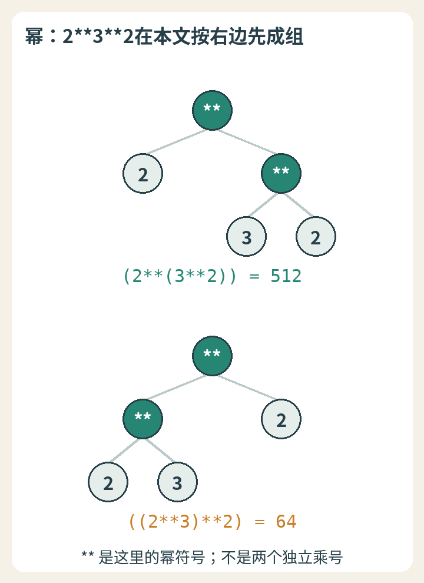

怎样让右侧任务把下一个乘方也收进来？给乘方的左强度30，但寻找右侧时，门槛传29。

A读到2并接收第一个`**`，调用门槛29的B。B读到3，发现后面是另一个左强度30的`**`。因为`29 < 30`成立，B继续，把`3**2`完整构成后才返回。

A因此收到整个`3**2`作为指数，得到`2**(3**2)`。

这里的29只是一个方便选择，它必须低于30，并与其他强度配合。不是所有语言、所有实现都把乘方写成这一对数字。

## 14. 只改一个门槛，树真的会变

这不是纸面说法。本文程序给乘方的右侧门槛留了一个可调参数。

正常值29时，实际结果记录的是`(2**(3**2))`。把这个参数改成30，下一处乘方就会遇到`30 < 30`为假，右侧提前返回，结果变成`((2**3)**2)`。


这个小改动揭示了规则表的两列为何不能草率合成一列：

- 左强度决定“下一项有没有资格接进当前任务”。
- 右门槛决定“我寻找右侧时，允许它继续收多远”。

它们可以相等，也可以不同。优先级与结合性因此能够放在同一个很小的比较机制里表达。

## 15. -2**2：负号究竟包住谁？

现在负号又来了。

我们选择与Python这一算术子集一致的分组：`-2**2`表示`-(2**2)`，结果是−4；`(-2)**2`则是4。[Python表达式规范](https://docs.python.org/3.12/reference/expressions.html#the-power-operator)

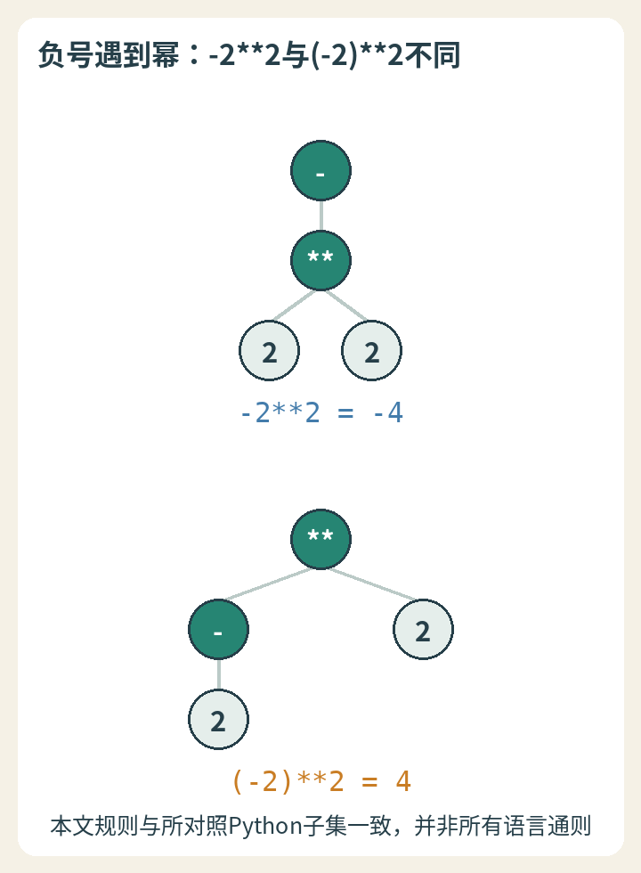

本文规定：作为前缀的负号，为自己的右侧调用一个门槛25的任务。

这个任务读到2后，遇到左强度30的乘方。`25 < 30`成立，所以它把`2**2`一起收下，最后才交给外层负号。

但若输入是`-2*3`，负号的右侧任务读完2，看到的是左强度20的乘号。`25 < 20`不成立，它只返回2。于是先形成负2，再由外层接上乘3。

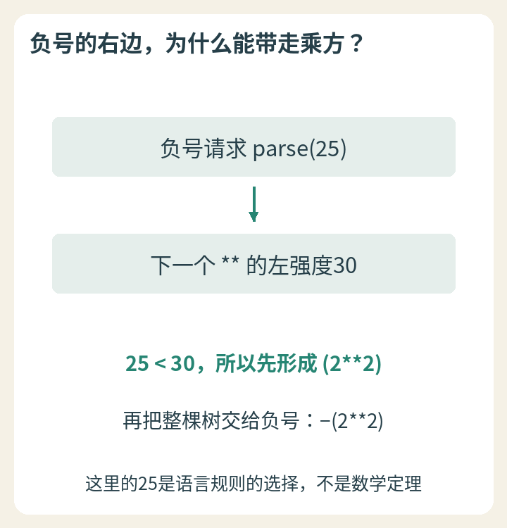

此处必须区分同一个字符的两个角色：中缀减法的强度是10；前缀负号寻找右边时用25。不能拿“减号只有一个优先级”概括这套处理。

## 16. 那2**-3为什么也能读？

可能出现一个很好的疑问：乘方右边的任务门槛是29，而负号不是25吗？`29 < 25`不成立，那`2**-3`岂不是不允许？

这里把两类工作混在一起了。

**一个任务先读开头，再用门槛判断后续中缀符号。** 前缀负号是右侧表达式的开头，不需要先通过中缀比较。

因此，读取乘方右侧的任务看到`-`，会调用负号的前缀处理。负号再用自己的门槛25去读3，构成负3，交回乘方。最后结构是`2**(-3)`，值为0.125。

前一节图中负号所在的位置正是这个区别的关键：先问“现在需要一个开头，还是已经有左边在等待连接”，再问“后续符号够不够强”。

这也是为什么只画一张从低到高的优先级表，有时还不足以解释全部细节。**角色和进入阶段，同样属于规则。**

## 17. 括号不是更强的乘号，而是一份局部约定

看`(2+3)*4`。

新任务在开头读到左括号`(`，于是进入专门的前缀处理：再调用一个门槛0的表达式任务，去读括号里面的内容。

内部任务可以接纳加法和乘法，直到游标指向右括号`)`。右括号的左强度是0，所以内部任务停止并返回整棵`2+3`子树。

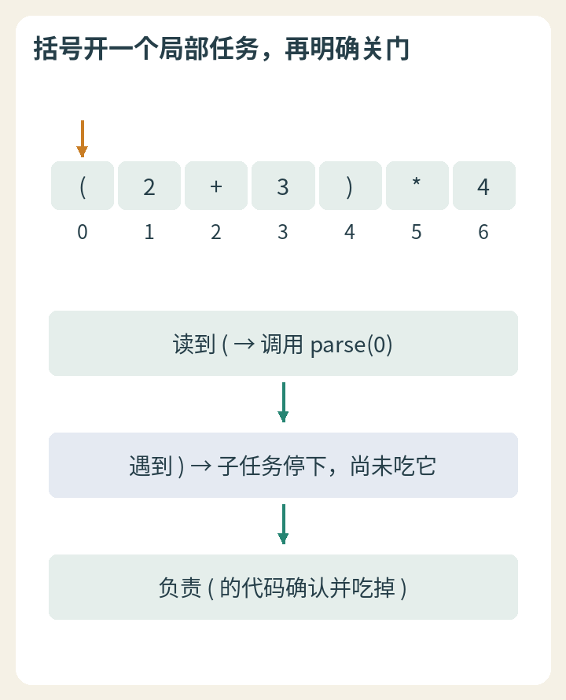

然后谁拿走右括号？不是内部表达式任务，而是先前接收左括号的那段处理代码。它要检查“下一项确实是右括号”，再消费它。

这一步检查不可省略。否则输入`(2+3`也可能被当成完成的分组，错误悄悄漏过去。

左括号处理结束后，外层获得整棵`2+3`作为自己的`left`，游标已经走到乘号。外层再把它与4拼成乘法。

括号没有成为这棵AST上的额外运算节点，但它确实改变了子树怎样组织。语法结构中保存的是它造成的效果。

## 18. 两个星号，要在切词时就认成一项

到这里，我们一直假设输入已经被正确分成词元。这个前提值得单独检查。

在本文支持的符号中，既有`*`，也有`**`。切词器遇到星号时，应先尝试较长的`**`，再尝试单个`*`。

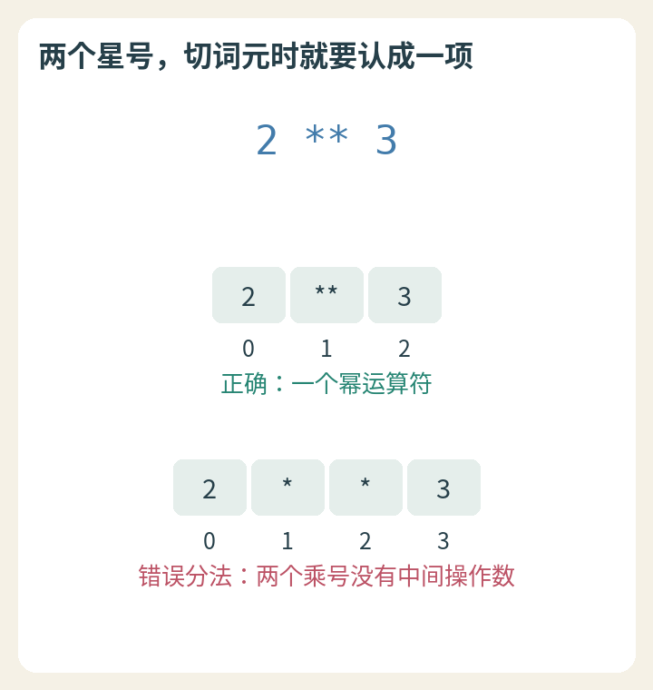

如果错误地把`2**3`切成`2`、`*`、`*`、`3`，解析器会读到第一个乘号，然后发现它的右侧居然以乘号开头，于是报错。

这不是把乘法优先级调高或调低就能解决的。后一步解析不能靠门槛猜出前一步遗漏的词元身份。

相同道理也适用于多位数字和变量名。先确定字块，再确定分组，两个层次各自有清晰职责。

## 19. 正确拒绝，也属于解析器的工作

解析器不应替作者猜测没写出来的内容。

`2+`缺少右侧；`(2+3`缺右括号；`2+*3`在需要表达式开头时遇到乘号；`2 3`则在一个表达式结束后还剩一项数字。

下面箭头的位置来自本文程序实际记录的字符位置。程序的位置计数从0开始，也就是首字符的位置是0。

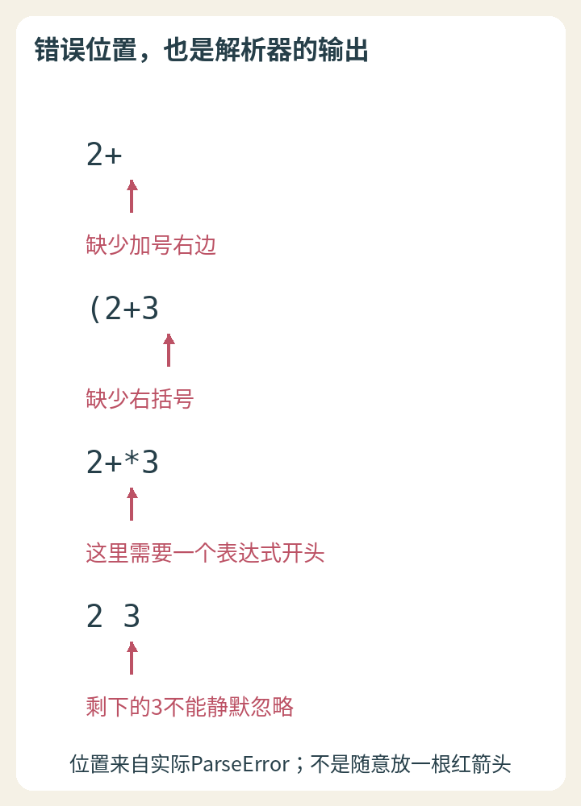

为什么最外层解析结束后，还要检查游标是否确实到达EOF？因为某些剩余词元的左强度为0，会使表达式任务正常返回。例如`2 3`可以先构成数字2的节点，但这不代表整段输入已经合法。

因此，要把两项判断分开：

1. 当前这部分表达式读完了吗？
2. 整段输入还有不允许剩下的东西吗？

本文也明确拒绝`2(3+4)`。有些数学书允许省略乘号，这个小语言没有加入那条语法，所以必须写`2*(3+4)`。不是算法能力不足，而是我们没有授权它把相邻两组解释成隐式乘法。

## 20. 能搭成树，不代表能算出正常数值

输入`8/0`，词元没问题，语法也没问题：一个除法节点，左边8，右边0。

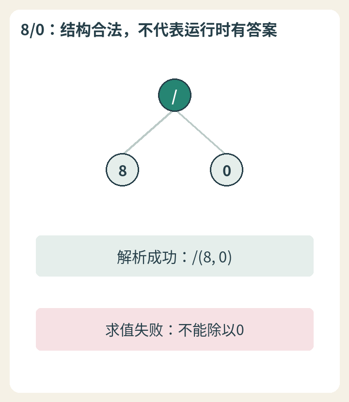

本文程序的解析步骤确实成功，随后求值步骤才抛出`ZeroDivisionError`，即除零错误。

类似地，`damage+1`的结构可以完全清楚，但求值之前仍需要知道`damage`对应什么数。本文的示例环境给damage设置了3；换一个数据表，结构可以不变，结果却会变。

所以，“语法合法”“变量已有定义”“数值运算可执行”“结果符合游戏规则”，是不同层面的要求。一个小解析器不应该声称替所有层面提供保证。

## 21. 真正跑出来的树是什么样？

本文用Python 3.12.14实际运行了一份小解析器。它先生成树，再把节点和连接写成Graphviz的图描述文件。Graphviz是一种按照节点关系自动排布图形的工具。

下图就是Graphviz 2.42.4根据实际`2+3*4`解析结果生成的PNG，没有手工移动其中的节点。它和前面的教学示意图是两类材料：一个展示实际工具输出，一个把中途状态放大解释。

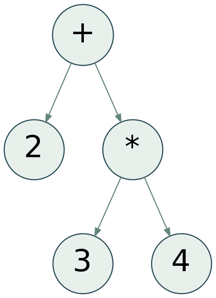

原始[图描述文件](examples/normal-ast.dot)和[SVG输出](examples/normal-graphviz.svg)也保留在示例目录里。你可以检查：根节点是加号，左边是2，右边是乘号；乘号下面才是3和4。

除此之外，我们还调用CPython的`ast.parse`，取得Python自己生成的AST，作为独立对照。`ast.parse`只解析，不执行输入中的算式。输出中的`BinOp`表示二元运算，`Constant`表示常量数字。

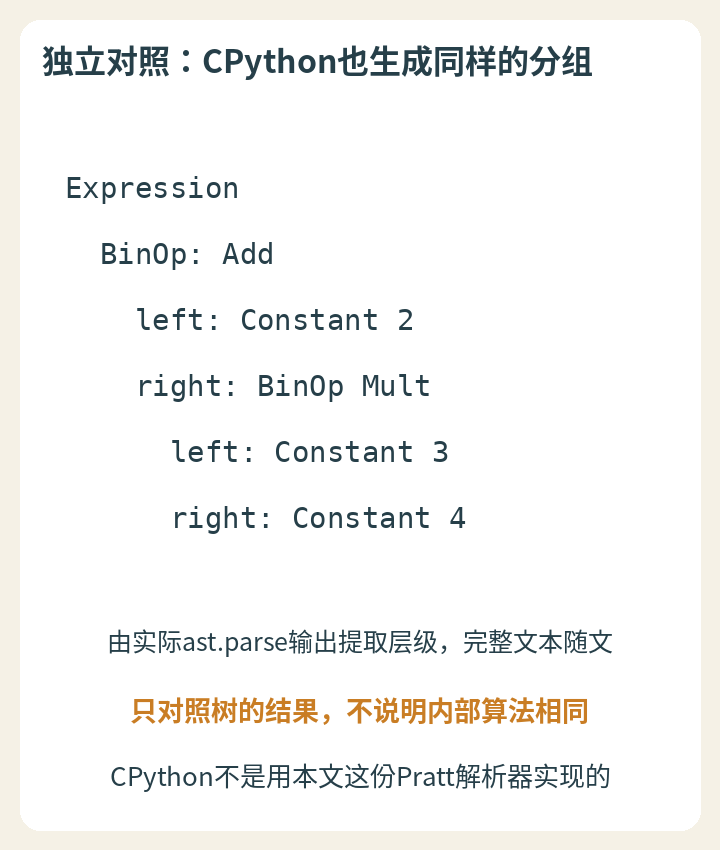

图中为便于阅读重新安排了文字，原始文本保存在[cpython-ast.txt](examples/cpython-ast.txt)。我们比较的是树的结构，不只是最后数值。这样即便两种不同分组恰好算出同一个数，也不会掩盖差别。

实际运行检查了14个指定案例，以及随机种子314159生成的5000个算式，本文树与CPython返回树的对应结构全部一致。另外10个非法输入都被本文解析器拒绝。这些结果证明所检查案例通过，**不是对无限输入的形式化证明**。

也不要反过来推断“Python内部用的就是本文这个Pratt解析器”。CPython的解析器采用PEG路线，官方的[PEP 617](https://peps.python.org/pep-0617/)说明了这项设计。不同解析方法可以实现相同的算式分组规则。

## 22. 把图里的动作，收成一小段程序

如果前面的步骤已经清楚，下面这段伪代码只是把它们压缩到一起；不写代码也可以跳过本节。

```text
读取表达式(门槛):
    取出一项词元
    left = 按“开头角色”处理这项词元

    当 门槛 < 下一项的左强度:
        取出这一项中缀运算符
        right = 读取表达式(该运算符的右侧门槛)
        left = 新节点(运算符, left, right)

    返回 left
```

“按开头角色处理”不是一句魔法，而是前面讲过的几种情况：数字返回数字节点，名字返回名字节点，前缀正负号调用一个门槛25的任务，左括号调用门槛0的内部任务并检查右括号。其他不允许开头的词元报错。

“下一项的左强度”来自规则表。本文没有中缀角色的词元使用0，促使当前表达式任务返回；最外层再检查是否还有多余词元，括号处理器则检查是否遇到了期待的右括号。

全部可运行代码见[parser_lab.py](examples/parser_lab.py)。本文示例支持ASCII整数、变量名、`+ - * / **`及分组括号，不支持函数调用、属性访问、赋值、字符串或完整程序语句。它没有使用`eval`或`exec`执行用户文本。

这是一份范围有限的教学实现，不是可直接承诺安全的通用脚本沙箱。输入长度、嵌套深度和数值范围都设置了限制；具体条件见[运行说明](examples/README.md)。

## 23. 从左到右一次走完，就一定不会慢吗？

对于本文这种固定规则、直接连接节点的核心解析过程，每个普通词元只被消费一次。创建一个节点时，只连上已经存在的左右孩子，不需要复制它们的全部内容。

因此，在已切好的n个词元上，关闭额外追踪输出、并把一次节点操作视为固定工作量时，核心解析的总工作量随n线性增长，通常记作O(n)。这个记号在这里就是“词元数量翻一倍，基本动作数量大致也翻一倍”，不是某台机器耗时的保证。

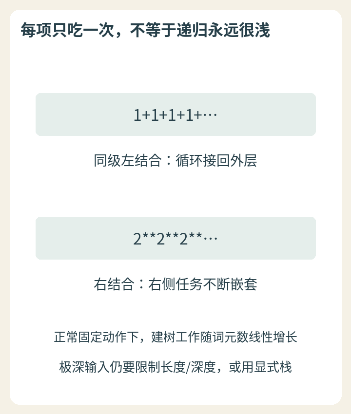

但同时挂起的任务可能很多。连续右结合乘方、很多层括号，都会增加调用深度；程序运行环境的调用栈并不是无限的。本文在解析任务深度超过128时拒绝继续，输入文本也限为3000字符。

还有一个容易漏掉的细节：为了制作动画，本文追踪模式会在许多事件中把当前子树写成带括号字符串。这些字符串可能反复描述已经长大的树，因而额外工作量不再保证线性。**核心算法的O(n)，不能不加区别地套到绘图、日志和完整测试过程上。**

更不能把它当成数值计算的复杂度。处理很大的整数、计算乘方、生成图片，属于后续工作，各自有自己的成本。

## 24. 1973年的想法，今天看仍然很具体

这种方法对应Vaughan R. Pratt在1973年发表的论文《Top Down Operator Precedence》，收录于首届POPL会议论文集，第41—51页。[ACM论文记录](https://doi.org/10.1145/512927.512931)

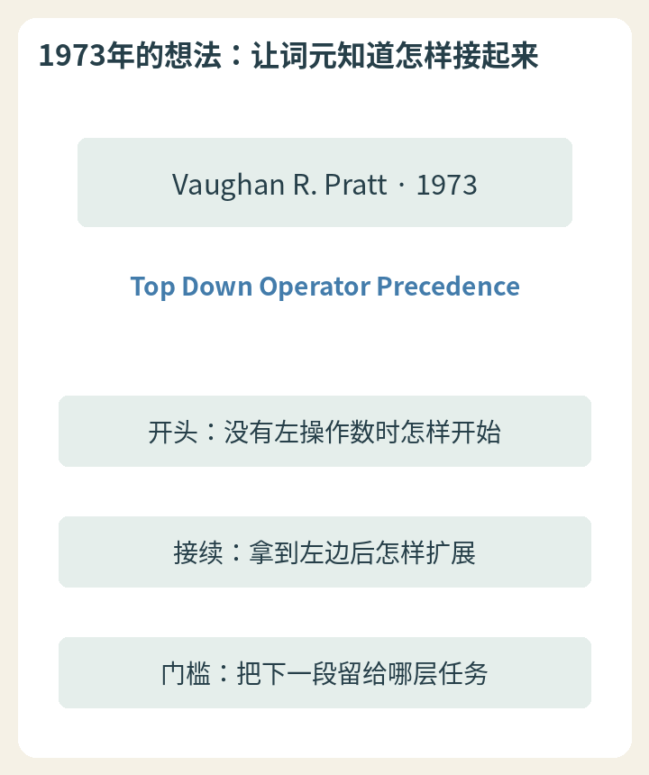

本文查阅的可读全文来自该论文的[公开重新排版转录](https://tdop.github.io/)，它不是原扫描件，也不是Pratt本人的网页。第3节可以直接看到`left`、左右绑定强度的比较，以及词元在有、无左侧表达式时使用不同处理的思想。

我们没有照搬论文里的某个完整语言，也没有复原1973年的软件。本文的小语言、数字门槛、示例程序和全部讲解图，是为这条学习路线重新设计的。

如果继续学习，Robert Nystrom本人写的《Crafting Interpreters》[表达式编译一章](https://github.com/munificent/craftinginterpreters/blob/master/book/compiling-expressions.md)展示了这种方法怎样接到一个语言实现里。那里的具体比较约定、运算符集合和输出目标与本文不同，不要只从两份代码里各摘一半凑起来。

值得带走的不是某段代码有多短，而是一个可重复使用的设计：**让词元说明自己怎样开始、怎样连接；让每次子任务带着明确的停止条件。**

## 25. 如果想自己动手，只改一个问题

实验是可选的。静态正文已经给出完整机制；下面三个小改动适合检验自己是否真的看懂。

第一步，运行[示例程序](examples/README.md)，在输出中找到`2+3*4`的事件列表。每到一个`compare`事件，就只回答两个问题：当前门槛是多少？下一项的左强度是多少？不用同时背整棵树。

第二步，把乘方右门槛从29改成30，只观察`2**3**2`的树，不先看数字答案。如果你能预言它变成哪一棵树，就已经理解结合性怎样从比较中出现。

第三步，比较`-2**2`、`(-2)**2`、`2**-3`。每次先指出负号处于“开头角色”还是“已有左边后的连接角色”，再继续推。这样能避免只背优先级表却解释不了右边负指数的困惑。

不要拿`8/0`作为“解析器是否正确”的失败标准。更有信息量的检查是：它能否先构成正确的除法树，再由求值器报告除零。

## 26. 从几个字符，回到屏幕上的砖

再看开头那排砖，现在它背后不再是一句含糊的“电脑知道乘法优先”。

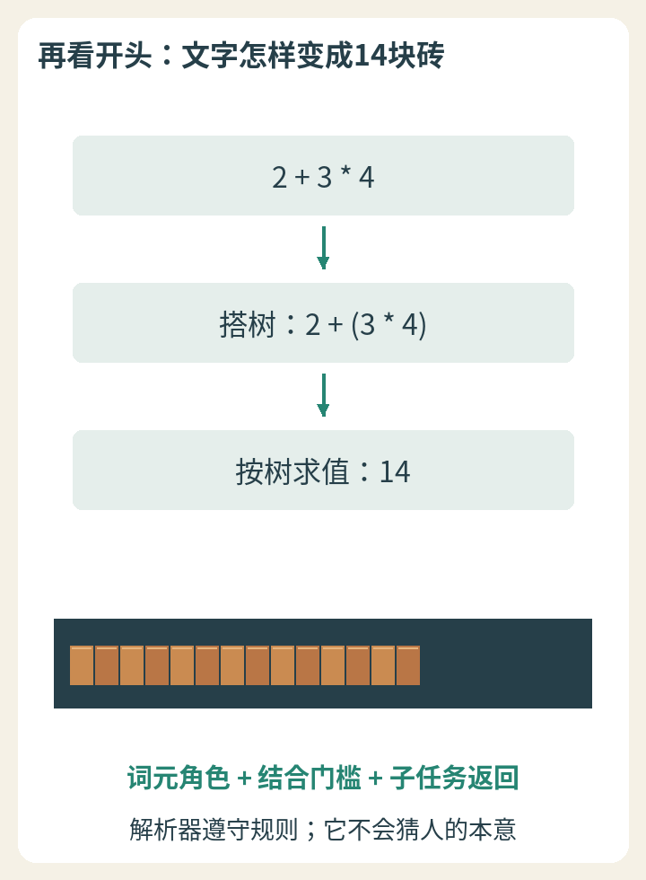

发生的事情是：

1. 切词器认出数字和符号。
2. 最外层读到2，随后接纳加号。
3. 加号的右侧任务带着门槛10，继续接纳强度20的乘号。
4. 乘法子树完整返回，成为加法的右孩子。
5. 求值器沿着已经确定的树计算，得到14。
6. 绘图程序按照14这个数量画砖。

任何一步都不需要程序猜测你的意图。你规定词元的角色、比较规则和错误边界，程序就能把一行线性的文字，变成层次分明的结构。

下次在关卡工具、公式输入框或小型脚本中看到一条算式时，你可以试着先不求答案，而是问：**这棵树的根是谁？它的左右两边，各自是一整块什么？**

能回答这个问题，就已经走进了解析器真正工作的地方。

---

本文原创正文、教学图与原创程序输出采用[CC BY 4.0](https://creativecommons.org/licenses/by/4.0/)。原创示例代码采用[MIT许可](examples/LICENSE.txt)。事实出处、素材身份、运行版本和AI辅助说明见[来源与图片清单](sources.md)。
