# 删掉一半三角形，山峰为什么还能站住？QEM给形状做的误差账

你在做一个小游戏。地图上有一片山地：两个山峰，中间绕着一条窄山脊。

近看时，山地需要足够多的三角形，才能把起伏拼出来。远处的山只占屏幕一小块，继续使用同样密的网格，有时就不划算了。

于是你得到一个任务：**把800个三角形减到400个，甚至160个，尽量让它还像原来的山。**

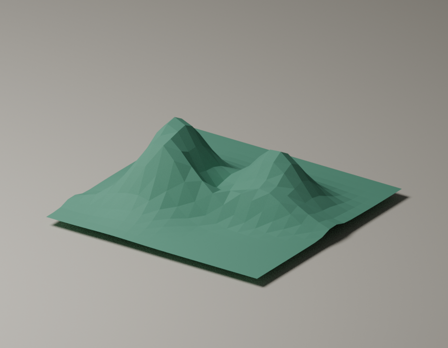

这是把真实输入网格交给Blender 4.3.2渲染出来的画面。Blender是一款制作三维模型与图像的工具；这里它只负责把已有模型画出来，没有替我们运行简化算法。画面是虚拟模型渲染，不是实物照片。

先别随机删。三角形不是可以随便扔掉的纸片：直接移除一片，可能留下一个洞；平均删掉一些顶点，又可能恰好削平山峰。

真正的问题是：**哪里可以大胆省，哪里必须小心留？两个点合成一个点时，新点应该放在哪里？**

1997年，Michael Garland与Paul S. Heckbert发表了一种很有影响力的回答：给每个顶点保留一份“偏离原来形状会有多贵”的小账本，每次选择代价较小的合并。[原论文与作者说明](https://www.cs.cmu.edu/~garland/quadrics/)

这份账本叫**二次误差度量**，英文缩写QEM。名字听起来像要先学矩阵，实际上主线可以从几张三角形、一次删点和一道初中二次函数开始。

本文的山地由附带程序原创生成。所有简化结果都来自实际运行；我们还安排了一个同预算对照，看看“误差小”究竟体现在哪里。

## 1. 三角形网格究竟存了什么？

先拆开一个最小的网格。

一个**顶点**是一个位置，可以用三个数表示，例如(x, y, z)。在山地里，x、y表示地面上的位置，z表示高度。

两个顶点之间的连接是**边**；三个顶点围成的一小片是**三角形面**。程序通常分别保存顶点坐标表和三角形的顶点编号表。

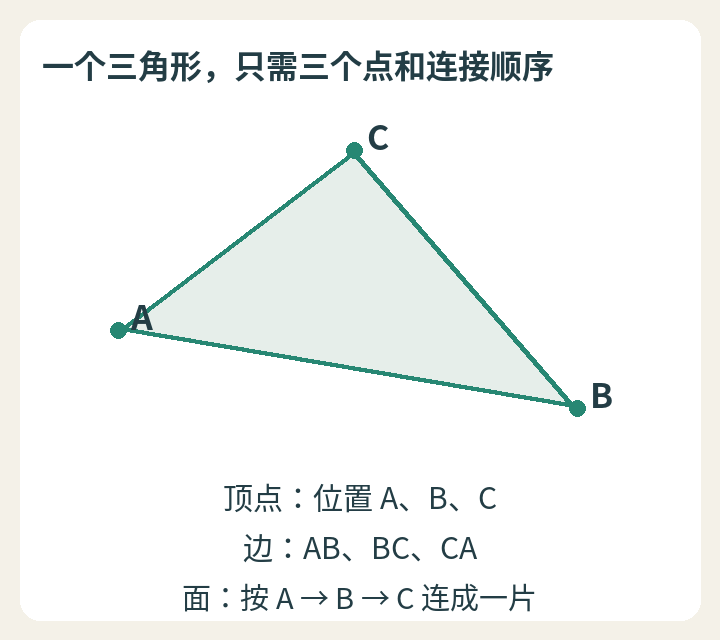

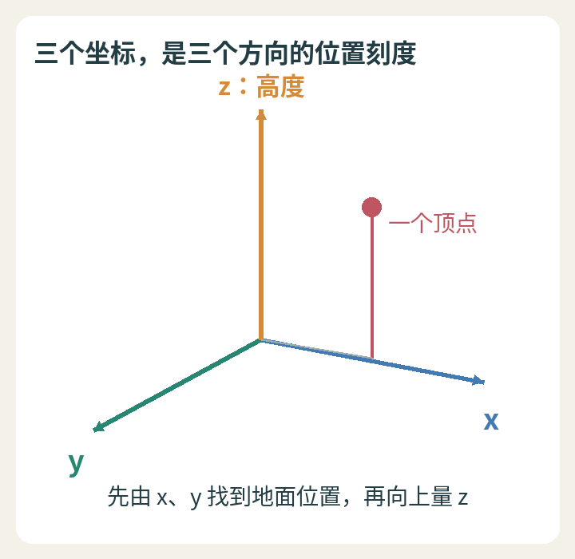

同一个顶点可以被几片三角形共用。你挪动这个顶点，周围的面都会跟着改变。

本文先在一个21×21的方格上放顶点，一共441个。一行21个点之间只有20段空隙，所以这个正方形有20×20个小方格。每个方格再切成两个三角形，因此有：

20×20×2 = 800个三角形。

接着用平滑的数学函数给每个顶点指定高度，形成两座山峰和一条山脊。x、y分别从−1到+1，地面正方形边长为2、面积为4。坐标没有绑定米或厘米，都是**无量纲数值**。

先打开线框，看看刚才那座山由哪些小片拼成：

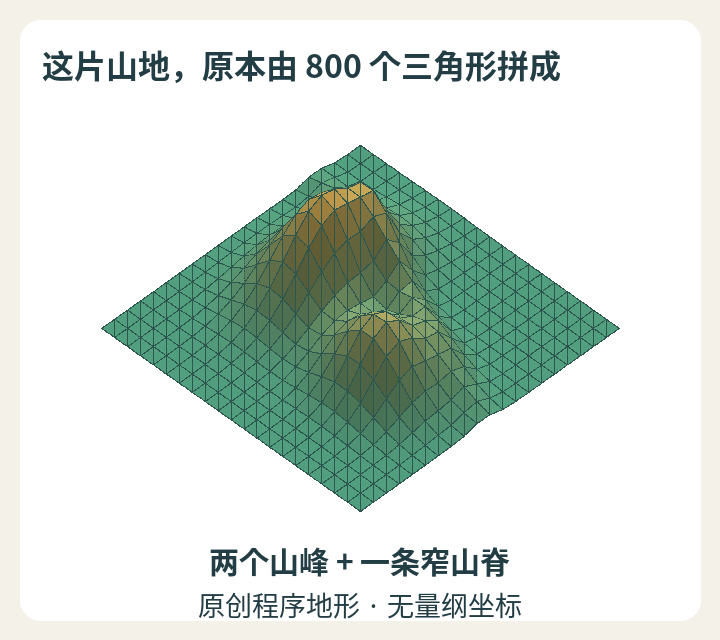

下面是同一地形三个档位的俯视图。注意：简化后留下的三角形不再一样大。

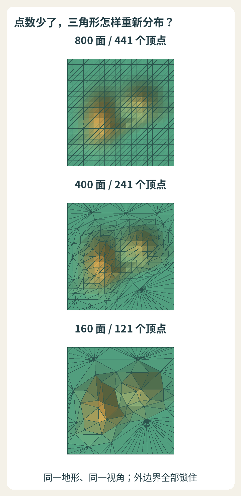

在较平缓的地方，大三角形也能把形状交代清楚；到山峰与窄山脊附近，就需要更谨慎。后面我们要解释，程序怎样不靠“认出一座山”，也能产生这种分配。

这里做的是**减少几何复杂度**。[Catmull–Clark细分](https://zyuanming.github.io/tech-articles/articles/2026-10-12-catmull-clark-subdivision/read.html)讨论的是增加面并产生更平滑的表面，问题方向不同；给模型建立包围盒层次，也不等于把模型本身的面数变少。

## 2. 先把三维问题压成一条折线

在纸上画一条折线，再选一个中间点，直接连接它的前后两个点，相当于把它删掉。

如果这三个点本来几乎在一条直线上，删掉中间点，轮廓变化不大。

如果中间点正好是山尖，删掉它，山尖马上变成一条横过去的弦。

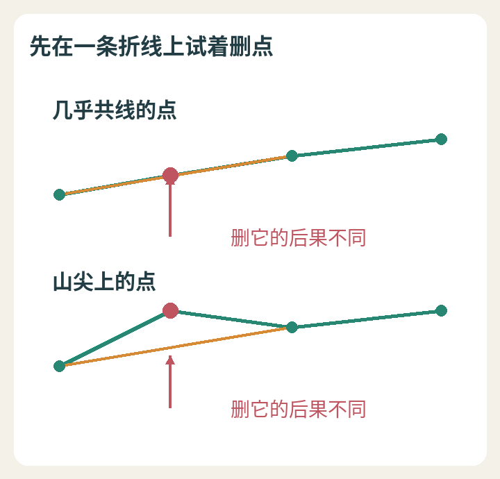

这告诉我们两件事。

第一，**点与点的重要程度不同**。不能只按编号每隔三个删一个。

第二，**“重要”需要变成程序能比较的数**。人能一眼认出鼻尖、山脊、车身折线，程序需要某种可计算的替代标准。

QEM选择的替代标准，与一个点偏离附近原始平面的程度有关。先记住这个方向，我们还要准备一个不会随便开洞的局部操作。

## 3. 不直接挖掉一片，而是折叠一条边

选一条连接A、B的边，把A和B合并成一个新顶点P。这叫**边折叠**。

原来接到A或B的其余边，改接到P；同时包含A和B的两片三角形，因为两个角重合，退化成线，不再作为三角形保存。

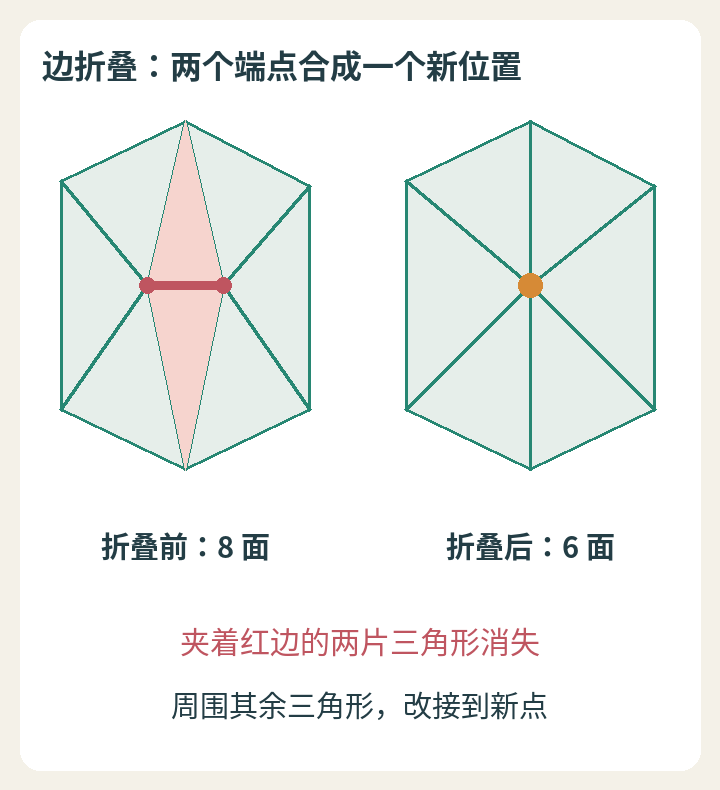

图中是一个正常的内部局部：折叠前8片面，折叠后6片面。周围仍然连成一块，没有把红色两片原地挖掉。

“内部”意味着这条边不在模型外轮廓上。对这类正常内部边，一次折叠通常少一个顶点、两个三角形。

所以本实验从800面到400面，需要200次这样的操作；从400面到160面，再做120次。

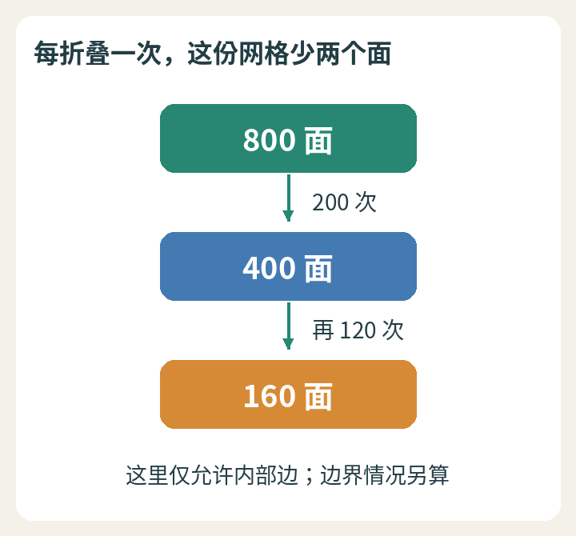

这里有一个容易忽略的自由：**P不一定是A，也不一定是B，甚至不一定是中点。**

把两点合并，与把新点放在哪里，是两个相关但不同的决定。放置得好，周围三角形可以更贴近原形；放置得坏，哪怕选中了合理的边，也可能把表面拉歪。

## 4. 怎样给一个候选新位置打分？

看看一个顶点周围的三角形。每片三角形都躺在一张平面上。

你可以想象：把那片小三角形延伸成一张无限大的薄纸。现在提出一个新位置P，测量它离这张纸的**垂直距离**。

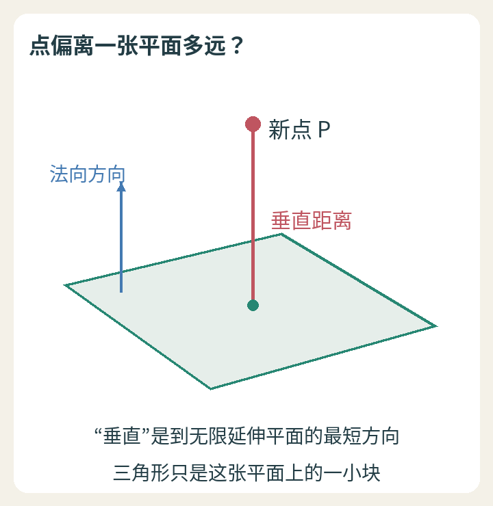

垂直于平面的方向叫**法向方向**，可以把它理解成纸面正对着的方向。沿着这个方向量，得到的是点到平面的最短距离，而不是随便拉一条斜线的长度。

若P还在原平面上，距离是0。若P离开平面，距离就变大。

一个顶点周围有好几张这样的平面。我们把P到这些平面的距离分别平方，再加起来：

**误差分数 = 到平面1的距离² + 到平面2的距离² + ……**

分数越小，表示这个候选位置总体上越照顾这些平面约束。暂时不用担心如何高效存储它，先理解这个分数在惩罚什么。

它关心的是“偏离原来的局部表面方向”，不是单纯“离A近不近”。因此，沿着一块平面滑动，与垂直于那块平面抬起来，受到的惩罚可以很不一样。

## 5. 为什么非要平方？

用一个有方向的数表示点到平面的偏离时，平面上方可能记作+1，下方记作−1。正负号只是表示在哪一侧。

直接把这些有符号的偏离相加，+1和−1会抵消。结果变成0，却不代表两个偏离都消失了。

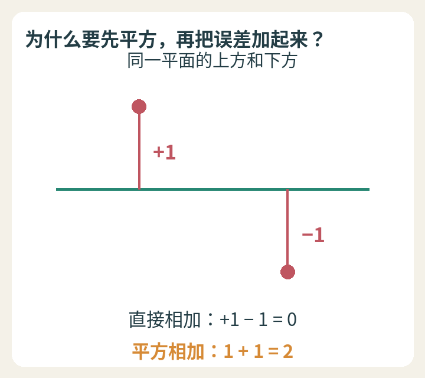

平方之后，两边都成为正数；较大的偏离也会得到更重的惩罚。距离2的平方是4，距离1的平方只有1。

还有一个对计算很有帮助的特点：点到平面的有符号距离是坐标的线性表达式，平方后得到二次表达式；把很多这样的式子相加，仍然是二次表达式。这就为后面的紧凑账本和求最优位置铺好了路。

注意：分数是**距离平方的和**，不是距离本身。若坐标单位是米，分数的量纲就是平方米；本文坐标无量纲，分数也是对应的无量纲平方量。不要把分数0.01直接读成“误差是一厘米”。

## 6. 亲手找一次最合适的位置

先不在山地里找，换成最容易算的两个平面：x=0和x=2。

这两张平面平行。我们只考虑新点的x坐标，它们给出的误差是：

E(x) = x² + (x−2)²。

试三个位置：

- x=0：0²+2²=4；
- x=1：1²+1²=2；
- x=2：2²+0²=4。

中间看起来比较公平，而且确实是最小值。把式子整理一下：

**E(x) = 2(x−1)² + 2。**

平方不可能小于0，所以x=1时，E最小，等于2。

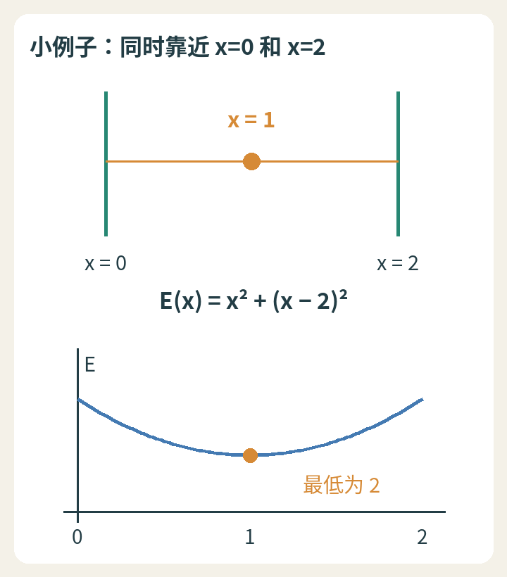

这里没有一个位置能同时待在x=0和x=2上。最优解做的是折中，**最小误差不一定等于零**。

在三维网格里，情况类似，只是需要同时选择x、y、z，并照顾更多不同方向的平面。这个例子里的y、z还完全没被约束，这一点会在第9节派上用场。

## 7. 关键省钱之处：不带着一大摞纸跑

如果顶点每合并一次，就把所有旧平面的方程抄成一张越来越长的清单，存储和计算都可能越来越重。

Garland与Heckbert的关键办法是：**用一个固定大小的小矩阵，概括这份“距离平方之和”。**

把顶点A保存的评分规则记作Q_A，把B保存的规则记作Q_B。Q还不是某个位置的得分；给它一个候选位置P，算出的E(P)才是分数。合并之后，新的误差账本就是：

**Q_P = Q_A + Q_B。**

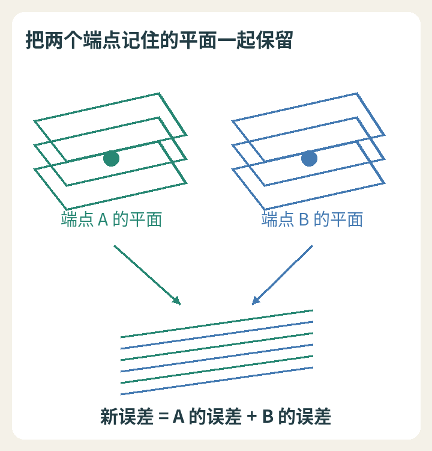

这里的加法很普通：两个小矩阵相同位置的数字分别相加。即使前面已经合并过许多顶点，账本仍然一样大。

它是一张4×4的对称矩阵。对称意味着主对角线两侧对应数字相同，所以16个格子只需要保存10个独立数字。

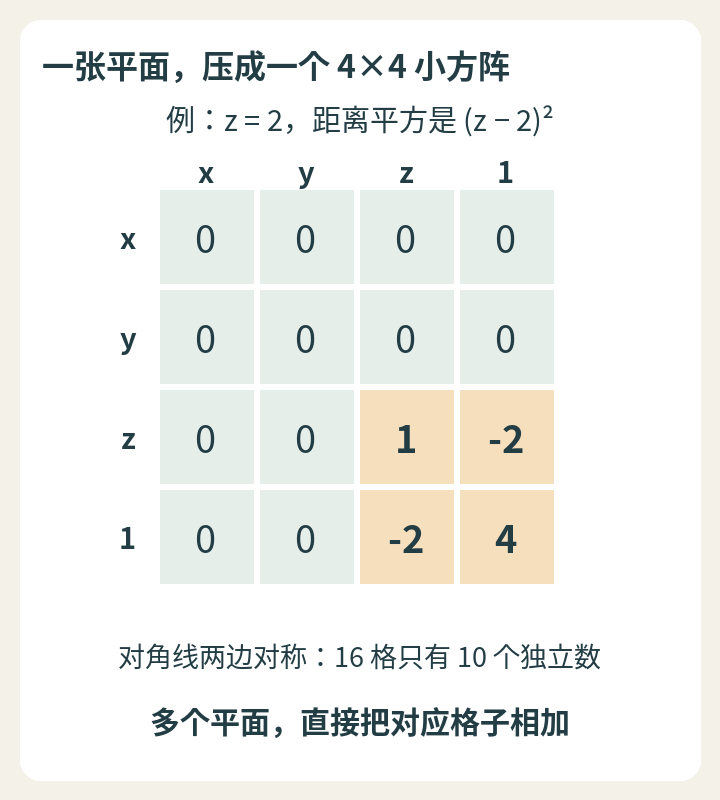

图里的行与列都依次对应x、y、z、1。最后的1是固定不变的乘数，用来装下常数项和一次项，不是第四个空间方向。使用规则很直接：每格的系数，乘它所在行的量，再乘所在列的量，最后把16格的结果相加。

例如这张表记的是平面z=2的距离平方。试一个高度z=3的候选点；x、y取什么都不影响这张平面的得分，因为相关系数都是0。只有四格非零：

- z行、z列：1×3×3=9；
- z行、1列：−2×3×1=−6；
- 1行、z列：−2×1×3=−6；
- 1行、1列：4×1×1=4。

加起来，E(P)=9−6−6+4=1，恰好等于(3−2)²。换候选点只需换x、y、z；Q中的系数不用重写。多个平面的规则相加，也只需把对应格相加，因为同一格始终乘同样的两个量。

先把矩阵想成“一种打包后的多项式”就够了。它不是保存十个采样点，也不是把整个网格塞进了16个像素；它保存的是评价任意候选位置所需的二次表达式系数。

有一处值得诚实交代：A和B可能原本共用某张平面，两份账本相加时，这张平面可能被重复计入。原论文也明确讨论了这一点。这里追求的是便宜、可累加且有用的近似，不是维护“每个不同平面恰好出现一次”的集合。

若你已经熟悉矩阵，第18节给出正式写法；还没学过，也可以继续主线。

## 8. 为什么它会偏爱某些移动方向？

假设你站在一片平整坡面上。

沿坡面方向挪一点，新位置仍接近周围所有平面；垂直于坡面跳起来，就会同时远离它们。

再想象一条山脊：两侧坡面的方向不同。沿山脊移动，可能仍然比较照顾两侧；横跨山脊移动，就更容易伤到其中一侧。

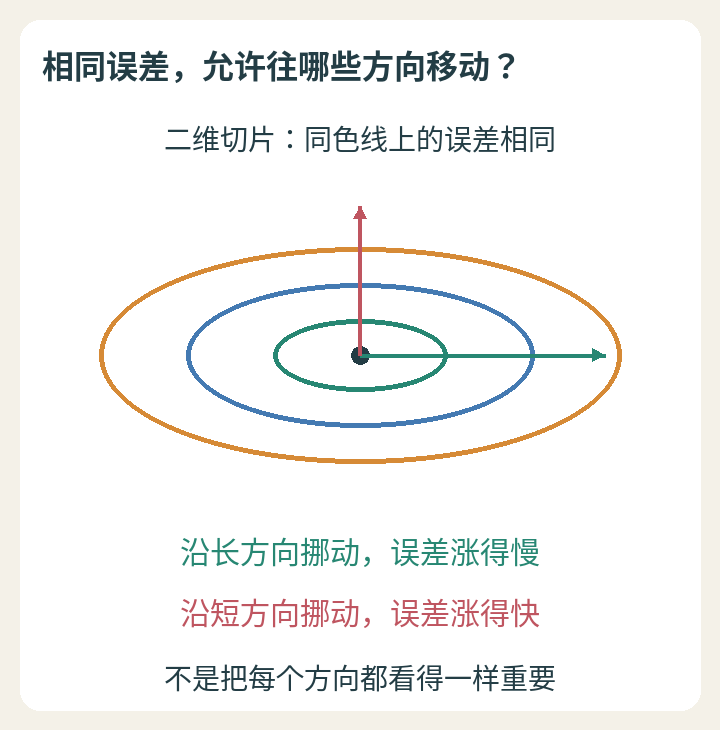

图里，同一条颜色线上的误差相同。沿椭圆长轴移动较远，误差才增加到下一档；沿短轴移动一点，就可能跨过好几档。

三维里的对应形状常是椭球，也可能退化成其他形态。这正是二次误差账本有意思的地方：**它不把各个方向的移动当作一样危险。**

但不要把图理解为“算法检测出了山脊这个物体类别”。它只是利用相邻平面的方向，通过数值约束间接反映局部形状。

## 9. 完全平的地方，反而可能没有唯一答案

若周围所有面都在同一张平面上，只要新点仍在这张平面里，到这些平面的距离就全是0。

往左一点、往右一点、在平面上再滑远一点，都一样好。

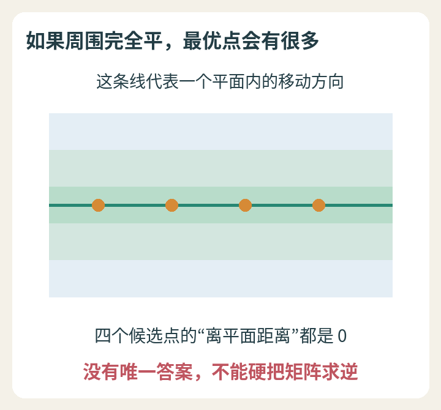

这不是程序突然变笨，而是你提供的约束没有告诉它“平面内到底该站哪儿”。

反映到求解方程上，就可能出现**奇异矩阵**：方程没有提供足够的独立信息，无法据此确定唯一的三个坐标。接近这种情况时，浮点计算也可能很不稳定。

因此，健壮实现不能写成“每条边都无条件求一个逆矩阵，然后相信答案”。

本文教学程序准备四类候选：A本身、B本身、两者中点，以及在方程数值条件足够好时求出的最优点。

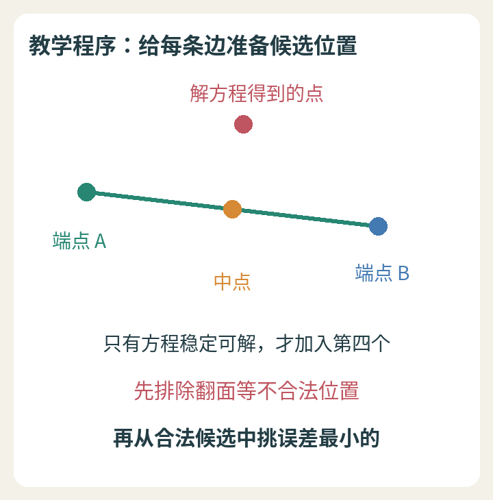

程序先排除不合法候选，再比较其余候选的误差。如果方程不稳定，至少还可以尝试端点和中点。

这是便于阅读的**教学变体**。原论文在奇异情况下还讨论了先沿端点之间的线段寻找最优位置，再考虑端点与中点等回退；本文没有把那段线段优化完整搬进示例。

我们的条件数阈值是10¹⁰，它是这里的数值保护约定，不是QEM的定义，也不是适用于所有模型尺度的万能常数。

## 10. 一次局部选择，怎样变成整张网格的简化？

现在可以把算法写成一轮轮重复的小动作。

1. 为当前允许折叠的每条边，合并两个端点的误差矩阵。
2. 产生候选新位置，检查是否合法，算出这一条边的最好可用代价。
3. 在所有可用边里，选择代价最小的一条。
4. 完成折叠，更新附近三角形、连接关系和候选代价。
5. 直到达到面数目标，或者已经没有合法操作。

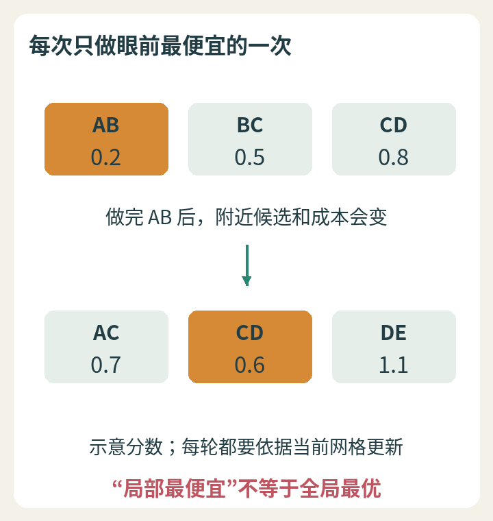

这种做法叫**贪心选择**：每次先做眼前最便宜的一步。它没有搜索所有可能的几百步组合，因此不承诺得到全局最优网格。

原论文用最小堆维护候选优先次序。可以把最小堆理解成一种让你快速取出“当前最低价条目”的数据结构，但折叠后附近的旧报价仍然必须更新。

为让读者容易核对，本文的小程序采用更慢、更直接的办法：**每轮重新扫描全部当前边**。800面规模还能方便实验；这不是面向百万面资产的生产级实现，也不能用它的耗时代表论文或现代引擎性能。

还有一件尤其重要：当前三角形变了，误差矩阵却不能每轮只根据新三角形重建。

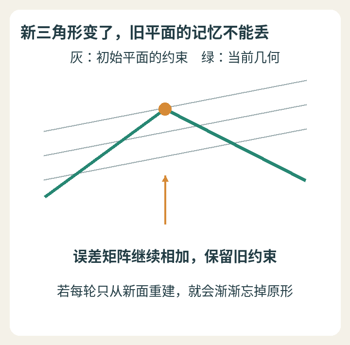

否则，第一轮偏了一点，第二轮把已经偏掉的表面当成新标准，再偏一点，就可能逐步忘记最初的形状。QEM通过相加传播初始平面的约束，而不是不断给自己的最新结果重置评分标准。

## 11. 实际运行：先把800面减半

现在回到开头的山地。

我们运行两个程序路径，输入完全相同，外边界锁定规则和合法性检查也相同：

- **QEM路径**：按累计平面误差选边，并从合法候选位置里选代价较小的位置；
- **最短边对照**：挑当前最短的合法内部边，把它合到中点。

这是两套完整策略的对照。它同时包含“怎样挑边”和“怎样放新点”的差异，**不能把全部差距单独归功于某一个公式**。

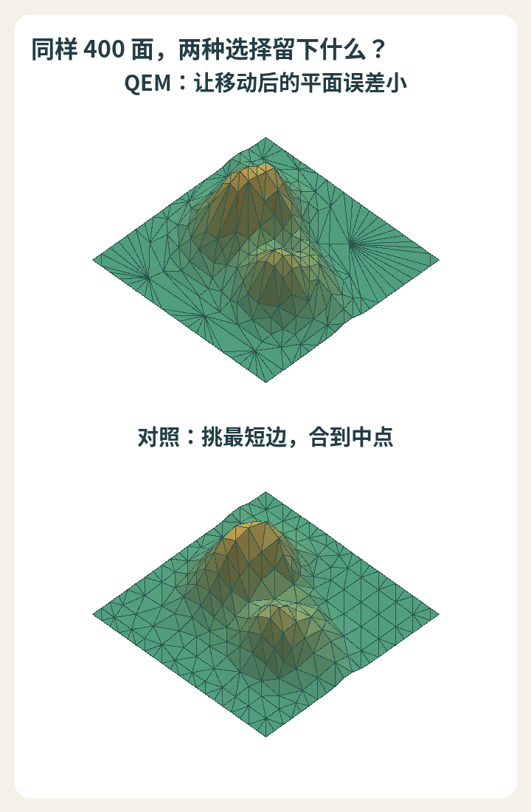

两张都还能认出山。但QEM更愿意在平缓区域合并出大面，把预算留给变化明显的地方。

最短边法也不是什么都不考虑：边长里包含高度差，所以陡峭区域某些边自然较长。不过，“两个端点近”并没有直接衡量合并后对周围原始平面的伤害，不能等同于“这一刀很安全”。

## 12. 再压到160面，会付出什么代价？

160面是原800面的20%。这一次，两套策略的差异更显眼。

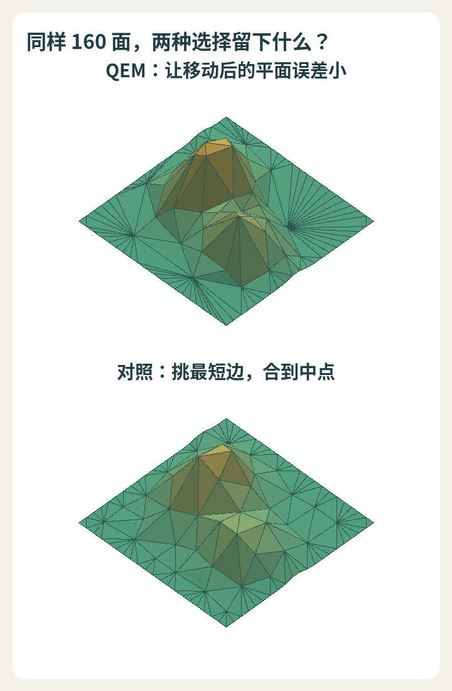

不要只盯着某条线框漂亮不漂亮。观察峰顶位置、坡面起伏、两峰间的连接和窄山脊是否还在。

把QEM的160面结果交给与开头完全相同的Blender场景，不画线框、只看实际表面和光照，效果如下。这里按各三角形真实的平面朝向计算光照，没有让相邻面假装共享一个平滑朝向来掩盖棱角。


QEM结果也已经变粗，不能说“删掉80%的面，形状完全不变”。预算越紧，保留原形的自由就越少。

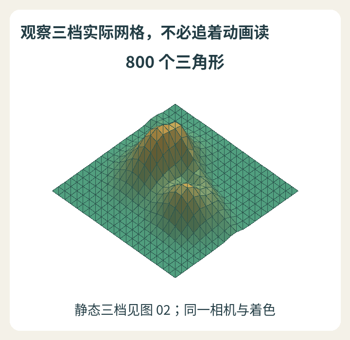

动画只帮助你观察变化，前面的静态图已经保留全部三个档位。暂停动画，不会丢失算法的某一步解释。

而且，外边界锁定本身会消耗预算。本文固定了80个外边界顶点：四条边各21点，四个角重复计了一次，故4×21−4=80。对于保持这圈边界的三角化圆盘，仅边界也已经需要至少78片面。不能一边坚持这些约束，一边要求程序随便压到十几个面。

## 13. “看着还行”之外，再量一次真正的偏差

QEM内部的分数不是最终模型质量的精确证书。要评价结果，我们另做一项测量。

在地面正方形上均匀放81×81个位置，共6561个采样点。对每个(x, y)，分别计算：

- 原始800面网格在这里的高度；
- 简化网格在这里的高度；
- 两者相减。

怎样知道三角形内部的高度？把它当成一小块平板，用三个角的高度按位置加权。比如在三角形重心，三个角各占1/3；角的高度分别为0、0、6时，这里的高度就是2。其他内部点也使用三个非负权重，权重相加为1。这叫三角形内的线性插值。

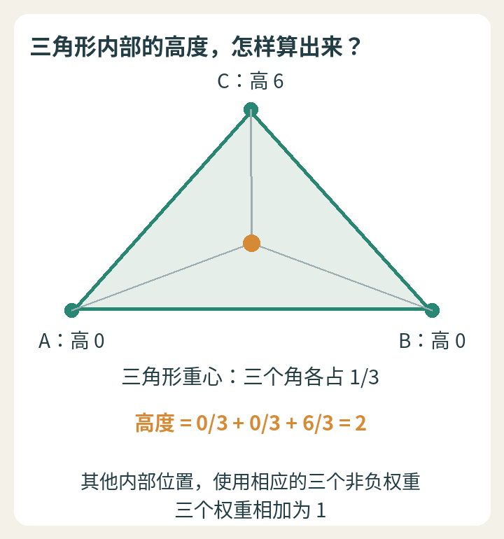

比较的是**原始三角形网格**，不是生成地形前的连续数学函数。

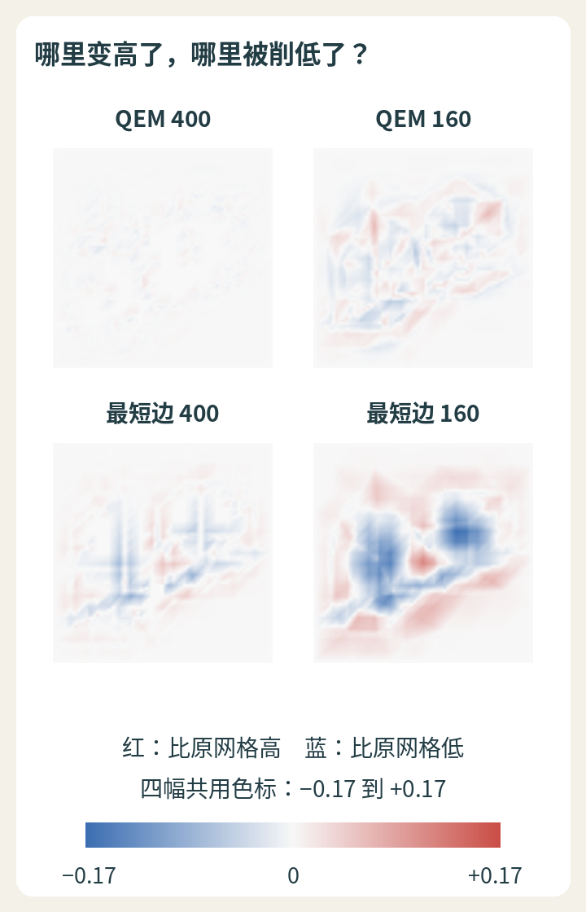

再沿地面上的y=0切一条线，把高度单独画出来，就能直接观察山坡在哪一段被削低或抬高。

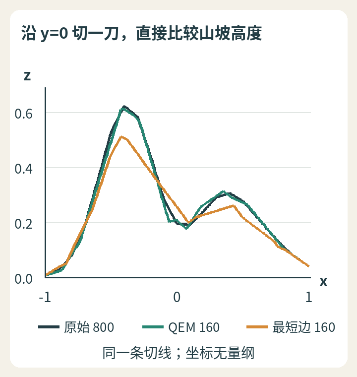

红色表示简化后比原网格高，蓝色表示被削低。四张图共用相同色标，不能给每张图分别拉满对比度之后，再凭颜色深浅比较好坏。

接着，把每个高度误差平方、求平均、再开平方，得到**均方根误差**，简称RMSE。开平方后，它重新回到与高度相同的尺度。

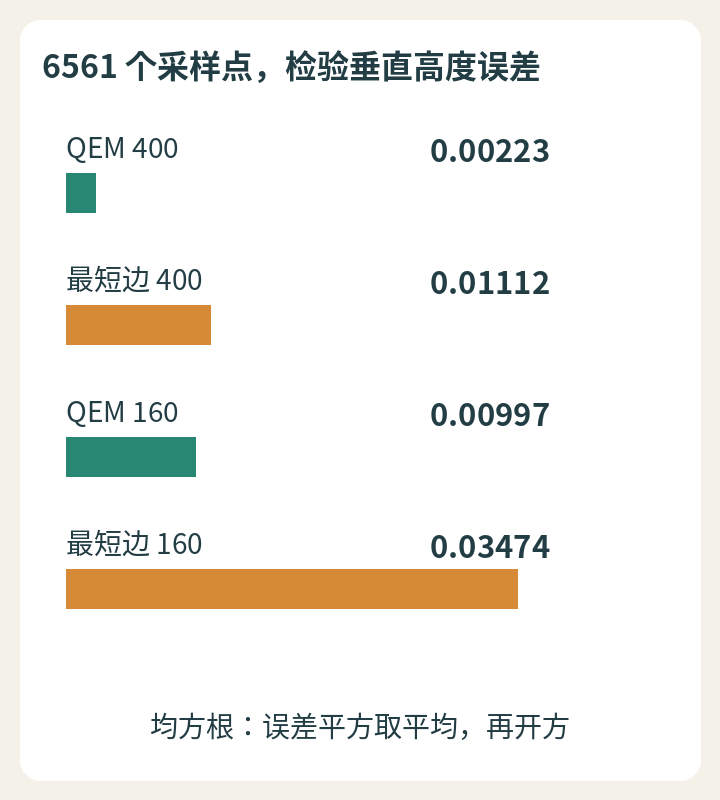

本次运行得到：

- 400面：QEM的RMSE约0.002231，最大采样绝对误差约0.018080；最短边对照分别约0.011117与0.088300。
- 160面：QEM的RMSE约0.009966，最大采样绝对误差约0.056789；最短边对照分别约0.034745与0.163411。

在这份输入和这些规则下，QEM路径更好地保持了采样高度。这个结论可以复跑，但不能外推成“所有模型都按固定倍数获益”。

这项测量也有边界：只测固定网格上的**垂直高度误差**，不是在所有方向寻找最近表面的距离，更不是整个连续表面的最大误差保证。采样点之间仍可能有更大的偏差；带洞、悬挑或多层结构也不能这样简单地比较高度。

## 14. 一个反例：分数是零，形状照样能坏

回想第4节，那张小三角形被延伸成了无限大的平面。

这很便于计算，也带来了明显的盲点：点可以在平面上滑得很远，仍然得到零分；但它已经离原来的有限三角形很远了。

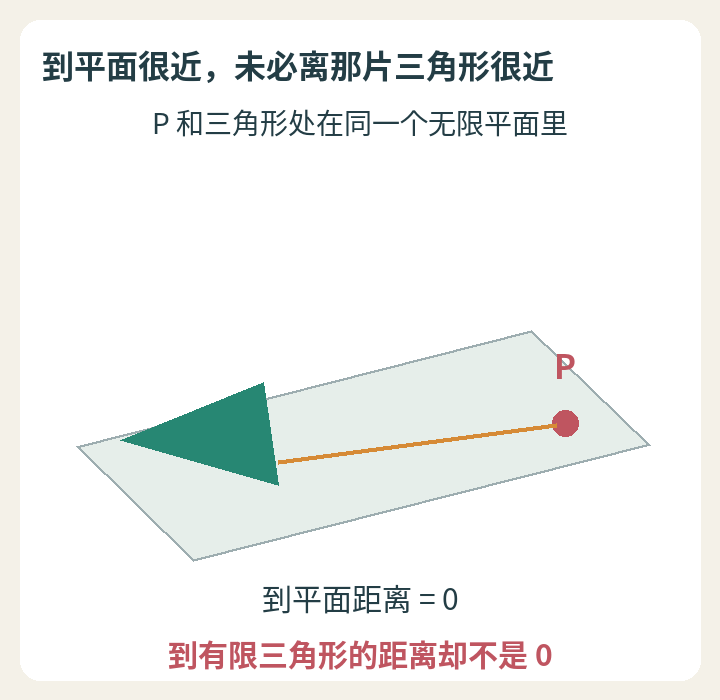

所以QEM的平面距离是一种高效近似，不能当成“到原始网格真实表面的最近距离”。

再看一个更直观的后果：把平面矩形右上角的顶点往左挪，新的表面仍在同一个平面上，平面误差可以一直是0，但轮廓已经缺了一角。

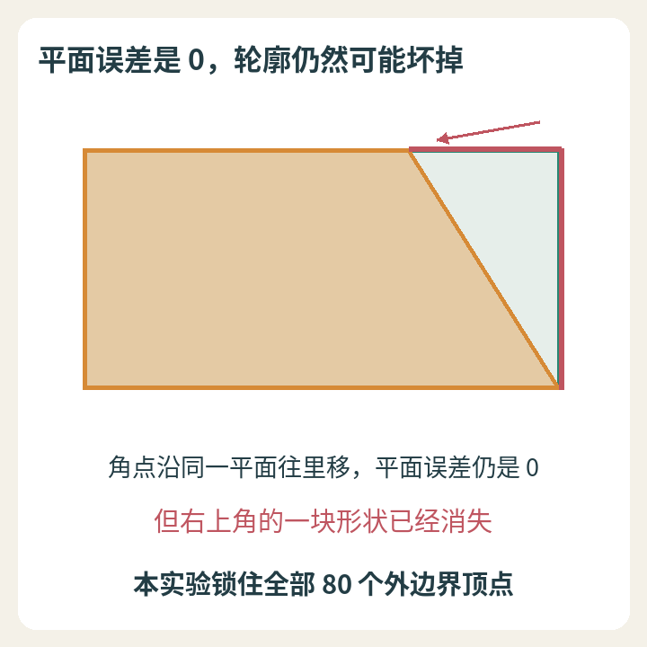

本文选择最容易核对的保护：所有外边界顶点锁住，任何涉及它们的边都不折叠。原论文还讨论了给边界加入额外约束平面并施加较大权重的做法，它允许更灵活地简化边界。

锁住边界与给边界加惩罚，不是同一个规则。前者简单保守，后者需要认真选择约束和权重；不要把本文规则当成所有QEM实现的必选方式。

## 15. 分数再低，不合法的折叠也不能做

如果新位置把周围一个三角形拉过它的对边，那片面就可能翻过去，造成错误朝向或重叠。

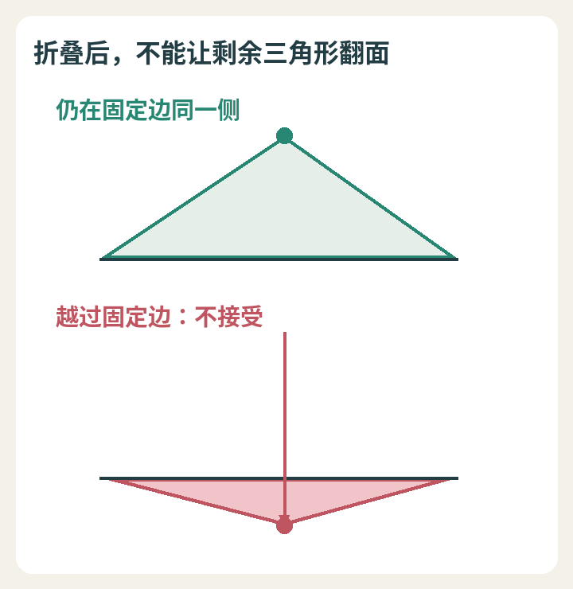

本文程序做了几层检查：

- 只考虑由两片面共享的内部边，且两个端点都不在锁定边界上。
- 检查连接关系：两个端点的公共邻居，必须正好是这两片面中位于对面的两个顶点。这是本例使用的边折叠链接条件。
- 对折叠后留下的邻接三角形，拒绝面积退化或法向转到反侧的候选。
- 因为输入是高度地形，还要求三角形在xy平面的投影保持正面积，避免把它折成不再能按同一(x, y)读出高度的形状。

“公共邻居”只是同时和A、B有边相连的顶点。若出现额外连接，强行合并可能改变局部拓扑。这里先把此类候选排除，而不是事后猜测是否开洞。

在400面和160面两个输出处，程序还检查：所有边只属于一片或两片面，外边界位置逐点不变，没有重复面，投影总面积保持4，V−E+F保持1。

V、E、F分别是顶点数、边数、面数。这里的1对应这块带一圈外边界的连通圆盘型网格；不是所有三维模型都该等于1。你可以把它先当作辅助核账，拓扑公式值得另开一篇细讲。

这些检查服务于**本文这类简单高度地形**。它们不构成一个可随意接收任意脏网格、保证处理所有自交和非流形情况的通用修复器。

## 16. 只保护几何，还会漏掉什么？

想象一块完全平的地板，一半是绿色，一半是橙色。两种颜色的交界在游戏里非常重要，但所有顶点都可以落在同一个几何平面上。

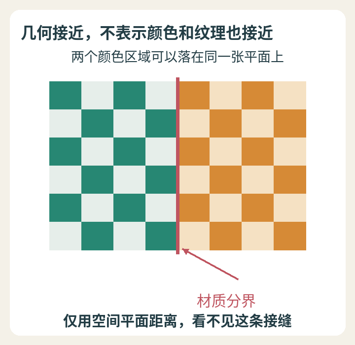

只算三维平面距离的QEM，并不知道那条颜色分界在哪里。纹理坐标、材质边界、法线硬边和动画蒙皮权重，都需要额外处理。

这里的**纹理坐标**就是“模型表面这个点应当读取图片上的哪个位置”；几何位置很接近，不代表应该读取同一块纹理。

Garland与Heckbert在1998年的后续论文中扩展了颜色和纹理等属性处理。本文实现的是仅含几何的教学版本，没有暗中包含那些扩展。[作者文献入口](https://www.cs.cmu.edu/~garland/quadrics/)

而在引擎中，根据观察距离切换不同复杂度模型，通常称为不同**细节层级**，简称LOD。QEM可以帮助生成这些模型，却不独自决定什么时候切换、怎样避免突然跳变。

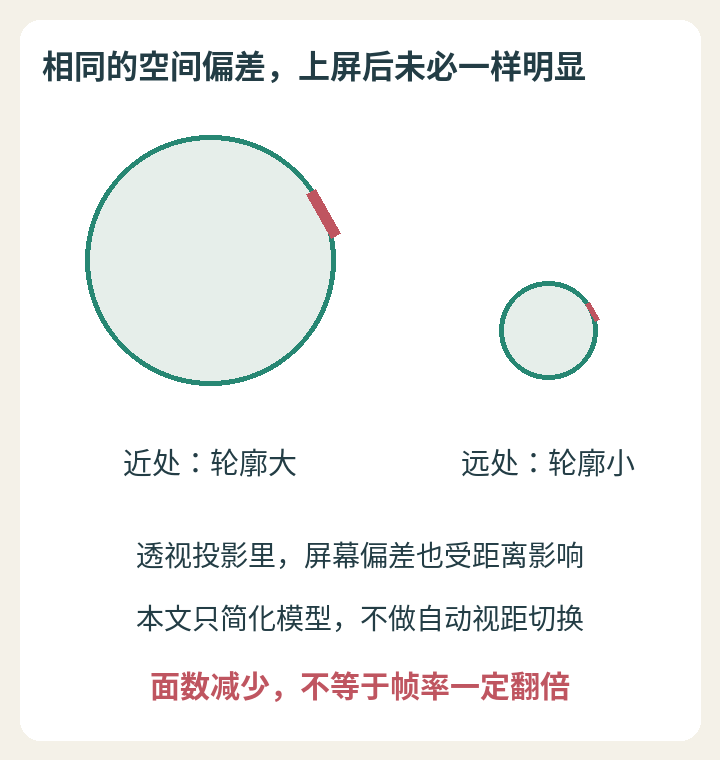

面数下降也不保证帧率按相同比例提高。渲染时间还可能受像素着色、阴影、材质切换、其他场景物体等因素影响。本文没有测游戏帧率，不能把160面与800面的比例拿去冒充性能测试结果。

## 17. 这段历史，究竟是哪一篇论文？

容易记混的有三个节点：

- 1997年：Garland与Heckbert的SIGGRAPH论文《Surface Simplification Using Quadric Error Metrics》，给出这里讨论的几何误差方法与顶点对收缩框架。
- 1998年：两位作者发表颜色与纹理扩展论文。
- 1999年：Garland的博士论文《Quadric-Based Polygonal Surface Simplification》作进一步分析与系统整理；论文页面标明日期为1999年5月9日。

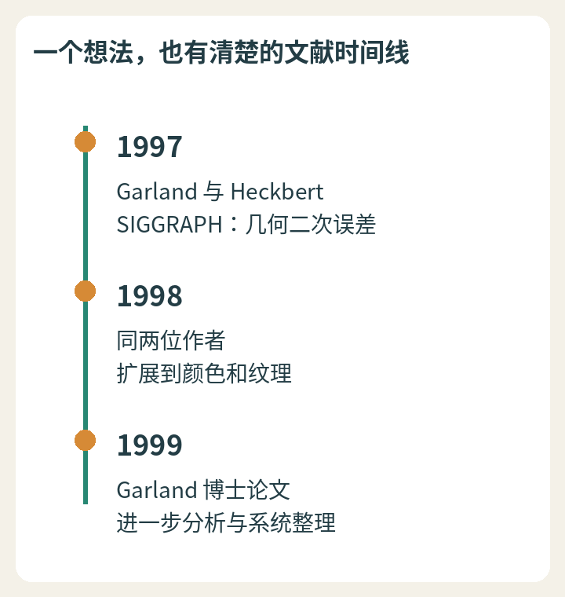

还有一个重要区别：**1997年原算法并不只允许合并已有边的两个端点。**它还讨论把距离足够近、原本不相邻的顶点配成候选对，以合并分离部分、改变模型的连接结构。

我们为了让“折叠后为什么少两片面”和边界保护更清楚，只采用相邻内部边。这是主动缩小范围，不能反过来说原论文的QEM只能做边折叠。

原作者页面提供牛、兔、足骨和地形等示例的来源线索，也说明了其某份实验代码的发布方式。但代码的授权不自动覆盖所有第三方模型和论文图片。本文没有复制那些模型，而是公开自己的生成程序与网格，方便你从零复算。

[原论文PDF](https://www.cs.cmu.edu/~garland/Papers/quadrics.pdf)值得看第4—6节；[博士论文页面](https://www.cs.cmu.edu/~garland/thesis/)则是继续深入的入口。本文没有把1999年的整理当成1997年才首次发生的另一件事。

## 18. 进阶：把“小账本”展开给你看

这一节可以跳过，不影响你运行实验。

一张平面写成：

ax + by + cz + d = 0。

其中(a, b, c)给出法向方向。先算出这个法向的长度L=√(a²+b²+c²)，再把a、b、c、d四个系数一起除以L。这样新的a²+b²+c²=1，而整张平面的位置不变；对一个点代入左边，得到的就是有符号距离。不能只除a、b、c而保留d，否则通常会把平面移到别处。若不做归一化，把同一平面方程整体乘100，就会凭空把平方误差放大10000倍。

把平面系数记成列向量p=(a, b, c, d)，把候选点补一个常数1，记成h=(x, y, z, 1)。这个1只是为了把式子里的常数项d一并装进去。

有符号距离就是pᵀh。上标T表示转置，作用是让一列数横过来，逐项相乘后相加。

因此，距离平方可以写为：

(pᵀh)² = hᵀ(ppᵀ)h。

ppᵀ把每个系数与每个系数分别相乘，组成4×4矩阵。把很多平面的这些矩阵相加，就是Q：

**Q = Σ ppᵀ，E(h) = hᵀQh。**

这就解释了：为什么相加矩阵等于相加误差，为什么矩阵大小不会随平面数量增加。

再把Q的左上3×3部分记为A，最后一列的前三个数记为b，右下角常数记为c。候选三维位置写成列向量v，则：

E(v) = vᵀAv + 2bᵀv + c。

寻找这个二次函数的最低点，在A可逆时归结为解三个线性方程：

**Av = −b。**

代码用线性方程求解器求v，没有先显式计算A的逆。若A奇异或过于接近奇异，就走前面介绍的候选回退。

请把“这个合并账本上的最优点”与“整个模型的全局最优简化”分开：前者解决一次局部放置，后者还涉及后续几百次折叠如何组合。

## 19. 你可以复做的三组实验

完整源代码是[qem_lab.py](examples/qem_lab.py)，运行记录是[results.json](examples/results.json)。原网格与四个输出也提供为OBJ文本文件：

- [原始800面](examples/qem-800.obj)
- [QEM 400面](examples/qem-400.obj)、[QEM 160面](examples/qem-160.obj)
- [最短边400面](examples/shortest-400.obj)、[最短边160面](examples/shortest-160.obj)

OBJ里的v行写顶点坐标，f行写三角形的三个顶点编号，编号从1开始。它们是模型数据，不是图片。

本次运行环境为Python 3.12.14与NumPy 2.3.5。两张带光照的实际模型渲染另由Blender 4.3.2完成，[渲染脚本](examples/render_in_blender.py)和[渲染记录](examples/blender-results.json)一并提供。程序需要NumPy，不依赖游戏引擎；在装有相应环境的终端运行：

```sh
python qem_lab.py
```

它会在代码所在目录重建结果文件和五个OBJ模型，覆盖同名结果；改参数前可先另存一份。耗时会随机器变化，结果文件中的时间不是性能承诺。

**实验一：先不用电脑。**把第6节的两个平面改成x=0和x=4。列出E(x)，找最小值。

答案是x=2，最小值8。再想一想：为什么仍然不能确定y、z？因为你没有给这两个方向任何约束。

**实验二：给它一个方向。**代码中的矩阵检验使用x=0、x=2、y=1、z=3四张平面。最优点应是(1, 1, 3)，误差2。把z=3改成z=5，重新写出你预期的最优点，再改对应测试。不要只改输入却保留旧断言。

**实验三：检查“越少越好”这句话。**先复现400面和160面的结果，再把目标改成300面和200面。目标必须是本例能由内部折叠到达的偶数；同时修改run函数中用来测量、取快照的目标列表，不能只改simplify的默认参数，让后面的读取仍然索要旧档位。

比较两套策略在相同新预算下的高度误差。然后把输入改成完全平面，例如在terrain函数里令z=0，观察许多QEM候选变成并列低分。网格外形由边界约束守住，内部选哪个点则可能受回退与并列顺序影响。

想继续改程序，可以把原论文的线段最优化回退加进去，或者增加一种“按平面误差选边、但只允许中点”的对照。后者能更好地分离选边策略与新点放置各自的作用。

本实验另外实际执行了1000组固定种子随机坐标检验，确认矩阵评分与逐平面平方求和一致，并在输出处执行前述网格检查。它没有测任意商业资产、动画变形或GPU速度。

## 20. 最后，把整件事缩成一句自己的话

如果现在有人问你：“QEM是不是挑不重要的点删掉？”

你可以说得更准确一点：

**它用初始局部平面的距离平方，给每个顶点做一份可相加的误差账本；每轮尝试把一对点合成一个点，选择便宜且合法的操作，并把旧账本一起带过去。**

于是，平缓处往往能大刀阔斧，形状变化处通常要多留预算。但这个分数是近似，轮廓、连接关系、纹理和动画等要求仍然需要额外照顾。

这也是本文更值得带走的设计习惯：当一个原始问题太昂贵，不一定先把每个细节算得精确无比。可以寻找一个**足够有用、能紧凑保存、还能在操作中自然合并的近似量**，再用独立实验和反例检查它究竟丢了什么。

---

正文与原创教学图、原创地形数据采用[CC BY 4.0](https://creativecommons.org/licenses/by/4.0/)，示例代码采用[MIT许可](examples/LICENSE.txt)。第三方论文、网页及其图片仍属于各自权利人，本文只链接，不据此重新许可。事实依据、完整配图职责与素材取舍见[sources.md](sources.md)。
