# 图片没变，只多了一个字节：rsync怎样找回错位后的旧片段？

先看这张小图片：夜色、山坡，还有一个黄色圆盘。

我们实际生成了两份图片文件。把它们分别打开，看到的像素完全相同；程序把两份解码后的红、绿、蓝数值逐一核对，也全部相同。

可是，旧文件有18445个字节，新文件有18446个字节。


多出来的东西不是一座山，也不是一个新像素，而是文件开头附近的一个换行。

现在，假设你电脑里有新文件，另一台电脑还保存旧文件。要让对方得到**字节完全一致的新版本**，你当然可以把18446个字节全部再发一遍。

但大部分内容明明没变。有没有办法告诉对方：“开头这一小段用我的，后面那些你已经有了，直接拿来拼”？

难点在于：插入的那个字节，把后面的内容全部向右推了一格。若双方只按原来的刻度整齐分块，就会觉得许多块都变了。

rsync算法有一个非常漂亮的处理：**接收端照常切固定块，发送端却让一个小窗口逐字节滑动，重新找回错位之后仍然相同的片段。**

我们先看真实文件，再用十几个字母手推整个过程。到需要加法时再加法，需要公式时再写公式。

## 1. 为什么同一张图片，可以有不同的文件字节？

屏幕上的一个小色块叫**像素**。本文图片宽96个像素、高64个像素，每个像素由红、绿、蓝三个数指定颜色，这三个数通常简称RGB。

文件里除了像素数值，还需要告诉读取程序：“我是什么格式？宽多少？高多少？颜色数值最大到多少？”这部分说明叫**文件头**。

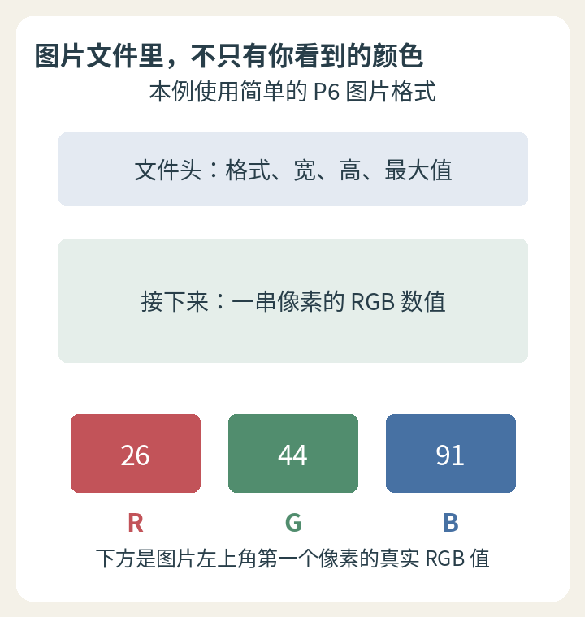

这里选用便于观察的P6型PPM图片：前面用文本写简短说明，后面按顺序存颜色数值。sRGB和BT.709这些色彩规则，约定了数字怎样对应到颜色与亮度。为了专注字节问题，示例采用常见的sRGB式数值变体，没有进行严格BT.709色彩转换；两份文件使用同样的数值解释。

原文件头读起来是：

```text
P6
96 64
255
```

新文件在P6后面多了一行空白：

```text
P6

96 64
255
```

按该格式的空白分隔规则，这不会改变宽、高或后面的像素。我们把新增换行放在**宽度之前**；不能随意跑到像素开始处插入空白，因为最大值之后有专门的分隔规则，后面的字节就属于像素数据了。[Netpbm格式说明](https://netpbm.sourceforge.net/doc/ppm.html)

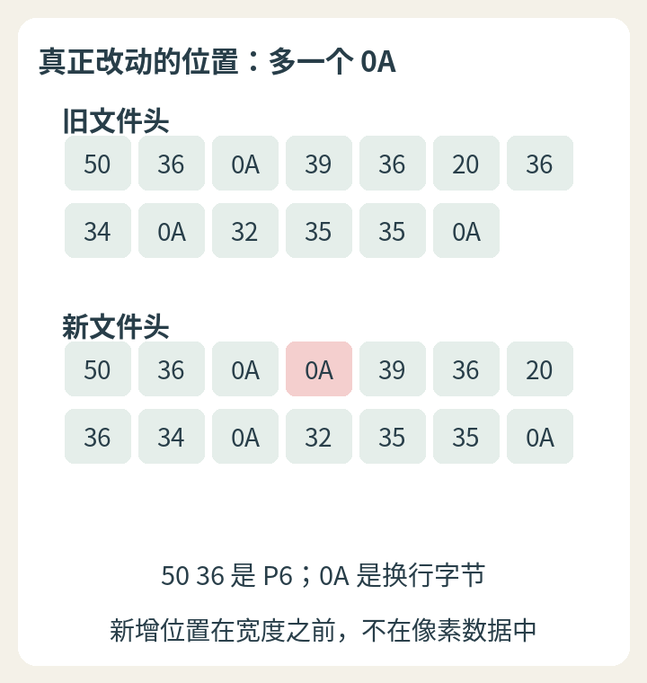

图里用的是**十六进制**：用0—9和A—F这16个符号表示数。本例的一个字节取值0到255，可以写成两个这样的符号；0A代表十进制10，在这里就是换行。50、36分别是字母P和数字字符6的字节编码。

你不必背这些编码，只要看出：新增0A之后，后面的字节仍然是原来那些，只是位置改变了。

## 2. 把文件缩成16个字母，错位就一眼可见

先把复杂图片放在一边，旧文件暂时写成：

```text
AAAABBBBCCCCDDDD
```

只在开头加一个X，新文件就是：

```text
XAAAABBBBCCCCDDDD
```

ASCII是一套把常见英文字母、数字等字符对应到整数的编码约定。这里故意只使用它范围内的字母，每个字母恰好占一个字节。中文字符不能直接套用“一个字就是一个字节”，那是另一个编码问题。

把旧文件每4字节切成一块，我们得到AAAA、BBBB、CCCC、DDDD。

如果新文件也从头每4字节机械分块，得到的却是XAAA、ABBB、BCCC、CDDD，最后还剩D。

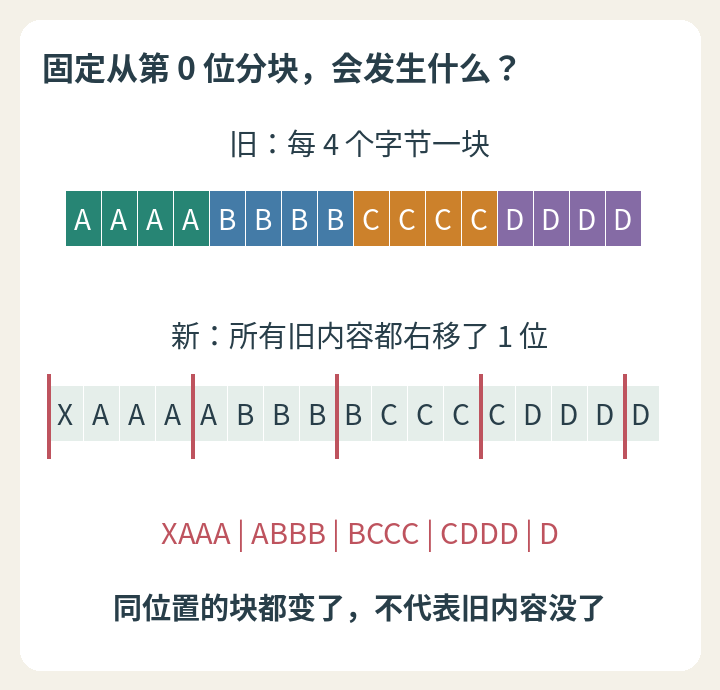

**同位置的块都不一样，旧内容却几乎一字没动。**

所以，“比较第0块、第1块、第2块……”不是这道题的好答案。我们需要的是找内容，而不是死守同一个位置编号。

这里把文件最开头的位置记作0。某个字节前面有多少字节，它的**偏移**就是多少；新文件里的第一组AAAA从偏移1开始。

## 3. 谁手里有旧文件，谁手里有新文件？

把角色先摆清楚，后面就不会绕晕。

- **发送端**有新文件A，希望对方最终也得到A。
- **接收端**已有旧文件B，希望利用B中仍有用的部分。

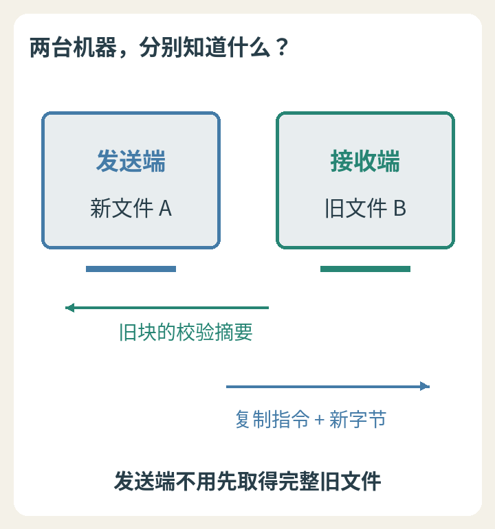

最笨的办法之一，是让接收端先把整个旧文件B传给发送端。这样发送端确实可以在本地比较两个文件，但本来想省流量，结果先传了一整份旧文件。

rsync算法换了一种安排：接收端不先发送旧内容，而是给旧文件的每一块做一张较小的**核对卡**，把这些卡发过去。

卡片告诉发送端：“如果你在新文件里看见这一类内容，可以引用我的第几块。”

实际核对卡不是肉眼可读的文字卡片，而是包含块编号与校验数字的数据。它比大块内容短，却不能代替大块内容本身。

## 4. 一张核对卡里，为什么有两种校验？

接收端对每个旧块计算两类信息：

1. 一个计算便宜、能随窗口快速更新的**弱校验值**。
2. 一个较长的**强摘要**，用于进一步核对内容。

“摘要”在这里是从一串字节计算出的固定长度数值。相同算法处理相同内容，得到相同摘要；不同内容也可能撞号，因此“摘要相同”不是没有前提的数学证明。

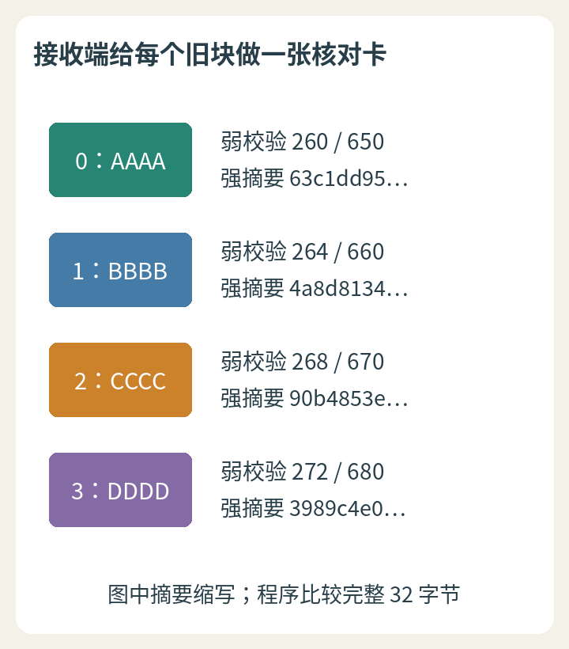

图中弱校验有两个组成数，暂时不用背。第7—10节会手算它们。

我们的教学程序选择SHA-256作为强摘要，每份完整摘要是32字节。图里为了看得清，只显示开头八个十六进制字符与省略号，**实际程序比较完整摘要**。

这不是在说原始rsync报告就用了SHA-256。原报告描述的是MD4，摘要长16字节；这里主动换成方便使用的现代标准库算法，也没有复刻现代rsync的协议细节。[原报告算法步骤](https://rsync.samba.org/tech_report/node2.html)

还有一个容易误会的地方：核对卡不是压缩包。接收端仍必须保存旧文件，之后COPY指令才能从中拿到真实字节。

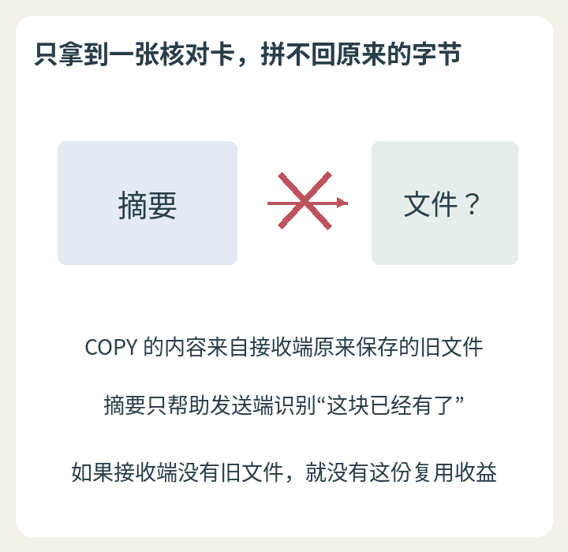

若对方完全没有旧文件，就没有这份“你已经存着，我只发引用”的收益。

## 5. 关键一步：发送端不按固定边界找

收到旧块卡片后，发送端拿一个长度同样为4的窗口，在新文件上试探。

第一站，偏移0，窗口看到XAAA。核对之后，没有对应旧块。

不要立刻跳到偏移4。只向右挪一个字节，来到偏移1，窗口看到AAAA。这次就能匹配旧块0了。

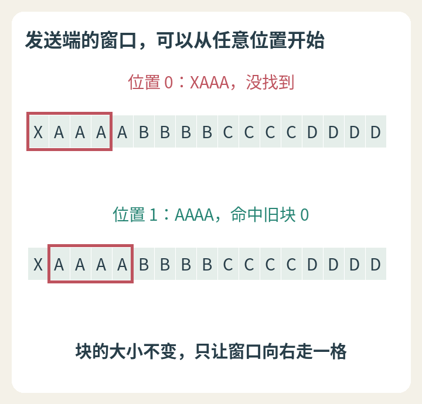

这里有两个不对称的动作：

- 接收端的旧文件被切成**不重叠的固定块**；
- 发送端在新文件里寻找这些块时，可以检查**任意字节偏移**。

窗口仍然是4字节宽，没有忽大忽小。变化的是窗口从哪里开始。

这也解释了为什么它不是“内容决定块边界”的分块算法。旧块边界已经按固定大小划好了，发送端只是努力在新文件中重新找到这些固定块的内容。

## 6. 找到了以后，不用重发那四个A

发送端已经知道：偏移1起的AAAA等于接收端的旧块0。

它可以先发送新增字节X，再发送一条“复制旧块0”的指令。后面依次是复制旧块1、2、3。

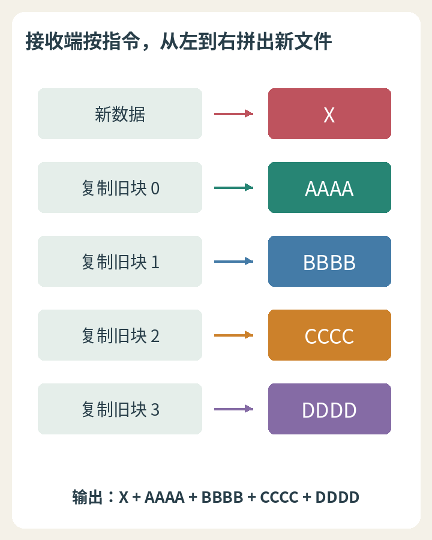

于是接收端按顺序拼出：

```text
DATA X
COPY 0
COPY 1
COPY 2
COPY 3
```

DATA表示“这里是需要新发送的真实字节”；COPY表示“从你保存的旧文件取出指定块，接到新输出后面”。

这里说的COPY不是“在原文件同位置覆盖”。本文程序保持旧文件不动，另外构造新输出，防止还没读到的旧内容被自己覆盖。

有了这个小例子，你已经理解了算法想达到的效果。剩下的问题是效率：若文件很长，窗口要试许多位置，每次都把窗口内所有字节重新算一遍，会不会很贵？

## 7. 先做一个很便宜的数字：普通和a

让窗口暂时变成ABCD。这四个字母的ASCII字节值分别是65、66、67、68。

第一个数a，就是把窗口里的字节值加起来：

**a = 65 + 66 + 67 + 68 = 266。**

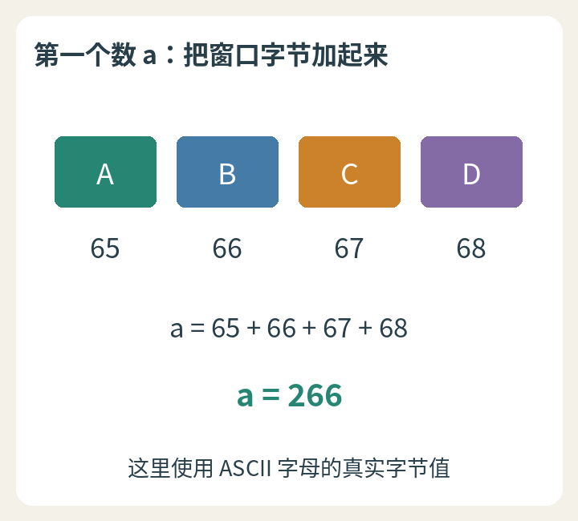

这很容易算，却有明显缺陷：ABCD换成DCBA，和仍然是266。顺序变了，a没有发现。

所以我们再加一个对位置有感觉的数。它仍然只是快速筛选用的工具，后面会亲眼看到它也能撞号。

## 8. 再做一个带位置感的数字：加权和b

对4字节窗口，从左到右分别给4、3、2、1的权重。

A的65算四份，B的66算三份，C的67算两份，D的68算一份：

**b = 4×65 + 3×66 + 2×67 + 1×68 = 660。**

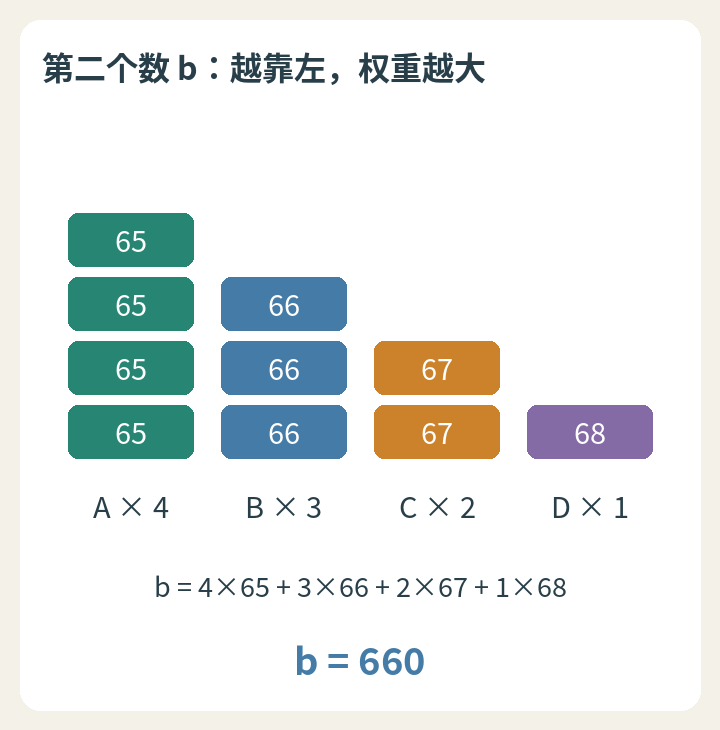

“权重”就是某项在总和里算多少份，不是什么神秘的新运算。

把a和b一起使用，比只用普通和更能分辨内容与顺序。现在窗口每滑一步，我们都需要更新这两个数。

## 9. 窗口滑一步，a只需换出一个、换入一个

ABCD向右滑一步，变成BCDE。旧的A离开，新的E进入，B、C、D都还在。

E的字节值是69，所以：

新a = 旧a − 离开的A + 新来的E

= 266 − 65 + 69

= 270。

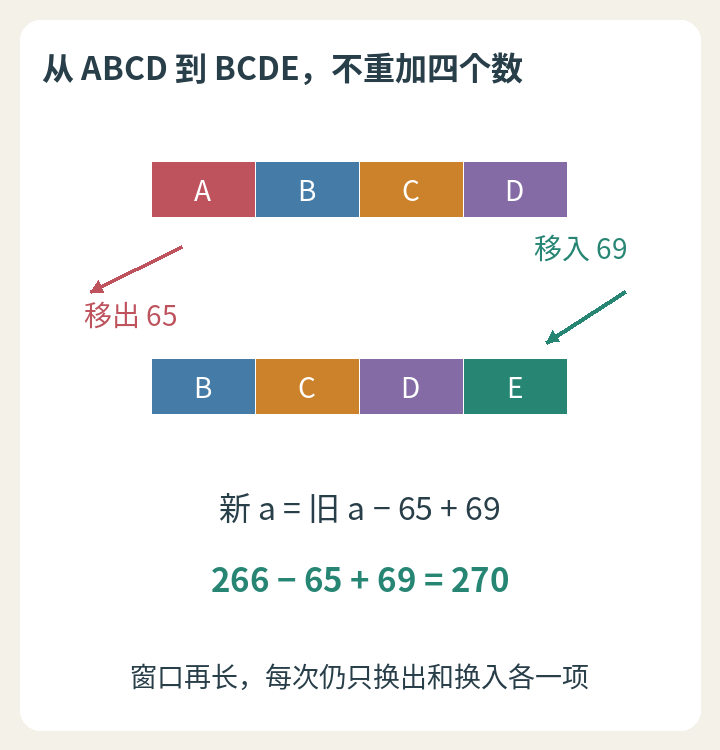

不管窗口有4字节还是4000字节，更新普通和时，都只需要处理离开和进入的两个值。

这叫**滚动更新**：利用上一个窗口已经算好的结果，而不是把大部分没变的工作重新做一遍。

但b的权重也跟着位置变了，看起来没这么简单。

## 10. b也能滚动：删四份旧A，再补一整层

旧b是：

4A + 3B + 2C + D。

先减去4A，留下：

3B + 2C + D。

新窗口BCDE希望得到的是：

4B + 3C + 2D + E。

两者差多少？恰好是一份B、一份C、一份D、一份E，也就是**新窗口的普通和，新a**。

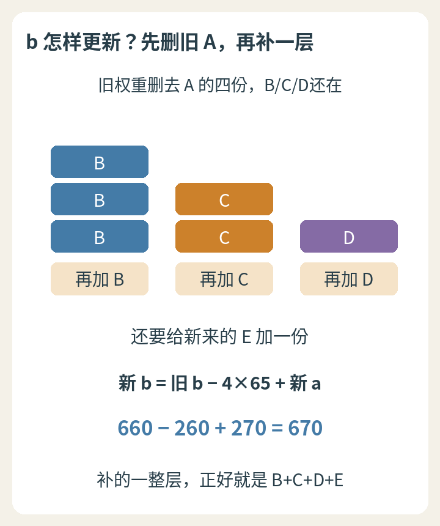

所以：

新b = 旧b − 4×旧A + 新a

= 660 − 260 + 270

= 670。

你也可以直接重算4×66+3×67+2×68+69，验证结果确实是670。

若窗口长度记作S，离开的字节值记作out，进入的记作in，两个更新规则就是：

```text
新a = 旧a − out + in
新b = 旧b − S×out + 新a
```

第二式用的是**已经更新好的新a**，不是旧a。这是抄代码时很容易错的一格台阶。

## 11. 数字一直变大怎么办？让它绕回来

真正的校验值不能随着文件无限增长。本文和原报告这里采用的做法，是对两个累加数分别取除以65536的余数。

一“位”就是一个0或1。16位有2的16次方、也就是65536种不同组合。因此每个数最终落在0到65535之间，可以放进16位。

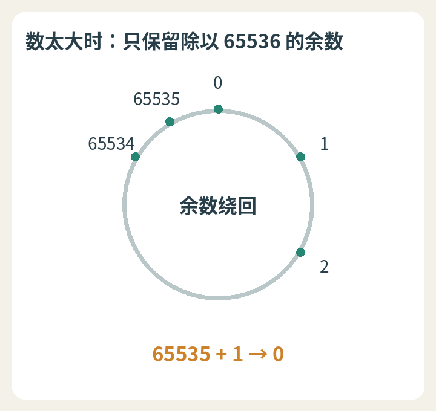

**取模**可以先理解成钟表绕圈：24小时制里，23再走一小时回到0；这里只是把圈的长度换成65536。

两个16位数还能组合成一个32位值：a放低16位，b放高16位。用普通算式写就是a+65536×b。

在滚动更新之后也取相同的余数，递推关系仍然成立。完整推导与定义可以对照[原报告Rolling checksum一节](https://rsync.samba.org/tech_report/node3.html)。

本文示例把每个字节解释成0—255的无符号数，并省略实际协议的种子等细节。它用于解释算法，不与rsync真实线上格式兼容。

## 12. 两个校验数仍然会撞号，给你一个真的反例

ABCD的a、b分别为266、660。

现在换成B@DD。@的ASCII值是64，因此字节值为66、64、68、68。

普通和：66+64+68+68=266。

加权和：4×66+3×64+2×68+68=660。

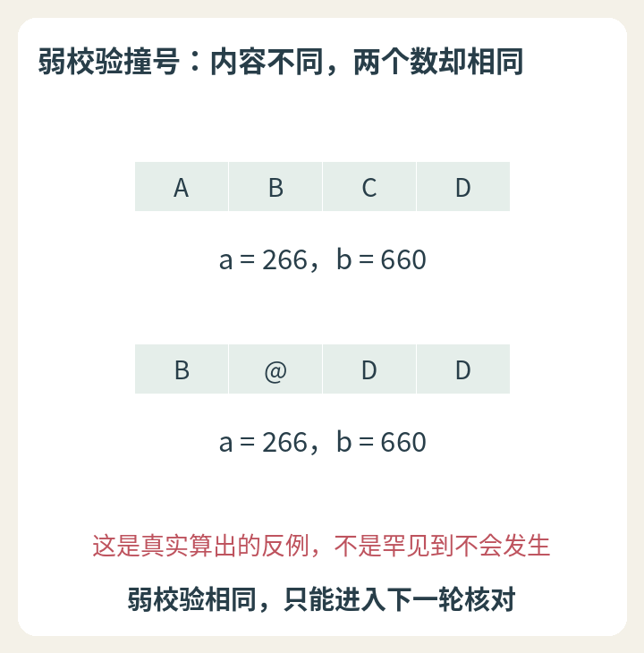

内容不同，弱校验却一样。这叫**碰撞**。

所以弱校验命中时，不能马上宣告“找到了相同旧块”。还要计算当前窗口的完整强摘要，与候选旧块的强摘要比较。

本文实际运行后，两组内容的SHA-256不同，B@DD被正确拒绝，没有误发COPY。

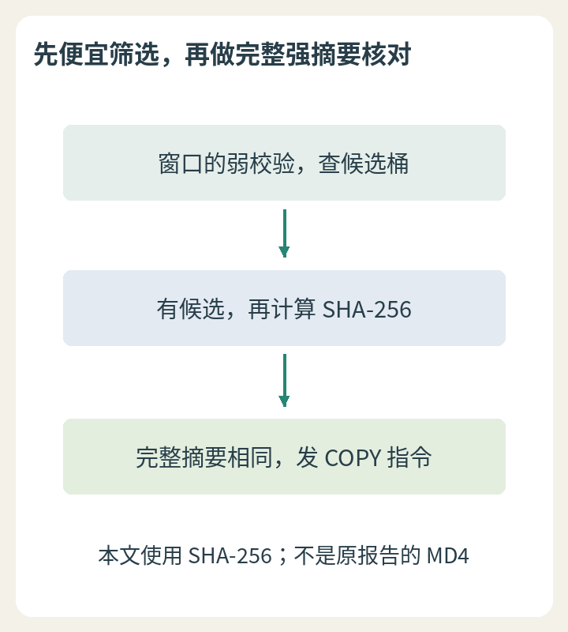

强摘要也不是数学上绝无碰撞。算法是在合适摘要的工程假设下判断匹配，接收端还要检查最后重建出的整份结果。我们的测试另做了逐字节相等断言，不拿“哈希一样”替代所有实验核对。

## 13. 怎样避免拿窗口去挨个比较所有旧块？

如果旧文件有十万个块，每个窗口都挨个翻十万张卡片，滚动加法再快也救不了整体开销。

本文程序使用字典这种“用一个键查对应值”的结构：把弱校验值作为键，把对应的候选卡片列表作为值，先快速找到具有相同弱值的一小组候选。这样的分组常被形象地叫“桶”。

桶里可能有重复内容，也可能有不同内容的碰撞；程序算一次当前窗口的强摘要，再与桶里的候选核对，不能只保留一张卡就丢掉其他可能。

原报告使用了更具体的三级搜索：先由弱值派生16位索引，再核完整32位弱值，最后做强摘要。本文的Python字典把前面的查找细节换成了更直白的教学实现。[原报告Checksum searching](https://rsync.samba.org/tech_report/node4.html)

每轮的移动规则也要分清：

- 没找到匹配，只向右滑一个字节，把滑过去的未匹配字节暂存为新数据。
- 找到匹配，发COPY，然后跳过整个匹配块，从后面继续。

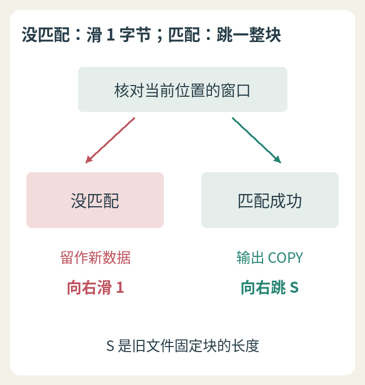

下面的动画来自16字节小例的实际运行轨迹，共五个检查位置：0、1、5、9、13。不是每一格都必须查到底。

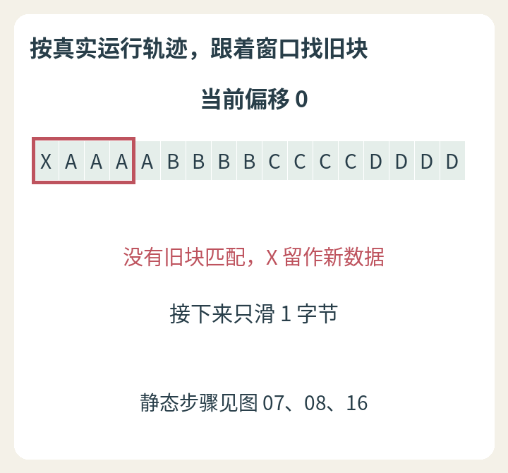

滚动更新的单步工作量不随窗口长度增长，不等于“整个系统在任何输入上都严格恒定时间”。签名表生成、候选桶碰撞、强摘要、读取磁盘和写出结果，都还需要工作。

## 14. 回到真实图片：旧位置256，移到了新位置257

现在用同一个教学程序处理开头两份PPM文件，块大小设为256字节。

旧文件18445字节，可得到72个完整块，最后剩13字节。接收端为72个完整块生成签名。

因为新增换行位于旧文件的偏移3，包含文件头的第一块被打断了。第一段成功复用的完整旧块，从旧文件偏移256开始；它在新文件里变成从257开始。

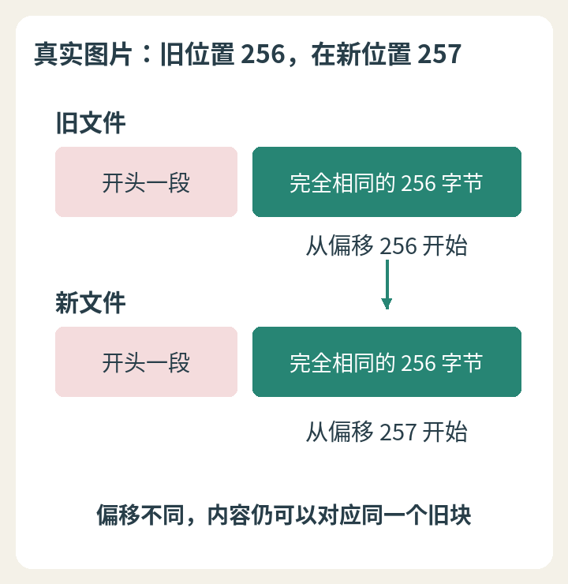

随后连续找到71个旧块，共复用：

71×256 = 18176字节。

这份教学实现没有为不足一整块的旧尾巴建立签名，所以末尾13字节仍作为新数据发送。整个重建过程由三部分组成：

- 开头257字节，作为新数据；
- 中间18176字节，用71条COPY引用；
- 末尾13字节，作为新数据。

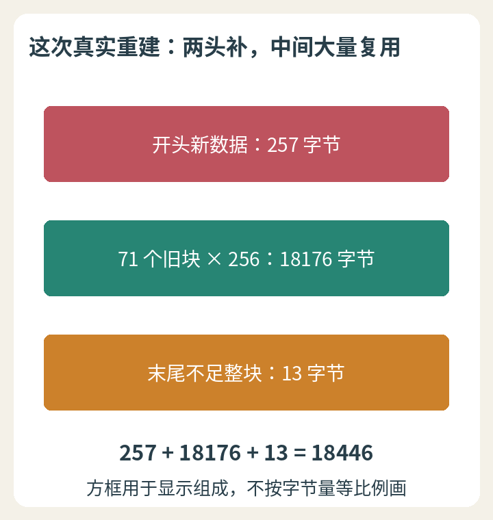

总和257+18176+13=18446，与新文件长度一致。重建完成后，程序实际核对了全部字节，并再次确认两份图片解码后的像素相同。

这也回答了一个直觉上的疑问：**只改一字节，不等于新数据区只能有一字节。**块大小、改动位置、尾块处理都会影响究竟能复用多少。

## 15. 省了许多正文，为什么还不能说“只传一个字节”？

我们已经见到开头和尾巴要发送270个字节。除此之外，协议还需要携带签名、块号、长度、校验等说明。

为了让这笔账可复算，示例把签名和更新指令真正编码成了两份二进制数据，而不是只数“X有一个字节”。

本例使用一个明确标注为**自定教学格式**的安排：

- 签名表有11字节头部，每张卡40字节，包含4字节块号、4字节弱值、32字节SHA-256。
- 更新包有47字节头部，包含目标长度、完整目标摘要与指令数量等。
- 每条COPY占5字节：1字节类型标记和4字节块号。
- 每段DATA有5字节类型与长度说明，后面跟真实字节。

因此图片例子的签名表为11+72×40=2891字节。

更新包为47+71×5+2×5+270=682字节。

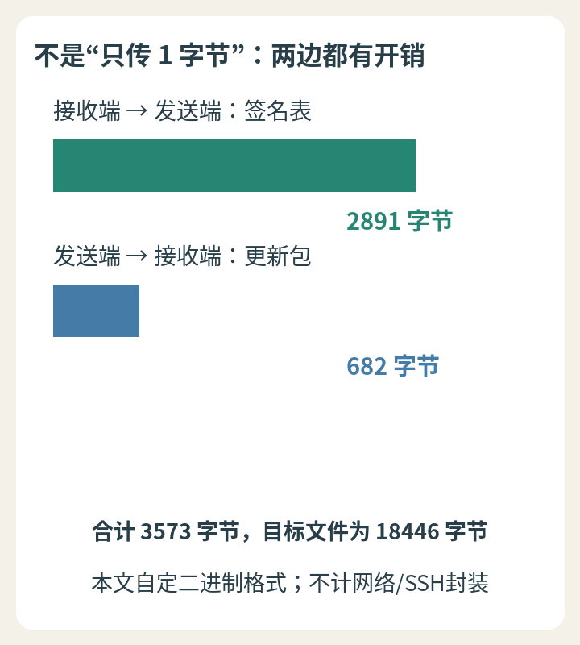

两个方向合起来是3573字节，比直接发送18446字节少得多。但它仍然不是1字节，也不是270字节。

这是**本文格式的实际字节计数**，不包括网络、SSH（常用的安全远程连接方式）、文件名与真实rsync协议的封装，不是网络抓包，也不能拿它宣传rsync真实命令恰好发送了这些字节。

甚至最开始17字节的小例，在这套格式里要171字节签名加73字节更新包，总共244字节，反而比完整传输更大。


小例的职责是把机制讲清楚，不是证明“凡是差量同步就省钱”。

## 16. 块大小是一个折中，不是越小越好

块小，轻微改动通常只会伤到一小段，容易找回更多旧内容；但旧块数量变多，签名表和COPY指令也更多。

块大，签名更少；可是一个小改动可能让一大块无法直接匹配，需要多发一些真实内容。

我们对同一图片例子换了不同块大小，实际统计同一种教学格式的双向总字节量。

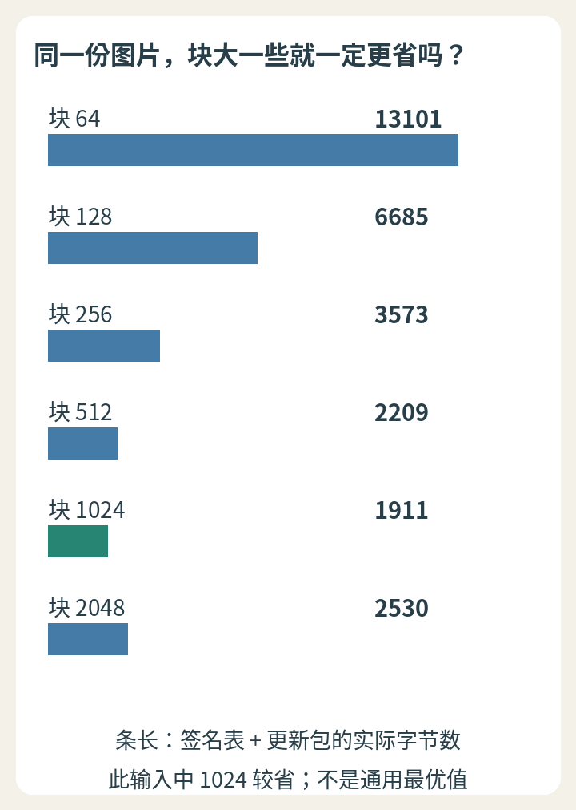

例如，256字节块总计3573字节，1024字节块降到1911字节，继续增到2048字节却回到2530字节。

更小也不必然更省：16字节块只需发送30字节新内容，但签名与指令太多，总量达到51933字节，已经超过原文件。

1024在这组参数里比较合适，不代表它是所有文件的最佳答案。文件大小、改动分布、重复性、摘要长度和真实协议编码，都会改变这笔账。

还有一条实现边界要单独说明：原报告允许最后一块短于S；本文为保持窗口讲解简单，只为完整旧块建卡，短尾巴按新数据处理。

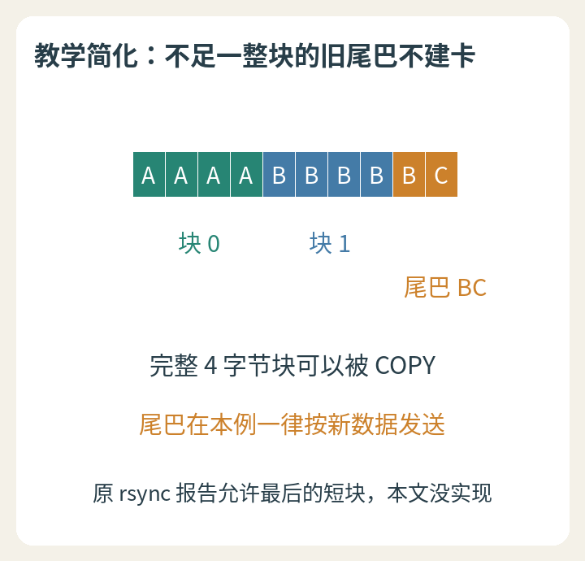

正确重建仍然成立，只是可能错过一些额外的复用机会。

## 17. 如果内容换了位置或顺序，也能复用吗？

可以。因为匹配的核心是内容，不是新旧位置编号相同。

把AAAA、BBBB、CCCC、DDDD重新排列成CCCC、AAAA、DDDD、BBBB，发送端可以输出COPY 2、COPY 0、COPY 3、COPY 1。

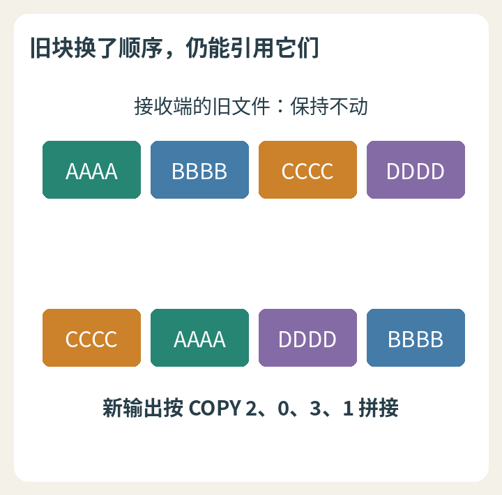

本文也实际跑了这个例子，重建结果逐字节一致。

但它没有看懂“这是一段被移动的函数”，也没有识别“这是一只换位置的游戏怪物”。它只是碰巧找到相同字节块。语义相似却字节不同的内容，不能凭意义直接复用。

这与[Merkle树及Git对象](https://zyuanming.github.io/tech-articles/articles/2026-10-10-merkle-git-history/read.html)那篇讨论的树形依赖、版本身份和共享对象不同。这里的主角是一份文件里的滑动窗口，不是整部历史的一棵摘要树。

## 18. 文件先压缩，会不会更容易省？

压缩本身可能把整份文件变小，但它也可能把原来的局部变化扩散成压缩字节流里的较大变化。

gzip是一种可以在解压时还原原字节的压缩方式。我们用相同gzip设置分别压缩两份图片，时间字段固定为0，避免把当前时间当成额外变化。结果旧压缩文件15451字节，新文件15453字节。

然后仍以256字节块运行同一个delta模型。这一次，没有匹配到一个完整旧块；双向数据总量为17916字节。

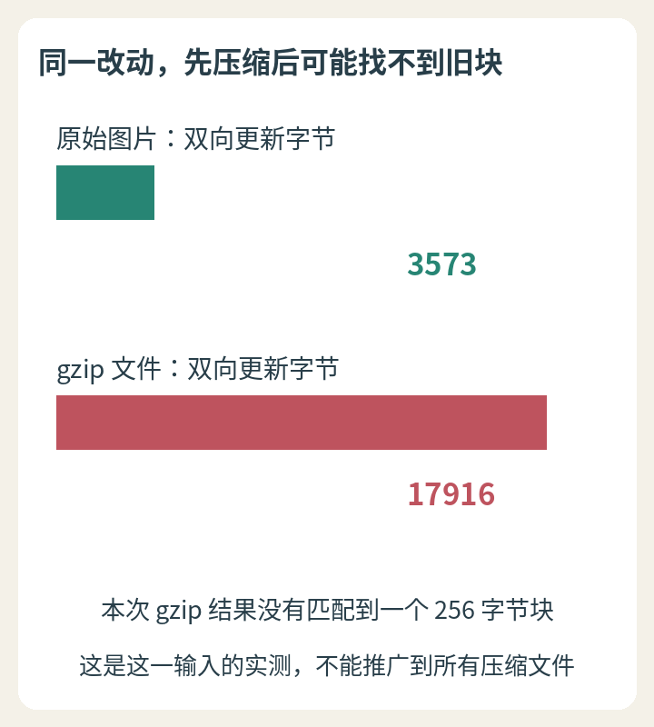

它甚至比直接发送15453字节的新gzip文件更大。对于这次输入，没必要坚持差量方案。

不要把这个结果背成“压缩文件一定不能做差量”。不同压缩格式、重置方式、输入和改动位置，都可能有不同表现。这只是一个真实反例，提醒我们：**差量复用需要在当前这层字节表示中找到相同片段。**

图片看着相同、文字意思接近、文件只改了一个小地方，都不是字节层面可复用率的绝对保证。

## 19. 真正使用rsync时，三个检查别混在一起

到这里我们研究的是算法。真实命令行工具还要处理目录、文件属性、连接与错误。

尤其要分开三个问题：

1. 要不要更新这个文件？
2. 更新过程中，哪些旧块可以复用？
3. 重建后的整份文件是否正确？


按[官方rsync手册](https://download.samba.org/pub/rsync/rsync.1.html)，默认的文件快速筛选通常看大小与修改时间；`--checksum`改变的是更新前的文件筛选方式，不是“没有它就不会做块匹配”。常规传输还会做最终结果校验，具体也受校验选择等选项影响。

另一个实验陷阱是：两边都是本地路径时，工具默认可能采用whole-file，也就是整文件更新。想验证差量算法，不能运行普通本地复制后就假定已经触发了滚动匹配；相关选项需要按实际版本核对。

现代版本还能协商或选择不同校验算法。本文既不宣称它永远使用1996年的MD4，也不宣称它默认使用本例的SHA-256。这些工具层细节以版本手册与实际输出为准。

本文没有把自写Python程序冒称一次真实rsync网络传输，也没有用一个看起来像终端的自制图去证明没有运行过的命令。

## 20. 摘要能核对内容，不会自动证明对方是谁

假设一个不可信的人把文件换了，又把摘要一起换成假文件的摘要。两者依然可以核对成功。

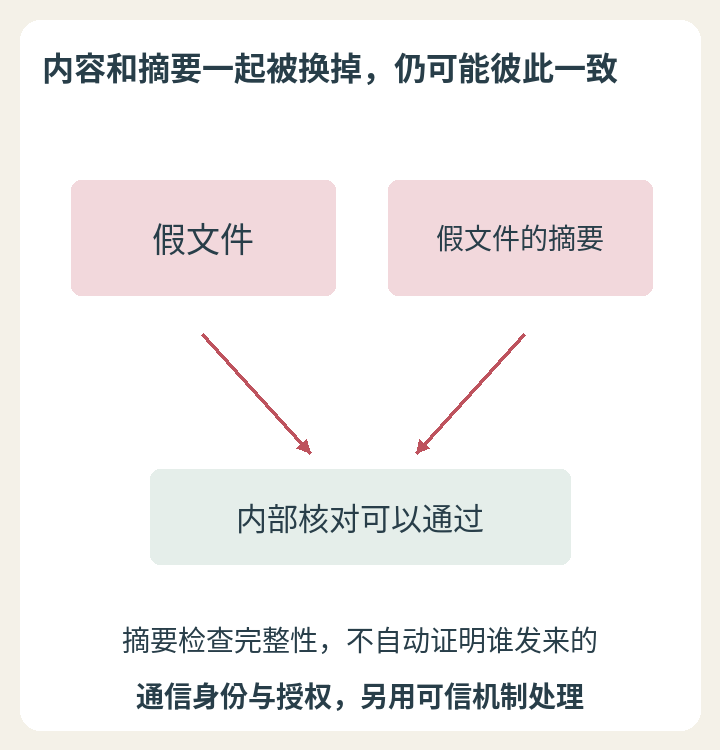

因此，内容完整性与通信身份是不同的要求。实际传输还需要适当的可信连接与授权安排，不能把滚动校验或普通摘要当成身份认证。

我们的代码只是本地教学数据的重建模型：输入是随文公开的文件，输出在示例目录里；没有远程主机地址、账户或网络连接步骤。

## 21. 为什么资料有时写1996，有时写1998？

因为它们可能指向不同事情。

澳大利亚国立大学馆藏把Andrew Tridgell与Paul Mackerras的《The rsync algorithm》列为1996年技术报告，编号TR-CS-96-05。[ANU馆藏条目](https://openresearch-repository.anu.edu.au/items/15a1c428-0ad3-49d6-bb54-9238250cbbf0)

目前算法项目保存的HTML版本，页脚则写着1998-11-09。其“About this document”页面明确说明：这一天是由Tridgell启动LaTeX转HTML的日期。[网页生成说明](https://rsync.samba.org/tech_report/node8.html)

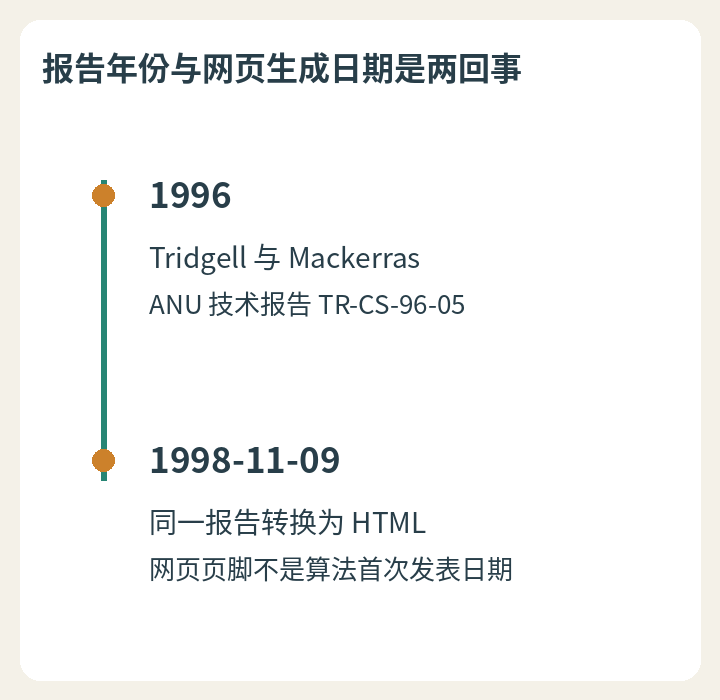

两者不是互相冲突的“发明年”。读历史资料时，发表日期、网页生成日期和后续修订日期，必须分别看待。

原报告从低带宽、高延迟的双向连接问题出发。它有意思的地方不是让文件凭空消失，而是重新安排了信息流：**让拥有旧内容的一方先给出小型索引，再让拥有新内容的一方到所有偏移里寻找对应。**

## 22. 想自己试，先从不改代码的观察开始

实验是可选的。只靠前面的图片、手算和反例，已经能解释主要机制。

如果想复现，下载[delta_lab.py](examples/delta_lab.py)后，在有Python 3的环境运行：

```sh
python delta_lab.py
```

计算核心只用标准库。本次实际环境是Python 3.12.14。脚本会在自身目录生成两份PPM、结果JSON和三组教学签名/更新包，覆盖同名文件；改之前可以先另存自己的副本。

完整结果见[results.json](examples/results.json)。原始图片文件分别是[landscape-old.ppm](examples/landscape-old.ppm)与[landscape-new.ppm](examples/landscape-new.ppm)，像素一致的额外解码记录见[pixel-check.json](examples/pixel-check.json)。Pillow是一个读取和生成图片的Python库，仅用于这项图片解码核查与制图；额外核查程序是[verify_pixels.py](examples/verify_pixels.py)，delta核心不需要它。

可以按下面三个台阶继续。

**第一步，不运行程序也能做。**把小例的X从开头移到BBBB与CCCC之间，预测哪些四字节旧块能复用。再想一想：新增位置在块边界上，与插进BBBB中间，会有什么区别？

**第二步，检查滚动数字。**手算BCDE→CDEF。新a应为274，新b应为680。用“移出B的66、移入F的70”更新，和直接重算是否一致？

**第三步，只换一类参数。**保留同一组图片，在结果的block_sizes列表里比较字面量字节、签名表字节和总量，看看三条趋势是否一致。不要只比较最小的那一列，就宣布总流量最优。

实际验证包括3000次滚动更新与完整重算比较、500组随机插入测试，以及11907组短二进制串/块大小组合的重建检查。空文件、短文件、整块匹配和尾部都包含在这些范围中；另有弱碰撞被拒绝、旧基底被篡改后最终校验失败的反例。

这些通过说明本教学实现对已列测试成立，不意味着完整复刻了生产级rsync，也不替代网络断连、并发文件变化等真实系统测试。

## 23. 最后，用自己的话说出它的诀窍

如果只记住“rsync会比较校验值”，还差最关键的一步。

更完整的说法是：

**接收端把旧文件切成固定块，只发这些块的核对卡；发送端拿固定宽度的窗口在新文件的任意偏移上寻找匹配。没找到就滚动一字节，找到了就发旧块引用；接收端用旧内容与新数据拼出目标文件。**

弱校验负责便宜地排除大多数不可能，强摘要负责进一步核对，最终结果还要验证。复用的字节来自接收端真实保存的旧文件，不是从短摘要里变出来的。

开头那个换行让边界错了位，却没有让旧内容消失。只要不把“地址变了”误当成“东西全变了”，程序就有机会把熟悉的片段重新认出来。

---

原创正文、教学图、测试图片与数据采用[CC BY 4.0](https://creativecommons.org/licenses/by/4.0/)，原创示例代码采用[MIT许可](examples/LICENSE.txt)。第三方文献与工具各自保留原权利。出处、素材范围、图像职责和复现限制见[sources.md](sources.md)。
