# 只问八次，怎样把电压放进256个格子？逐次逼近ADC的猜数游戏

假设你做了一个小旋钮，希望电脑知道它转到了哪里。

旋钮连着一个电路。你转动它时，输出电压平滑地变化：可能是1.731伏，也可能是1.737伏。电脑需要的却是一串0和1。

现在有一个限制：你手边的电路，每次只能回答一个问题：

**眼前的电压，比我拿来比较的电压高，还是低？**

它不会直接说“1.737伏”。它甚至不会告诉你差多少。

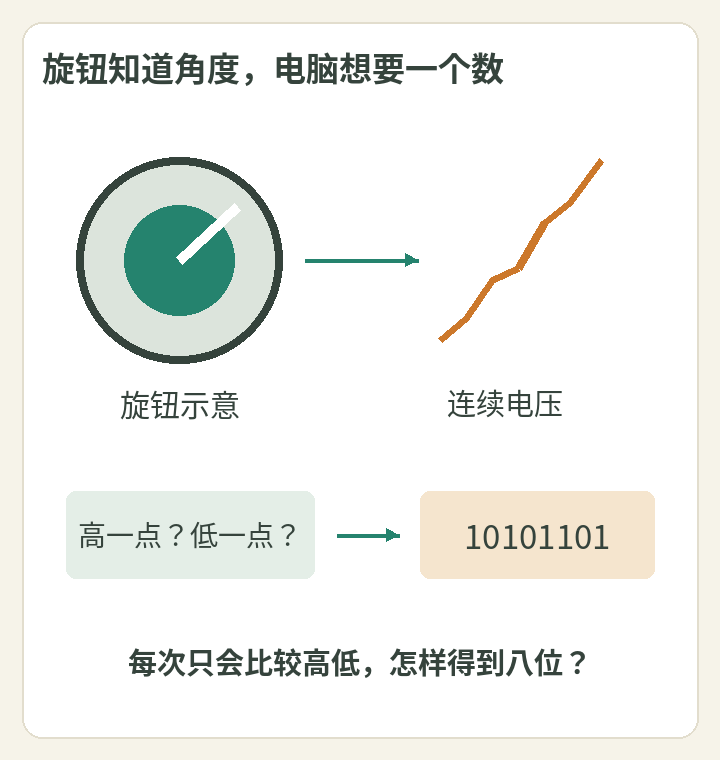

要把0到2.56伏分成256个小格，你需要把256条刻度全部试一遍吗？

一种很实用的答案是：在理想条件下，八次比较就够。这个办法叫**逐次逼近**，采用它的一类模数转换器通常简称**SAR ADC**。

ADC是“模拟到数字转换器”的英文缩写；SAR来自“逐次逼近寄存器”，也常用于指这类架构。寄存器的作用，我们会在第4节认识。

但八次问答得到的不是一个无限精确的电压。它找到的是一个小区间。接下来我们亲手完成这八次，再看看为什么真实电路必须认真对待参考电压、保持时间与误差。

## 1. 先别接电路，猜一个0到255之间的整数

你在心里选了一个整数，我只能问“它是否至少为某个数”。

如果从0开始逐个问，选中的数越大，我可能问得越久。

换一种问法：第一次问“至少是128吗？”

如果是，答案就在128到255；如果不是，就在0到127。无论得到哪种回答，256种可能都缩成128种。


接着问剩余范围的中间位置，再把一半可能排除。候选数量依次变成：

**256 → 128 → 64 → 32 → 16 → 8 → 4 → 2 → 1。**

这就是二分查找的想法：每个问题尽量把还没排除的可能分成同样大的两半。

为什么恰好是八次？因为一个只有“是/否”的回答，最多提供两种分支；八层分支最多容纳2⁸=256种不同结局。只要每层都把区间均分，这个上限就用满了。

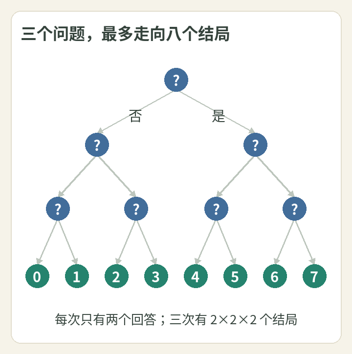

这里的树画的是三次问答，方便看清。不是说现实的八位转换器里面长着一棵有256片叶子的物理树；控制电路只需要沿着当前那一条路径走。

## 2. 把“猜数”写成八个不同大小的砝码

另一种看法更接近后面的电路。

准备八个数字权重：

**128、64、32、16、8、4、2、1。**

从大的开始，每次试着加一个。如果总和没有超过目标，就留下；超过了，就拿走。每个权重最终只有“留”和“不留”两种状态，分别记作1与0。

例如目标整数173：

128留下；再加64会到192，太大，拿走64；加32到160，留下；加16到176，太大；再依次试8、4、2、1。

最后留下128、32、8、4、1，总和是173。

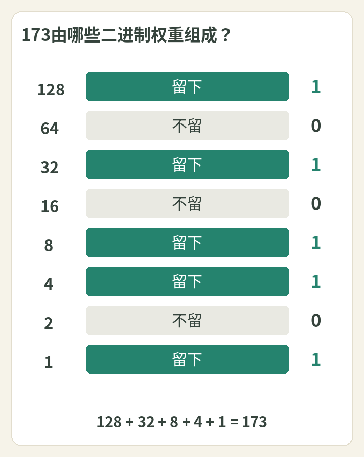

把每个位置的决定排好，得到：

**10101101。**

最左边控制最大权重，叫最高有效位，英文缩写MSB；最右边控制最小权重，叫最低有效位，缩写LSB。暂时不必背缩写，只要认出“大砝码”和“小砝码”。

真正的ADC不把电压当物体称重。这个比喻说明的是选择顺序与位权，电路里的实现是比较电压。

## 3. 从256个整数，走到256个电压小格

我们选一个便于手算的理想例子：

- 主线输入范围：0伏 ≤ 输入 < 2.56伏；恰好到上端与越界的模型处理另见第17节。
- 输出：八位无符号二进制，编号0到255。
- 总共256格，每格宽度相同。

一格多宽？

**2.56 ÷ 256 = 0.01伏。**

0.01伏也就是10毫伏；1伏等于1000毫伏。

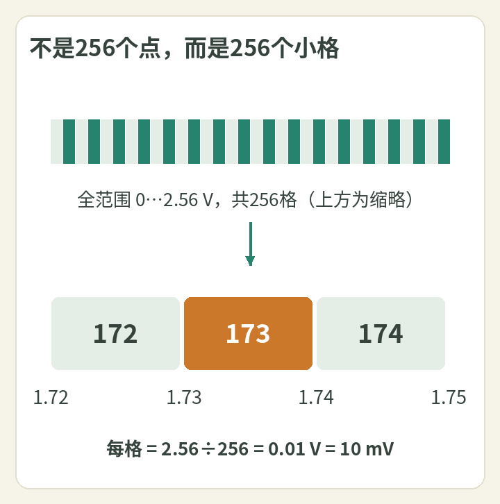

我们把这0.01伏称作一个LSB对应的电压宽度。你可以把它理解为：最右边那一位对应的最小格距。

为了让整个例子明确，我们采用如下**教学约定**：编号k代表从k×0.01伏开始，到(k+1)×0.01伏之前的区间。左端包含，右端不包含。

因此，173号格是：

**1.73伏 ≤ 输入电压 < 1.74伏。**

这是“向下分箱”的理想量化模型。真实ADC的数据手册可能把理想跳变点放在半LSB位置，并有不同的端点、输入范围和编码约定。不能把本文约定直接当成所有芯片的传输曲线。[1][2]

接下来隐藏的输入电压设为**1.737伏**。这是实验设置告诉我们的真值；ADC自己并不知道。它必须通过比较来缩小范围。

## 4. 三个角色：谁提问，谁回答，谁记住答案？

第一个角色是**比较器**。

它接收两个电压：待测电压与试探电压。理想模型中，前者大于或等于后者就回答1，否则回答0。

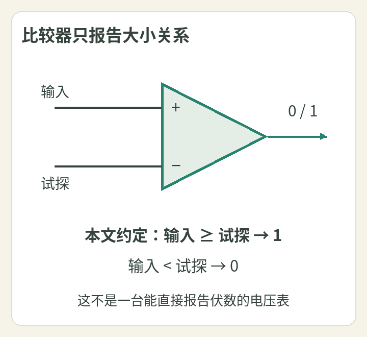

这里把“恰好相等”归到1，是为模型选择明确边界。真实比较器在非常接近门槛时会受噪声、失调和响应时间影响，后面会讨论。

第二个角色是**数模转换器，DAC**。它做反方向的事情：把一个数字候选变成模拟试探电压。

在我们的理想模型里，给它128，它输出1.28伏；给它192，输出1.92伏；给它173，输出1.73伏。公式是：

**试探电压 = 候选编号 × 参考电压 ÷ 256。**

参考电压在此是2.56伏，相当于整把尺子的长度基准。它不是神奇地由“八位”这个词决定的。[1]

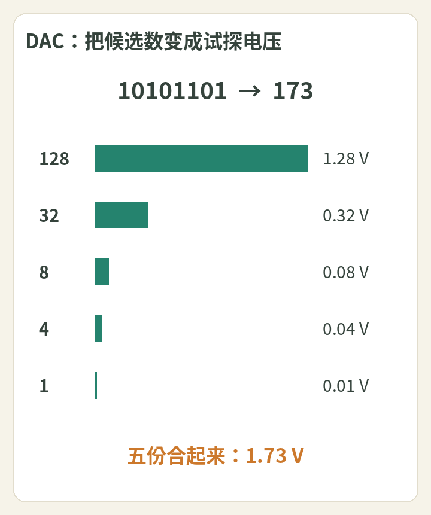

第三个角色是**逐次逼近寄存器与控制逻辑**。寄存器就是一小组能记住0或1的存储位置；控制逻辑决定现在试哪一位，比较后该保留还是清零。

把三个角色连起来：控制逻辑给DAC一个候选；DAC产生电压；比较器回答高低；控制逻辑记下结果，提出下一个候选。[1]

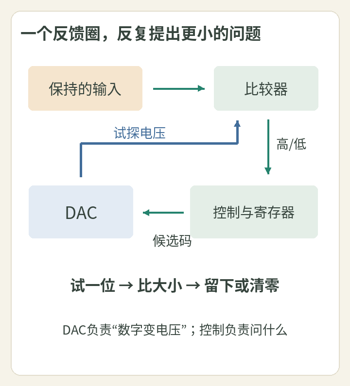

你可能会问：已经有DAC，为什么还需要ADC？因为DAC只会回答“这个数字对应多大电压”，不会直接回答“这个未知电压对应什么数字”。把它放进一连串有策略的比较里，反向问题才被解决。

## 5. 第一问：至少有1.28伏吗？

从最大权重开始，把最高位暂时设成1，其余都设成0：

**10000000 = 128。**

DAC把它变成1.28伏。比较器面对的是：1.737是否至少为1.28？答案是。

所以最高位留下1。输入不可能在0到1.28伏这半边，我们保留上半边：

**1.28伏 ≤ 输入 < 2.56伏。**

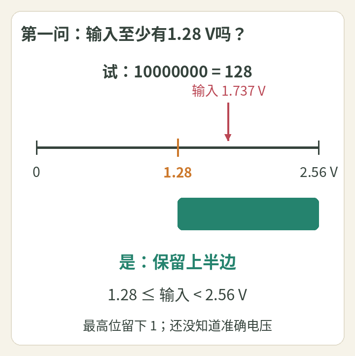

注意，我们没有因此宣布“输入就是1.28伏”。1.28只是当前已经确认不超过输入的下界。

## 6. 第二问：再放上0.64伏，会不会太高？

现在试第二位。保留刚才的1，再把64对应的位置暂时设成1：

**11000000 = 192。**

DAC输出1.92伏。1.737小于1.92，所以这次试探过头了。把第二位清零，最高位仍然保留。

新的范围变成：

**1.28伏 ≤ 输入 < 1.92伏。**

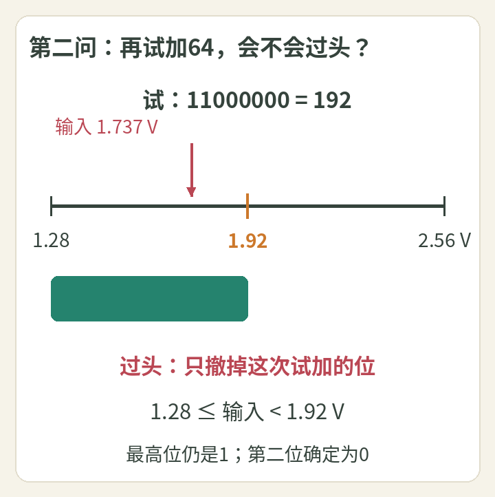

这是初学时最容易误会的一步：“太高”并不是把全部候选清零，而是只撤掉**这一次试加的位**。此前已经确定的高位不随便推翻。

第三问试32，候选160，电压1.60伏。它仍低于输入，于是留下32。前三位成为101，范围缩到1.60至1.92伏。

剩下的五次，规则完全相同，但我们把数值都列出来，方便你自己接着算。

## 7. 八次问答走完了，究竟得到了什么？

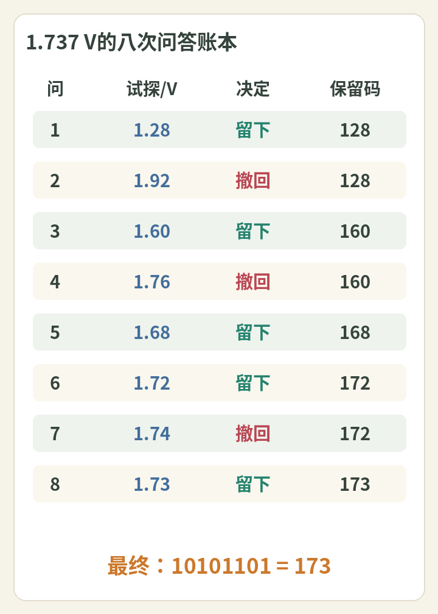

第四问试1.76伏，过高，撤掉16。

第五问试1.68伏，没过，留下8。

第六问试1.72伏，没过，留下4。

第七问试1.74伏，过高，撤掉2。

第八问试1.73伏，没过，留下1。

最终输出10101101，也就是173。我们已经知道输入在1.73伏至1.74伏之间，却仍不知道它是1.731、1.737，还是1.7399伏。

把每次试探画成时间顺序，会看到它并不是一直单调上升。过头时，下一个候选会往回退一点；没过头时，候选再加上更小的一份。

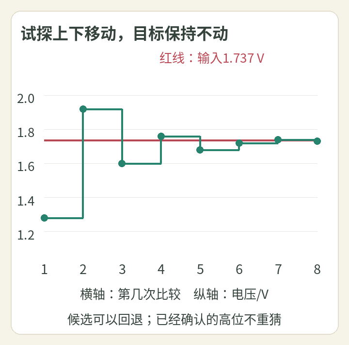

再看区间如何收缩。红色箭头表示同一个1.737伏输入。下面动画把每轮当前候选区间放大到同样的显示宽度，因此一定要读两端的数字，不能把画面宽度当成电压宽度。

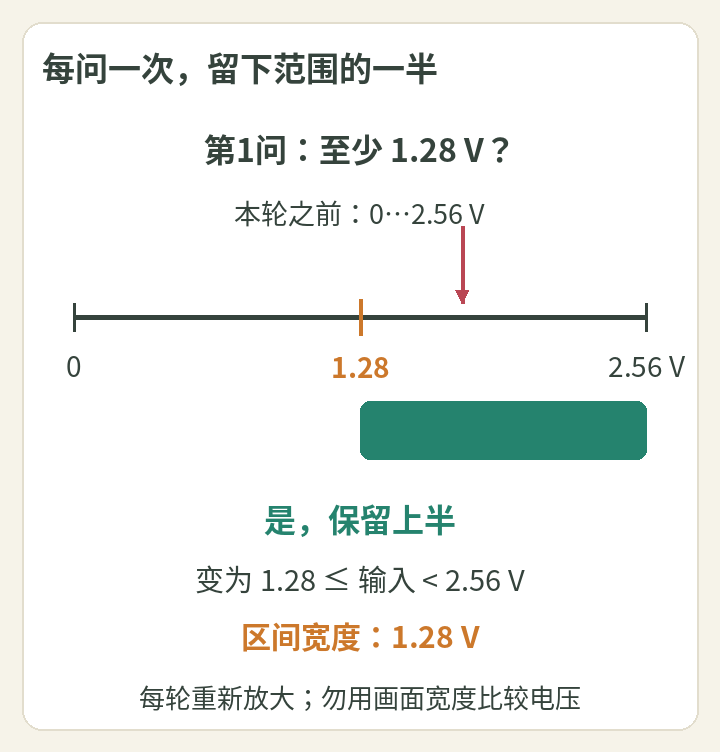

缩小顺序是每次减半。八轮之后宽度从2.56伏变成0.01伏。算法完成的是**定位一个格子**，并没有把连续世界压成一个无误差的精确点。

## 8. 一个简短证明：为什么不会漏掉正确的小格？

我们把“目前没有排除的区间”叫候选区间。开始是0到2.56伏。

每轮把它切成两半，比较门槛就在中点。

- 如果输入至少等于中点，就保留上半边。
- 如果输入小于中点，就保留下半边。

只要比较正确，而且整个过程比较的是**同一个固定输入**，包含输入的那半边就不会被丢掉。

第一轮如此，第二轮仍然如此，每一轮都如此。八轮后，输入还在留下的小格里，而这个小格正好宽一个LSB。

这类证明的关键不是代数很复杂，而是找到了一个每轮都保持成立的事实：**真正的输入还在当前区间里。**

稍后你会看到，一旦输入在问答期间自行变化，这个事实就未必继续成立。算法的前提不是装饰。

## 9. 173不是1.737：怎样表达量化误差？

假设只把编号乘以格宽：173×0.01=1.73伏。这个值对应小格左端。

对于本例真实输入1.737伏，左端值比它低0.007伏，也就是7毫伏。

如果应用想用一个数代表整格，也可以选择中点：

**(173+0.5)×0.01=1.735伏。**

这次与真实输入只差2毫伏。但它更接近是本例的数值结果，不代表你恢复了被量化丢掉的那部分信息。

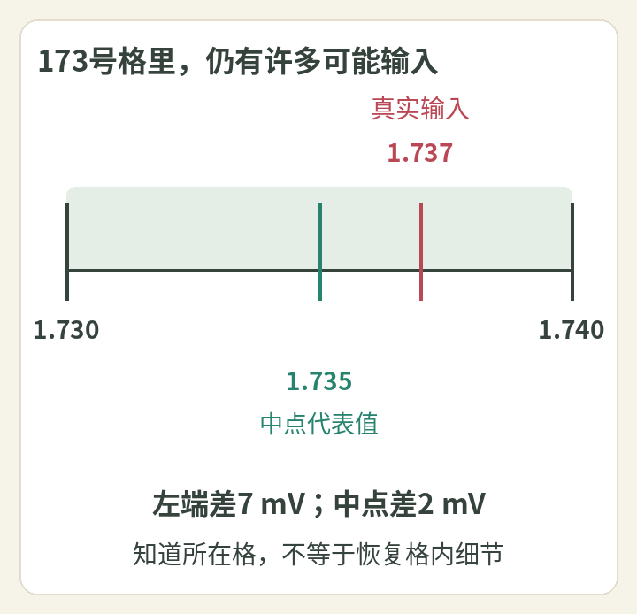

在本文的理想等宽格模型里，用每格中点代表整格，误差绝对值不超过半格，也就是0.005伏。用左端代表，则误差从0到略小于一格，方向也不同。

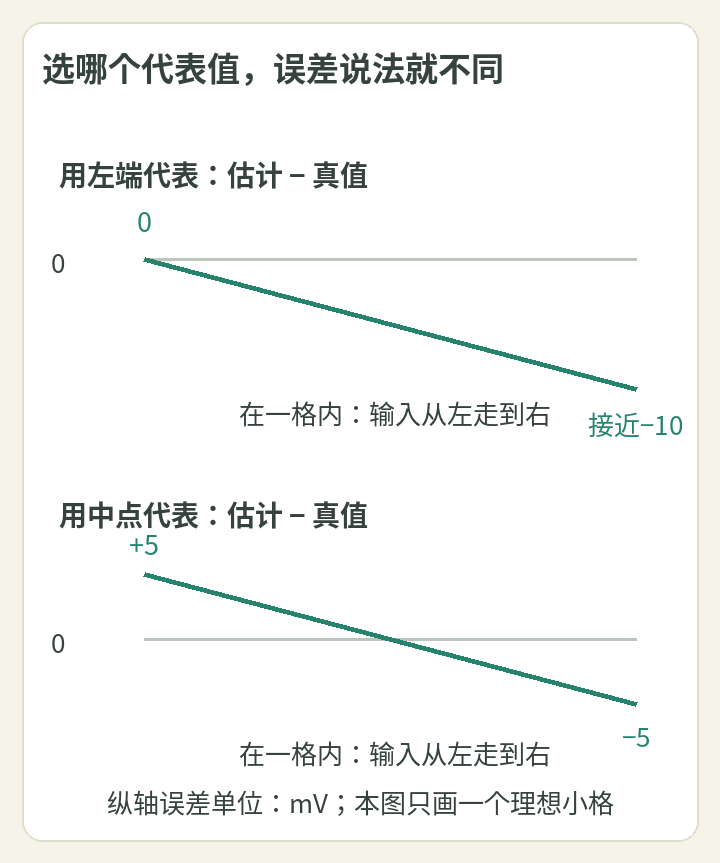

所以，看见“量化误差±半LSB”，先问清楚：它讨论哪一种理想传输约定，拿什么代表每格，是否排除了溢出、噪声与其他误差？[2]

“有误差”也不意味着ADC坏了。有限个编号不可能为无限多种电压各留一个独立名称。量化是这种表示方式本身的一部分。

## 10. 为什么要先把电压暂时“按住”？

假如我们没有一直比较同一个输入，而是第一问时它为1.20伏，之后一路升高，第八问时已经到2.20伏。

第一问1.28伏太高，于是最高位被判成0。按照算法，这等于认定输入在下半范围。

可是真实电压接下来已经升到上半范围。后面的低位就算全部留下，也最多得到127。最初被排除的高半边不会自动回来。

配套模型把这八个比较时刻的输入设成从1.20到2.20伏等间隔上升，结果输出127；若保持最初的1.20伏，正确结果是120。变化输入下的127既不是起始时刻的120，也不是结束时刻的220。

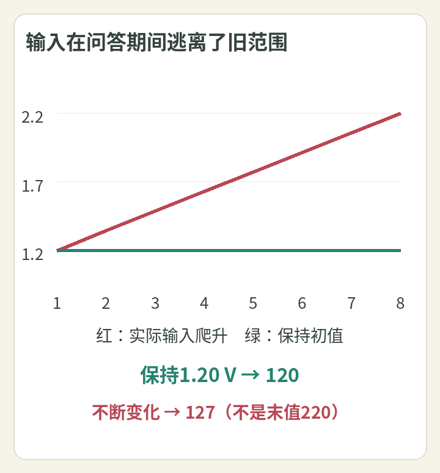

解决这个问题，需要在开始转换时取一个样本，并在比较期间尽量保持它。这就是**采样保持**。

一种简化理解是：开关闭合时，一个小电容跟随输入充电；开关断开后，电容上的电压暂时保留下来，后面的比较围绕这个样本进行。[1][2]

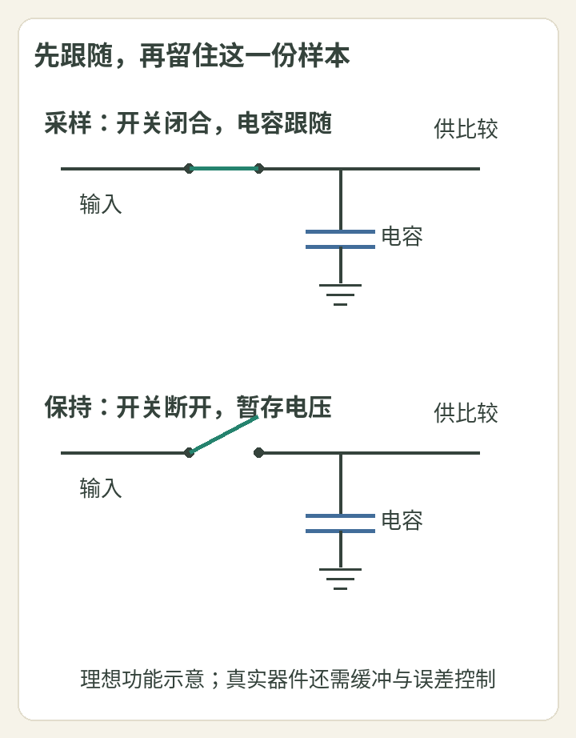

电容可以在两片导体之间存储电荷；其电压与储存电荷有关。真实电路还有缓冲、寄生电容、漏电、开关注入等细节，不能把这幅功能示意当成完整接线图。

“保持”也并非永远不变。工程上需要的是：在这次转换花费的时间内，变化小到满足目标误差要求。

## 11. 采样不是按下按钮就瞬间结束

如果小电容原来电压为0，现在要跟随2.56伏，它需要时间接近目标。输入信号源也不能无限快地提供电荷。

用最简单的电阻R、电容C模型，剩余差值会按指数衰减。令τ=R×C，这个τ叫时间常数；经过一个τ，差值约剩原来的36.8%。

你不必先会微分方程。只看一个结果：经过5τ，仍剩约0.674%的初始差值。

对于八位、全范围跳变，如果希望残差小于半LSB，目标是小于满范围的1/512，约0.195%。因此5τ还不够；这个单极点理想模型需要超过约6.24τ。[3]

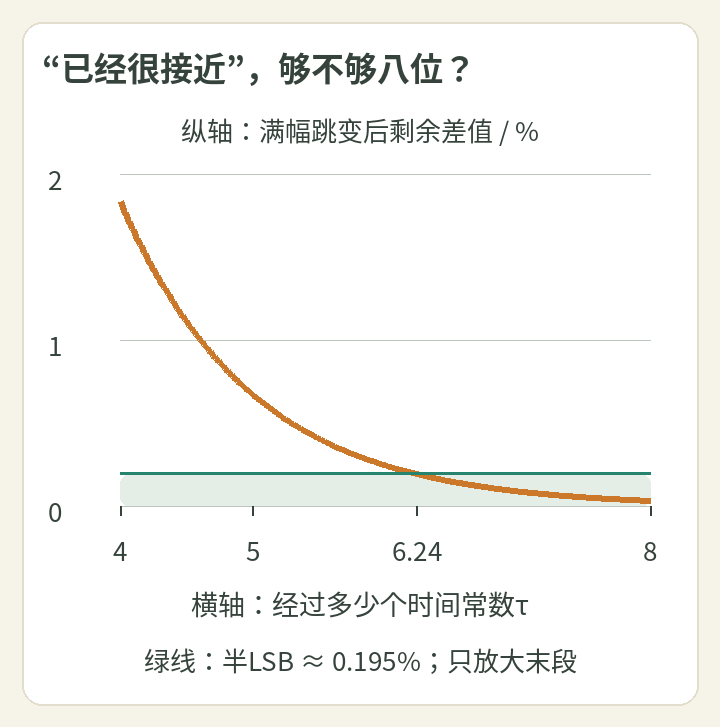

这些数字是对本文RC模型重算的，不是某个芯片的保证。真实设计要看数据手册里的获取时间、允许的信号源阻抗，以及驱动电路要求。

同样，“八次比较”不自动等于“八个外部时钟就能拿到完整数据”。采样、DAC稳定、比较器判定、内部控制和输出读取都可能占用时间。较高位数还要求更小的误差，不能仅按位数比例推算速度。[1]

## 12. 八位分辨率，不等于八位准确度

一把尺子印了很多小格，如果所有刻线整体偏了，测量仍会有系统偏差。

我们给比较器模型加一个简单的偏移：它看见的输入总比实际高20毫伏。对于1.737伏，它按1.757伏做决定，最后输出175，而不是173。

码仍然是八位，格数仍然是256个，但结果整体偏了两格。

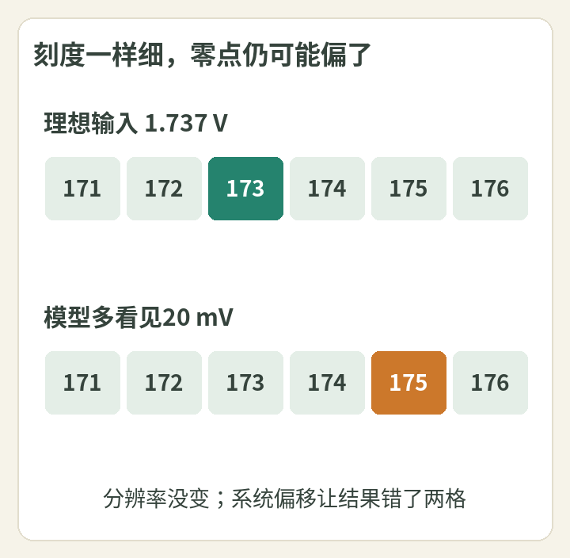

这是**失调**的一种教学模型。真实ADC还可能有增益误差、不同格子宽度不等的非线性、噪声等问题。[2]

分辨率告诉你能输出多少种编号、理想小格多细；准确度要问这些编号与真实输入有多接近。两者有关联，却不能互相替代。

## 13. 参考电压一变，整把尺子都跟着变

先前我们一直假设参考电压准确等于2.56伏。

现在假设硬件实际参考只有2.50伏，而软件仍然以为它是2.56伏。硬件每格宽度变成2.50÷256，约9.765625毫伏。

同样的1.737伏，在这把稍短的尺子上会得到177。若软件继续按原来的10毫伏格宽取中点，就报告1.775伏，比实际输入高38毫伏。

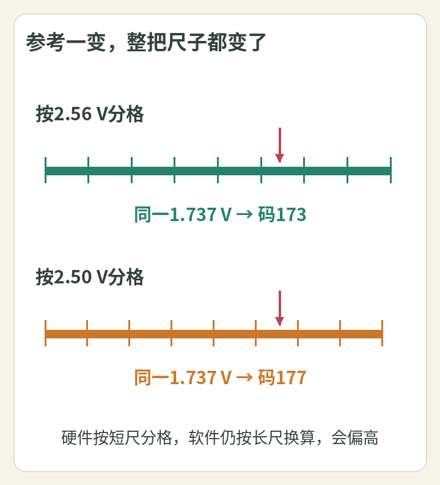

问题不是二分算法突然不会猜数，而是硬件与软件使用了不同的尺子。

这里最值得记住的是：数字结果通常先表示**输入相对于参考的比例**。要把它换回绝对伏数，参考本身的质量也进入了答案。

## 14. 为什么一动不动的输入，也可能让最后一位跳来跳去？

如果电压恰好在173号格的下边界1.730伏附近，哪怕只有一点点输入噪声，也可能让它一次落在172号格，下一次落在173号格。

我们做一个明确的模型实验：每个样本的平均电压为1.730伏，加入标准差2毫伏的高斯噪声；每次取样之后仍保持住，再用理想八位量化。随机种子固定为20261013，共取10000次。

本次结果：172出现4884次，173出现5116次。

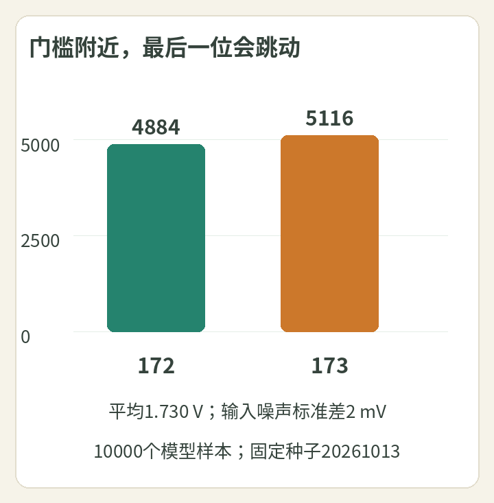

图里的柱子来自实际运行，不是示波器实测。这个模型只给每次保持的输入加噪声，没有另外模拟转换过程中每一次比较器判定的噪声。

平均多次读数可能帮助估计某些随机变化的中心，但不会自动纠正错误参考、系统偏移或所有非线性。看见最后一位跳动，也不能立刻认定芯片坏了；要先问输入离跳变点多近，以及噪声来自哪里。

## 15. 进阶但可跳读：DAC能不能用电容来做？

前面的算法只要求DAC给出不同权重的电压，并没有规定DAC必须用哪种内部结构。

很多SAR ADC采用电容阵列。它既能参与保存样本，也能通过开关切换产生比较所需的差值。[1][4]

先认识一个简单关系：对理想电容，电荷Q等于电容值C乘以两端电压差V，即Q=C×V。C越大，同样电压差下能储存的电荷越多。

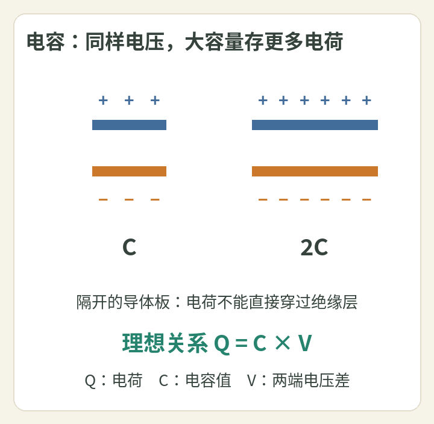

现在把问题缩成三位，方便画清楚。仍用2.56伏参考，三个权重应该是1.28、0.64、0.32伏。

可以安排四只电容：4C、2C、C，再加一只C。最后这只叫补足电容，在这个简单模型中不代表额外输出位；它让总电容正好是8C。

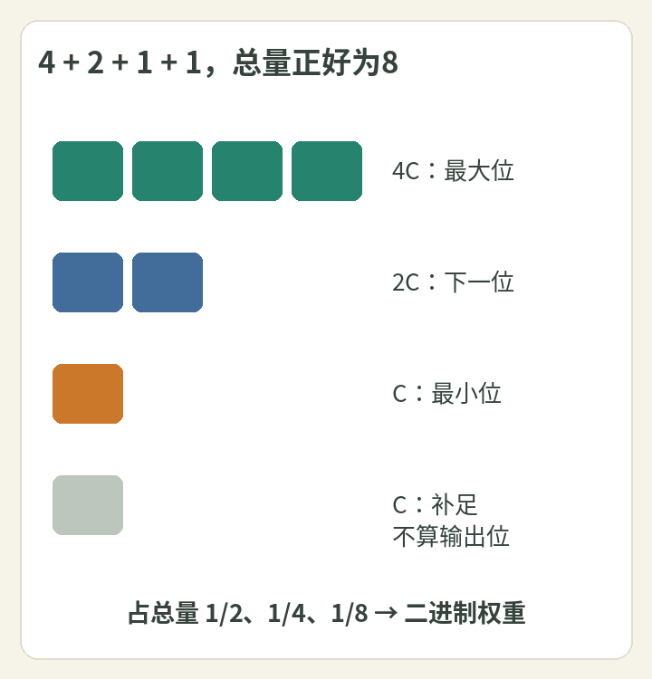

全部上端连到同一个节点。采样时，这个公共上端接0伏，下端接输入电压；上端相对下端的电压差是−1.737伏，所以公共上端存下的是负电荷。这里符号跟我们选哪一端作参照有关；并不是说电荷穿过了电容中间的绝缘层。

随后把公共上端与外部电路隔离，再把下端切到0伏。在理想、无漏电模型里，隔离上端所带的总电荷不能凭空消失，因此公共节点移动到负的输入电压。这个例子里是−1.737伏。

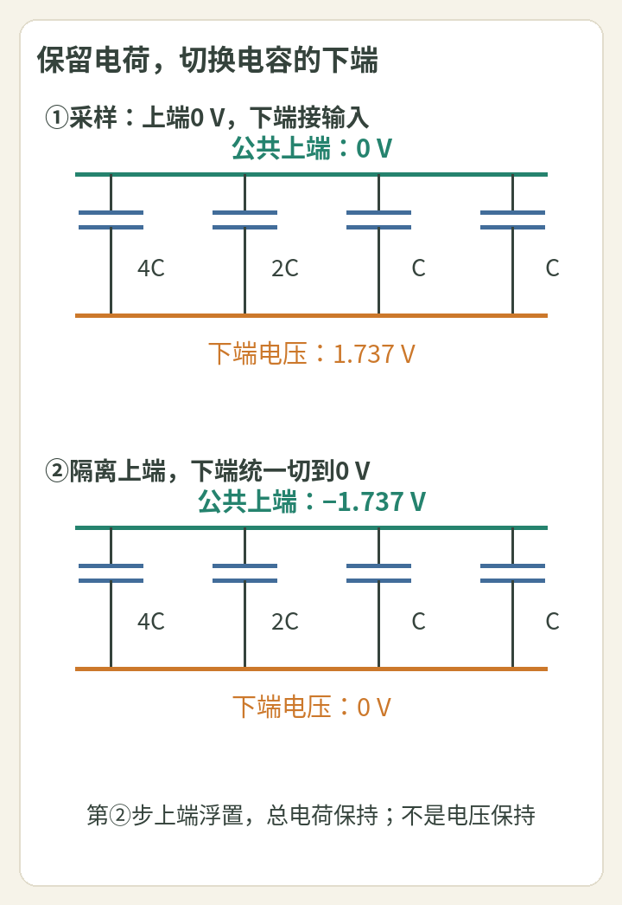

接着把4C那只电容的下端从0伏切到2.56伏。它占总电容的一半，公共节点就上升参考电压的一半，也就是1.28伏。

于是公共节点电压变成：

**−1.737 + 1.28 = −0.457伏。**

它仍小于0，意味着试探的1.28伏还没超过输入，最高位应该留下。

再试2C，相当于额外增加0.64伏；公共节点变成+0.183伏，说明过头，于是撤回。最后试C，增加0.32伏，节点变成−0.137伏，留下。三位结果101，正好与八位例子的前三次决定一致。

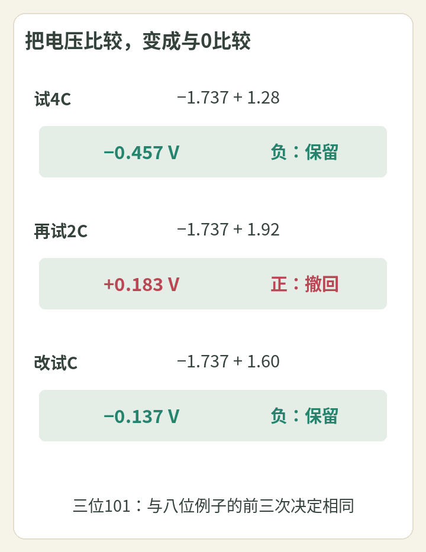

这里出现负电压，是这一理想教学切换方式选择0伏作为起点的结果；真实芯片可以采用其他共模电压、差分结构与切换方案。请不要按这几幅示意随意把负电压接到单电源器件引脚。

若你愿意继续核算，配套程序检查了八种三位开关状态：公共上端总电荷始终相同。若还没学电路，也可以在这里停下，只抓住机制：**同一份样本电荷，配上不同比例的电容切换，就能产生有二进制权重的试探差值。**

## 16. 一个真实的早期设计，为什么不能被画成今天的芯片？

逐次逼近不是最近才有的技巧，但把它压缩成“某个人某天发明了今天所有SAR ADC”会过于草率。

我们选一份可以直接核对的原始材料：Bernard M. Gordon与Evan T. Colton的美国专利US2997704。申请日期是1958年2月24日，授权日期是1961年8月22日。[5]

专利说明书开头就描述了从最高有效位开始，试加、比较、决定保留或清除，再走向下一位的过程。

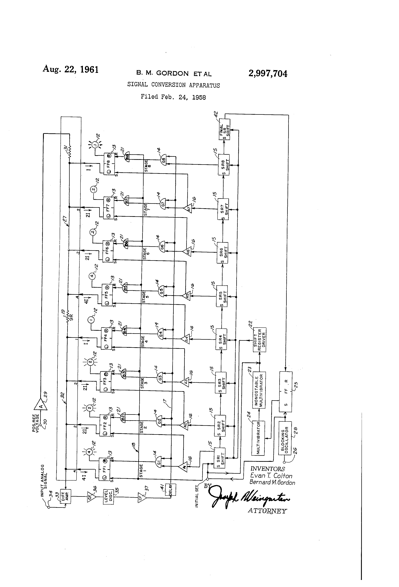

这张完整原图的小字用于史料查阅，不要求你在手机上辨认所有线路。与我们刚学的主线相关的是：它把记忆某一位、顺序控制、形成模拟量与比较结果反馈，安排成一组配合工作的真实电路。

还有一个很容易忽略的差别：原图示例采用**4-2-2-1的十进制数字表示**，分成两个十进制位组，并用霓虹灯显示；不能看见八个级，就把它说成本文“0到255的直二进制八位转换器”。专利正文明确交代了这种表示方式。[5]

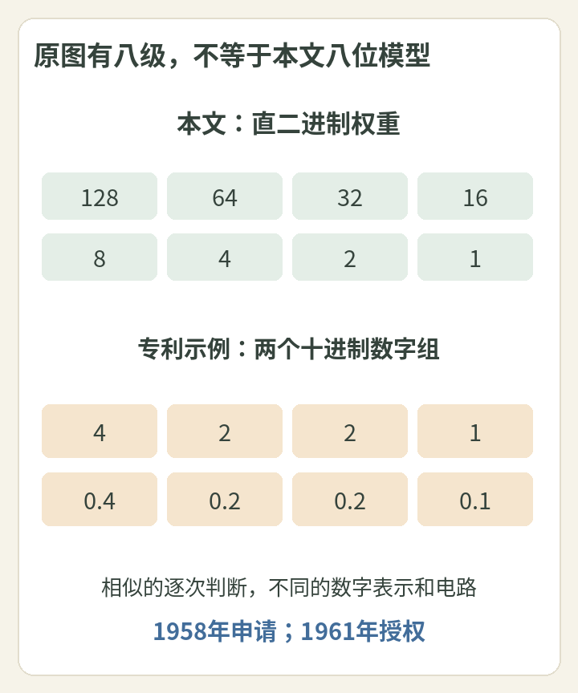

这份材料的价值在于：相似的逐次判断思想，已经被放进具体器件、控制时序与显示需求中。它不是今天电容阵列芯片的内部照片，也不证明这两位作者独自创造了全部相关思想。

完整[五页原始专利PDF](originals/US2997704.pdf)随文保存。ADI的[MT-021](https://www.analog.com/media/en/training-seminars/tutorials/MT-021.pdf)还展示了不同时期的器件与架构；其图像版权另有保留，本文提供出处，不把厂商图片直接套上原创许可。

## 17. 在电脑上认真验证，再决定怎样用在电路上

配套[sar_lab.py](examples/sar_lab.py)使用Python标准库，其中关键比较采用Fraction有理数运算，避免1.73这类十进制边界先被二进制浮点近似扰动。

```text
python sar_lab.py
```

本次实际运行环境为Python 3.12.14。[结果JSON](examples/results.json)记录了每一次试探、参考值、噪声种子和实验范围。

主要检查包括：

- 对1至12位模型，每个格子都测试下边界、中点、靠近上边界的一个点，共24570个精确输入点。结果都落在正确编号，比较次数等于位数。
- 对每个位宽，检查负输入、恰好参考值和超出参考值的模型饱和结果。饱和只表示本程序限制输出编号，绝不表示实际器件可安全承受越界输入。
- 重算1.737伏的八步，以及20毫伏失调、2.50伏实际参考、转换期间爬升输入三个反例。
- 固定种子生成10000个带输入噪声的样本；另检查三位电容阵列八种开关状态的电荷守恒。

这些测试验证了我们写出的教学模型，不能替代电路仿真、硬件测量、器件数据手册或生产设计验证。

## 18. 三个适合自己动手的问题

**一，把输入换成0.427伏。**仍用2.56伏参考和八位模型，逐次写出八个候选；最后应得到42，二进制00101010，对应0.42至0.43伏。

**二，恰好落在门槛上怎么办？**分别输入1.7299、1.7300、1.7301伏。本文的“等于时留下”约定，会让哪些输入属于173号格？用Fraction写十进制字符串，避免把浮点误差误认为编码规则改变。

**三，多加一位，发生了什么？**九位模型把同一范围分成512格，格宽变成5毫伏，多进行一次理想比较。然后重新想想：若参考仍错了60毫伏，或者保持电压还在明显漂移，多一位本身能把这些问题抹掉吗？

如果手边没有电子器件，纸笔和Python已经足够完成主线实验。本文没有要求你接电源，更不涉及市电测量。

## 结尾：高低两个字，也能问出很多东西

比较器的一次回答很少：只告诉你高还是低。

逐次逼近的巧妙，在于每个问题都用上了之前的答案，把下一次比较安排在还没排除范围的中间。有限的问答因此能高效地找到一个小格。

电路工程又把这个漂亮想法拉回现实：比较必须可信，参考必须明确，样本要暂时稳定，DAC要有时间接近目标。最终得到的数字，也必须带着格宽、范围和误差一起理解。

你若能从173想到“在这套约定下，它代表1.73到1.74伏”，而不只想到“电脑终于读到了1.73”，就已经跨过了理解模数转换的一道重要门槛。

## 来源与延伸

[1] Walt Kester，[MT-021：ADC Architectures II: Successive Approximation ADCs](https://www.analog.com/media/en/training-seminars/tutorials/MT-021.pdf)，重点第1—4页的结构、时序与电容阵列。原厂教程中的历史与当时产品性能不被当作今天通用上限。

[2] Bonnie Baker，[TI SBAA147B：A Glossary of Analog-to-Digital Specifications and Performance Characteristics](https://www.ti.com/lit/an/sbaa147b/sbaa147b.pdf)，获取时间、输入范围、分辨率、量化、失调与增益等条目。实际器件以各自数据手册为准。

[3] Texas Instruments，[Settling time challenge and improvement tips](https://e2e.ti.com/blogs_/archives/b/precisionhub/posts/settling-time-challenge-and-improvement-tips)。SAR输入获取与RC稳定问题；本文5τ和6.24τ数值按明确模型另行计算。

[4] Analog Devices，[Understanding SAR ADCs: Their Architecture and Comparison with Other ADCs](https://www.analog.com/en/resources/technical-articles/successive-approximation-registers-sar-and-flash-adcs.html)。DAC与比较器的职责、电容阵列与二分控制。

[5] Bernard M. Gordon、Evan T. Colton，[US2997704A：Signal conversion apparatus](https://patents.google.com/patent/US2997704A/en)。1958年申请、1961年授权；具体示例的4-2-2-1十进制表示与本文直二进制教学模型分开。

原创教学图、原始专利材料、运行范围与权利清单见[来源与图片说明](sources.md)。本文原创正文和教学图采用CC BY 4.0，配套代码采用[MIT许可](examples/LICENSE.txt)；第三方材料权利分别保留。使用AI辅助研究、写作、编程和原创制图，没有声称实测真实旋钮、ADC或示波器。
