# 一个开关，为什么需要两条不同门槛？

你给一个小程序加了温度报警：达到28℃，亮灯；低于28℃，灭灯。

写出来只有一行判断，运行起来却像在犹豫。28.2，亮；27.8，灭；28.1，又亮；27.9，又灭。温度只是小幅摆动，灯却像在眨眼。如果灯换成风扇、继电器，或者游戏里的“可以交互”提示，频繁改主意就更烦了。

先看下面这组真实程序输出。这里的温度是我们故意编排的测试数列，并不是温度计实测；风扇图案也是原创教学显示，不是某款硬件的控制软件截图。左右收到完全一样的数字，区别只在判断规则。

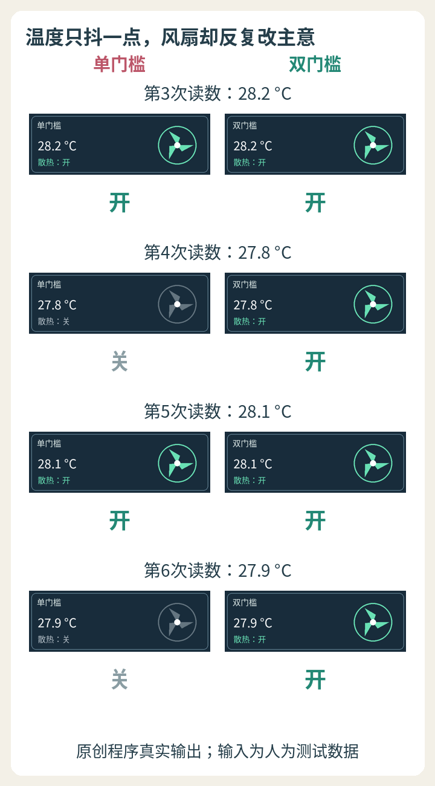

右边没有预测未来，也没把温度磨平。它只多记住了一件事：**我刚才是开着，还是关着？**

本篇沿着这个小问题走到施密特触发器。先把九次读数手算清楚，再看真实芯片、两个电压门槛，以及让电路自己改变判断条件的正反馈。后半部分有电阻公式，前面会补齐台阶；不运行代码，也能读懂主线。

## 1. 先把“规则”与“测量”分开

现实中的读数可能来自温度、光线、距离、电压。传感器、环境和采样方式都可能使数字波动。但我们今天先不问波动从哪里来，而是问：**数字已经给到我，我该怎样决定一个开关状态？**

“阈值”就是做决定的分界值，口语里也可以叫门槛。单门槛规则是：

- 当前读数大于或等于28℃，开。
- 当前读数小于28℃，关。

它没有记忆。给它27.8，无论上一秒发生什么，都回答关。

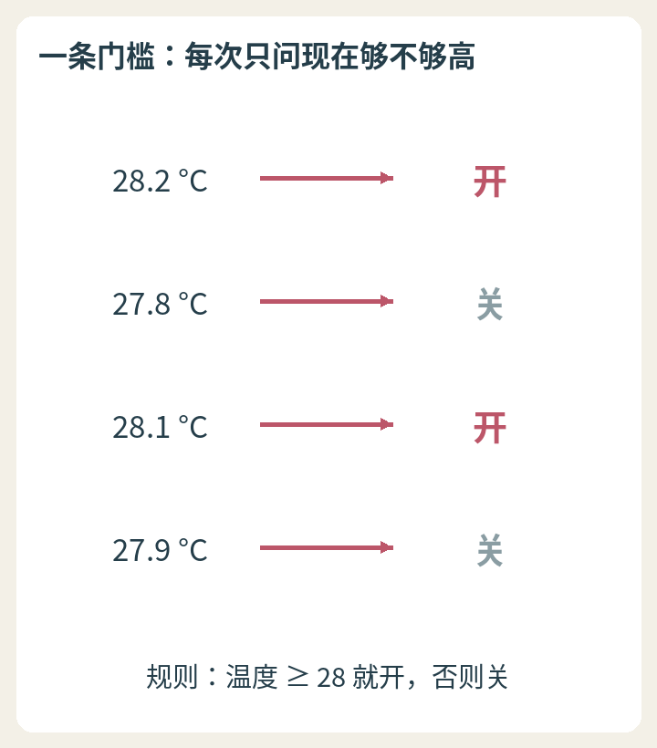

这个规则本身没有算错。问题在于，我们真正想要的也许不是“每一刻严格反映是否超过28”，而是“确实热起来才开，明显凉下来再关”。

这是需求的变化，所以应当修改规则，而不是责怪程序太听话。

## 2. 两条门槛，中间留一段“别改主意”的空间

换一条约定：

- 温度达到28℃，开。
- 温度降到26℃，关。
- 温度在26℃与28℃之间，维持原样。

注意最后一条。它没有叫你输出“半开”，也没有要求风扇转一半速度。输出仍然只有开和关；中间区域只是**不要求改变已有状态**。

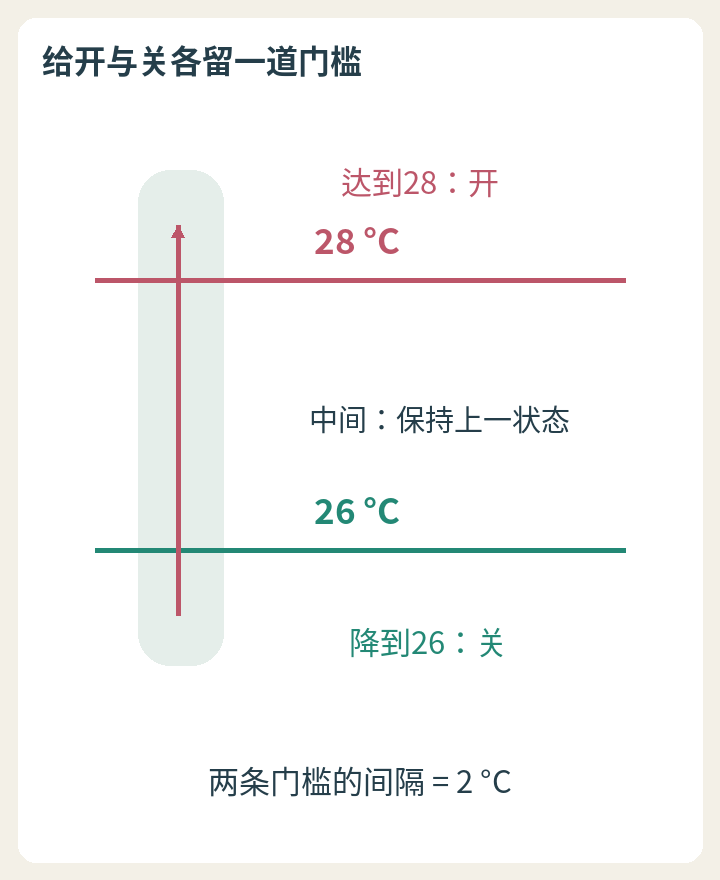

28是上门槛，26是下门槛。上门槛必须高于下门槛。这里间隔是2℃。

温度刚从28.2退到27.8时，旧规则说“已经低于28，关”。新规则则说“你确实开过，但还没凉到26，继续开”。这就是右边显示不再闪烁的原因。

它也带来一个变化：27.8℃时，系统可能仍然开着。你不能既要求它严格执行原来的单门槛定义，又希望它在门槛旁完全不改主意。

## 3. 一张九行小账本，足够看懂全部规则

我们明确指定初始状态为关，再依次喂入九个数。

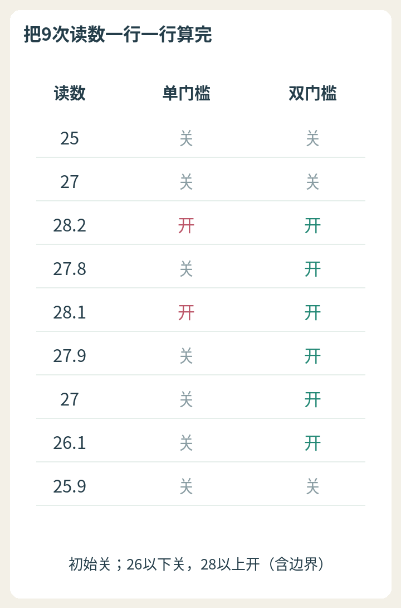

从头算一遍：

1. 25℃：已经低于下门槛，关。
2. 27℃：在中间区域，沿用刚才的关。
3. 28.2℃：超过上门槛，开。
4. 27.8℃：在中间区域，沿用开。
5. 28.1℃：超过上门槛，仍然开。
6. 27.9℃：中间区域，仍然开。
7. 27℃：还是中间区域，仍然开。
8. 26.1℃：很接近下门槛，但尚未到，继续开。
9. 25.9℃：越过下门槛，关。

单门槛总共切换4次，双门槛只切换2次。这里的“切换”是状态改变，不是检查了多少次。连续三次回答开，只算一次从关到开的变化。

我们还约定：恰好28时开，恰好26时关。这是本篇软件模型的边界写法。真实模拟电路不会在数学上的绝对精确等号处瞬间完成一切；后面会说到器件公差和延迟。

## 4. 为什么同一个27℃，会有两个正确答案？

这是最值得停一下的地方。

第一条经历是25→27。系统没有到过上门槛，所以到27时仍然关。

第二条经历是29→27。系统先因29而打开，回落到27时还没到关闭门槛，所以仍然开。


此刻读数相同，答案却不同。区别存在于“怎样来到这里”。

这类依赖过去经历的现象，叫**滞回**，英文是 hysteresis。在本篇这样最简单的开关模型中，记忆并不神秘，只需要保留一个开或关的状态。

这也解释了为什么不能只写成“输出是当前温度的某个普通单值函数”。中间区域里，仅凭当前温度还少了一项信息：上一状态。

## 5. 把记忆画成两个房间：状态机

想象程序只能待在两个房间之一：关的房间，开的房间。

在关的房间里，只有达到上门槛，才搬到开的房间。在开的房间里，只有达到下门槛，才搬回关的房间。其他时候，待着不动。

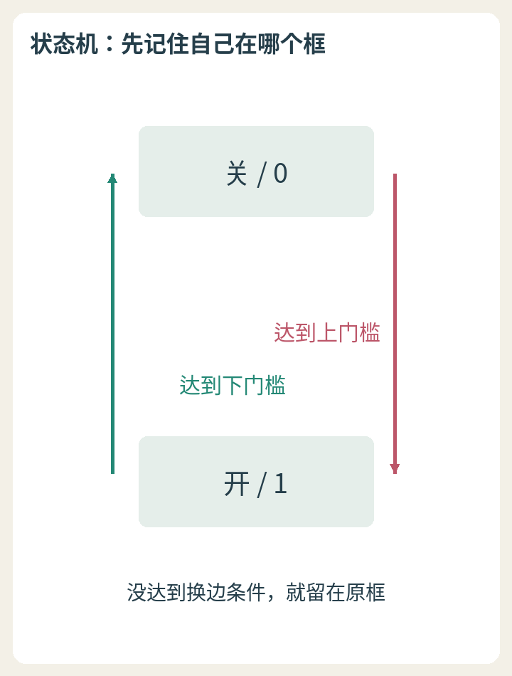

这就是一个很小的**状态机**：保存“现在在哪个状态”，再由输入决定是否换状态。

你可能已经在游戏里用过相似思路：角色处于站立、跳跃或受伤状态，不是每一帧都从零猜自己该做什么。本篇只有两个状态，恰好能把记忆的作用看得很清楚。

逻辑可以写成三句话：

```text
输入 ≥ 上门槛：状态设为开
否则，输入 ≤ 下门槛：状态设为关
否则：状态保持不变
```

“否则”保证一份输入按清楚的顺序处理。“保持不变”则是整件事的核心，不能顺手写成关。

## 6. 一条有来有回的线，怎样读？

很多资料会给你一个长方形似的图，说这叫滞回回线。第一次看时，最容易把横轴当成时间。

这里横轴是温度，纵轴是输出状态。向右移动，表示温度上升；向左移动，表示温度下降。我们不是在图上不断朝右播放时间。

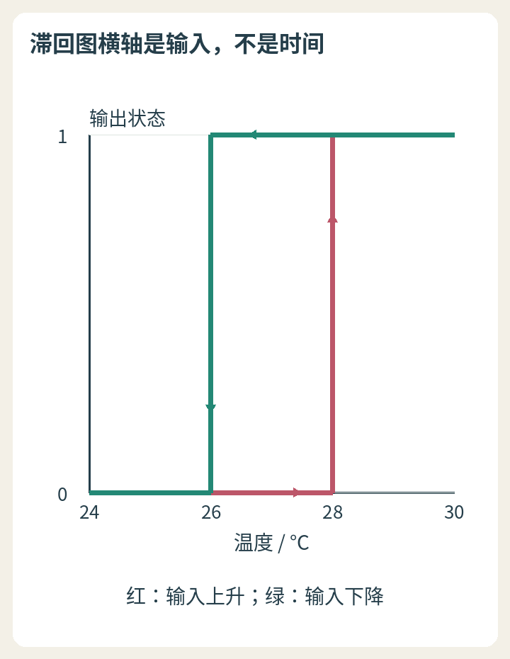

沿红箭头走：从低温、关闭出发，经过26也不打开，一直走到28才跳到上面。

沿绿箭头回来：从高温、开启出发，经过28也不关闭，一直退到26才跳到下面。

26到28之间，上下两条线都存在。那不是绘图失误，而是在告诉你：这个区域确实允许两种状态，具体在哪条线上取决于历史。

有时资料把两门槛之差称为**滞回宽度**。温度模型里它的单位是℃；电压电路里则是伏特。宽度不是一个没有单位的“强度旋钮”。

## 7. 把测试拉长：输入没变平，输出却少跳了

附带程序还生成了12秒、601个样本的测试输入：先升温，在28℃附近摆动一段，再降温。仍然是人为构造的输入，不是温度计采集记录。

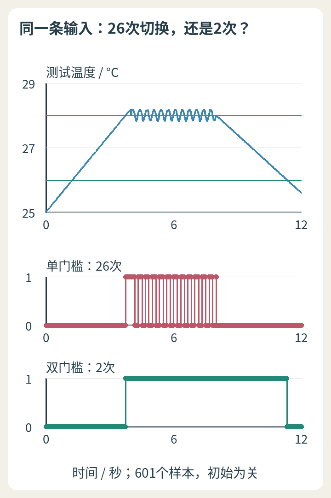

蓝线的波动没有被删掉。两种程序收到同一组原始数值。单门槛输出切换26次，双门槛输出切换2次。可下载的[数据表](examples/trace.csv)与[计算结果](examples/results.json)保留了这些数值。

这不是“所有情况下都能减少到2次”的保证。我们只是实算了一组明确给出的输入。换一条温度曲线，切换次数当然可能不同。

真正普遍的结论来自规则本身：**只要输入始终严格待在两个门槛之间，状态就不会因为这些输入而改变。**

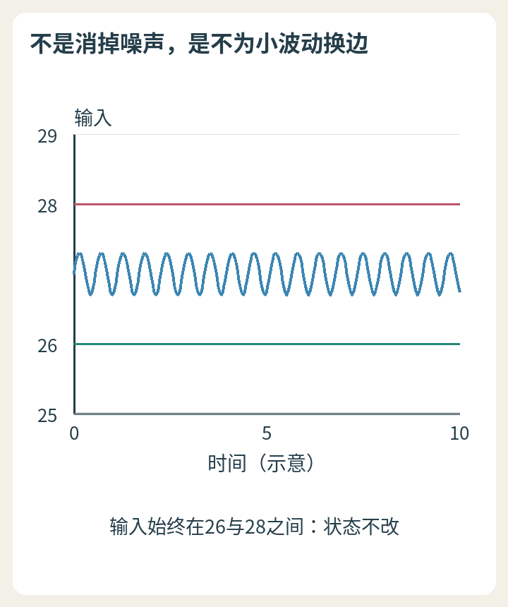

若一段输入的整个取值范围比滞回宽度还窄，它无法同时到达两道门槛。这段期间可能先发生一次切换，但不可能单靠这段范围中的数值反复在两边转换。别把“不能反复切换”误说成“绝不会发生第一次切换”。

## 8. 加宽门槛，就一定更好吗？

加宽中间区域，确实能容忍更大的往返波动，但代价也更直接：系统要等到更远的另一道门槛才改变状态。

假设关闭门槛从26降到20。风扇不容易关闭了，却也可能在你不想让它继续运行时一直运行。换成游戏的互动提示，中间区域太宽，玩家已经离开很远，提示还挂着。

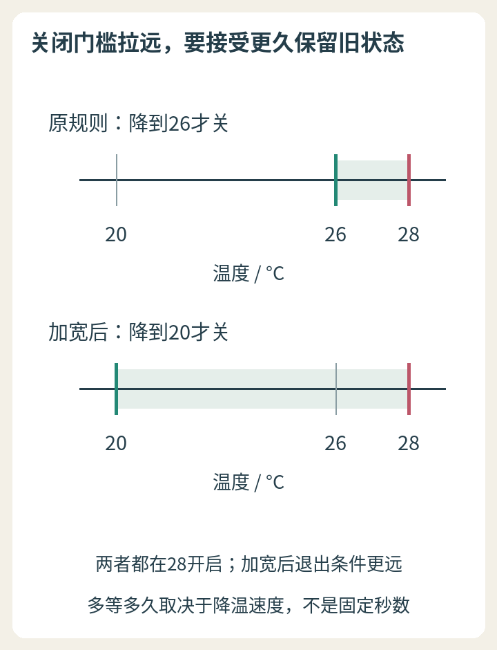

所以门槛间隔需要符合用途，不能只追求“看起来稳定”。你需要先知道：允许在多大的范围内继续保留旧答案？过早切换和过晚切换，哪个代价更大？

还有一个细节：滞回宽度是输入幅度的间隔，不是固定等待时间。温度下降很快，可能很快到26；下降很慢，就会等很久。你不能把2℃的宽度直接叫作“延迟两秒”。

## 9. 它能对付小抖动，但不是所有“去抖”

在硬件里，一个按键接通时，接触部件可能发生短暂弹跳。这里不要凭名字就认为施密特触发器能包办所有按键去抖。

如果输入真的反复从0伏跳到3.3伏，而门槛分别是1伏、2伏，那么每次摆动都完整跨过两道线。根据我们刚刚学会的规则，输出就应当反复变化。

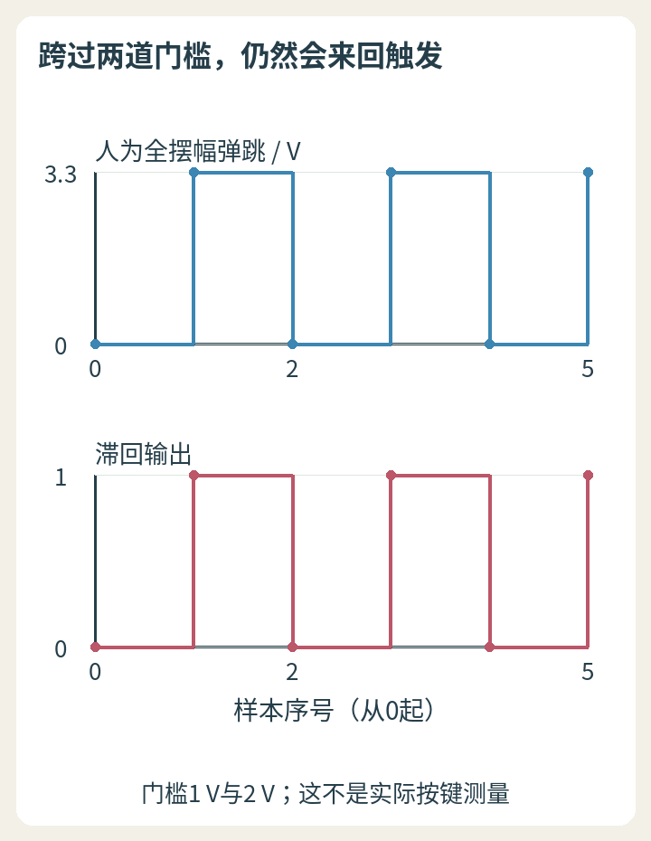

这张是反例模型，不是示波器实测。它说明的是一个逻辑边界：**抗门槛附近的小扰动，不等于拒绝完整越过两门槛的信号。**

别因为按钮与输入波形都叫“抖”，就以为它们一定需要同一种处理方式。

## 10. 很短的脉冲，甚至可能留下一个持续状态

再看25→29→27→27→25这五次输入。

初始关。29让它开起来。虽然29只出现一次，后面的27却仍在保持区，因此系统会继续开，直到最后的25才关闭。

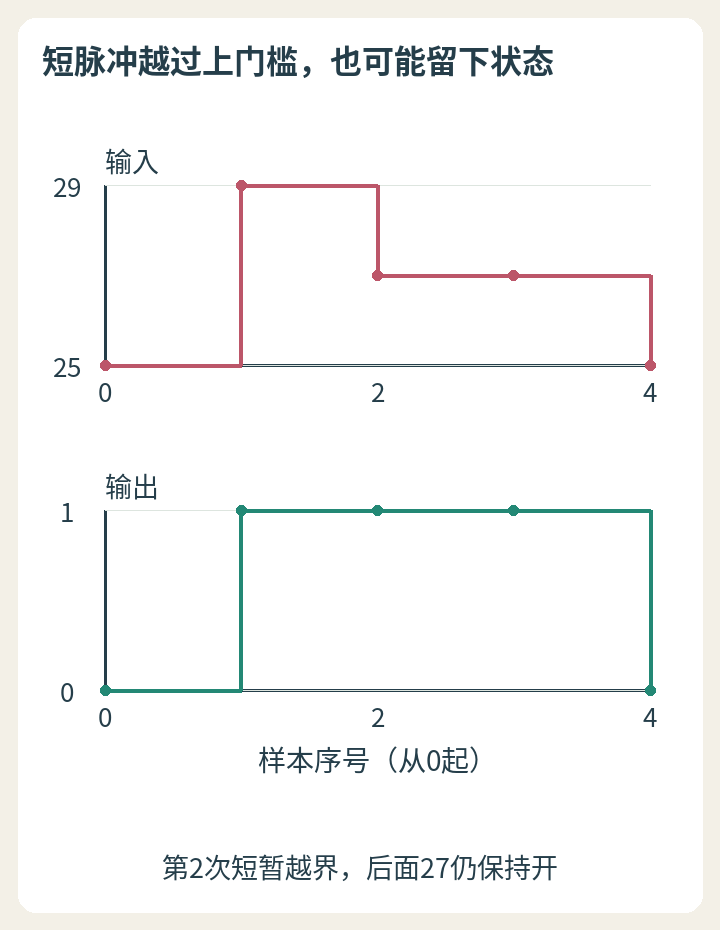

它并不知道那次29是真实事件还是毛刺。“毛刺”通常指非常短暂、并非我们想要的脉冲；但短暂是时间性质，两阈值规则本身并没有检查持续时间。

因此，不能说“只要加施密特，短毛刺就都没了”。如果应用要求信号稳定一段时间才承认变化，那需要另外加入时间条件。

## 11. 三件很像的东西，先分清职责

第一件是**窗口判断**：当前值是否落在某个区间中？例如26≤温度≤28时返回真。它只看现在，同一个27总得到同一个答案。


第二件是本篇的滞回：使用两条不同的转换门槛，中间保存状态。

第三件是**时间去抖**：候选状态出现以后，必须连续保持一段时间，才接受它。例如连续0.2秒都满足条件，才真正改变显示。0.2秒只是示例参数，不是通用推荐值。


还有滤波，它会先改变输入序列，比如削弱快速变化的成分。后面用一个电阻电容模型看它的作用。

这些办法可以组合。先滤波，再用滞回判断，最后按需求限制最短运行时间，都有可能。但组合前应该分别知道每一层解决什么问题，否则调参数时会不知道自己究竟在修哪一层。

## 12. 程序刚启动，哪来的“上一状态”？

如果第一次读数就是27，低于28又高于26，三句话规则会走到“保持不变”。可程序才刚开，保持什么？

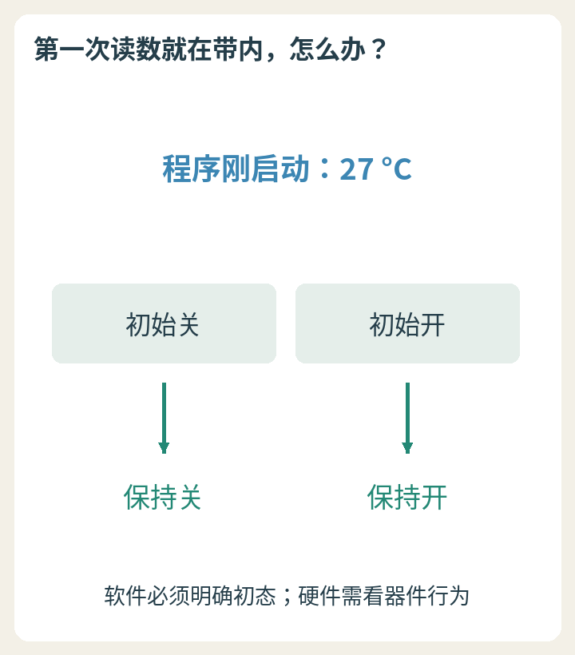

答案是：你要明确设计初始状态。示例程序初始化为关；其他应用可能选择开，也可能在开始前要求输入先到一个确定区间。

这个选择不是数学会替你决定的。一个游戏提示默认隐藏通常容易理解；一个有安全要求的控制系统，还要分析传感器故障、断线和启动过程，不能照抄教学示例。

数字软件可以清楚保存一个布尔值。布尔值只有真和假两种，这里分别代表开和关。真实芯片在电源上升、输入悬空或条件不明确时的行为，则必须查具体器件资料，不能用“它有记忆”推断一个未经保证的启动结果。

## 13. 这并不只是一段软件：看看真正的板和芯片

下面是 Raspberry Pi 官方文档中的 Pico 开发板照片。开发板，就是把处理器芯片、电源相关元件与连接位置放在一块板上，方便开发和试验。中央黑色芯片是RP2040；靠USB接口的白色部件是板载按键；两侧金色区域是连接外部电路的焊盘。

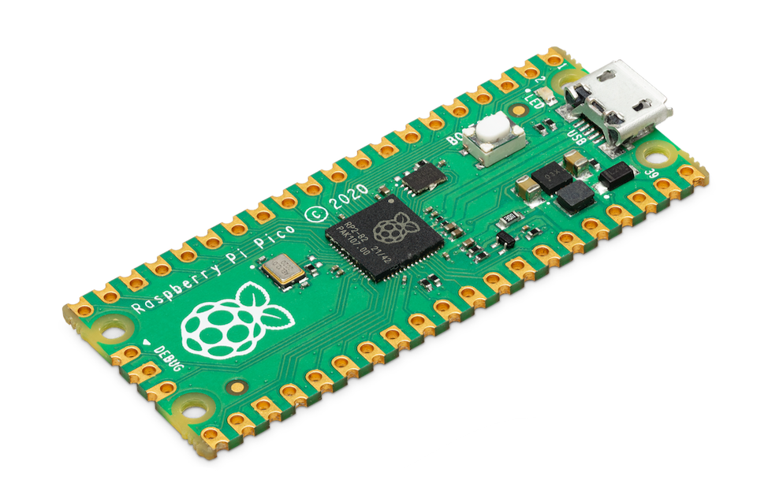

照片：Raspberry Pi Ltd，原图未改动，按[CC BY-SA 4.0](https://creativecommons.org/licenses/by-sa/4.0/)保留许可。不是本文拍摄，也不是本文搭建的实验。

我们选这块板，不是因为已经替你接好一个温控器，而是因为它给“双门槛可以存在于真实数字输入中”一个看得见的对象。Raspberry Pi官方软件开发工具包的[输入接口说明](https://github.com/raspberrypi/pico-sdk/blob/079c6f39023649b154152db30f1d781e884879bc/src/rp2_common/hardware_gpio/include/hardware/gpio.h)明确说，可以启用或关闭通用数字输入的施密特滞回；对应RP2040的[寄存器定义](https://github.com/raspberrypi/pico-sdk/blob/079c6f39023649b154152db30f1d781e884879bc/src/rp2040/hardware_regs/include/hardware/regs/pads_bank0.h)也列有控制这项功能的SCHMITT字段。这里核对的是官方功能声明，不是本文的硬件实测。

再看芯片封装的正面与背面。

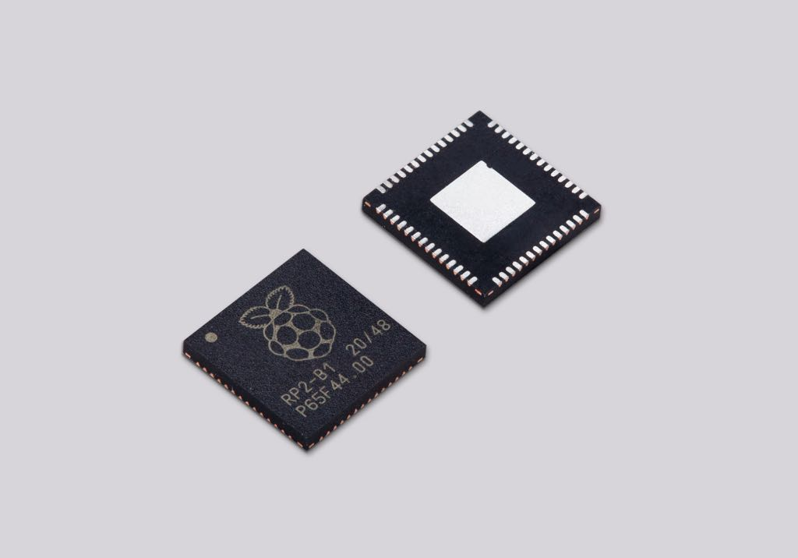

照片：Raspberry Pi Ltd，原图未改动，CC BY-SA 4.0。芯片内部有大量电路，照片能展示封装和连接触点，**看不到里面的施密特电路**，也不能从照片量出它的门槛电压。

这里的实例是RP2040输入接口，不是下面会介绍的独立74HC14芯片；两者的电压规格不能混着用。

## 14. GPIO、输入接口、施密特，分别在哪一层？

GPIO是 General-Purpose Input/Output 的缩写，中文通常叫通用输入输出。暂时把它理解为处理器与外部电路交换数字信号的通道就够了。

外面的导线带来电压，芯片需要把这个电压解释成内部能使用的0或1。输入接口处可以带有施密特特性，使向上与向下变化使用不同门槛。

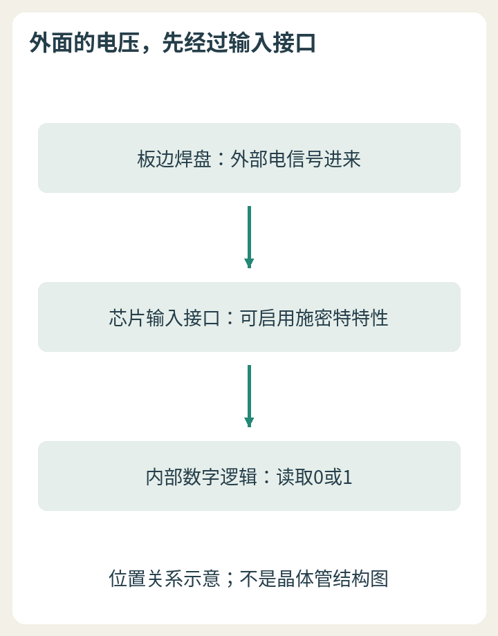

图是位置关系的原创简化示意，不是RP2040的内部晶体管布局，也不表示外部任何电压都能直接接进来。输入允许的电压范围、供电和连接方式仍由器件规格约束。

到这里，“施密特触发”可以先理解为：**把带滞回的门槛切换落实为一种电路行为。** 不同电路的细节会变，但上升与下降采用不同转换门槛是我们要抓住的共同点。

## 15. 小心反相：输入上升，输出不一定变成“开”

前面的温度软件是“输入高，状态开”。电路不一定采用这个方向。

一种常见器件叫施密特触发反相器。“反相”在这里表示逻辑方向翻转：输入足够低时，输出高；输入上升越过上门槛，输出变低；输入再下降越过下门槛，输出变高。

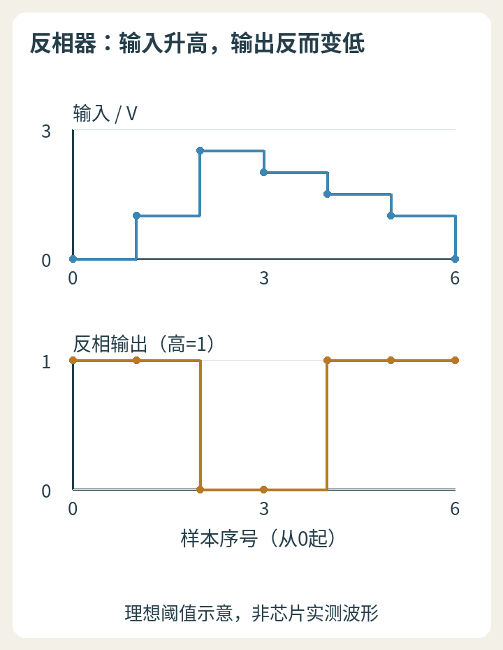

高、低说的是电压状态，0、1则是对逻辑状态的编码。它们不是“电路有没有通电”的同义词；输出低也不表示整个芯片关机。

图中用上门槛2.5伏、下门槛1.6伏帮助读方向。这里是理想阈值的离散模型，没有模拟传播延迟，也不是示波器记录。

只要方向讲清楚，反相与非反相都可以有滞回。**“有两道门槛”和“输出是否反向”是两个不同问题。**

## 16. 74HC14的“六路”，不是自动帮你重复处理六次

TI的SN74HC14是六路施密特触发反相器。六路的意思是同一个封装内有六个独立输入输出通道，不是输入必然依次穿过六级。[TI SN74HC14官方资料](https://www.ti.com/lit/ds/symlink/sn74hc14.pdf)

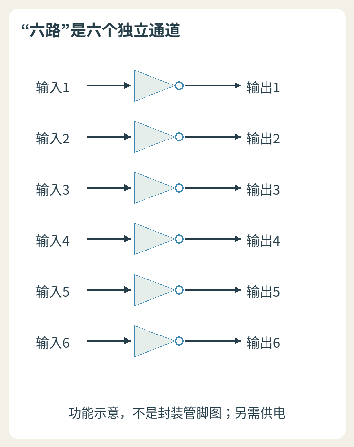

图上小三角加输出端的小圆圈，表达反相功能。为了看清六路关系，我们省略了细节；这不是可照着接线的管脚图，也没有表示供电连接。

我们不在这里要求你买元件搭电路。认识器件时，第一步是知道它在做哪件事，第二步才是查具体型号、封装、供电和引脚。把“名字很像”当成“接法与规格都一样”，很容易走错方向。

前面的Pico照片不能拿来冒充74HC14实照，也不能用74HC14的门槛给Pico输入做保证。

## 17. 规格表里的“典型”，不是每颗芯片都精确这样

刚才的2.5伏和1.6伏并非随意挑选：TI的SN74HC14 Rev L数据表§5.5，在供电VCC=4.5伏、环境温度25℃这一条件下，给出上门槛典型值2.5伏、下门槛典型值1.6伏。

不过，同一张表也给出范围：上门槛1.55～3.13伏，下门槛0.9～2.45伏；滞回宽度另有0.4～2.1伏的规格，典型值0.9伏。

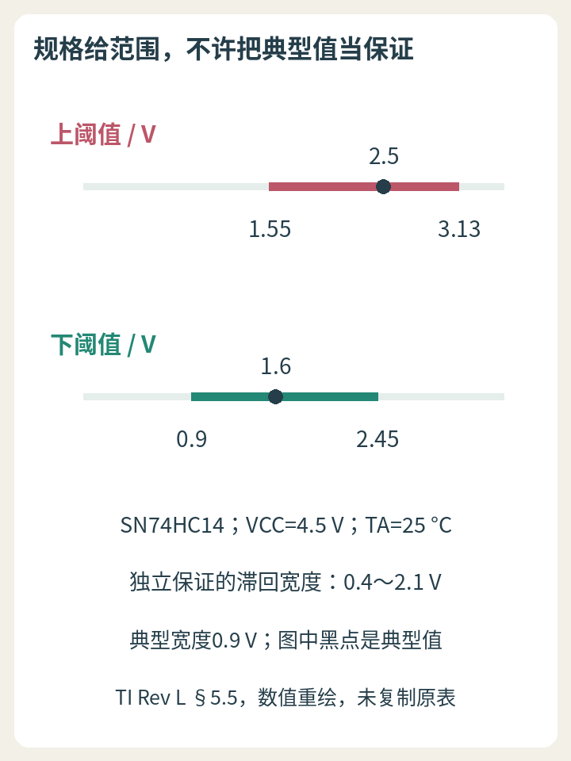

这张图把数值重新画出来，没有复制厂商原表。VCC表示器件供电电压，TA表示环境温度。条件变了，不能继续把这组数字当成万能常数。

为什么上下范围看起来重叠？因为它们是对许多器件和规定条件给出的各项边界，不是要求同一颗器件同时取“最低上门槛”和“最高下门槛”。不能拿1.55减2.45，得出这颗施密特器件的滞回宽度是负数。宽度要看同一器件的实际两个门槛及单列的宽度规格。[TI数据表§5.5](https://www.ti.com/lit/ds/symlink/sn74hc14.pdf)

工程上的“有保证范围”与课堂上的“先假定一个精确值”，各有作用。把这两层分开，公式才不会在离开练习纸时突然失灵。

## 18. 两道门槛，电路怎样自己造出来？

下面换成一个独立的理想比较器模型。**它用于解释正反馈，不是74HC14或RP2040的内部实现图。**

先认识比较器。它比较两个输入端的电压：

- 标着“+”的输入端电压更高，输出高。
- 标着“−”的输入端电压更高，输出低。

这里的加减号标识比较方向，并不是让你把两个信号随手加减后接到电源上。

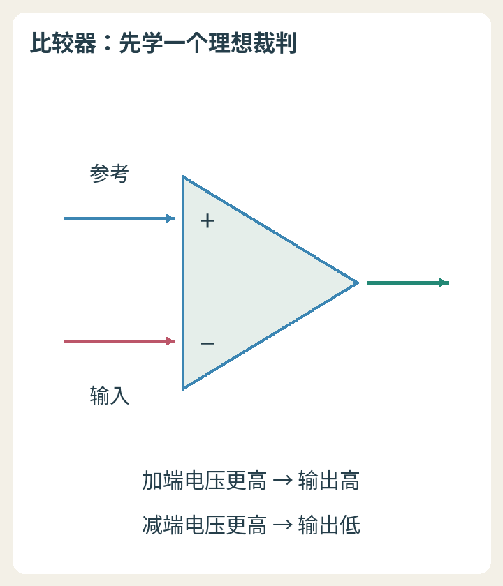

我们把要检测的输入接到减端，把参考电压接到加端。于是输入一旦超过参考，输出就转低。这是反相方向。

暂时假定输出高时恰好5伏、低时恰好0伏，比较器输入不吸收电流，变化没有延迟；所有电压相对于同一个参考地。这些是假设，不是对真实器件的规格承诺。

接下来最重要的问题是：**如果参考电压不是固定的，而是受到输出影响，会怎样？**

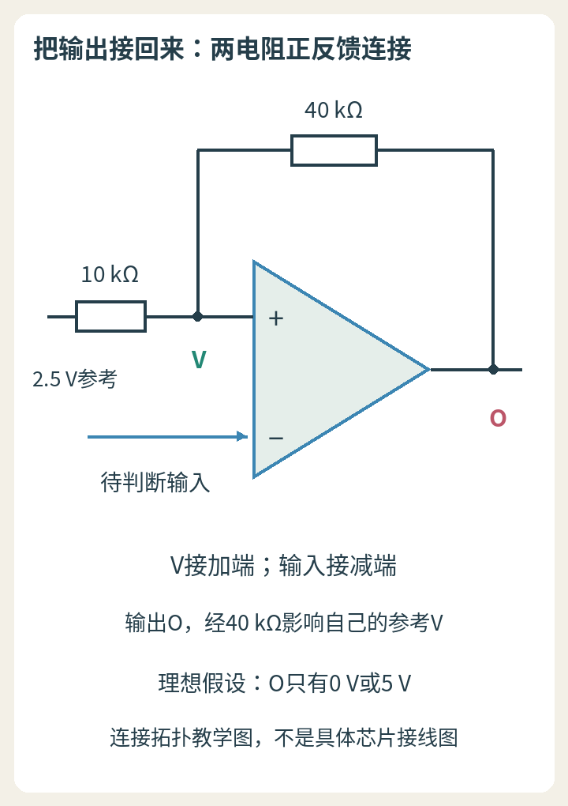

先沿线看一次：输出O走上方的40kΩ支路，回到绿色V节点；左侧2.5伏参考经过10kΩ，也汇到V。V接比较器加端，要判断的输入另接减端。方框电阻之间的线表示实际连接关系，不是四个互不相干的文字标签。


## 19. 电阻那一段，先从电流账本讲起

先补两个基本词。电压是两点之间的电势差，这里可以先把它当作相对于统一零点的数，单位叫伏特，写作V。电流描述电荷流动的快慢。前面说的参考地，就是本模型共同选定的零电位参照，不要求你真的接一根导线到泥土中。

我们用两条电阻支路接到同一个参考节点：

- 一条从2.5伏参考电源出发，经过10千欧电阻，到节点。
- 另一条从比较器输出出发，经过40千欧电阻，到同一个节点。

“节点”就是这些连接汇合的位置。千欧写作kΩ，10kΩ就是10000Ω。Ω是电阻单位欧姆。

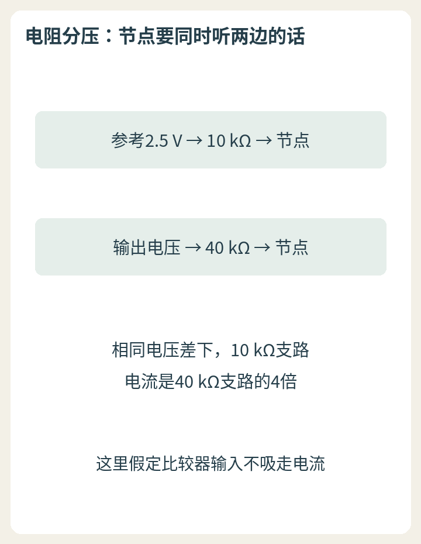

在简单电阻模型中，电流等于两端电压差除以电阻。相同电压差下，10kΩ支路的电流是40kΩ支路的4倍。

假定比较器的输入端不从节点吸走电流，流进节点与流出节点的电流必须平衡。节点电压因此不是随意选择，而是被两条支路共同确定。

你可以把它想成“两个电压共同拉住一个参考点”，但别把类比当成真实绳子。下一步会用电流账本精确算一次。

## 20. 把节点电压算出来，只需要一次整理

把节点电压叫V，输出电压叫O，二者单位都是伏。

从2.5伏那边流向节点的电流是(2.5−V)/10000；从输出那边流向节点的电流是(O−V)/40000。负数表示实际电流方向与我们选的方向相反。

两个有符号电流加起来为零：

```text
(2.5 − V)/10000 + (O − V)/40000 = 0
```

两边同时乘40000，把分母去掉：

```text
4(2.5 − V) + O − V = 0
10 − 4V + O − V = 0
10 + O − 5V = 0
V = 2 + 0.2O
```

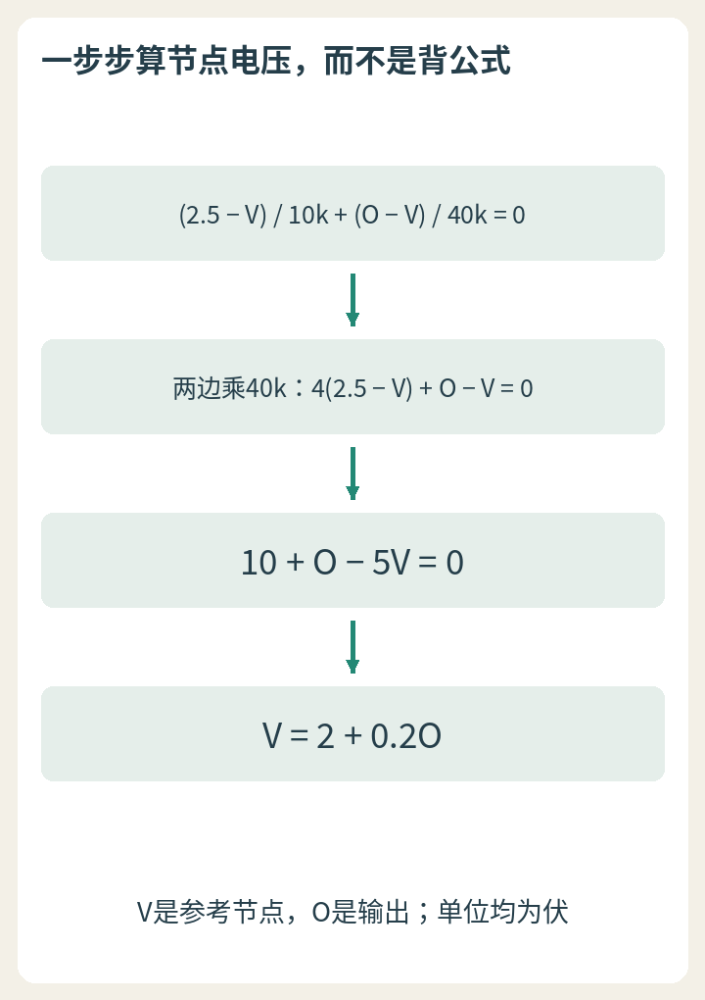

最后这一行很有意思：参考节点电压并不是一个常数。它会跟着输出O变化。

输出为5伏时，V=2+0.2×5=3伏。输出为0伏时，V=2+0.2×0=2伏。两道门槛出来了。

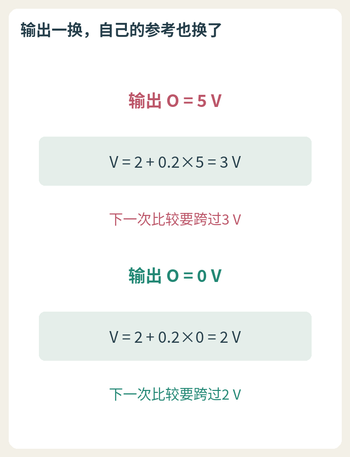

若你暂时不想重算每个分式，记住数值关系即可：**输出高，参考3；输出低，参考2。** 后面的切换过程只用这两条结果。

## 21. 正反馈，究竟“正”在哪里？

假设输入从低电压开始。输出处于高状态，所以参考为3伏。

输入慢慢升高，没超过3伏时，仍然低于加端参考，输出继续高。现在输入略微超过3伏，减端胜出，输出开始变低。

变化没有停在这里：输出变低，又把参考从3伏拉到2伏。此时输入早已高于2伏，比较器更明确地支持低输出。刚刚发生的变化，推动条件进一步支持这个变化。

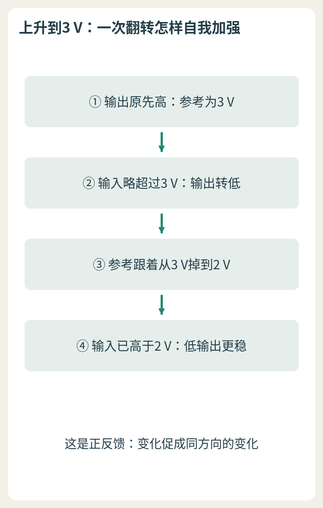

这叫**正反馈**。反馈是“输出又影响到输入侧的判断条件”；正则指这段作用加强了正在发生的变化，而不是“对人有好处”的意思。

输入往下走时也类似。只要输出仍低，参考就是2伏。输入必须降到2伏以下，才让输出转高；输出一转高，参考又升到3伏，这会加强高输出的状态。

于是上升要跨3伏，下降要跨2伏。整个电路用自己的输出，改变了下一次需要跨过的门槛。

## 22. 回线再看一次：这次是反相的

现在横轴是输入电压，纵轴是输出电压。

输入上升时，输出先保持5伏，到3伏附近才转成0伏。输入下降时，输出先保持0伏，退到2伏附近才回到5伏。

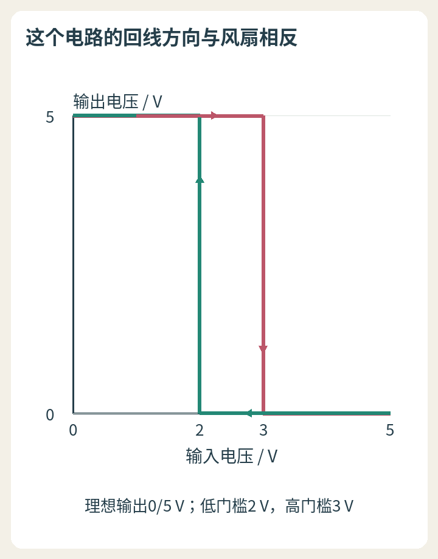

请和第6节的温度回线对照。它们都在中间区域保留历史，但上下方向不同。前面是高温让软件状态开，这里是输入高让反相输出低。

本模型把转换画成竖直线，是为了呈现门槛关系。真实电路有有限变化时间、输出电压范围、负载影响和内部结构。比较器若采用不同输出形式，还可能需要其他外部元件。不能把这张理想回线当作任何芯片在任何接线下的实测结果。

## 23. 电阻电容滤波为什么常和它一起出现？

先不接真实电路，看看一个最简单的数学模型：输入突然从0伏变成3.3伏，经过一阶RC低通后，输出不是立刻跳过去，而是逐渐靠近3.3伏。

R代表电阻，C代表电容。电容能储存电荷，电压变化需要充放电过程。**时间常数**RC描述这个过程的时间尺度；它不是说恰好到这个时刻就全部完成。

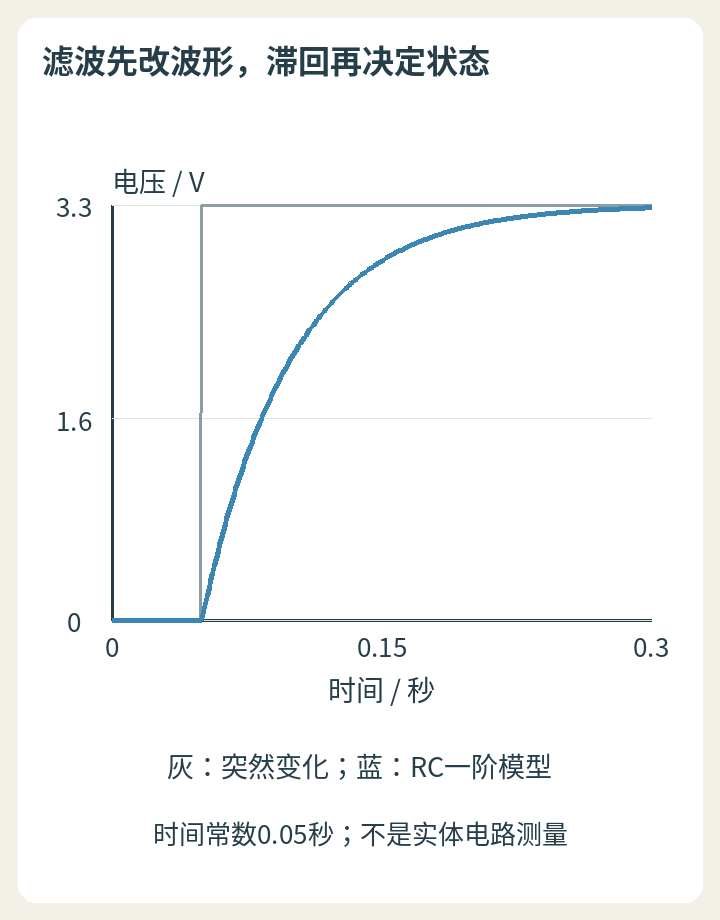

图中时间常数取0.05秒，0.05秒时输入开始变化。蓝线来自指数模型计算，不是仪器采样。经过一个时间常数，变化完成约63.2%；再往后继续接近目标。

滤波改变了输入波形，施密特特性则让慢慢经过中间电压的信号采用有滞回的转换门槛。两者可以协作，但不是同一件事。

[TI的施密特应用说明](https://www.ti.com/lit/ab/scea046b/scea046b.pdf)也讨论慢变化输入、噪声及按键应用。真正设计时仍需查具体器件的输入变化速度要求、输入电流和门槛，不能从“施密特”三个字推出无限制容忍所有慢边沿。

这里不提供连接市电、风扇功率负载或旧式高压电子管的实验步骤。理解门槛规则，用数据和图就足够。

## 24. 这个名字从哪里来？先把两种日期分清

Otto H. Schmitt的论文《A thermionic trigger》发表于1938年的 Journal of Scientific Instruments，第15卷24—26页。论文正文同时写着：稿件收到于1937年11月26日。

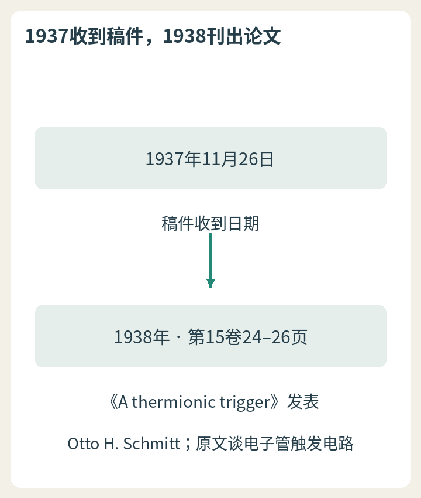

因此，看到一个名为“Schmitt1937.pdf”的文件，不能直接把发表年份写成1937。收稿、发表、构思和发明，原本就是不同事件。[原论文扫描件](https://people.eecs.berkeley.edu/~pister/publications/FamousPapers/Schmitt1937.pdf)

原文讨论的是电子管电路。电子管属于比今天集成电路早的一代电子器件；论文关注让慢变化的电信号形成明确切换，并让两个切换条件存在差别。它也讨论温控和照明等应用。

我们今天用软件状态、现代芯片和理想比较器重新走一遍机制，并不等于这些器件与1938电路长得一样，也不表示所有滞回现象都由某个人首次发现。历史名字给了一个入口，真正值得带走的是它解决问题的方式。

## 25. 回到游戏：提示不要在边缘跳来跳去

假设玩家靠近一个宝箱，就显示“可交互”。距离小于或等于5时显示，大于5时隐藏。玩家站在边缘，距离可能在4.9、5.1之间变化，提示又会闪。

这回输入越小越接近目标，所以规则方向反过来：

- 距离≤5，进入可交互状态。
- 距离≥7，退出可交互状态。
- 距离在5与7之间，保持原来的提示状态。

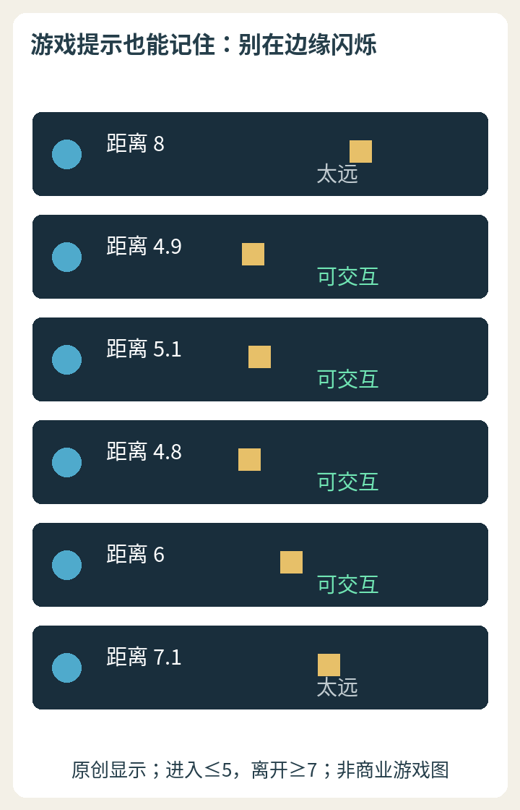

这是本文原创的简化显示程序输出，不是某个商业游戏的截图。圆点代表玩家，方块代表目标；图中的距离是测试输入，不是画面像素的直接单位。序列得到的状态是隐藏、显示、显示、显示、显示、隐藏。

你也可以把这个想法用在不同细节模型的切换上：近处切高细节，远处切低细节，两种转换距离留出间隔，减少在边界附近反复跳变。但真实游戏是否适合保留旧状态，还要看玩法、遮挡和其他规则。

尤其不要让视觉稳定掩盖逻辑不一致：如果实际交互只允许5以内，提示却在6处继续说“可交互”，玩家会困惑。可以同步调整交互状态，或把提示文案设计成“靠近目标”，但需要明确选择，而不是给显示套两条线就算完成设计。

## 26. 想试代码，可以从最小版本开始

下面是与前面完全相同的核心逻辑：

```python
def next_state(value, was_on, low=26, high=28):
    if value >= high:
        return True
    if value <= low:
        return False
    return was_on
```

这里的True表示开，False表示关。`was_on`是调用前的状态，函数返回这次处理后的状态。每次调用后，要把返回值保存下来，供下一次使用；如果每次都把`was_on`重新设为False，记忆就丢了。

[完整示例](examples/schmitt_lab.py)另外检查上门槛必须大于下门槛，并拒绝无穷大、非数字数值等不适合本模型的输入。数据无效时应采取什么应用动作，则由真实系统另外决定。

运行方式与依赖在[示例说明](examples/README.md)。实际输出包括九行账本、601行测试数据和输入接口之外的纯软件检查。可选的显示程序需要Pillow；核心数值模型只用Python标准库。

可以自己改三件事：

1. 把最初状态改成开，重新计算第一个27。
2. 把下门槛从26提高到27.9，看门槛旁小波动如何更容易触发切换。
3. 输入25、29、27、27、25，解释为什么一次短越界能让状态保留。

这些测试能核对规则实现，不能代替实际芯片、传感器、电源和负载的测试。我们没有把软件结果叫作硬件测量。

## 27. 最后带走三问


以后再看到两个门槛，不必急着背“施密特”“滞回”“正反馈”这几个词。先问：

**第一，什么时候进入，什么时候退出？** 两条条件要清楚，方向也要清楚。输入高是开还是关，取决于应用及电路是否反相。

**第二，中间区域保留哪份历史？** 如果完全不需要过去，它也许只是一个窗口判断。若确实要保持状态，就要考虑启动时从哪里开始。

**第三，还有什么会越过我的规则？** 全幅弹跳可以跨过两门槛；短脉冲可以留下状态；带宽变大可能让退出更迟；真实器件还有公差与电压范围。

一个看似只有开和关的小问题，最后让我们学到一件更广泛的事：程序和电路并非每一刻都必须推翻过去。有时，给改变主意设置明确的条件，比让每次小波动都拥有最终决定权更合适。

---

原创正文、原创教学图与教学显示按CC BY 4.0发布；原创示例代码按MIT发布。两张Raspberry Pi官方照片另按CC BY-SA 4.0保留，原始许可随文附上；不因本文章正文许可而改授。来源版本、数值复算、全部图像职责与权利见[资料与配图说明](sources.md)。
