# 把“中”切掉半个，后面的字还找得回来吗？UTF-8 写在字节里的路标

有一个小文件，里面只有四个字：

**A中𠮷B**

你没有从文件开头读取，而是跳到中间。巧的是，落点就在“中”的半截。

计算机看到的不是半个汉字图案，而是一串没有空格的字节。它怎么知道：眼前这两个字节是前一个字的尾巴，后面那个才是新字的开头？必须倒回文件第一字节，从头数一次吗？

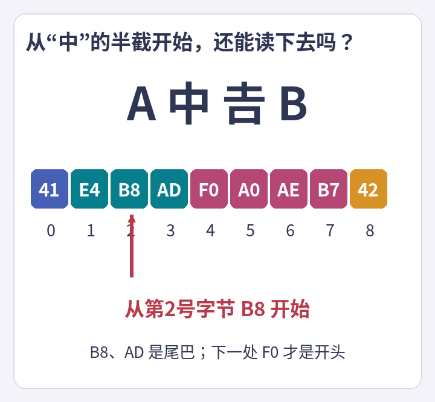

UTF-8的一个巧妙之处，就是把这种边界信息放进了字节自身。

这篇会从这个九字节文件出发，亲手算出“中”的编码，找回后面完整的“𠮷B”，再讨论为什么“找到下一个开头”既不等于修好了丢失的字，也不等于已经验证输入安全合法。

你不必预先认识十六进制、Unicode或位运算。我们先把这些层次拆开，每次只搬上一小块。

## 1. 屏幕上的字、字的编号、文件里的字节，不是同一层东西

看见一个“中”，很容易想象文件里就存着这个字的形状。

大多数普通文本文件并不是这样存的。它记录某种文字编码；字体与排版系统再决定怎么把它画出来。

**Unicode**提供一个统一的码点空间。你可以暂时把**码点**理解为编号位置。汉字“中”的码点写作U+4E2D；字母A写作U+0041。前缀U+提示这是Unicode码点，后面的数字使用十六进制。

**UTF-8**则规定：怎样把这些编号变成按顺序存储的字节。

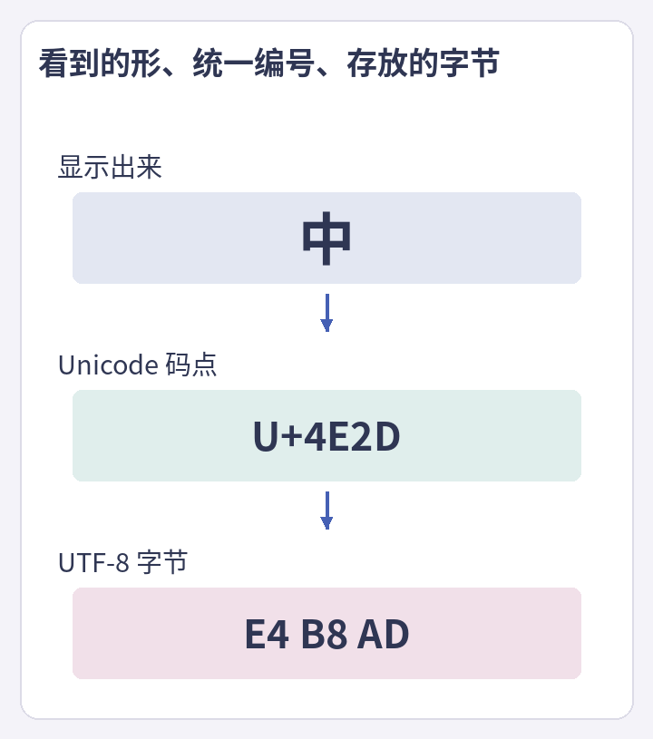

三件事不要混在一起：

- 字体换了，同一个码点可以画得很不一样。
- 同一段码点序列，可以使用UTF-8或其他Unicode编码形式保存。
- 一眼看见的“一个字”，有时需要不止一个码点。我们先学字节边界，稍后再回来拆这个更细的问题。[1]

本文的“𠮷”是U+20BB7，不是常见的“吉”U+5409。它让我们有一个真实的四字节例子。即使字体把细节画得相似，看码点编号也不会弄混。

## 2. 一个字节到底有多大？

在这里，一个**字节**由八个位组成，每位只能是0或1，所以共有2⁸=256种不同值，从0到255。

例如二进制11100100，亮起的权重是128、64、32、4，相加得到228。我们也可以用十六进制把同一个数写成E4。

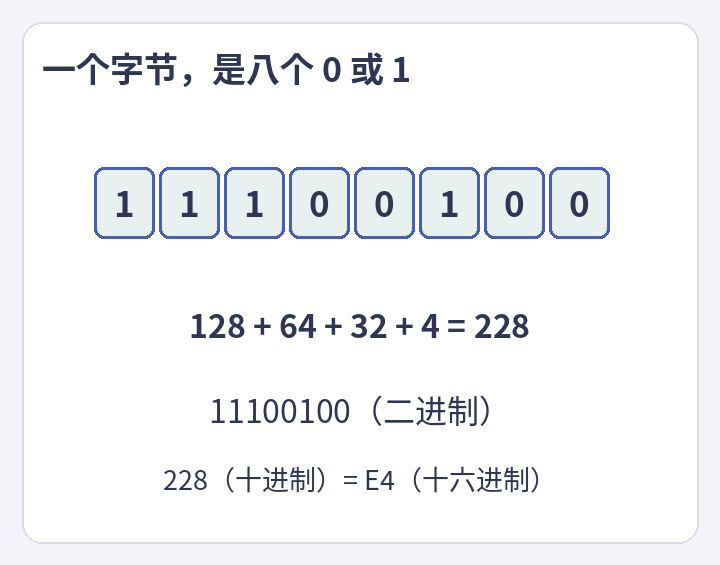

十六进制不是一种额外的文件编码，只是人阅读数字的缩写方法。

把八位从中间分成两组，每组四位。四位共有16种值；0到9继续用数字，10到15用A、B、C、D、E、F。于是1110是14，写E；0100是4，写4。两组放在一起，就是E4。

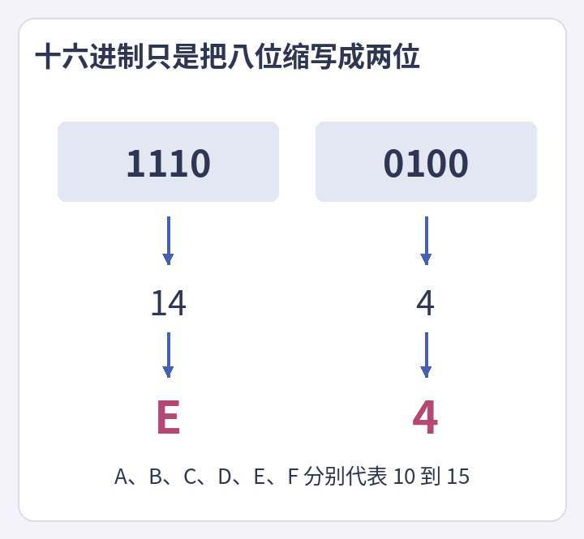

后面写“E4 B8 AD”，意思是三个字节的数值。空格是为了让我们看清楚，**并没有额外存进文件**。同样，文件也没有在每个字后面藏一个逗号。

## 3. 为什么不干脆给每个字都安排同样多的字节？

固定长度当然可以成为一种设计。例如UTF-32使用32位编码单元。但工程设计常常不只面对新问题，还要面对已经存在的大量程序和文件。

很多旧程序熟悉ASCII：英文字母、数字、标点与控制字符，占据0到127。例如A是十六进制41，斜杠“/”是2F，换行是0A，NUL是00。

如果一种新编码能让这些内容继续保持原字节，很多已有工具就比较容易继续工作。注意，是“比较容易”，不是自动把所有旧程序变成完整多语言编辑器。[2][3]

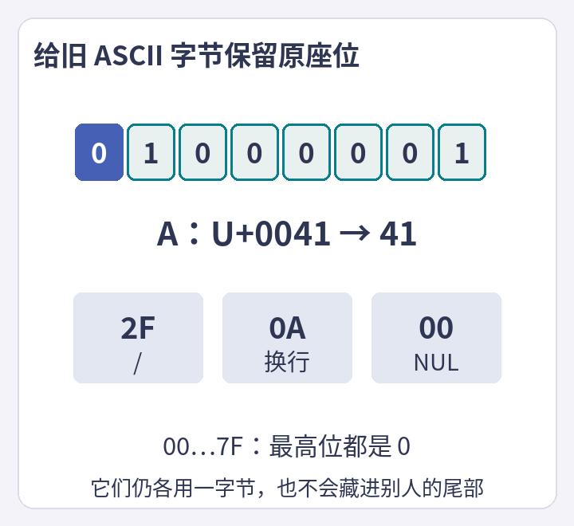

UTF-8保留了这一点：0到127的码点，仍然使用同值的单个字节，最高位是0。

还不够。假设斜杠的字节2F有时是路径分隔符，有时又悄悄出现在某个汉字的内部，一个只认识字节的旧程序就可能把文件名切错。

因此，UTF-8还让多字节编码中的每个字节都处于128及以上。这样，一个合法UTF-8流里的ASCII字节只会代表它自己，不会藏在别的码点的编码里。[2]

这个安排使“能表示更多文字”和“尽量不破坏旧字节约定”开始接上。接下来的问题是：多字节之间怎么分组？

## 4. 让每个字节先亮出身份

想象排队的人戴着不同帽子：有人举牌说“这一组有三位”，后面的人则说“我跟着前面那位”。这里的帽子就是字节最前面的几位。

UTF-8约定：

- **0xxxxxxx**：单字节码点，自己就是完整的一组。
- **110xxxxx**：两字节组的首字节。
- **1110xxxx**：三字节组的首字节。
- **11110xxx**：四字节组的首字节。
- **10xxxxxx**：续字节，只能接在某个多字节组的开头之后。

x不是实际存储的字母x，而是尚未填入的0或1；这些位置才装码点编号的数据。[1][2]

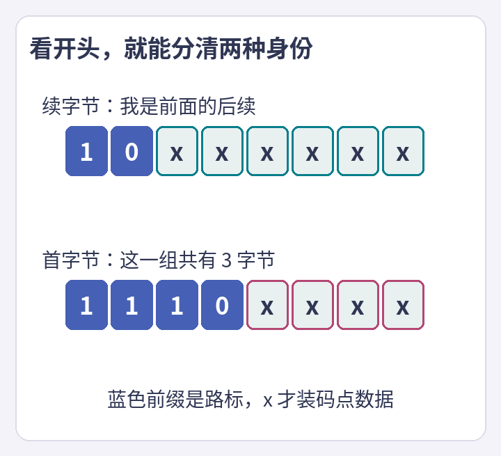

对于多字节首部，最前面连续1的数量告诉你整组总长度。110有两个开头的1，整组两字节；1110有三个，整组三字节。续字节的10则明确说：**别从我这里开始解释一个新码点。**

把所有包装形状放在一起：

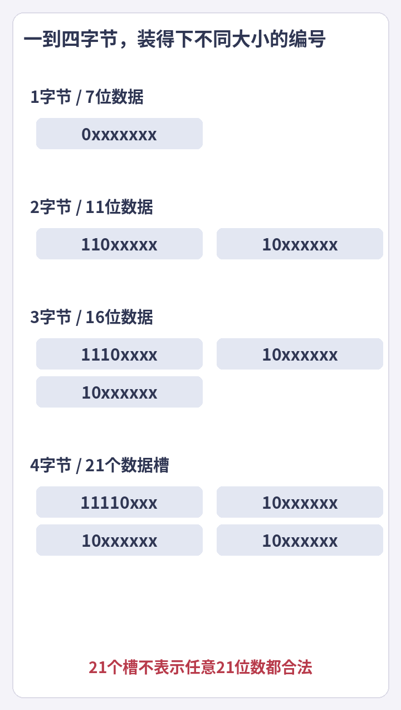

一字节有7个数据位；两字节是5+6=11位；三字节是4+6+6=16位；四字节是3+6+6+6=21个数据槽。

但先记住一个悬念：有21个槽，不代表所有21位整数都允许放进去。Unicode有自己的范围，UTF-8也要求采用最短的合法包装。我们在第10节补上这些限制。

## 5. 亲手把“中”装进三个字节

“中”是U+4E2D。把十六进制编号换成二进制，是：

**0100111000101101。**

它需要三字节格式，所以数据槽分成4、6、6位。最省心的装法是从右往左分：末尾6位给最后一个字节，再往左6位给第二个，剩下4位给第一个。

分成：

**0100 | 111000 | 101101。**

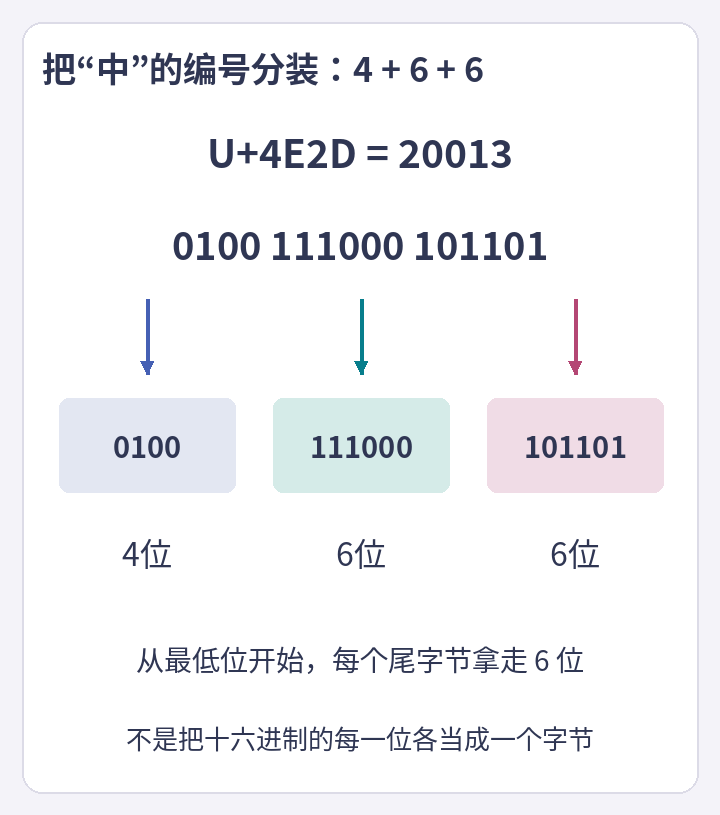

现在给它们加上身份前缀：

第一份0100，前面加1110，得到11100100，也就是E4。

第二份111000，前面加10，得到10111000，也就是B8。

第三份101101，前面加10，得到10101101，也就是AD。

所以“中”的UTF-8编码是：

**E4 B8 AD。**

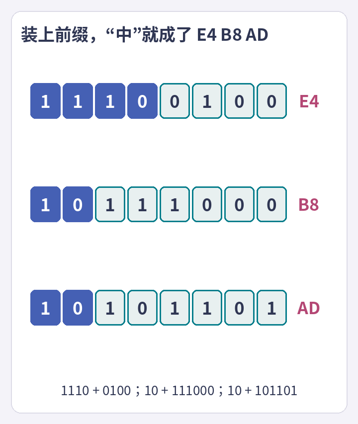

你刚刚做的事情，比背一张编码表更重要：你看到了哪几位负责**结构**，哪几位负责**内容**。

解码就是反过来。根据E4的1110开头，知道该有三个字节；确认另外两个都以10开头；去掉这些前缀，将0100、111000、101101拼回去，便恢复U+4E2D。

只做“去头、拼数”还不能称为完整严格解码器，因为非法输入也可能拼出一个数。先让合法例子在脑子里站稳，我们马上就会看反例。

## 6. 四字节并不是给“表情”专用的

我们再看“𠮷”，码点U+20BB7，也就是十进制134071。

它超出了U+FFFF，因此使用四字节格式。按3、6、6、6个数据槽装好后，结果是：

**F0 A0 AE B7。**

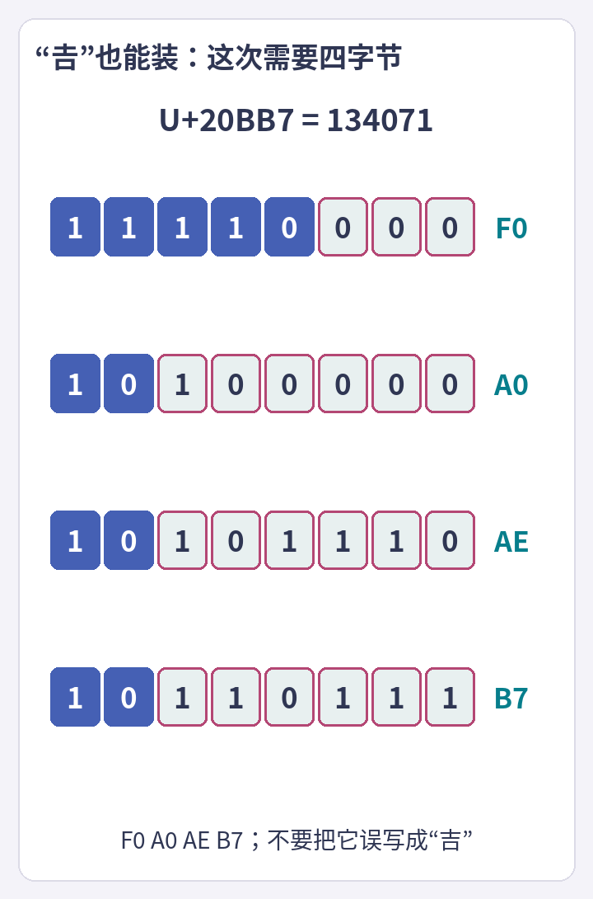

四个字节不是因为“这个字比较复杂”，也不是因为“它是表情”。长度由码点编号所在范围决定。复杂的常用汉字可能用三字节，一些看起来很简单的字符也可能在需要四字节的范围。

Unicode的码点空间通常按每65536个位置划成一个平面。U+0000到U+FFFF是基本多文种平面；其后的范围称为补充平面。这里知道“编号超过FFFF，UTF-8会用四字节”就够继续往下走，不必背各平面的名称。

现在把四个码点放回一起：

A是41，“中”是E4 B8 AD，“𠮷”是F0 A0 AE B7，B是42。

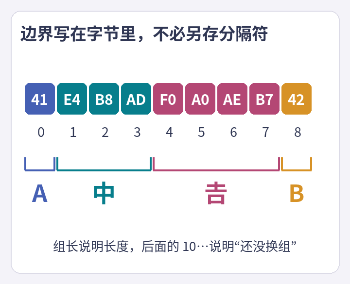

得到九个字节：

**41 E4 B8 AD F0 A0 AE B7 42。**

文章里的颜色、空格、括线都是教学辅助。真正的UTF-8数据不需要这些额外标记，因为每个字节的前缀已经承担了分组职责。

## 7. 终于回到开头：从 B8 进入，怎样找下一组？

为了能准确描述位置，我们把九个字节的索引从0开始编号：A在0号字节，“中”在1、2、3号，“𠮷”在4、5、6、7号，B在8号。

现在从2号字节B8开始。

B8写成二进制是10111000。它以10开头，是续字节，因此不能作为新码点的开始。跳过它。

下一个AD是10101101，也以10开头，仍是续字节。再跳过。

随后到F0，二进制11110000。它不是10开头，而是四字节组的首部。新的完整码点从这里开始。

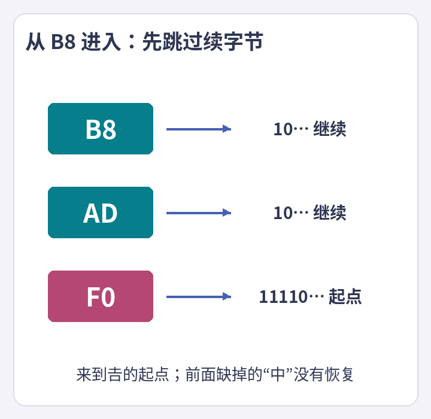

从F0继续读，得到“𠮷”，再得到B。后面的完整文字被找回来了。

可是“中”没有复原。它的首字节E4位于我们丢掉或没有拿到的那一侧。知道后面哪里有新边界，不等于知道前面原本丢了什么。

这种从流中途进入，能够重新辨认码点边界的性质，叫**自同步**。此处的同步不是时钟对齐，而是“我们重新知道从哪里分组”。

换一个切点，试试结果会怎样。下面动画依次检查九个起始字节位置，数字索引、跳过数量和保留下来的文字都由同一个样本生成。

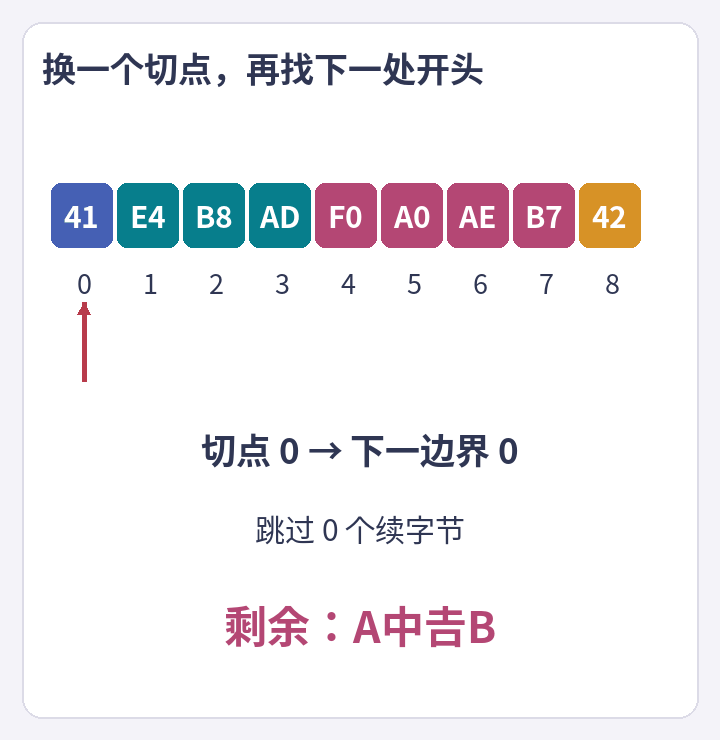

例如，从5号字节A0进入，要跳过A0、AE、B7，直到8号字节42才得到完整的B。最多可能跳过三个续字节，因为一个合法UTF-8码点最多只有四字节。

如果已经到达文件末尾，没有下一个码点，那么“下一个边界”就是流的末尾，不能凭空读出新内容。

你也可以打开[可拖动的字节边界实验](examples/boundary-lab.html)，逐格改变起点，先猜结果再核对。它只处理本文这个已知合法样本，正文静态图已经给出了必要步骤，不依赖脚本才能读懂。

## 8. 为什么它不会把一个尾巴误当新开头？

在**合法UTF-8流**中，续字节统一以10开头。

单字节码点以0开头；多字节组首部以110、1110或11110开头。它们与10开头的续字节，不属于同一种前缀。

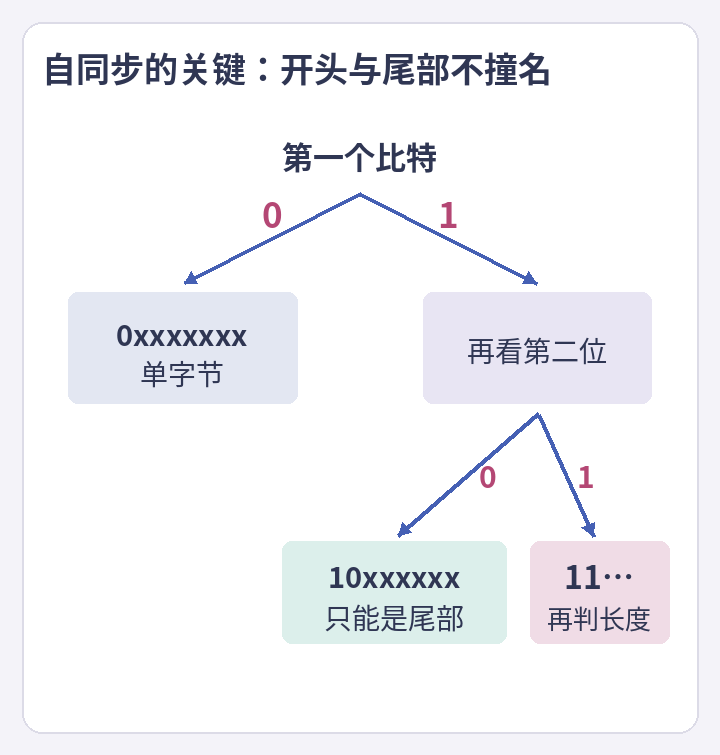

所以，只要你已知这是一段合法UTF-8的后缀，向前跳过10开头的字节，就能找到下一组的开头或结尾。这里“已知合法”是一个非常重要的前提，不是讲解时可随意省去的客套话。

向后查找也能利用同样结构：如果落在某个续字节上，而且前面的字节仍能访问，就向前追溯它所属组的首字节。在合法流中，最多追过三个续字节。

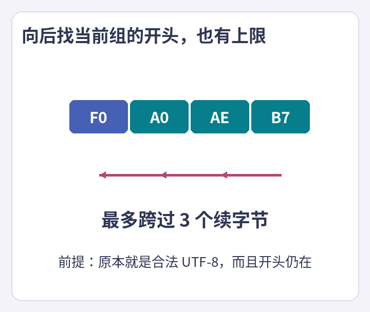

不过，边界容易找，不意味着第十万个码点也能直接用一个简单乘法定位。UTF-8的组长可变，找第十万个码点一般仍要扫描、利用额外索引，或从某个已知位置继续计数。

**“给定字节位置，附近能找边界”与“给定第几个码点，能立刻算出字节位置”，是两种不同的随机访问问题。**

## 9. 来历不明的字节，不能只靠跳过 10…

假如收到E4 41 AD。

E4看起来确实像三字节组的开头，但第二个字节41是ASCII字母A，以0开头，并不是它需要的续字节。

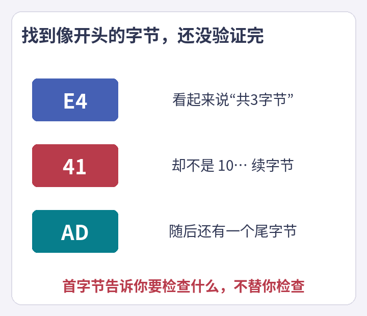

还有FF：它不以10开头，却也不是任何合法UTF-8首字节。如果你的算法是“只要不是续字节，就放心当作有效开头”，它会在坏数据面前过于乐观。

因此，要分开两个任务：

**边界定位**：对已知合法的字节流，快速找到下一处码点起点。

**合法性验证**：对尚未信任的输入，检查每个组是否符合完整UTF-8规则。

前者可以很简单；后者不能省掉必要条件。它们可以在同一系统里配合，但不能拿一个短扫描函数冒充完整解码器。

## 10. 严格解码还要过哪几道门？

至少有三层问题。[1][2]

第一，首部说的字节数量是否到齐，后续字节的前缀是否正确。

第二，是否采用该码点**最短的合法写法**。

第三，解出的值是否属于Unicode标量值范围。

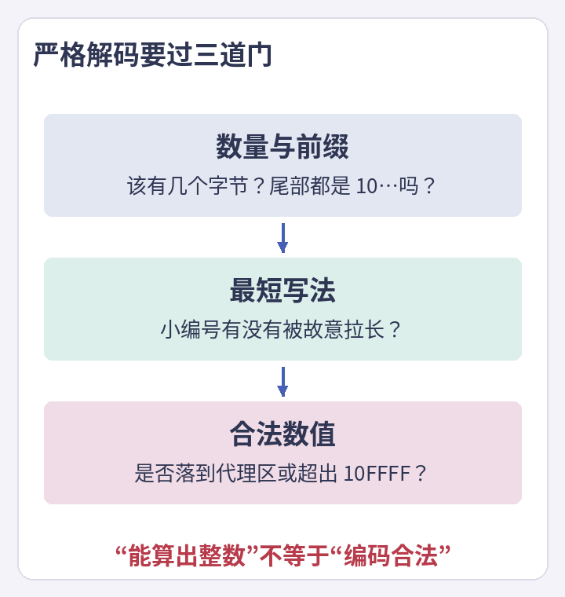

我们逐个把后两项变成具体反例。

### 10.1 斜杠不能穿一件过大的外套

斜杠“/”的码点是U+002F，十进制47。它本来就属于ASCII范围，正确UTF-8只有一个字节2F。

如果故意把47拆成两个负载组，再塞进两字节形状，可能造出C0 AF。一个只会去掉110与10前缀、再把负载拼起来的天真程序，仍可能算回47。

但C0 AF不是合法UTF-8。这就是**过长编码**：本来一字节就能表示，却用更长的形式包装。[1][2]

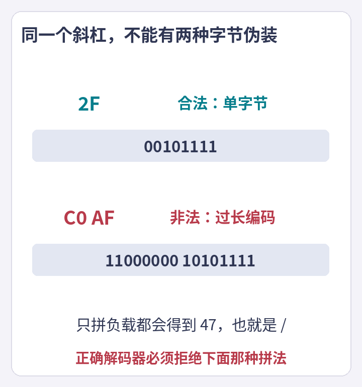

为什么要严肃对待？如果一个系统的检查层与使用层对“哪种写法算同一个字符”意见不同，就可能出现检查结果与实际解释脱节。

我们不需要制造某个真实系统的攻击，就能理解设计上的危险：同一信息不应带着一个检查器忽略、另一个解释器接受的非法伪装穿过边界。严格解码器应直接拒绝这种过长形式。

### 10.2 某些编号位置是保留给另一种编码机制的

Unicode码点总范围到U+10FFFF为止。其中U+D800到U+DFFF是代理码点区，供UTF-16的代理对机制使用，不是Unicode标量值。

UTF-8直接编码标量值，因此不能把这些代理码点各自当普通字符编码进去。ED A0 80若只是机械拼负载，会得到U+D800，但这个结果必须被判非法。

同样，F4 90 80 80会越过U+10FFFF，也必须被拒绝。[1]

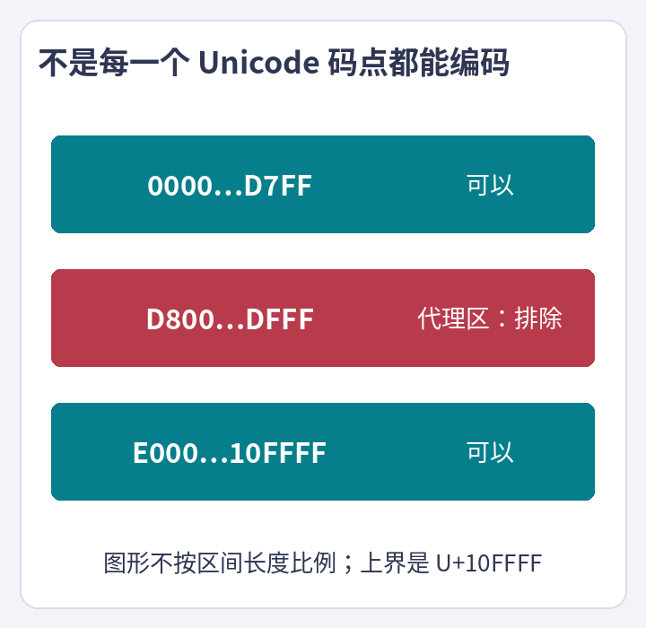

这里没有要求你现在学会UTF-16。只需要知道：有一段码点位置不是UTF-8可以直接装进去的对象。

反过来，一个码点尚未分配给某个具体文字，或者被标记为非字符，并不自动使它的UTF-8字节结构非法。UTF-8是否合法、该码点是否已经分配、某个应用是否允许它，是不同层次的问题。[1]

## 11. 网络刚好把一个汉字切开，应该跳过去吗？

先别急。前面的场景是：你主动从一段文本的中途进入，前面的内容不打算读，或者已经拿不到。

网络分块则常常不同：你本来拥有从头到尾的完整流，只是它分几次到达。

例如第一块是41 E4，第二块是B8 AD 42。两块连起来其实是完整的“A中B”。第一块末尾的E4并不是垃圾，它只是还在等后两个字节。


如果每次收到一块都独立解码，第一块会因为E4不完整而报错；第二块开头又会因为B8不是首字节而报错。

如果为了“容错”把这些头尾全删掉，网络明明没丢一个字节，程序却自己丢掉了一个完整汉字。

正确思路是使用**增量解码器**：这一块能解的先解，结尾没到齐的少量字节暂存；下一块到达后接着处理。Python的codecs就提供这种接口。[4]

下面是一次真实运行，每次只喂一个字节。仍然从A开始：收到41就能输出A；接下来，只有等“中”的三个字节到齐，才会输出“中”。

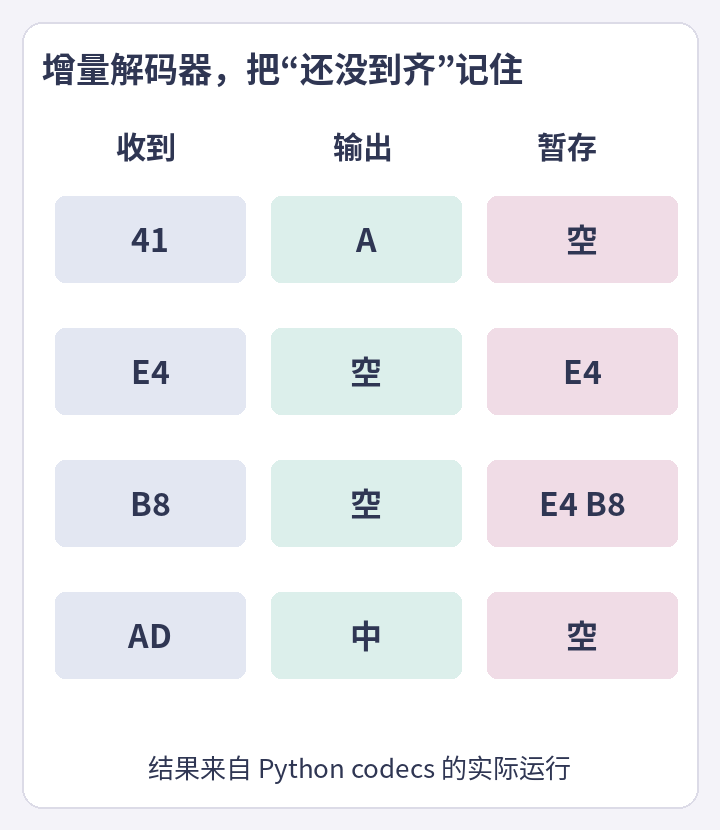

```python
import codecs

decoder = codecs.getincrementaldecoder("utf-8")("strict")
print(repr(decoder.decode(bytes.fromhex("E4"), final=False)))
print(repr(decoder.decode(bytes.fromhex("B8"), final=False)))
print(repr(decoder.decode(bytes.fromhex("AD"), final=False)))
print(repr(decoder.decode(b"", final=True)))
```

前三次分别输出空字符串、空字符串、“中”；最后一次空输入并声明结束，正常完成。

这里的final=True有意义：它告诉解码器“后面真的没字节了”。如果流结束时仍只收到E4 B8，严格解码器就不该无限等待，而应报告不完整序列。[4]

**重新找边界适合恢复位置；持续收流则要保留尚未到齐的信息。**两个场景不能因为都看见“半个字”就采用同一种删除策略。

## 12. 1992年的巧思，也是在迁就已有系统

这套设计不是为了让今天的教学图看起来整齐才出现的。

Pike与Thompson的《Hello World》介绍过Plan 9采用多语言文本时遇到的现实问题：要让Unicode和已有的字节流、文件名、工具与管道协作，又希望能从字节流中途找回边界。文中对之前方案的讨论，明确指出了自同步的不足。[3]

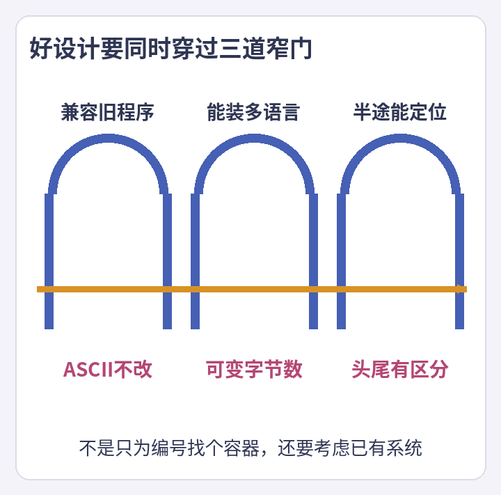

Rob Pike在2003年的邮件回忆里说，1992年左右的一晚，他看到Ken Thompson在新泽西一家小餐馆的桌垫上设计了这个方案。请留意资料身份：这是当事人十多年后的回忆，不是我们拿到了那张桌垫，更不是一张可以随意生成的“历史现场照片”。他在后续邮件中还表示希望当时保存了桌垫。[5]

同一份资料同时保留了1992年的通信与后来的档案核查，提到X/Open此前的提案以及增加的边界定位要求。把历史写成“两个人完全没有外部背景，吃顿饭凭空解决一切”，会抹掉真实的设计约束与协作。

《Hello World》也提醒了另一个容易被“一个晚上”的故事遮住的事实：把整个系统改造成支持Unicode及字节流文本，此前已经做了数月工作；后来更换具体编码时，因为库接口已有基础，迁移才相对集中。[3]

想认识两位设计者，可以看[Rob Pike在2010年OSCON上的照片](https://commons.wikimedia.org/wiki/File:Rob-pike-oscon.jpg)与[Ken Thompson在2019年受访的照片](https://commons.wikimedia.org/wiki/File:Brian_Kernighan_and_Ken_Thompson.jpg)。这些是后来公开活动的照片，不是1992年的设计现场。本文没有把它们的时间或场景移花接木。

我们使用的是现代UTF-8：每个标量值一至四字节。某些早期材料还讨论过更长形式，不能把旧文的六字节示例直接拿来当今天有效的UTF-8。RFC 3629把相关限制和变更明确写了出来。[2]

## 13. 找到了码点边界，为什么仍可能“切坏一个字”？

来看两个视觉上常常相同的é。

一种写法使用单个码点U+00E9，UTF-8是C3 A9。

另一种写法先放字母e，也就是U+0065，再放组合重音U+0301。UTF-8是65 CC 81。这是两个码点，常常一起显示成一个带重音字母。[6]


假如你在第二种写法中，沿着合法码点边界把e与后面的重音分开，字节层面没有损坏UTF-8，却拆开了一个用户通常希望一起选择、删除或移动的单位。

Unicode的**扩展字素簇**规则，正是在更高一层寻找这种用户感知单位的默认边界。它也有复杂语言背景和需要定制的情况，并不是“所有人眼中的一个字”都能永远用一句规则解决。[6]

所以，要截断文件到某个字节数、跳到下一个码点、按退格键删除一个可见字符，这三种操作需要的边界知识不同。

你今天学会的UTF-8自同步，只解决其中的字节与码点层。它不会自动负责字素分割、文字方向、字体选择或语言上的词界。

## 14. 如果真的丢了一个字节，会怎样？

再回到A中𠮷B的九字节流。删掉“中”内部的B8，剩下：

41 E4 AD F0 A0 AE B7 42。

E4本来需要两个续字节，AD勉强能当第一个，可随后F0不是续字节。这说明“中”那一组已经坏了。

后面的F0仍然清楚标出“𠮷”的起点，42也仍然是B。

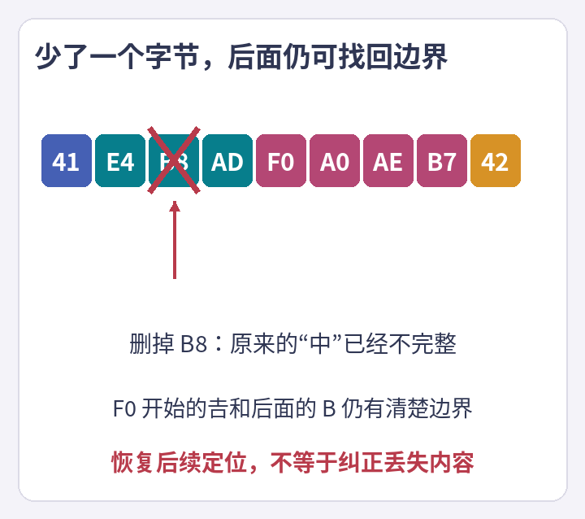

这解释了自同步为什么有用：某处出现损坏，不一定让后面所有分组永远跟着错位。

但它不是纠错码。“中”原来缺掉的那个字节是什么，单靠后面的路标并不知道。若你需要检测或恢复传输错误，还需要在另外的层次使用校验、重传、纠错等机制。

对于非法数据，程序也要选定明确策略。Python严格模式会报错；replace模式可以用替换字符U+FFFD表示无法正常解码的部分。下面这个具体例子在本文使用的Python 3.12.14中，E4 41 AD被替换处理为“�A�”：合法的A没有被坏序列吞掉。

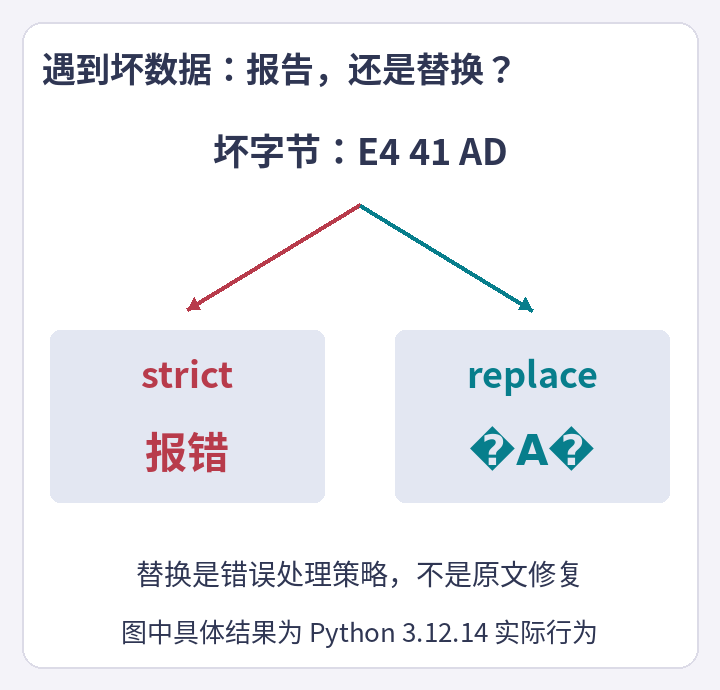

这不是原文修复，只是让错误以可见的方式留下来。直接忽略错误会删除信息；在标识符、配置、校验和数据交换中，悄悄删掉内容可能让后续程序误解输入。该报错还是替换，必须由应用需求决定，不能只追求“不抛异常”。

## 15. 验证通过，能证明文件本来就是 UTF-8 吗？

也不能。

两个字节C3 A9，按UTF-8解释是é；按Latin-1把每个字节分别映射成字符，则会得到Ã和©，经常写在一起成为“é”。

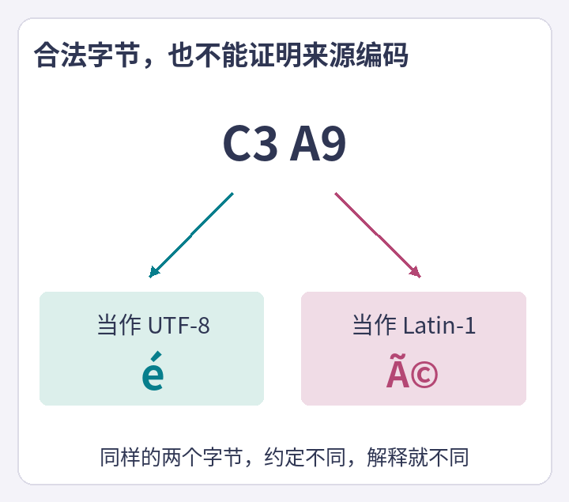

同一串字节，可能在不止一种编码里都合法。某段ASCII内容更是同时兼容多种编码。

所以“UTF-8验证器接受了它”只表明字节结构符合UTF-8，不等于证明作者当初就采用了这个编码。可靠的数据交换，应通过文件格式、协议、声明或双方约定确定编码。自动猜测有时有用，却不能凭一次合法性测试给出绝对保证。[2]

这也解释了有些乱码为什么看着很“有规律”：它不一定是字节随机损坏，可能是完整字节被套上了错误的解释规则。

## 16. 把关键说法交给程序认真检查

配套[utf8_lab.py](examples/utf8_lab.py)包含一个教学编码器、完整输入的严格解码器，以及可以反复运行的测试。运行它只需要Python标准库：

```text
python utf8_lab.py
```

本次实际使用Python 3.12.14，内置Unicode数据库版本15.0.0。本文核对的现代UTF-8字节规则来自Unicode 17.0的固定版本说明；测试的是标量值与字节格式，不是在验证Unicode 17.0全部新分配字符的名称、属性或字素分割规则。

具体做了这些检查：

**一，对所有1112064个Unicode标量值编码。**跳过代理区后，逐个把教学编码器的结果与Python内置UTF-8编码比较，再解码回来。各个长度的标量值数量分别为128、1920、61440、1048576，合起来正好1112064。

请把这理解为“可编码的标量值数量”，不是世界上已经使用的文字数量。里面包括尚未分配等位置。

**二，穷举所有一字节与两字节输入。**共有256+65536=65792个完整字节串，将教学严格解码器是否接受，与Python严格解码逐个比较。结果一致。一字节输入中128个合法；两字节输入中18304个合法，后者既包括一个两字节码点，也包括两个ASCII码点。

**三，检查九字节贯穿样本的所有切点。**包括末尾，总共十个切点。对已知合法样本寻找下一个完整边界，跳过续字节数量都不超过3，剩余后缀能严格解码。

**四，把九个字节按所有可能方式分块。**相邻字节之间有八个可选切口，每个切或不切，共2⁸=256种分块。增量解码器全部恢复同一个A中𠮷B。它不仅适用于“刚好分两块”的演示。

**五，单独检查非法样本。**过长编码、孤立续字节、截断、错误续字节、代理码点和越界值，均被拒绝。

完整[运行结果JSON](examples/results.json)保留了码点、字节、每个切点和增量输出。这里没有穷举全部四字节串，更没有宣称有限测试覆盖所有生产解析器的错误处理、安全性或性能。

## 17. 一个字符串“有多长”，请先问是哪种长度

A、中、𠮷，各自都是一个码点，UTF-8长度却分别是1、3、4字节。

e加组合重音通常看成一个带重音字母，却有两个码点、三个UTF-8字节。图中的虚线圆只是让重音标记的位置更容易看见，并不是样本文本多存了一个圆圈。

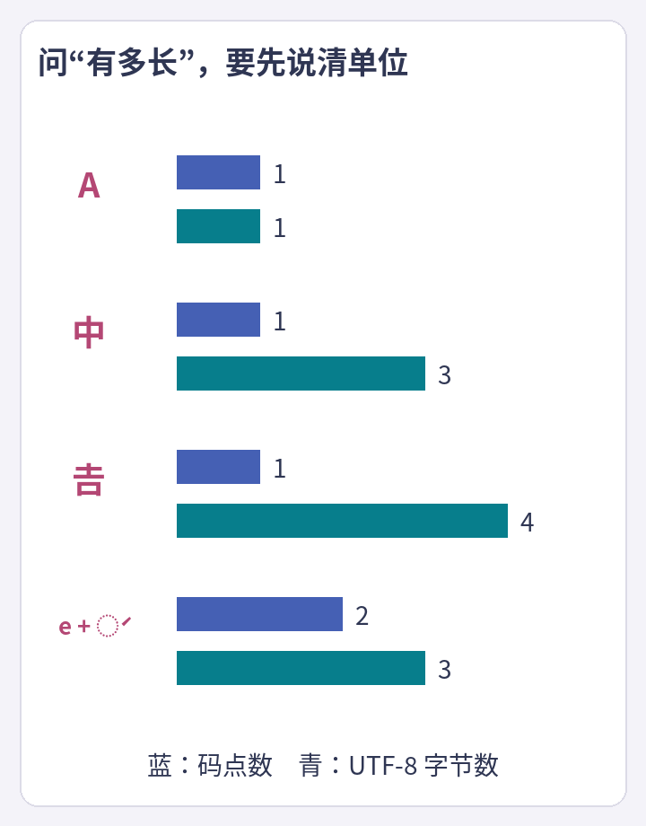

由此可以看见几种常见误会：

“每个汉字三个字节”不是普遍规则，我们的𠮷就用了四个。

“字符串长度就是用户看到的字符数”也不是普遍规则。程序语言或接口的长度可能在数字节、编码单元或码点；用户操作往往还需要字素层面的定义。

“UTF-8比任何编码都省空间”同样不能脱离具体文本。ASCII占多时，一字节保留很方便；不同文字和不同编码之间的空间差异，需要按真实内容计算。UTF-8是一种编码安排，不是通用压缩算法。[7]

## 18. 留几个可以自己做的小实验

**实验一：把“中”换成“文”。**先用Python查看ord("文")和"文".encode("utf-8").hex(" ")，再用4、6、6的数据槽手算。答案应是E6 96 87。不要只抄答案，试着指出每个字节里哪些位是前缀。

**实验二：从“𠮷”的四个字节分别开始。**从F0开始能读完整𠮷；从A0、AE或B7开始，若只向后取完整码点，应继续找到后面的B。你能分别算出要跳过几个续字节吗？

**实验三：把网络块切得更碎。**给一个严格增量解码器依次喂E4、B8、AD，每次使用final=False。E4是首字节，B8、AD才是续字节：收到E4和B8时都输出空字符串，收到AD时输出“中”。然后另建一个全新的严格增量解码器，只喂E4 B8并使用final=False，再调用decode(b"", final=True)，观察末尾缺少AD时的不完整序列错误。不要拿删除贯穿样本最后一个字节42（字母B）代替这个实验：那样剩余部分仍是完整UTF-8。

**实验四：给验证器与边界扫描器不同输入。**先用合法样本，再用FF、E4 41 AD、C0 AF。解释为什么扫描器的前提已经不满足，不能以“我找到了一个非续字节”为理由继续宣布合法。

这些实验都不需要处理真实用户数据，也不需要发网络请求。实验材料就是本文构造的短字符串。

## 结尾：路标的价值，是让局部信息够用

UTF-8没有在每个码点外面再插入一个分隔符。它把“我是一组的开头”“我还跟着前面那组”这类信息，放进了每个字节的高位。

于是，当你掉进一个汉字的半截，不必因为丢了起点就一直猜到文件结尾。局部的几个路标，已经足以找到下一处完整边界。

但好用的性质总有边界：它不替你补回丢失字节，不替你判断未知文件原本采用哪种编码，也不自动告诉你用户眼里的一个字由几个码点组成。把这些层次分开，才能既欣赏这个设计的简洁，又写出不会在真实输入前自作聪明的程序。

## 来源与材料

[1] Unicode 17.0，[第3章，3.9.3 UTF-8及表3-6、3-7](https://www.unicode.org/versions/Unicode17.0.0/core-spec/chapter-3/)。码点/标量值、UTF-8合法字节与转换规则。

[2] F. Yergeau，[RFC 3629](https://www.rfc-editor.org/info/rfc3629/)，2003。ASCII兼容、边界特性、编码限制、历史与非法序列风险。

[3] Rob Pike、Ken Thompson，[Hello World](https://9p.io/sys/doc/utf.html)。作者关于Plan 9文字处理与迁移的说明；当前HTML包含后来的更新，不把它说成未改动的1993年原始扫描。

[4] Python，[codecs：增量解码器](https://docs.python.org/3/library/codecs.html)。接口说明；文中具体输出另以Python 3.12.14实际运行核对。

[5] Rob Pike，[2003年UTF-8历史邮件及所附档案](https://www.cl.cam.ac.uk/~mgk25/ucs/utf-8-history.txt)。餐馆桌垫故事明确作为当事人回忆，所附1992年材料与回忆分别辨认。

[6] Unicode，[UAX #29：Unicode Text Segmentation](https://www.unicode.org/reports/tr29/)。扩展字素簇与码点边界的不同。

[7] Unicode，[UTF-8、UTF-16、UTF-32与BOM FAQ](https://www.unicode.org/faq/utf_bom.html)、[Compression FAQ](https://www.unicode.org/faq/compression.html)。编码形式、码点表示与压缩概念的边界。

全部正文教学图为原创。代码、实验范围、视觉清单和第三方人物照片链接的使用说明见[来源与图片说明](sources.md)。本文原创正文与教学图采用CC BY 4.0，配套代码采用[MIT许可](examples/LICENSE.txt)。使用AI辅助研究、写作、编程和制图；未声称实测任何网络、设备或生产系统。
