# 点了“创建房间”却没回音，再点一次安全吗？

你和朋友准备开一局游戏。模式选好，点击“创建房间”，按钮转了好一阵，却始终没有出现房间号。

这时，再点一次似乎很自然。

但服务器那边，可能已经建好了房间。只是那封“成功了，房间号是R001”的回信，没有回到你手里。

也可能第一封请求压根没有送到。对你来说，两种情况都只有一个画面：还在等。

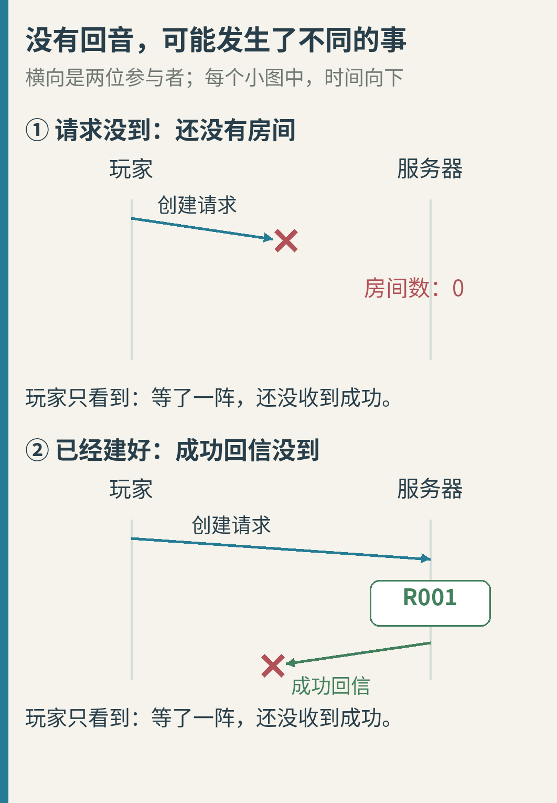

图中左边是玩家，右边是服务器，每个小图里的时间向下。蓝箭头是创建请求；绿色箭头是成功回信；红叉表示这条消息没送到。它们是用来解释可能情况的时序示意，不是某款游戏的网络抓包。

**“没收到成功”，并不等于“没有成功”。**

今天的问题就是：如果同一件事需要再问一次，怎样让服务器找回它已经做好的结果，而不是又做出一件新的？

## 1. 先让“再做一次”真的发生

先不用任何特殊技巧。玩家每次请求创建，程序就往数据库里插入一条新房间记录。

第一次调用产生R001。我们故意让调用方忽略返回结果，模拟“玩家没有拿到回信”。然后再调用一次，产生R002。

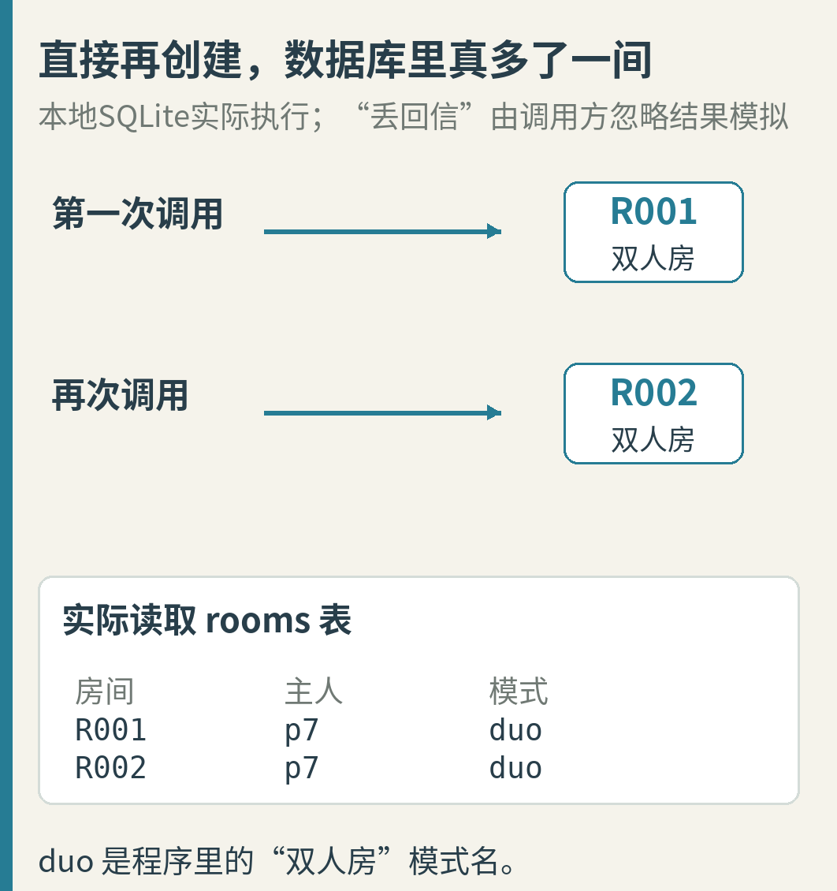

这幅图根据本次实际运行的SQLite结果重新排版。SQLite是一种把数据库保存在文件里的软件；图中rooms是“房间表”的名字，表里每一行是一间房。p7代表同一个玩家，duo是程序里“双人房”的模式名。

这里确实执行了数据库操作，但没有真的启动联网游戏，也没有制造网络丢包。**本实验的“房间”只是一条数据库记录**；回信丢失先用“调用方不接收这次返回值”来模拟。后面还会真的终止一个写数据库的子进程，比较提交前后的结果。

两个房间并不是数据库写错了。它很忠实地完成了两次创建。

我们缺少的，是一个信息：第二封请求究竟表示“我还在问刚才那次创建”，还是“我真的想再开一间”？

## 2. 不能只看请求长得像不像

假设两封请求都写着：

- 玩家：p7
- 模式：duo，也就是双人房

它们完全一样，服务器就应该只建一间吗？

不一定。玩家可能确实想同时开两间配置相同的房间，留给两组朋友。

只把参数比较一遍，并没有补上“这是不是同一次愿望”的信息。AWS工程师Malcolm Featonby在讨论安全重试时，也用两次有意创建相同配置的实例，解释了仅靠参数推测意图的局限。[AWS原文](https://aws.amazon.com/builders-library/making-retries-safe-with-idempotent-APIs/)

一个更直接的办法，是让客户端，也就是玩家手里的游戏程序，给**这一次创建的意图**取一个编号。

第一次创建叫K17。它的所有重试仍然叫K17。只有当玩家明确要开始另一次创建时，才换成K18。

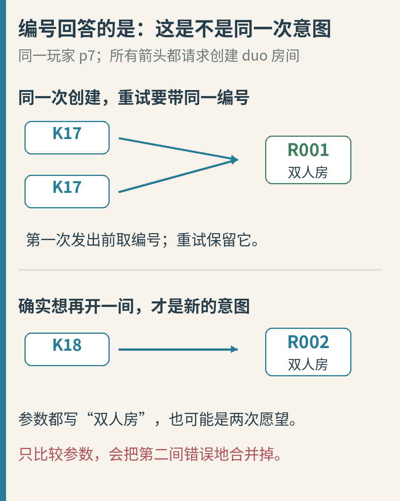

K17不是房间号。它在房间建成之前就有了，用来认领“我问的是哪次创建”。R001才是创建完成后得到的房间号。

这样的意图编号常被叫作**幂等键**，英文是idempotency key。先别被这个名字绊住：在这里，它最重要的工作，就是把多封重试来信，指向同一次创建。

K17、K18只是为了读图方便的短名字。真实服务需要按自己的规则生成足够不易冲突的编号，并在第一次发送前保存好。每次超时都重新生成一个编号，恰恰会把重试伪装成新意图。

下面始终使用p7、K17、duo和R001这一组名字。比较不同方案时，**每个实验各从空数据库开始**；它们是平行对照，不是同一个库一直往下累加。

## 3. 服务器需要的，不只是一个“见过了”

收到K17以后，服务器要能回答两个问题：

1. 我是否已经完成过这个玩家的这次创建？
2. 如果完成过，原来的结果是什么？

只有“见过”两个字还不够。玩家要的是房间号，不是“你问过了，自己猜吧”。

所以，本例除了保存房间本身，还保存一份创建回执。

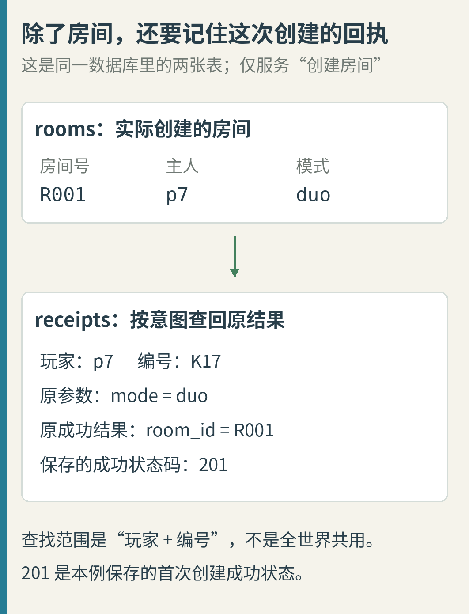

上面的rooms表回答“现在记录了哪些房间”。下面的receipts表回答“某次创建用了什么参数，当时返回了什么结果”。这里的回执是数据库记录，不是一封已经保证送达的网络回信。

对p7的K17，回执保留：原参数mode=duo、成功结果room_id=R001，以及首次成功的状态码201。201可以先理解为本例服务选择的一种“创建成功”标记；实验把它作为数据保存，并没有实际发HTTP消息。

查找回执时，使用的是“玩家p7 + 编号K17”。另一个玩家p8使用同样的短编号，不会拿到p7的房间。本例假定玩家身份已经由登录认证确定，编号本身不是密码，也不能替代身份检查。

这张回执表只服务“创建房间”这一种操作。若一张表还同时保存删房间、修改设置等别的操作，就要另外设计范围，不能让不同办事入口碰巧用了同一个编号，就被误认为同一件事。

## 4. 沿着K17，实际走一次

现在让p7带着K17，请求创建duo房间。

本例先让数据库开始一笔写事务。可以把事务理解为：**把几项数据库修改组成一个共同承诺，成功就一起留下，没有提交就不留下这半套结果。**

随后按顺序做：

1. 在受保护的写事务里，查找p7的K17。
2. 如果找到，核对参数。参数相同就取出原结果，不再建房。
3. 如果没找到，创建房间，得到R001。
4. 把K17、原参数和R001的成功结果存进回执表。
5. 提交这一整笔事务。
6. 提交完成后，才把成功结果交回调用方。

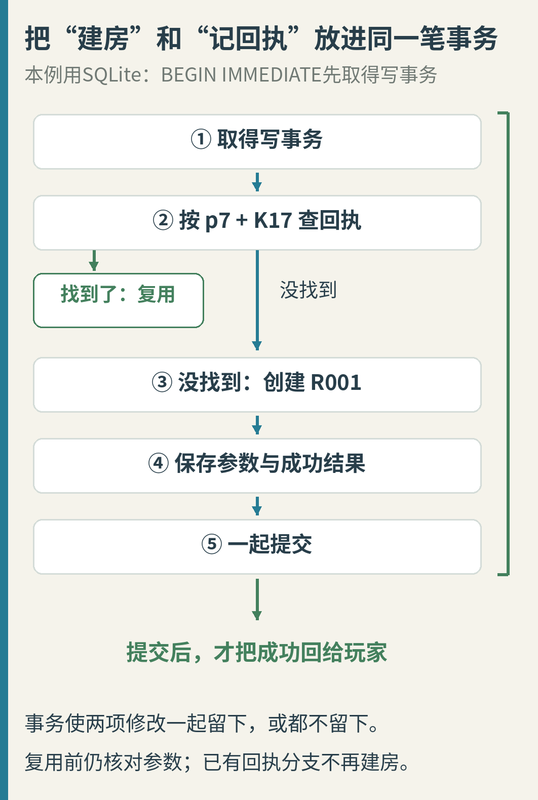

图右侧的绿色括线是这一笔数据库事务的边界。箭头表示步骤顺序，不是说几条语句在同一个瞬间执行。已有回执的分支也会正常结束自己的事务，再返回保存的结果。

SQLite中的BEGIN IMMEDIATE，就是本例开始写事务的命令。为什么要在查找之前取得写事务，而不是先随便查一下？先记住这个位置；讲到两个请求同时到来时，我们会看到它保护了哪一步。

现在回到开头：第一次创建已经提交，但玩家没收到回信。

玩家再带K17来问。服务器查到了原回执，返回R001。

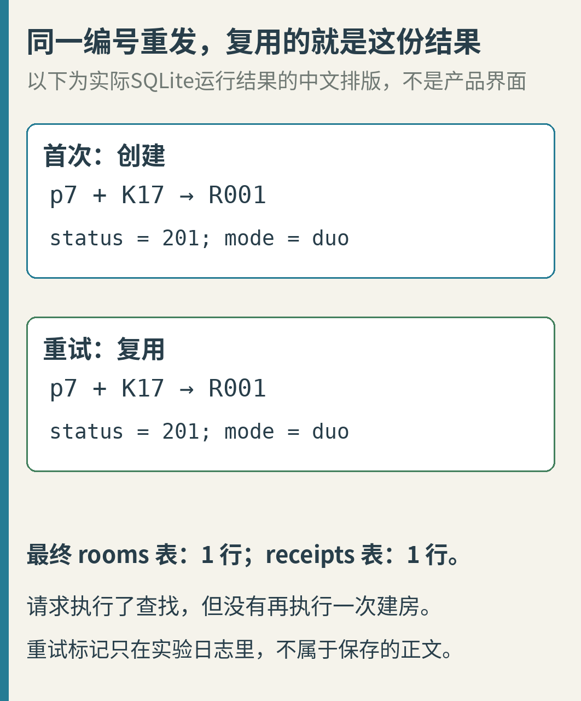

数据库里仍然只有一间房、一个创建回执。重试请求确实被处理了：程序仍然查了库、比较了参数、取出了结果。**没有再发生的，是“新建另一间房”这个效果。**

图中的“创建/复用”标签来自实验日志，用来帮助我们观察两条分支；它不是添加到缓存结果正文里的字段。

## 5. 这才是这里的“幂等”

“幂等”可以先从一个简单动作理解：把某个房间设为“关闭”。设一次是关闭，再设一次，目标状态仍然是关闭。

“创建一个新房间”就不同。没有额外保护时，做一次多一间，做两次多两间。

幂等键和回执让本例获得了一个更明确的约定：**同一玩家、同一个创建编号、相同参数，在回执仍有效的范围内重复请求，不再额外创建房间。**

这不是在保证网络只发出一封信，也不是在保证服务器只运行一次代码。每次重试都留下访问日志，同样不与这项创建约定冲突。

网页和许多应用与服务器通信时，会用到HTTP这套请求与响应规则。HTTP规范讨论幂等时，约束的是请求的预期效果；它也明确指出，重复请求的响应可能不同。[RFC 9110，9.2.2节](https://www.rfc-editor.org/rfc/rfc9110.html#section-9.2.2)

本例选择了更具体的一种做法：保存首次成功的状态和结果，再原样取出这份记录。别的服务也可能返回同一资源的最新状态。**“效果不重复”和“所有服务每次都返回逐字相同的内容”，不是同一个承诺。**

也不能给一个完全不支持这种约定的服务器，随便加个名为“幂等键”的字段，就以为保护自动出现了。客户端和服务端必须共同遵守这个办事规则。

## 6. 为什么不能先建房，再补记一下

看起来，最省事的实现是：

先把房间建好并提交，再保存“这次K17已完成”。

问题出在两步之间。如果房间已经留下，进程却来不及写回执就结束，重试时看到的仍然是“没有K17”。于是又建了一间。

把顺序反过来呢？先单独提交“见过K17”，再建房。如果进程在中间结束，下一次草率地“见过就跳过”，就会留下一个记号，却没有任何房间。

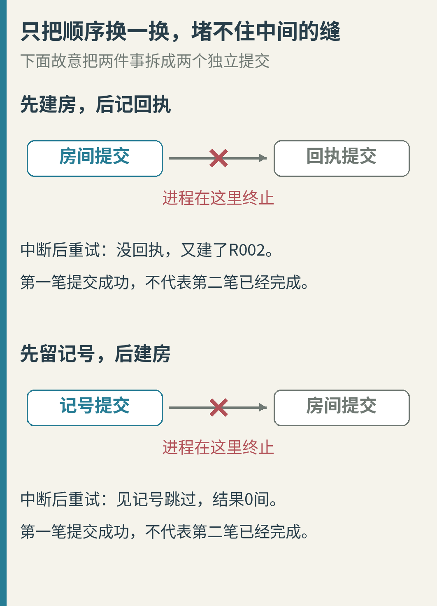

这两个故意写坏的版本也实际运行过：先提交房间、再终止进程的版本，重试后得到两间；只提交记号、再终止的版本，重试时跳过工作，最终是零间。

问题并不只是“顺序选错了”。**如果两次提交各自独立，中间就会有只能留下半套的机会。**

真实系统当然可以设计“进行中”记录、恢复流程和别的协调办法，但那需要更多状态与正确性安排。一个孤零零的“见过”记号，不能自动承担那些工作。

本例选择较容易看清的一条路：房间和完成回执放在同一数据库里，一起提交。我们借用SQLite已有的事务能力，不在这里重新实现数据库的恢复协议。[SQLite原子提交说明](https://www.sqlite.org/atomiccommit.html)

## 7. 真把进程停在两个位置，会怎样

这一段不再只是忽略返回值。

实验另外启动一个子进程，也就是由测试程序再启动的另一段独立程序，让它操作SQLite数据库文件，并在指定位置直接退出。主进程再重新连接这个数据库，读取表里的实际记录。

两个位置分别是：

- 已插入房间，但还没完成回执和提交。
- 房间与回执已经一起提交，但函数还没把结果返回给调用方。

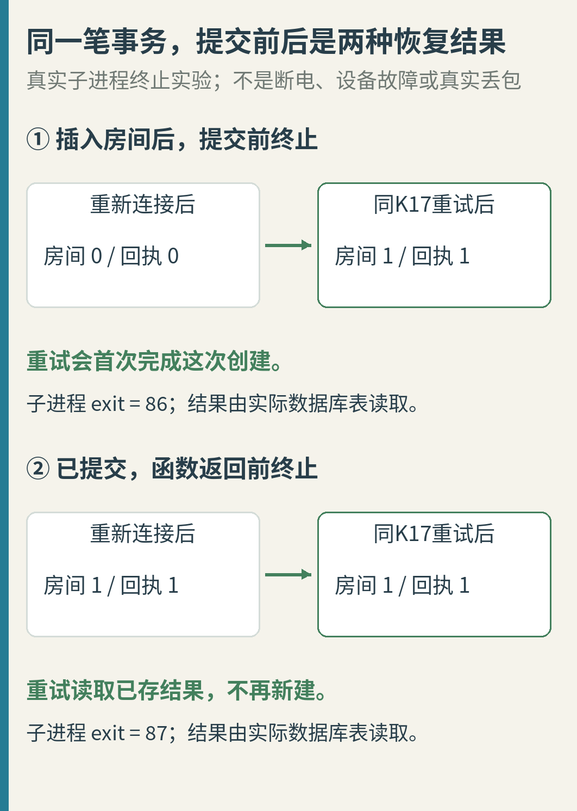

第一种情况，重新连接时读到零间房、零份回执。未提交的插入没有作为已完成结果留下。带K17重试，会正常创建R001，再留下它的回执。

第二种情况，重新连接时已经有一间房、一份回执。带K17重试，读取原来的R001即可。

所以，这两个位置虽然不一样，最终都能回到“这个意图创建一间房，有一份可找回的结果”。

图中的86、87是实验人为选择的进程退出码，用来确认子进程确实在相应分支结束，不是某种网络错误码。

必须分清验证范围：这是实际的**进程终止与重新连接实验**。没有拔电源、模拟磁盘损坏、杀掉操作系统，也没有穷举每一种存储故障。SQLite对原子提交的保证也有文件系统和设备等前提；不能把这两次测试说成“任何情况下永远不会重复”。

## 8. 两个K17同时到来，谁算第一次

假设服务器上有两个处理请求的工作者。

A查一下：“没见过K17。”

B紧接着也查一下：“我也没见过K17。”

如果它们都在没有保护的情况下继续创建，就可能各做出一间。仅仅把“先查、再做”写在流程图上，还不算并发保护。

本例的保护来自SQLite写事务：同一时刻，这个数据库只允许一个写事务。BEGIN IMMEDIATE在查询之前就尝试取得写事务；另一个连接须等待，或者在等待无法完成时报告忙碌。[SQLite事务说明](https://www.sqlite.org/lang_transaction.html)

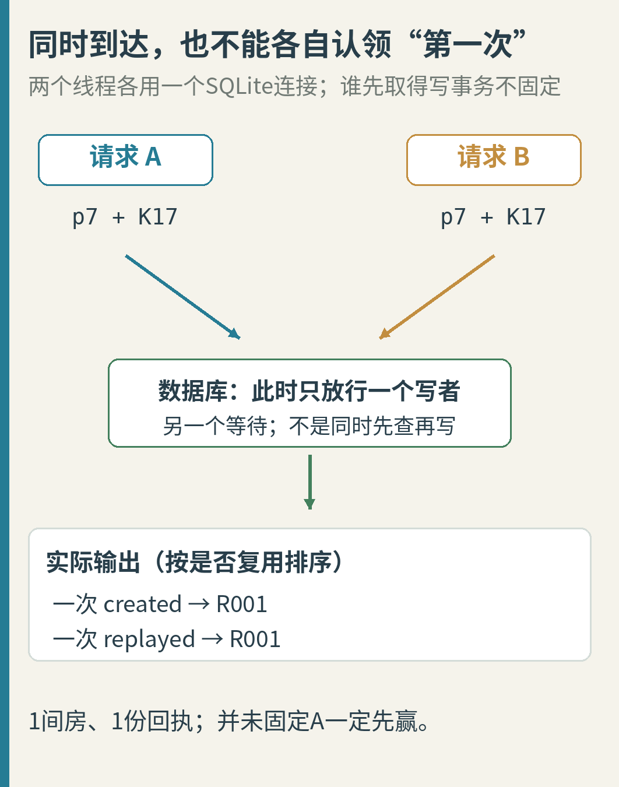

我们真的用两个线程、两个数据库连接，同时提交同一个p7、K17、duo。

实际得到的两份结果里，一份标记“本次创建”，另一份标记“复用”；两者都是R001。数据库仍然是一间房、一份回执。图按是否复用排序方便阅读，不声称某个指定线程总能先赢。

这里还有一层数据库约束：回执表不允许同一个“玩家 + 编号”出现两行，而且这两个字段都不允许为空。这是防线之一。但只给回执加唯一约束，却让房间在另一次独立提交中创建，仍然可能留下多余房间。

本例付出的代价也很明显：它把写事务串行化了，不仅同一个键，不同键的写入也会竞争。它用于说明因果，不是一套高吞吐量游戏后端架构。

连接配置的等待超时为10秒；若仍拿不到写事务，程序可能报告忙碌。那也不是把同一次意图改成新编号的理由。实际调用者应按接口约定保留原编号，稍后重试或查询，而不是无休止地高速轰炸服务。

## 9. K17还叫K17，参数却变了呢

回到只完成K17、数据库里只有R001的起点。

原来的参数是duo双人房。现在同一个玩家又带K17来，却把mode改成squad小队房。

该返回旧的双人房吗？玩家明明问的是小队房。该创建一间新的小队房吗？同一编号又开始代表第二件事了。

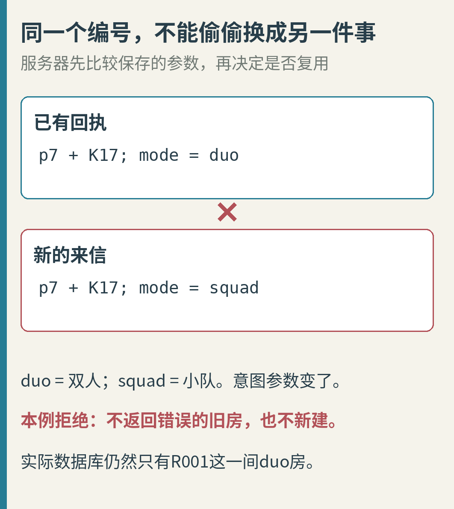

本例选择直接拒绝这个冲突，不覆盖原回执，也不创建新房间。实际实验后，库里仍然只有R001这一间duo房。

如果玩家确实改变了打算，应用需要明确处理原意图，再为真正的新创建使用新编号；不能让一次不确定的旧创建，悄悄被另一次不同参数的请求替换。

这里的参数比较也有范围：实验只比较一个mode字段，先把字段和值写成固定格式再比较。我们没有发明一种能判断所有业务请求“语义完全相同”的万能办法。

## 10. 一份回执，到底要记多久

如果所有编号永远保存，记录会越来越多。于是服务常常会约定一个保留窗口。

但删除回执不是一件与正确性无关的小事。它可能让服务器忘掉“这次意图已经做过”。

下面另做一个刻意不安全的实验：约定回执保留10个教学时间单位。时间0时K17创建R001；到了时间11，把旧回执删掉，但保留房间。随后，一封很晚才到的K17又来了。

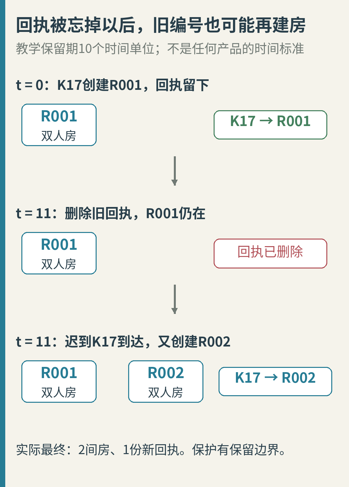

程序一查，没有K17，于是创建R002。最终两间房、一份新回执。

10和11只是这次实验选择的时间数字，没有对应真实产品的小时数。这个结果是在展示错误边界，并不是推荐“过了期限随便重做”。

保留多久，须结合最大可能的重试延迟、客户端恢复方式、资源生命周期和服务承诺决定。若服务只在某个窗口内保护重试，客户端也必须知道超过窗口后如何查证，不能永远拿旧编号盲试。

具体产品的规则甚至会随接口版本变化。例如支付服务Stripe的当前文档对API v1，也就是它的一套程序调用接口，说明了其回执保存、清理和参数冲突规则；同页对API v2有另一套重试语义。本篇不把某家产品的时间窗口或错误处理，写成所有幂等服务的统一定律。[Stripe官方说明](https://docs.stripe.com/api/idempotent_requests)

## 11. “曾经创建成功”，也不等于“现在还能加入”

还有一个容易混淆的时间差。

K17创建了R001。后来，玩家正常结束游戏，把R001关闭。回执仍然保留。

这时重新询问K17，本例仍会取出原来的创建结果R001。

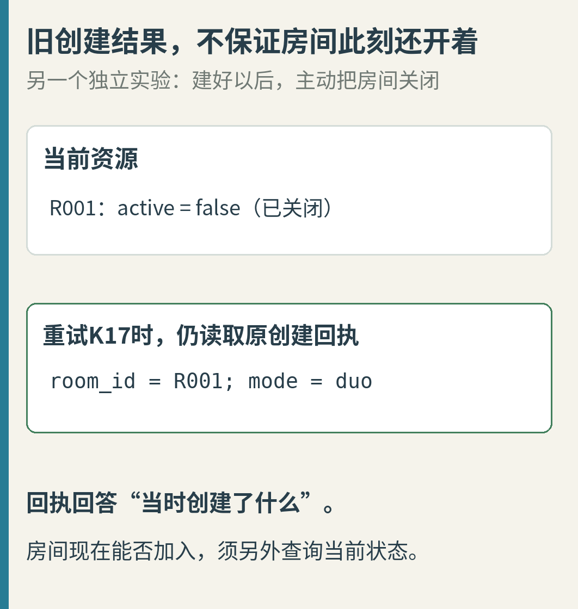

这并不矛盾：回执回答的是“那次创建产生了什么”，不是“这个房间现在是否开放”。

实验真实把active字段改为false，表示房间已关闭，再进行同键重试；返回的仍是R001，资源也没有被重新打开。

应用若要让玩家加入房间，还需要查询它当前的状态。其他服务也可以设计成返回同一资源的最新状态，或者对已结束资源给出明确答复，但必须把契约说清楚。

同一个意图的历史，与资源后来的生活，并不是同一张时间表。

## 12. 如果建房还要发邮件、启动别的服务

到这里，我们保护的是两张SQLite表里的变化：房间记录和创建回执。

真实游戏可能还要启动一个对局进程、请求别的机器分配资源，或者发送通知。那些动作不一定由这个数据库管理。

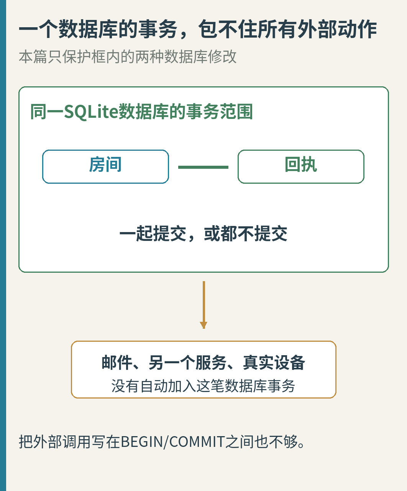

假设邮件已经发出，数据库却还没提交就终止。重试时数据库回到了起点，邮件可不会因为SQLite撤销事务，就从对方收件箱里消失。

把“发邮件”这一行代码写在BEGIN和COMMIT之间，也不会让邮件系统神奇地加入数据库事务。

因此，外部动作需要自己的可靠协调与重复处理设计。某些系统会使用事务发件箱等模式，但即使如此，消息仍可能重复，接收方也需要相应处理。这里先画清边界，不把另一个完整课题塞进K17的小例子里。[AWS关于事务发件箱的官方说明](https://docs.aws.amazon.com/prescriptive-guidance/latest/cloud-design-patterns/transactional-outbox.html)

**我们已经证明的局部结果，不能直接改名成“整个系统恰好执行一次”。**

## 13. 回到那个还在转的按钮

下次再看到“创建房间”迟迟没有回音，程序最该保留的，不只是一个旋转动画。

它还应该记得：哪个玩家、哪次创建编号、原来是什么参数，以及这次意图的结果是否已经确认。

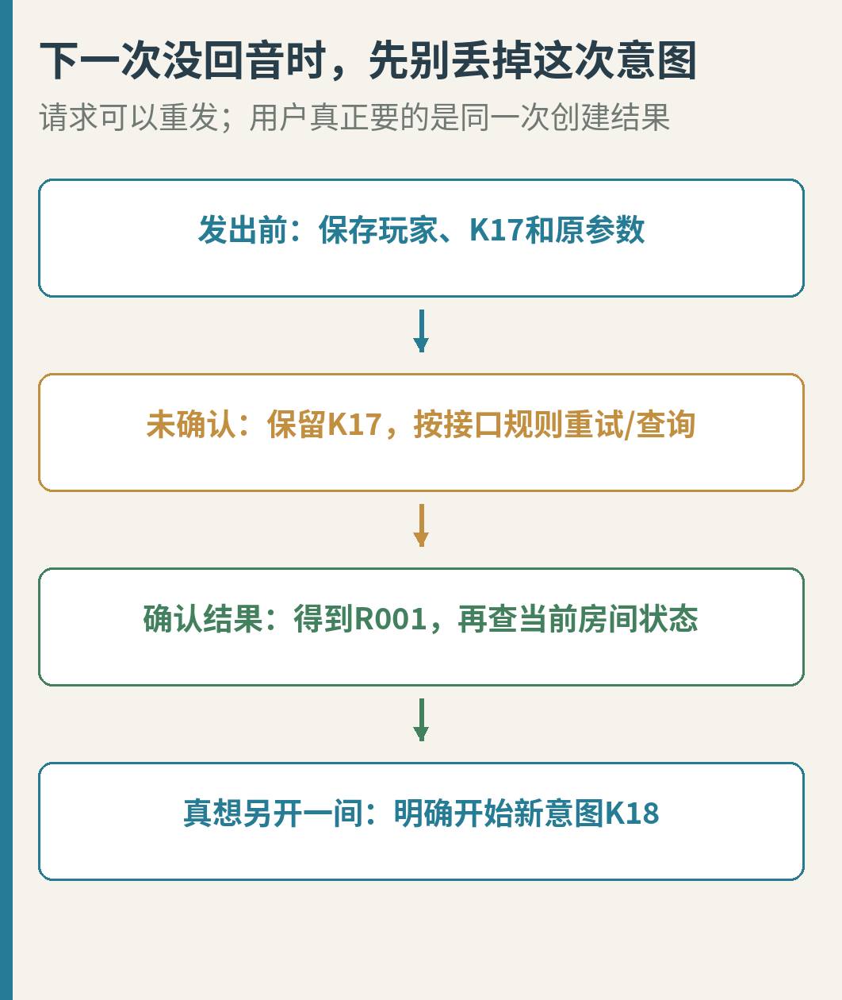

- 发出之前，准备并保存这次创建的编号。
- 没收到结果时，把它视为“尚未确认”，按照服务约定查询或重试，沿用原编号与参数。
- 找回结果以后，再判断那个资源现在是否还可用。
- 真正开始另一件事时，才使用新编号。

如果连原编号都丢了，或者已经超出服务承诺的重试窗口，就需要先查证原操作的状态，不能假装自己仍有同样的保证。

禁用按钮、提示用户别连点，可以减少误操作，却代替不了服务器端对重试的辨认。一次请求还可能被客户端超时逻辑、网络中间环节或后台任务重新发出，玩家未必又点过一次。

幂等键并没有让网络变得可靠。它做的是另一件更朴素的事：

**当同一次意图不得不敲第二遍门时，让系统有办法回答：“你要的那件事，我记得。”**

完整实验见[复现说明](README.md)，实际输出与版本、来源和许可见相应文件。原创正文与解释图采用CC BY 4.0，原创实验与制图代码采用MIT；没有在公开稿中复制无再授权依据的第三方架构图。
