# 打孔卡，怎样让织机织出花纹？

先看下面这件织物：人物坐在椅子上，旁边有桌子、窗帘和一叠卡片。衣服有明暗，家具也有细节。

它是大都会艺术博物馆收藏的《Joseph Marie Jacquard》，制作于 1839 年，材料是丝。你看到的是这件丝织肖像的馆藏照片，人物与房间本身都是织物中的图像。

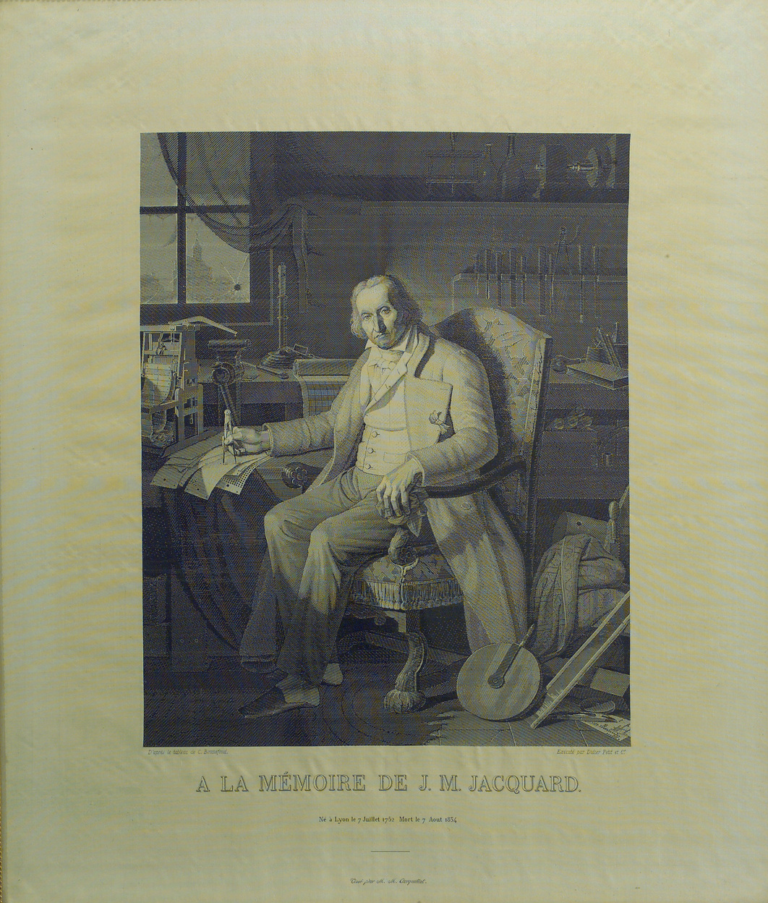

Didier, Petit et Cie，《Joseph Marie Jacquard》，1839。The Metropolitan Museum of Art，31.124，Bequest of William G. Jenkins, 1931。图像 CC0；[馆藏页](https://www.metmuseum.org/art/collection/search/222531)。原件的边缘与文字完整保留；画里描绘的卡片和机器，不能当成实物照片来研究。

丝线怎样织出这么多细节？我们先不挑战一整幅肖像，只问一个小得多的问题：**假如只有 8 根纵向的线，怎样让织机每次准确抬起其中几根？**

把这个问题弄懂，就能看见提花机构里最有意思的一段因果关系：卡片上的孔没有手，却能决定接下来哪几根线会动。

## 1. 先看布：花纹发生在交叉处

普通机织布有两组互相交叉的纱线。

沿着布的长度方向、事先排好并保持张力的，叫经线；横过布幅、一次次穿进去的，叫纬线。下面把经线画成蓝色，纬线画成金色。颜色只是帮助我们分清两组线，并不表示真实丝绸必须这么配色。

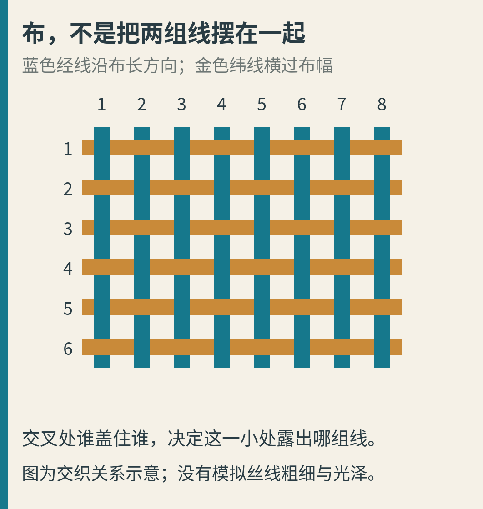

图中竖着的 1 到 8 号是经线，左边 1 到 6 是先后引入的纬线。看任意一个交叉处：有时蓝色经线盖住金色纬线，有时金色纬线盖住蓝色经线。两组线轮流在上、在下，才交错在一起。

这是一张为了看清关系而画得很松的示意图。真实纱线会靠得更紧，也会弯曲、受压、有光泽；它不是一张织物显微照片。

先记住一件事：**决定某次交叉时哪组线在上，就能改变布面呈现的组织。** 配合纱线颜色、密度和更复杂的组织，才有丰富的花纹与明暗。

## 2. 为了让纬线通过，先给它开一条路

如果所有经线绷在同一个高度，横着穿入纬线会很麻烦。织机可以先抬起一部分经线，让其余经线留在较低的位置。两层之间出现的空隙，叫梭口。

梭子是一种携带纬纱的小工具，它从梭口横穿过去，把一根纬线带到布幅的另一侧。这个“引入一次纬线”的动作，叫一次引纬；传统梭子过去一次算一次，回来又是下一次。

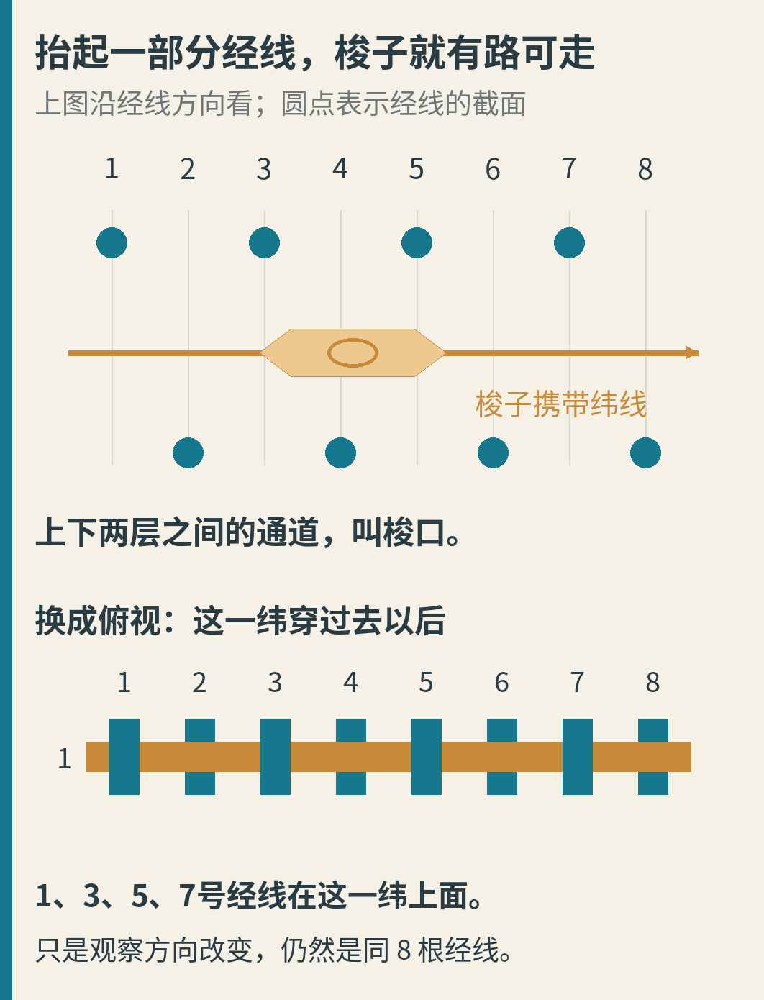

上图的观看方向要注意：我们沿经线望进去，所以每根经线看起来是一个圆点。1、3、5、7 号升到上层，2、4、6、8 号留在下层，金色箭头表示梭子横穿的方向。

下图换成俯视，画的是同一次引纬形成的交叉关系。刚才升高的 1、3、5、7 号经线，位于这根纬线上面；没有升高的另外四根，位于纬线下面。

纬线通过后，织机还要把它靠紧已经织好的布，这叫打纬；经线要继续送出，布也要逐渐收卷。提花机构主要负责其中的**选线与抬线**，不能把整台织机的所有动作都归给卡孔。

## 3. 真正的机器长什么样

下面是一张 1851 年的真实照片。Getty 的馆藏名称是《Double Jacquard Loom》，即双式提花织机。照片里，上方是高位控制机构，许多细绳从那里向下展开；下方是织机本体，两侧还能看见长长的卡链。

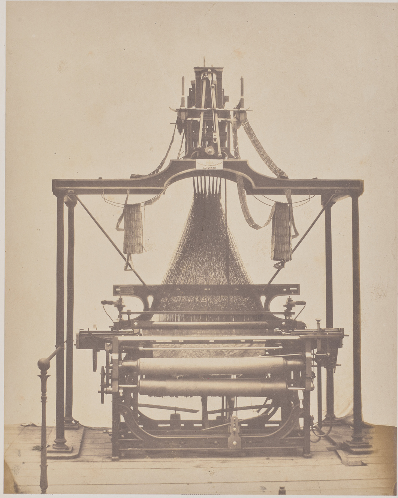

Claude-Marie Ferrier、Hugh Owen，《Double Jacquard Loom》，1851。The J. Paul Getty Museum，84.XB.577.2.2.12，Getty Open Content Program，CC0。[馆藏页](https://www.getty.edu/art/collection/object/107VAW)。这里裁去了大部分装裱留白，保留整台织机，[完整原件](originals/getty-107VAW-double-jacquard-1851.jpg)另存。

这张照片让我们看见“上面的控制机构，怎样通过绳束联系下面的经线”。但它是 1851 年的双式实物，不是 Jacquard 最早的那台机器，也不是接下来单升式教学图的逐件照片。

为了把内部动作讲清，后文采用 19 世纪技术手册记载的一种常见单升式原理：一副刀架升起被选中的钩，再落回去准备下一次。双升、双筒等其他结构有自己的安排，不在这里混讲。

## 4. 先把这次选择，写到一张小卡上

回到只有 8 根经线的教学模型。我们暂时规定：每根经线有自己的控制通道，一张卡在本次引纬前决定哪些通道被选中。

如果想抬 1、3、5、7 号，就在对应的四个位置打孔，其余位置保持完整。为了方便今天的读者记笔记，我们把“有孔”写作 1，“没有孔”写作 0：

**1 0 1 0 1 0 1 0。**

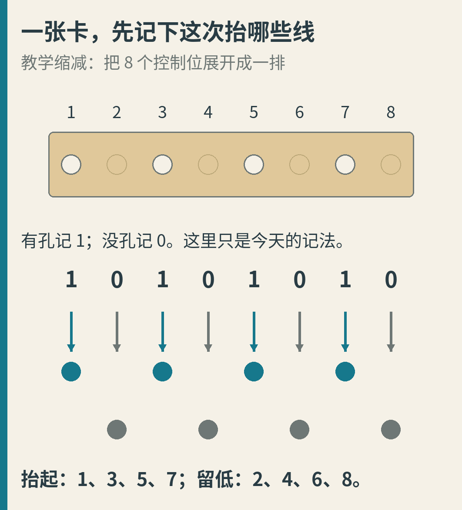

白色圆孔穿透卡片；浅色轮廓圈只是标出“这里本来可以打孔的位置”，那里的卡纸仍然完整。下方每个数字与同一编号的经线对应，1 表示本次抬起，0 表示本次留低。

这是一个**刻意缩减的 8 通道教学卡**。真实机器常把大量针位排成多行多列，卡上还会有用于定位和串接的孔；并不是看到一个洞，就能把它读成图案中的 1。

现在最关键的问题出现了：机器没有眼睛，怎么知道前方究竟是孔还是纸？

## 5. 先认出两种方向不同的细长零件

1888 年，E. A. Posselt 出版了提花机技术手册。下面是书中的原图 VII，它把一排 8 个钩及其选择机构剖开来画。

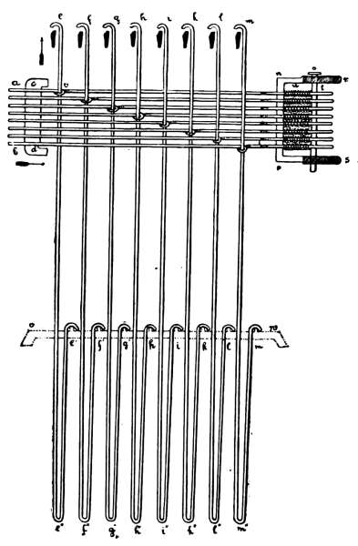

E. A. Posselt，《The Jacquard Machine Analyzed and Explained》，1888，Fig. VII，pp.14–15。公版历史插图，数字图源 Project Gutenberg / Internet Archive；[原文位置](https://www.gutenberg.org/files/54193/54193-h/54193-h.htm#FIGVII)。它是历史技术图，不是机器运行照片；原有小字不承担我们下一步的阅读任务。

先在图里找三个方向：

- 一组细长件从左往右伸出，这是读卡的横针；针尖在左，右端附近有弹簧。
- 一组长线从上往下延伸，顶端有弯头，这是竖钩。
- 竖钩弯头下面的小黑条，是提升刀的截面。许多这样的条装在一起，组成能够升降的刀架。

“提升刀”这个名字有点误导：这里的条状构件用于托住钩头，不负责切断丝线。

横针上有一个小眼，竖钩从中穿过。于是，横针如果被左右推动，就能把相应竖钩的上部推偏；而竖钩被刀架带着上升时，又可以沿针眼滑动。这是水平选择与竖直提升相接的地方。

## 6. 有孔与没孔，各自做了什么

把其中一条通道放大，看下面两个状态。卡片在左边，贴在卡筒的承卡面上；针从右边伸过来。图中灰块是卡筒局部，右缘米黄色薄层是卡片，尺寸与偏移都经过夸大。

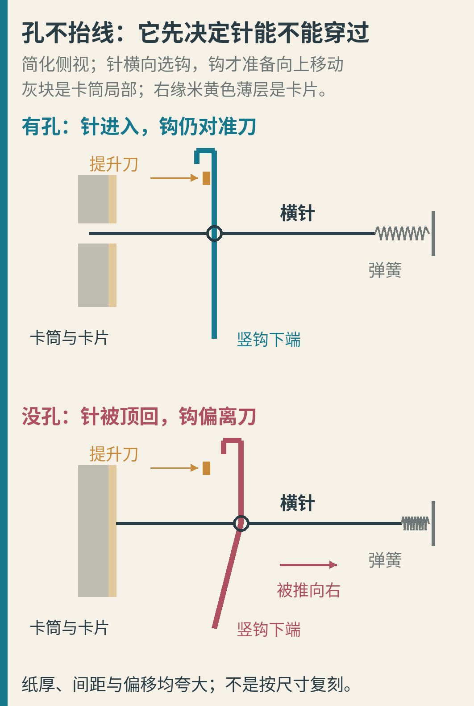

**有孔时：**卡片靠近针尖，针尖可以进入卡孔以及后面卡筒对应的空孔，没有被卡纸顶回。横针保持在原来的选择位置，竖钩的弯头仍位于提升刀能够托到的地方。

**没有孔时：**迎面而来的是完整卡纸。卡片把横针向右顶，右端弹簧被压缩，横针的针眼同时把竖钩上部推偏。于是，竖钩的弯头离开提升刀的抓取范围。

这里真正有趣的是：**孔没有主动做“向上拉”这个动作。它只是允许针尖通过，保留了钩与提升刀原来的对准关系。** 完整卡纸才会把那条通道推开。

这就是本篇单升模型中“有孔对应抬起”的机械理由，而不是我们凭空规定的一张 0/1 真值表。其他时期、其他结构的穿孔控制可能有不同的选择极性，不能把这句话倒推给所有前身。

## 7. 真正负责提起来的，是刀架

筛选完成后，刀架上升。仍对准提升刀的钩被托起，已经错开的钩留在低处。

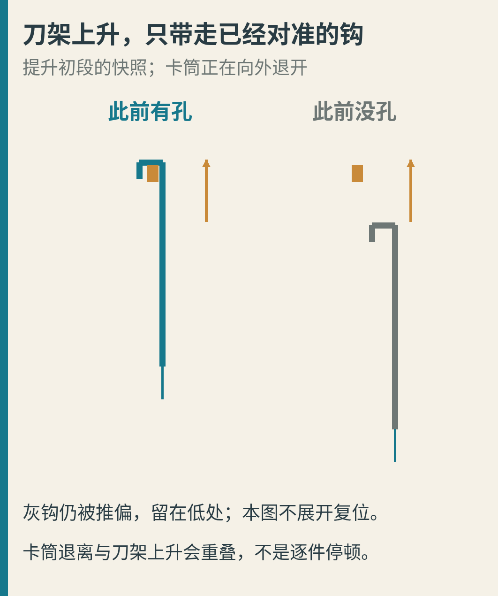

上图只保留两条通道。左边此前遇到孔，钩头搭在已经升高的刀上；右边此前遇到实部，错过了刀的抓取，钩仍在低位。图中金色小条表示刀的截面，向上的箭头表示刀架本次提升；灰钩仍处在被推偏的位置。

有一个时序细节值得说清：书中这类连杆机构，会在刀架上升的同时让卡筒向外退开。一些动作是重叠的，并不是“读卡完全停住、提升完全停住、再做下一件事”。我们画的是便于理解的状态。

这幅图只截取提升初段，没有展开后续复位。真实机器还需要导向和时序安排，让针、钩与刀架顺利回到下一次工作的状态；不能把这张简化快照当作可制造的全周期结构图。

下一次选择之前，单升式的刀架还要下降。卡孔只决定选择，提升经线所需的能量仍来自织机的动力与传动；纸片不会凭空给一大束丝线做功。

## 8. 钩与经线之间，还隔着什么

从高处钩子往下看，还有连接绳、穿线的小孔，以及下方的配重。

经线不是直接绑死在提花钩上。它从一个小孔中穿过，这个小孔叫综眼；综眼通过绳与上方的控制连接，下方的重物维持向下拉力。

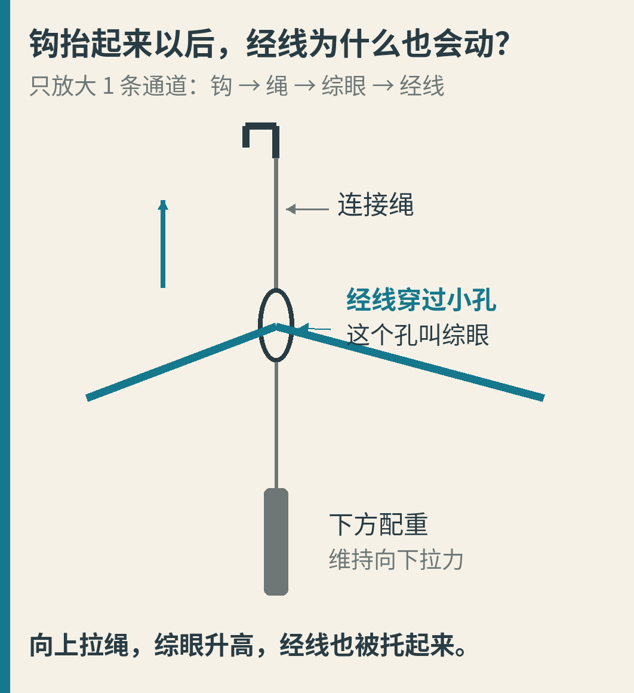

图中蓝线是经线。它原本沿织机前后方向绷着，穿过中间的综眼。上方绳子一拉，综眼升高，经线也被托高；下方配重帮助系统维持张力并随机构回落。

现在可以把整条因果链念完整：

**卡孔或实部 → 横针是否被推回 → 竖钩是否对准提升刀 → 钩是否被提起 → 综眼和经线是否升高。**

前面看见的梭口，就是许多这样的通道一起动作后形成的空隙。不是卡片直接碰到丝线，也不是读卡横针自己向上拉着经线走。

## 9. 卡片怎样换到下一张

读完一张，还要读下一张。这里的卡筒，虽然英文叫 cylinder，在我们讨论的机构中却是一个四棱柱，有四个平的承卡面。

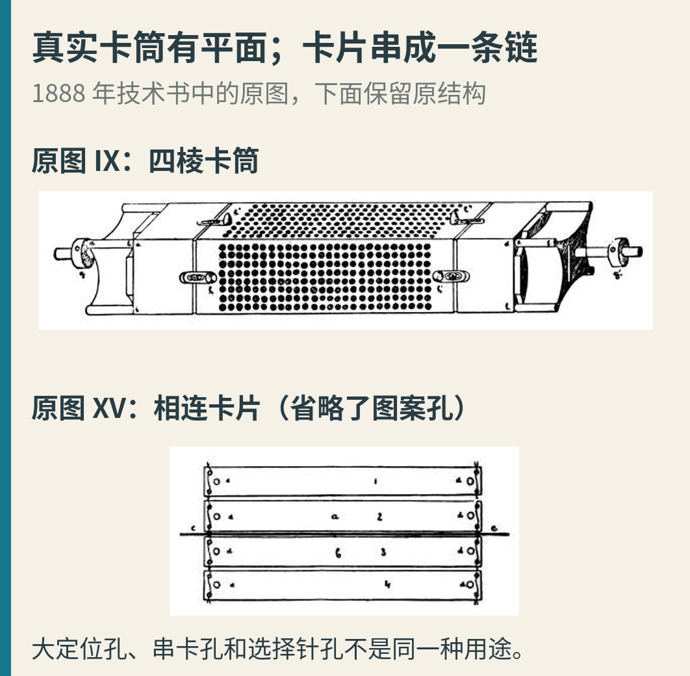

上图为 Posselt 原图 IX，p.16；下图为原图 XV，p.18。两幅均为公版历史插图，缩放后配中文说明。原图 XV 为了看清连接，省略了图案孔，不是说卡链上没有图案信息。

卡片串成一条链，依次经过承卡面。卡筒先往外退，让卡片脱离针尖，再转过一面，使下一张卡来到待读位置。

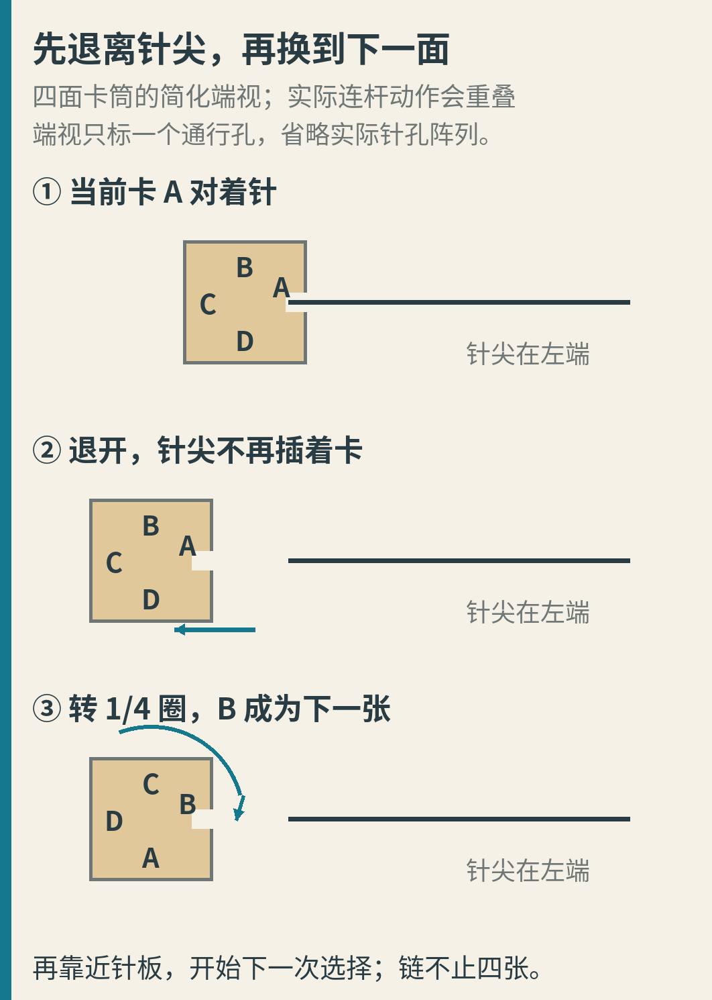

这是卡筒端视的简化图：每个字母表示当前位于那个面上的卡，针尖在横线左端；右侧只标出一个可通行孔，省略真实的针孔阵列。第一格中 A 对着针；第二格退开，卡与针尖之间出现距离；第三格转了四分之一圈，B 来到下一次面对针的位置。图中的转向只是这幅示意采用的方向。

为什么不能贴着针尖直接转？因为已经伸入孔里的针尖可能被卡边挂住。退出之后再转面，下一张卡才能重新对准。

这里的三格是在拆解相对位置，不是声称真实机器每个零件都单独停顿。具体连杆还要把卡筒的往返、分度与刀架升降协调起来。

## 10. 四个承卡面，为什么能读一条很长的卡链

卡筒只负责把眼前这一段卡链送到读卡位置，不必把全部卡片都储存在四个面上。更多卡片可以悬垂、折叠或由支架承托，像一条不断接续的队伍。

下面是前面 Getty 真实照片右侧卡链的局部。它仍是同一张 1851 年照片，只裁切放大了这一部分；没有补画卡孔或隐藏零件。

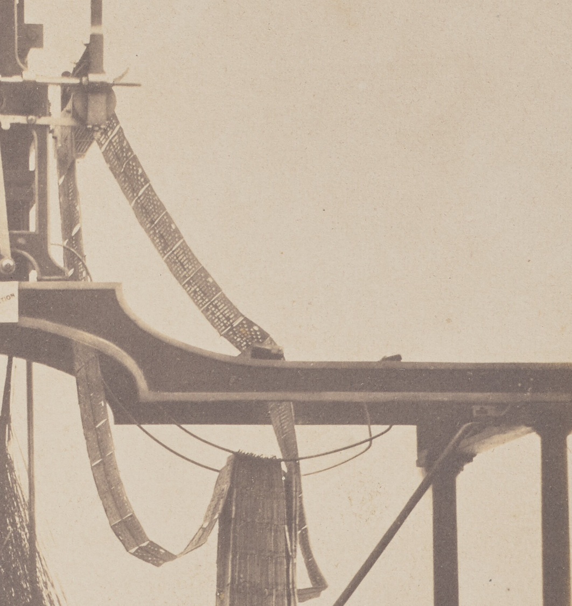

来源与权利同前面的 Getty 整机照片，CC0；原图裁切范围另记在[素材清单](examples/figure-metadata.json)。注意它与开篇织物里“画出来的卡片”不同，这里看到的才是实际机器上的卡链。

真实卡片往往有很多行孔位。那些行通常是为了把许多横针紧凑地排成一个阵列，**整张卡一起决定本次的选择**，不能把“卡上的第 1 行、第 2 行”直接读成“布上的第 1 纬、第 2 纬”。

Posselt 的附录给了一个很好的原例：一个 40 根经线的设计，对应一张为第一纬冲制的卡；它在 200 个控制位置中重复了五次。关键不是背 40 或 200，而是看见一张完整卡怎样经过控制位与穿综关系，给出一整次引纬的选择。[第一纬卡片原图22](originals/posselt-1888-i_091a.jpg)与[设计原图23](originals/posselt-1888-i_091b.jpg)可对照查看。

因此，本篇“一张卡对应一次引纬”是在普通单升、每纬正常换卡的工作方式下使用的教学约定。循环、重复读卡及更复杂组织会改变卡数与最终纬数的关系，不能把它说成所有机器永远不变的等式。

## 11. 让 4 张教学卡真的接成一个小纹样

我们现在换一套选择内容，仍然使用前面的 8 根蓝色经线与金色纬线，只把每次“抬哪些线”的名单换掉。

- 第 1 张：11001100，抬起 1、2、5、6 号。
- 第 2 张：01100110，抬起 2、3、6、7 号。
- 第 3 张：00110011，抬起 3、4、7、8 号。
- 第 4 张：10011001，抬起 1、4、5、8 号。

每张卡使用一次，引入一纬。四张读完，再从第一张开始，重复两轮就得到 8 纬。

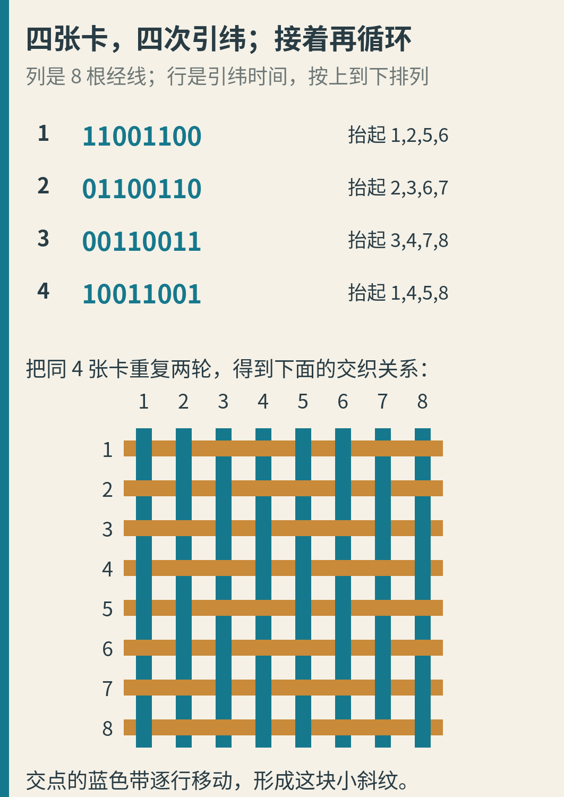

图中每一列仍是同一根经线，每一行是一次引纬，按时间从上到下排。这个上下方向只是组织图的排法，不是说真实织机或卡链必须从上往下走。

请沿着蓝色露在上面的交点看：它们逐行移动，形成一个小斜纹。第 1 行的蓝色位置是 1、2、5、6，下一行移到 2、3、6、7。**卡的顺序变成了时间顺序，时间顺序又变成了布上相邻的交织关系。**

这张图由随文程序按照四个 8 位串直接生成，可以逐格核对；它是组织关系示意，不是我们真的架了一台 19 世纪织机织出的样布。

## 12. 一只钩，为什么可能拉起好几根经线

刚才为了容易追踪，让一只钩只管一根经线。真实提花织造常常还要在布幅上重复同一个花纹，所以会采用不同的穿综连接。

Posselt 原图 XXV 展示了三个重复分区。它让同一根上方颈绳，在每个分区各接一根综绳。因此一只钩可以同时带动三个重复位置的经线。

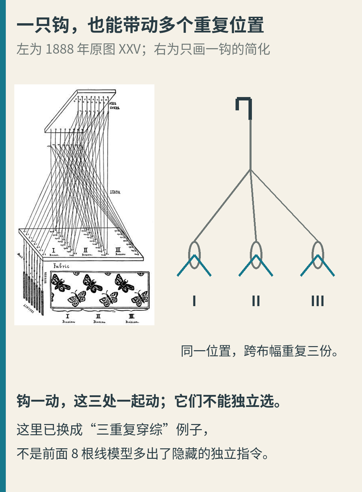

左侧为 Posselt，Fig. XXV，p.24，解释见 pp.24–25；公版历史插图，数字图源 Project Gutenberg / Internet Archive。原图只画出代表性的连接，并没有把实际机器全部钩和绳都画满。右侧为依据连接关系重新绘制的教学图，只画一只钩及三个对应位置。

这一次已经换成独立的“三重复穿综”例子，不是在之前的 8 通道卡里偷偷增加了指令。

共用控制的好处是，同样的动作可以在布幅上重复出现。限制也很直接：挂在同一钩下面的这些经线会一起动，不能在同一次选择中让它们各做各的。

所以，“卡片第几个位置管布上的哪根线”，还要经过穿综映射。卡上的孔阵列不能直接当作布面的小照片。

## 13. 全打孔，为什么不等于全能

假如连续很多次都把 8 个位置全部打孔，机器依然能够执行：所有经线都抬起，纬线从下面通过。

但在这一片交叉区域里，蓝经线会一直在上，金纬线一直在下，没有轮流上下交织。

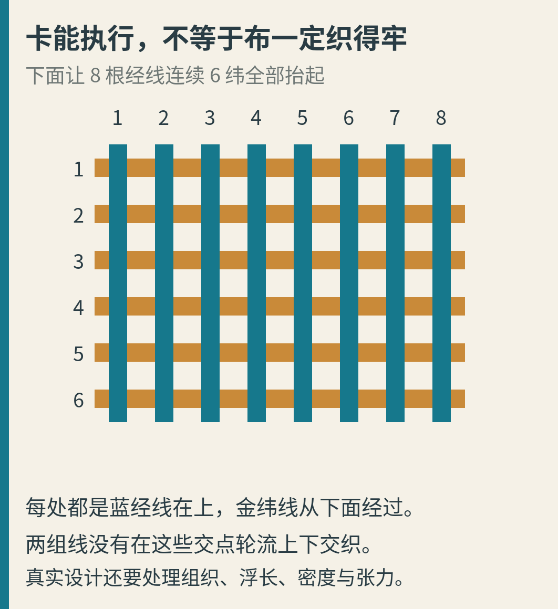

这不意味着“机器坏了”，而是提醒我们：**能发出动作指令，与能设计出合适的织物，是两件事。**

一根线连续跨过多处而没有在那些位置交织，形成的浮长也需要控制。实际设计还要考虑纱线、密度、张力、组织和用途。不能随便把一张黑白画冲成卡，就保证织出牢固又漂亮的布。

这件事在旧书里也说得很具体。下面的四幅原图，先给叶形草图，再给方格轮廓，然后加入组织点，最后才展示织物效果。

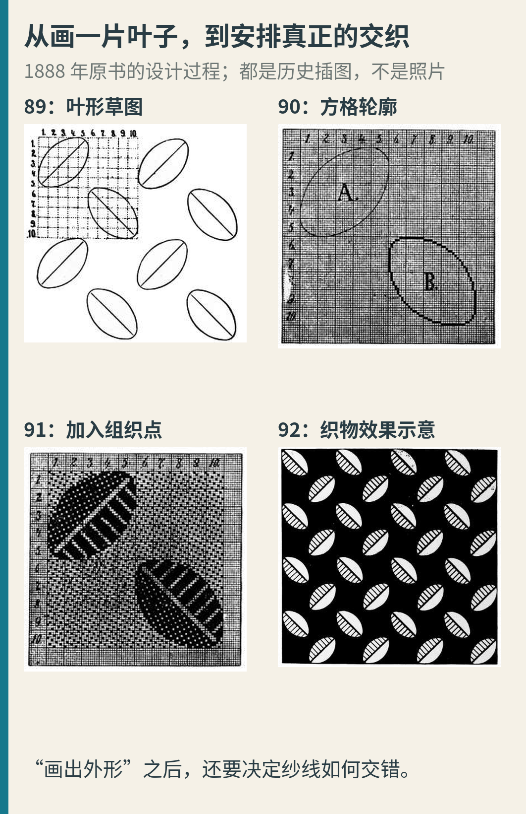

E. A. Posselt，1888，附录 Figs.89–92，pp.115–116。公版历史插图，数字图源 Project Gutenberg / Internet Archive；这里只做缩放、排版和中文标注。四幅都是书中插图，最后一幅也不是实际织物照片。

“画出一片叶子”解决的是外形；“让这些线怎样相交”解决的是织物结构。提花卡把后者的选择顺序存下来，不能替设计者免掉这一步。

## 14. 为什么它让人想到程序

现在再看“换卡就能换花纹”这句话，意思应该更精确了。

在同一套兼容的机构和穿综连接下，可以改变卡孔内容或卡片顺序，改变各次引纬时的经线选择，而不必每次重新制造整套选择零件。

但卡孔没有给丝线染色，也没有改变钩的数量。要换纱线颜色、密度、连接方式或其他织造条件，仍然需要相应调整。卡片可更换，不等于机器没有边界。

这是一种很具体的可编程控制：**把动作选择存到外部物件上，机器按约定规则依次执行。** 我们今天用 0 和 1 解释它，是为了让选择关系更容易阅读；历史卡片上的孔并不是写着数字的电子存储器。

也不能仅凭一串可更换卡片，就断言这台织机已经是通用计算机。本文看到的是固定机械规则下的选线控制，没有因此证明它能执行任意计算。

## 15. 回到那幅丝织肖像

Jacquard 并不是从零独自发明了所有穿孔控制技术。馆藏史记录了更早的穿孔纸、相连卡片和织机机构探索；他在 19 世纪初的改进与推广，是这条积累中的重要一段。

本篇不把某个博物馆模型的制作年份，当作“发明日”。开篇织物是 1839 年，Getty 的实物照片是 1851 年，解释机械的书是 1888 年；它们各自回答不同的问题，不能拼成“同一台原机的全过程”。

下面再看开篇同一件丝织物的局部。我们只从馆藏图像裁切，不生成缺失的纱线，不声称能凭屏幕图逐根测量当年的经纬。

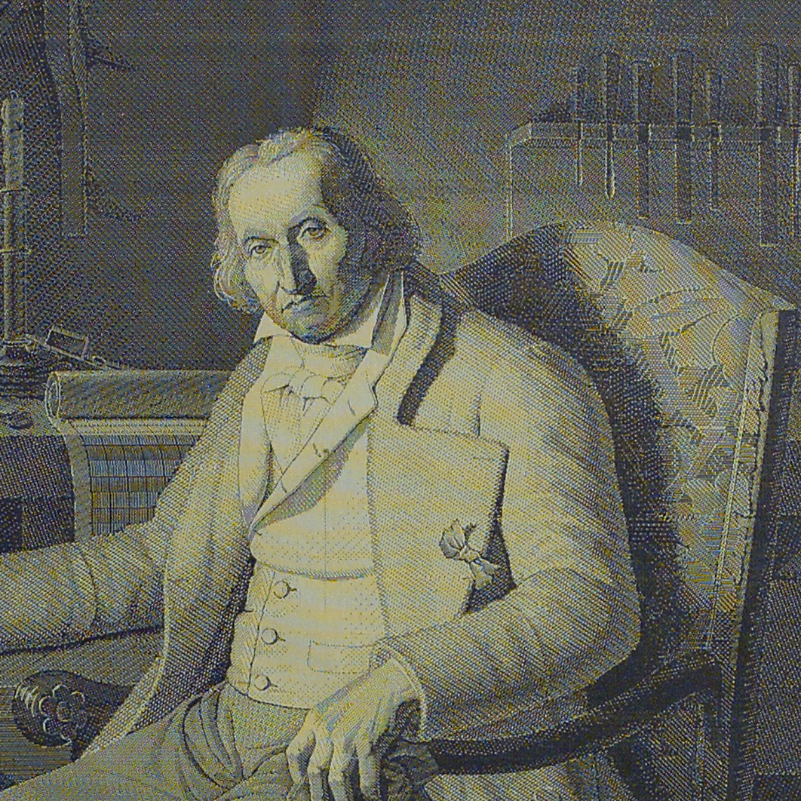

Didier, Petit et Cie，《Joseph Marie Jacquard》，1839，Met 31.124；CC0。与开篇为同一件织物、同一份馆藏图像的局部，不是另一份独立样本。

8 根线的小模型当然不能复刻这件复杂织物，我们也没有从照片反推出它当年的完整卡链。但现在，你已经能解释其中一条重要的路径：

**一处孔让横针通过，一个钩留在刀的上方，一根连接绳把综眼抬起，一根经线来到纬线上面。很多这样的选择，按时间连续发生，慢慢变成布上的图案。**

有时，理解一台宏大的机器，并不需要从它最复杂的成品开始硬猜。只要抓住一个孔，把它带来的动作一直追到一根线，就能找到进入整个系统的门。

---

原创正文与教学解释图采用 CC BY 4.0，原创制图代码采用 MIT。博物馆图像按各馆 CC0，公版历史图另行标明，不自动套用正文许可。完整来源、图像变换与 AI 辅助说明见 [sources.md](sources.md)；模型与制图复现见 [README](README.md)。
