# 动画角色临时转弯，怎样从动作库里挑出下一步？

角色正在往前走。左脚还在前面，右脚正准备迈出，你突然把摇杆推向左边。

程序当然可以立刻把整个人的朝向转过去。但如果身体转了，腿还照着原来的步子走，就可能像一个被拖着转向的玩偶。

更细一点的问题是：**动作库里有没有一个时刻，既能接上现在的身体姿势，接下来又会往你想去的方向走？**

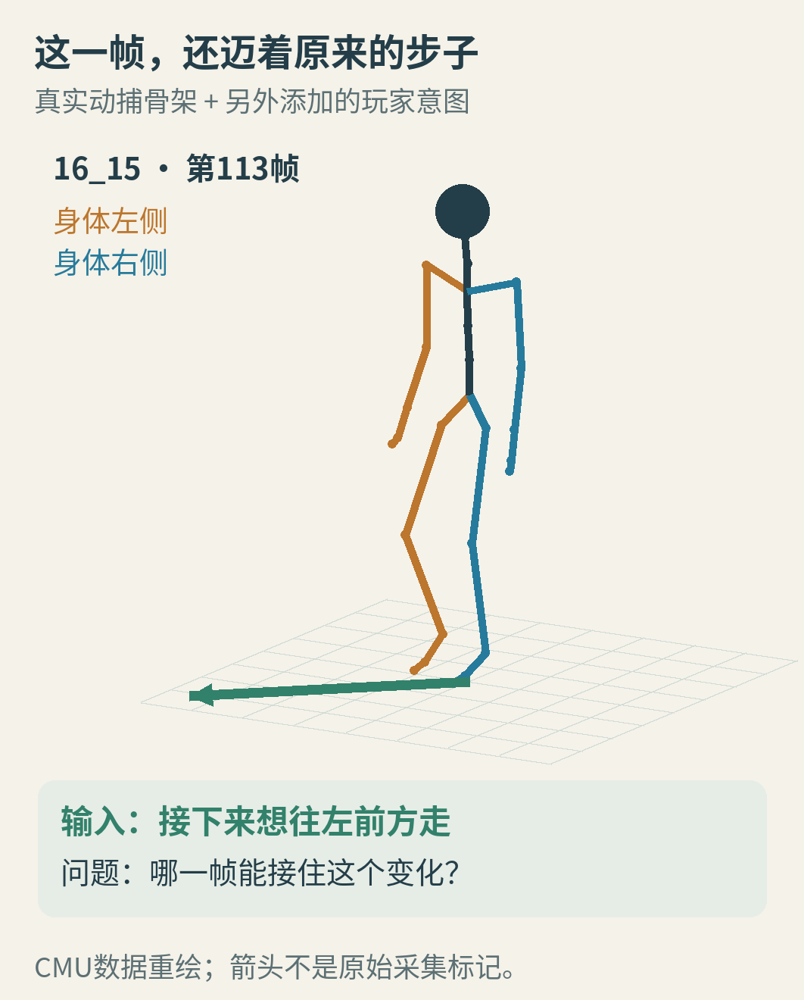

骨架不是某款游戏的截图，而是本文程序实际解析、绘制的CMU真实动作捕捉数据。橙色是身体左侧，蓝色是右侧；地面上的目标箭头是我们另外加的玩家意图示意，不是原始录像里的标记。数据来源与使用条件见[素材说明](third-party/NOTICE.md)。

这篇要讲的Motion Matching，常译为“动作匹配”，做的就是这样的挑选：把“现在怎么动”和“接下来想怎么走”变成可比较的数字，从保存的动作中找一个合适的帧，再取回完整姿势及其后续动作。

先用四个候选手算一遍，再把同一个检索思路放进一小份真实动作库。你不需要事先懂游戏引擎、骨骼动画或神经网络。

## 1. 选的是一个时刻，后面还有一串动作

动画可以先想成一本连续翻页的小册子。每一页记录一个瞬间的姿势；按照时间顺序快速播放，人就走起来了。一页就是一帧。

对骨骼动画来说，保存的通常不是每一页的照片，而是躯干、上臂、小腿等部位的位置、方向等数据。程序再根据这些数据，把角色画出来。

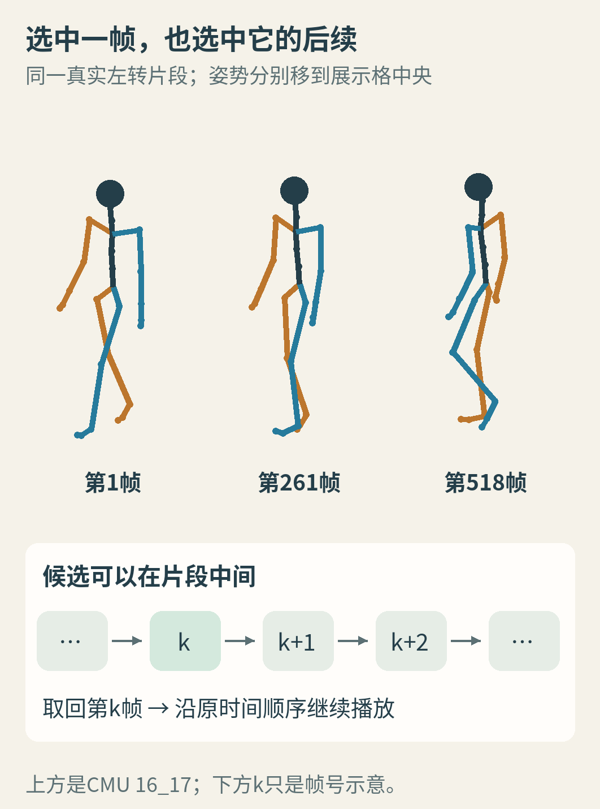

上面的三个人，来自同一段CMU“步行、90度左转”记录的第1、261、518帧。为了看清身体朝向，我们把每个时刻的地面位置分别移到展示格的中心；**这幅排列不是三个人真的站成一排，也不是保留原世界位置的轨迹图**。

一段动作里有许多可用的时刻。左脚在前、右脚在前、脚刚抬起、脚准备落下，对接续来说不一样。

因此，“选中左转动作”还不够精确。Motion Matching可以选中某个片段**中间的一帧**，从那里接着播放后面的帧；它不是必须从每段动作的开头播起，也不是每次随机拿一张互不相关的姿势拼上去。

## 2. 先建立一个跟着角色走的坐标系

为了比较姿势和路径，我们需要一种大家都认得的记法。

在角色脚下放一个地面参考点，暂且把它理解为“整个人此刻站在哪里”。从这个点往角色当前右边，是左右方向的正方向；往角色当前面朝的方向，是前后方向的正方向。距离都用米。

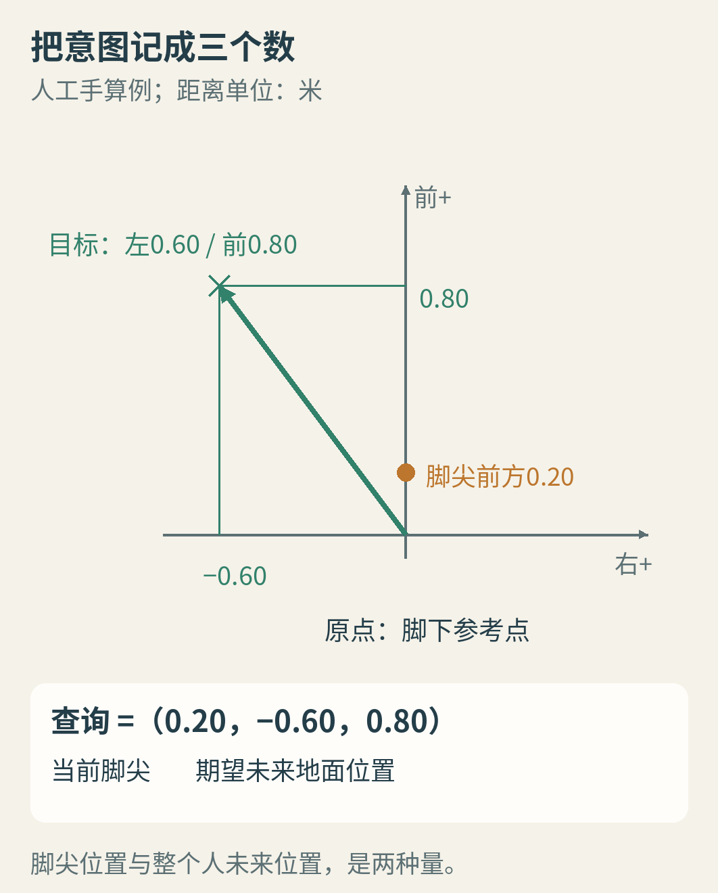

这里开始的是一个**人工编制、方便手算的小例**，不是从刚才的真实动捕图量出来的数。

我们想比较三件事：

1. 现在左脚尖在参考点前面多远？本例是0.20米。
2. 半秒后，希望整个人往左右方向移动多少？本例是−0.60米。
3. 半秒后，希望整个人往前移动多少？本例是0.80米。

右为正，所以−0.60表示向左60厘米。0.80表示向前80厘米。负号不是距离坏了，而是方向与正方向相反。

这三个数合起来，形成一次**查询**：

**（0.20，−0.60，0.80）**

查询的第一项来自现在的姿势；后两项来自玩家输入所形成的运动目标。这里的“未来”是**希望或预测接下来去哪里**，不是程序提前知道了玩家半秒后一定会怎样操作。

在动作库那一边，未来位置倒是已经记录好了：从某个候选帧往后看半秒，原片段中的角色走到了哪里，直接可以算出来。

一个是“想去哪里”，另一个是“这段已存动作接下来会去哪里”。我们要比较的是两者有多接近。

## 3. 给四个候选帧写三项索引

先不看庞大的动作库，只抽出四个假想候选帧，叫A、B、C、D。对每一帧，也写出同样的三项数字。

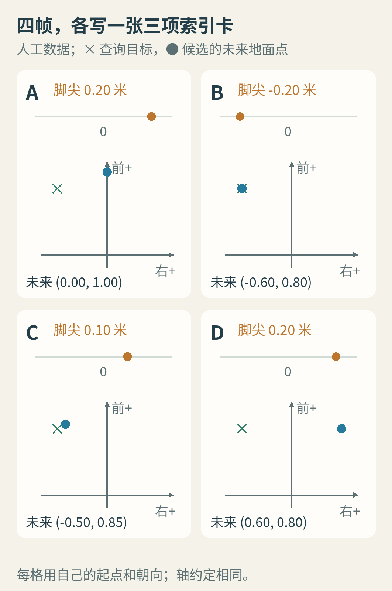

图中每一格都用候选**自己此刻的地面参考点和朝向**作坐标原点与方向，轴约定一致。小圆点是半秒后的地面位置，十字是查询目标；上方的短标尺单独表示左脚尖前后位置，不把脚尖当作整个角色的未来位置。

四项索引分别是：

- A：（0.20，0，1.00）。脚的前后位置相同，但接下来直走。
- B：（−0.20，−0.60，0.80）。后续路径正合心意，可左脚落在参考点后方。
- C：（0.10，−0.50，0.85）。脚的位置略有差别，后续路径也有一点偏差。
- D：（0.20，0.60，0.80）。脚的位置相同，接下来却偏向右边。

哪个最好？只比较路径，会选B；只比较这一项脚的位置，A和D又分不出高下。

我们需要一个明确的评分规则，把“接得上”和“去得对”放在一起比较。

这些简短数字叫**特征**。它们像动作帧的检索索引，不是完整人体。只有一个脚尖的前后位置，当然不能确定膝盖、手臂和头都在哪里，也不能分清脚是正在抬起还是准备落下。

## 4. 算距离之前，先说清比较用的尺子

最直接的差别，是把候选数字减去查询数字。但差0.1米究竟算严重还是轻微，需要看它属于什么量。

左脚错开10厘米，可能已经很显眼；半秒后的整体目标点差10厘米，未必需要同样大的惩罚。

本例人为选定两把尺子：

- 脚尖前后位置：用**0.25米**作比较尺度。
- 未来左右、前后位置：各用**1米**作比较尺度。

先用差值除以对应尺度，再平方。平方让正负方向的偏差都贡献正的分数，也让较大的偏差受到更大惩罚。最后把三项相加，分数越小越好。

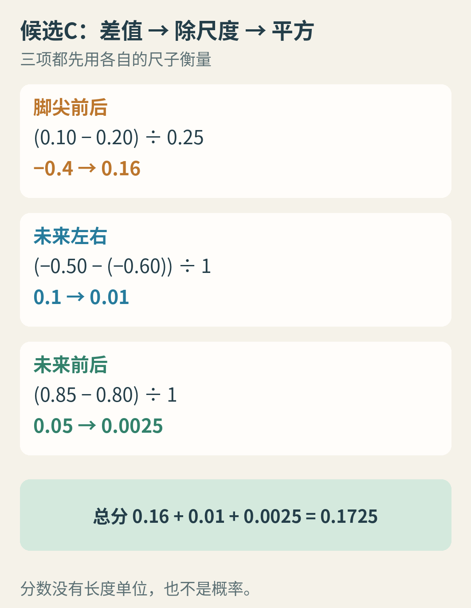

沿着C走一遍：

第一项，脚尖0.10减去查询0.20，差−0.10米；除以0.25米，得到−0.4；平方是**0.16**。

第二项，未来左右位置−0.50减去−0.60，差0.10米；除以1米再平方，是**0.01**。

第三项，未来前后位置0.85减去0.80，差0.05米；除以1米再平方，是**0.0025**。

因此C的总分是：

**0.16 + 0.01 + 0.0025 = 0.1725。**

分子和分母都以米计，相除后已经没有长度单位。这个分数是我们规定的差异代价，既不是“偏差0.1725米”，也不是“正确概率17.25%”。

本例的0.25与1是为教学人为选的尺度。真实系统也可以从数据的变化范围统计尺度，再调权重；不能把这里的数字误当成行业通用参数。

## 5. 扫过四帧，最小分数落在哪里？

对其他候选做同样的运算：

- A：0 + 0.36 + 0.04 = **0.40**。
- B：2.56 + 0 + 0 = **2.56**。
- C：0.16 + 0.01 + 0.0025 = **0.1725**。
- D：0 + 1.44 + 0 = **1.44**。

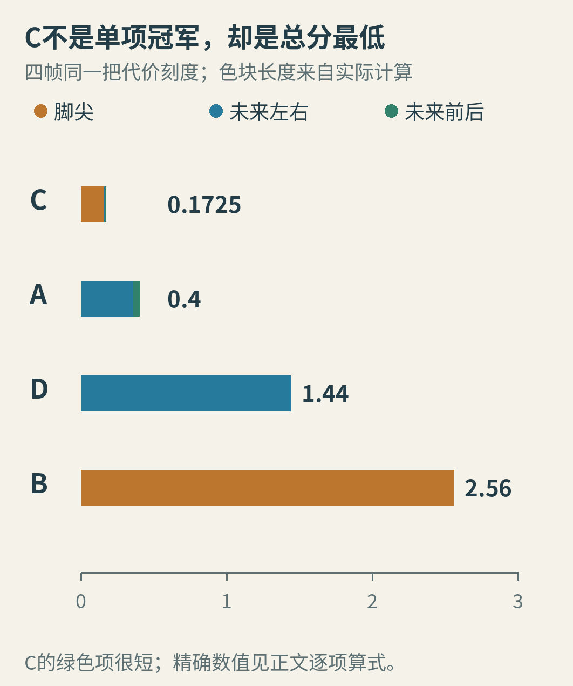

每根条由三部分组成，分别对应脚尖、未来左右和未来前后的误差项。C的总条最短，所以这次查询选C。

它不是每一项都最好的候选。B的轨迹完全命中，却在脚尖这一项付出了很大代价；A的脚位置很好，却往直前方走。C是**按照当前尺子折中后，总分最低的一帧**。

四帧可以逐个看；更大的库也可以先这样线性扫描，只是更费时间。各种加速检索结构是在减少查找成本，不是把基本问题换掉。

选中以后，真正的系统会用这个帧的身份，取回完整姿势，并继续读它所在片段的后续帧。

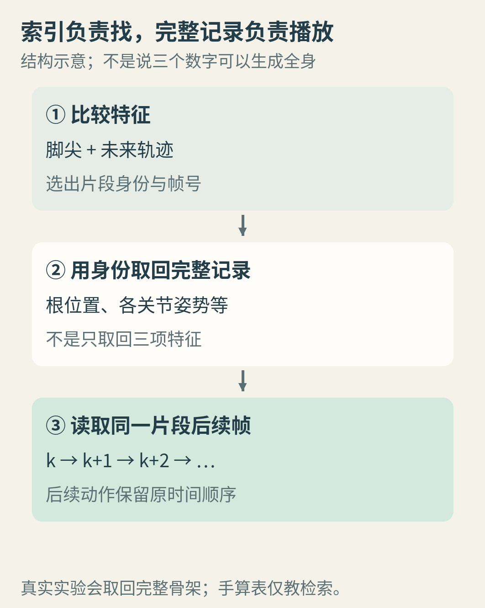

这一步很重要：不是用三个数凭空生成全身。上面的人工三特征表只用来教选帧，并不包含一套真实人体动作；后面的CMU实验才会实际取回完整关节数据并播放。

基础Motion Matching不要求训练神经网络。Holden等人的2020年论文专门先讲基础版本，再讨论用学习模型替换其中的操作。两者有联系，但不能把“Motion Matching”一看到就当成“先训练一个神经网络”。[作者论文，第3节](https://theorangeduck.com/media/uploads/other_stuff/Learned_Motion_Matching.pdf)

## 6. 为什么不直接拿世界坐标比较？

假设动作库里的一个人站在房间东边，而你的游戏角色站在西边。哪怕两个人的脚步姿势完全相同，脚尖的世界坐标也会差很远。

整个人转个方向也一样。原片段朝北前进，你的角色朝东前进；我们通常希望复用的是“往自己前方迈步”，而不是只允许它沿录制时的罗盘方向移动。

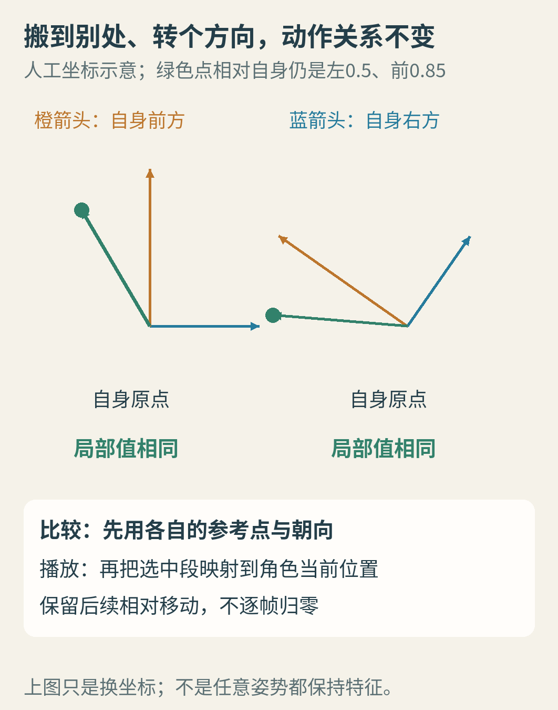

所以查询使用当前角色自己的参考点和朝向，各候选使用它们各自当时的参考点和朝向。坐标约定统一为“右、前”，再拿数字相比较。

选中后，再把整段候选动作的起点与朝向，映射到现在角色所在的位置和朝向。后续帧之间原来的相对运动则保留下来。

这里不是把同一个世界目标，分别旋转进每个候选任意的世界方向去改题；而是两边都先回答同一种问题：“相对我现在站的地方和面对的方向，这个量是多少？”

本文对真实数据做了一项实际检查：把整份数据在世界里平移，再整体旋转73度，重新提取这些相对特征。差异只到约2×10⁻¹⁵米的浮点舍入量级。它验证的是这次实现对同一刚体坐标变换的一致性，不是说任何动画变化都不会影响特征。

## 7. 挑得接近，也不能突然跳过去

回到人工小例。当前左脚尖在前方0.20米，选中的C在0.10米。若在一个瞬间直接替换，它会向后跳10厘米。

因此“挑哪个帧”和“怎样过渡到那个帧”是两步工作。

下面另外设一个只看脚尖前后坐标的小过渡：旧动作此刻为0.20米，向后速度0.30米/秒；新动作为0.10米，向后速度0.10米/秒。它们是说明过渡的人工数值，不是CMU测量结果。

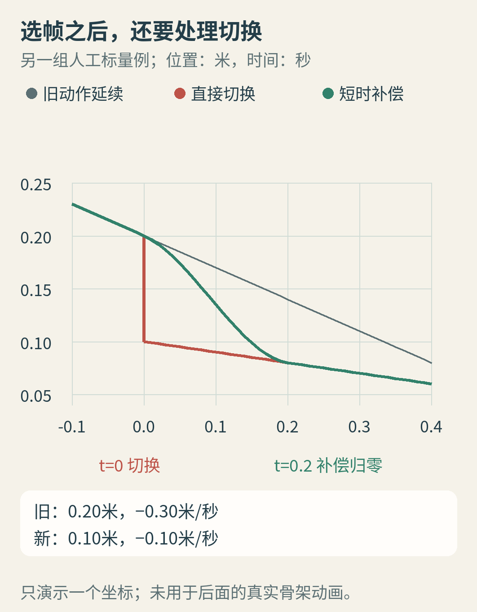

红线在切换时刻有一个断跳。绿线则先给新动作补上旧、新之间的位置差，同时照顾速度差，再在0.2秒内平滑地把这份补偿消掉。

刚切换时，绿线从旧位置、旧速度出发；补偿结束后，它回到新动作自己的位置和速度。图中的曲线由保存的代码实际计算，端点条件也有检查。

这里用的是**单个位置分量的教学过渡**，不是完整骨骼动画系统。真实接续还要处理各关节旋转、速度以及其他状态。常见的“惯性化”思路会保存这些差异并使它们衰减；这个词也不表示角色已经获得真实的物理惯性。[作者示例中的接续与位移讨论](https://www.theorangeduck.com/page/code-vs-data-driven-displacement)

另外，库里每帧都有索引，不表示每个画面刷新时都必须重新搜索并跳帧。实现可以隔一段时间或输入明显变化时检索，平时沿原动作向前播放，还可避免跳到太近的帧或不合适的片尾。这些规则会影响体验，不能把最小检索器当成完整控制器。

## 8. 换了评分标准，答案也会变

假如设计者更重视“赶紧往目标走”，可以提高轨迹部分的权重。

为了把现象放大，我们故意将两项轨迹代价乘以200。这个数字只是极端反例，不是推荐配置。

此时B仍为2.56，因为它的轨迹误差为0；C变成：

0.16 + 200 ×（0.01 + 0.0025）= **2.66**。

B反而获胜。程序并没有忽然变笨，而是在服从另一套优先级。

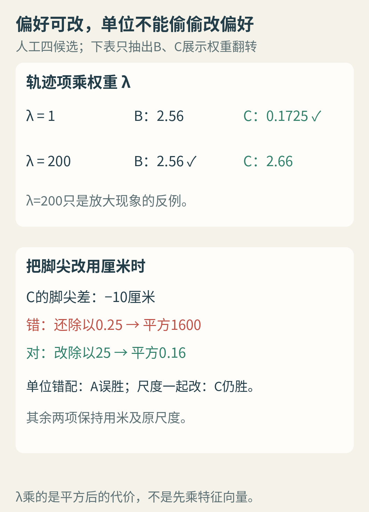

另一种“答案变了”，却可能是程序员犯了单位错误。

如果把脚尖位置由米改成厘米，却忘记把比较尺度0.25米也改成25厘米，脚的位置项会被异常放大。在这个小例中，A会错误地变成最低分。

若数值与尺度一起转换，代价不变，仍选C。**换单位不该偷偷改变动作偏好；改权重才是在有意改变偏好。**

还有一种问题，再怎么换权重也造不出答案：如果库里根本没有相应动作呢？

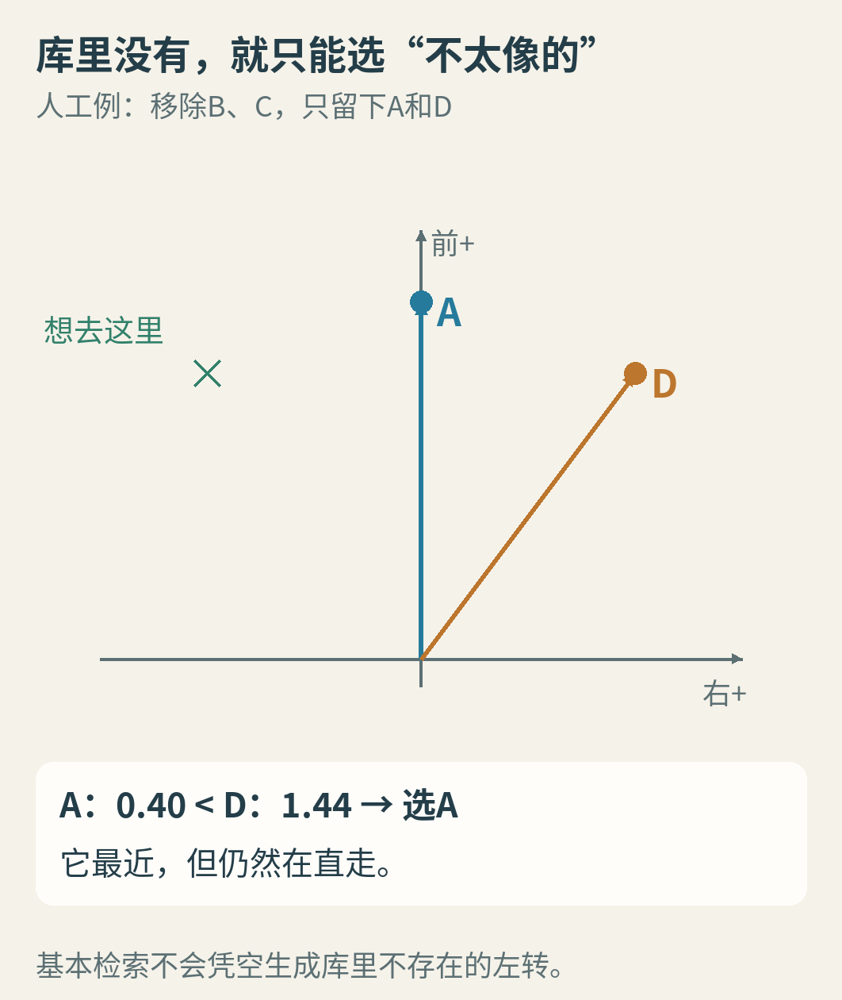

把B、C都移走，只剩直行A和右行D。同一查询会选A，它仍然没有朝目标左转。

“最近的”只表示在现有候选中最近，不表示足够好。基础检索不能凭空制造不存在的急转；后续扭曲、调整或生成方法，是要另外设计的部分。

## 9. 换成真实动作库，实际查一次

现在离开人工四候选，换到CMU Graphics Lab公开的三段真实动作数据：直行、左转步行、右转步行。前面的A/B/C/D数值，不再被当成这些真实帧的属性。

这三段分别有471、518、410个源帧，共1399帧。源数据采样率为120Hz，也就是每秒120个记录时刻。这里看未来半秒，因此要往后看**60个源帧**。

每段最后60帧没有足够的后续记录，不能偷偷借下一段的开头或循环回去当未来。排除它们，留下411 + 458 + 350 = **1219个候选帧**。

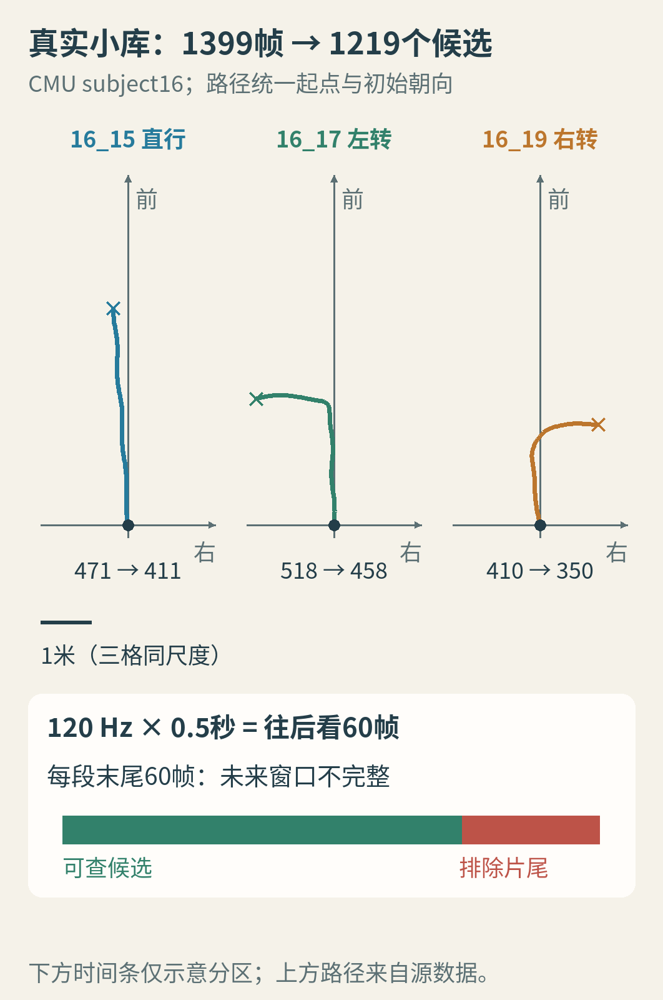

上图的实心点是片段起点，×是片段终点，曲线是根的地面轨迹；**这里的×不是查询目标**。

原文件记录骨架结构和关节角度，不是成品视频。本文程序先按骨架层级算出各骨段端点，再绘制为骨架；用CMU说明的比例把长度换成米。地面参考点取髋部根位置的地面投影，前向由根的朝向投到地面后得到。这个简单处理没有做Holden示例中额外的平滑根轨迹预处理。

为了与前面的0.20米建立直观联系，我们固定取直行片段16_15的第113帧作为当前状态。它的左脚尖前后位置约为0.200446米。

这次真实查询另设一个较小目标：半秒后，向左0.05米、向前0.35米。仍然使用脚0.25米、两项轨迹各1米的比较尺度。

程序实际扫描1219帧，得到最低分：

**左转片段16_17，第244帧，代价约0.00086628。**

这一帧的左脚尖前后位置约0.197689米；它后半秒的地面位移约为左0.032391米、前0.370846米。它离期望地面点约2.73厘米，并没有完全命中目标。

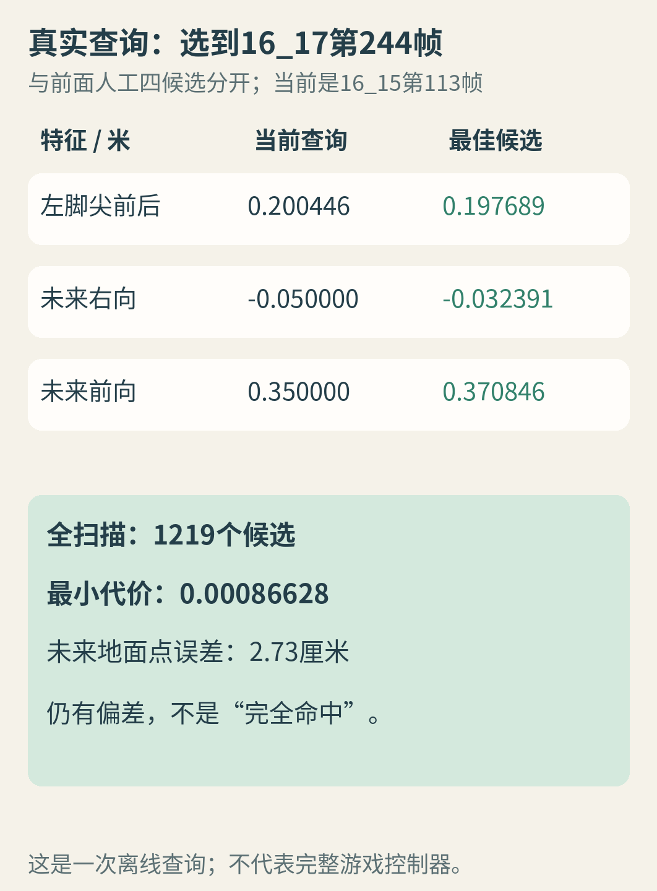

这是一次固定输入的离线检索实验，不是商业游戏性能评测，也没有以“挑到了左转片段”来证明所有查询都可靠。完整1219行特征、得分及原始动作文件都在[复现包](README.md)里。

下面把两个起点的地面位置和朝向对齐，分别继续播放原直行动作与选中动作的后半秒：

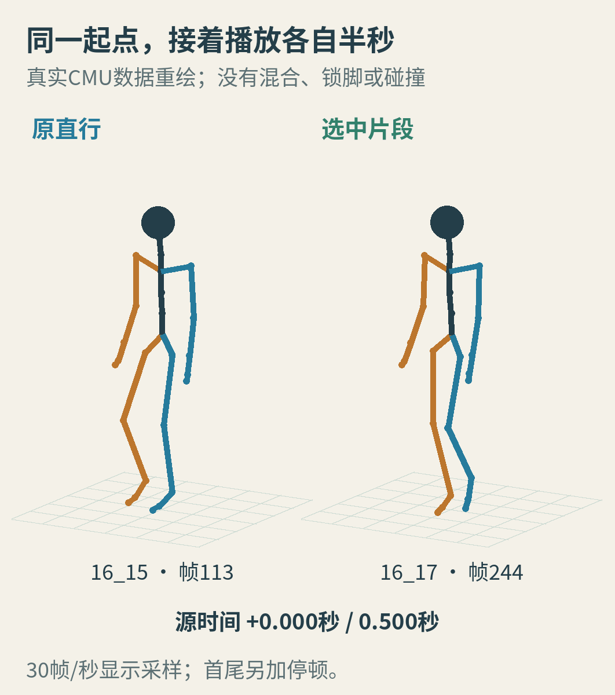

它是本文根据真实数据渲染的动画，不是动作捕捉现场录像。特征计算用了全部120Hz源帧；图中每4个源帧取1幅，共16个显示时刻，首尾加了停顿便于看清。关闭动画时，首帧仍显示两边的起点和源帧身份。

这一段**没有加入混合、锁脚、碰撞或下一次查询**。它只展示“选到一个真实帧以后，取回它所在片段的后续动作”。第7节的绿色过渡曲线没有偷偷套在这份数据上。

## 10. 脚尖这一项只差毫米，右膝却还能跳十几厘米

三项特征的局限，可以在同一次真实实验里直接看到。

当前帧与选中帧对齐后，左脚尖**前后这一项**只差约2.76毫米，看上去很接近。

但把所有骨段端点都拿出来比较，位移最大的点是右膝，差约**16.24厘米**。

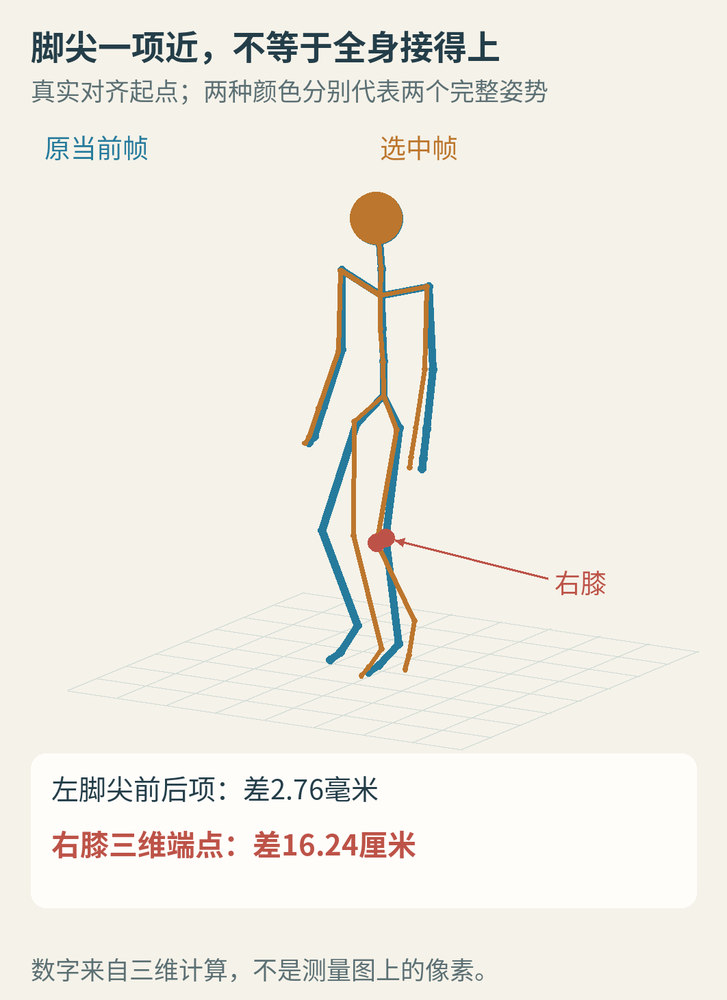

图中的数字是三维端点之间的距离，不是拿投影后的屏幕像素直接量出来的。这里“右膝”对应骨架文件里右大腿骨段的末端；其他文件名和端点定义在复现说明中列出。

这并不矛盾。我们只要求左脚尖的一个前后坐标接近，并没有要求另一只脚、膝盖、髋速度、抬脚方向都接近。

因此真实实现通常比较更多信息。例如Holden等人的论文用过两脚位置与速度、髋速度，以及多个未来时刻的位置与朝向。它们不是“数字越多越聪明”的装饰，而是在补充这种小索引遗漏的约束；具体选择仍由动作与任务决定。[论文的基础Motion Matching说明](https://theorangeduck.com/media/uploads/other_stuff/Learned_Motion_Matching.pdf)

即使特征更完整，接续方法和数据覆盖仍需检查。我们这个三特征实验做到了真实选帧和取后续，却没有资格宣称“已经实现自然无缝的游戏人物控制”。

## 11. 动作看起来自然，与游戏里走得听话，是两件相连的事

游戏角色还有一个常被忽略的分工：负责移动、碰撞的对象，与画面上表演动作的身体，不一定由同一套规则推进。

玩家要求立刻减速，碰撞体可以马上停住；动作库里的人，却可能还需要半步才收住脚。若强行把身体的位置拉回碰撞体，脚就可能在地上滑。

所以实际系统往往还需要协调目标轨迹、显示角色位移、碰撞以及脚接触。锁脚和逆向运动学可以帮助脚留在地面目标上，但它们也不是任意动作错误的万能补丁。作者2021年的演示，正是在讨论这些互相牵制的选择。[Code vs Data Driven Displacement](https://www.theorangeduck.com/page/code-vs-data-driven-displacement)

本文没有实现这些完整环节。单次最近邻检索、切换时的过渡、角色在世界中的移动和接触修正，各自有工作，不能用其中一步成功，替代整套系统的验收。

这也解释了Motion Matching的一个吸引力：它让已有丰富动作数据更容易被利用，却没有让动画师、动作采集、程序设计与调试变得不再重要。

## 12. 再把摇杆推向另一边

回到能手算的人工小例。当前左脚尖仍为0.20米，只把未来目标改成向右0.60米、向前0.80米。

查询变成（0.20，0.60，0.80）。四个候选与尺度都不变。

你可以自己算：A的代价0.40，B为4.00，C为1.3725，D为0。于是这一次选D。

你刚才做的，是同一套算法处理了不同意图，而不是临时加了一条“按右键就选D”的特判。

当然，分数为0也只表示**这三项特征**相同，不表示全身每个关节或后续所有时刻都完全一致。这个边界，在刚才右膝的16厘米差别中已经露过面了。

理解Motion Matching，可以先抓住四步：

1. 用明确坐标与尺度，描述现在的姿势线索和想要的后续路径。
2. 对动作库中的候选帧，提取同样定义的特征。
3. 按规定的距离找一帧，取回完整动作并沿时间继续。
4. 再处理过渡、世界移动、接触和数据覆盖，检查真正的画面结果。

代码与实际运行数据见[复现说明](README.md)，原论文、资料范围、数据权利和AI辅助情况见[来源说明](sources.md)。

下一次你在游戏里让角色突然转身，可以留意一下那半步：它不是只把方向箭头转了个角度，而是在一堆可能的过去里，挑一个能接向你想要的未来的时刻。
