# 水量测得分毫不差，为什么仍不知道两箱各装多少？

两只不透明的水箱，各能装10升水。你负责判断里面的情况，却只能看到一个显示器：它告诉你，两箱**加起来**有多少水。

显示器很准，没有四舍五入，也没有测量误差。此刻，它显示10升。

左箱8升、右箱2升，符合这个读数。左箱2升、右箱8升，也符合。

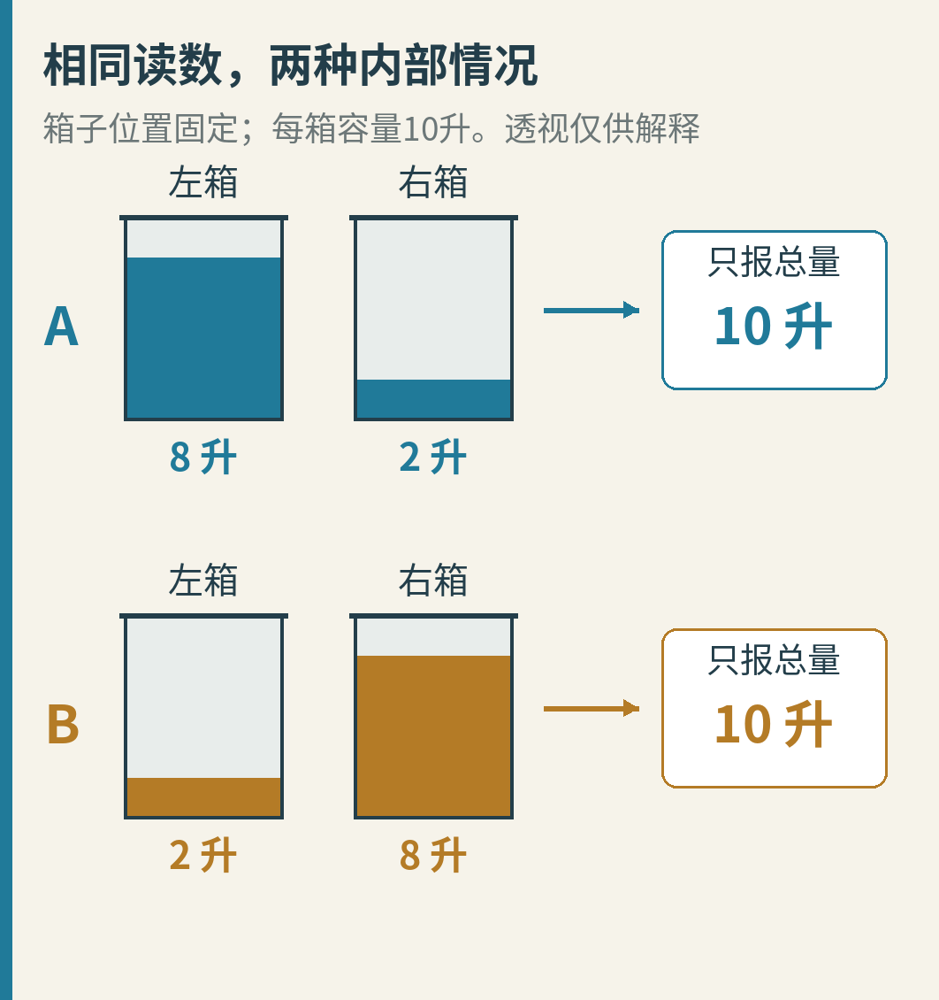

图把箱壁画成透明，只是让我们看见两种可能的真相；实际观察者只拿到右侧显示器的数字。A、B是两次对照实验的名字，蓝色始终表示A，金色始终表示B。左右箱的位置固定，并没有交换标签。

一眼看不出来，似乎没什么稀奇。那就等一等：水会排出，两箱之间也会交换水。连续记录十次、一百次，能不能把最初各装多少升倒推回来？

有时能。但在下面这个规则明确、读数完全准确的例子里，**无论等多久，都不能。**

我们要探究的是控制理论中的“可观测性”：从看得见的读数，加上已知的变化规则，能不能辨认看不见的内部状态。这是设计测量方案时的一个先决问题。如果两种内部情况始终留下相同的记录，后面的程序再聪明，也不能仅凭这份记录保证选对。

## 1. 先把水箱的规则说清楚

这里不做真实水槽实验。我们自己规定一套容易算清楚的**离散教学模型**：“离散”就是每隔一秒记一次账，不追踪两次记账之间的连续水流。

每轮都用**这一轮刚开始时**的水量，计算两件事：

1. 每只箱子向外排出自己水量的20%。
2. 两箱之间，从水多的一边向水少的一边，转移“水量差的10%”。

算完这两项，再一起更新左右水量。不是先排水，再拿排完的新水量算交换；这种先后混用会得到另一套模型。

从A开始：左8升、右2升。

- 左箱向外排：8 × 20% = 1.6升。
- 右箱向外排：2 × 20% = 0.4升。
- 左比右多6升，所以左向右转移：6 × 10% = 0.6升。

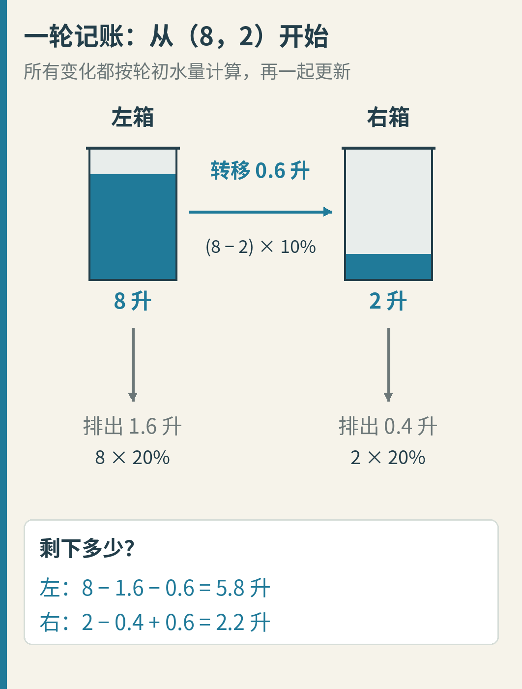

图中向下的灰箭头是离开这两只箱子的水，横向蓝箭头是箱间转移。箭头旁的升数才是这一轮的实际收支；箭头长度不表示流速。各箱最终剩下：

- 左：8 − 1.6 − 0.6 = **5.8升**。
- 右：2 − 0.4 + 0.6 = **2.2升**。

我们选的是数学规则，不是说普通水箱天然就这样流。真实水槽还可能涉及液位、管路、阀门等因素；本文的20%和10%不是从某台设备量出来的参数。

## 2. 水确实在变，读数却始终分不出A和B

用同样的规则，从B的左2升、右8升开始。向外排水变成左0.4升、右1.6升；转移方向变成右向左0.6升。

一秒后，B得到左2.2升、右5.8升。

A、B的内部情况仍然不同，显示器却都读出8升。

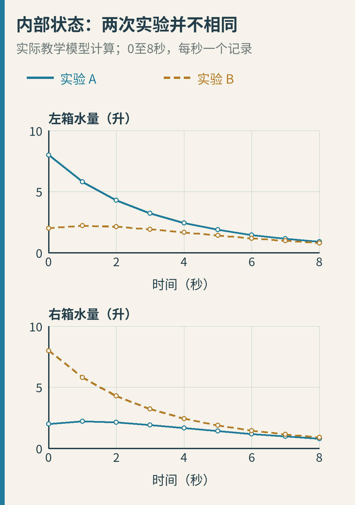

这两幅折线图来自本文程序的实际计算。横轴是从开始计起的秒数，纵轴是水量，单位升；上图只看左箱，下图只看右箱。蓝线是A，金色虚线是B。折线连接每秒一次的记录，**不是对两次记录之间真实水流的测量**。

同一时刻比较蓝、金两点，就能看出：左箱的水量不一样，右箱的也不一样。

现在把两箱水量相加，只留下显示器真正能给我们的数据：

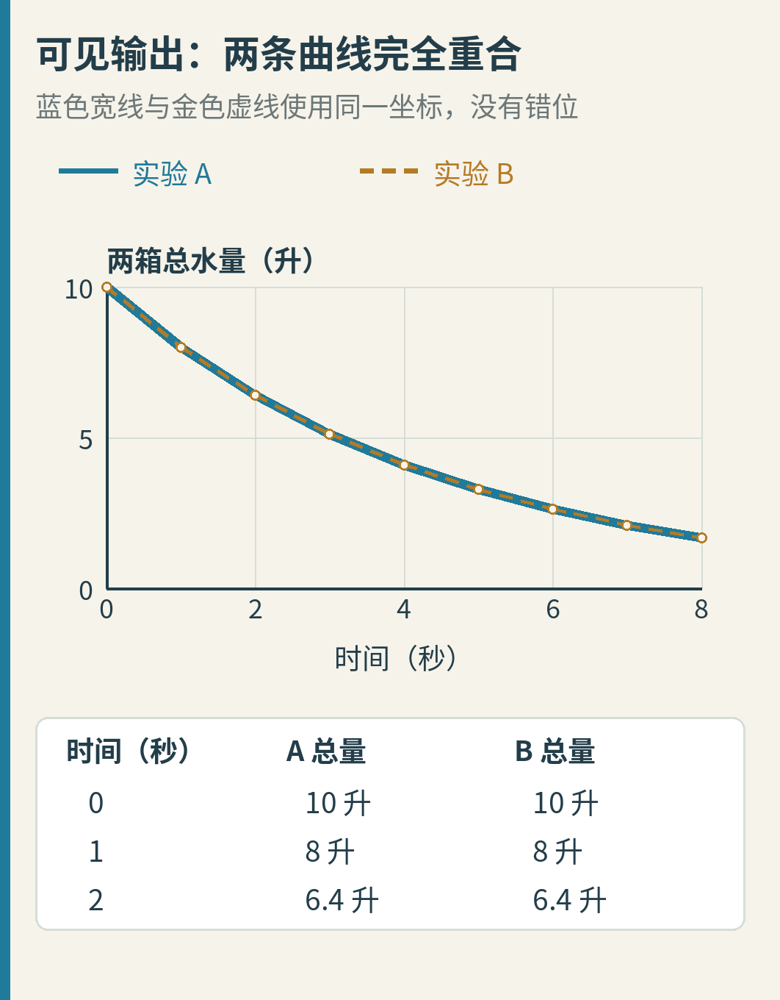

蓝线画得较宽，金色虚线沿同一条线画上去，没有为了“看见两条线”人为挪动数据。下面的小表把前三次记录并排展开：A、B都是10、8、6.4升。

这不是显示器卡住了。它一直在准确地报告变化，只是报告的这种变化，恰好不能揭示水在两边怎样分配。

## 3. 算再多轮，为什么也没用？

算了几轮相同，还不等于证明永远相同。我们需要找出总量下一轮究竟由什么决定。

先不管哪边多，把本轮两箱总量叫作“总量”。

两箱各排自己的20%，合起来就是排掉总量的20%。箱间转移则是一边少、另一边多：它改变分配，却不改变两箱合计。

因此：

**下一轮总量 = 本轮总量 × 80%。**

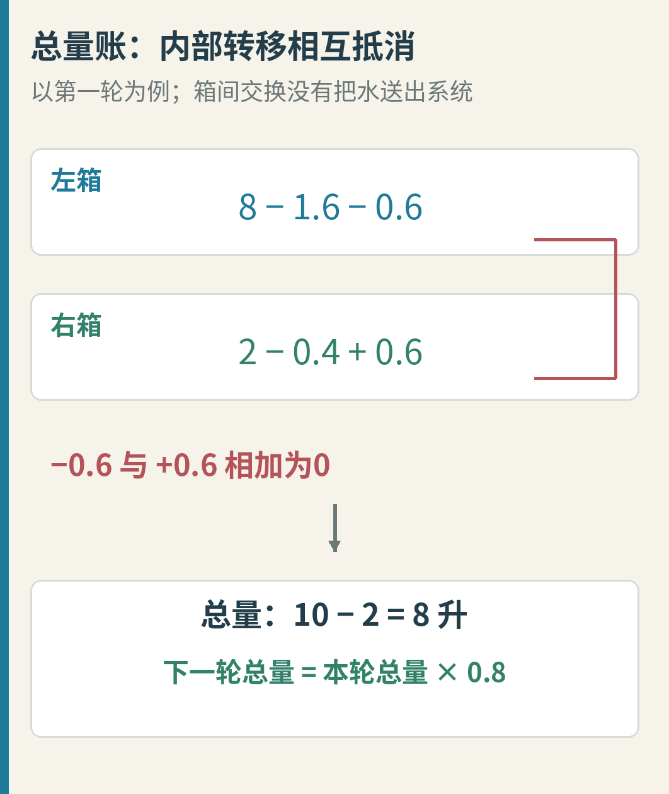

图用A的第一轮算给你看：转移的0.6升在两箱账上方向相反，相加时抵消。这个理由不依赖A的具体数字。

现在从相同的10升出发，两次实验都会经过：

10 → 8 → 6.4 → 5.12 → ……

下一次读数只重复透露“上一轮总量的八成”，没有多透露左、右怎么分。于是，我们不必真跑一百年，也知道继续读取同一个总量，不能区分A和B。

还有一个容易误会的地方：排水久了，两箱都会越来越接近空，A、B的区别也会越来越小。这不表示它们的**过去**变得可知了。两段不同的过去，仍然可以留下同一串读数。

如果愿意再算一步：左量减右量，下一轮会变成本轮差值的60%。A从差6升开始，经过6、3.6、2.16……；B从差−6升开始，始终符号相反。任意有限轮后，这个区别仍非零。图上逐渐贴近，不能当成数学上已经相等。

## 4. 藏起来的不是某一只箱子，而是一种变化

在这个模型里，某个时刻的“内部状态”，就是一个有顺序的水量对：**（左箱水量，右箱水量）**。知道它和更新规则，我们就能算下一轮。

传感器给出的数则叫“输出”。这里的输出只有左右之和。

除了A的（8，2）和B的（2，8），C的（5，5）也会给出同样的整串输出。实际上，总量为10升的起点还有很多。

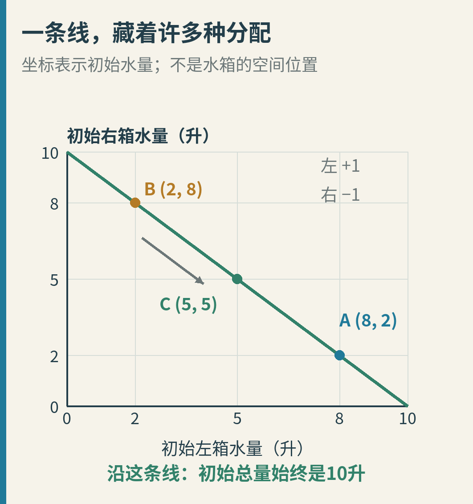

这不是水箱摆放的地图。横轴表示**初始左箱水量**，纵轴表示**初始右箱水量**；平面上的一个点，代表一种完整的起始分配。

从B沿线走到A，是左边多6升、右边少6升。横向增加和纵向减少刚好抵消，所以总量不动。C也在线上。

我们通常会说，这种“左多一点、右少同样多”的差异，是当前测量方案看不见的方向。它不是说右箱完全没影响：右箱多水当然会增加总量。隐藏的是**两边配合变化后抵消掉的那部分信息**。

对本文这种规则已知、没有测量误差的模型，若所有不同初态都能从输出记录区分，就称系统可观测；只要存在不同初态始终不可区分，就不可观测。我们已经找到了A、B这个反例，所以当前“水箱规则 + 总量传感器”不可观测。[Stanford离散可观测性讲义](https://ee263.stanford.edu/lectures/observ.pdf)

这说的是信息是否进入读数，不是测得准不准。把总量显示器再提高十位精度，也没有增加“分配情况”这一条线索。

## 5. 主动加点水，能不能把秘密问出来？

你可能会提出一个更积极的办法：别光看，给水箱一些已知的刺激。

我们增加一项规则：每轮排水和交换结束后，向左箱加0.3升，向右箱加0.1升。A、B两次实验都接受这套指令，每轮完全一样。

注意，“相同输入”是说**A和B收到相同的指令序列**，不是要求左右两只箱子加同样多的水。

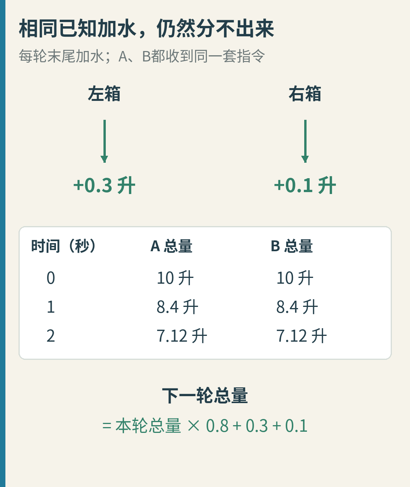

第一轮，A从5.8、2.2变成6.1、2.3；B从2.2、5.8变成2.5、5.9。两边的总量都变成8.4升。

新的总量公式只是多出已知加水：

**下一轮总量 = 本轮总量 × 80% + 0.3 + 0.1。**

于是两次实验仍给出同样的10、8.4、7.12……。你知道加了什么，但这条加水指令并没有让原来的隐藏分配出现在总量里。

这不是说所有系统都不能靠主动操作改善测量。结论限定在当前线性规则、固定总量测量，以及对照实验使用同一已知输入的条件下。未知的加水、偷偷改阀门、另一套动力学，都是新问题，不能混进这里替换条件。

## 6. 改量左箱：一个传感器也可能够用

下面换一种测量方式：显示器不再显示总量，而是**只显示左箱水量**。

同时重开一次实验，取消上一节的加水，恢复最初的排水与交换规则。观察者知道这套规则，但**没有之前的总量10升这条信息**。否则左箱一读8升，用10减8就得到右箱2升，根本不用等。

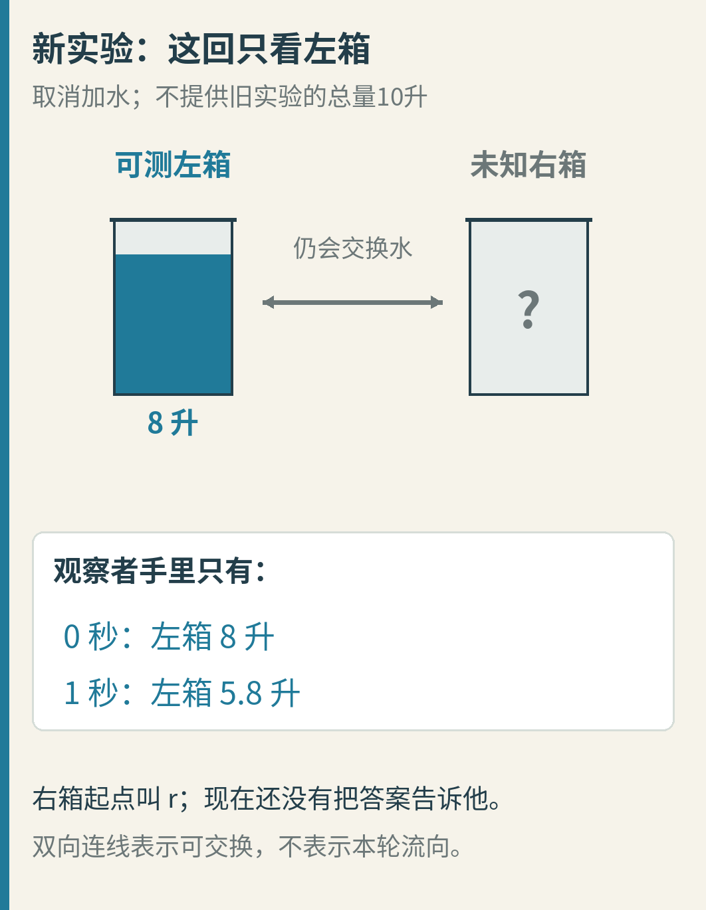

这次右箱画成不透明，不用水位偷偷泄露答案。新传感器给了两次读数：

- 开始时，左箱8升。
- 一秒后，左箱5.8升。

暂时把初始右箱水量叫作r。左箱在这一轮排掉8的20%，也就是1.6升。

箱间净转移由水量差决定：从左箱扣除0.1 ×（8 − r）。这里若括号为负，就表示实际水从右流向左；同一个带符号的式子也能处理这种情况。

于是左箱最后剩下：

5.8 = 8 − 1.6 − 0.1 ×（8 − r）

把最后一项展开，就是：

5.8 = 8 − 1.6 − 0.8 + 0.1r

前面三个已知数合起来等于5.6，所以：

5.8 = 5.6 + 0.1r

现在问题已经从“两只箱子怎么流”变成“一条只有一个未知数的等式”。

## 7. 第二次读数，带来了右箱的线索

沿着上面的等式继续：

1. 从5.8减去已知的5.6，得到0.2。
2. 这0.2等于初始右量的10%，所以除以0.1。
3. 得到r = **2升**。

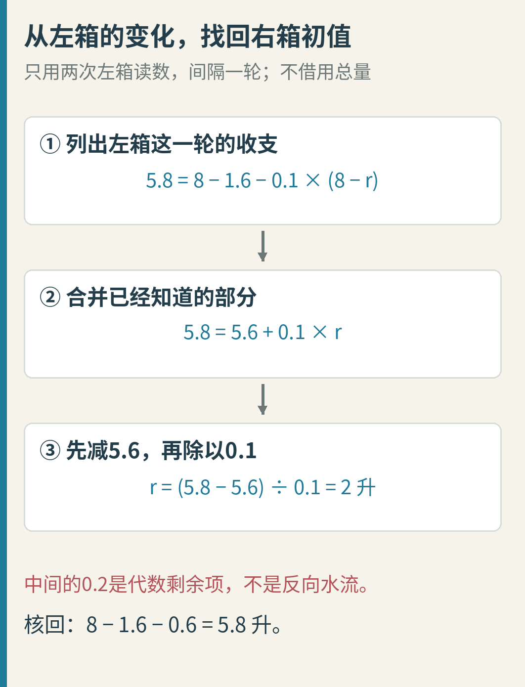

图中间的0.2升是**代数等式里的剩余项**，不是说现实中有0.2升从右箱流到左箱。核回原来的水量收支：初始8、2，净转移明明是左向右0.6升，最终左箱5.8升。把一个式子拆成几项，不等于每项都对应一股独立水流。

这一次我们用了**两次采样，间隔一轮更新**。一个传感器之所以能帮助恢复两个初始水量，是因为水箱之间会交换水：右箱的情况影响了下一刻左箱的读数。

而且这不是碰巧猜对了2。对任意允许的起始水量，记下左箱初读数y0与下一次读数y1，都有：

**初始左量 = y0**

**初始右量 =（y1 − 0.7 × y0）÷ 0.1**

这里0.7从哪里来？左箱先保留自己的80%，再在交换式里减去自己的10%，剩下70%；右箱则以系数0.1影响左箱下一刻。公式只是刚才那次手算的简写。

例如另一组只量左箱的实验，先读2升，下一次读2.2升，就得到右箱初值（2.2 − 0.7 × 2）÷ 0.1 = 8升。每一步都没有借用总量读数。

## 8. 两条记录，是两个线索，还是同一个线索说两遍？

回到初始水量的平面，可以把两种测量方式放在一起比较。

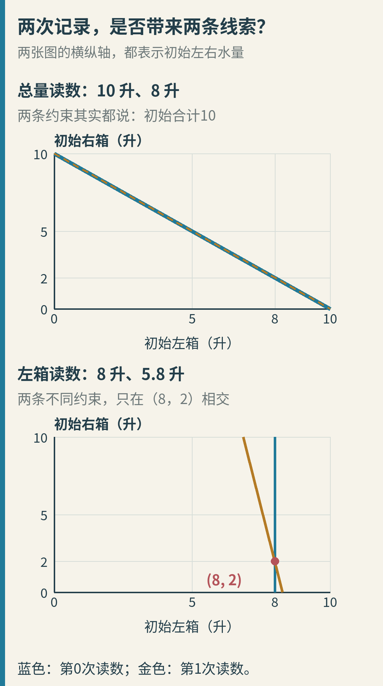

上图是原来的总量测量：第一条记录说“初始左右合计10”。第二条说“一秒后的合计8”。代入已知变化规律，后一句就是“初始合计乘0.8等于8”，仍然只是在说初始合计10。

所以两条约束画在**同一条斜线上**。记录有两行，新的独立线索却只有一条。

下图换成只量左箱：第一条记录把初始左量定在8，所以是一条竖线。第二条记录要求“0.7 × 初始左量 + 0.1 × 初始右量 = 5.8”，是另一条斜线。

它们只在（8，2）相交。符合两次读数的初态，只剩这一点。

两幅图的坐标都表示**初始水量**，不是把一秒后的水量当成另一个坐标点。第二次读数通过变化规则，变成了对“过去从哪里出发”的约束。

因此关键不是机械地数“有几个传感器”“采了多少次”，而是问：**这些读数是否提供了不同方向的信息？**

## 9. 选读：矩阵只是把刚才的账放整齐

如果还没有学过矩阵，可以跳过这一节，主线已经讲通。

矩阵在这里就是一张系数表。我们按顺序把“左、右”两个数放成一列，把两条更新规则并排整理：

- 下一轮左量 = 0.7 × 本轮左量 + 0.1 × 本轮右量。
- 下一轮右量 = 0.1 × 本轮左量 + 0.7 × 本轮右量。

这张更新表通常记作A。但为避免和前面的“实验A”混淆，图中直接叫它**更新系数表**；两者不是同一个A。

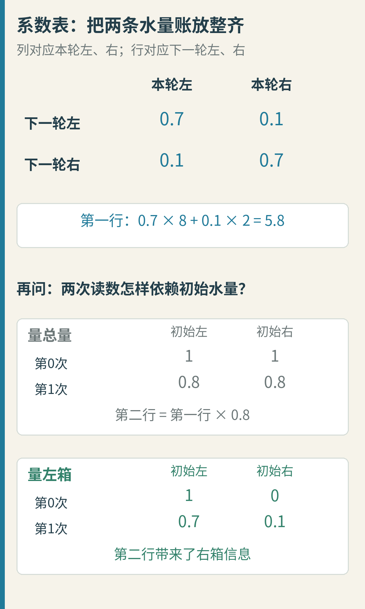

例如第一行的0.7、0.1分别乘8、2，再相加，就是5.8。数字所在的列告诉你乘哪只箱子的量，所在的行告诉你算下一轮哪只箱子。

对于测量，也可以列出“初始两个水量分别占多大系数”：

- 量总量：第0次是（1，1）；第1次是（0.8，0.8）。
- 量左箱：第0次是（1，0）；第1次是（0.7，0.1）。

把这两行叠起来，就得到本例的两次观测系数表，也就是可观测矩阵。

总量版本的第二行，是第一行整体乘0.8，没有提供新的方向；左箱版本的第二行却包含之前没有的右箱信息。矩阵语言把这里独立方向的数量叫作“秩”：前者为1，后者为2。我们有两个待确定的初始分量，后者的两条独立约束恰好能唯一确定它们。

常见的O = [C; CA]写法，正是在本例里把“直接看一次”和“按规则变化后再看一次”叠起来；C表示测量系数，分号表示上下叠行。对于参数固定的有限维线性离散系统，这个思路还能推广到更多状态。[Stanford讲义第4–7页](https://ee263.stanford.edu/lectures/observ.pdf)

不必先背判据再相信水箱结果。刚才的消元和两条直线，已经展示了这个判据在小例中为什么成立。

## 10. 能唯一算出来，不等于能算得很稳

到目前为止，读数完全准确。现在才引入测量误差，并且比较另一种交换强度。

仍然只量左箱，每箱仍排出20%，但把“交换水量差的10%”改成“交换水量差的1%”。用g表示交换比例：原来g = 0.1，现在g = 0.01。

左箱更新式随之变成：

**下一轮左量 =（0.8 − g）× 本轮左量 + g × 本轮右量。**

所以g变成0.01时，自己的系数是**0.79**，不能继续沿用原来的0.7。

为看清右箱信息有多明显，这一节换一对候选初态：P是（8，2），Q是（8，3）。两者左箱相同，右箱差1升。它们不是前面的A、B；A和B的左量一开始就差6升，不适合展示这里的困难。

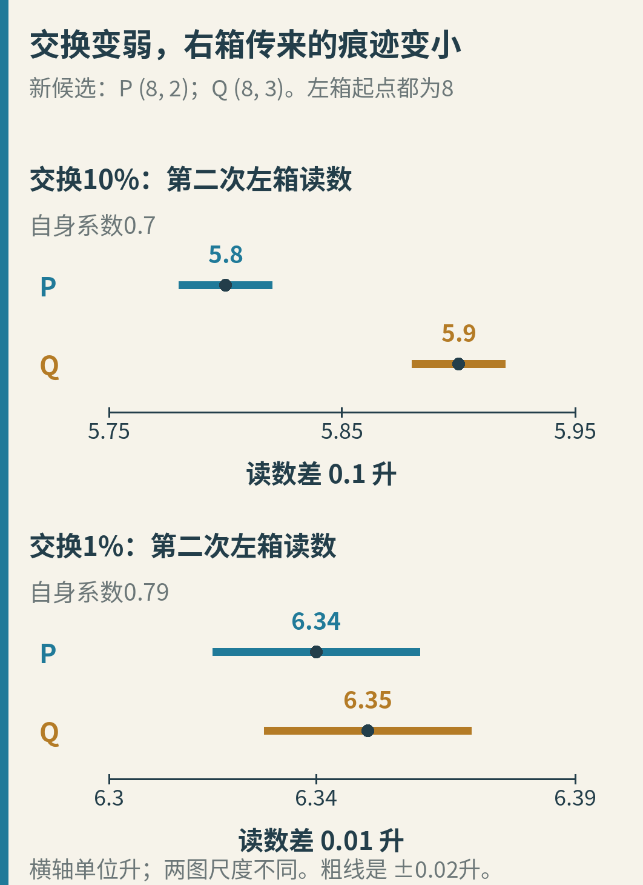

按10%交换时，下一次左箱读数是5.8和5.9升，差0.1升。按1%交换时，则是6.34和6.35升，只差0.01升。图中两组横轴范围不同，分别放大显示，并明确标出差值，不拿线段的视觉长度冒充相同尺度。

若每次读数可能偏差0.02升，那么后一组候选读数的误差范围就会重叠。右箱的区别确实传到了左箱，只是传来的痕迹很小。

来算一个具体、固定的误差例子。真实初态仍取（8，2），让第一次左箱读数多报0.02升、第二次少报0.02升：

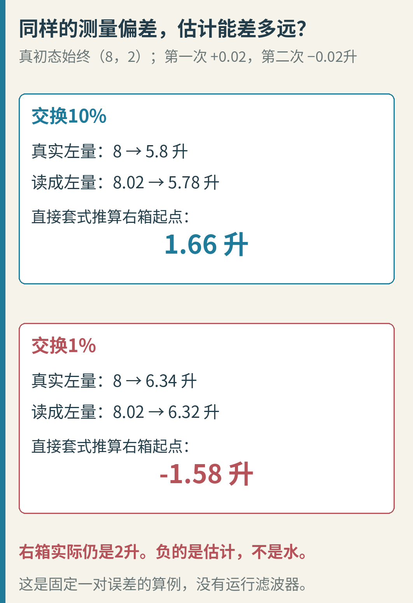

原来的10%交换：真读数8、5.8，读成8.02、5.78。代入原式，估计右箱初量为：

（5.78 − 0.7 × 8.02）÷ 0.1 = **1.66升**。

更弱的1%交换：真读数8、6.34，读成8.02、6.32。此时必须使用新系数：

（6.32 − 0.79 × 8.02）÷ 0.01 = **−1.58升**。

水当然没有变成负数。负数是把带误差读数直接代入无噪声公式后，得到的一个超出物理范围的估计。真正的右箱仍是2升。

两次计算的区别，藏在最后的“除以交换比例”里：g很小，读数中某些小误差就会被放大。这里只指定了一对误差做确定性计算，没有随机抽样，也没有运行滤波器，不能把它当作某款传感器的统计性能测试。

只要g不是0，这个两步方程在无误差条件下仍有唯一解；g恰好为0时，两箱不再交换，右箱的状态彻底不能影响左箱读数。

**“根本看不见”和“理论看得见，但容易被误差淹没”，是两道不同的关。** 更多读数、物理约束和合适的估计方法可能改善实际表现，但需要重新分析，不能由“可观测”三个字自动保证精度。

## 11. 这件事为什么会成为一门理论？

水箱只是入口。更普遍的困难是：系统内部有好几个量在一起变化，而我们常常只能测到其中一部分，或者它们的某种组合。

Rudolf E. Kalman在1960年的《Contributions to the Theory of Optimal Control》中已经明确讨论可观测性；1963年的《Mathematical Description of Linear Dynamical Systems》进一步讨论内部状态描述与输入、输出关系之间的联系。不同内部状态可能在外部留下相同表现，是其中的重要问题。[1960年原文重印](https://liberzon.csl.illinois.edu/teaching/kalman_paper.pdf)、[1963年原文](https://people.duke.edu/~hpgavin/SystemID/References/Kalman-JSIAM-1963.pdf)

照片拍摄于2007年12月27日，不是论文发表时的现场，也不是本文水箱实验。来源：ETH-Bibliothek Zürich, Bildarchiv / Fotograf: Unbekannt / HK_04-01925；CC BY-SA 4.0。保留原JPEG文件，未裁剪改色。[机构影像标识](https://doi.org/10.3932/ethz-a-000672660)、[完整图源与许可](third-party/NOTICE.md)。

我们不必因此把所有状态空间思想归功于一个人，也不必把这个新编的水箱模型冒充历史论文中的原例。读原文的意义，在于看清一个概念究竟要分开哪些问题。

“可控性”问能不能通过输入，把状态送向想要的地方；“可观测性”问能不能通过已知输入与测得输出，把状态辨认出来。“含噪声时怎样估计得更好”又是下一层问题。它们相关，却不能拿其中一项通过，代替另外两项的检查。

## 12. 下次看到一串数据，可以先问这三句

第一句：**我真正想知道的内部量是什么？**

本文是初始左、右水量，而不只是总量。目标不同，同一个显示器够不够用，答案也可能不同。如果只想知道合计水量，它已经很好用了。

第二句：**这些内部量，怎样影响我能拿到的读数？**

量总量时，重新分配可以互相抵消；只量左箱时，交换让右箱的影响在下一秒传过来。计算方法之前，先检查信息通道是否存在。

第三句：**我得到的是新线索，还是旧线索的重复？**

10、8、6.4这一串总量很精确，却只在重复同一个初始总量；8、5.8这两次左箱读数，在已知规则下反而足够恢复两个初值。

你可以自己换一组起点试试：左6升、右4升。

- 总量第一读数是多少？一秒后呢？
- 若只测左箱，第二读数是多少？
- 只用这两个左箱读数，能不能把右箱的4升倒推回来？

答案是总量10、8；左箱6、4.6；（4.6 − 0.7 × 6）÷ 0.1 = 4。和（8，2）相比，总量仍分不出它们，左箱记录却不同。

本篇的模型、精确分数结果、逐秒数据与重绘方法见[复现说明](README.md)，历史与素材范围见[来源说明](sources.md)。不运行代码，也可以完成上面的手算。

测量很准确，是一件好事。但开始分析前，还值得多问一步：**我正在准确地测到什么，又把什么留在了看不见的地方？**
