# 芯片里的时钟，怎样追上另一串节拍？

数字电路常用周期性的电信号安排动作：电压一次次从低变高，再从高变低。这样的信号叫时钟。这里的“时钟”给电路提供节拍，不需要带一块显示时间的表盘。

如果一串节拍很稳定，我们希望另一处电路跟着它走，怎么办？

本地电路自己产生节拍，却可能天生快一点或慢一点。光把频率写成同一个数字还不够：两串信号也许每秒都重复一次，但其中一串总是晚半拍。

先看这次程序实际算出的两段波形。

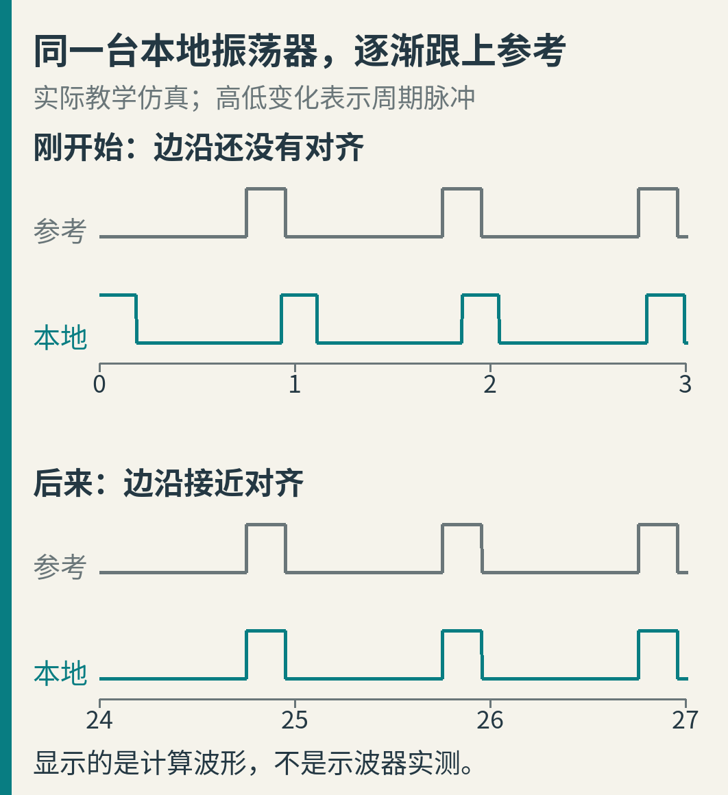

灰色是参考，绿色是本地输出；每条线的突然上升表示一次上升沿。横向是时间。上半图取刚开始的0到3秒，下半图取后来的24到27秒。注意下半图的时间已变，不能把它当成上半图紧接着的三秒。

后面两路几乎同时上升。这不是把绿色波形画到灰色上去，而是让程序反复比较早晚，再调整本地节拍的快慢，算出了新的上升时刻。它是数值模型的波形，不是实物示波器的测量截图。

这种把输出送回来比较、调节的结构，叫 **锁相环**，英文缩写PLL。它用在产生和跟踪周期信号的电路中，也可以配合分频器，把一个较低频率的参考变成更高频率的输出。[ADI原厂入门资料](https://www.analog.com/media/en/training-seminars/tutorials/mt-086.pdf)

下面是一套真正做出来的锁相环本振模块。所谓本振，就是装置内部产生周期信号的振荡器。它会给接收、变换信号等电路提供所需的周期信号。

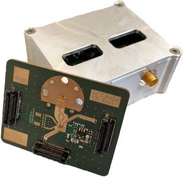

图片：Tobias T. Braun等，2023，[原论文图1](https://doi.org/10.1017/S1759078722001386)，[CC BY 4.0](https://creativecommons.org/licenses/by/4.0/)。从出版社PDF无损提取，画面未改动。论文研究面向射电天文的低抖动信号源；这里仅用它展示真实装置，不把它说成已在望远镜上部署的产品，也不把后面的简化程序当成这套装置的电路仿真。

我们先把快得看不清的节拍放慢成每秒一次，用加减乘除走完一次反馈。

## 1. “一样快”和“同一时刻到”，是两回事

一串信号每隔1秒重复一次，它的 **周期** 就是1秒。每秒重复的次数叫 **频率**；每秒1次，写成1赫兹，缩写1 Hz。

如果每隔0.5秒重复一次，一秒里就能重复2次，频率为2 Hz。周期越短，频率越高。

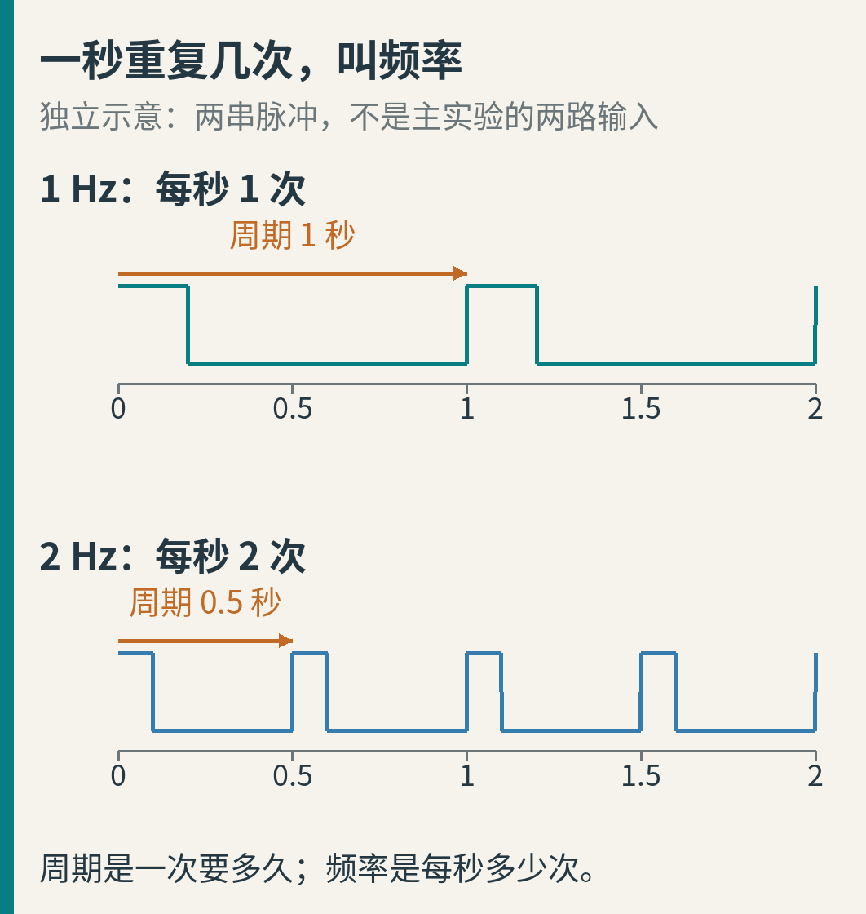

看相邻两个上升沿之间的时间，不要数一条脉冲画得多高。这里画出的高低只用来标记状态，纵向高度不是频率。

再看两串都是1 Hz的信号：参考在整秒上升，本地总是晚0.25秒上升。

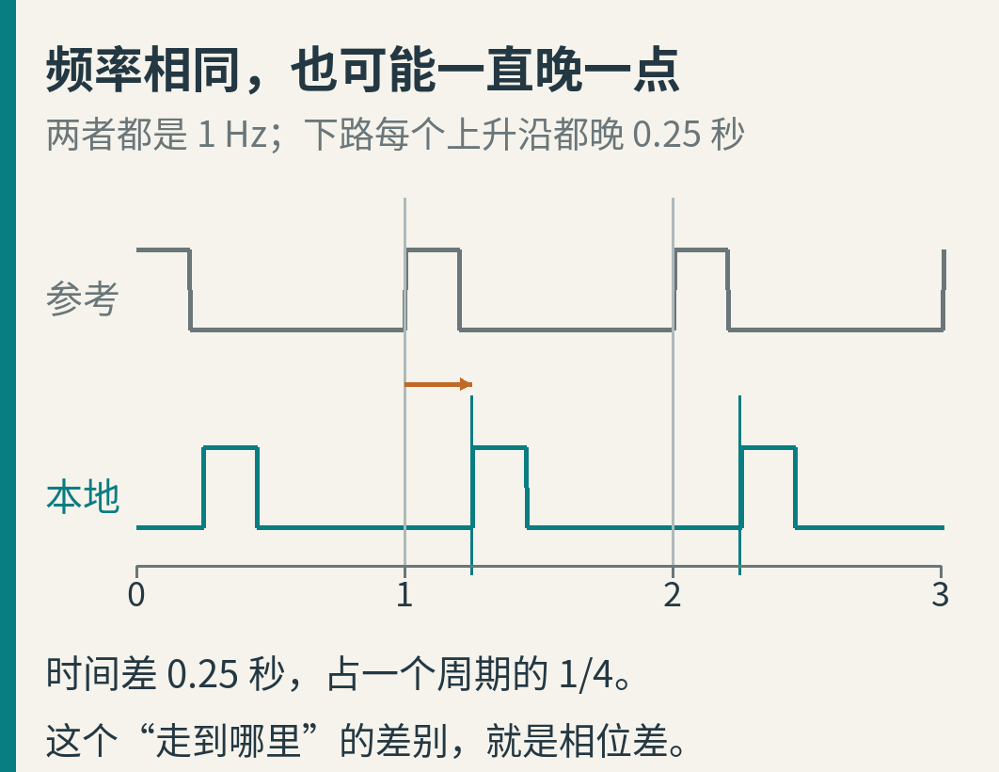

它们同样快，但不同时到达。0.25秒占1秒周期的四分之一，所以也可以说，本地落后 **四分之一圈**。

这里把一次完整周期想成一圈。信号进行到这一圈的哪里，叫 **相位**。相位可以用角度表示，也可以用圈数；本文统一用圈，转完一圈就是1，不需要先学弧度。

锁相环要看的正是这个差别。如果两路频率已经相同，固定相位差就不会继续越拉越大。**锁定可以保留固定相位差；相差严格为0，是某些结构和理想条件下的进一步结果。** 我们稍后会亲自算出一个“同频，却仍然晚0.2圈”的例子。真实器件也有不同类型的比较器，锁定时的相位关系并不一律相同。[TI SCHA003B应用报告中的比较器差异](https://www.ti.com/lit/an/scha003b/scha003b.pdf)

## 2. 慢一点点，为什么会越来越落后？

假设两路最初同时上升。参考1 Hz，每1秒走完一圈；本地0.8 Hz，每秒只走0.8圈，所以要1÷0.8=1.25秒才能走完一圈。

第一次完成一圈，本地晚0.25秒。完成第二圈，参考用了2秒，本地用了2.5秒，已经晚0.5秒。第三圈的差距又增大。

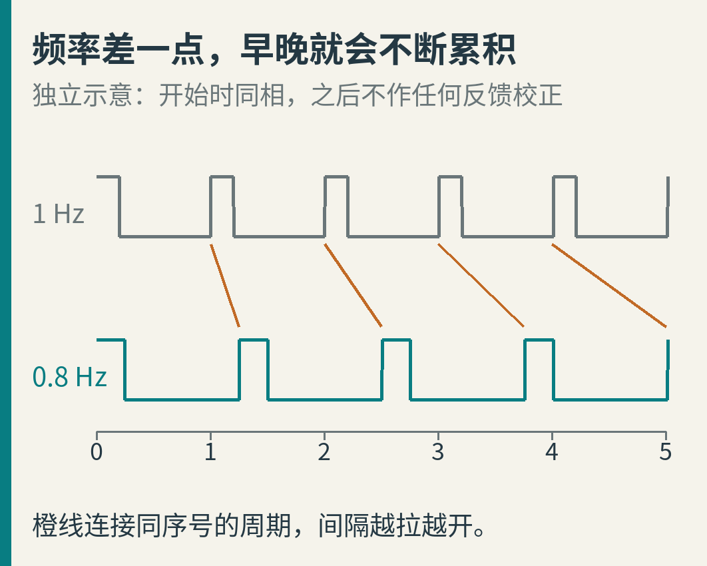

橙线连接两路中同序号的周期完成时刻。它们越来越斜，表示落后在累积。

频率差是“每秒少走多少”，相位差是“目前累计差了多少”。因此，持续的频率差会变成不断变化的相位差。

这给了控制器一个可观察的线索：不一定要先准确测出“你究竟慢了多少赫兹”，先看它是不是持续落后，再调快一些，也能逐步追赶。

产生本地节拍的电路叫 **振荡器**。如果能用电压或数字指令改变它的频率，它就成了可控的振荡器。现实中常见压控振荡器，简称VCO；本文用一个可以直接设定频率的数字模型，省去电压到频率的器件细节。

## 3. 先约定，怎样把“领先”记成正数

主实验的参考频率是1 Hz。本地振荡器没有任何修正时，自由频率为0.8 Hz。

“自由频率”就是暂时不调它，它自己会跑多快。后面加上修正以后，实际输出可以快于0.8 Hz。

开始计算的这一刻，本地相位取0圈，参考已经走到0.25圈。

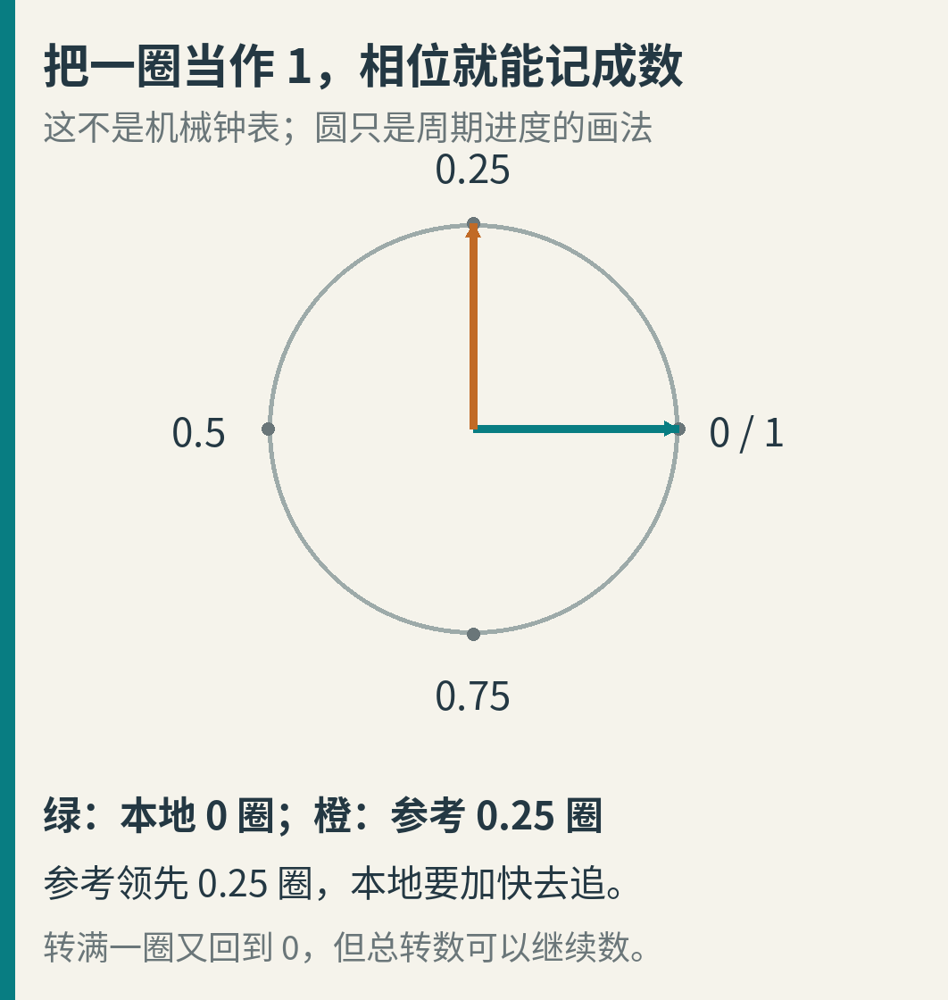

从圆的右端算0，逆时针前进，上方是0.25，左边0.5，下方0.75。绿箭头表示本地的周期进度，橙箭头表示参考。

约定：

**误差 = 参考相位 − 本地相位。**

此时误差为0.25−0=+0.25圈。正数表示参考在前、本地落后，所以控制器应该让本地快一些。负数表示本地领先，应该让它慢一些。

实际电路中，比较两个周期信号先后的部分叫 **鉴相器**，也就是相位比较器。它可以利用边沿先后来产生纠偏信号，具体电路不止一种。有些还比较频率差，称为相位频率检测器，缩写PFD。

为了手算，我们的模型直接拿到两个可比较的周期进度，每隔0.1秒检查一次。这个简化让“误差如何变成调速”清楚可见，但它不代表所有硬件比较器都这样取样。

## 4. 一个周期绕回零，直接相减会出什么问题？

如果只显示一圈内的位置，0.98圈和0.02圈其实相隔很近：从0.98再往前0.04圈，就绕过1，回到0.02。

但直接算0.02−0.98，会得到−0.96，好像差了快一整圈。

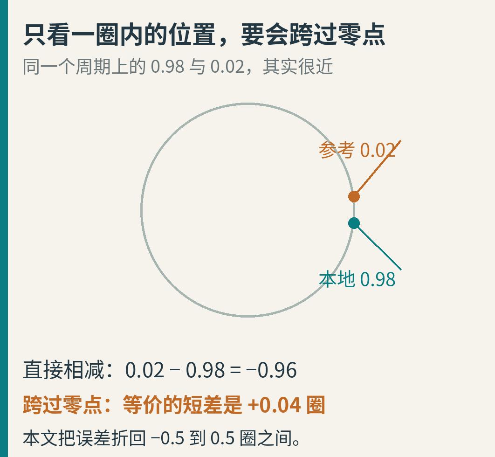

因此本文每次把差值折回 **−0.5到0.5圈之间**，选择相邻的一次周期关系。上面的−0.96加上一圈，就成为+0.04。

这一步叫包裹相位差，代码里写作wrap。恰好差半圈时，两边一样近；本程序按−0.5处理。

选择短差也会丢掉“中间到底多转过几整圈”的信息。频率差太大、检查又太稀疏时，这个简单比较器可能被迷惑。我们会在最后给出一个确切反例，所以先别把它当成无条件可靠的频率识别器。

主例的初始差只有0.25圈，先沿这条正常追赶过程继续。

## 5. 为什么要把输出接回来？

假如只告诉振荡器“请加快0.2 Hz”，那只是一次预先设定。温度变化、器件偏差或参考改变以后，它不会自动知道自己又落后了。

锁相环把本地输出送回比较器，下一次再检查早晚。这样，每一轮都有新的误差，而不是永远相信最初那条调速指令。

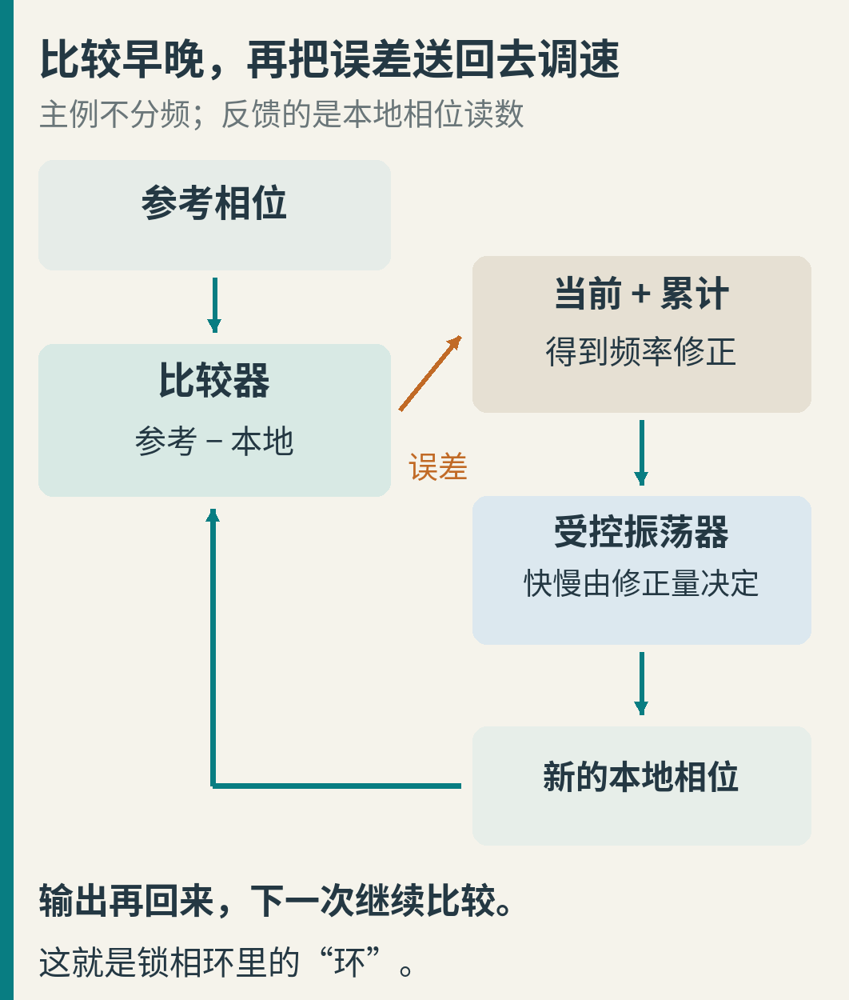

从左上方的参考开始读：比较器算误差，右上方把误差变成频率修正，振荡器按新频率走一小段，再把新的本地相位送回来。

这个闭合路径，就是名字里的“环”。

现在还缺最关键的一步：误差是圈数，振荡器要的是快慢。该怎样把前者变成后者？

## 6. 第一种调法：落后多少，就按比例加快

先用一个很直接的规则：每落后1圈，给本地增加1 Hz；落后0.25圈，就增加0.25 Hz。

这个比例系数叫Kp。本例Kp取1 Hz/圈。字母不是神秘参数，它回答的是：**差1圈时，这个规则愿意立即改多少频率？**

只用这项调节，第一刻的频率就是：

0.8 + 1×0.25 = **1.05 Hz**。

参考是1 Hz，本地暂时被调到比它更快，才有机会把已经落下的距离追回来。如果只是调成完全一样快，原有的四分之一圈落后会一直保留。

但是，当误差变小时，这项立即修正也会变小。仅靠它，未必能把相差推到0。要看清原因，我们再加第二种调法，然后把两者放在同一个实验里比较。

## 7. 第二种调法：记住过去持续落后的部分

我们增加一个 **累计修正量** z。它的单位是Hz，直接表示目前已经积累了多少额外调速。

如果本地持续落后，就让z一点点增加；持续领先，就让z一点点减少。即使误差后来接近0，已经积累的z也不会自动清空。

主例每0.1秒检查一次。规定每差1圈、持续1秒，累计修正增加0.5 Hz。这个累计速度系数叫Ki，本例取0.5 Hz/(圈·秒)。

于是每次检查，先这样更新：

**新z = 旧z + Ki × 时间步 × 误差。**

再决定下一小段时间的输出频率：

**输出频率 = 自由频率 + Kp×误差 + 新z。**

第一部分看当前，第二部分保留过去的累计影响。这样的控制常叫 **PI**：P表示比例，I表示积分。这里不用微积分也能把积分理解成“每隔一小段时间，把误差乘上这段时间，加进总账”。

累计项并不意味着把所有测量误差永久当真。在完整设计中，还要考虑噪声、调速范围、延迟和状态限制。本文先用明确的理想小模型看它怎样工作。

## 8. 同一组数，真的走完三次检查

回到t=0：参考0.25圈，本地0圈，旧z=0，误差+0.25圈。

先更新累计量：

**新z = 0 + 0.5×0.1×0.25 = 0.0125 Hz。**

然后加上自由频率和比例修正：

**输出频率 = 0.8 + 1×0.25 + 0.0125 = 1.0625 Hz。**

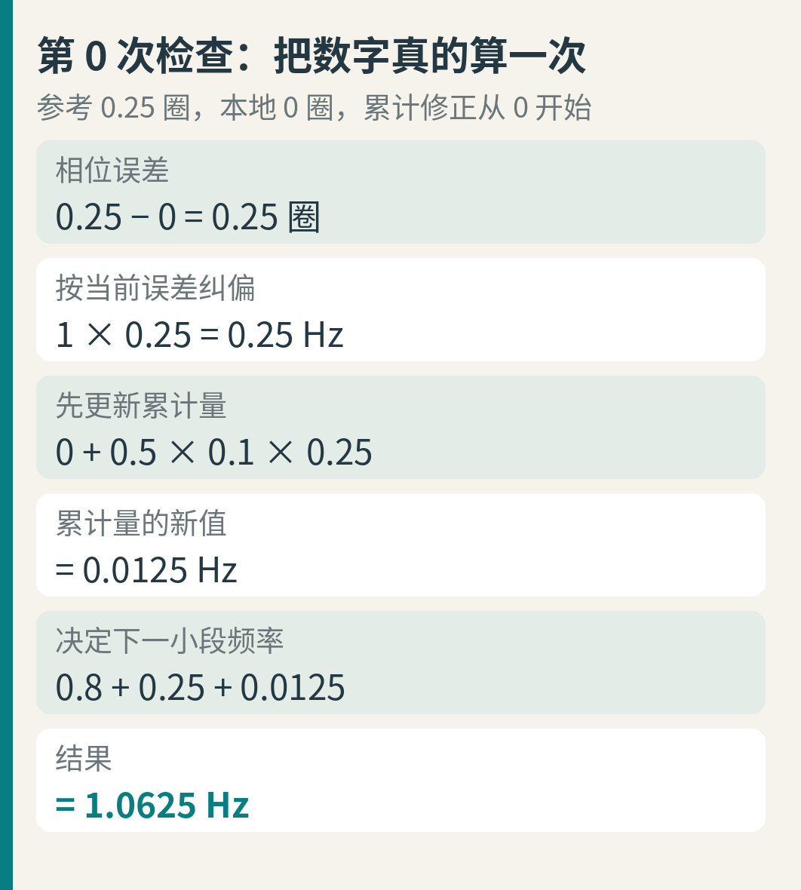

这一频率作用于接下来的0.1秒。本地在这段时间内前进：

1.0625 × 0.1 = **0.10625圈**。

因此到t=0.1，本地相位为0.10625。参考仍按1 Hz走，前进0.1圈，从0.25到了0.35。

新的误差不是原来的0.25，而是：

**0.35 − 0.10625 = 0.24375圈。**

继续累计时，也不能把z重置为0：

- 新z = 0.0125 + 0.5×0.1×0.24375 = **0.0246875 Hz**
- 新频率 = 0.8 + 0.24375 + 0.0246875 = **1.0684375 Hz**

下面是程序保存的前三次检查，按显示位数四舍五入。

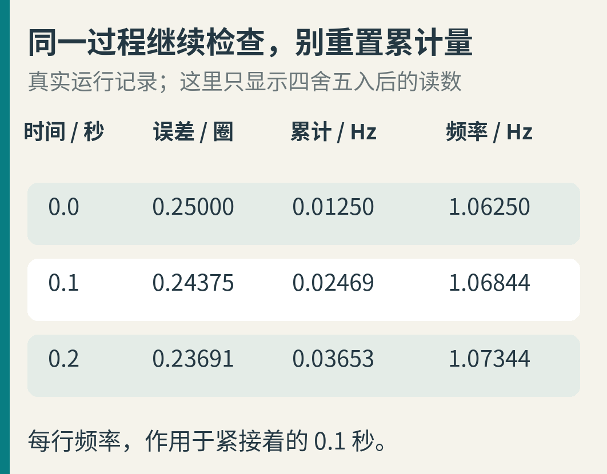

每一行的频率控制紧接着的0.1秒。先比较当前相位，更新累计量，决定频率，再让相位往前走；换更新次序，数值也可能改变。正文和随文程序采用同一个顺序。

## 9. 追上以后，为什么不会一直越跑越快？

随着本地追赶，正误差变小。比例修正随之减小，累计量增加得也越来越慢。若本地一时领先，误差变负，比例项会让它慢下来，累计项也会往回调整。

这次完整运行得到下面两条曲线。

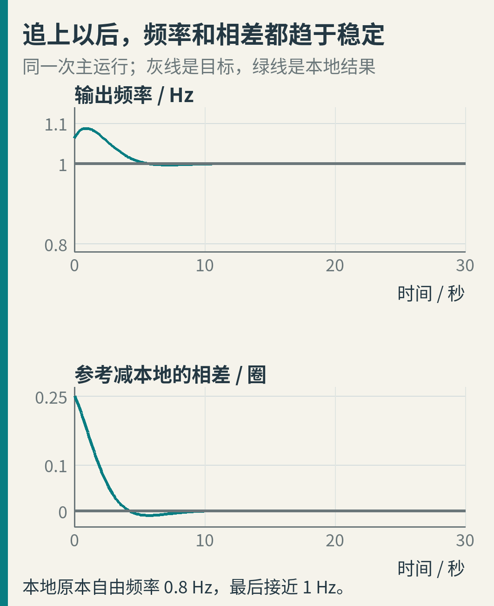

上图纵轴是频率，单位Hz；灰色水平线为1 Hz目标，绿色是输出。下图纵轴是相位差，单位圈；灰线为0，绿色是误差。两图横轴都是从0到30秒，不能拿上下曲线的高度直接互比。

起初输出略快于参考，追赶之后收敛到接近1 Hz；相差也趋近0。

这时累计修正z约为 **+0.2 Hz**。把它放回公式：

0.8 + 1×0 + 0.2 = **1 Hz**。

误差归零后，没有新的量继续加到账上，但账上已经留下的0.2仍然在。它补上了自由频率0.8与参考1之间的差。

所以，PI的目标不是“只要看见误差0，就撤掉一切修正”。如果那样做，本地会马上回到0.8 Hz，又开始落后。

这组参数在本次离散模型里收敛，不代表把任何参数、任何检查间隔塞进环路都稳定。调节太猛、延迟太大、振荡器触到限幅，都可能改变结果。

## 10. 如果删掉累计项，会怎样？

现在保持其他条件不变，只把Ki设为0，也就是只看当前误差。

要让本地输出达到1 Hz，就得满足：

**0.8 + 1×误差 = 1。**

解出来，误差必须是 **0.2圈**。

如果误差真的变成0，比例修正也变成0，本地反而只能跑0.8 Hz。因此在这个模型中，它最后会停在一个固定相差上：足够落后，才能一直产生所需的0.2 Hz修正。

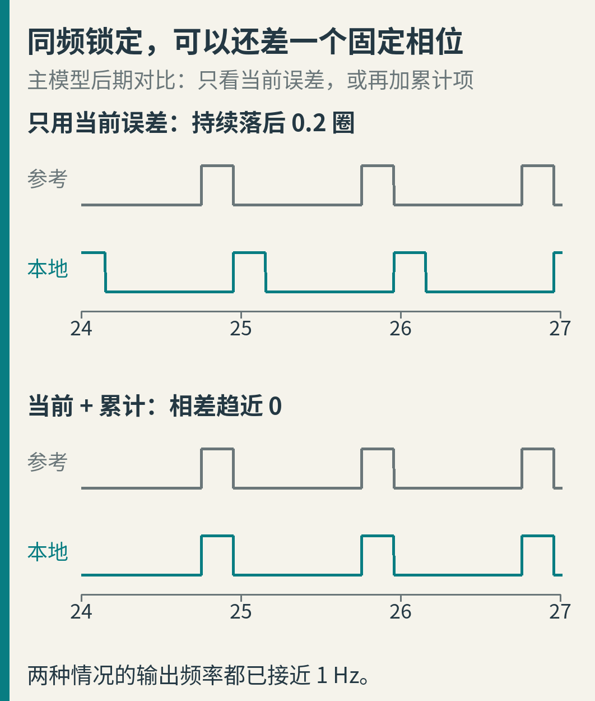

灰色始终是参考，绿色是本地。上半图只用当前误差，绿色上升沿稳定地晚0.2秒；因为此时周期为1秒，所以也就是0.2圈。下半图加入累计项，两个上升沿接近重合。

两种情况下，频率都已接近1 Hz。上半图并没有继续越落越远。

这是为什么不能把“锁定”简单等同于“零相位差”。固定相差能否消除，要看比较器、控制结构、输入变化和工作条件。本文的0.2圈来自 **直接圈数误差、Kp=1、自由频率0.8 Hz** 这套具体模型，不能照搬到别的芯片数据手册里。

## 11. 往反馈路上放一个除法，为什么会得到倍频？

假设我们让本地输出每走完4个周期，反馈信号才走完1个周期。这就是 **除4分频**。

比较器现在看到的是分频后的反馈，不再直接看原始输出。

如果参考是1 Hz，反馈最终也锁到1 Hz，那么原始输出必须是：

**4 × 1 = 4 Hz。**

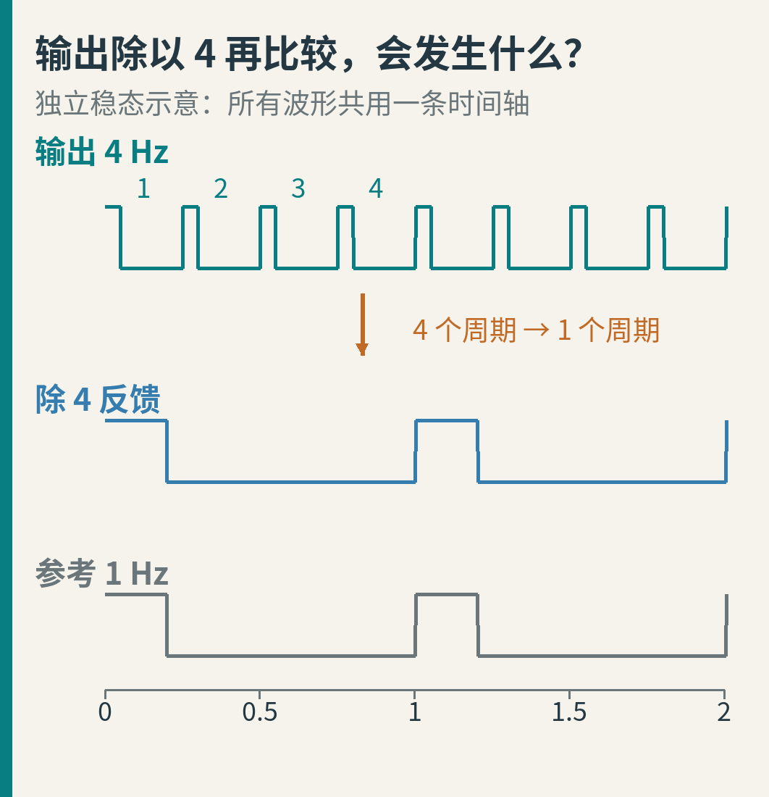

先数上排的四个周期，再看中排对应的一个周期。灰色参考与蓝色反馈比较，绿色高频输出并不是每个上升沿都要与参考重合。

分频器自己只会把节拍变慢。之所以产生更快的原始输出，是因为环路为了让“被除过的反馈”追上参考，主动把振荡器调快了。

一般地，如果反馈除以N，稳定锁定时就有：

**输出频率 ÷ N = 参考频率。**

所以输出等于N倍参考。这是许多频率合成结构的基本关系；真实设计还可能在参考路上分频，或使用其他更复杂的方式。[ADI MT-086的频率合成说明](https://www.analog.com/media/en/training-seminars/tutorials/mt-086.pdf)

随文程序也做了除4的独立运行。为保持相似的追赶过程，把自由频率从0.8改为3.2 Hz，并把两个纠偏系数相应乘4，最终输出接近4 Hz。反馈相位由 **完整累计的输出圈数先除4** 得到；不能先把输出圈数每圈清零，再除4，那样会丢掉分频器本来需要记住的计数。

这类部分确实可以做在芯片上。下面是前面那篇研究论文的芯片显微照片。

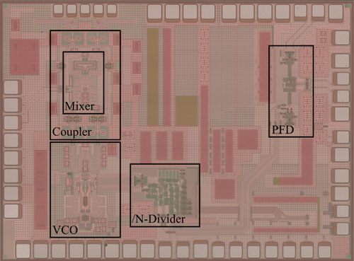

图片：Tobias T. Braun等，2023，[原论文图3](https://doi.org/10.1017/S1759078722001386)，[CC BY 4.0](https://creativecommons.org/licenses/by/4.0/)。从出版社PDF提取，画面未改动。左下VCO对应可调振荡器，中下N-Divider对应分频器，右侧PFD对应相位频率比较部分。图中还有其他射频模块，环路滤波器在外部；不能把这张照片当成一个通用PLL所有部件的完整清单。

## 12. 改得快，还是改得慢？

参考也可能变化。如果它从1 Hz变成1.2 Hz，本地要重新跟上。

下面是另一次明确改过参数的实验：时间步缩到0.02秒，比较两套PI系数。蓝色“快环路”用Kp=2、Ki=1；橙色“慢环路”用Kp=0.4、Ki=0.04。系数的单位仍与前面一致。这里的快慢是这两组稳定模型在此任务中的响应表现，不是给所有PLL分类的标准名称。

第30秒，参考频率从1改为1.2 Hz，参考相位保持连续，没有瞬间跳过一段圈数。

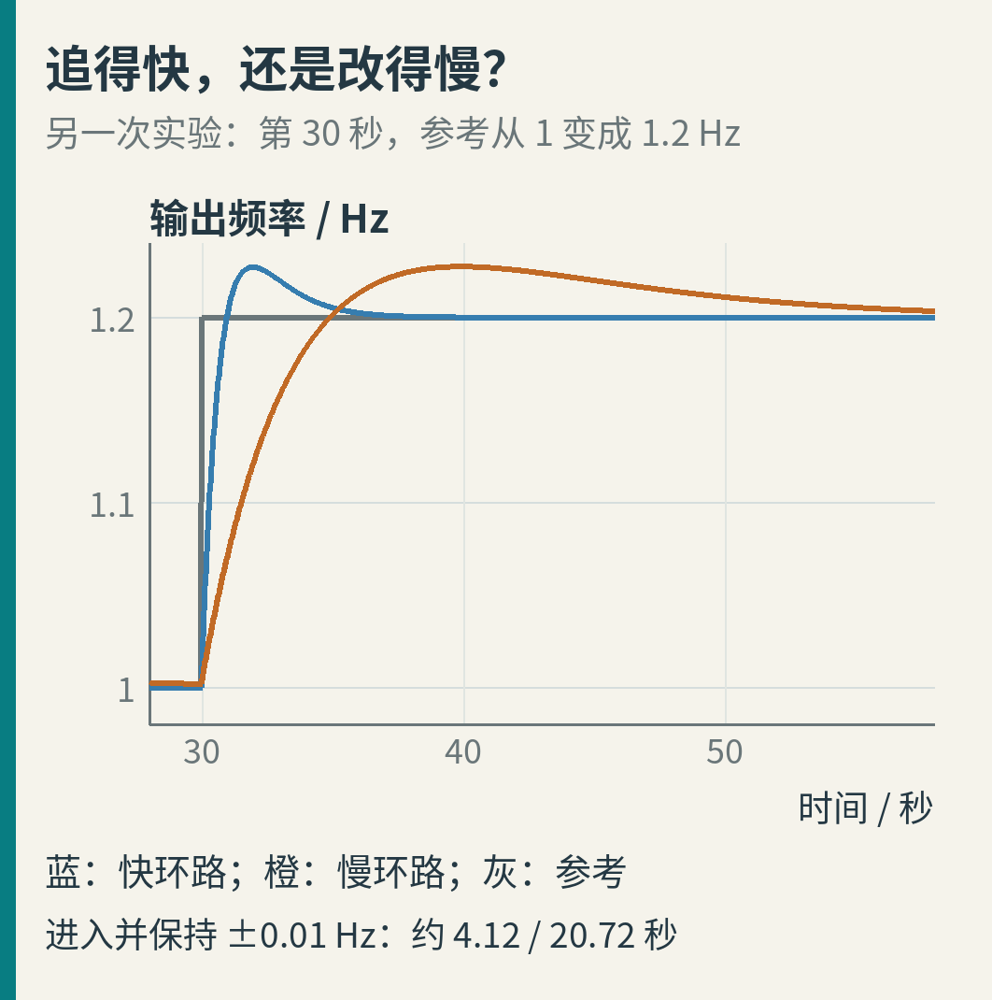

灰线是参考，蓝线和橙线是两个输出。它们可能暂时超过目标，再逐渐回来，并不是碰到1.2就立刻停住不动。

为了给“追上”一个可复算标准，我们检查输出何时进入1.2±0.01 Hz，而且在本次观察区间余下时间保持在其中。快环路约需4.12秒，慢环路约需20.72秒，都是从第30秒的改变开始计时。

仅从这张图看，似乎越快越好。但如果输入本身有细小的乱动，追得积极也可能把那些乱动一起带进输出。

## 13. 噪声要先问：从哪一边来的？

实际信号的边沿不会永远落在理想时刻。它们可能有微小早晚摆动，常称为时间抖动；用周期进度表示，就是相位波动。

不能只问“这个环路会不会滤掉噪声”，还要问噪声从哪里进入。

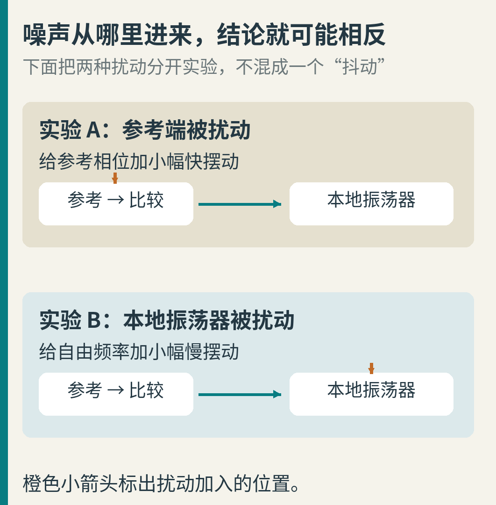

橙色小箭头指出加入位置。我们把两种情况分开：

- **实验A，参考端扰动：** 给参考相位加入幅度0.03圈、每秒摆动0.8次的正弦扰动。本地自己没有额外扰动。
- **实验B，本地振荡器扰动：** 参考保持干净，给本地自由频率加入幅度0.04 Hz、每秒摆动0.08次的正弦扰动。

它们都是人为设定、方便重复的测试信号，不是实测芯片噪声。两种输入的量纲和变化速度不同，所以不能拿A与B的柱高直接评选“哪种噪声更严重”。我们只在同一种输入下比较快慢环路。

怎么给输出的波动一个数？取第100秒到125秒这一段，先算“输出相位减干净参考相位”，再减去这段的均值；把剩下的偏离平方、平均、开平方。这就是图中的相位波动均方根，单位仍为圈。

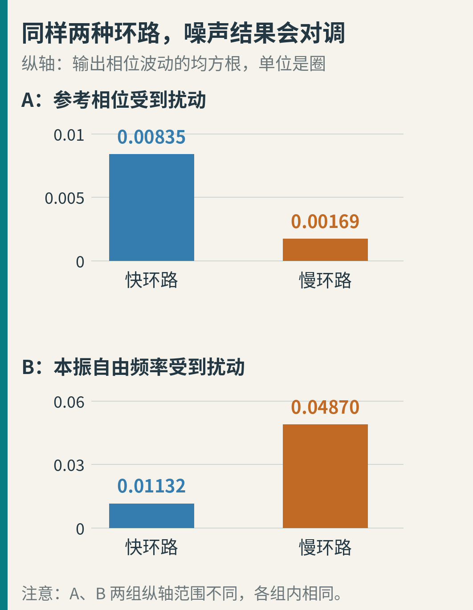

A组中，快环路约0.00835圈，慢环路约0.00169圈。慢环路不太积极地追随参考端较快的摆动，输出更安静。

B组却反过来：快环路约0.01132圈，慢环路约0.04870圈。扰动来自本地内部，环路要靠反馈把它纠正；改得太慢，就留下了更多偏离。

**这两组图的纵轴范围不同，组内才共用标尺。** 数字和标签都保留，避免用相似柱高暗示相同波动量。

一般分析也会把参考到输出、本振自身扰动到输出写成不同的传递路径。参考相位的跟踪通常呈低通特征，而本振自身相位噪声的校正有另一条通道。因此“环路窄一点，就能过滤所有噪声”是错误的概括。[ADI对两类噪声传递的分析](https://www.analog.com/en/resources/analog-dialogue/articles/pll-for-high-frequency-receivers-and-transmitters-2.html)

这里也没有把PI本身说成一个能把所有高频信号压到0的滤波器。我们观察的是 **闭合整个反馈环之后的结果**，包括相位比较、控制以及振荡器的相位推进。

## 14. 这个简单比较器，也可能认错

前面每隔0.1秒，读取一次两路的周期进度。如果本地在两次读取之间偷偷多转了一整圈，下一次读到的一圈内位置可能还一样。

构造一个极端但能完全算清楚的例子：参考1 Hz，本地自由频率11 Hz，两路初始相位都为0，检查间隔仍是0.1秒。

到0.1秒时：

- 参考走了0.1圈
- 本地走了1.1圈

若只看一圈内的进度，两者都是0.1。到0.2秒，参考0.2圈、本地2.2圈，折回一圈后又都是0.2。

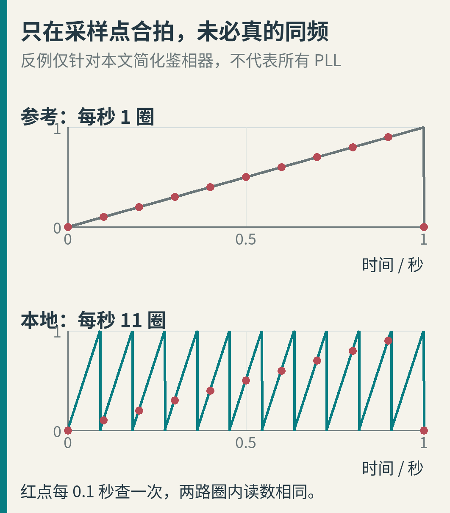

纵轴是一圈内的进度，从0到1；锯齿落回0表示又转完一圈。红点是每隔0.1秒真正读取的位置。两路红点一样高，红点之间的轨迹却完全不同。

本程序这时会一直读到接近0的误差，因而不调速，误把11 Hz留了下来。它没有真正与参考同频，只是 **采样比较没有看见中间多出来的周期**。

这个反例限定在本文“定时读取、只选短相差”的简化鉴相器。实际PFD可以利用边沿和频率关系，电路的捕获能力还受振荡器可调范围、滤波器和初始状态影响，不能把这个例子直接当成所有PLL的故障条件。

它提醒我们两个问题应分开验证：已经锁定后能跟随多大变化，和从很远的初始偏差能不能进入锁定，并不是同一件事。

## 15. 一个环，留下了哪些可继续追的问题？

回看开头那两段波形，现在可以逐步解释绿色边沿为什么会接近灰色：

比较器先发现本地落后；比例项立即加快它，累计项记住持续需要的修正；振荡器按新频率走过下一小段；新的相位再回来参加比较。

当自由频率0.8 Hz需要变成1 Hz时，累计项最终留下约0.2 Hz，误差可以接近0。删掉累计项，本例就要保留0.2圈的固定相差，才能产生足够的比例修正。加上除4反馈，比较器要求反馈合拍，原始输出便需要跑到4 Hz。

同一套反馈思路，还同时牵动了响应速度、相位波动、可调范围与捕获能力。想跟得快，就要问会不会把参考的扰动跟进去；想跟得慢，就要问还能不能及时纠正本地自己的偏离。

真正有意思的并不是“两个节拍终于重合”这一个画面，而是为了维持这种关系，环路必须不断比较，而且必须知道自己比较到了什么。

## 可选：复算本文波形

[复现说明](README.md)提供原创Python程序、固定参数、输出记录和制图脚本。正文理解不需要先运行代码。

主实验使用Python 3.12.14、NumPy 2.3.5，绘图使用Pillow 12.3.0。本文时间尺度特意放慢，采用双精度浮点、理想频率执行器与采样相位比较；没有模拟电压范围、芯片延迟、固定点误差、电荷泵或完整射频电路。数值结果不是原论文装置的复现，也不是器件选型或工程稳定性保证。

一手资料、两幅真实照片的完整信用、每幅图的职责、代码许可和AI辅助说明见[资料与素材清单](sources.md)。
