# 一堆点里混了干扰，程序怎样找出直线？

一张桥梁照片里，有桥面，也有车辆、树木和水面的反光。假如我们想让程序找出桥面的一条直边，第一步可能是把明暗变化强烈的位置记成一堆点。

问题来了：这些点并不全来自那条边。

如果要求“一条直线尽量照顾所有点”，少数离得很远的点也可能把结果拉偏。下面是一个可以完整复算的小例子：灰点完全相同，橙线把它们全放进一次拟合，绿线先找出一群支持同一条线的点，再一起拟合。拟合，就是选出一条尽量符合数据的线。

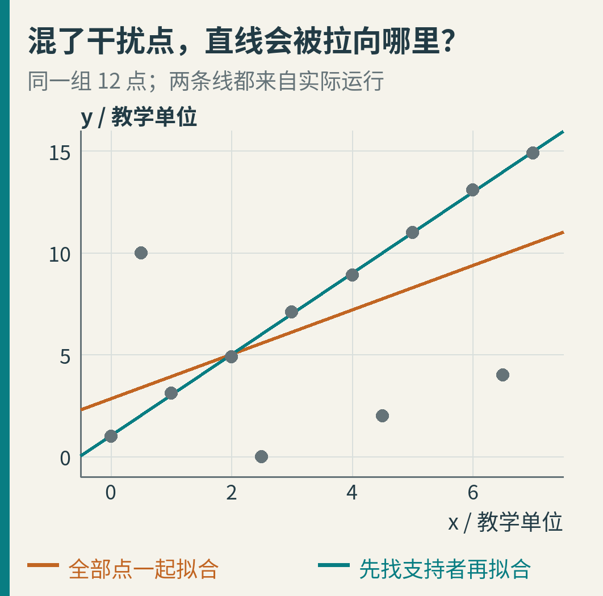

图中横轴是 x，纵轴是 y，单位暂时只是教学例子里的数值单位。橙线和绿线都是程序的实际输出，不是手画的“好坏答案”。绿线怎么得到，我们马上逐步算。

这套办法叫 **RANSAC**，名称来自 Random Sample Consensus，通常译为“随机抽样一致性”。最直观的动作是：**先让少数点提出一个候选，再问所有点有多少支持它。** 重复几次，留下更受支持的候选。

## 1. 程序要找的，究竟是什么

先看一张真实照片。它来自美国地质调查局 USGS：密苏里河上有四座桥，摄影信用为 Joel M. Galloway / USGS。下图完整保留照片画面，只缩小显示，并加上黄色矩形。照片不是本文生成的，也不是算法模拟出来的。

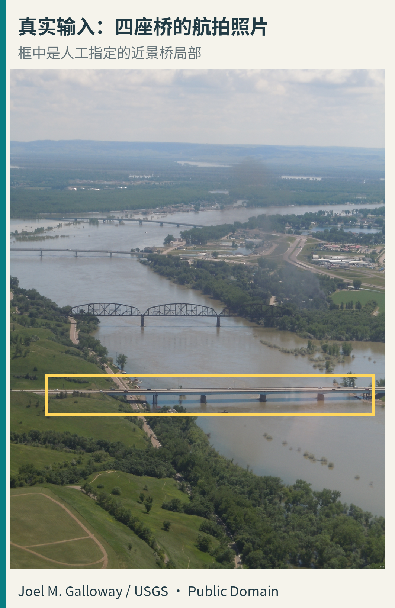

原图：[USGS《Bridges》](https://www.usgs.gov/media/images/bridges)，Public Domain。黄色框是我们人工指定的处理范围，不是程序自行认出的桥。框里的局部边缘接近直线，但车辆、桥墩和背景仍会贡献干扰。

我们最后会真的从这张照片提取点、运行拟合，并留下没有被选中的点。为了先弄懂算法，暂时换成只有 12 个点的例子。

这里的“直线模型”只回答一个很窄的问题：**给定横坐标 x，直线预测的纵坐标 y 是多少？** 它不理解“桥”，也不理解哪一个物体是人想看的。

## 2. 用 12 个点，建立一个能手算的世界

一个平面位置可以用两个数表示。先沿横轴向右走到 x，再沿纵轴向上走到 y，就找到这个点。比如 A=(0,1)，F=(5,11)。

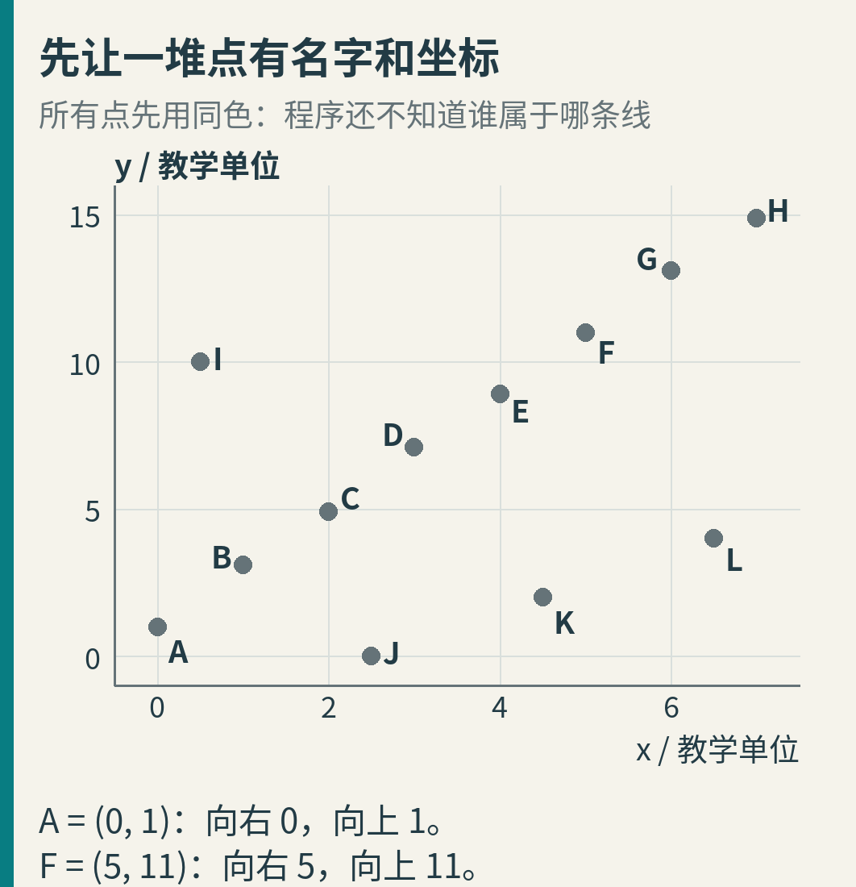

我们给它们起名，方便在文字和图中找到同一个对象：

- A=(0,1)，B=(1,3.1)，C=(2,4.9)，D=(3,7.1)。
- E=(4,8.9)，F=(5,11)，G=(6,13.1)，H=(7,14.9)。
- I=(0.5,10)，J=(2.5,0)，K=(4.5,2)，L=(6.5,4)。

这组数据是本文构造的。A 到 H 原本安排在 y=2x+1 附近，只带一点上下抖动；I 到 L 是另外放进去的四个干扰点。这个设计让我们知道答案大致应该在哪里，便于检查算法。

**程序收到的只有坐标，没有“A 到 H 是好点”这张名单。** 后文把它们叫“生成内点”，只是说明我们造数据时的身份；算法自己选出的“支持点”，则要靠候选直线和误差规则来决定。两者不能混为一谈。

## 3. 为什么“一起照顾所有点”会遇到麻烦

常见的直线拟合方法是最小二乘。先不急着记名字，可以把它理解成一个评分游戏：

1. 提出一条线，用它预测每个 x 对应的 y。
2. 算出观察到的 y 与预测 y 差多少。
3. 把每个差平方，再全部加起来。
4. 找到总分最小的那条线。

平方就是一个数乘以自己。它让正负偏差都变成非负数，也让大偏差变得特别有分量。

比如暂时拿 y=2x+1 来评分。B 的 x=1，直线预测 3，实际是 3.1，差 0.1，平方是 0.01。L 的 x=6.5，直线预测 14，实际是 4，差的大小为 10，平方就是 100。

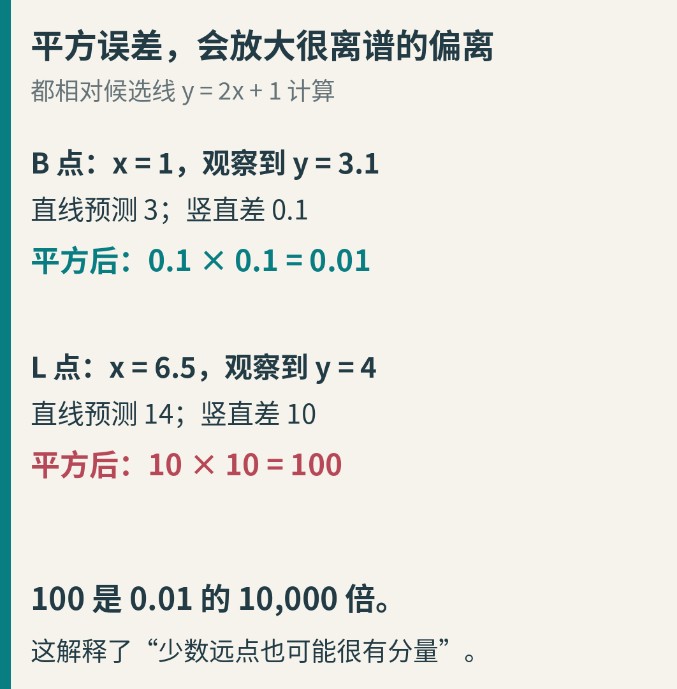

单是 L 的这一项，就相当于一万个 0.01。于是，为了降低几个远点造成的总分，直线可能宁可离开原本整齐的那群点。

把全部 12 点一起做最小二乘，本次实际得到：

**y ≈ 1.091935x + 2.844892。**

这就是开头的橙线。它没有算错；它认真优化了“所有点的平方误差总和”。麻烦在于，我们真正想找的是一个被干扰点混在里面的结构，“每个点都应该照顾”未必是合适的前提。

最小二乘并不是坏方法。等找到适合放在一起的那群点，它还会回来帮忙。

## 4. 只拿两个点，先提出一个猜想

一条不竖直的直线可以写成 y=ax+b。

这里 a 是斜率：x 每增加 1，预测的 y 改变多少。b 是截距：在 x=0 时，预测的 y 是多少。我们要从点的位置算出这两个数。

先拿 A=(0,1) 和 F=(5,11)。从 A 到 F，向右移动 5，向上移动 10，所以每向右 1，平均向上 2：

**a=(11−1)÷(5−0)=2。**

再看 A：x=0 时 y=1，因此 b=1。这两个点提出的候选就是 y=2x+1。

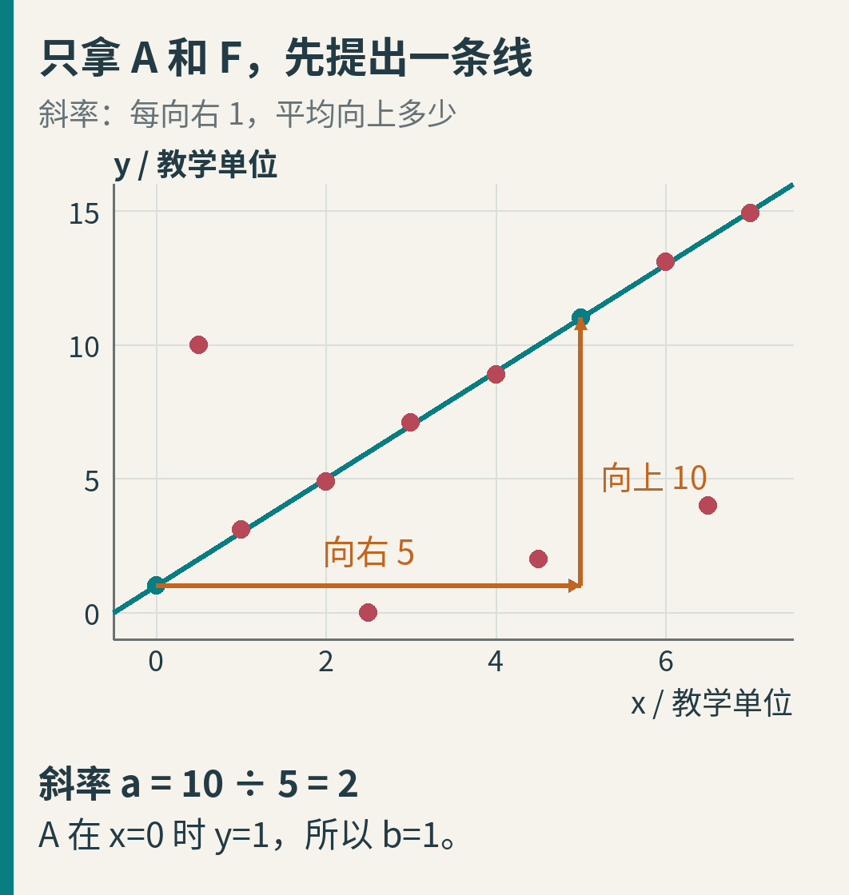

这张图里绿色的 A、F 是本次抽中的两个点；红色只表示“这次没被抽中”，还没决定它们支不支持候选。

为什么只拿两个？对于这个模型，横坐标不同的两个点已经足够确定一条线。我们希望先用一个小样本迅速提出猜想，而不是一开始就让所有干扰点参与决定。

如果两点的 x 相同，这个算法就不能拿它们确定 y=ax+b。本文遇到这种样本会跳过，并把它算作一次已经花掉的抽样；主例中所有 x 不同，因此没有发生这种情况。竖直直线本身也不在本文模型的范围内。

## 5. 其他点怎样投票

现在不要问其他点“你是不是好点”，而要问一个可以计算的问题：

**这条候选线，对你的 y 预测得够不够接近？**

我们暂定容许误差为 0.25。对每个点，计算：

**竖直误差 = |观察到的 y − 直线预测的 y|。**

两边的竖线表示取绝对值，只保留差的大小。误差小于或等于 0.25，就给当前候选投一票。0.25 叫阈值，单位和 y 相同。

仍然使用 y=2x+1：

- B：预测 3，实际 3.1，误差 0.1，支持。
- C：预测 5，实际 4.9，误差也是 0.1，支持。
- I：预测 2，实际 10，误差 8，不支持。
- L：预测 14，实际 4，误差 10，不支持。

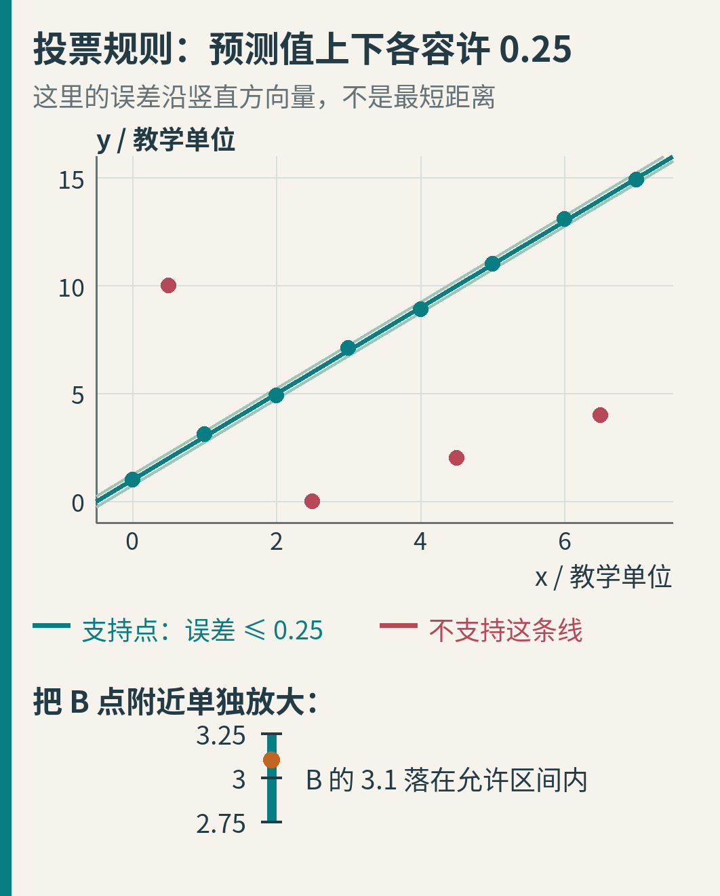

上图绿点支持，红点不支持。浅绿边线表示预测值上下各 0.25；下方把 B 所在位置单独放大：预测 3，允许区间为 2.75 到 3.25，实际 3.1 落在里面。

把 12 点都检查完，A 到 H 一共给出 8 票。算法现在有一个“支持点集合”，也叫一致集。

这里量的是**沿竖直方向的误差**，不是点到直线的最短距离。对接近竖直的边缘，这种模型和误差都不合适；更一般的几何直线拟合会换一种表示和距离。先固定规则，才能公平比较本篇的候选。

## 6. 如果抽到的两个点很糟呢

RANSAC 没有保证第一把就抽中合适的点。它会重复抽样。

本次程序运行了 12 轮。每轮从完整的 12 点中均匀抽两个不同的点；同一轮不能抽两次同一个点，下一轮则重新开始，可以再抽到旧点，甚至重复同一对。

我们使用固定的随机种子 20261074。种子是让伪随机抽样顺序能被复现的设置；这个种子特意选来让第 2 轮出现方便手算的 A、F。它是教学演示，不是一次不加挑选的性能测试。

前三个有代表性的候选是：

- 第 1 轮抽到 E、K，直线很陡，只有这两个点支持它。
- 第 2 轮抽到 A、F，得到刚才算过的 y=2x+1，有 8 票。
- 第 4 轮抽到 J、K，得到 y=x−2.5。J、K、L 恰好排在这条线上，有 3 票。

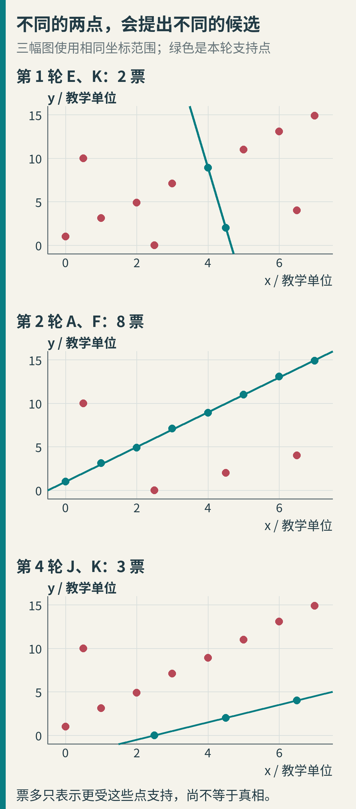

注意第三种情形：干扰点也可能组成另一条很整齐的线。它们不是“无规律的垃圾”，只是与我们要找的主结构不同。

基础 RANSAC 在这里选择的是**支持点更多的候选**。如果另一条边的点更多，它完全可能选中另一条边。所谓“最大一致”，不等于“读懂了人的意图”。

## 7. 怎样保留最好的一次

程序只需要记住“目前最好的候选及其支持点”。新一轮结束后，如果票数更多，就替换它。

同票怎么办？本文再比较各自支持点的平方误差总和，较小的优先；若仍相同，保留先到的候选。这是本文实现明确选择的规则，不代表所有 RANSAC 库都这样打破平局。

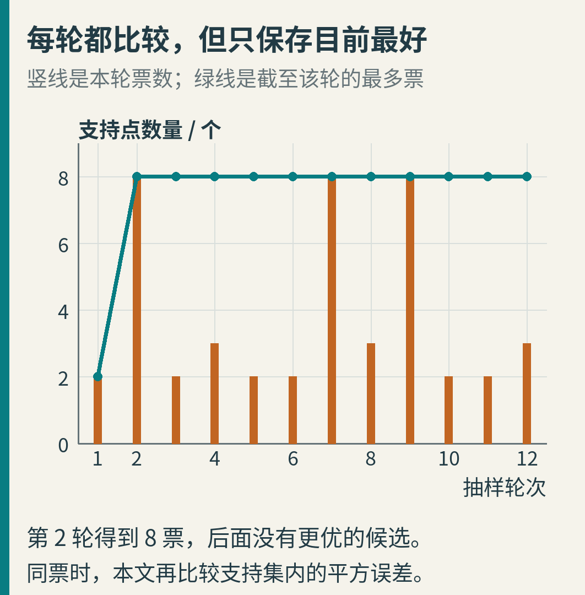

橙色竖线表示本轮得到几票，绿色连线表示到这一轮为止的最高票数。第 2 轮达到 8 票后，虽然第 7 和第 9 轮也得到 8 票，却没有赢过保存的候选。第 12 轮还重复抽到了 J、K，这在我们的抽样规则中完全允许。

主线可以压缩成五个动作：

1. 抽两个点。
2. 算候选直线。
3. 检查所有点的误差，数支持者。
4. 与目前最好者比较，必要时替换。
5. 用完预算后，取出保存的支持集。

这里的预算是 12 轮，支持点不是每轮越攒越多。不同候选有各自的支持者，不能把所有轮的绿点统统合并。

## 8. 找到支持者，还可以再认真拟合一次

目前保存的 y=2x+1，毕竟只由 A、F 两个点决定。其他六个支持点的信息还没有用于确定最后的斜率和截距。

现在，我们只把保存的 8 点交给最小二乘，让它们共同决定一条线。这叫重拟合。先隔开明显不一致的点，再利用一组相容数据里的细节，两步各做各的事。

为了看清这次小调整，下图改变纵轴：不再直接画 y，而画“该位置的 y 比 2x+1 高或低多少”。例如 B 原来是 3.1，生成线在 x=1 处是 3，所以图里 B 的高度是 0.1。横轴仍是原来的 x。

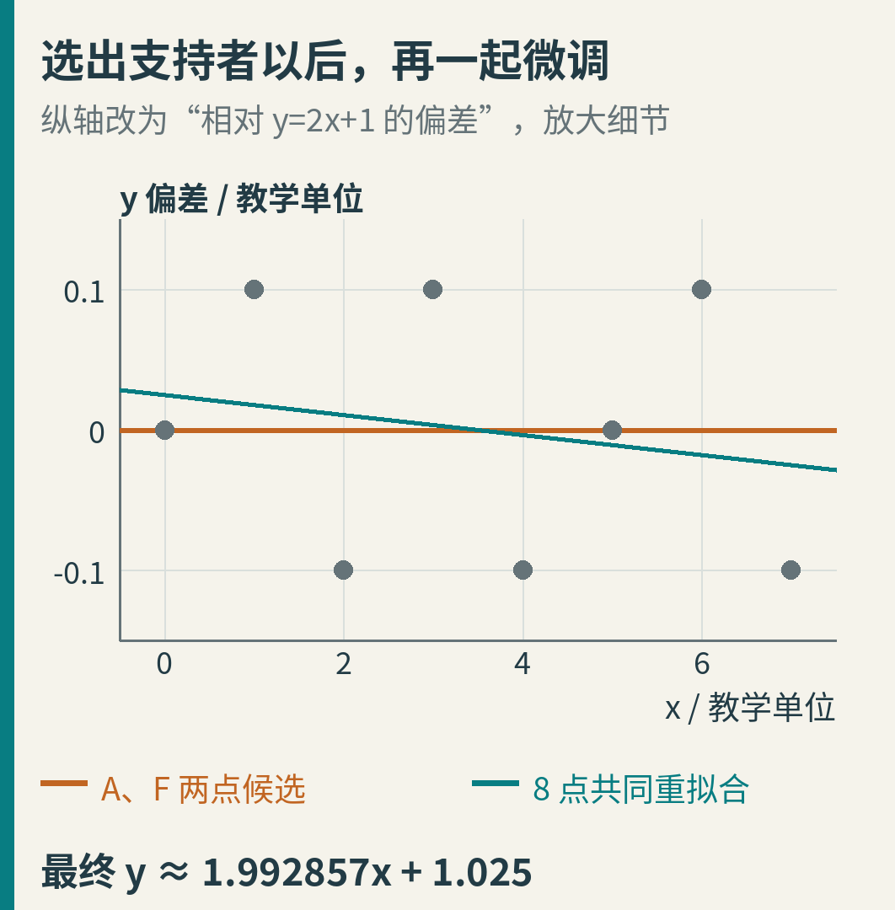

橙色水平线是原先 A、F 的候选，在这个偏差坐标里处处为零。绿色是 8 点共同重拟合的结果：

**y ≈ 1.992857x + 1.025。**

若你想核算这一步，可以先求 8 个 x 的平均值 3.5，以及 8 个 y 的平均值 8。对于每个点，把它的 x 减去 3.5，y 减去 8，分别得到“离各自平均值多远”。这组数据有两个可求和的量：

- 把每点的两个偏离相乘，再相加，得到 83.7。
- 把每点的 x 偏离平方，再相加，得到 42。

斜率取 83.7÷42≈1.992857；截距则让直线经过平均位置 (3.5,8)，所以 b=8−a×3.5=1.025。

为什么用这个比例？当我们把线绕平均位置轻微转动时，每个点的预测值会按它的 x 偏离同步改变。把所有平方误差相加后，最低处恰好满足“斜率×x 偏离平方和 = 两种偏离乘积和”。这个可跳读的核算，不是理解随机抽样主线的前提；完整计算代码也随文提供。

重拟合以后，线变了，支持者可能随之改变。我们又用最终直线检查了一遍阈值，这个 12 点例子的支持者仍然是 A 到 H。后面的真实照片会出现变化，所以不能默认两张名单永远相同。

## 9. 阈值不是无关紧要的旋钮

为什么刚才选 0.25？因为这组教学数据的主结构上下抖动只有 0.1；0.25 能容下它们，同时排除远处那四个点。这是已知数据构造下的选择，不是算法发现的一条万能常数。

现在不重跑搜索，只固定 y=2x+1，换三个阈值，观察谁有投票权。

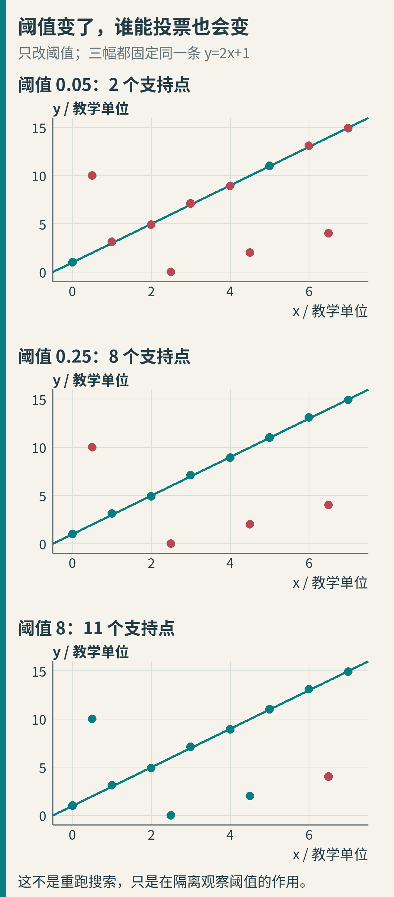

- 0.05 太窄，只容下 A、F 两点，连轻微抖动也被拒绝。
- 0.25 容下 A 到 H，共 8 点。
- 8 太宽，I、J、K 也加入，总计 11 点；L 的误差 10，仍在外面。

所以，看到“支持点特别多”不能立刻庆祝。也可能只是把容许范围放得太宽了。

实际使用时，阈值要结合测量噪声、分辨率与任务容差设定。照片缩小之后，像素阈值也属于缩小后的坐标；原图的 3 像素和缩小图的 3 像素不是同一段影像距离。

## 10. 抽多少轮，才算不是只赌一把

先问一个比“最后找到正确模型”更简单的问题：**至少有一轮，两个抽样点都来自 A 到 H，这件事有多大概率发生？**

在这组自己构造的数据里，我们知道有 8 个生成内点和 4 个其他点。第一下抽中生成内点的概率是 8/12。

如果第一下已经抽中，同一轮剩下的是 11 个点，其中只有 7 个生成内点。因此第二下的条件概率是 7/11，不是又乘一次 8/12。

两步都成功的概率为：

**q = 8/12 × 7/11 = 14/33 ≈ 42.4%。**

也可以数点对来核对：12 点共有 66 个不同点对，8 个生成内点能组成 28 对，28/66 仍然等于 14/33。

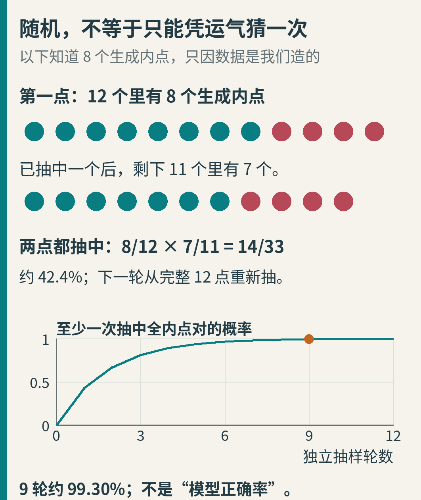

一轮没有抽中的概率是 1−q。下一轮重新从完整集合独立抽样，所以两轮都没抽中是 (1−q)×(1−q)。重复 K 轮，全部失手的概率就是 (1−q) 的 K 次方。

“至少中一次”与“每次都不中”是互补的两种情况，因此：

**至少一次抽中全内点对的概率 = 1−(1−q)^K。**

代入这个例子，9 轮约为 99.30%，12 轮约为 99.867%。本文选 12 轮是演示预算，并没有在程序中把 99% 当作动态停止条件。

这段推理有两个重要前提：知道真实生成内点数量，并且各轮重新独立抽样。真实照片通常没有前一项信息；用当前模型的支持比例代替它，只能得到依赖估计的判断，不能平白得到严格保证。如果禁止跨轮重复点对，抽样规则也变了，要重新算概率。

## 11. 99.30% 为什么不是“正确率 99.30%”

因为我们刚才只算了一个抽样事件，没有证明那个样本一定提出好模型。

看看 C=(2,4.9) 和 D=(3,7.1)。它们都来自 A 到 H，身份完全符合“生成内点”。但它们靠得很近，相隔的横向距离只有 1。

由这两个点算出的斜率是：

**(7.1−4.9)÷(3−2)=2.2。**

理想的生成线斜率是 2，C 的 −0.1 和 D 的 +0.1 抖动，让这次候选变成 y=2.2x+0.5。拿原阈值 0.25 检查，它只得到 C、D 的 2 票。

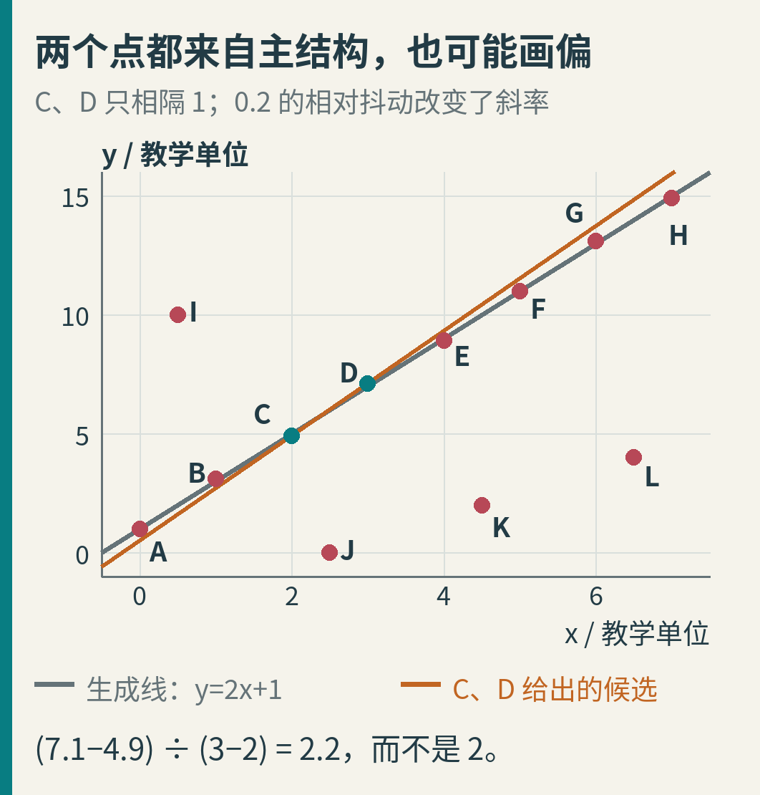

图中灰线是造数据时的 y=2x+1，橙线是 C、D 提出的候选，绿点是这次真正支持橙线的点。

这说明“抽到标签正确的点”与“拟合得足够好”之间，还隔着噪声、点间距离、阈值和模型是否合适等问题。把全部 28 对生成内点穷举一遍，在本例的阈值下，只有 17 对能让 8 个生成内点全部支持其候选。

因此，前面的概率句子必须完整地说：**至少一次抽到全生成内点对的概率。** 少了后半截，就容易把有限的数学结论说成算法包办成功。

## 12. 回到真照片：点不是凭空长出来的

现在回到 USGS 的桥梁照片。这次切换到图像坐标：左上角附近是起点，x 向右增加，y 向下增加，单位是像素，也就是组成图片的小格子。不要沿用前面 y 向上的图。

原照片为 3240×4320 像素。本文先缩小到 1080×1440，再人工规定处理范围：x 从 100 到 1049，y 从 880 到 999。这就是前面黄色框的范围，所有后续像素读数都属于缩小后的工作图。

在这个范围里，每隔 6 列取一列，总共 159 列。每列要交出一个候选点，方法很简单：

1. 把每个像素的红、绿、蓝三个数取算术平均，当作本文的亮度代理。它是方便演示的数值，不是经过校准的人眼亮度。
2. 对某一行 y，比较下面一行 y+1 和上面一行 y−1 的亮度，取差的绝对值。
3. 找到变化最大的那一行，把这个位置当作该列的候选点。若并列，选 y 更小的那行。

为什么看变化，而不是只选最亮的点？因为物体边缘常常体现为明暗突然改变；最亮处也可能只是大片水面中的反光。

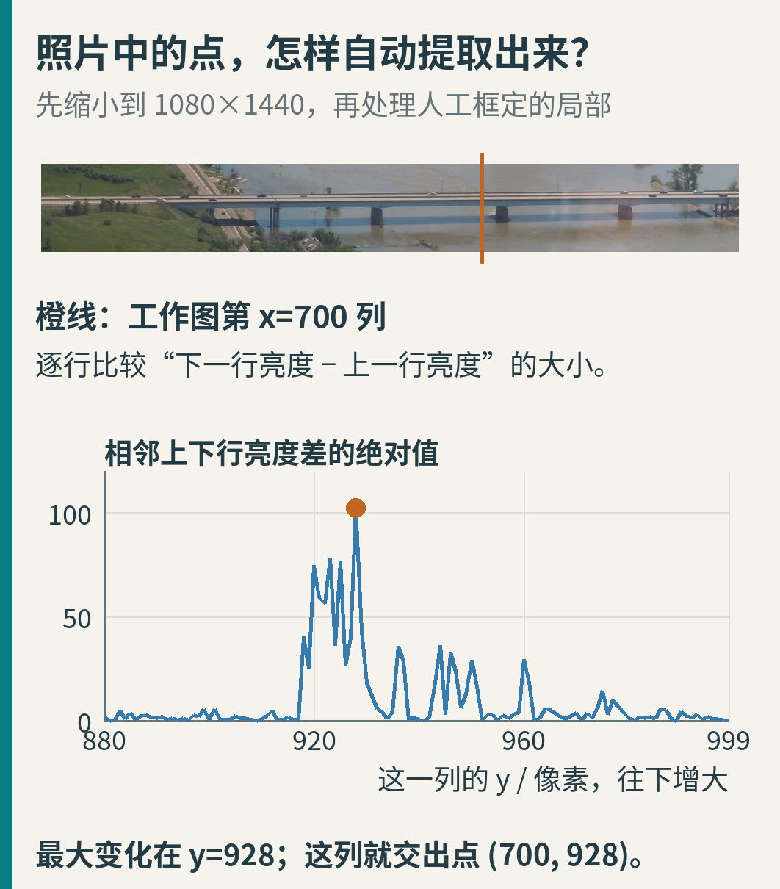

图上方是工作图的局部，橙色竖线位于 x=700。下方把这一列的 y 放到横轴，纵轴表示上下相邻行亮度差的大小。最高的位置在 y=928，所以这一列给算法的点是 (700,928)。注意：曲线图的横轴是扫描行号 y，而不是照片的 x。

这只是很简陋的边缘候选提取。车顶、树木、阴影也会产生明暗变化，有些列挑出的正是这些位置。我们没有把不顺眼的点手工删掉，也没有为照片人工添入假点。

## 13. 真数据里的两张支持名单，真的不同

这次仍使用竖直误差，不过单位换成工作图像素，阈值取 3。设置 100 轮、随机种子 20261014，其他比较和重拟合规则与 12 点例子相同。

这些照片参数在第一次试跑前确定，此后保留原结果；没有不断改种子直到线条更好看。人为选择局部范围这项前提也保留在结果里。

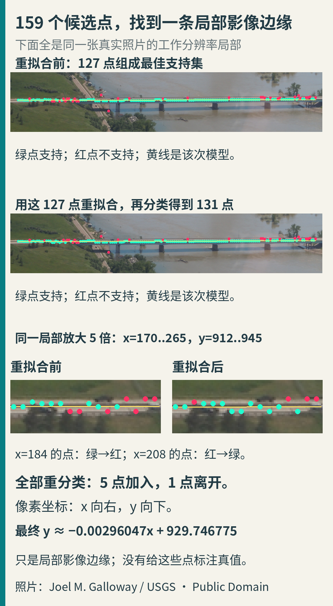

上方两幅局部图里，绿色小点支持对应直线，红色小点不支持，黄色是直线。下方把同一小块区域放大 5 倍，能看见 x=184 的点从绿变红，x=208 的点从红变绿。局部放大沿用工作图坐标，没有把像素单位也乘 5。完整坐标与两张名单保存在随文结果文件中。

第 55 轮保存了最终胜出的候选，它有 127 个支持点。我们用这 127 点共同重拟合，得到：

**y ≈ −0.00296047x + 929.746775。**

图像的 y 向下增加，所以负斜率在照片里表现为往右略微向上。

再按最终直线和 3 像素阈值分类，支持点变成 131 个：原先的 1 点离开，另外 5 点加入，净增 4 点。这时必须分清：

- **127 点**是实际用于最终重拟合的原支持集。
- **131 点**是最终直线重新检查数据后的支持集。

本文没有再拿这 131 点继续拟合到收敛。也没有给真实照片的每个候选点标注“正确边缘”真值，所以不能把 131/159 叫成识别准确率。

结果说明，在人工框出的这个局部里，简单提点配合 RANSAC 能找到一条受到许多候选点支持的近水平影像边缘。它不证明程序认识桥，也不用于判断桥的结构安全或测绘精度。

## 14. 这套思路比直线更大，但条件不会消失

1981 年，Martin A. Fischler 与 Robert C. Bolles 发表了题为 *Random Sample Consensus: A Paradigm for Model Fitting with Applications to Image Analysis and Automated Cartography* 的论文。SRI 的[官方书目页](https://www.sri.com/publication/artificial-intelligence-pubs/random-sample-consensus-a-paradigm-for-model-fitting-with-applications-to-image-analysis-and-automated-cartography-2/)记录了作者、年份和发表信息。

RANSAC 值得记住的，不只是“随机选两个点画线”，而是一种组织推理的办法：**小样本提出假设，全体数据检验支持程度，再把有限算力花在重复试探上。**

换成其他任务时，“两个点”“直线”和“竖直误差”都可能改变。例如一般圆需要三个不共线的点来确定；相机图像配准则会选择其他模型、最小样本和误差。不能只换一个名字，沿用本篇全部参数。

基础版本也有明确的难处：内点比例很低时需要更多尝试；阈值不合适时支持集会失真；样本退化时模型无法确定；多个结构争夺支持时，票最多的不一定是你要的对象。

现代库会加入更复杂的抽样、评分、退化检查与优化。这里的自写代码只负责把最基础的一条线走通，不声称复现某个库的全部策略。

## 15. 不写代码，也可以完成一次 RANSAC

回到那 12 点，你现在可以自己做一轮：

- 任取横坐标不同的两个点，算 a 和 b。
- 用 y=ax+b 给其他点作预测。
- 按 0.25 的竖直误差阈值，逐点投票。
- 把票数和已有候选比较。

比如抽 J、K，应该得到 y=x−2.5；除了 J、K，L 也支持它，所以有 3 票。再试 C、D，你会遇到“两个生成内点却只有两票”的反例。

想复现整组实验，可看 [README](README.md)、[原始代码](examples/simulate.py) 与[本次实际结果](examples/expected-results.json)。照片的原生文件也随文保留，脚本不用联网；制图所用坐标、阈值、抽样顺序、支持名单与重拟合输出都可以核对。

这次最重要的收获，也许不是一条更贴近桥缘的黄线，而是一个很实用的问题：当观测里混了别的东西，**我们是否应该先问谁愿意支持同一个解释，再让它们一起决定答案？**

---

本文原创正文与解释图采用 CC BY 4.0，原创代码采用 MIT。USGS 原照片为 Public Domain，摄影信用与变换范围另行保留。事实、素材来源及 AI 辅助说明见 [sources.md](sources.md)。
