# 程序已经算出答案，怎样倒着算出“谁影响了答案”？

假设屏幕上有两个旋钮，分别标着x和y。你转动它们，右边的刻度就跟着变化。

程序内部的规则很短：先算x乘y，再加一次x。现在x是2，y是3，刻度停在8。你希望它停在10，于是又让程序算了一个“偏差分数”：离10越远，分数越大。

程序能告诉你现在不理想。可如果你想把分数降下来，接着就会问：**x稍微增加一点，分数会往哪边走？y呢？变化有多快？**

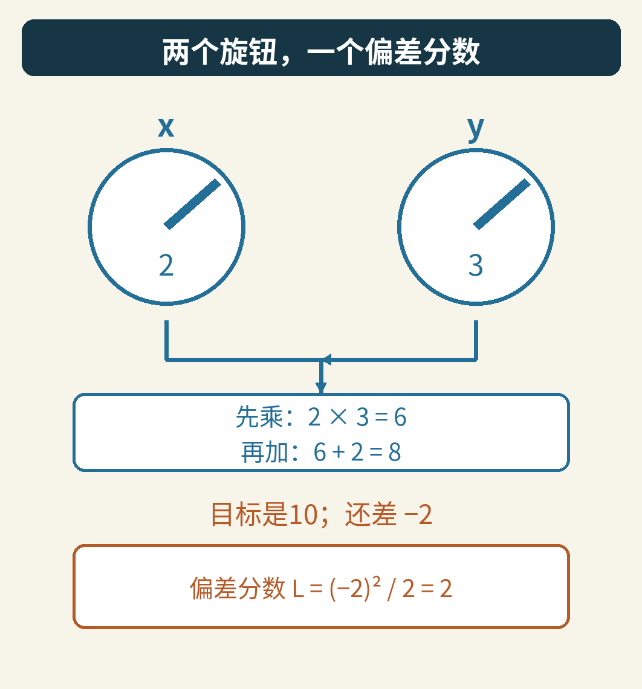

这是一套人为设计、全部数值都能手算的规则，没有模拟真实仪器。我们把旋钮和读数都当作没有物理单位的数字，专心看信息怎样在程序里流动。

给每个旋钮都试着加一点、重新运行，确实能探测变化。但如果有一百万个可调参数，逐个试探会很费事。

反向自动微分提供了另一条路：**正常算一遍，记住各步的局部变化规律，再从最后的分数往回传。** 输入很多、最终只关心一个分数时，这个方向尤其合适。

## 1. “影响有多大”，先缩小成一个明确的问题

我们把计算写完整：

- u = x × y
- v = u + x
- r = v − 10
- L = r² / 2

u、v、r都是中间结果。r是带正负号的偏差；L是偏差分数，也叫损失。平方使偏差无论向哪边都计正分，除以2是为了让后面的导数更简洁。

代入x=2、y=3，得到u=6、v=8、r=−2、L=2。

先固定y=3，只把x从2改成2.01。重新算：v从8变成8.04，L从2变成1.9208，减少了0.0792。

输入变了0.01，分数变了−0.0792，两者相除是−7.92。它说明：在这一小段区间里，x平均每增加1单位，L相应减少7.92单位。

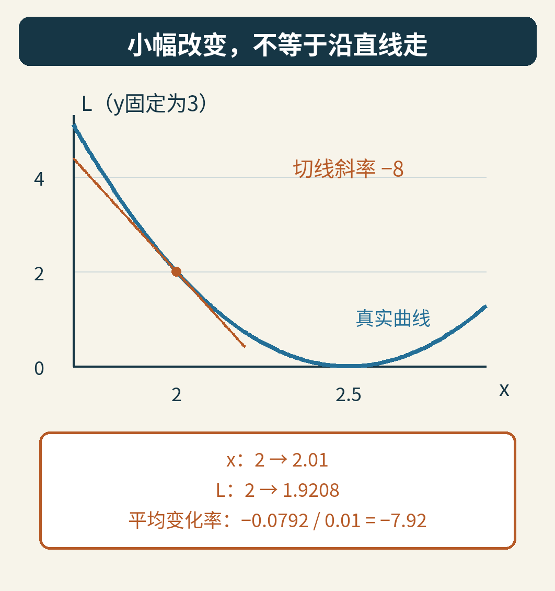

我们并不真的让x增加整整1；那个“每1单位”是在描述变化率。

把探测范围缩到足够小，就引出**导数**：在某一点附近，输入微小变化时，输出的一阶变化率。曲线上可以把它看成切线的斜率。本例在x=2、y=3时，这个数是−8。

于是，对足够小的变化，有：

**L的变化 ≈ −8 × x的变化。**

x增加0.01时，预测减少0.08，实际减少0.0792。两者接近，但并不完全相同，因为曲线不是直线。

现在有两个输入。写“L对x的偏导数”时，意思是暂时固定y，只考察x；写“L对y的偏导数”则反过来。把这些偏导数并排收集起来，就是梯度。

这里说的“影响”是**这段数学程序在当前输入附近的敏感度**。它不是对现实世界因果关系的证明，也不是给参数颁发“重要性排名”。换计量单位、换输入位置，数值都可能变化。

## 2. 把程序画成图，就能看见x走了两条路

我们平常写程序是一行接一行。现在把每个中间量画成一个点：如果算某个点需要另一个点，就从后者画箭头过来。

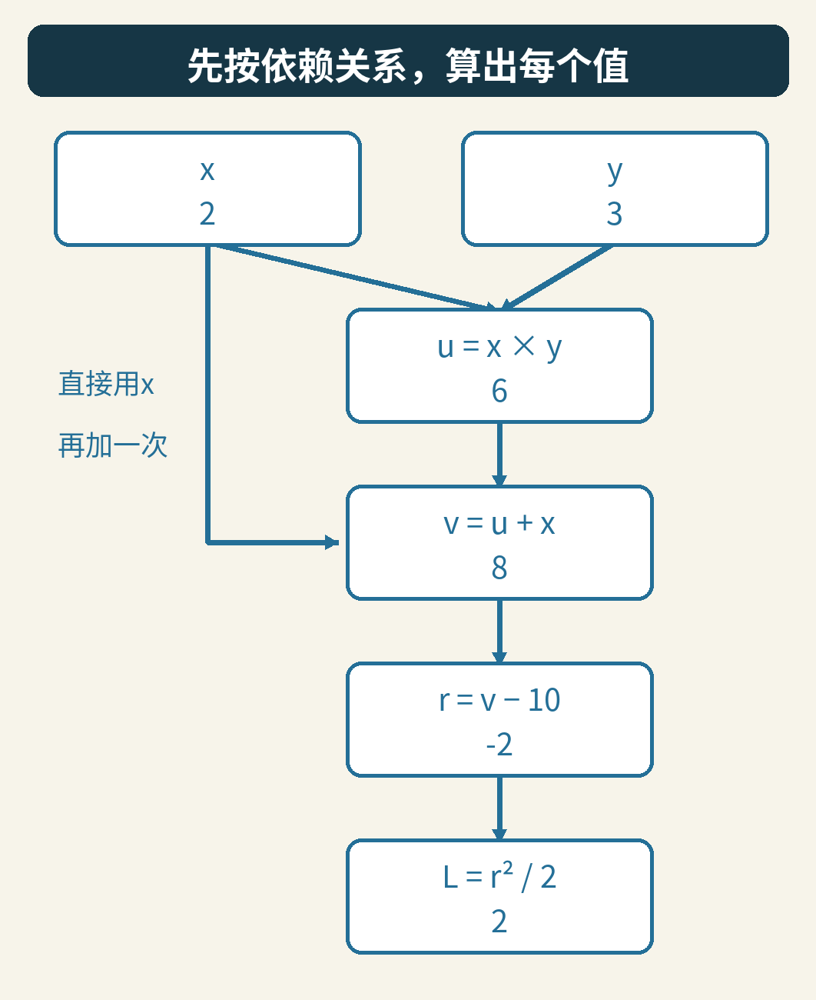

从上往下读，依次得到6、8、−2、2。这叫计算图。

注意x连出了两条线：一条先经过乘法，变成u；另一条直接进入v=u+x。

所以x一变，v会同时受到两处变化的影响。漏掉任何一条，答案都会错。

这也说明计算图不一定是一棵树。同一个结果可以被多个地方共享；若强行把共享结果复制成互不相干的变量，后面就容易漏算或重复算。

图里的10是固定目标。本文只求x、y的梯度；它仍参与正向数值计算，但不是我们要调整的旋钮。

## 3. 每种小运算，只负责说明自己附近会怎样变

先不盯着整条程序，只看三种局部规则。

第一种，加法。若c=a+b，在b不变时，a增加一点点，c也增加同样多；反过来也一样。因此c对两边输入的局部变化率都是1。

第二种，乘法。若c=a×b，在b不变时，a增加一点点，c的增加量就是那一点点乘以b。因此对a的局部变化率是b，对b的则是a。

在u=x×y、x=2、y=3这里，u对x的局部变化率是3，对y的是2。

第三种，半平方。若L=r²/2，它对r的变化率就是r。当前r=−2，所以局部变化率是−2。

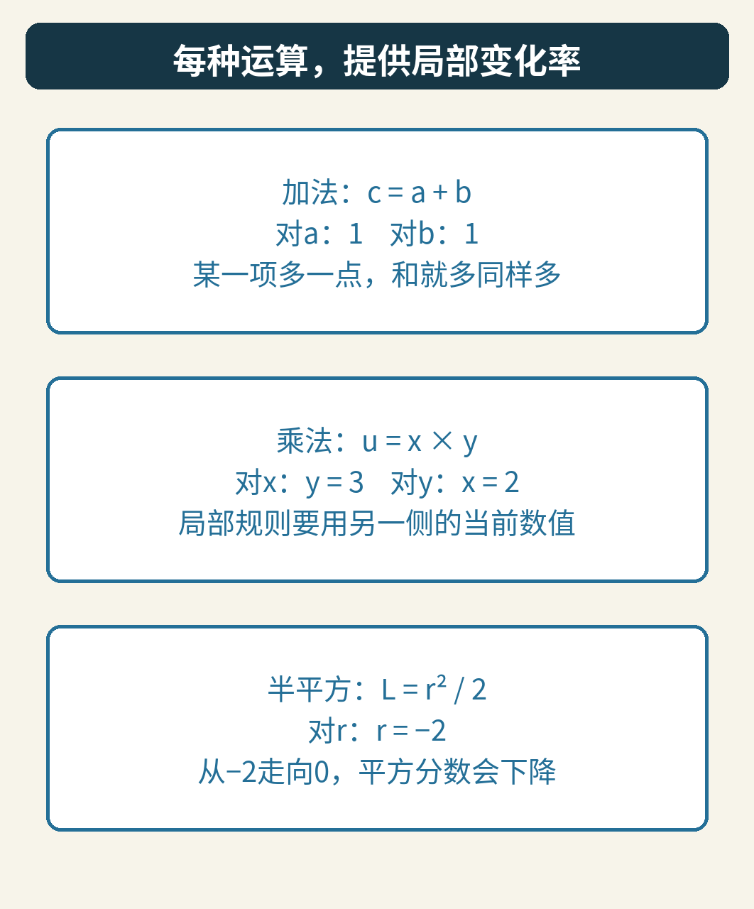

负的变化率很合理：我们现在比目标少2。把r从−2往0推，偏差缩小，平方分数就下降。

如果你还不熟悉平方的求导，可以直接展开：

(r+δ)²/2 − r²/2 = rδ + δ²/2。

再除以δ，得到r+δ/2。当δ趋近0，留下的就是r。我们丢掉的是相对于δ更小一阶的弯曲项，不是在每一步随便猜一个系数。

把这些局部规则准备好，整条程序就不需要重新发明一套微积分。

## 4. 沿着一条路径：变化率为什么相乘？

假设甲变化1小份，会让乙变化3小份；乙每变化1小份，又会让丙变化5小份。那么经由这条路径，甲变化1小份，丙就变化15小份。

这就是链式法则的直觉：**连续经过几段，局部变化率沿路径相乘。**

回到我们的程序。从v到r，减去固定的10，变化率是1；从r到L，当前变化率是−2。因此L对v的变化率是：

**−2 × 1 = −2。**

再经过v=u+x。如果暂时只看u这一路，v对u的变化率也是1，所以L对u的变化率仍是−2。

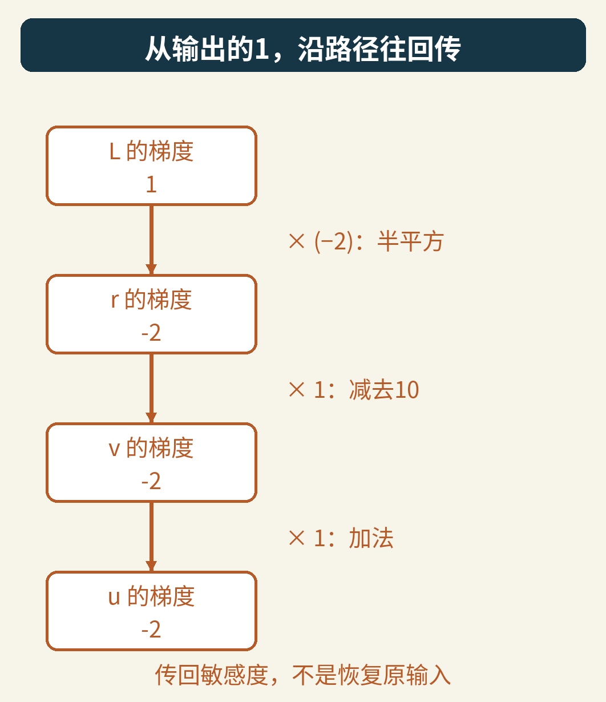

反向走的时候，我们给每个节点留一格账，记“最终L对这个节点的变化率”。这格账常叫该节点的梯度或伴随量。

L自己的那格从1开始：把L当作一个可以单独改变的量，它对自己的变化率当然是1。这个1不是损失的当前值；当前损失是2。

随后每过一条反向边，都做同样的事：

**传给前一个节点的贡献 = 后一个节点已收到的梯度 × 这条边的局部变化率。**

传回来的不是原来的数据，也不是试图把乘法“倒着除回去”。即使某一步把许多输入压成一个数、无法逆推出原输入，仍可能有清楚的导数。

## 5. 遇到分叉：为什么要相加，而不是选一条？

轮到x了。前面已经看见，它影响v有两条路。

直接进入v的那一路：L对v的梯度是−2，v对这一份x的局部变化率是1，所以贡献为−2。

经过u的那一路：L对u的梯度是−2，u对x的局部变化率是y，也就是3，所以贡献为−6。

两条路径来自**同一个x的变化**。x增加一点点时，两条路会同时发生，因此要把它们相加：

**L对x的梯度 = −2 + (−6) = −8。**

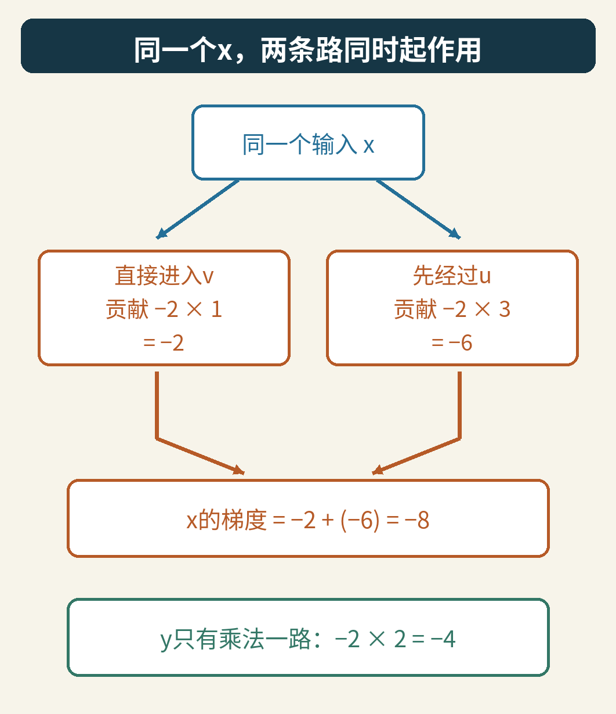

y只经过乘法进入u，因此：

**L对y的梯度 = −2 × x = −2 × 2 = −4。**

现在我们得到梯度（−8，−4）。小范围内，如果x变化Δx、y变化Δy，L的变化就近似为−8Δx−4Δy。

它不是说x永远“比y重要两倍”。这个比较只描述当前点、当前参数化、当前单位下的数值；往别处走，梯度也会变。

把正向和反向的账摆在一起，会发现每个节点都有两种完全不同的信息。

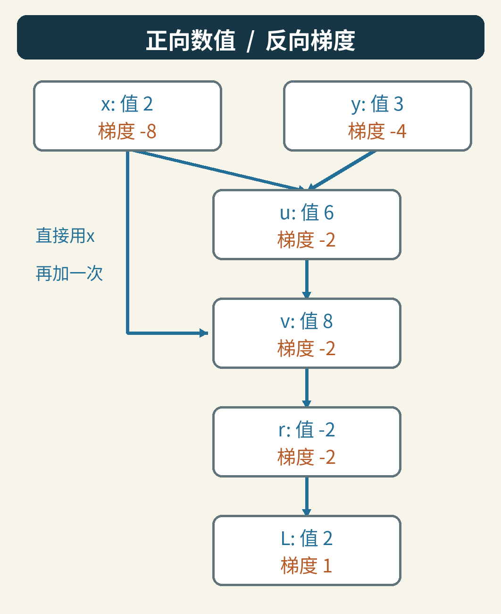

比如u的数值是6，它的梯度是−2；x的数值是2，它的梯度是−8。不要因为它们存放在同一个对象里，就把两类数字混起来。

## 6. 为什么程序里的关键符号是“+=”？

把上一节变成代码，最核心的一行就是：

```python
parent.grad += node.grad * local_derivative
```

这里的“+=”表示把新贡献加进已有账目。如果写成“=”，后一条路径就可能把前一条覆盖。

还有一个更隐蔽的问题：**什么时候才能继续往前传？**

看一个更小的共享节点例子：先算w=x×x，再算z=w+w。x=2时，w=4、z=8。

z向w传回两份1，所以w的最终梯度是2。w再沿自己的两条输入边各传回2×2=4，x收到4+4=8。

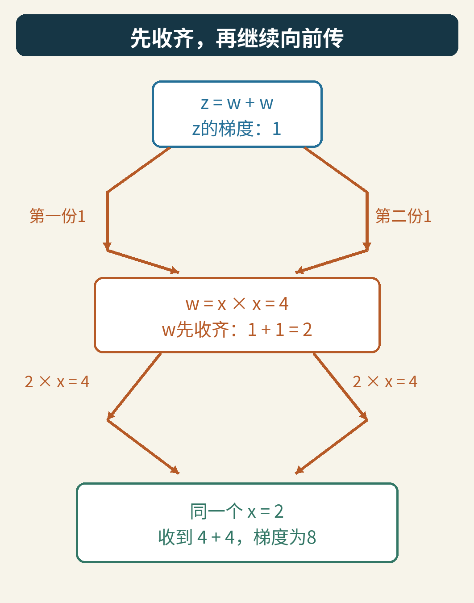

如果w刚收到第一份1就急着往x传、之后又没有正确处理第二份，就会漏贡献。

一种简单稳妥的做法是：正向记录依赖顺序，反向严格倒着处理。先处理所有使用w的后续运算，再处理w本身。这个符合依赖关系的先后次序叫**拓扑顺序**。

还有一个必须保留的区别：遍历节点时，同一个w只需要安排处理一次；但w+w的两条输入边都要计入。**节点不重复处理，不等于重复使用的边可以删掉。**

本文的[完整小实现](examples/run_autodiff.py)只用Python标准库，给每个数值对象保存：

- 当前数值
- 它依赖的输入节点
- 对每个输入的局部变化率
- 一格开始为0的梯度

求导时先收集拓扑顺序，清零各格，给输出填1，再倒序累加。实现保留重复输入边，也不会因为两个不同节点恰好都等于2，就把它们合并。

这是为理解机制写的标量教学程序。它没有张量广播、GPU、并行调度或高阶求导；而且递归遍历不适合直接处理极深的图。你读懂它以后，再看成熟框架的自动微分引擎，会更容易辨认那些复杂设施在解决什么问题。[PyTorch官方引擎说明](https://pytorch.org/blog/overview-of-pytorch-autograd-engine/)

## 7. “自动”在哪里？它和两种常见办法有什么不同？

第一种办法，是把整个公式交给代数系统，要求它生成一个导数公式。例如将本例写成L=(x(y+1)−10)²/2，再推导出L对x的导数。这是符号微分的一种典型用法。

第二种办法，是把输入挪一点，重新运行原程序，用输出差除以输入差。这叫有限差分；第1节的−7.92就是它。

自动微分则把程序拆成已知局部规则的运算，再根据**实际依赖关系**组合这些规则。本例的反向实现直接算出−8，没有挑一个很小的h去试探，也没有先生成整条导数的代数表达式。

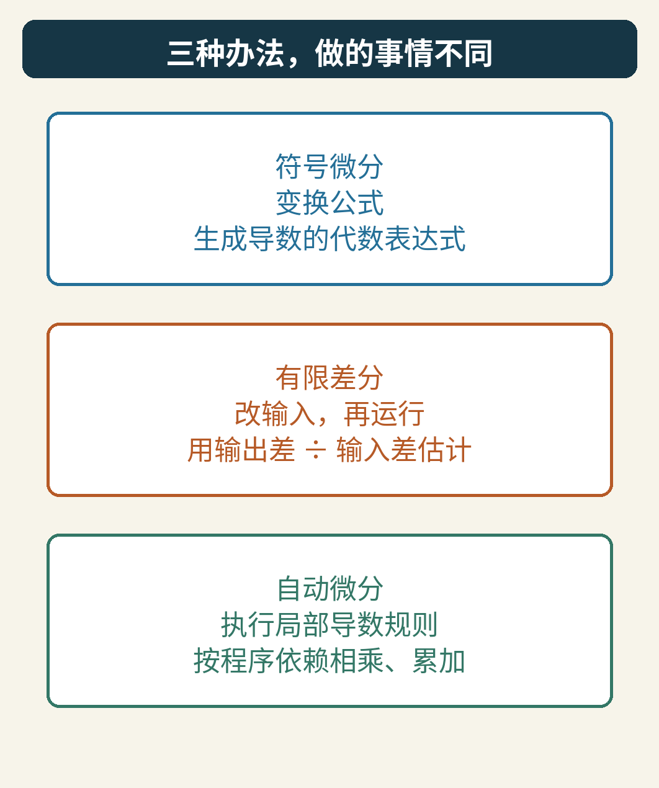

“自动”不是机器凭空悟出了微积分，而是链式法则的组合与记账由程序完成。

有限差分仍然很有用，尤其适合做独立的梯度检查。但步长h不是越小越好。

对本例固定y=3，用前向差分：

[L(2+h,3) − L(2,3)] / h。

如果用精确实数代数展开，结果恰好是−8+8h。所以h太大时，和真正导数−8之间会有明显差别。

在计算机里，h太小时又会遇到另一件事：非常接近的两个浮点数相减，舍入误差会被除以h放大；再小一些，2+h甚至可能存成与2相同的浮点数。

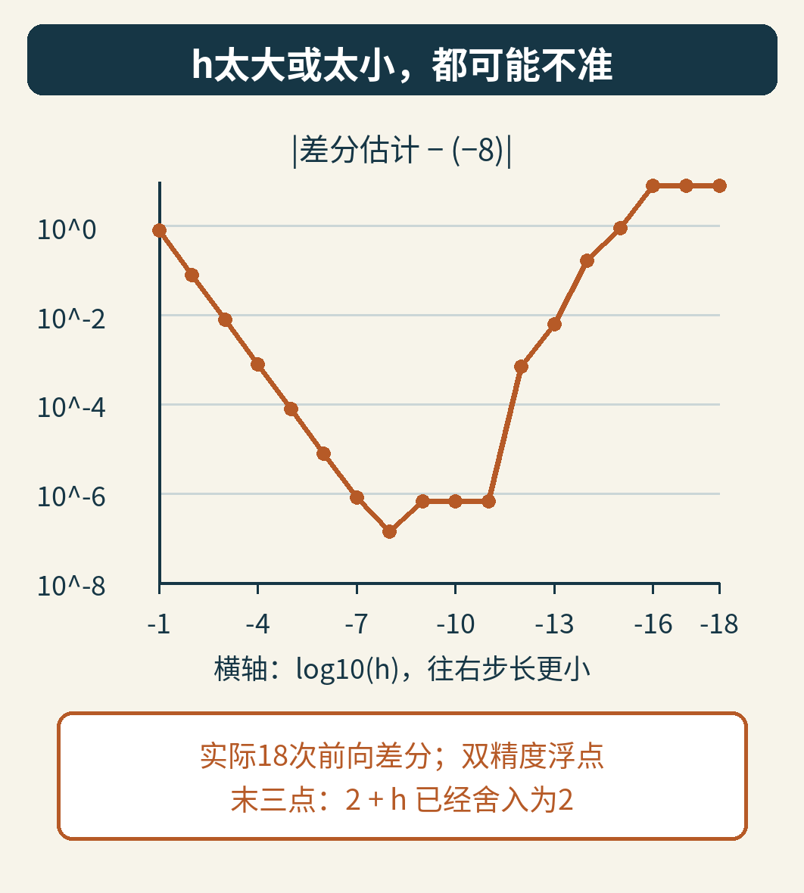

图中点来自随文程序在Python双精度浮点上的实际运行，不是手画的理想U形曲线。横轴、纵轴都按10倍间隔排列；连线只是帮助跟随这些离散点。

这条曲线说明的是这个函数、这个输入、这次浮点环境，不能读成“所有函数都该选同一个最佳步长”。

你也可以试两边一起挪的中心差分。本例固定y以后是二次函数，中心差分在精确算术中会刚好抵消截断项，所以它并不适合用来演示一般中心差分的截断误差阶。随文数据同时保留了它的实际浮点结果。

自动微分省去了差分的步长误差，却**没有消灭浮点舍入误差**。本例的整数中间值恰好能精确表示；换一段含除法、三角函数或很长运算链的程序，不能凭“用了AD”就宣布答案绝对精确。

## 8. 为什么最后只有一个分数时，反向特别划算？

假设程序有n个输入，只输出一个分数L。

如果用逐个输入的前向有限差分，要为了每个输入分别再跑程序。前向自动微分不是有限差分，但它也可以沿着一个选定的输入方向，把变化率正向传到输出。若按坐标方向逐个求完整梯度，通常需要n个方向的计算。

反向模式先完成正向计算，再从这个单一分数出发，沿图回传一次，就能同时得到所有输入的梯度。

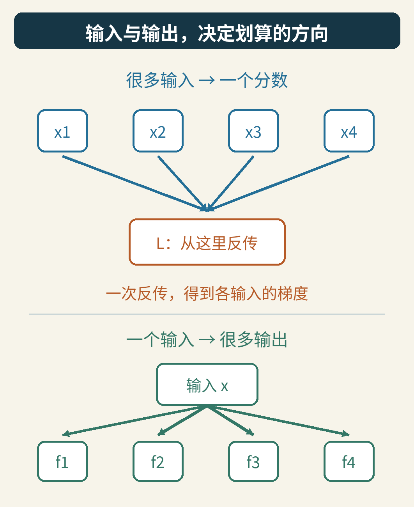

在局部规则成本受控的通常情形下，这一趟反传的运算量，与原程序的一次求值处于同一量级。这里说的“一趟”，仍然要访问图中的运算与依赖边；输入变多、原程序变大，总工作量照样会增长。它不是与模型大小无关的常数时间。

反过来，若只有一个输入，却想知道很多个输出各自如何变化，前向模式可能更合适。

如果有多个输出，只做一次反传，一般得到的是某种指定输出组合对输入的梯度；不能声称一次就免费得到任意大小的完整导数表。JAX官方文档用JVP、VJP解释这两个方向，读懂本例后再去看这些缩写，会更有着落。[JAX前向与反向模式](https://docs.jax.dev/en/latest/jacobian-vector-products.html)

## 9. 倒着走需要路标：为什么还要占内存？

乘法那一节已经暴露了答案：要把u的梯度传回x，我们需要当时的y；要传回y，需要当时的x。

于是正向计算时，不能把所有中间信息用完就扔。反向阶段往往还要用它们。

本文的小程序直接保存每条边的局部变化率。这适合短小标量例子。真实张量计算可能保存输入、输出、掩码或其他足以恢复局部规则的信息；具体保存什么，由运算和实现决定。

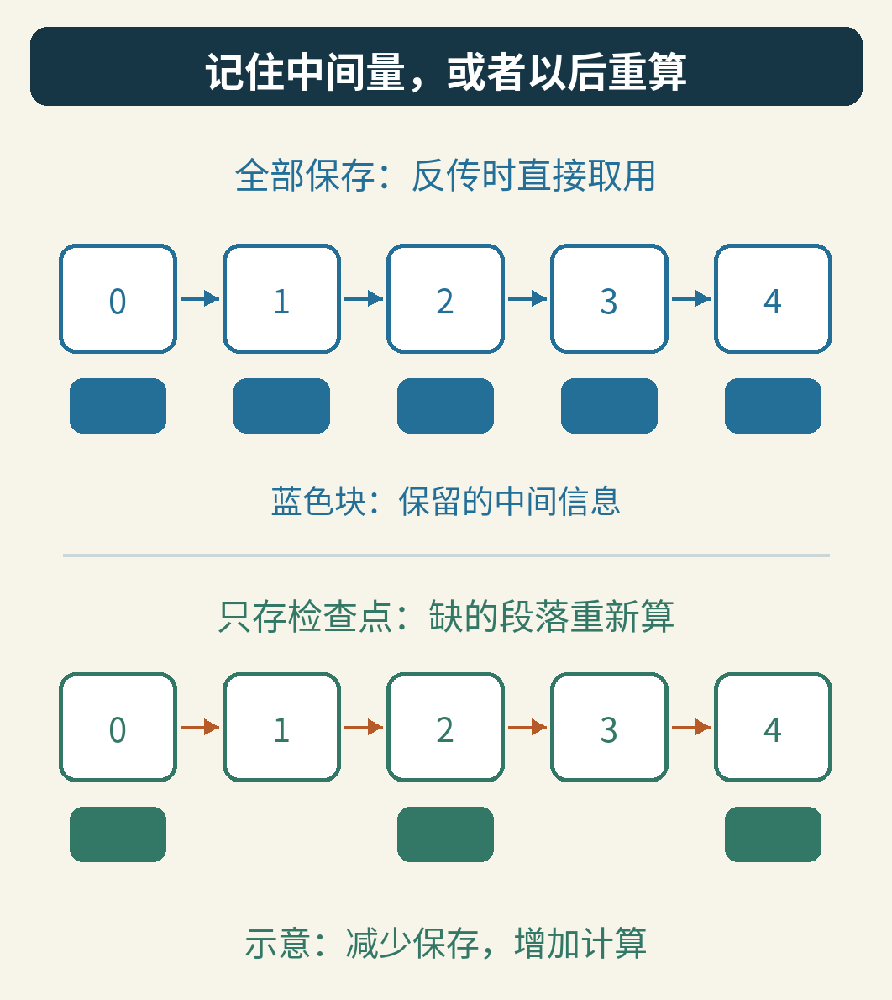

一种常用交换是**检查点**：只保存部分位置，反传需要中间量时，从检查点重新计算那一段。这样能减少某些中间量的保存，代价是增加计算。

图是策略示意，不是本文实现的内存实测。具体省多少，取决于图的结构、保存策略和框架实现；并非“只记一个数”就能对任意程序免费倒推。[JAX检查点说明](https://docs.jax.dev/en/latest/notebooks/autodiff_remat.html)

因此，反向自动微分的巧妙之处并不是不付成本，而是把很多输入共享的后续计算与导数传播组织起来，避免为每个输入从头重复一遍全部工作。

## 10. 有分支、拐角和离散动作，怎么办？

普通程序会写if，会循环，也会取最大值。它们不会因为进了自动微分系统就突然消失。

先看一个很短的函数：输入非负时返回x，否则返回−x。这就是绝对值。

当x=2时，执行的是返回x的分支；在足够小的邻域里，分支不变，导数是1。当x=−2时，执行的是返回−x的分支，导数是−1。

但到了x=0，左右斜率对不上，普通意义下的导数不存在。

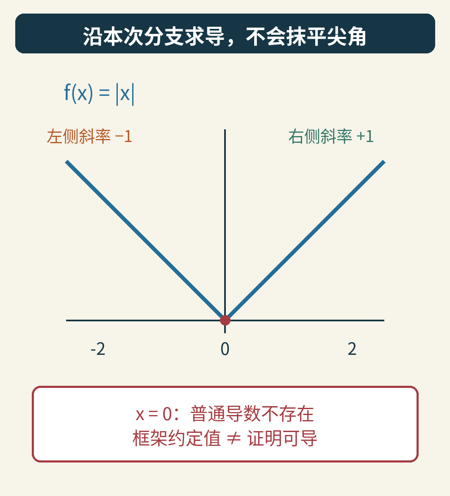

框架可能在这类点上使用约定值、次梯度规则或其他特定行为。**返回一个数字，并不说明那个点拥有普通数学导数。** 精确行为要查所用算子与框架的文档。[PyTorch不可导函数的梯度规则](https://docs.pytorch.org/docs/main/notes/autograd.html#gradients-for-non-differentiable-functions)

对于根据本次输入建立计算图的实现，反传沿的是本次实际执行的路径；若改输入导致分支切换，就需要重新执行、重新确定路径。编译型系统还可能对控制流的写法施加限制，不能把某个框架的能力外推到所有工具。[PyTorch执行图说明](https://docs.pytorch.org/docs/main/notes/autograd.html#how-autograd-encodes-the-history)

更极端一点，如果程序先把x四舍五入成整数，再用它选择一件物品，微小变化常常什么也改变不了，越过边界又突然跳变。你即使拿到了某个局部梯度，也未必得到了“该换哪件物品”的有用搜索方向。

自动微分擅长组合已有的可微规则。它不是自动解决所有离散决策的魔法。

## 11. 求出梯度以后，答案并没有自动变好

我们已经知道在x=2、y=3时，L对x的梯度是−8。想降分，直觉上可以让x往正方向动一点。

固定y=3，采用一个简单更新：

**新x = 旧x − 步长 × 梯度。**

取步长0.01，新x=2.08，重新计算得到L=1.4112，确实比2低。

但如果步长取0.2，新x=3.6，L反而变成9.68。方向在起点没有错，只是走得太远，越过谷底以后又爬上了另一边。

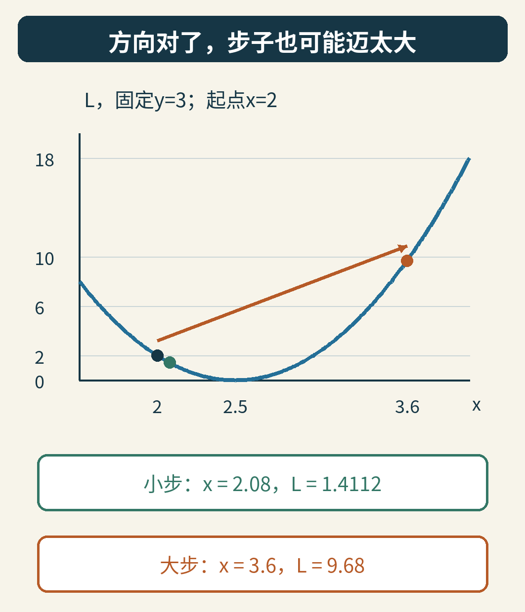

**自动微分负责算梯度；优化算法负责决定怎么用梯度。** 两者经常一起出现，但不是同一件事。

在神经网络训练里，最后的损失沿网络往回传播梯度，通常就叫反向传播。它是反向自动微分思想的一个重要应用，不能因此把自动微分的适用范围缩成“只会训练神经网络”。一个可微的几何程序、数值模型或我们这段小算式，同样可以有自己的计算图。

一个有意思的历史对照是：Linnainmaa在1976年的数值分析论文里，用反向传播的系数分析累计舍入误差；其算法从末项的1出发，倒读运算记录，向输入系数累加。1986年Rumelhart、Hinton与Williams的论文则把反向传播放在神经网络学习的背景中。这两份原文已经足以提醒我们：同一种求导结构，可以服务于不同问题。[1976年原论文](https://doi.org/10.1007/BF01931367)，[1986年原论文](https://www.nature.com/articles/323533a0)

## 12. 最后自己走一遍，不靠背公式

把旋钮改成x=1、y=2，其余规则不变。

先正向算：u=2，v=3，r=−7，L=24.5。

然后不要直接套展开后的总公式，按图回走：

1. L那一格填1。
2. 半平方把−7传给r。
3. 减10和加法分别把−7继续传向v、u，以及x的直接路径。
4. 乘法再给x传−7×2=−14，给y传−7×1=−7。
5. x收齐两路：−7+(−14)=−21。

所以梯度是（−21，−7）。随文程序也在36组输入上，把自动微分结果与独立写出的解析公式逐一比较；共享节点、重复输入边和第二次求导前清零都有单独检查。

[运行方法与结果](README.md)里保留了完整代码、实际输出和差分数据。正文里的正向图、反向图、误差曲线和更新曲线都能由随文绘图程序重新生成。

再回头看“倒着算”，它其实只有两条朴素规则：

**沿一条路，把变化率相乘；几条路汇到同一个量，把贡献相加。**

真正需要程序帮忙的，是在一个可能很大的依赖网络里，把这两件事做得完整、有序、不漏账。
