# 三点往哪边拐，一个错误的正负号能毁掉什么？

你在做一个画图工具：用户点三个位置，程序把它们围成三角形。规则听起来很简单，三个点若不在同一条直线上，就能围出一小片面积。

现在程序却出了件怪事。按A、B、C的顺序检查，它说：“三点共线。”把起点换成B，按B、C、A检查，它又说：“有面积，逆时针。”

点没有移动，只是从另一个顶点开始数，三角形怎么可能忽然出现？

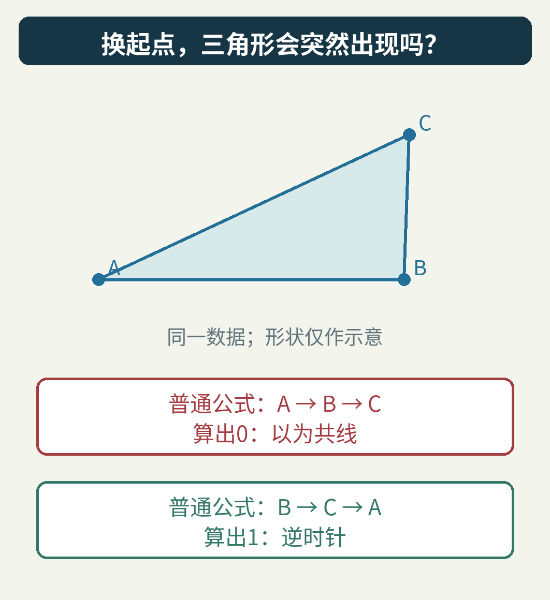

这不是虚构的故障情节。下面会用三个完全能存进双精度浮点的整数坐标，实际重现它，再看一个错误的“0”如何把三角形的一个顶点删掉。

关键不在多打印几位小数，而在于：**当一个数的正负号会决定程序走哪条路时，怎样确认这个符号真的可信？**

## 1. 先做一件不用量角器的事：判断左转还是右转

站在A，面向B。第三个点C在你的左手边，还是右手边？

我们采用通常的数学平面：横轴向右，纵轴向上。沿A→B前进，C在左侧就是左转，右侧就是右转，恰好在直线上则不转。

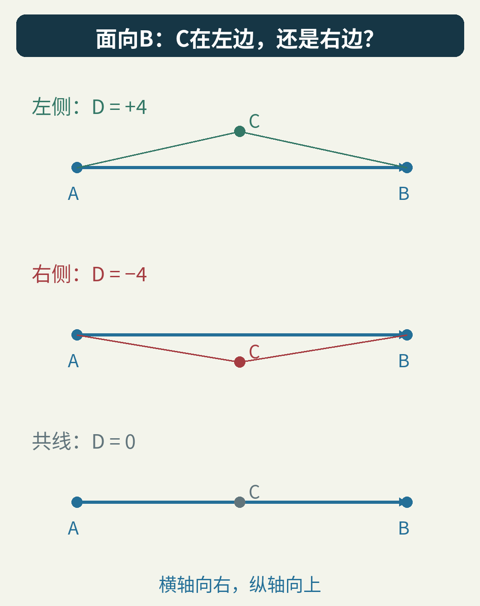

先用最简单的坐标：A=(0,0)，B=(4,0)。C=(2,1)在上方，对着B走时它在左侧；C=(2,−1)在右侧；C=(2,0)在直线上。

注意，有些屏幕坐标的纵轴向下。如果不先说清坐标方向，画出来的“顺时针”和数学公式里的“顺时针”就可能相反。本文所有几何图都用纵轴向上。

把这种只回答左、右、共线的判断叫作**方向谓词**。谓词可以理解为程序用来作决定的小问题；它返回的是类别，而不是需要画到屏幕上的新位置。

## 2. 两个乘积相减，为什么能表示方向？

先把A当成临时原点。这样B相对于A的位置是：

bx = B的横坐标 − A的横坐标，
by = B的纵坐标 − A的纵坐标。

同样得到cx、cy。然后算：

**D = bx × cy − by × cx。**

这个数叫二维行列式，也可以看成两条向量叉积的垂直分量。名字暂时不重要，先看它在图上是什么。

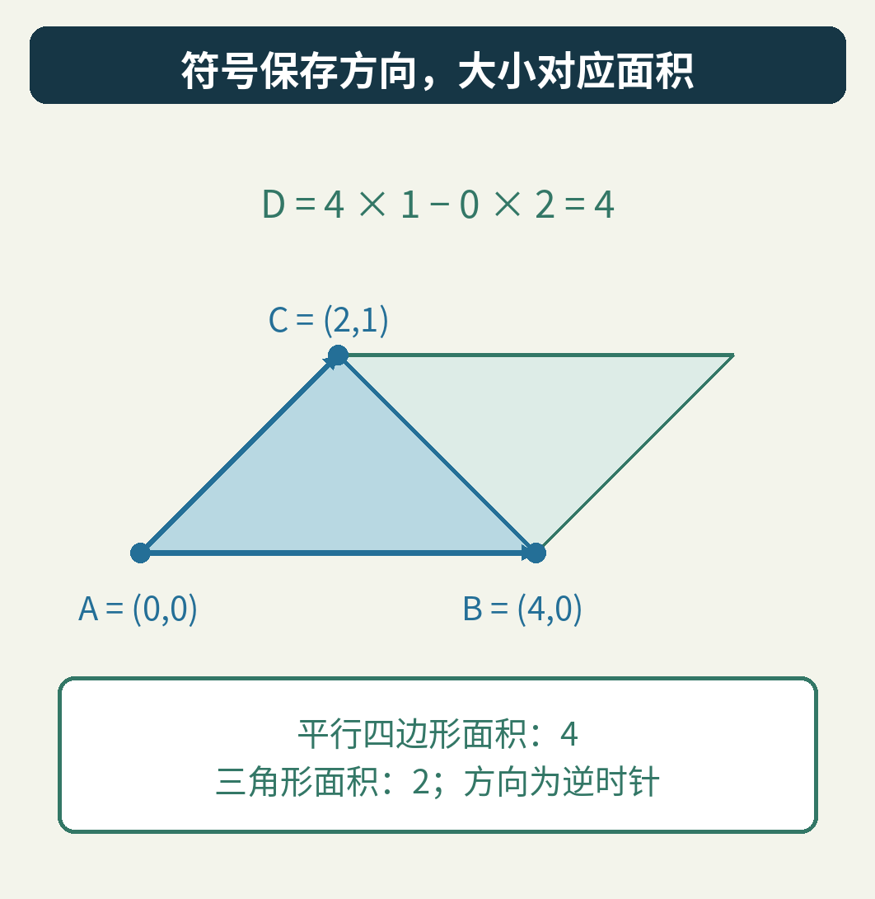

D的绝对值，是AB与AC围出的平行四边形面积，也就是三角形面积的两倍；符号保存了绕行方向。

- D>0：A、B、C按逆时针排列，C在有向边A→B左侧。
- D<0：顺时针，C在右侧。
- D=0：三点共线，包括两点重合的情况。

刚才的三个小例里，by=0，所以D就是4乘以C的高度，分别得到4、−4、0。

程序往往不需要精确知道面积是3.14159还是3.14160。它只是要知道：**这个数究竟在0的哪一侧？** 可这个看起来更简单的问题，有时反而不能容忍一点点含糊。

## 3. 一个“只差1”的三角形

取N=2²⁷，也就是134217728。把三个点设成：

- A=(0,0)
- B=(N,N−1)
- C=(N+1,N)

这些整数都远小于2⁵³，因此本例输入的各个整数坐标能被双精度二进制浮点精确表示。问题还没有出在“把坐标存进去”那一步。

代入公式：

**D = N×N − (N−1)×(N+1)。**

用整数代数展开，后一个乘积是N²−1，所以D就是1。三角形有正面积，面积为1/2。

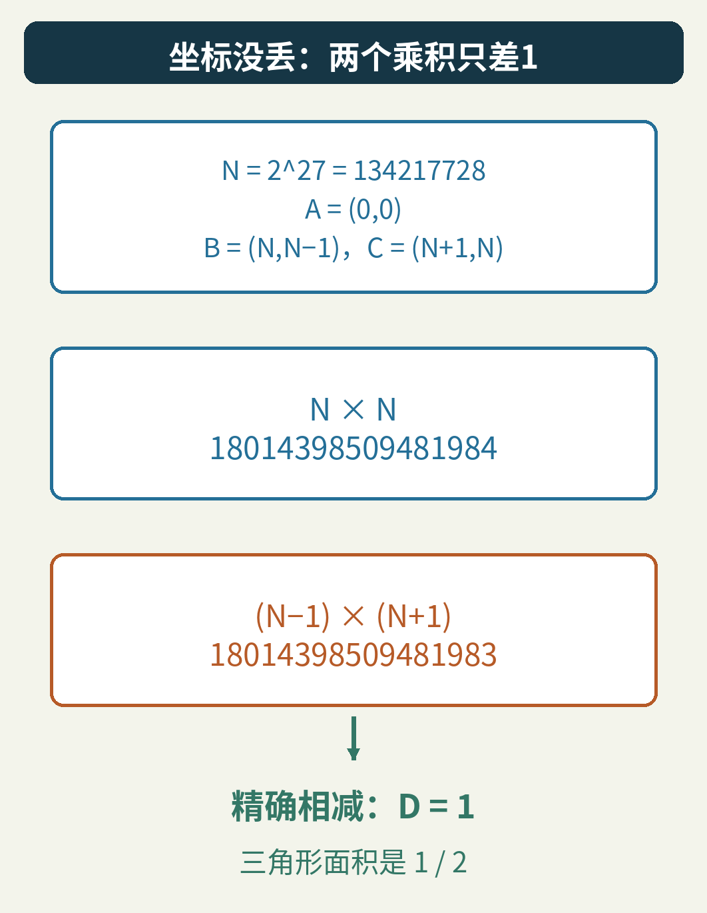

具体两个乘积分别是：

- 18014398509481984
- 18014398509481983

两个十七位整数只差最后的1。坐标虽然能精确保存，乘积却已经走到了另一种数值尺度。

## 4. 错误不是最后才凭空出现，而是差别先被磨掉了

双精度浮点只能保存有限个有效二进制位。它在不同大小的数附近，可表示数的间隔也不同。

本例第一个乘积刚好是2⁵⁴，能精确表示。第二个乘积比它小1，落在相邻可表示数之间；在本次默认的就近舍入规则下，也被舍入成2⁵⁴。

于是程序真正拿来相减的是：

**18014398509481984 − 18014398509481984 = 0。**

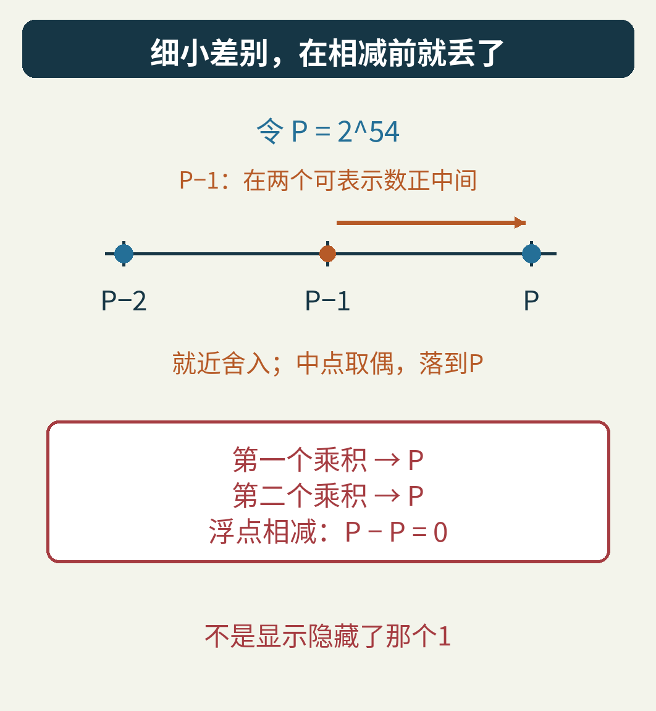

从这一步开始，再打印二十位小数也找不回那个1。不是输出窗口藏住了有效数字，而是前面的乘法已经把差别舍掉。

这里常说的“消减”是指两个接近的量相减后，结果依赖于原值中很细的差别。要特别小心：**最后的减法本身可以完全正确，问题仍然存在。** 在这里，两个已经相等的浮点数相减，得到0当然没错；错的是它没有代表原来两个精确乘积的差。

## 5. 换一个起点，矛盾真的出现了

在精确数学中，从A开始按A→B→C绕一圈，和从B开始按B→C→A绕一圈，方向相同；循环移动三个点的顺序不会改变D。

可普通浮点公式会先减去第一个点的坐标。换起点，就换了中间计算的数值尺度。

随文程序的实际结果是：

- D(A,B,C)：0
- D(B,C,A)：1
- D(C,A,B)：1

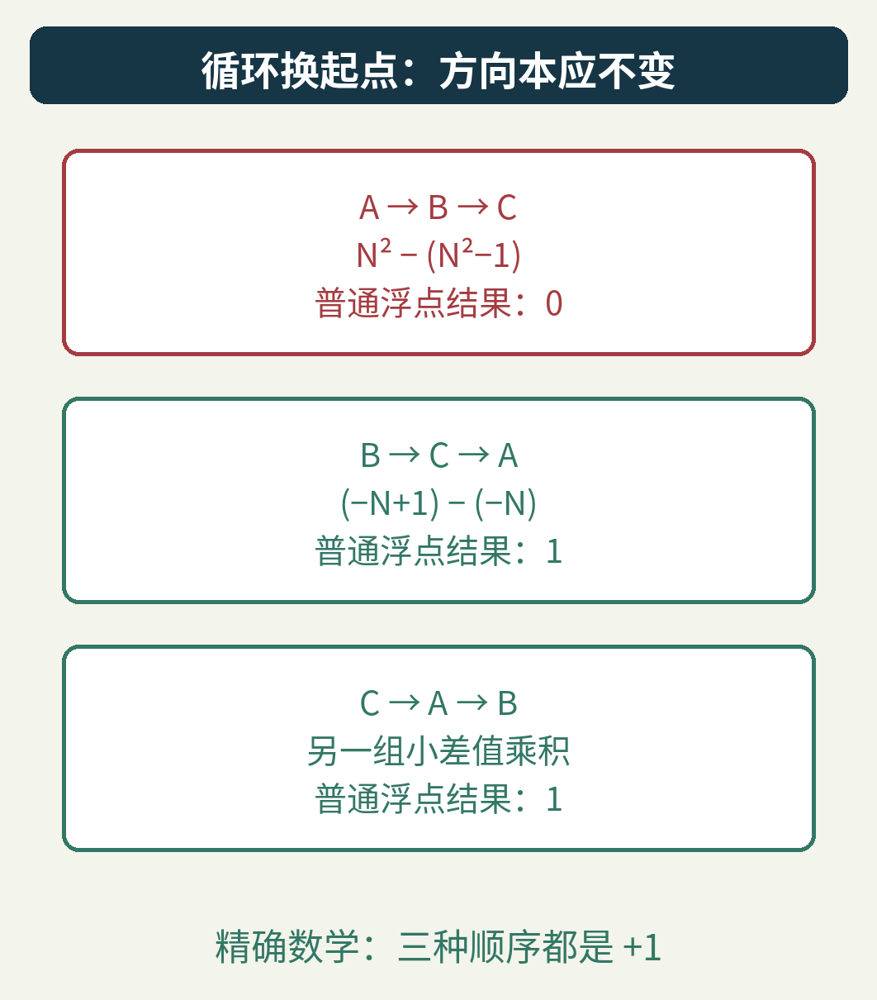

以B为起点时，B→C的差是(1,1)，B→A的差是(−N,−N+1)。计算变成：

1×(−N+1) − 1×(−N) = 1。

这一次没有先形成那两个约1.8×10¹⁶的大乘积，所以恰好算对了。

这不能变成“以后永远换成B就安全”的窍门。另一个输入可能在别的计算顺序下出问题。我们需要的是对**本次计算能否确认符号**作判断，而不是押一个看起来比较顺眼的公式。

## 6. 一个错判怎样把面积删没了？

想象用一根橡皮筋包住所有点。橡皮筋围出的最外圈叫凸包。

有一类简单算法把点排好顺序，逐个检查最近三个点。如果它们不能形成规定方向的转弯，就删掉中间那个点，继续检查。

对我们的三个点，正确结果应保留A、B、C，形成一个极细的三角形。但普通浮点把A、B、C判断成共线，于是删掉B，最后只剩A、C两个点。

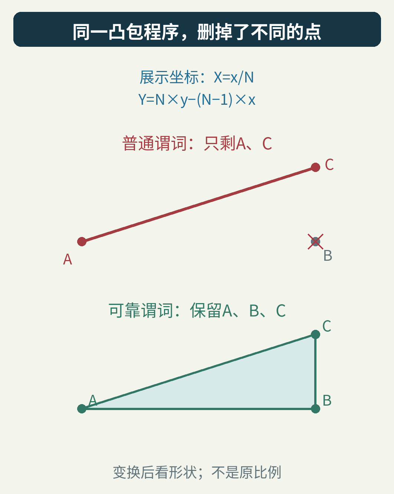

这里的两种结果来自随文同一份凸包程序，唯一改变的是它调用的方向谓词。不是把两张示意图当成两套软件的截图。

为了让极细的三角形看得见，这张图使用了明示的坐标变换：横坐标是x/N，纵坐标是N×y−(N−1)×x。这个变换会改变外观比例，但保留方向和面积；图不是原坐标的等比例放大。原始坐标与全部运行输出都保留在附件中。

几何算法里的许多决定也类似：一条边该不该翻转，一个点该放在哪个区域，一个三角形是不是退化。一次方向误判可能改变连接关系，后面再算得精细，也未必能把已经删掉的结构自动补回来。[Shewchuk的原始问题说明](https://www.cs.cmu.edu/~quake/robust.html)

## 7. 统一加一个很小的阈值，就能放心了吗？

你也许会想：既然接近0危险，就规定绝对值小于0.000000001时，一律当成0。

这有时能服务于“我们愿意把多近的点视作重合”这样的应用约定，但它不是对数值误差的普遍修复。

看另一个很瘦、但完全不共线的三角形：A=(0,0)，B=(1,0)，C=(1,2⁻⁴⁰)。D=2⁻⁴⁰，约9.09×10⁻¹³，小于上述阈值，所以会被判成共线。

现在把所有坐标都乘以2²⁰，形状只做等比例放大。D会乘以这个尺度的平方，恰好变成1。同一个形状，阈值规则又说它不是共线。

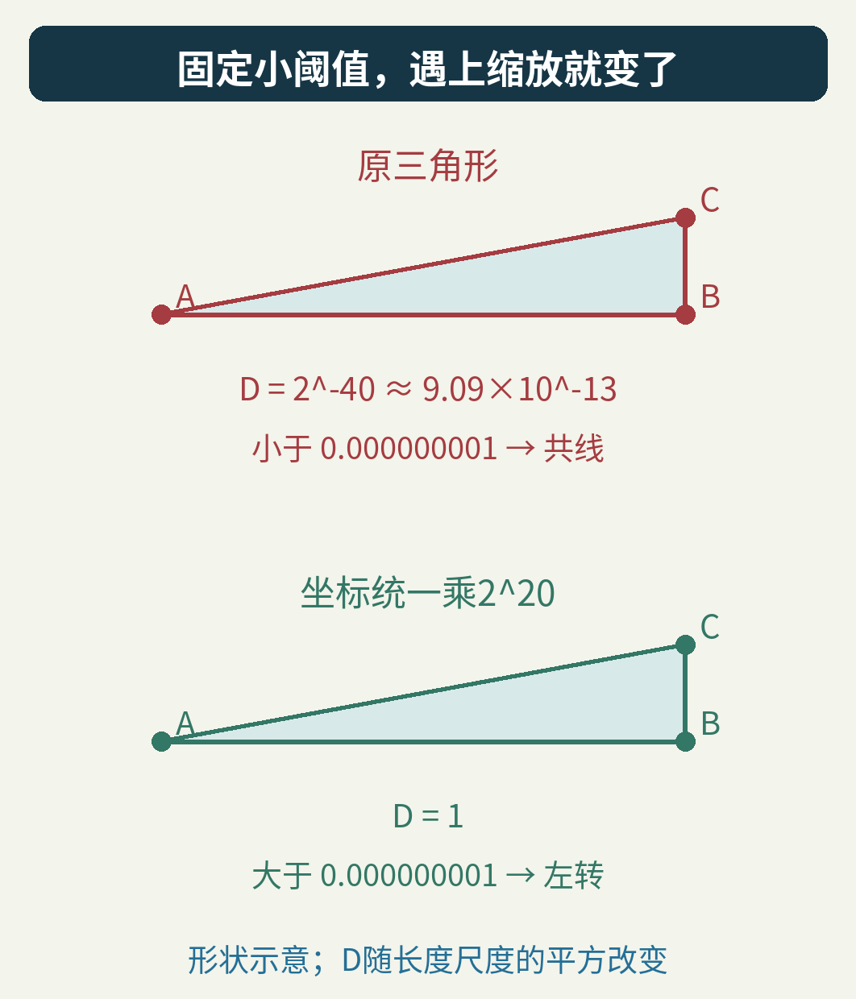

原因并不玄妙：D带有面积的尺度。坐标乘1000，D就乘1000000。一个没有说明单位、尺度和语义的“神奇小数”，不会自动适应所有几何数据。

还有一个逻辑陷阱：我们现在不知道一个接近0的结果是正、负还是零。直接把“不知道”改写成“就是零”，等于替程序作了一个没有证据的决定。

## 8. 过滤器先问：我有把握吗？

可靠的方向判断可以分两层。

第一层做比较便宜的计算，同时给出一个有数学依据的范围，保证精确结果落在里面。

如果整个范围都大于0，就能放心返回左转；如果整个范围都小于0，就能返回右转。只有当范围碰到或跨过0时，才把问题交给更精细的算法。

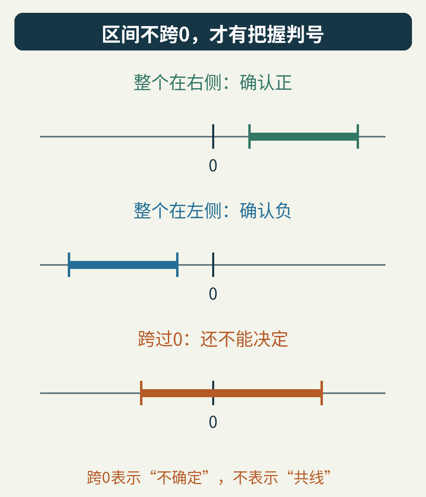

这就是**过滤**：简单、确定的情况先过；不确定的情况留给更强的工具。

图中的区间是计算误差的包围范围，不是随机噪声的置信区间。它不表示“有95%概率在这里”，而是建立在指定算术条件下的一项包含保证。

注意，区间跨0并不证明三点共线。它只说明：**第一层给的证据还不够。**

Shewchuk的方向谓词先使用浮点估计和误差界，再按需要进入更精细的运算。他的实现用多个浮点分量保存被普通舍入丢掉的细节，而不是一开始就让每个问题都付出最高精度的代价。[作者原始算法与代码入口](https://www.cs.cmu.edu/~quake/robust.html)

## 9. 做一个能看清每一步的两层版本

为了让实验容易复查，本文采用另一种教学实现：第一层用**向外扩张的浮点区间**，第二层直接用精确分数。它展示过滤架构，不冒充Shewchuk的完整自适应展开算法，也没有以Python代码和成熟几何库比赛速度。

一个精确输入x，可以先写成区间[x,x]。做运算时，把下界朝负无穷方向挪到相邻可表示数，把上界朝正无穷方向挪到相邻可表示数，保守地包住舍入前的结果。

例如，区间相减时，最小可能值来自“左边下界减右边上界”，最大值来自“左边上界减右边下界”。乘法则检查四个端点乘积的最小值和最大值，再向外扩张。

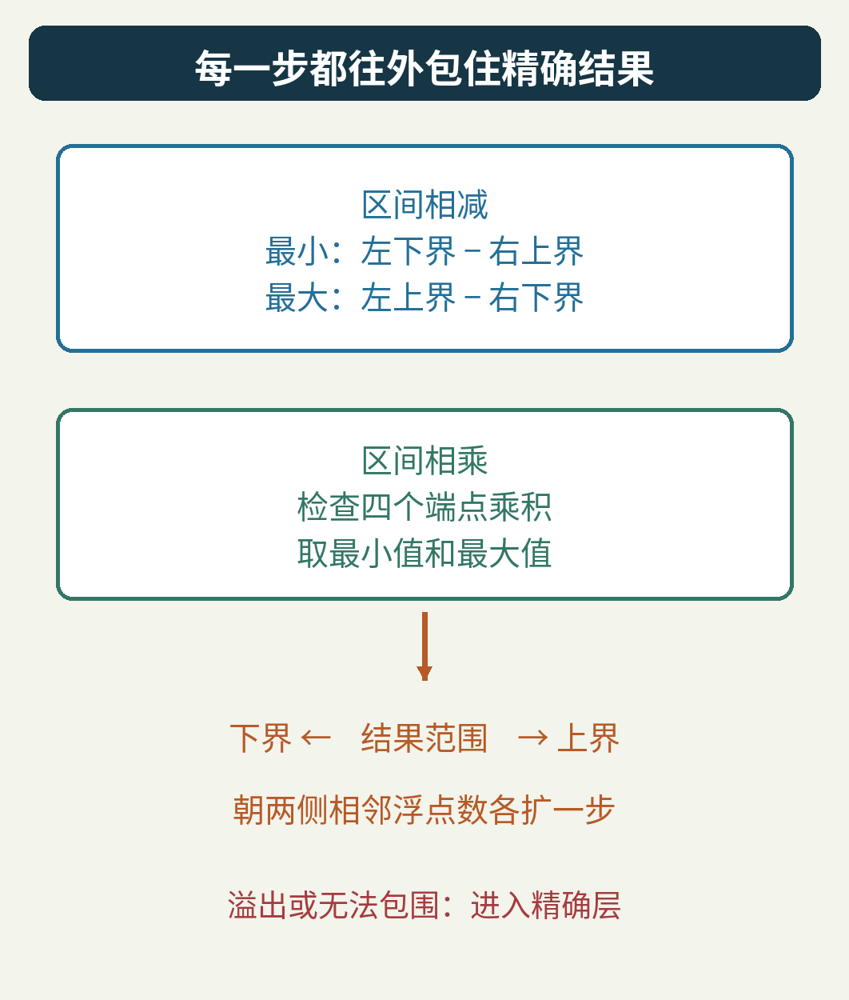

随文程序使用Python的math.nextafter寻找指定方向上的相邻浮点数。每一步保守扩张，在本次采用的二进制双精度、正确舍入的基本运算条件下，保证不会把精确值排除在外。若中途出现无法继续包围的无穷端点或溢出，就不让这一层作决定，直接回退。[Python相邻浮点数说明](https://docs.python.org/3/library/math.html#math.nextafter)

对开头的主例，这个保守区间约为[−14，20]，跨过0。因此它诚实地回答“暂时不能确认”。保存数据里有完整浮点端点，这里只作便于阅读的近似显示。

第二层把**已经存下来的浮点输入**精确转换成分数，按整数分子、分母进行运算。本例所有坐标都是整数，所以直接得回D=1，确认左转。

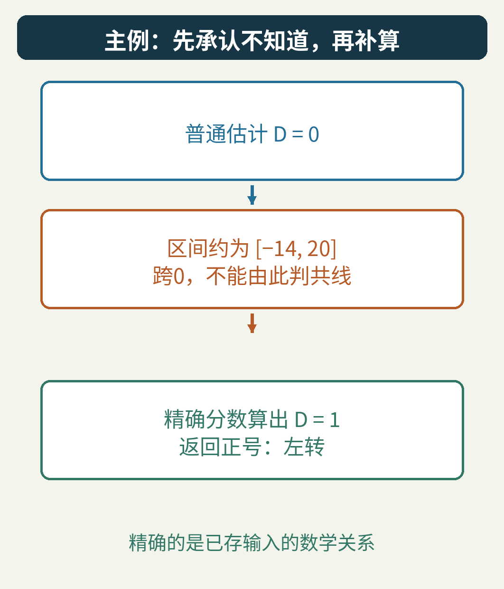

Python的Fraction.from_float保留的是该浮点数本身的精确值，不是猜它原本来自哪个十进制字符串。[Python分数说明](https://docs.python.org/3/library/fractions.html)

工业实现可以使用更高效的误差界、浮点展开、精确数类型和专门过滤策略。CGAL的官方Filtered_predicate示例也把区间过滤与精确回退分开；本文的简化实现是为了让这两层职责能被学生直接读懂。[CGAL过滤谓词](https://doc.cgal.org/latest/Kernel_23/classCGAL_1_1Filtered__predicate.html)

## 10. 实际跑一小片邻域，错误集中在哪里？

只看一个特意构造的例子还不够。我们保持A、B不动，在C的附近取31×31个浮点网格点。

横、纵坐标各向两边移动15步，统一采用2⁻²⁵的坐标步长。这961个坐标都可以精确存进双精度浮点；我们改变的是实际输入，不是输出时多打印几个小数位。

每个点都分别运行普通浮点方向判断、两层判断，再用精确分数独立核对。

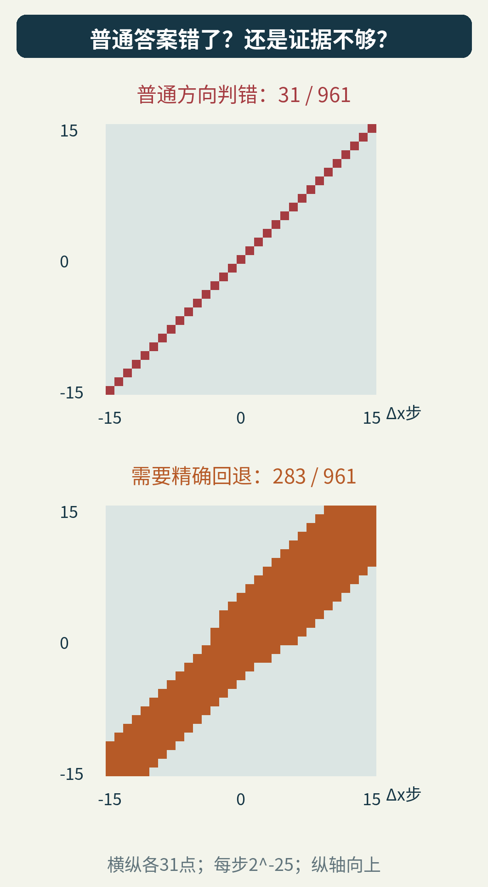

实际结果：961个点里，普通浮点有31个方向分类错误；两层算法全部与精确结果一致，其中283个进入精确回退。

图的两个面板回答不同问题。上面标的是“普通答案已经错了”；下面标的是“第一层不能保证，所以升级计算”。不能把下面所有点都叫作错误，也不能因为普通计算碰巧算对了，就认为那里不需要证据。

再用固定随机种子生成500组坐标范围在−100到100之间的普通三点样本，这次全部在区间层就确定了符号，没有进入精确回退。

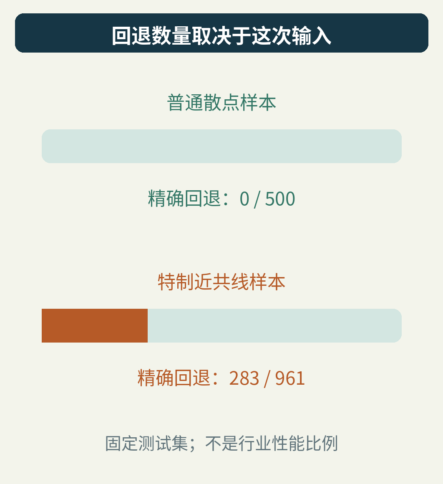

这不是“真实工程中回退率永远为零”的证明。特意造的近共线数据、普通散点、不同尺度的模型，难度本来就不同。实验要展示的是：**让不确定性决定额外工作，而不是给所有输入贴同一张精度标签。**

程序还检查了全部6种顶点排列、共线、重合、极小乘积、溢出量级，并拒绝NaN和无穷输入。共1475次方向检查都与分数参考结果一致。这是有范围的测试记录，不替代算法及算术条件的论证。

## 11. 精确判号，也救不回已经丢失的输入

到这里很容易产生一个新误会：用了精确回退，就能恢复现实中的真实位置。

看另一组数。设M=2⁵³，B=(M,M)，C=(M+1,M)。如果保留原始整数，B与C不相同。

但把它们先转成双精度浮点时，M+1会舍入成M。存下来的B和C成了同一个点。此时再精确计算，也只能正确回答“这两个已存点重合”。

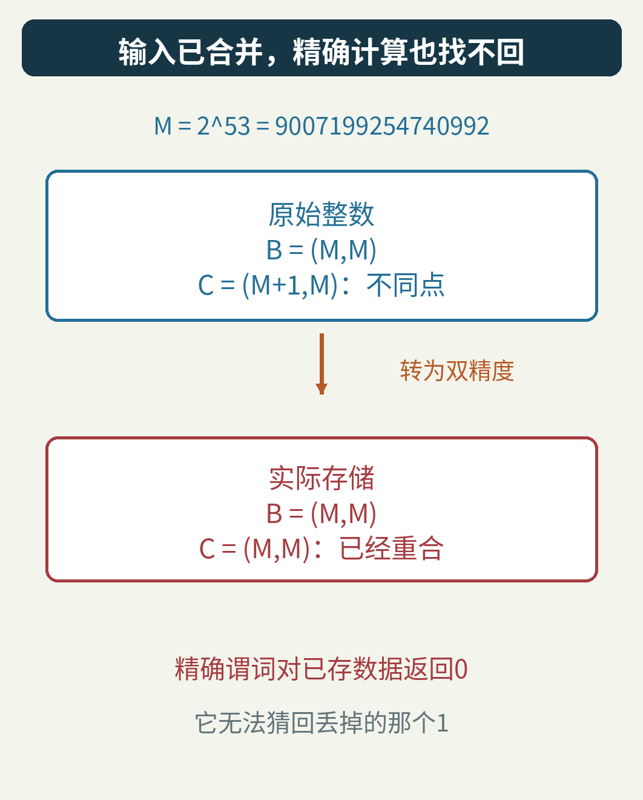

开头N=2²⁷的例子，是输入没丢、运算过程中丢了差别；这一节M=2⁵³的例子，是输入阶段就丢了差别。两件事要分开。

真实测量数据还有另一层不确定性：尺子本身可能只能精确到毫米。对记录下来的坐标精确判号，不等于你已经知道现实物体在微米尺度上位于哪一侧。

“可靠谓词”要保证的是：**对交给它的那些数，几何分类与它们的精确数学关系一致。** 若应用需要把距离很近的对象视为同一对象，那是另一个需要明确定义的几何容差问题。

## 12. 小小的判断，比很多位漂亮小数更重要

方向谓词不会替你完成全部几何算法。可靠判断和可靠构造也是两件事：判断三点在哪一侧，与计算两条线交点的新坐标，承担的任务不同。CGAL甚至有明确区分“精确谓词、一般不精确构造”的内核类型。[CGAL内核职责说明](https://doc.cgal.org/latest/Kernel_23/classCGAL_1_1Exact__predicates__inexact__constructions__kernel.html)

但这个小问题揭示了一种很值得程序员记住的设计方式：

不要只问“这个答案大概接近吗”，还要问“它会让程序作出什么决定”。

如果一个数只是用于画一条轻微移动的线，小误差可能只造成一丁点视觉偏移；如果它的符号决定删哪个顶点、接哪条边，同样的小误差可能改变整个结构。

遇到后者，好的程序不需要每次都一上来算到最精细。它可以先便宜地尝试，再检查证据是否足够；证据不够，就保留“不确定”，认真补算。

完整[实验与运行方法](README.md)保留了这三个点、961点邻域、500组固定样本、凸包差异、原始运行结果以及所有绘图代码。你可以先改N，观察普通公式在哪些规模开始丢掉那个1，再去看过滤器如何应对。

当一张复杂网格最终能可靠地连起来，背后有时正依赖这样一个很朴素的习惯：**不知道时，不要冒充知道；只把确认过的符号交给下一步。**
