# 游戏里的烟，怎样跟着空气卷起来？

游戏里有一团烟。角色从旁边跑过，或者一阵风吹来，它不该只是整张贴图平移：有的部分先走，有的部分后走，细长的烟带会弯曲、拉长，卷成涡。

程序怎样算出下一幅画面？

先看下面这次实际计算。一开始只有一条亮色的染料带；我们另外给这片区域一组初始空气速度。此后没有人逐帧画它的轮廓，程序反复更新数字，就得到后面的形状。

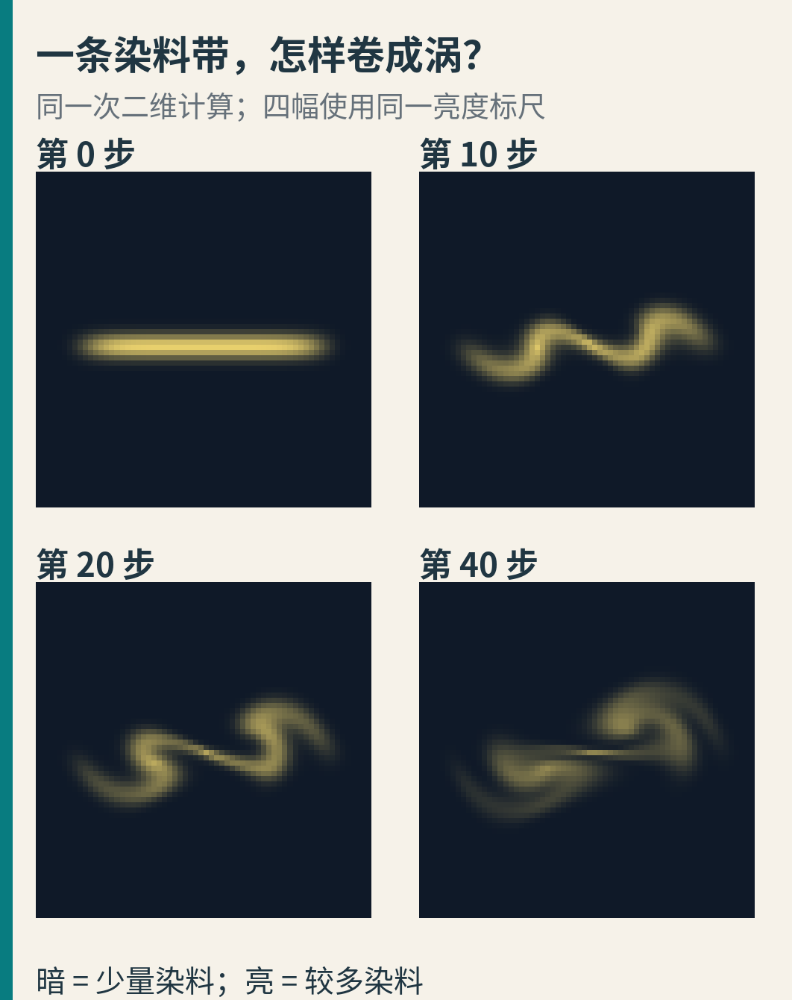

按左上、右上、左下、右下读。亮处表示染料较多，暗处表示较少，四幅使用相同的颜色范围。这里是本文原创程序的二维计算结果，不是实拍烟雾，也不是某款游戏的截图。每一步的模拟时间为0.04个时间单位；图中的“第20步”因此对应0.8，而不是第20秒。

我们要拆开的是图形学中的 **Stable Fluids** 思路：先让程序能够搬运一团颜色，再让搬运它的空气速度符合约束。Jos Stam在1999年的同名论文中给出面向交互式流体动画的方法，2003年又写了更便于游戏开发者实现的版本。这里采用自己的小例子和程序讲解，不逐行复刻历史代码。[原论文与作者资料](https://www.josstam.com/publications)

读这篇不需要先懂微分方程。用到的第一件工具，只是“速度乘时间等于移动距离”。

## 1. 我们看得见烟，却不直接看见空气的速度

风洞里的研究人员会放出烟，让原本不容易看见的气流留下线索。下面是真实的SLS模型试验场景：烟枪放出的烟经过模型附近，摄影记录了它的形状。

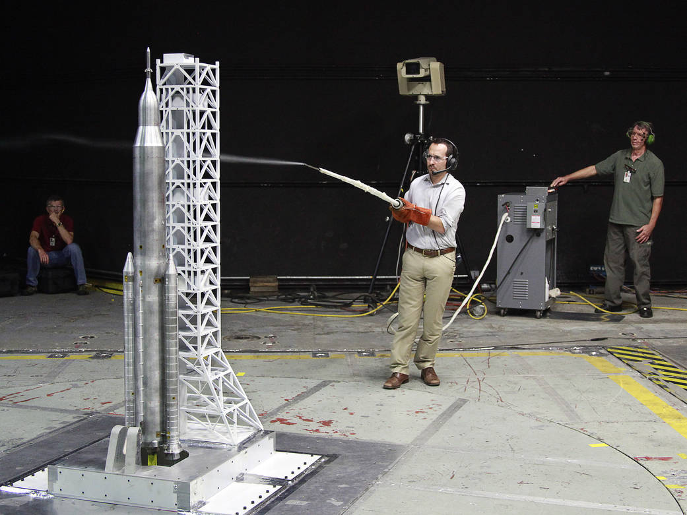

图片来源：[NASA/LaRC，Smoke Flow Visualization for SLS，2013](https://www.nasa.gov/image-article/smoke-flow-visualization-sls/)。这是现实中“借烟看气流”的场景，不是对本文算法的验证。随时间持续放出的烟线，记录了先后释放的烟的运动；气流变化时，不能直接把照片上的每条曲线都当成某一瞬间的速度方向。

在我们的程序里，也把两样东西分开记：

- **染料读数**：这个位置有多少用来显示的颜色。一个数就够了。
- **空气速度**：这个位置的空气往哪里、以多快的速度运动。在平面内，需要横向和纵向两个数。

比如横向速度为2、纵向速度为0，意思是每个时间单位向右移动2个长度单位，不向上或向下移动。这里的单位可以自己选，只要全程一致。

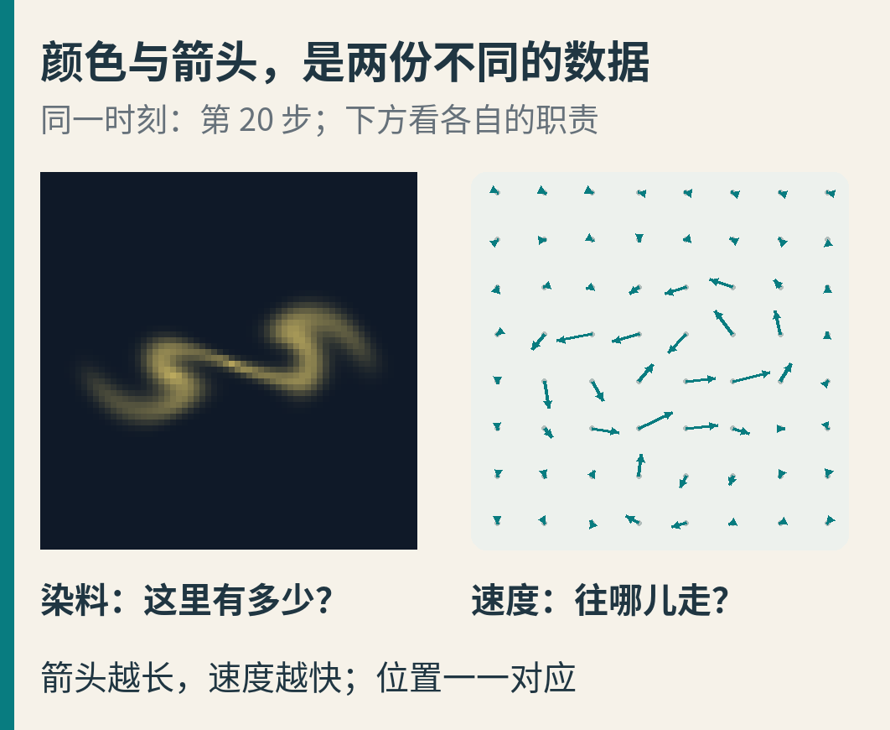

左边用颜色显示染料，右边抽出部分位置，用箭头显示速度：方向告诉你往哪儿走，长度告诉你有多快。两幅对应开头的第20步，位置一一对应。为了看清，箭头比实际存储的速度样本稀疏得多。

**没有染料的地方，也可以有空气在流动。** 反过来，一块很亮的染料，也可能暂时几乎不动。颜色不是速度。

本文把染料当作跟随空气的标记，它不反过来改变空气运动。要模拟热烟上升，还需要温度、浮力等作用；这次先不加。

## 2. 连续的空间，程序怎样记下来？

拿一张方格纸覆盖这片平面，在固定的位置记下一批数字。计算机不能保存平面上无限多个位置，只能先保留这些样本。

整片速度样本叫 **速度场**。这里的“场”不是额外的物体，只是“不同位置分别有自己的数”。染料也有一张这样的数值表。

画面并不是连续不断地算。程序先保存旧时刻的表，再计算过一小段时间后的新表。这段时间叫 **时间步**，常写作Δt，读作“delta t”。

假设某处空气每单位时间向右走1.5、向上走1.25。如果这一步持续1个时间单位，它的位移就是：

- 向右：1.5 × 1 = 1.5
- 向上：1.25 × 1 = 1.25

如果时间步改成0.5，两个移动距离都减半。这和每一帧画多少像素是不同的事：时间步决定物理模型往前推进多久，像素只是最后怎么把结果画出来。

接下来用一个专门为手算设计的小场景：样本之间的距离取1，时间步也取1。它的尺度与开头64×64格的完整模拟不同，先别把两组数字混在一起。

## 3. 要填新表，为什么反而先往后找？

假设我们现在要填新时刻位置 **(2,2)** 的染料读数。括号里的第一个数是横向位置x，第二个是纵向位置y；x向右增加，y向上增加。

先问：下一刻来到这里的染料，上一刻大约在哪里？

如果这一步的速度按(1.5,1.25)处理，就把刚才算出的位移退回去：

- 旧位置的x = 2 − 1.5 × 1 = 0.5
- 旧位置的y = 2 − 1.25 × 1 = 0.75

于是，我们去旧表的 **(0.5,0.75)** 附近查染料。

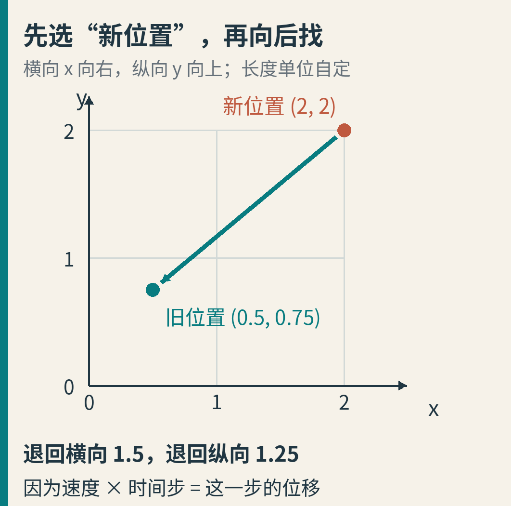

红点是正在填写的新位置，绿点是追查到的旧位置，绿箭头表示查找方向。图上的网格仍留在原地，没有被移动；倒着走的是我们的查询路径。

这叫 **回溯**。它不是把真实烟雾倒放，也不是说空气在倒流。

这样做的便利在于，每一个新位置都能主动问一次“我该去哪里取值”。如果只把旧样本的位置往前推，它们通常不会正好落在新网格上，还需要另外决定怎样把值分配给新格子。回溯采样选择了另一条路。

这里还有一个近似：我们拿一个速度，把这一步的路径当成直线。如果路径经过的地方速度不同，真正的轨迹会弯；时间步太大，回到的位置就可能不准。稍后讨论“稳定”时，这一点不会消失。

## 4. 旧位置没有存数字，怎么办？

旧表只在固定样本处存数，而(0.5,0.75)落在四个样本中间。

给这四个样本安排一组简单的染料读数：

- 左下(0,0)：0
- 右下(1,0)：4
- 左上(0,1)：8
- 右上(1,1)：12

注意，括号是位置，冒号后的数才是染料。染料读数12不表示这个点位于x=12，也不表示速度为12。

先沿横向估。x=0.5在左右两端正中间，所以：

- 下边0和4的中间值是2
- 上边8和12的中间值是10

再沿纵向估。y=0.75表示从下向上走了四分之三，因此更接近上边的10：

**2 × 0.25 + 10 × 0.75 = 0.5 + 7.5 = 8。**

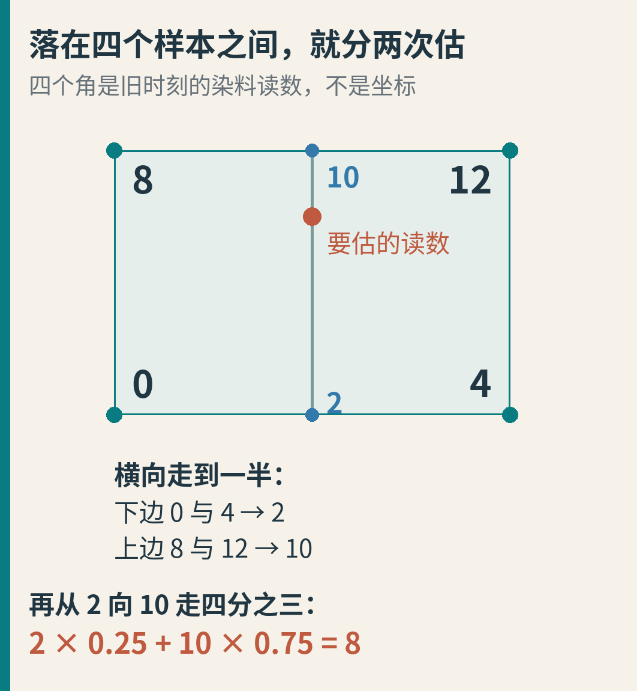

先看下边和上边的蓝色中间值，再看红点。这个过程叫 **双线性插值**：横向做一次按距离加权的估计，纵向再做一次。它没有凭空知道两点之间的真实情况，只是作了一个明确、便宜、可重复的近似。

现在把8写入新表的(2,2)。就完成了一个新样本的搬运。

其他新位置也做同样的事情：选定位置，退回位移，找四个旧样本，按相对距离混合。整个新表都填完后，才把它换成下一步的旧表。不能一边覆盖旧表，一边让后面的样本误读已经更新过的数据。

如果你把这一步的横向速度换成1，新的回溯位置就是(1,0.75)。它恰好落在右边上，读数变为4×0.25 + 12×0.75 = 10。你不需要改整套方法，只需要重新算来源位置和权重。

## 5. 这种搬法，为什么有助于避免“数值爆炸”？

把刚才的两次插值展开，8实际上来自：

**0×1/8 + 4×1/8 + 8×3/8 + 12×3/8。**

四个权重都不小于0，加起来正好等于1。这像按比例混合四份浓淡不同的颜色：结果不会比最浓的一份还浓，也不会比最淡的一份还淡。

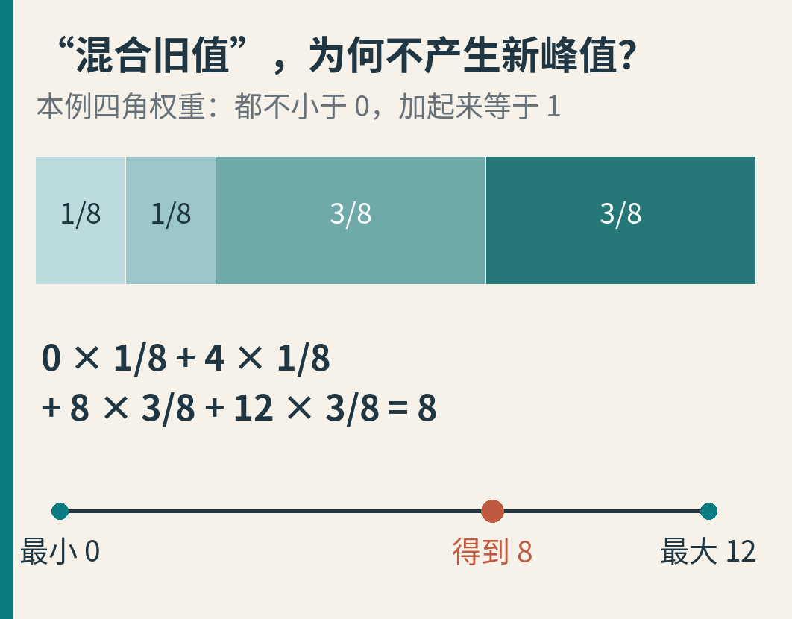

图中四段宽度对应各自的权重；数轴上的红点8落在0到12之间。只要沿用这样的插值，即使查询位置跨过了许多格，它仍然是在旧样本之间取加权平均。对这个搬运步骤来说，不会因为取样本身制造出越来越大的新峰值。

这件事为什么值得在意？换一种看起来也很自然的更新规则，就可能出问题。

暂时把二维平面缩成一排等宽的格子，首尾相接。每格宽1，空气每一步向右移动1.5格。有一种简单的 **显式上风更新**，先用旧值算这一格流出多少、左邻流入多少：

**新值 = 旧值 + 1.5×(左邻旧值 − 本格旧值)。**

这里的1.5是“一步走过的距离÷一格宽度”。“显式”表示右边全是已经知道的旧数字；“上风”表示流入信息取自空气迎面来的那一边。

如果本格为1、左邻为0，就得到1 + 1.5×(0−1) = **−0.5**。染料怎么会有负数？另一端还会出现1.5，超过原来最浓的1。

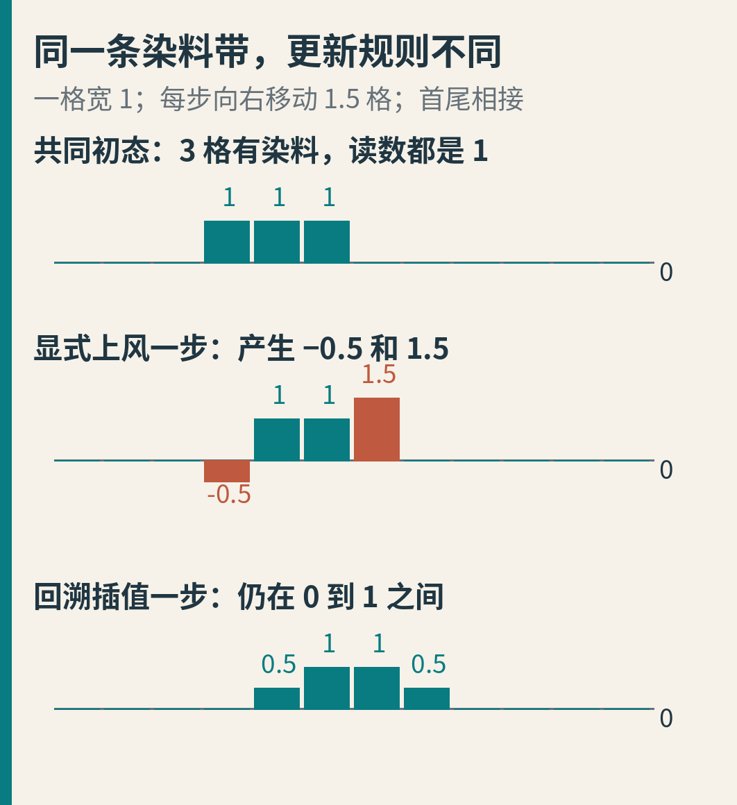

从上到下是共同初态、显式上风一步、回溯插值一步。柱子高度表示染料读数，水平线为0；红柱标出跑出0到1范围的数。下图的0.5来自两个旧格各取一半。

这个例子的显式更新也可写成“−0.5×本格旧值 + 1.5×左邻旧值”。负权重破坏了刚才的混合保证。继续反复算，误差就可能越放越大。

**这不是说所有显式方法都不能用。** 对这里选定的上风公式，把一步移动距离限制在一格以内，就能保住非负权重；其他方法还有自己的稳定条件。Stable Fluids的吸引力之一，是把搬运改成回溯取样，减轻这类时间步限制带来的麻烦。

但“不会因这种机制爆炸”，不等于“随便取多大的时间步都准确”。一条本来绕着涡旋弯曲的路径，仍可能被我们的直线回溯抄了近路。

## 6. 颜色会搬了，空气本身的速度从哪里来？

前面暂时把速度当成已知。完整动画却需要更新速度本身，否则我们只是在一幅不会变化的风向图里搬颜色。

空气运动至少要处理几件不同的事：

1. 外力改变速度，例如风机推动，或热空气受到浮力。
2. 流动把运动信息带向别处，速度场本身也需要搬运。
3. 黏性让相邻位置的速度差逐渐缓和。
4. 调整速度，让不可压缩模型中的每个小区域不凭空积多或减少空气。

第二项看起来像“速度搬速度”。实现上可以先冻结这一阶段所用的旧速度，再分别回溯取出横向速度、纵向速度的新值。两个分量都必须读取同一阶段的旧数据，不能先覆盖横向速度，再让纵向速度读到一半新、一半旧的场。

第三项和第四项还没解释。它们分别引向 **隐式扩散** 和 **投影**。我们先看只有两个格子的扩散，再用四个格子讲投影。

## 7. “隐式”不是隐藏公式，而是把新值一起求出来

这里换成独立的封闭两格模型，先用染料浓度讲扩散：左格0，右格12。扩散会把高处的一部分传到低处，直到差异逐渐减小。

速度的黏性扩散也有“平滑邻近差异”的作用，但它平滑的是速度分量；染料扩散平滑的是染料。二者的系数可以不同，不要因为都用了相似计算，就当成同一个物理量。

为了手算，把扩散强度、时间步和格距合并后的系数取为1。隐式更新用的是 **未知的新差值**：

- 新左 = 0 + (新右 − 新左)
- 新右 = 12 + (新左 − 新右)

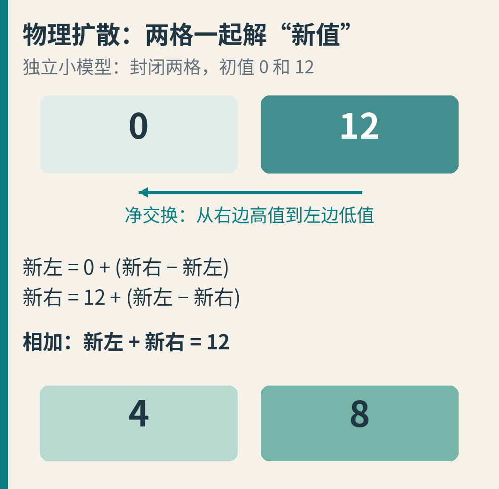

不能先算新左，因为新右还不知道；也不能先算新右。这两条关系得一起满足。

把两式相加，括号里的交换量互相抵消，得到“新左 + 新右 = 12”。再看第一式，它说“2×新左 = 新右”。于是总共三份“新左”等于12，算出 **新左4、新右8**。

原来(0,12)的差距变成(4,8)，总和仍为12。这是这个封闭两格模型的结果，不是对任何离散程序的守恒担保。

如果系数不是1，而是任意非负数a，同样整理会得到：新左 = 12a/(1+2a)，新右 = 12(1+a)/(1+2a)。a越来越大时，两者都趋近6，而不是越过彼此后反复放大振荡。这给出隐式扩散为什么适合较大时间步的一种最小直觉。

在大网格里，不再只联立两条关系，而是一大组。它算起来比直接套旧值复杂一些，却换来了有用的稳定性。注意：它仍在近似随时间变化的过程，稳定不保证每一步的误差很小。

## 8. 为什么搬完速度，还要再改一次？

设想一个固定大小的格子，每单位时间左边有3份空气流进来，右边只有1份流出去，上下又都不通。

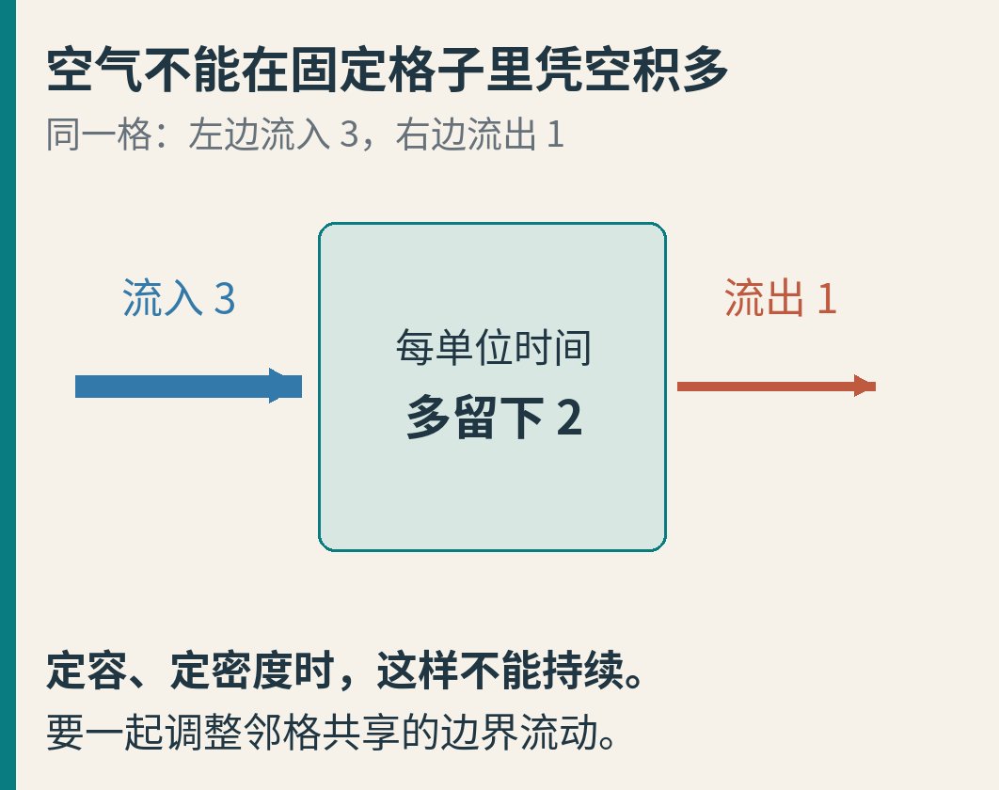

多出来的2份怎么办？

现实气体可以压缩，但本文采用的是 **不可压缩近似**：把每个固定体积里空气的密度视为不变。因此不能一直多流入少流出，也不能一直多流出少流入。

这里的空气密度，与显示颜色用的染料读数，是两回事。一个区域可以越来越亮，因为别处较浓的染料流了进来；这不表示空气本身被越挤越密。

我们把“总流出减总流入”称为 **净流出**。不可压缩要求每个格子的净流出为0。把它再按格子大小换算成单位体积的量，就是数值方法里要检查的 **散度**。

刚才对速度进行搬运、施加外力以后，这项条件不一定还成立。程序需要做一次整体校正。这个步骤叫 **投影**。

它要消掉的是不合约束的挤压，不是把所有速度清零。关键在“整体”：两个邻格之间的那条边，是同一股流动。你在左格减少流出，也就改变了右格的流入，不能各自算完再假装它们互不影响。

## 9. 用四个格子，看见“整体校正”在校正什么

这次换成一个2×2的封闭小盒子。外墙不漏，里面只有四条共享边。上排为A、B，下排为C、D。

为了只算加减，所有格子、内边面积和时间单位都归一化。箭头上的数表示每单位时间穿过边的体积流量。正方向约定为 **向右、向下**；负数就表示实际流向相反。这个向下的约定只用于四格图，不是把前面回溯坐标的y轴偷偷翻转。

初始情况：上边A→B为3，下边C→D为1，两条竖边为0。

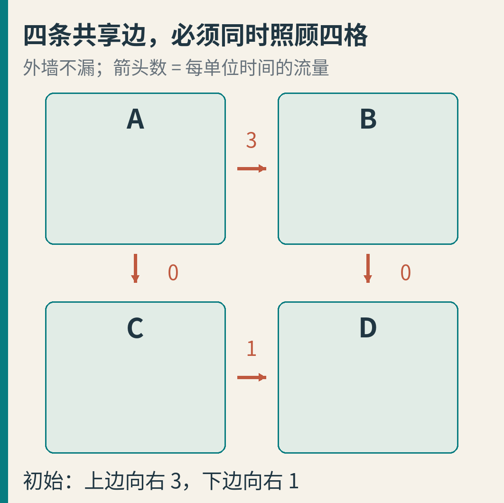

A只有流出3，B只有流入3；C流出1，D流入1。四格合起来并没有漏掉空气，但每一格都不满足自身的平衡。

一种粗暴修法是把四条边全归零。它的确平衡，却把本来可以保留的流动也一起抹掉了。

我们采用另一种规则：给每格一个校正数q。对任意一条从左格指向右格的边，先算“右格q − 左格q”，再从原来的流量里减去这个差值。竖边同理，使用“下格q − 上格q”。

例如A→B原来为3，校正后就是：

**3 − (qB − qA)。**

这个规则与压力作用的方向相符：如果B的校正数更高，就削弱朝B流去的速度。这里已经把时间、密度和格距等因子吸收进q的定义；q是本教学模型的校正势，不能把2.5读成真实空气的2.5帕。

真正的问题变成：怎样选这四个数，使四格同时平衡？

## 10. 四个校正数，不是凭感觉填的

先把A的q取为0。这样做不损失一般性，因为每条边只使用两格的差；给所有q加上同一个数，不会改变任何一条流量。

用b、c、d分别简写B、C、D的q。我们逐格写要求。

**A格：** 向右是3−b，向下是−c。两项相加要为0，所以 **b+c=3**。

**B格：** 朝左的流量是b−3，朝下是b−d。相加为0，所以 **2b−d=3**。

**C格：** 朝上的流量是c，朝右是1−d+c。相加为0，所以 **d−2c=1**。

这三条一起求：后两条分别给出d=2b−3、d=2c+1，所以b−c=2。再与b+c=3相加，得到2b=5。

于是 **b=2.5，c=0.5，d=2**。

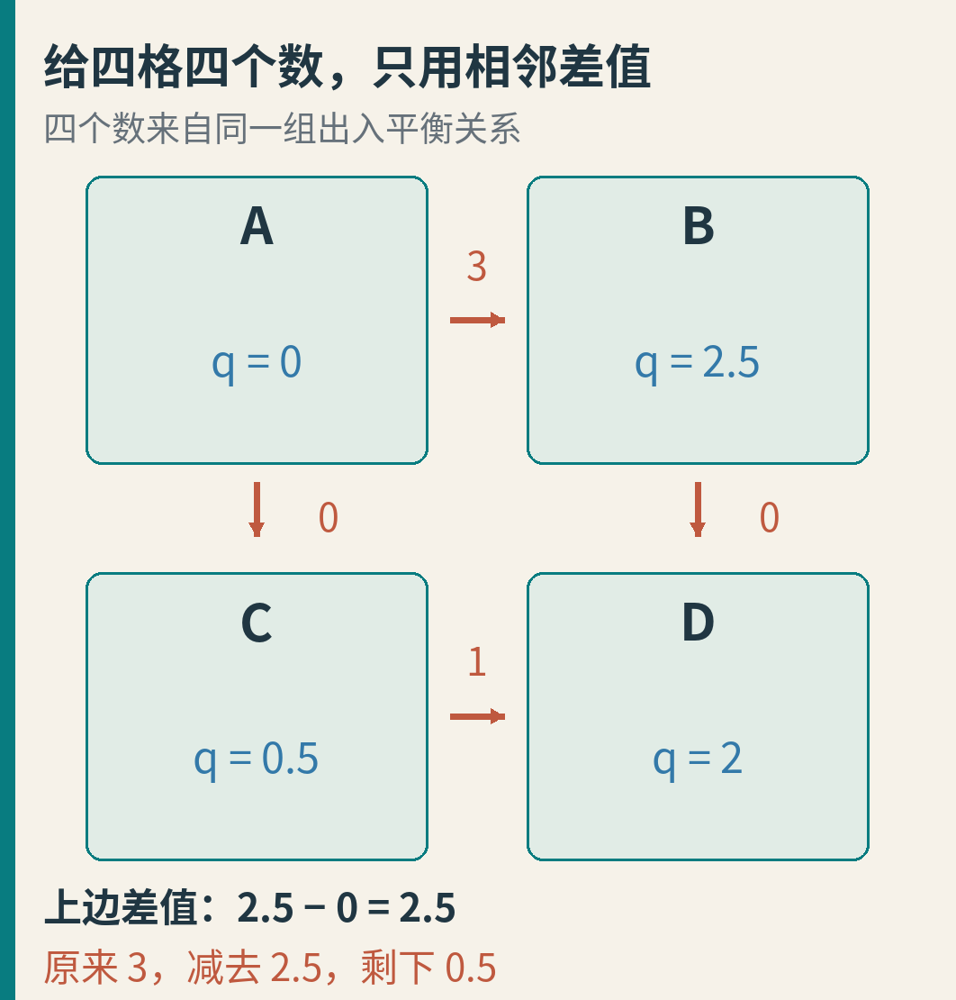

蓝色q是刚算出的校正数，红箭头仍显示校正前的流量。现在逐条检查它们产生什么变化：

- A→B：3 − (2.5−0) = **0.5**
- C→D：1 − (2−0.5) = **−0.5**
- A→C：0 − (0.5−0) = **−0.5**
- B→D：0 − (2−2.5) = **0.5**

两条负数意味着实际往反方向走。于是得到下面的环流。

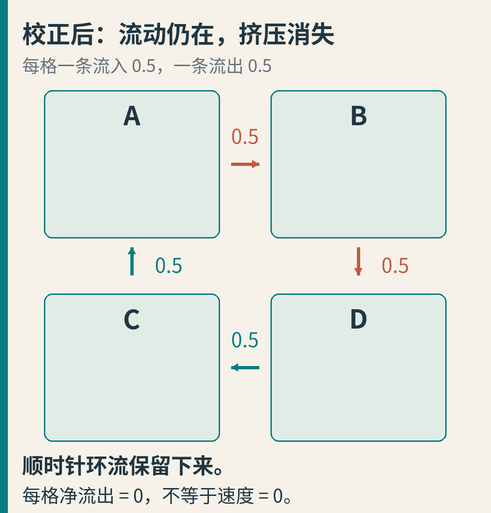

从A出发，顺着A→B→D→C→A走，每条边都是0.5。每格都流入0.5、流出0.5，D也自动满足了平衡。**空气仍在流，格子却不会越挤越多或越来越空。**

这就是这次投影保留下来的部分。它不是为了制造一个装饰性的旋涡，而是按同一组相邻差值去掉不满足条件的部分，原本允许的环流仍然存在。

在大网格里，道理没有换，只是未知数和相邻关系更多。这样的关系组成一个叫 **泊松方程** 的问题。程序需要把它们一起求解；不能用“每格随便减掉一点散度”代替共享边上的一致更新。

## 11. 把四格换成真正运行的网格

开头的完整模拟使用64×64个格子。与刚才封闭的四格盒子不同，它的边界首尾相接：从右边出去会从左边回来，从上边出去会从下边回来。它适合做循环的教学场景，不是一间有墙的真实房间。

程序还采用一种存数方式：染料和q放在格子中心，横向速度放在竖边中点，纵向速度放在横边中点。这样，两格共享的边自然只存一份速度。

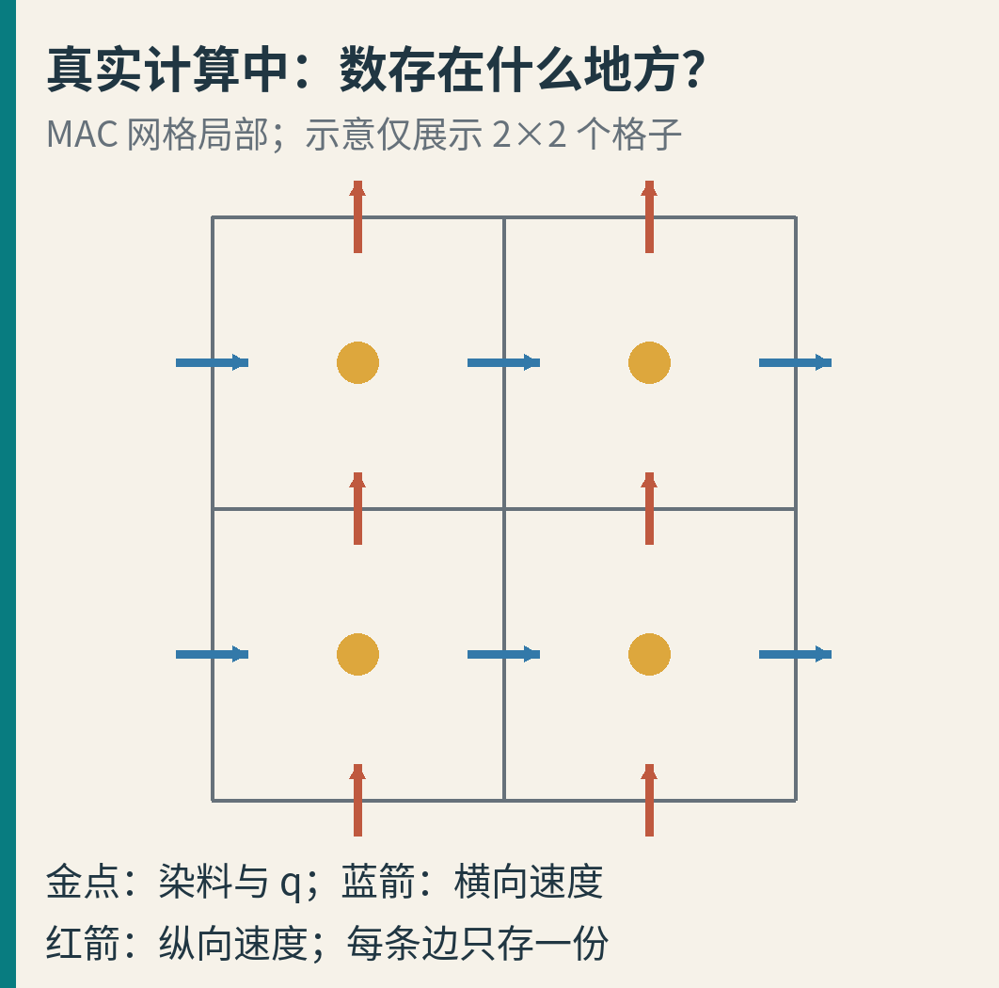

金点是染料和q，蓝箭头只代表横向分量的存储位置，红箭头只代表纵向分量的位置；这张图是位置示意，不是此刻真的处处向右、向上流动。

这种安排通常叫 **MAC交错网格**。本文选择它，是为了让“边上存速度、格内检查出入”的关系容易核对。1999原论文的实现把速度存在格心，不能把这里的布置冒称它的原代码。

一个格子的散度，按本程序的约定计算为：

**(右边横向速度 − 左边横向速度 + 上边纵向速度 − 下边纵向速度) ÷ 格宽。**

为何是减？右边向右的速度属于流出，左边向右的速度属于流入；上边、下边同理。四条边面积相同，除以格宽就完成了从边速度到单位体积净流出的换算。这里回到通常的y向上坐标，和四格流量图的向下记号已明确分开。

下图是本次第1步：先回溯更新速度，再做投影。左右两幅的红蓝热图使用相同范围，不自动各自放大。

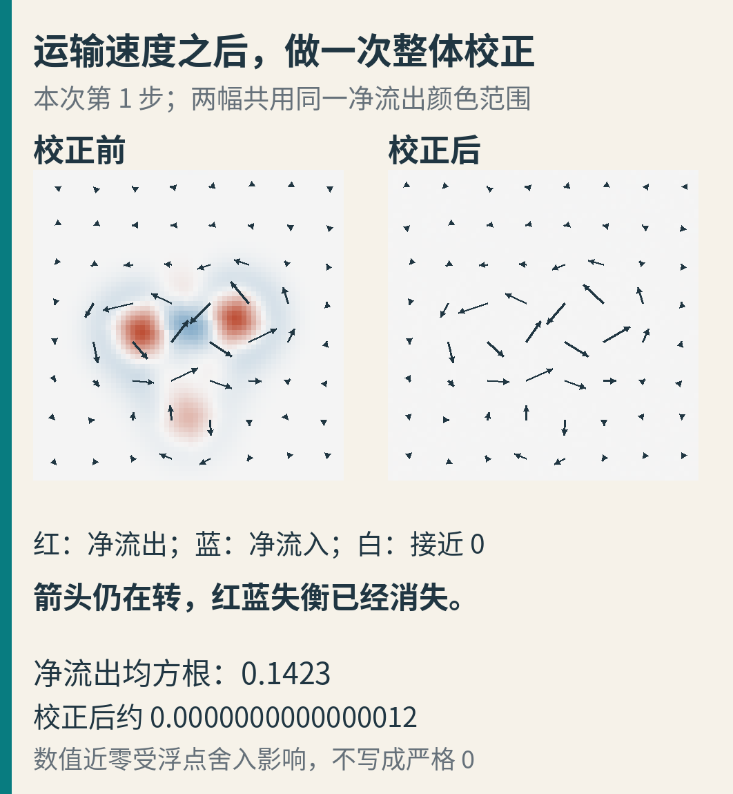

红色表示净流出，蓝色表示净流入，白色表示接近0。深色箭头是同位置的速度。校正后几乎全白，却还看得见转动的箭头。

把各格散度平方后求平均，再开平方，得到一个汇总大小，叫 **均方根**。这次从约0.1423降到约0.0000000000000012。它是这套周期网格、双精度浮点和求解方法的实测结果，不是所有流体程序都会达到的精度。

本程序借助FFT快速求解周期网格上的那组线性关系。FFT在这里是求解工具，不是产生涡旋的原因。更重要的是：检查散度、计算相邻差值、求解方程使用了相容的离散规则，所以校正后检查的正是之前要消掉的那一项。

## 12. 现在才能把一帧接起来

把前面几个动作按程序的次序放到一起：

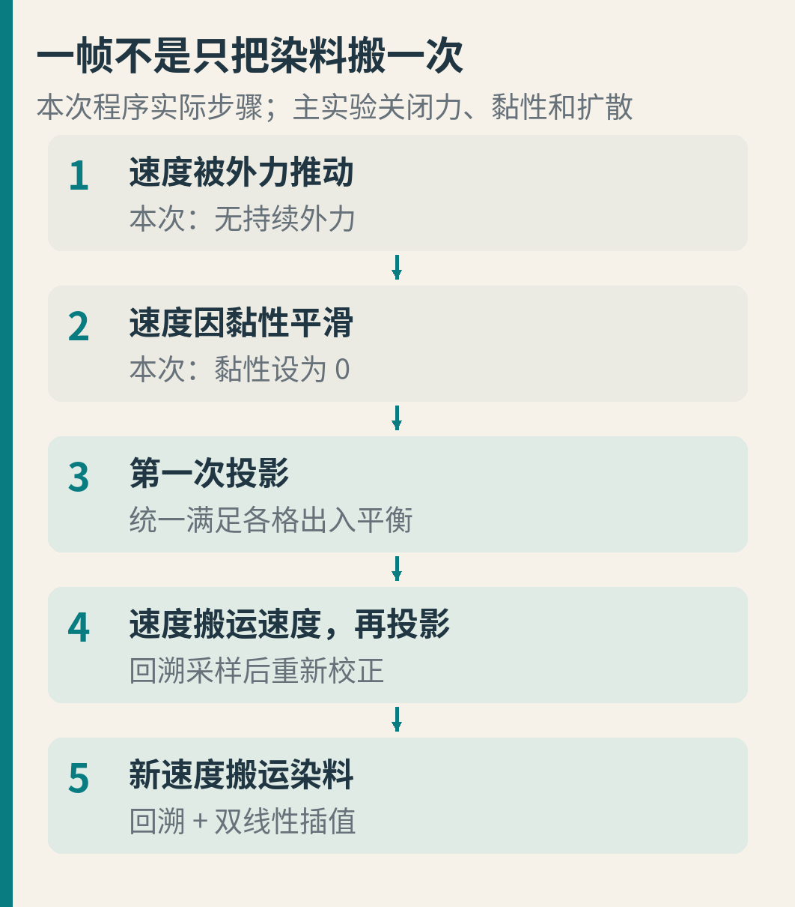

主实验一开始给定速度，此后没有持续外力；黏性与染料扩散系数也都设为0。因此图中前两项不改变它，但保留了它们在完整方法中的位置。

第一次投影，让准备拿来搬运的速度满足出入平衡。接着用它回溯更新速度本身。插值以后，平衡可能被破坏，于是再投影一次。最后用更新后的速度搬运染料。

这一次序接近Stam在2003年教学版本中的安排；1999论文列出的分步次序有所不同，回溯轨迹的求法也更复杂。本文用一次直线退步简化回溯，不能据此断言历史算法只有这一种实现。[2003作者原文](https://www.josstam.com/_files/ugd/cf1fd6_9989229efbd34a26ba5ccd913721a2ac.pdf)

如果把颜色去掉，速度表仍会继续更新。把颜色重新撒进去，它就会显出这时的流动。你可以把染料当作观察这套数字运动的窗口。

## 13. Stable这个名字，承诺了什么，又没有承诺什么？

最容易产生的误解是：“既然稳定，就可以放心把时间步开得特别大，而且结果一定像真实空气。”

我们已经看见，回溯插值的好处是限制新极值，隐式扩散也避免了某些简单更新的放大问题。它们使动画更容易持续运行，却没有替我们保证轨迹精度、细节锐利度或染料总量。

看同一次实验更晚的状态。

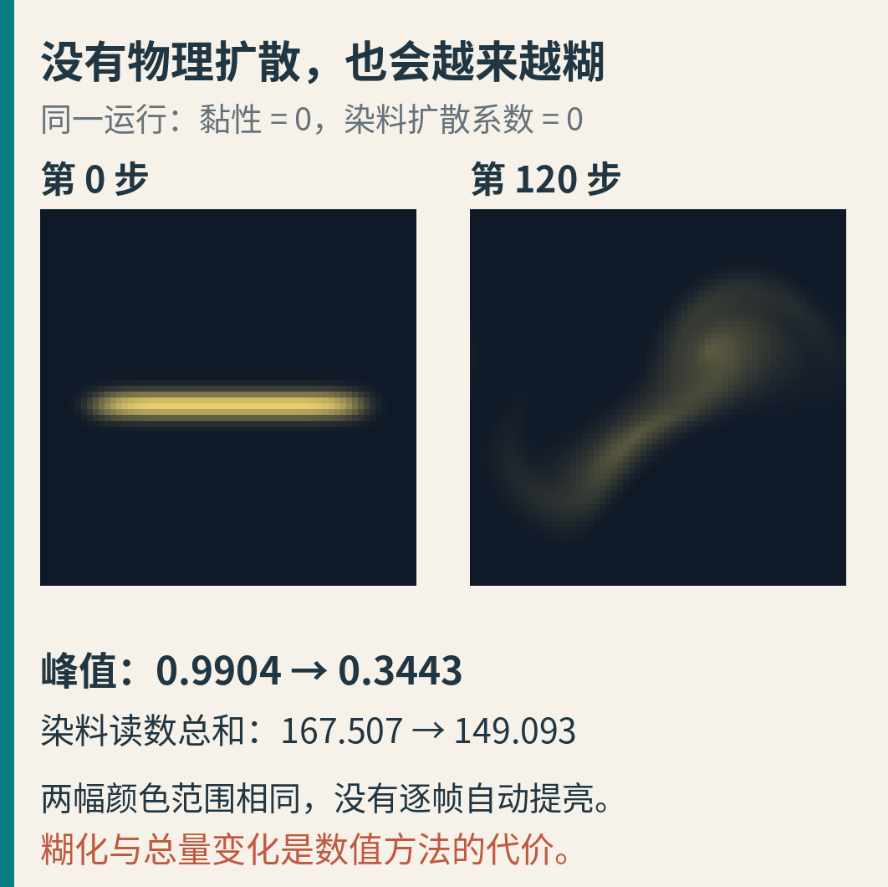

左右仍使用相同亮度范围。到第120步，染料峰值从约0.9904降到0.3443；所有格子的染料读数相加，从约167.507变成149.093。因为各格面积相同，这个总和的比例变化也就是“总染料量估计”的比例变化，约减少11.0%。

我们明明把物理黏性和染料扩散都设成0，为什么仍然糊？

因为一次插值会把多个旧值混起来；下一次又在上次混过的结果上混。原来的锐利边缘逐渐失去。这叫 **数值耗散**，是计算方法带来的效果，不应偷偷解释成“空气本来就有黏性”。

染料总和的变化又是另一项检查。前面保证的是“每个新值由一组加起来等于1的权重生成”。要让全表总和不变，还得保证每个旧样本被全体新位置取用的总权重恰好合适。一般的回溯插值没有自动做到这一点。

所以，**速度场已经满足不可压缩约束，并不能自动推出染料的离散搬运严格守恒。** 这两件事必须分别测。Stam在1999原文中也明确指出，数值耗散会使流动衰减过快，它的精度并不适合多数工程用途。[原论文，PDF第2页](https://www.josstam.com/_files/ugd/cf1fd6_898fe9b63df946689101b8d074f8efba.pdf)

## 14. 那就把时间步调小，能解决吗？

时间步变小通常有助于减少一次回溯的轨迹误差。但这不是消除所有误差的万能按钮，因为步数也变多了。

换成一个更容易核对的独立实验：一排64个样本，首尾相接，一段平顶染料只做恒速向右平移，总共移动16格。真实答案只是把原形平移16格，边缘不会变圆。

比较三种走法：每步1格走16次；每步0.5格走32次；每步0.25格走64次。

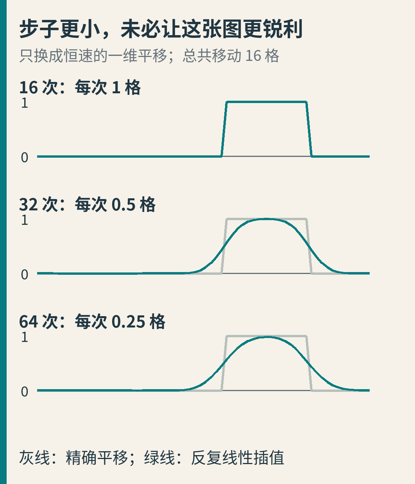

灰线是精确平移的轮廓，绿线是实际反复插值后的读数。横向从左到右仍是样本位置，纵向越高表示染料越多，三行用相同尺度。

第一行每次都恰好查到一个旧样本，不需要混合，因而保持平顶。后两行每次都混合邻居，边缘逐渐变圆。它没有推翻“小时间步有助于某些精度”的结论，只是提醒我们：**轨迹误差和反复插值的糊化不是同一种误差。**

提高分辨率、采用更高阶的回溯或插值、对耗散作补偿，都是后续可以研究的方向；这些办法也会增加计算量，有些还需要限制新极值。这里不把一个基础教学求解器包装成现成的游戏特效系统。

## 15. 回到那团烟

现在再看开头的四幅图，可以把它们拆成两层：

一层是颜色怎样搬。对每个新位置，先用速度回到旧位置，再从附近旧样本估一个染料值。我们实际算过一次：从(2,2)退回(0.5,0.75)，四个读数0、4、8、12混成8。

另一层是空气怎样继续流。它的速度会被搬运，也可能受到力和黏性的影响；随后通过共享边上的整体校正，让每个格子的出入重新平衡。我们也实际算过一次：四格原来两股向右流动，校正成每条边0.5的环流。

这两层合起来，颜色才会被一片会变化的空气卷动，而不是只沿着固定路径播放。

Stable Fluids有意思的地方，在于它接受了一个面向动画的取舍：用可控制的近似换取更容易持续交互的流动，同时留下值得继续研究的问题。为什么小涡旋衰减得快？如何更好地保存染料总量？什么时候需要三维、温度、障碍物或真正的水面？这些都能从我们已经算清楚的一步继续追下去。

## 可选：复算本次结果

[复现说明与代码入口](README.md)提供原创求解器、固定输入、检查项和制图脚本。正文的理解不依赖安装或运行它们。

本次环境为Python 3.12.14、NumPy 2.3.5；图像用Pillow 12.3.0生成。主运行使用64×64周期MAC网格、时间步0.04、120步、一次直线回溯与双线性插值，初始速度固定，物理黏性和染料扩散系数均为0。它不是流体工程精度验证，不模拟烟的燃烧、三维光照，也没有处理水面的自由边界。

历史依据、全部视觉素材来源、各图职责与AI辅助说明见[资料与素材清单](sources.md)。
