# 不运行程序，怎样证明数组下标不会越界？

一个数组有八个格子。你想把前n个格子清零，写出了这样一段小程序：

```python
# 已知：n是整数，而且0 <= n <= 8
# a有8个元素，合法下标是0到7

i = 0
while i < n:
    a[i] = 0
    i = i + 1
```

看起来很普通。现在把条件里的`<`改成`<=`，只多一笔，程序就可能走到不存在的第九个位置。


测试时输入n=3，两份程序都没有越界；输入n=8，第二份才露出问题。我们能不能不挑一个输入运行，而是拿到一份覆盖所有允许输入的理由？

这篇文章里的检查器不会逐条模拟每一种运行。它做的事情更像：**给变量画一圈范围，让所有真实可能的值都留在圈内；只要这圈范围始终避开危险位置，就能排除这一类错误。**

这种方法叫抽象解释。名字听起来抽象，我们先从八个格子开始，逐步造出一个能理解的检查器。

## 1. 先问清楚：我们要证明哪一件事？

目标不是“这个程序什么都对”，而是下面这句具体的话：

每当执行到`a[i] = 0`时，i都是0至7之间的整数。

这里的“每当”很重要。可能输入n=0，循环一次也不进入；也可能输入n=8，循环执行八次。每一条允许的运行，只要真正来到数组访问位置，下标就必须合法。

还要分清两个位置：

- **循环头**：准备判断`i < n`的地方。
- **访问位置**：条件成立，已经进入循环身体的地方。

n=8时，循环头确实会看到i=8。此时`8 < 8`不成立，程序退出，并没有访问`a[8]`。如果把这两个位置混在一起，就会把正确程序误判成越界。

把九种输入n=0至8全部运行后，可以画出下面的状态图。一个点代表一对(n,i)：横坐标是n，纵坐标是i。绿色点会执行数组访问；对角线上的橙色点到达循环头后退出。

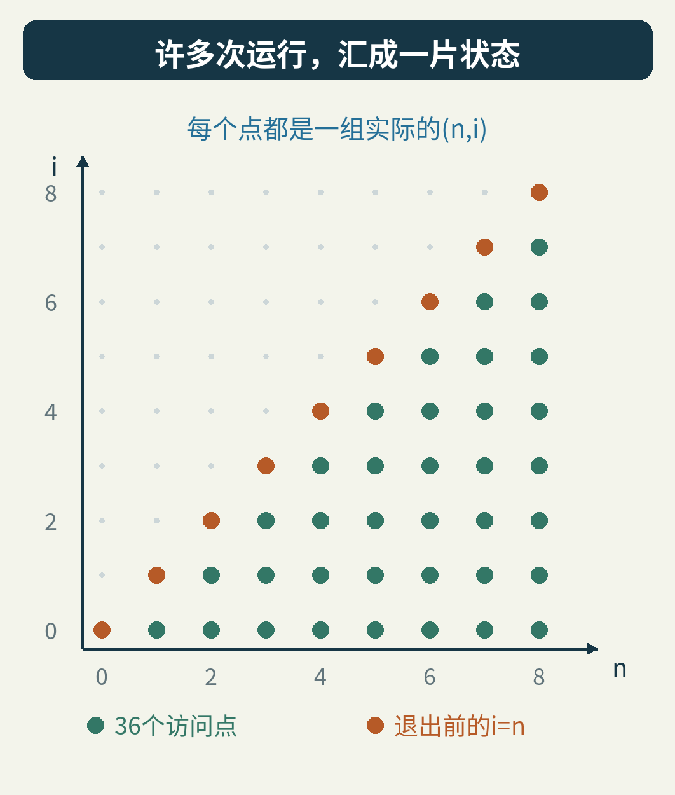

这张图来自附带程序的枚举结果，共36次合法访问。它让我们先看见答案。不过，后面的分析不是靠枚举这些点得出结论。枚举只是用来核对这个小例子，看看分析有没有说错。

为了把核心问题看清，本文先使用不会溢出的数学整数，n在循环中不变，数组长度固定为8。我们不在这里同时加入指针别名、并发修改或机器整数回绕。真实工具要把目标语言的这些规则也纳入模型。

## 2. 不记住每个值，只记住能罩住它们的范围

假设某个位置上的变量，实际只可能等于0、2、5。

准确记录的方法是保存集合{0,2,5}。如果可能值很多，这份记录就会越长越大。换一种记法，只保存最小值0和最大值5，得到区间[0,5]。

方括号表示包括端点。这里讨论整数，所以[0,5]装着0、1、2、3、4、5六个值。

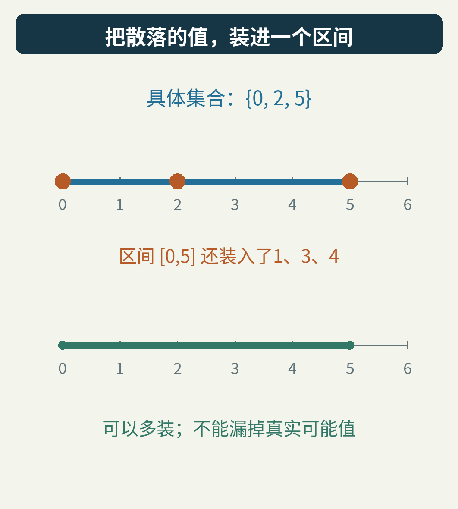

区间多装进了1、3、4。信息变粗了，但真正可能的三个值一个也没漏。

这是整个方法最重要的方向：

**允许把不可能发生的状态算进去，不能把可能发生的状态漏出去。**

“多装一点”的近似叫作过近似。它像一张罩住所有鱼的网：网里可以有空水域，但不能把某条鱼排除在外。

为什么要选这个方向？因为我们要证明“没有危险”。若连这张更大的网都没碰到危险区，里面的真实状态自然也不会碰到。反过来，网碰到了危险区，还不能断定鱼在那里；那也许只是多罩住的一块空水域。

抽象解释中的“抽象”，就是选择一种更简洁的信息表示。本例选择区间，也可以选择正负号、奇偶性或变量之间的关系。它们回答的问题不同，省下的计算和丢掉的信息也不同。

## 3. 用区间执行一次加法，是什么意思？

普通执行时，i是一个具体整数。比如i=4，执行`i = i + 1`以后变成5。

区间分析时，假设我们只知道i在[0,7]里。它会把两个端点各加1，得到[1,8]。

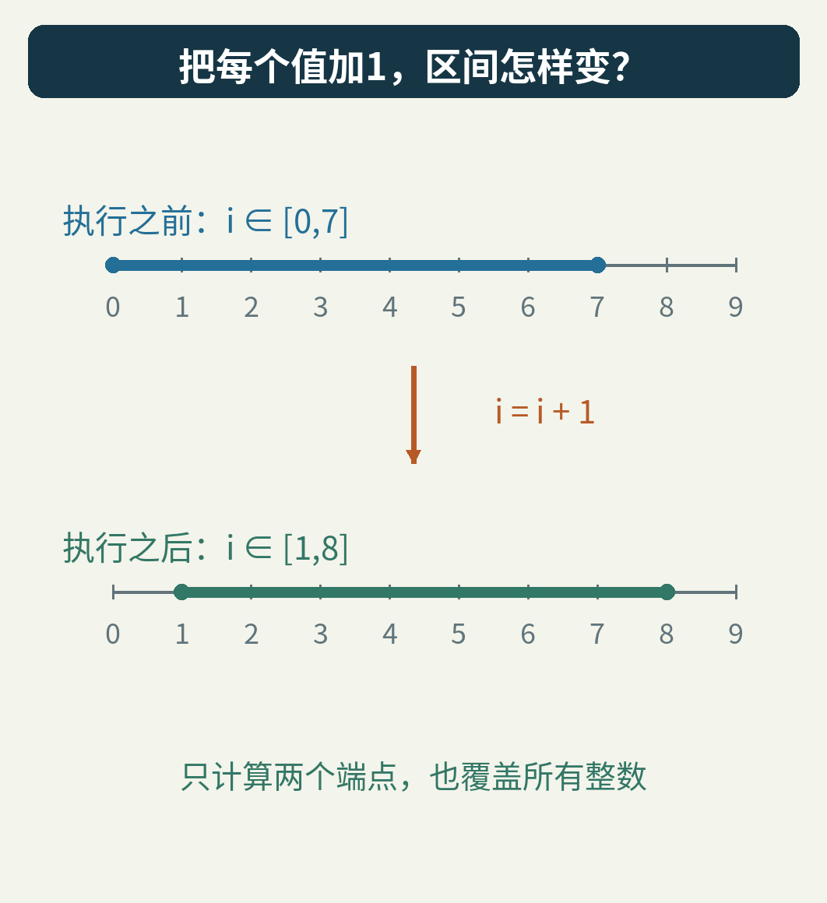

这不是猜测平均值，也不是随机挑几个数。对每个满足0≤i≤7的整数，把不等式同时加1，就得到1≤i+1≤8。规则覆盖了区间里每一个值。

如果两个变量分别在[a,b]和[c,d]，它们相加后的结果一定在[a+c,b+d]。因此可以用几次端点运算，替代逐个计算所有组合。

这种描述“一条语句怎样改变范围”的规则，叫作转移规则。所谓在抽象世界里解释程序，就是让这些范围跟着语句往下走。

规则必须服从真实运算的含义。例如，用数学整数的加法规则分析会回绕的无符号机器整数，就可能错得很严重。实际分析器不是只要把数字换成方括号就能成功；它必须忠实建模所检查的语言。

## 4. 两条路汇合，为什么范围会变宽？

再看一个小分支：

```python
if flag:
    i = 2
else:
    i = 6
# 两条路在这里汇合
```

从第一条路来，i等于2；从第二条路来，i等于6。汇合以后，分析器得同时容纳两种来路。

在区间表示里，能包含它们的最小区间是[2,6]。

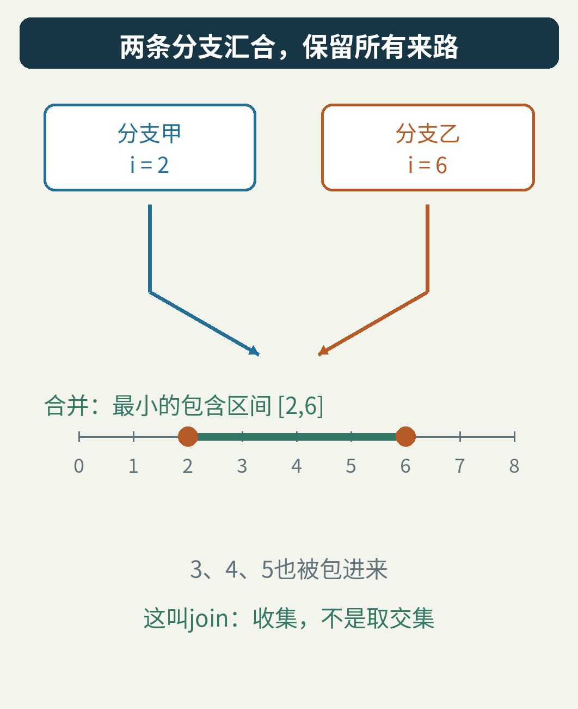

这个操作通常叫join，也就是合并。它取较小的下界和较大的上界：

[a,b]与[c,d]合并，得到[min(a,c), max(b,d)]。

注意它不是求交集。交集会问“两条路都允许哪些值”，可能把每条路各自真实发生的结果排除掉。汇合点需要回答的是“无论从哪条路来，都可能带来哪些值”。

多出来的3、4、5是简洁表示的代价。程序没有真的执行出这些值，而分析器暂时没有保留区分它们的信息。

## 5. 循环难在哪里？答案会沿着回边返回来

回到清空数组的循环。

第一次来到循环头，i来自入口赋值，等于0。以后再次来到循环头，i来自循环末尾的`i = i + 1`。同一个位置要接住两种来路。

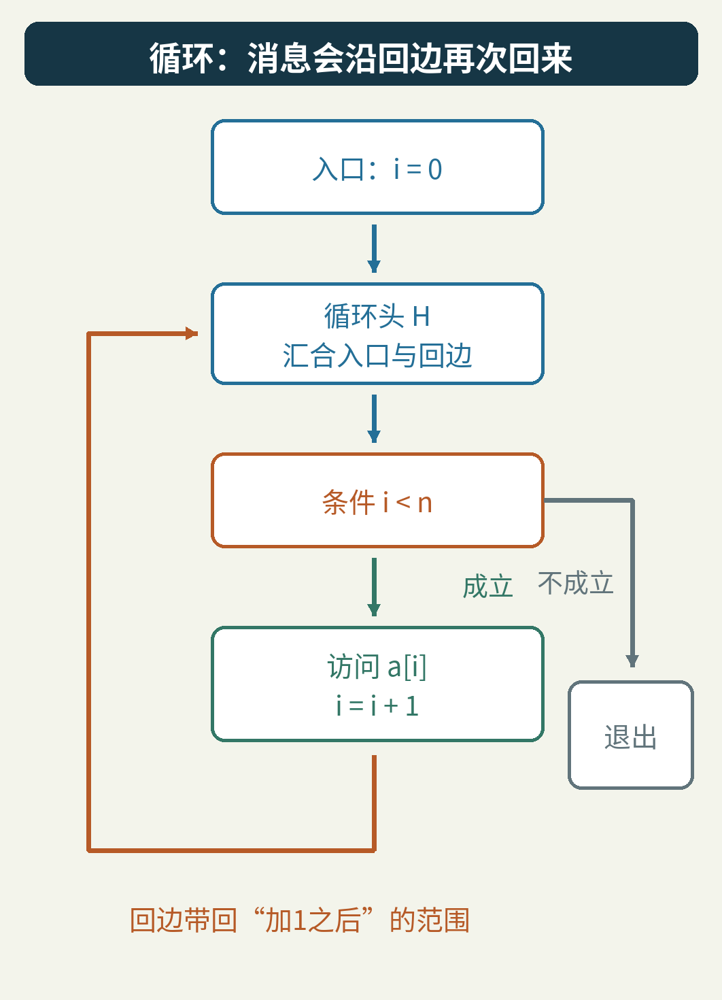

把循环头所允许的区间叫作H。不要急着把它当成答案，我们试着从入口出发，一轮轮补全它。

最初H=[0,0]。

- 进入循环的那些状态，i仍然是0。
- 加1以后，回边会带来1。
- 和入口的0合并，循环头需要扩大到[0,1]。

再传播一次，范围能带回2，于是得到[0,2]。接着是[0,3]、[0,4]……

这里的一“轮”指分析器沿循环传播一遍范围，并不等于真实程序执行了一次循环。分析器每轮处理的是一批可能状态。

条件也参与分析。已知n≤8，而进入循环必须满足i<n，那么进入身体的i至多是7。因为i是整数，“小于等于8的n，再比n小一点”意味着i≤7，不会出现7.9这种中间值。

所以，不管循环头收到了多大的上界，真正进入身体之前，还要经过这道条件筛选。

## 6. 范围不再变化时，为什么就可以停？

我们的小检查器实际得到下面的轨迹：

[0,0] → [0,1] → [0,2] → … → [0,8]。


到了H=[0,8]，再绕一圈看看：

1. 经过条件`i < n`，结合n≤8，进入身体的范围收窄为[0,7]。
2. 执行加1，得到[1,8]。
3. 和入口的[0,0]合并，又得到[0,8]。

答案回到了自己。这叫作**不动点**：把当前信息送进分析步骤，再取回来的信息没有改变。

如果喜欢公式，可以把刚才这一圈缩成：

F(H) = 入口区间，与“条件筛选H以后再加1”的结果合并。

在这里，F([0,8])=[0,8]。

但“算着算着不变了”还不是全部理由。真正支撑安全结论的是三个可以逐项检查的事实。

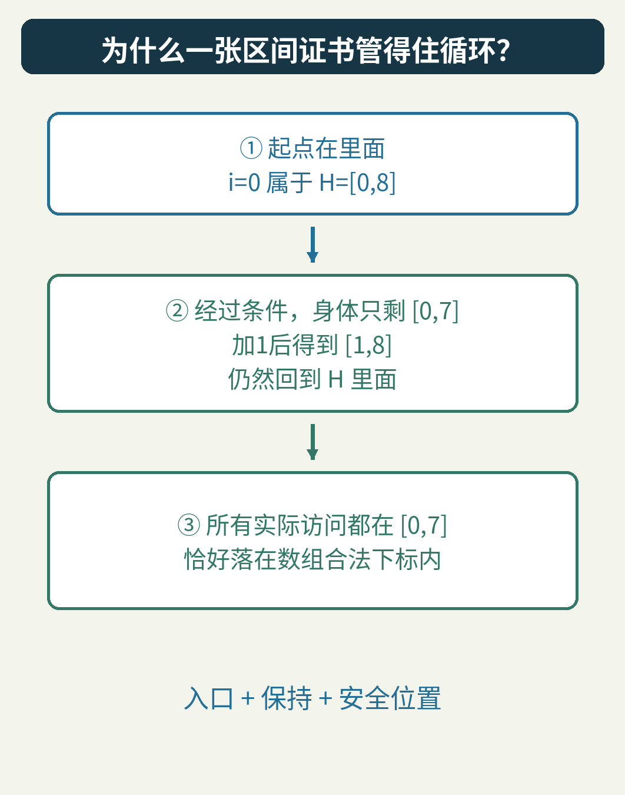

第一，起点在范围里。i=0确实属于[0,8]。

第二，只要从范围里的状态出发，执行一次允许的循环，再回来时仍然在范围里。这保证第一次不会逃出去，第二次也不会，第100万次同样不会。这样的性质叫循环不变式。“不变”指这条范围性质持续成立，不是说变量的值不再改变。

第三，在实际数组访问位置，经过条件筛选后的范围是[0,7]，全部位于合法下标之内。

这三点说明：无论某次运行循环了多少次，只要走到那条访问语句，下标就安全。

其实也不一定非要F(H)恰好等于H；只要入口被包含，而且F(H)完全包含在H内，就已经足够作为这种保持性证书。较宽的范围也能证明正确的事情。

## 7. 只改一个比较符号，检查器会看见什么？

现在把`i < n`改成`i <= n`。

条件成立时，i可以等于n。n又可以等于8，所以身体的下标范围变成[0,8]。加1后的回边范围为[1,9]，最终循环头得到[0,9]。

循环头的9不是数组访问本身。真正的警报来自访问位置里的8：它超出了合法范围[0,7]。

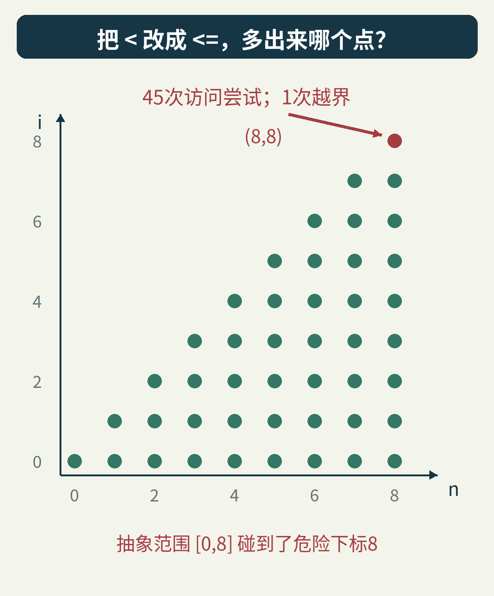

现在我们可以找到一条真实见证：取n=8，依次访问0、1、2、3、4、5、6、7之后，还会尝试访问8。这证明警报对应一个真错误。

附带程序把九种n都枚举了一遍，得到45次访问尝试，其中恰好一次越界，即(n,i)=(8,8)。这个计数是小例子的核对结果；分析器发出警报只需要观察区间与合法范围的关系，并不依赖先找齐45个点。

如果调用者只能保证n≤9，原来的`<`版本也不再安全。输入前提不是装饰，它是证明的一部分。分析器只能对它得到的前提负责。

## 8. 要是区间一直长，检查器会不会自己跑不完？

我们故意选了上界8，所以逐轮算到不动点很快。若上界是一万亿，每轮只把上界扩大1，就不划算了。

更明显的例子是没有退出限制的循环：从i=0开始，不断把i加1。循环头的区间会出现：

[0,0]、[0,1]、[0,2]、[0,3]……

每一步都比前一步宽，却始终没有一个有限的最终上界。

这里需要一种办法，让分析过程主动停止追逐每一个新整数。常见方法叫**加宽**，英文是widening。

一种简单策略是：先精细算几轮；以后若上界还在增长，就直接把上界放到+∞。

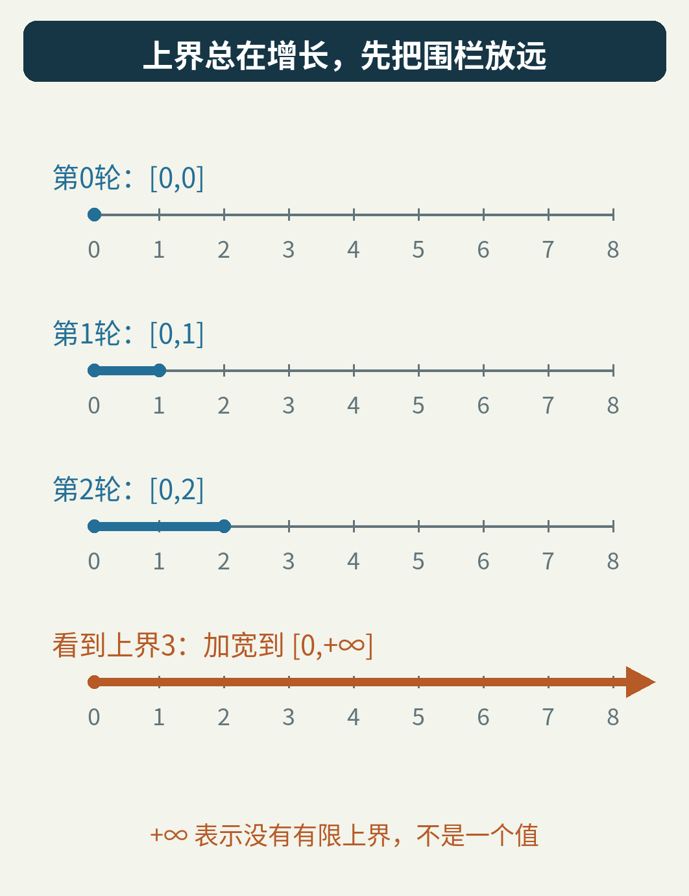

+∞在这里不是变量真的能取到的一个神奇整数，而是“目前不给它设有限上界”的记号。[0,+∞]包含所有非负整数。

这个跳跃非常保守，却没有漏掉任何已知可能值。对这里的简单整数区间加宽规则，一个端点一旦被放到无穷，就不再继续逐个扩大；因此这种增长不会无限拖住分析器。

别把两种终止混在一起：

- 分析器算完了，不代表被分析的程序一定会退出。
- 一个永远循环的程序，也可以始终不发生数组越界。

安全性质与终止性质是不同问题。加宽主要解决分析过程怎样收敛，不负责凭空证明所有程序都会结束。

## 9. 放得这么宽，还能证明数组安全吗？

很有意思：在我们原来的小循环里，能。

为了观察加宽的效果，附带程序虽然只处理上界8，也故意在看见上界从2增长到3时使用加宽，得到循环头H=[0,+∞]。

这个范围看起来松得没有边，但到达访问位置前，条件还在：i<n，而且n≤8。经过它筛选，身体又只剩[0,7]。

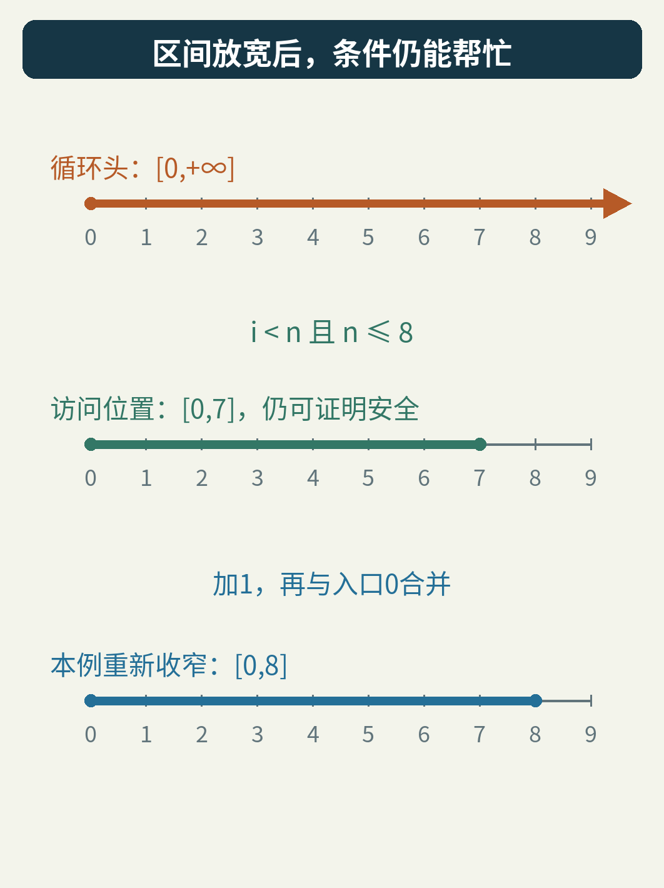

因此，访问安全仍然能够证明。我们需要精确的地方，是危险操作实际发生的位置，不必让程序每个位置的信息都同样精确。

还可以进一步恢复一些精度。在本例中，把[0,+∞]沿循环传播一遍，条件得到[0,7]，加1得到[1,8]，与入口合并得到[0,8]。再次传播仍为[0,8]。

这展示了**收窄**的想法：加宽先让分析稳定下来，再利用程序约束把范围缩回一些。本例一步就回到[0,8]。一般分析器需要有保持健全性与终止性的收窄规则，不能看到范围太大就随意删去自己不喜欢的值。

## 10. 为什么明明安全的程序，也会收到警报？

到目前为止，区间都帮了大忙。下面让它碰一次壁。

```python
# b有2个元素，合法下标为0、1
if flag:
    x = 0
    y = 1
else:
    x = 1
    y = 0
j = x + y
b[j] = 7
```

沿第一条路，(x,y)=(0,1)，j=1；沿第二条路，(x,y)=(1,0)，j也等于1。两条真实路径都安全。

如果在分支汇合处，检查器只给每个变量各自保存一个区间，它会得到：

x∈[0,1]，y∈[0,1]。

然后按区间加法，j∈[0,2]。2不在长度2的数组里，于是响起警报。

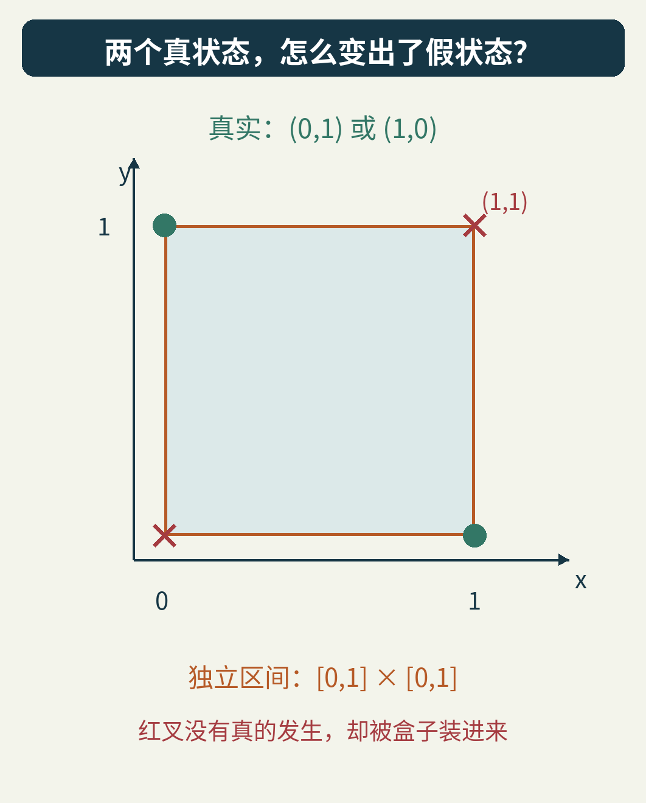

多出来的2是从哪里来的？从虚构的组合(x,y)=(1,1)来。真实程序从来不会同时把x和y设为1，但两个独立区间已经忘记了它们来自哪一条分支。

这种警报叫**假警报**：分析的过近似碰到了危险，真实运行却到不了那里。

假警报不一定意味着区间运算写错了。恰恰相反，这里的加法和合并都遵守了“不漏真实状态”的要求；问题在于它们保存的信息不足以排除虚构组合。

“健全”描述的是不漏掉模型范围内的真实错误，并不等于每次发出的警报都有真实错误。阅读一个分析工具的保证时，要分清它讨论的是哪种性质、哪套语义与哪些前提。

## 11. 提高精度，不只是把数字写得更多

刚才丢失的不是小数位，而是变量之间的联系：x与y相加总等于1。

可以有两种直观补法。

一种是暂时保留两份状态：(0,1)或(1,0)，让两条分支各自继续走到数组访问之后再合并。这样不会提前混搭变量。

另一种是使用能保存关系的抽象表示，直接记录x+y=1。它不用逐个列出所有整数对，而是保存一条连接变量的约束。

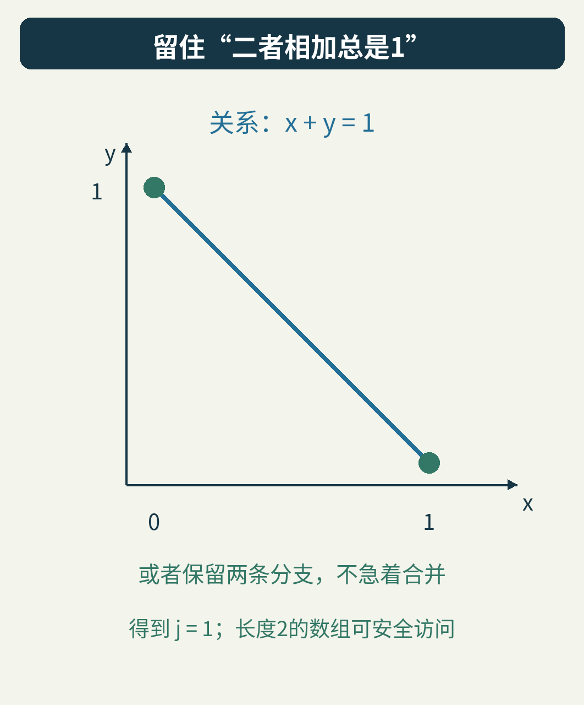

图里的斜线表达这条关系。在本文的整数、0至1范围内，线上只有两个允许的整数点，正好就是两条真实分支。

更有表达力的表示往往要付出更多计算和存储，但也不能简单地说“永远选最复杂的”。分析器可以只在导致警报的那一小段保留关系，在其他地方仍使用便宜的区间。不同抽象也可以互相传递约束。

所以，分析精度不是单独一个“多算几位”的旋钮。你要先问：是哪一种信息丢了？是变量的关联、路径条件、调用上下文，还是运算语义？补回对的问题，才有机会消除无用警报。

## 12. 从一个小区间，到真正的程序分析

1977年，Patrick Cousot与Radhia Cousot发表论文《Abstract interpretation: a unified lattice model for static analysis of programs by construction or approximation of fixpoints》，把程序语义、抽象表示和不动点计算放进统一的数学框架。[作者保存的论文入口](https://www.di.ens.fr/~cousot/COUSOTpapers/POPL77.shtml)

这里的价值不只是设计一种区间技巧，而是追问：抽象世界里的结论，为什么有资格说明真实程序？我们反复使用的“真实状态包含在近似范围里”，正是这条联系的直观入口。

后来，基于这一理论的分析器走进了大型工程。Astrée项目的历史页面记载，它在2003年对Airbus A340主飞控的一份约13.2万行C程序，自动证明了所检查的运行时错误不存在。这个例子涉及特定代码、模型与运行时性质，不能扩大成“证明飞机的一切行为都正确”。该项目也明确说明，过近似可能产生假警报，并通过组合抽象与领域信息改善精度。[Astrée项目说明](https://www.astree.ens.fr/)

本文没有运行Astrée，也没有把几十行教学程序包装成工业检查器。附带实现只处理已经写明的几个固定例子，不会读取任意Python或C源代码。

不过，它已经包含了一条完整的小链条：表示范围，传播语句，合并路径，处理循环，再检查危险操作。

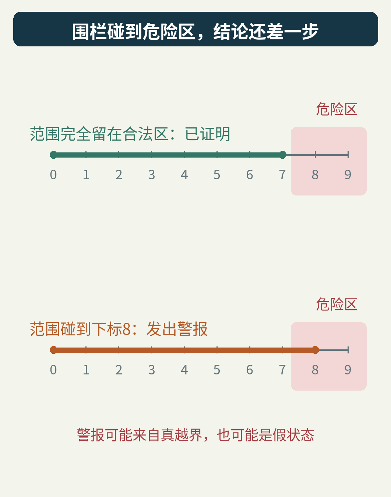

当你再次看到“静态检查通过”，可以问：它覆盖了什么语义和性质？当你看到一个警报，可以问：有真实执行见证，还是范围合并带来的虚构状态？

这比把工具当成一句“安全”或“不安全”的判词更有用。真正值得理解的是：**它保留了哪些信息，这些信息怎样沿程序流动，最后又为什么足以支持那个结论。**

## 可以自己追下去的两个问题

把原程序的入口改成i=1，会不会越界？它还会清空前n个元素吗？两问的答案并不一样：下标安全并不自动证明功能满足要求。

再把每次加1改成加2。区间仍能给出一个范围，但它会不会忘记“i一直是偶数”？如果数组访问的安全性依赖奇偶性，你会为检查器增加哪一种信息？

本地小实验的[运行方法与语义范围](README.md)、[程序](examples/run_intervals.py)、[完整结果](examples/expected-results.json)、[实际访问记录](examples/concrete-visits.csv)和[出处及图像授权](sources.md)都随文保存。正文、原创图与教学数据采用CC BY 4.0；原创代码使用MIT许可。
