# 照片为什么曾经要靠一桶桶电荷“接力搬运”？

想象一张只有十二个像素的照片。

十二个位置同时接住光，分别留下十二份记录。现在，芯片边缘有一个读数的地方。问题来了：中间那些像素的记录，怎样越过其他像素，到达出口，又不弄混原来的位置？

一种曾广泛用于数码相机、也用于科学仪器的答案很有意思：**让每个位置先积攒一包电荷，再把这些电荷包依次接力到出口。**

这就是CCD，Charge-Coupled Device，电荷耦合器件。这里的“CCD”说的是成像芯片，不是游戏物理里的连续碰撞检测。

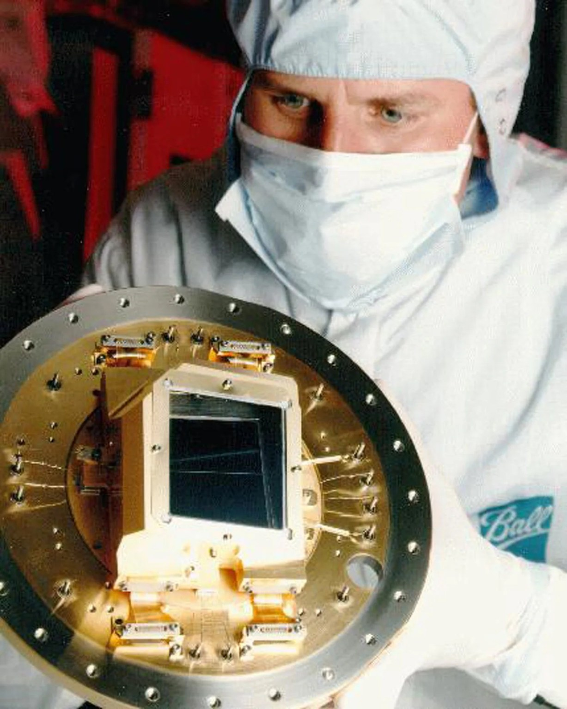

*真实器件照片，来源与署名：NASA。中央是探测器所在的组件，周围是封装及连接结构；这不是放大后的单个像素。NASA的[哈勃设计介绍](https://science.nasa.gov/mission/hubble/observatory/design/)提供原图与身份说明。照片未添加或生成器件细节。*

从这张照片里，你看不见电子的移动。但我们可以把过程缩成一个能在纸上追踪的小例子：十二包电荷，三排四列，一个出口。

## 1. 先别急着找0和1：照片最初存成了什么

光落到硅中，若被合适地吸收，可以产生电子与空穴。空穴可以先理解成电子离开后留下的、表现得像带正电的空位。这里讨论收集电子的CCD；不同器件也可以采用不同载流子和电压极性。

电场把产生的电子收集到对应像素的储存区域。亮一些的位置，一般能积攒更多信号电子；暗一些的位置，积攒得少一些。

因此，在曝光结束、尚未读出时，芯片保存的不是JPEG，也不是“红色255、绿色128”这样的现成数字，而是**不同位置有多少电荷**。

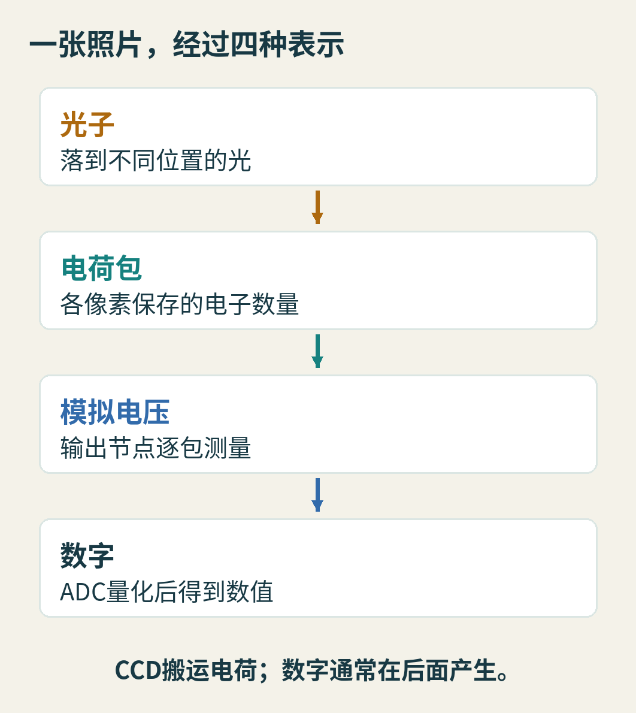

“曝光”就是让传感器在一段时间里接收光。为了看清数量关系，假设某个像素每秒收到1000个光子，当前波长下平均有一半最终贡献一个被收集的电子，曝光0.2秒。忽略其他来源的电子，期望信号为：

```text
1000光子/秒 × 0.2秒 × 0.5 = 100电子
```

这里的0.5叫量子效率：在这个简化可见光例子中，平均有多大比例的入射光子转成了被收集的信号电子。它会随波长和器件结构变化，不是所有CCD都取0.5。100电子也是平均意义的期望值，不承诺每次曝光恰好得到100个。[Teledyne的CCD工作原理说明](https://www.teledyne-e2v.com/en-us/Solutions_/Documents/2020-01-22_e2v_how-a-charge-coupled-device-works_web.pdf)解释了电荷收集、量子效率与后续读出。

这也让“多曝光一会儿”有了具体含义：在光稳定、未饱和等条件下，多给电子一些积累时间。不过，光照的统计波动、暗电流和读出电路都会带来误差，不能把“曝光两倍”理解成每一次测量都精确翻倍。

## 2. 不用真的挖坑，怎样把电子留在原地

可以把电子包想成放在小碗里的珠子。可硅片上并没有为了每个像素挖一个盛电子的空洞。

真正起作用的是电场。

硅上方有一排电极，通常叫栅极。栅极与硅之间隔着绝缘层。改变栅极电压，会改变硅中电子所处的能量环境。某些区域让电子处于较低的势能，周围又有较高的势垒，于是电子容易被约束在这个区域里。

这个能量上的“低洼处”，就叫势阱。

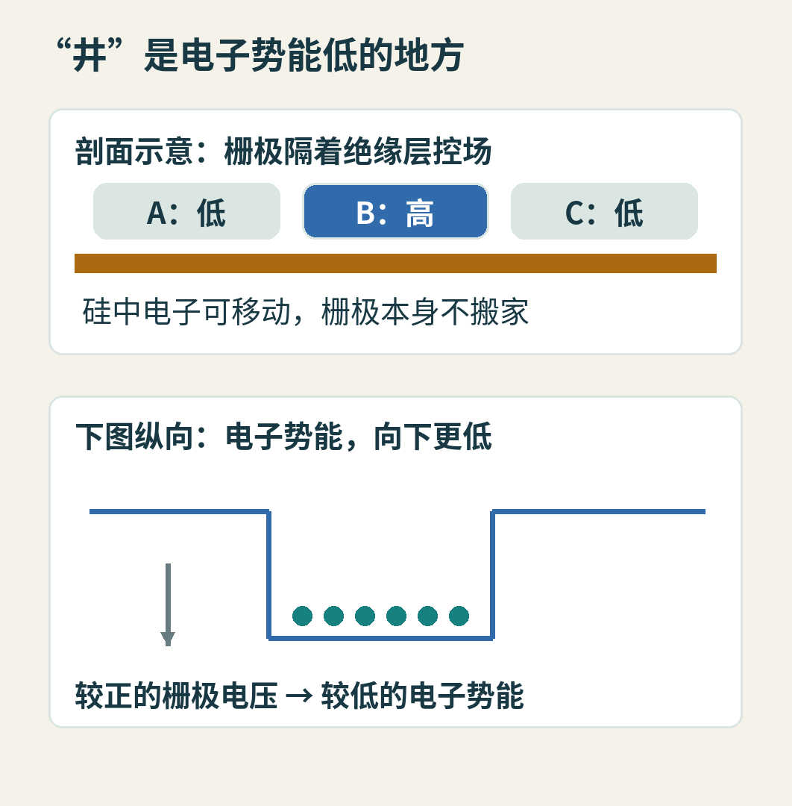

有一个方向很容易画反：**电子带负电。在这里所画的电子收集结构中，较正的栅极电压，能对应较低的电子势能。**图下半部的“越低”，说的是电子势能越低，不是栅极电压越低。

珠子和碗只是帮助理解“约束与转移”。真实电子受电场等因素影响，不是在重力作用下滚过一块有沟槽的板子；图中的直角台阶也不是求解半导体方程得到的精确势能曲线。

不同CCD的具体结构并不一样。实际科学CCD可以把电荷放在硅内部的埋沟道里，减少与表面的接触；两列之间也有抑制串流的结构。对眼前的问题，只需抓住一个关键：**栅极不动，改变电压，就能改变电子适合待在哪里。**

## 3. 如果只把旧“碗”撤掉，电子会不会乱跑

假设电子现在聚在A栅极下面。想把它送到右边B下面，最粗暴的办法似乎是先关掉A，再打开B。

但交接时最好不要让电荷突然失去合适的落脚处。

更容易理解的顺序是：

1. A先保持收集状态，B也逐渐打开，让相邻区域连成可交接的低势能区域。
2. 再撤去A的收集条件，把电荷留在B下面。
3. 接着用同样办法，从B交给C。

我们画一个三相结构。沿转移方向，栅极按A、B、C、A、B、C排列；所有A接同一路控制时钟，B、C各接另一路。“相”在这里表示几组按次序变化的控制信号，不是三种不同颜色的光。

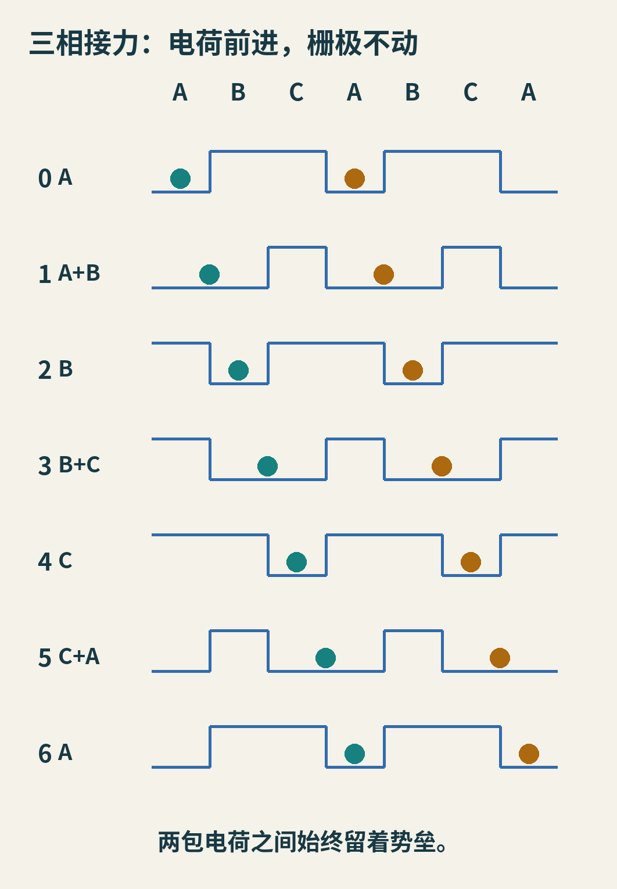

绿色和棕色的圆点代表两包电荷，用不同颜色只是为了让眼睛跟踪它们，电子本身没有这样的身份颜色。

按左侧编号读这张图：

- 0：电荷在A下面。
- 1：A与B共同维持可交接区域。
- 2：电荷留在B下面。
- 3：B向C交接。
- 4：电荷留在C下面。
- 5：C向右边的下一个A交接。
- 6：电荷进入下一个A，完成一个像素间距的转移。

注意第5步。A这一路重新打开时，左边的A也会打开。为什么电荷不往回跑？因为当前位置是C，右边紧邻下一个A；往左走则隔着处于势垒状态的B。**交接顺序和空间排列一起决定了方向。**

另一个重要条件是，相邻两包之间始终留着势垒。如果把它们所在的区域全连成一个大“碗”，原来属于两个像素的数量就可能混在一起。

这一三相转移过程与相位交叠，可对照[Nikon的CCD原理教程](https://www.microscopyu.com/digital-imaging/introduction-to-charge-coupled-devices-ccds)中三相读出说明。本文图是重新组织的教学示意，不是原厂时序图，也没有把两相、三相、四相器件说成同一种结构。

## 4. 为什么只要几路时钟，就能让一整列一起走

现在把同一个过程换成“时间表”来看。

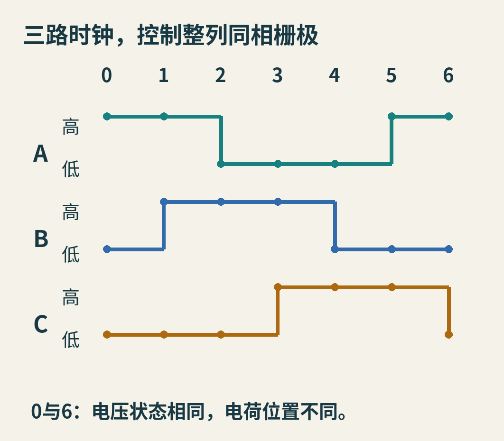

图上方的0到6与上一图对应。折线只表示逻辑上的高低状态；真实电压需要时间上升、下降，具体幅度和交叠要按器件要求设计。

第0和第6时刻，三路电压状态相同：A高，B和C低。但电子已经向前移动一个像素。

这很像扶梯踏板经过一轮机械运动后，装置看起来又回到熟悉的形状，人却已经升高了一截。周期性的是控制方式，前进的是被搬运的东西。

由于每隔三个栅极就有一个A，所有A可以共用时钟；不用给每个像素单独接一组控制器。B、C同理。一次完整的三相循环，能让一整列里的电荷包一起向前挪一个像素间距。

这里有个之后要用到的计数规则：**一个像素间距的转移，包含好几个栅极交接时刻。**讨论“经过2048次像素转移”时，不能又把这七个示意时刻当成七次像素转移算进去。

## 5. 从一条接力链，变成一整张照片

回到十二个像素。我们假设曝光已经结束，后续读出时不再有光产生新的信号，也暂时忽略暗电流、噪声、饱和和转移损失。

给每个像素预先放入一份确定的电荷。图中的一个单位等于100个电子：

```text
          列0  列1  列2  列3
行0         1    2    3    4
行1         5    6    7    8
行2         9   10   11   12
```

这不是实拍照片的数据。它是为了让读出顺序一眼可查而设计的教学输入。左上角100电子，右下角1200电子，一共7800电子。

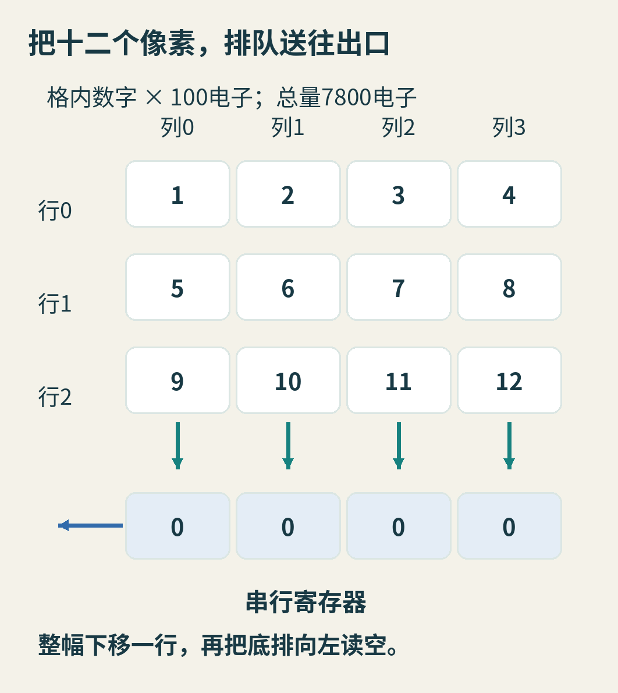

成像区里，同一列的电荷沿纵向移动。各列同时动作，就表现为整幅图向下挪一行。这叫并行转移：一次控制，许多列一起工作。

底下还有一条横着的接力链，叫串行寄存器。“寄存器”是暂存和搬运信号的结构；这里搬的是模拟电荷包，名字不意味着里面已经有数字比特。

第一轮并行转移之后：

- 原行2的900、1000、1100、1200电子进入串行寄存器。
- 原行1移动到原行2的位置。
- 原行0移动到原行1的位置。
- 顶部补入空的电荷位置。

接下来暂时不移动成像区，先把串行寄存器读空。若它还没读完就再塞进一行，来自不同行的包就可能相加，空间信息也会丢掉。需要求和的特殊读出方式另有用途，但那不是我们此刻想要的逐像素照片。

## 6. 一个出口，怎样认出十二个原位置

把输出节点安排在串行寄存器左边。第一次向左移动，900电子到达输出节点；第二次，1000电子到达；然后是1100与1200。

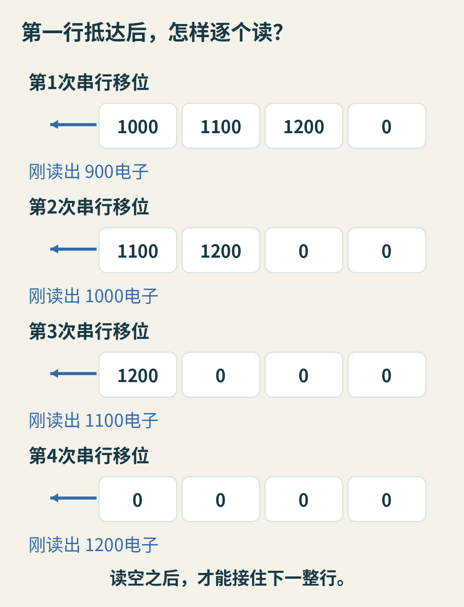

这一排读空后，再做一次并行转移，送入原行1，读出500、600、700、800。最后是原行0。

最终顺序是：

```text
900, 1000, 1100, 1200,
500,  600,  700,  800,
100,  200,  300,  400
```

它看起来是一条一维序列，怎么重新变成二维图像？

因为接收端知道时钟与排列规则：每四个样本是一行，第一组对应原行2，第二组对应原行1，第三组对应原行0。按这个规则放回去，就能恢复原矩阵。

**位置不必贴在每个电子上；位置可以由明确的读出次序保存。**

真实芯片可能有多个输出端、不同扫描方向、额外的参考像素等，数据处理必须知道实际布局。“所有CCD都只有一个放大器”是不对的。这里选择单出口，是为了把机制缩到最清楚。

下面不是手填的示意数值，而是随文程序实际生成的十二个输出样本：

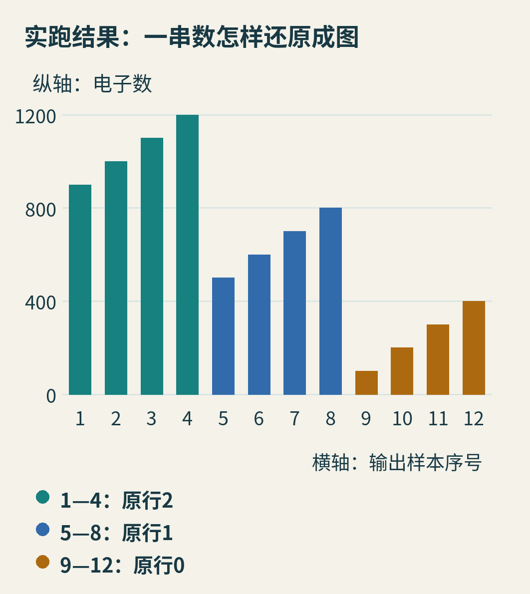

*实际运行的教学模型结果。横轴是输出样本编号，不是秒；颜色表示原行身份，不是光的颜色。原始记录：[readout.csv](examples/readout.csv)。*

程序保留了初始状态和每次转移后的状态：3次并行、12次串行，加上初始时刻，共16个状态。每一步都检查：

```text
成像区电荷 + 串行寄存器电荷 + 已输出电荷 = 7800电子
```

读完后，还会按样本的行列身份重建矩阵，确认与输入完全相同。我们另外穷举了只有0或1的全部64种2×3小图，检查同一套移位规则。它验证的是程序的记账和顺序，没有证明真实器件也能无损搬运。

## 7. 出口读的是电荷，为什么电脑看到数字

电子包到达输出端后，可以送入一个检测节点。节点有一定电容，收到电荷会引起电压变化。只看变化幅度，基本关系是：

```text
电压变化幅度 = 电荷量 / 电容
```

一个电子的电荷量很小，许多电子聚在一起才形成相应的可测变化。电路对这个电压进行处理，之后由ADC，也就是模数转换器，把模拟量变成数字码。

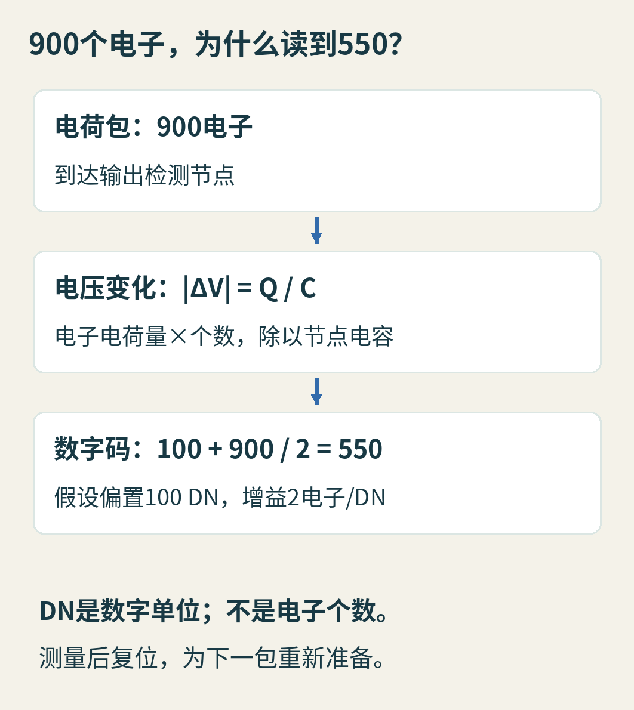

假设某台教学相机的转换增益是“2电子对应1个数字单位”，又把基准偏置设为100个数字单位，那么900电子会对应：

```text
100 + 900 / 2 = 550 DN
```

DN是digital number，即数字码的单位。这个例子里，550不是550个光子，也不是550个电子。若想反算电子数，应先扣掉100，再乘2。

这里选的900恰好可以整除2，省去了量化取整。真实读出还涉及复位、采样、放大、偏置漂移和噪声等；测完一包后，需要为下一包准备合适的基准状态。[Hamamatsu技术资料](https://www.hamamatsu.com/content/dam/hamamatsu-photonics/sites/documents/99_SALES_LIBRARY/ssd/ccd_kmpd9002e.pdf)的输出节点与转换系数章节给出了具体器件层面的说明。

还有一个容易混淆的问题：这些电荷本身知道“红、绿、蓝”吗？一般并不知道。一个像素的电荷量反映它在响应波段内收到的光，不自带颜色标签。彩色成像还需要滤光片、分光或多次不同波段的曝光，以及后续组合。灰度电荷接力与彩色照片处理，是相邻但不同的环节。

## 8. 读到一半，光还照着，会怎样

前面的读出很干净，因为我们偷偷给了一个重要条件：曝光结束后，没有新的光信号加入。

如果不满足这个条件呢？

假设原本属于一个暗像素的电荷包，正经过某个很亮的位置。它一边搬家，一边又收集到了那里产生的新电子。最后的读数就不再只代表最初那个像素的曝光量。

对全帧式CCD来说，同一个区域既负责感光，也负责转移。读出期间的继续照明会造成图像污染，可能表现为沿转移方向的拖影，常称smear。因此需要合适的快门或照明时序。[Hamamatsu的图像传感器选型说明](https://hub.hamamatsu.com/us/en/technical-notes/image-sensors/image-sensors-product-selection.html)特别讨论了全帧式读出与照明配合的问题。

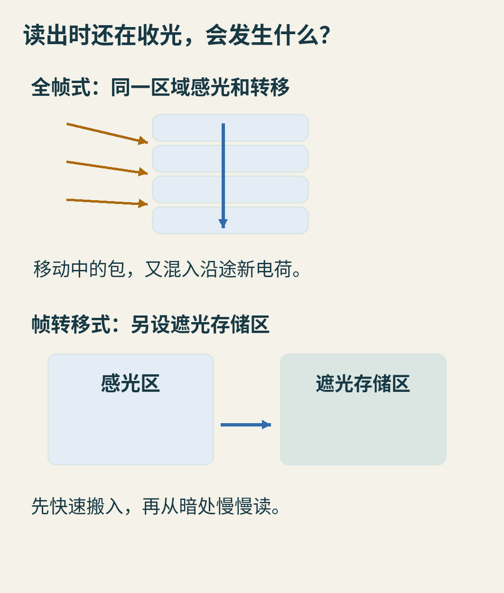

一种结构上的解决思路，是在感光区旁边安排一个遮光的存储区。曝光完成后，迅速把整帧搬到那里，再从暗处逐行读出。这叫帧转移式CCD。

它把“赶快离开光照”和“有条理地测量”拆开了，不过也要付出额外存储面积等代价，而且快速搬入期间仍可能受光，不等于拖影数学上必为零。

另有行间转移等结构，把遮光转移通道布置在感光位置附近。它们共享“先保存电荷、再有序转移”的想法，具体取舍各不相同。看到full-frame与frame-transfer这两个相近英文名字时，尤其不要把它们当成同一个结构。

## 9. 如果一桶装满了，继续曝光能恢复细节吗

势阱能保存和转移的电荷有限。这个容量常叫满阱容量，full well。

为了手算，假设某个像素最多容纳1000电子。现在同一列三个位置原本应该分别积累：

```text
100，1500，100
```

中间的1500已经超出容量。具体会怎样，取决于器件结构：可能向附近溢出，也可能被防溢出结构排走。我们先规定一个非常简化的规则：超过1000的部分全部进入下一行。

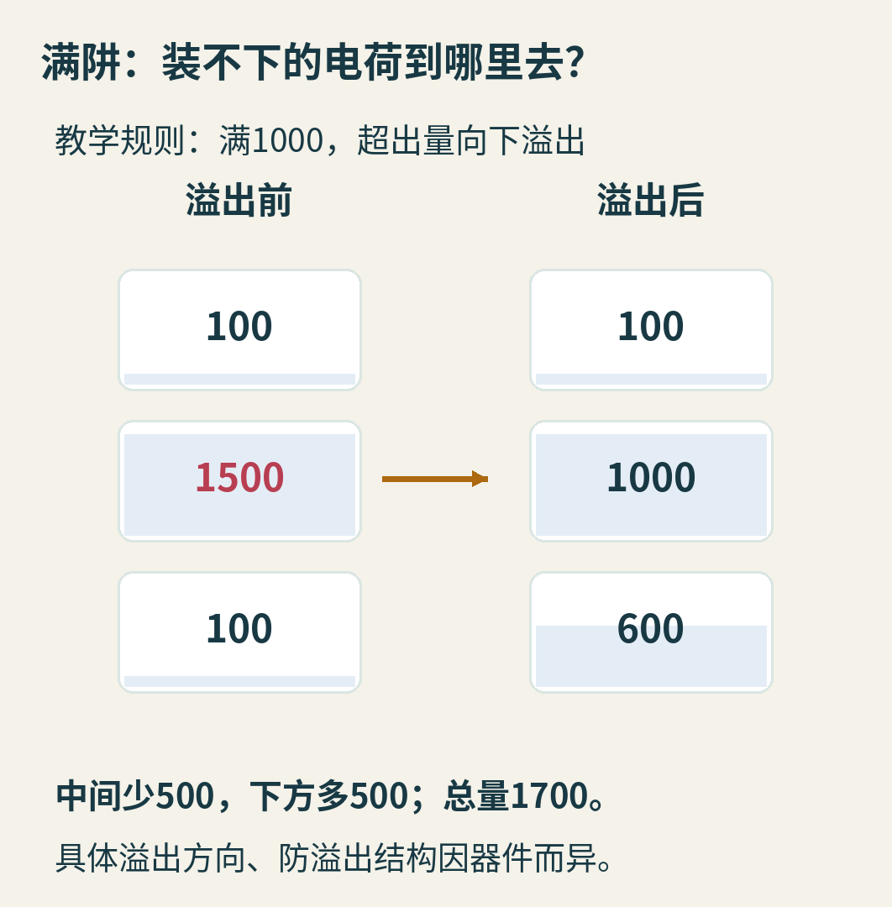

结果就是：

```text
100，1000，600
```

中间像素看起来达到上限，下方本来暗的像素却变亮了。若溢出延伸到多个位置，就会污染周围图像；这种电荷溢出现象称为blooming。STScI的[STIS成像说明](https://www.stsci.edu/hst/instrumentation/stis/observing-strategies/imaging)提醒观察者，饱和位置的电荷可能沿列溢出，影响附近目标。

注意它与上一节的区别：

- smear的问题是，读出搬运时还在收集沿途的新光。
- blooming的问题是，局部电荷已经多到储存结构容纳不下。

两者都可能拉出亮条，但起因不同。

本图的“只向下一格溢出”是人为规定的教学模型，不是所有CCD的物理规律。它只让你看见：额外的电荷不必凭空消失，也可能跑到原本属于其他像素的地方。

一旦超出器件的线性工作范围，单靠把输出数字拉暗，通常无法凭空找回原来丢失或混合的细节。曝光、满阱和读出量程要一起考虑。

## 10. 每次只少一点点，走得远会差多少

理想接力要求每次都把原包完整交给下一站。真实器件做不到绝对完美。

定义电荷转移效率CTE：在所规定的一次像素间转移中，有多大比例的电荷成功随原包前进。CTI则表示转移不效率，CTI = 1 − CTE。

先用一个刻意简化的模型：每一步成功比例都是同一个数η；暂不把迟到电荷重新算回原样本。那么原包按时前进n步以后，保留比例是：

```text
第一步：η
第二步：η × η
第n步：η的n次方
```

如果每步99.99%，也就是η = 0.9999，走2048步之后：

```text
0.9999 ** 2048 ≈ 0.814802
```

还剩约81.48%。如果每步是99.999%，结果则是：

```text
0.99999 ** 2048 ≈ 0.979728
```

约97.97%。只多了一个9，多次重复以后，差别会很明显。

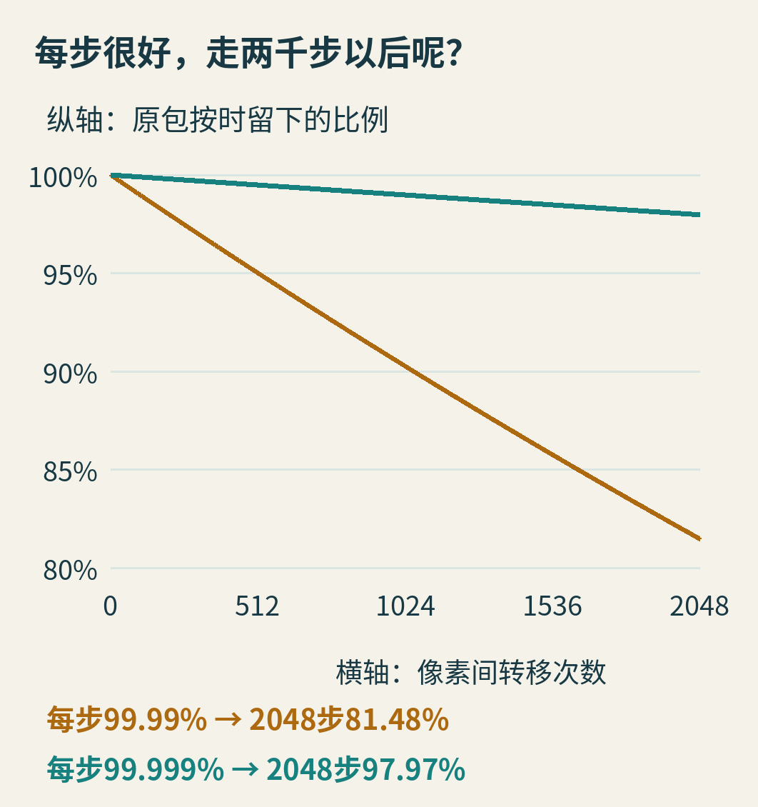

*由程序实际生成的[efficiency.csv](examples/efficiency.csv)绘制。参数用于教学比较，不是某台相机的实测或保证值。纵轴从80%开始，以看清差异。*

这说明，CCD不仅需要“能搬”，还需要“连续搬很多次，仍然极少混乱”。距离输出端越远，通常需要经历越多转移；不同像素在读出路径上的遭遇也就不同。

但不要把η的n次方当成通用器件校正公式。真实效率与信号强弱、背景、温度、时钟及缺陷等有关，未及时转走的电子还可能稍后释放。STScI的[ACS电荷转移资料](https://hst-docs.stsci.edu/acsdhb/chapter-4-acs-data-processing-considerations/4-6-wfc-ccd-detector-charge-transfer-efficiency-cte)解释了空间辐射损伤如何形成电荷陷阱，影响转移。

## 11. “少掉的电子”，为什么会变成一条尾巴

想象一包电荷在前进，途中有些电子被临时困住。原包走远后，这些电子才释放出来，就可能混入后面的读数。

因此，问题不一定只是“这一个像素暗了一点”，还可能是“后面的像素多出一点”。本来集中的一个亮点，会被拉出尾巴。[STScI对CTE损失性质的说明](https://hst-docs.stsci.edu/wfc3dhb/chapter-6-wfc3-uvis-charge-transfer-efficiency-cte/6-3-the-nature-of-cte-losses)介绍了电荷被陷阱暂时扣留、与原包分离的过程。

我们再做一个可以逐拍核算的模型。用一条六格的串行寄存器，左边是出口；从左往右编号0到5，在第3格放1000电子，其他格放0。

理想情况，每拍整包左移一格，第4拍会一次读出1000电子。

现在为了把尾巴放大到容易看见，故意设每拍只转走90%，剩下10%留在原格，下一拍再参与转移。这不是一台真实CCD的参数，也不是根据陷阱能级建立的物理模型。

规则写成两句：

```text
本拍输出 = 最左格原有量 × 0.9
每格新量 = 本格原有量 × 0.1 + 右邻格原有量 × 0.9
```

最右格没有右邻居，补入0。所有格都用“这一拍开始时的旧值”计算，不能从左往右一边改一边读，否则会改变规则。

第4拍最早抵达的那部分，必须连续四次都成功前进，所以是：

```text
1000 × 0.9 ** 4 = 656.1
```

后面的拍数还会陆续读到迟到部分。程序算出的前四个非零读数为656.1、262.44、65.61、13.122。

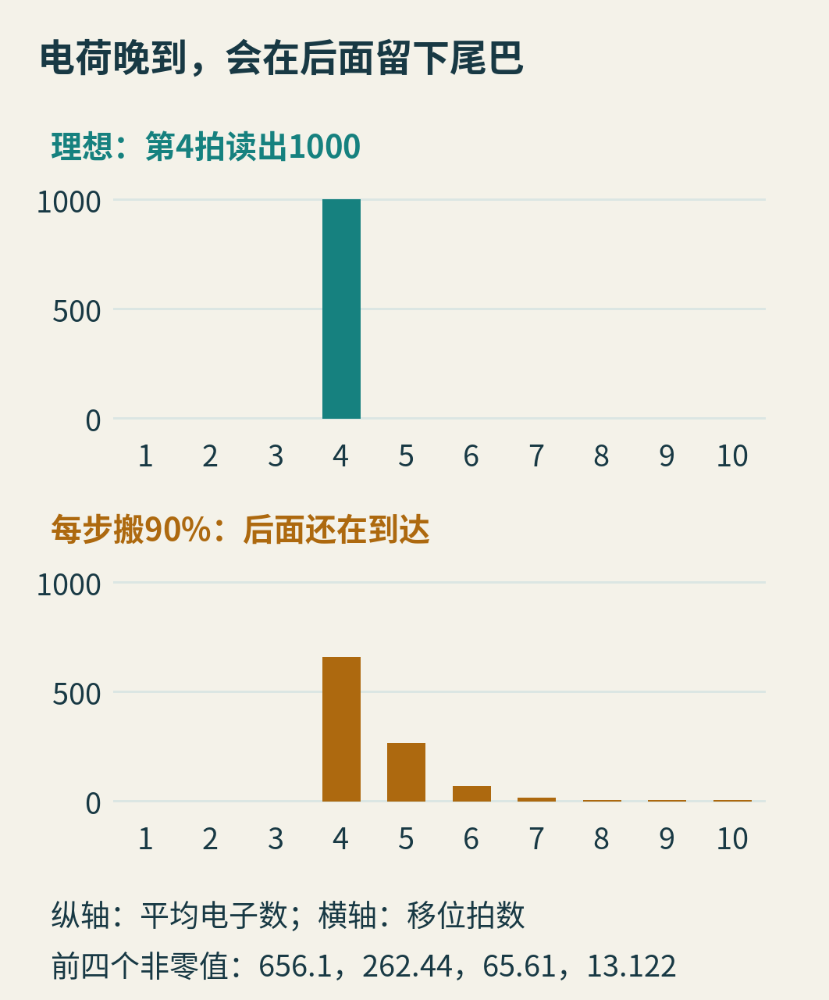

*由[trail.csv](examples/trail.csv)绘制前10拍，完整文件记录16拍。小数表示平均电荷量，不意味着把一个电子切成小数份。*

这里每拍都检查“累计读出量 + 寄存器中剩余量 = 1000”。我们用了精确分数计算来检查守恒，然后才转成小数输出。

尾巴很淡的时候，屏幕可能已经看不清，数值却并非恰好为零。读到第16拍时，程序还会保留剩余量，而不是因为图画到头了，就把它偷偷扔掉。

上一节的η的n次方，追踪的是原包按时走完指定路径的份额；这一节则把迟到份额继续跟踪。两种观察回答不同问题，并不冲突。

## 12. 为什么后来又有另一种常见路线

如果电荷必须经过很多像素才能到达测量位置，读出速度、控制时序、转移缺陷和电路集成都会成为设计问题。

典型CMOS有源像素传感器采用另一类思路：在像素内部或附近，把信号转换并通过读出电路送出去，而不是让每个像素的电荷包都沿长长的CCD链接力到边缘。

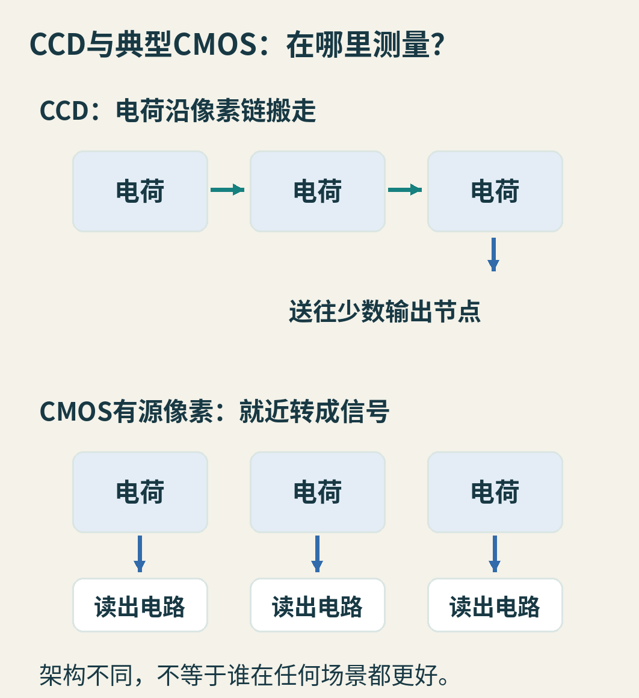

这张图刻意没有给每个CMOS像素画一个ADC，因为“有源像素”不等于“每个像素必定自带一个ADC”。实际设计可能共享列电路，也可能采用其他转换和读出安排。

同样，CCD也能设计多个输出端，并非只能让所有像素挤过唯一小门。比较真实相机，要看具体结构、应用条件和完整系统，不能只凭CCD或CMOS两个名字就断言谁永远噪声更低、谁永远画质更好。Hamamatsu的[CMOS技术说明](https://hub.hamamatsu.com/us/en/technical-notes/image-sensors/advances-in-cmos-image-sensors.html)从读出架构及集成方式讨论了这种差别。

因此，标题中的“曾经”描述的是CCD在摄影发展中的重要历史位置，不是宣布它已经消失。NASA对哈勃[高级巡天相机](https://science.nasa.gov/mission/hubble/observatory/design/advanced-camera-for-surveys/)的介绍，就明确列出了使用CCD的探测通道。也不能反过来说，今天所有数码相机或手机都靠CCD成像。

## 13. 一次器件构思，不等于一部相机从天而降

1969年，贝尔实验室的Willard S. Boyle与George E. Smith提出CCD构思。1970年，他们发表《Charge Coupled Semiconductor Devices》，描述怎样储存、转移和检测电荷，并讨论可能的应用，其中已经包括成像。[原论文出版信息与摘要](https://doi.org/10.1002/j.1538-7305.1970.tb01790.x)可直接核对。

同一期期刊里，G. F. Amelio、M. F. Tompsett与G. E. Smith发表《Experimental Verification of the Charge Coupled Device Concept》，报告实际制作器件并测量电荷转移的工作。[实验验证论文](https://doi.org/10.1002/j.1538-7305.1970.tb01791.x)提醒我们：纸面上能画出势阱，与真的做出可用器件，是两种成果。

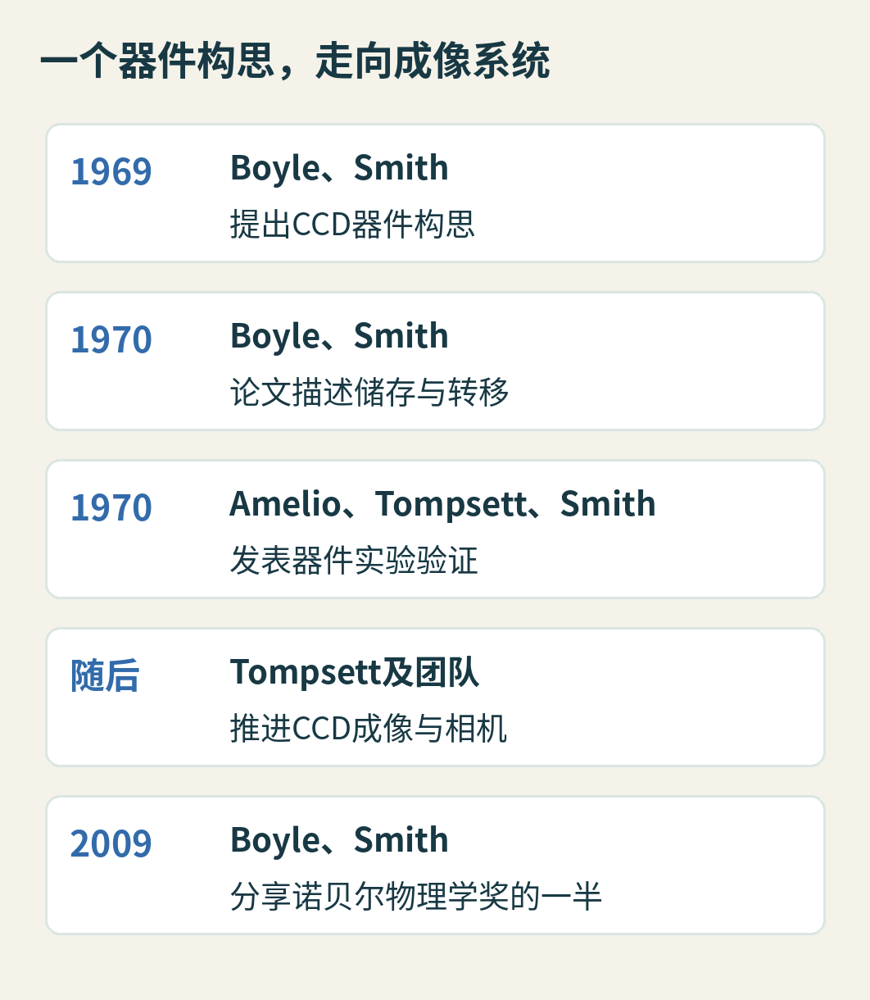

从器件到成像系统，还需要解决曝光、读出、时序、信号处理等一串问题。贝尔实验室的[机构回顾](https://www.nokia.com/bell-labs/about/awards/2009-nobel-prize-physics/)明确提到，Michael Tompsett及其团队推进了CCD成像应用和相机工作。因此，把这些进展全部压缩成“两个人某天下午直接造出了数码相机”，会抹掉重要区别。

2009年，Boyle与Smith因CCD相关发明共同获得当年诺贝尔物理学奖的一半，另一半授予光纤通信领域的Charles K. Kao。[诺贝尔奖官方记录](https://www.nobelprize.org/prizes/physics/2009/summary/)给出了获奖归属。

回看开头的问题，CCD的巧妙并不只是“光能变成电”。更特别的是，它把一整幅图像的位置与亮度，暂存在一包包电荷里；再用重复的电压时序，让这些电荷在不弄混次序的前提下，抵达可以测量的地方。

一张照片，从空间中的分布，变成时间上的队列，再被重新铺回二维。

## 14. 用十二格，检查自己是否真的跟上了

不必拿到一块传感器，先拿笔改一改我们的例子。

**问题一：**只把左上角的100电子改成600电子，其他不变。输出序列的哪一个样本改变？

答案是第9个，增加500；总量从7800变成8300。若你答第1个，多半把图像左上角与我们的实际读出起点混在了一起。

**问题二：**出口改在串行寄存器右边，仍先读底排，第一组四个数是什么？

是1200、1100、1000、900。空间位置没有“天然正确”的输出顺序，但接收端必须与硬件约定一致。

**问题三：**转移模型的效率改成100%，还有拖尾吗？

按照本文的残留规则，不会：第4拍读出1000，其余拍为0。真实设备可能还有别的噪声或拖影原因；这里只是在检查这个明确的模型。

随文的[运行说明](README.md)给出代码、原始数据和重绘命令。主程序只用Python标准库；绘图用Pillow。它没有连接相机，没有读取NASA传感器的原始图像，也没有求解半导体电场。它让我们核对的是：**当规则被明确写出来时，电荷数量、移动次序和读出结果是否互相吻合。**

---

本文原创文字及原创教学图采用CC BY 4.0；代码采用MIT许可。NASA照片保留NASA署名，按NASA媒体使用规则用于事实性教育说明，不纳入作者的CC BY再授权，也不表示NASA背书。详细来源、第三方图像范围、模型边界与AI辅助说明见[sources.md](sources.md)。
