# 这些并发操作，能排成一条合法队伍吗？

两个人同时操作一块记分牌。牌上原来是0，一个人要把它改成1，另一个人连续读了两次。

如果读到的是“0，然后1”，我们大概不会觉得奇怪：第一眼看时还没改，第二眼看时已经改了。

如果读到的是“1，然后0”呢？

先不要急着说程序坏了。也许有人后来又写了0，也许两次读取本来就在重叠。判断之前，得把条件说清楚：**从记录开始到结束，只有这一次写1；第一次读取已经返回，第二次读取才开始。**

即便写入请求从头到尾都还没回复，第二种结果也解释不通。

为什么“尚未回复”不能成为它的借口？这就是今天要拆开的谜题。我们不钻进服务器内部，而是拿着调用和返回的记录，问一个很具体的问题：这些操作能否排成一条符合规则的队伍？

## 1. 先造一台没有并发的正常机器

先把网络、线程和服务器都放到一边。想象记分牌只有一个格子，保存一个数字，最初为0。

它提供两种操作：

- 写入一个值：把格子换成这个值，然后返回确认。
- 读取：返回格子里当前的值，不改变格子。

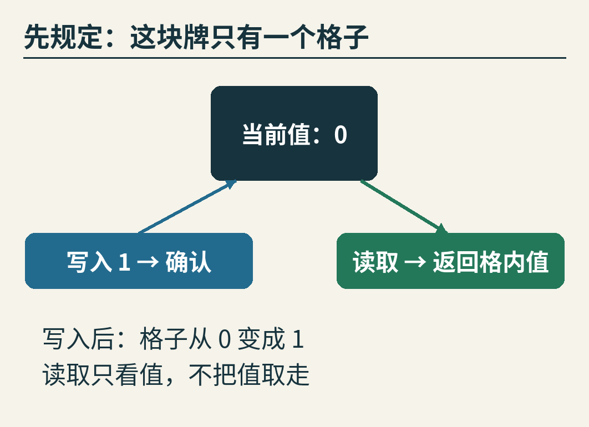

这样的单格读写对象，在计算机科学中通常叫作“寄存器”。这里的寄存器是一个抽象对象，不是在讨论某款CPU里的具体硬件寄存器。

如果大家排队，一次只做一件事，规则很简单：

初值0 → 读取返回0 → 写入1 → 读取返回1。

反过来，初值0 → 写入1 → 读取返回0，就违反了刚才的规则。除非中间还有一次写0，否则格子不会自己变回去。

这份“一次只做一件事时应该怎样表现”的说明，叫作对象的**顺序规格**。规格不是一份实现代码，而是判断结果对不对的标准。

为什么先说这个？因为“结果能不能解释”取决于对象本来答应做什么。记分牌的读取不删除内容；取号队列的“取出”却会移走一个号码。同一串返回值，对不同对象可能有不同结论。我们接下来一直检查同一个单格记分牌，避免中途换规则。

## 2. 请求不是一个点，而是一段区间

真正的操作往往需要时间。客户端发出“写1”的请求，可能先排队，再执行，再等回复到达。

我们在调用方能记下两个事件：

1. 调用：开始请求这项操作。
2. 返回：收到这项操作的结果。

把它们放到一条从左向右的时间线上，就得到一段区间。

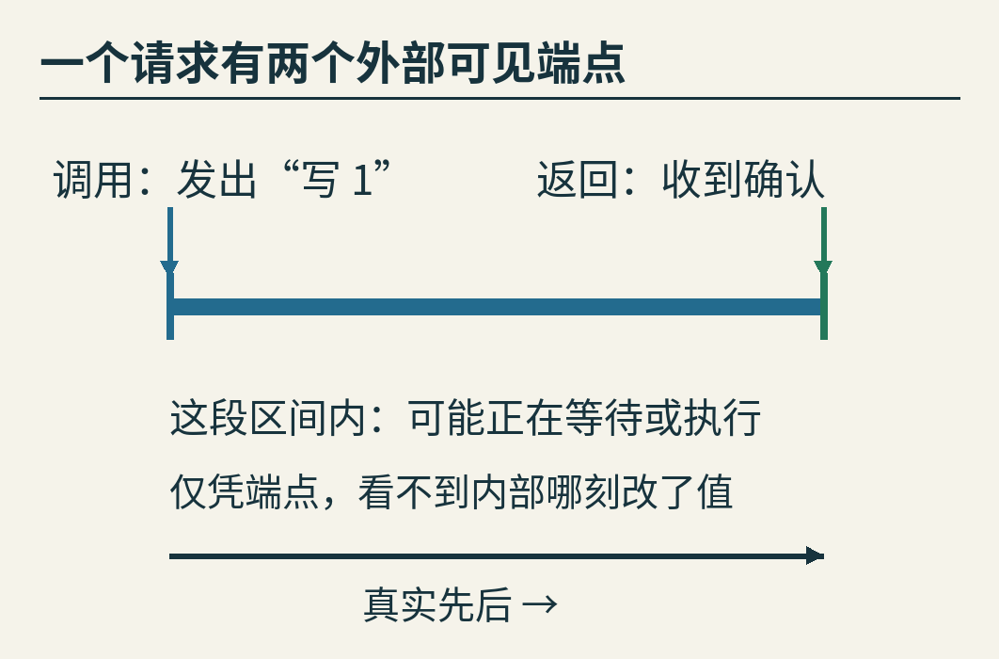

这段区间里可能有等待，也可能有真正的执行。只知道端点，通常不知道内部究竟在哪一刻改变了格子。

如果甲的操作已经返回，乙才开始调用，那么甲必须排在乙前面。这是一条没有商量余地的先后关系。

如果两个区间重叠，情况不同。甲先发出请求，不代表甲一定先产生效果；甲先收到回复，也不代表甲一定先产生效果。我们只能说：单看这些端点，还没有把它们的顺序锁死。

“并发”在这里就表示这种操作区间的重叠。它不要求两颗CPU真的在完全同一纳秒执行指令。一台机器上交错推进的两个任务，也可能产生重叠的调用区间。

接下来的图把六个外部事件编号为1至6。这些数字只说明先后，不是六个等长的毫秒。两点画得同样远，也不表示实际耗时一样。

## 3. 先读0，再读1：把变化放在两次读取之间

现在给刚才的故事加上完整记录：

- 事件1：写1开始。
- 事件2、3：读取A开始，返回0。
- 事件4、5：读取B开始，返回1。
- 事件6：写1终于返回确认。

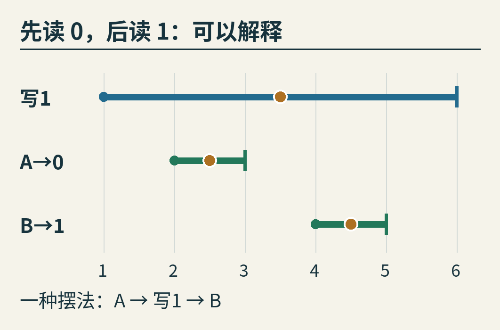

看上去，写入把两次读取都包在自己肚子里。但这没什么问题。

我们可以在每个操作自己的区间里放一个小点，假装整项操作在那个点上瞬间生效：

- A在事件2与3之间取值，此时格子是0。
- 写1在事件3与4之间生效，格子变成1。
- B在事件4与5之间取值，因此返回1。

这三个点从左到右，给出顺序：**A → 写1 → B**。

它符合单格记分牌的规则，也没有颠倒“A已经返回，B才开始”这个事实。写入很晚才返回，只意味着确认晚到了，不妨碍它此前已经修改了数据。

这样的解释，就叫作这份历史的一次**线性化**。整个性质叫作**线性一致性**，也常译为“可线性化性”：能否让外部看到的操作，像是在各自调用与返回之间某一刻完整生效，并且服从对象的顺序规则。

所谓“历史”，就是这次运行中记录下来的调用和返回事件。我们检查的是这份历史能否被解释，不是声称已经看穿了内部所有指令。[Herlihy与Wing的原论文](https://www.cs.cmu.edu/~wing/publications/HerlihyWing90.pdf)系统描述了这种正确性条件。

图中的小点叫作**线性化点**。在这张教学图里，它们是一个可行解释的见证，并不是测量仪器实际抓到的内部时刻。找到一个解释就够了，不要求解释唯一，更不要求每个操作都恰好在区间中点生效。

## 4. 先读1，再读0：为什么找不到合适的小点？

只改两次读取的结果，其他事件顺序完全不变：A返回1，之后的B返回0。

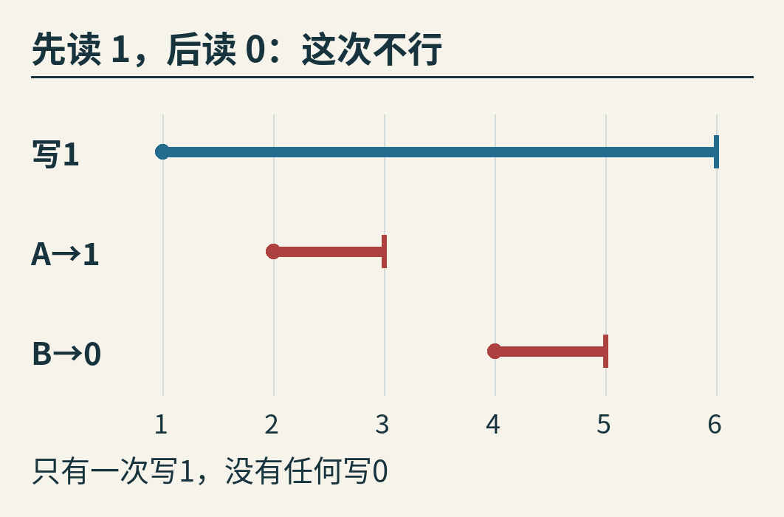

乍看上去，两次读取都跟写入重叠，似乎都能说“这次刚好读到了旧值或新值”。问题恰恰在于：不能给每一次读取各编一段互相冲突的故事。

我们只允许一条共同的队伍。逐条推：

第一，A读到了1。初值是0，又只有一次写1，所以写1必须排在A之前。

第二，A已经返回，B才调用，所以A必须排在B之前。

第三，B读到了0，又没有人写回0，所以B必须排在写1之前。

三条合起来就成了：

**写1 → A → B → 写1。**

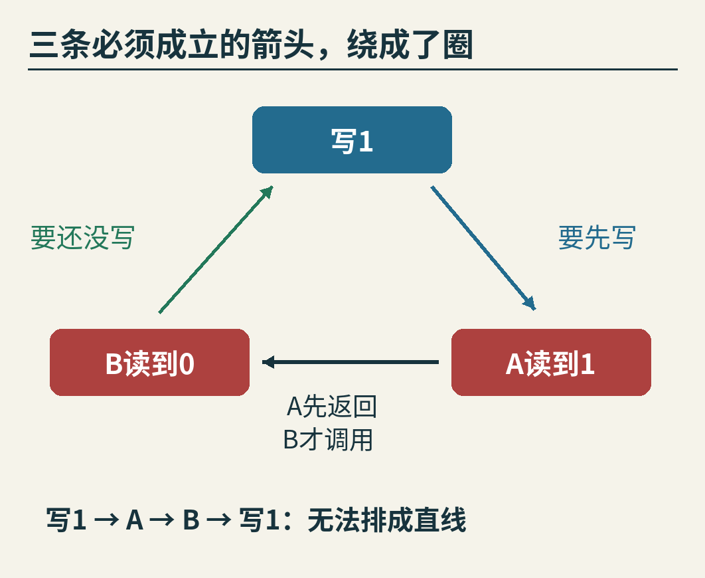

这要求写1排在自己前面。无论怎样摆点都做不到。

这里最容易误会的一句口号是：“跟写入重叠的读取，读到旧值或新值都可以。”对单次读取孤立地看，这可能不出错；对整份历史一起看，却不够。多个返回结果必须能由**同一个完整的先后顺序**解释。

如果把条件改掉，让A和B本身也重叠，那么“A返回1、B返回0”又可能成立：把B的取值点放在写入之前，A的取值点放在写入之后即可。可见，返回值列表不是完整证据，操作区间也是答案的一部分。

还有一个更小的反例：写1已经返回，随后新发起的读取返回0。

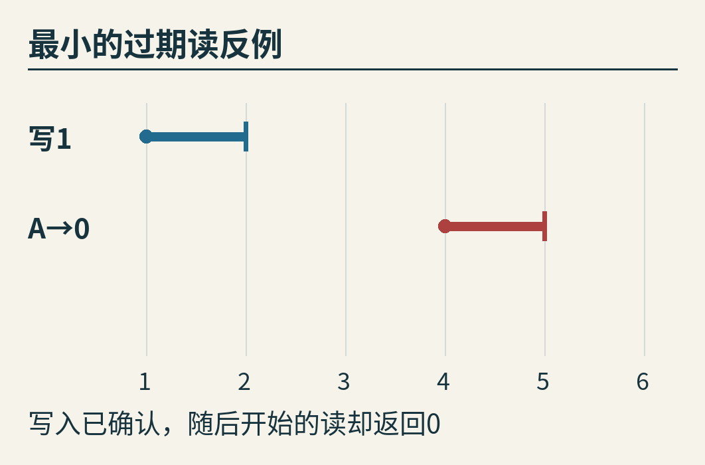

只有两项操作，就足以拒绝这份历史：真实先后要求“写1 → 读”，格子的规则又要求读到1。此时再说“后台可能还没同步完”，只是解释某种实现为什么给出这个结果，并不能让结果符合它承诺的线性一致性。

## 5. 为什么不能按时间戳简单排一排？

既然目标是排队，能不能按调用时间排序？

试一份新记录：读取先开始，一直等着；写1随后开始，很快完成；最后读取拿到1返回。这个历史完全能解释为“写1 → 读1”。按调用时间硬排，却会变成“读1 → 写1”，于是误判。

那就改按返回时间排序？也不行。写1先开始，值已经改了，但确认还在路上；读取返回1之后，写入才返回。按返回时间排序，同样把读放到了写前面。

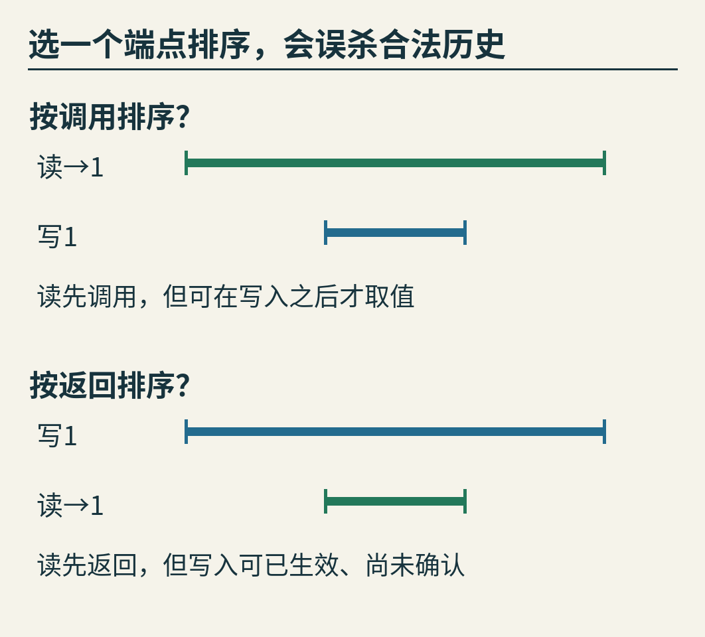

问题不是时间戳精度不够。即使端点测得分毫不差，也不能凭一个端点决定所有重叠操作的生效顺序。

正确的用法是：**用端点提取不可颠倒的关系，再在剩下的选择里寻找符合对象规则的排列。**

对真正的多机器记录，还会多一层困难：不同机器的时钟可能不一致。一个日志写着12:00:00.100，另一个写着12:00:00.090，并不能不加条件地当成跨机器真实先后。实践中要说明记录机制、时钟误差和已知因果关系，不能把不确定的顺序冒充确定约束。

本文的实际程序就在同一个进程里记录事件，使用同一个单调时钟，并给事件分配严格递增的序号。这样可以先专注于一致性问题，而不同时研究分布式校时。

## 6. 做一个小检查器：找一条路线，或者把路线都排除

回到A读0、B读1的合法历史。我们已经能手算，现在把步骤交给程序。

对每一种候选排列，检查器做两件事：

第一遍，检查真实先后。如果某项操作早已返回，另一项才开始，排列里就不能反过来。

第二遍，从格子初值0开始，按排列逐项执行顺序规格。遇到写1，就把状态改成1；遇到读取，就比较“历史记录的返回值”与“此刻格子里的值”。不同就淘汰这条排列。

只要有一条通过，就得到一份可以交给别人核查的见证。所有排列都失败，才能在当前完整模型和这份有限历史的范围内判定不可线性化。

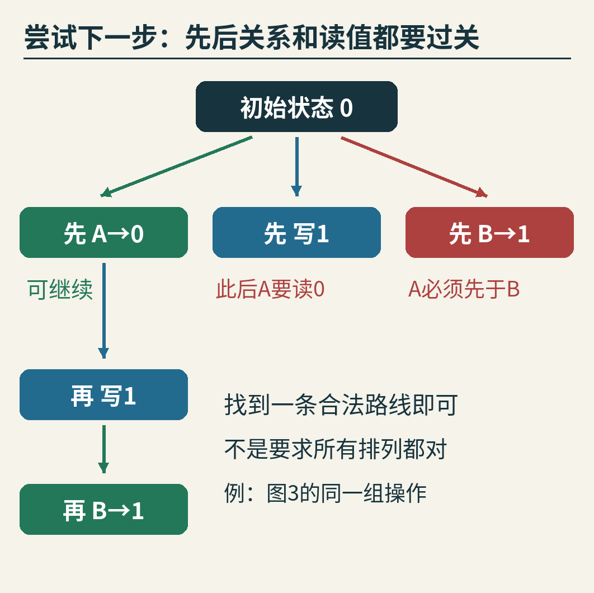

注意图中两个失败分支的理由不一样。

如果先放B，它马上违反“A先于B”。如果先放写1，单是这一动作没错，但后面迟早还要安排A；A需要返回0，此时却再也没有写0的操作，路线走不通。

三个操作最多只有六种排列，适合教学。十个操作最多就有3,628,800种排列。实际检查工具会使用剪枝、缓存状态等手段减少搜索；本文的小程序故意保留直接枚举，让“为什么接受、为什么拒绝”更容易看清楚。

我们也没有让程序自动猜任何接口的业务含义。代码里明确写的是“初值0、取值0或1的单个寄存器”。要检查队列、集合或银行转账，需要换成相应规格，不能把本例的读写规则直接套过去。

## 7. 真正运行一次：好格子与故意出错的旧缓存

附带程序不只给手写的历史打标签，还实际启动一个Python写线程，由主线程完成两次读取。线程可以理解为同一程序中分别推进的执行路线。

为了稳定复现而不是碰运气，我们用事件信号控制推进顺序：写线程先记录调用，然后等待；主线程读一次；允许写线程修改值；再读一次；最后才允许写线程返回。

读写格子时使用锁。锁在这里让一次读取或修改不会与另一项正在进行的格内访问混在一起。等待回复的阶段不一直占着这个锁，否则两次读取就进不来了。

第一轮按上述顺序读取共享格子，得到A=0、B=1。检查器找到的见证恰好是A → W → B，W代表写1。

第二轮故意制造错误：先允许写入生效，A正常读取到1；B却绕开共享格子的当前值，强行返回事先固定的旧缓存0。写入的确认仍然放到最后。检查器拒绝这份历史。

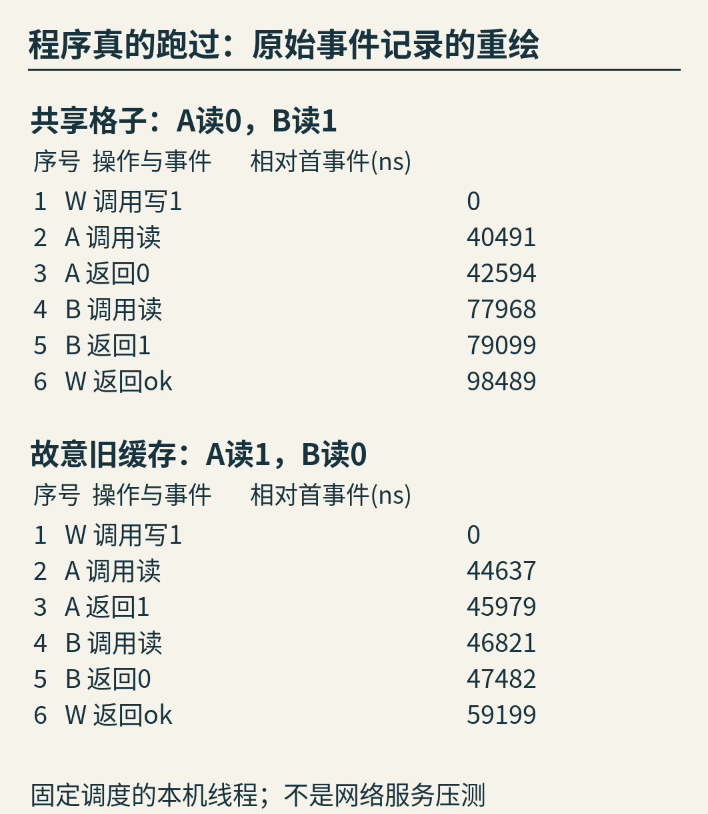

这是**本机教学程序的实际执行记录**，不是数据库或网络服务的实测，更不是自然出现的一次线上故障。第二轮错误是有意注入的。事件序号与返回值在这套控制顺序下可复现；纳秒间隔会随着机器和调度变化，不应该据此比较性能。

图中时间是把各轮首条事件的单调时钟读数减去后的结果；原始CSV还保留相对各轮记录器启动的读数。读者可以逐项对照[正常轮记录](originals/locked_register.csv)、[故障轮记录](originals/injected_stale_read.csv)与[程序输出](originals/experiment-stdout.txt)。图是从这些数据重新绘制的，不是终端截图。

## 8. 再穷举360份历史，检查我们有没有写错判断器

一个检查器自己也可能有错误。因此还需要反过来检查它。

这里固定三项操作：一次写1、两次读取A和B。每项都有调用和返回两个端点，共六个事件。要求每项调用早于自己的返回，其余先后都枚举。

六个不同事件共有720种排列。对每一对调用与返回，有一半顺序满足“调用在先”；三对合起来留下90种端点顺序。A、B各能返回0或1，又有四组返回结果，于是总共360份历史。

这一步的A和B可以来自两个独立调用方，所以也枚举了它们互相重叠的情形，不限于主故事里两次连续读取。

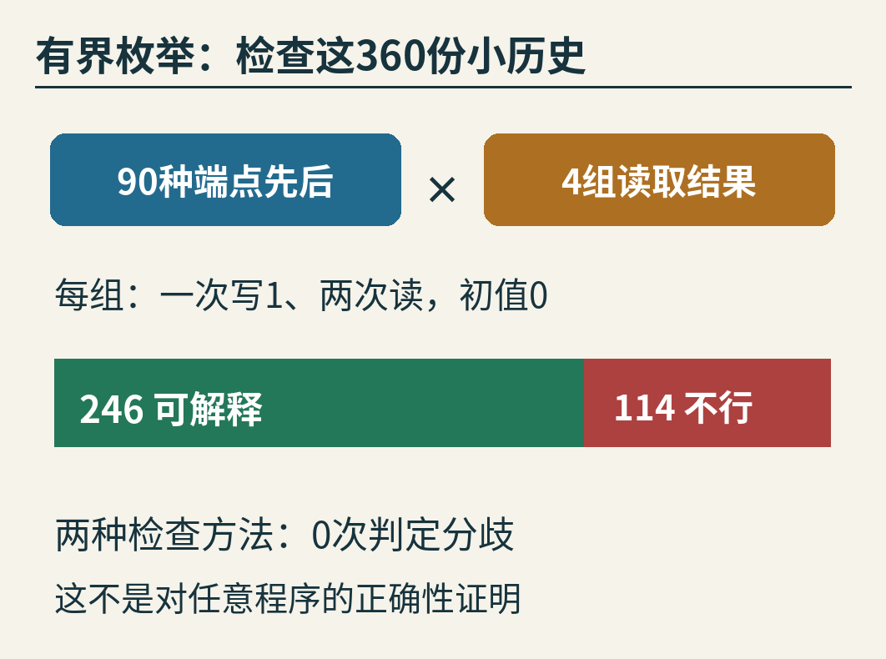

本次实际结果是：246份可线性化，114份不可线性化。

还可以独立实现第二种判断方法。在这个“只有一次写1、没有写0”的特殊问题里：

- 读到0的操作，必须排在写1之前。
- 读到1的操作，必须排在写1之后。
- 已返回的操作，必须排在后来才调用的操作之前。

把这些约束都画成箭头。如果形成环，就不可能排成队；如果没有环，就能反复拿出一个没有前置要求的操作，排出一条队伍。这就是图5的推理被完整算法化了。

穷举器对360份历史分别运行“排列加状态执行”和“约束图查环”，判定分歧为0。第二种方法只在这里的特殊读写设定下使用，不能凭这几条箭头检查任意多次写入或任意数据类型。

这些数字证明我们认真核对了有限输入范围，不能证明某个真实实现对所有未来运行都正确。更不能把“246”解读成软件有68.3%的可靠率：这360份构造历史并不是现实运行的概率分布。

## 9. 请求一直没返回：删掉，还是算进去？

现在截断记录：写1开始了，读取A返回1，但写入直到观察结束都没有回复。

如果把所有未完成请求直接删除，就只剩“初值0，读取却得到1”，看起来出错了。可实际很可能是：值已经写好，确认还没来得及到达。

这种已经调用、还没有匹配返回的请求，叫作**待定操作**。

处理它，需要允许两种可能：

- 对尚未产生效果、也不需要用来解释已完成结果的请求，可以暂不把它纳入顺序解释。
- 对已经产生效果的请求，可以在历史末尾补上一个可能的返回，再把它放进合法顺序。

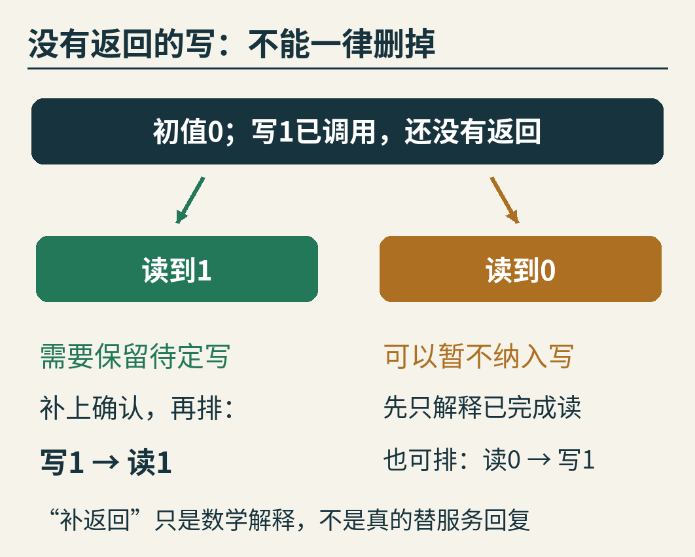

“补返回”是一种数学上的可能性检查，不是检查器真的替服务器发送了确认，也不是准许它改写已经记录下来的读取结果。

在这个例子里，A返回1迫使我们保留待定的写1，并安排“写1 → A”。如果A返回0，就可以只解释这个已完成的读取；也可以保留写1，排成“A → 写1”。

无论怎样选，已经完成的操作都不能为了凑答案而随意删除。被保留的待定写也不能越过自己的调用时刻，跑到尚未发起请求的过去。

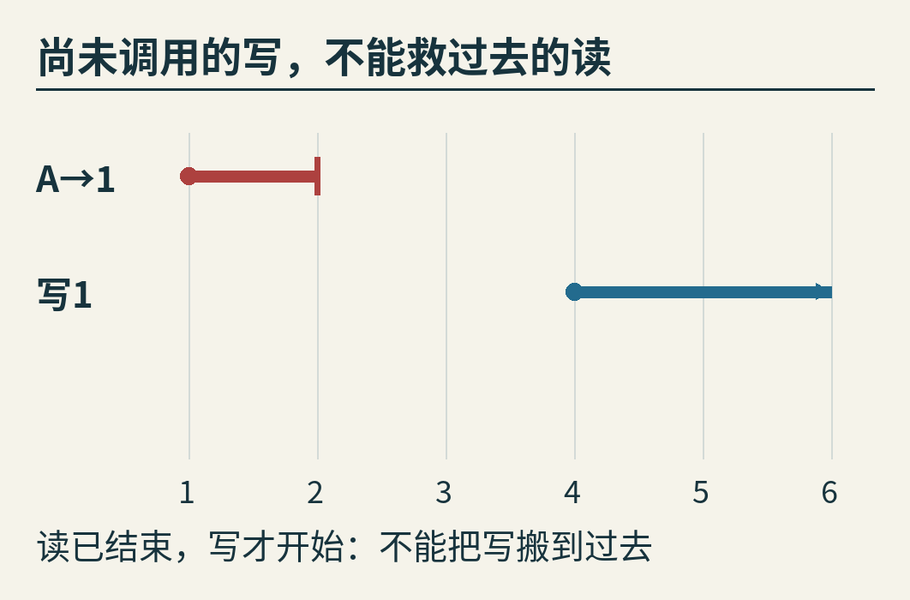

上图就是边界：读先结束，写后开始。把后来的待定写搬到前面，才有办法解释读到1，但这违反了真实先后，所以仍然不合法。

这一点甚至值得专门核对文献。Sela、Herlihy与Petrank在[2021年的论文](https://arxiv.org/html/2105.06737v2)中指出，原始形式化定义处理待定操作时有一处符号笔误，修正要让保留的待定操作也受真实先后约束。本文采用这一意图明确的修正版；不是把“未完成”理解成可以任意穿越时间。

附带代码支持待定写的这些小例子；不接收待定读，也不替任意错误码推断含义。真实客户端的“超时”尤其需要小心：它可能只表示客户端停止等待，并不能单凭这个词断言服务端没有执行。如何把超时记录映射成“确定失败”或“结果未知”，必须依据接口契约和记录方式另外建模。

## 10. 它承诺了什么，又没有承诺什么？

线性一致性是一种外部行为标准，不是一套固定的复制协议，也不是“所有请求必须真的串行运行”。只要外部结果能够解释为合法顺序，内部可以有重叠、等待或并行。

[Jepsen维护者的模型说明](https://jepsen.io/consistency/models/linearizable)也提醒：保证的对象范围需要看清楚。有的接口以单个键为对象，有的操作覆盖更大范围。不能看到“线性一致”四个字，就自行扩成任意跨对象业务的原子保证。

举个仍然只用这块格子的例子。甲和乙都想“加1”，却各自用两次独立请求实现：先读，再把读到的数加1写回。

甲读0，乙也读0，接着甲写1、乙也写1。最后是1，不是2。

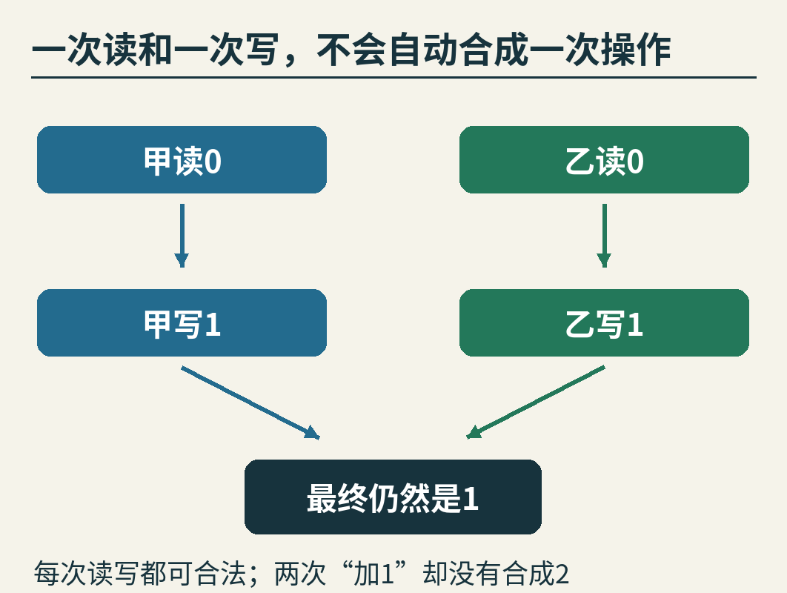

这四项读写可以完全按上述顺序执行，每一项都符合寄存器规格。所以错误不在单项读写的线性一致性，而在业务把“读，再写”当成了不可插入的一整步。若需要两次加1累加成2，就要使用具有相应原子语义的加法操作，或另行设计正确的并发控制。

还有三个边界：

第一，它本身不保证请求及时完成。一个实现可能结果始终符合规则，却慢得令人受不了。安全性问“有没有发生不该发生的结果”；进展与可用性还要回答“事情能不能继续完成”。

第二，它不自动保证断电后数据仍在。掉电持久性需要存储与恢复方面的额外契约，不能从一段运行中的读写历史直接推出。

第三，一份历史通过不等于整个实现已经被证明正确。测试可能抓住一个反例，却无法靠有限次成功运行穷尽所有线程交错、故障时机与输入。

这些限制没有削弱检查的价值。恰恰因为问题问得窄，得到的回答才清楚：这一组观察，是否违背了所声明的对象规则？

## 11. 下次看到并发日志，可以先画这三样东西

不用先背一长串一致性模型的名字。拿到一份小日志时，可以这样开始：

1. 写出对象的初始状态和顺序规则。读取会不会改变状态？写入成功究竟承诺什么？
2. 给每项操作画出调用与返回区间，保留准确的参数、结果和请求身份。结果未知的操作单独标出来。
3. 先连上“已经返回，后来才调用”的箭头，再加上返回值要求的约束。试着排一条合法顺序；排不出时，说明冲突在哪里。

别忘了检查记录是否完整、时钟是否可信、是否遗漏其他写入。漏掉一次写0，就可能把正常系统误判成图4那样的错误；胡乱删除一个未知结果的写，也可能把图11的正常情况误判为异常。

作为小练习，把图4中的第二次读取改成：在A返回之前就开始，直到A返回之后才结束。其他条件不变。试着在三个区间里安排“B读0 → 写1 → A读1”。你会看到，改变的不只是画面，两次读取之间原来那条强制先后关系也消失了。

线性一致性让“看起来像一台正常机器”变成了可以动笔检查的问题。不是每个请求各自找一个说法，而是让所有已经观察到的结果，共同站进一条不自相矛盾的队伍。

## 延伸阅读与复现

- Herlihy、Wing：[Linearizability: A Correctness Condition for Concurrent Objects](https://www.cs.cmu.edu/~wing/publications/HerlihyWing90.pdf)，TOPLAS 12(3)，1990年7月，463—492页。论文首页另注明前身发表于1987年1月的POPL，不能把期刊发表日期当成最早出现日期。
- Sela、Herlihy、Petrank：[Linearizability: A Typo](https://arxiv.org/abs/2105.06737)，2021年；本文核对的arXiv v2日期为2021年7月29日，重点看待定操作的真实先后限制。
- [复现说明](README.md)与[完整教学代码](examples/check_history.py)：只需Python标准库即可重跑历史检查、受控线程示范与360份历史枚举。
- 图像身份、资料支持范围、许可和AI辅助说明见[sources.md](sources.md)。
