# 程序撞了一次墙，怎样把整类死路一起封掉？

有六个只能开或关的选项。你选了第一个，又选了第二个，到了第三个，程序忽然说：不行，这几项要求互相打架。

最朴素的办法是退一步，换个选项，再试。

可是，如果第二次失败和第一次其实出于同一个原因，第三次、第一万次呢？程序能不能把失败写成一条准确的规则，以后只要碰到同类局面，就提前绕开？

更大胆一点：能不能看清，夹在中间的某个选择根本没参与矛盾，直接越过它，回到真正需要修改的地方？

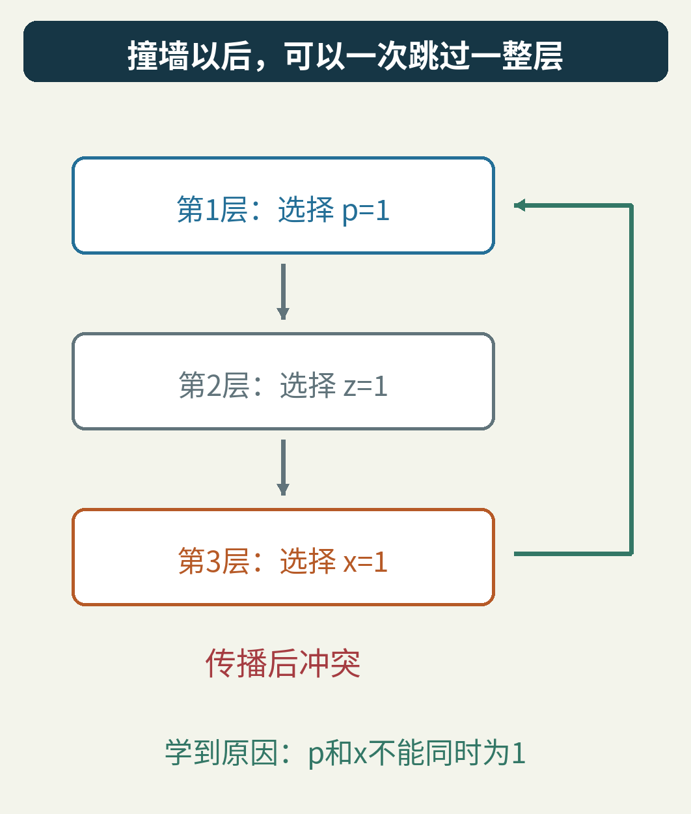

这正是 SAT 求解中的一个核心想法：**冲突驱动的子句学习**，英文简称 CDCL。我们先不背这串名称，只做一件很小的事：给六个开关找一套能同时满足规则的配置，然后让程序从一次具体失败里学到东西。

整篇的四条原规则、每一次推导和最后的解，都能手算。附带程序还把全部 64 种完整配置检查了一遍。

## 1. 先把“找个能用的配置”说清楚

六个开关分别叫 p、z、x、u、v、w。每个只有两个值：1 表示开，0 表示关。

这里的字母不代表某款真实设备，只是一个配置谜题。这样我们可以专心看推理，不用先学一套硬件知识。

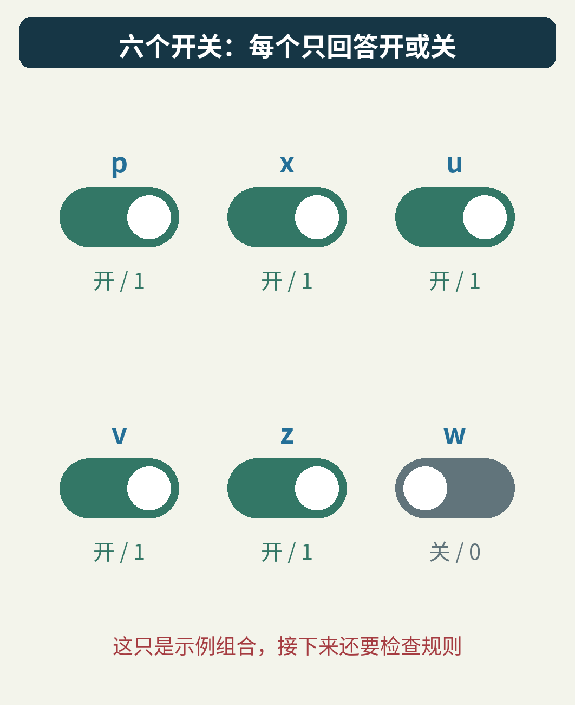

配置要遵守四条规则：

- C1：如果打开 x，就必须打开 u。
- C2：如果打开 x，就必须打开 v。
- C3：p、u、v 不能三个一起打开。
- C4：z、w 至少打开一个。

请先看出一个藏在规则里的关系：开 x 会带着 u、v 一起开；如果这时 p 也开了，C3 就不答应。

你可能已经想到：“那 p 和 x 不能同时开。”没错。稍后要做的，就是让程序从失败中，自己把这句藏起来的话推出来。

先学两个很小的符号：

- ¬x 读作“非 x”。x 为 0 时，¬x 为真；x 为 1 时，¬x 为假。
- a ∨ b 读作“a 或 b”。至少一项为真，整条就为真；两项都真也可以。

于是，C1 可以写成“¬x ∨ u”。为什么？x 没打开时，¬x 已经为真，规则没有额外要求；x 打开时，¬x 为假，只有把 u 打开才能满足它。

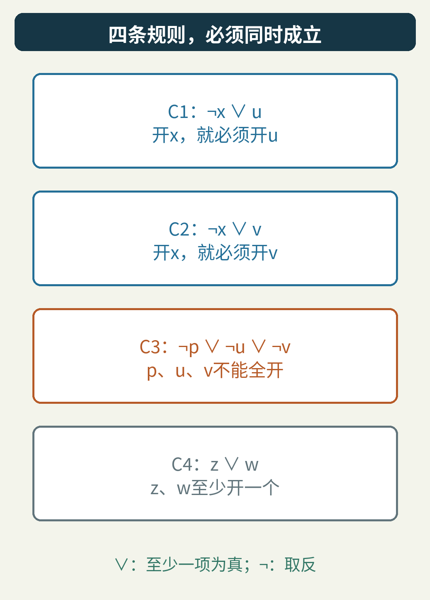

一条这样的“或”规则叫**子句**；里面的 x、¬x 这类正反形式叫**文字**。这里的“文字”是逻辑术语，并非中文字符。所有子句又必须同时成立，这种形式叫**合取范式**，简称 CNF。

SAT 是 satisfiability，可满足性。问的就是：有没有一份完整赋值，让所有规则都为真？有就给出一份，没有就证明不存在。我们这道题有 6 个变量，所以完整配置一共是 2⁶，也就是 64 种。

## 2. 在猜下一步之前，先做那些已经被逼出来的事

假设我们还不知道 u，但已经选定 x=1。

C1 的“¬x ∨ u”就只剩下 u 这一条活路。为了遵守 C1，u 必须为 1。这不是一次新猜测，而是原规则与已有选择共同逼出的结果。

这叫**单位传播**：一个尚未满足的子句中，如果其余文字都为假，只剩一个文字还没有确定，就必须让最后这个文字为真。

“单位”说的是此刻只剩一个未定的文字，不要求这条规则最初只有一项。

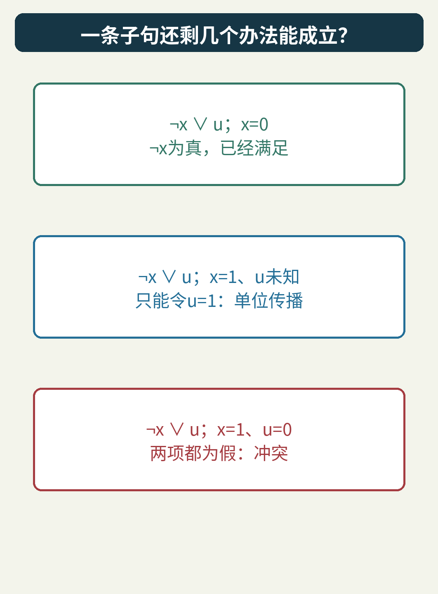

反过来，如果 x=1、u=0，那么 ¬x 和 u 都是假。C1 没有任何一项能让它成立，这就是冲突。

还有一种常见情况：子句已经有一项为真，剩下的变量可以先不管。例如 x=0 时，C1 已经满足，不会再借这条规则强迫 u 取什么值。

求解程序会反复传播：刚推出的 u，可能让另一条规则只剩一个未定项；新的结果再传到下一条。直到再也推不动，或者撞到一个全假的子句。

这样做的收益很直观：别把已经能推出来的事，再当成岔路去猜。

## 3. 把一次失败完整走出来

现在人为规定这次教学实验的选择顺序：先选 p，再选 z，再选 x，并且三次都选 1。真实求解器会用自己的策略选变量；这里固定顺序，是为了让推理过程能逐步复现。

每次主动做一个尚未被强迫的决定，就进入新的**决定层**。由这个决定接着传播出的结果，也记在同一层。

第一层，决定 p=1。

C3 变成“¬u ∨ ¬v”：u、v 至少关一个。不过目前还剩两个未定项，暂时不能决定关谁。

第二层，决定 z=1。

C4 的“z ∨ w”已经满足，w 可以继续未知。这一步没有引发别的传播。

第三层，决定 x=1。

按 C1、C2、C3、C4 的顺序检查规则：

1. C1 推出 u=1。
2. C2 推出 v=1。
3. C3 发现 p、u、v 全为 1。它的三个文字全是假，冲突出现了。

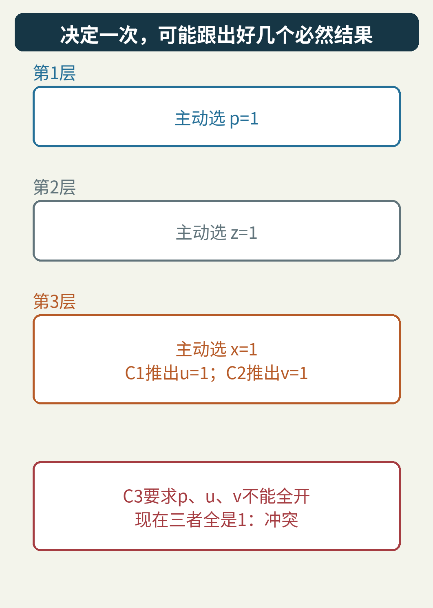

注意层数的含义。u、v 虽然分别来自两次推导，却没有新开第四、第五层。它们都属于第三层，因为我们没有对它们重新做自由选择。

如果只保存“失败了”，信息就太少。程序还需要保存每个被迫赋值的**理由**：u 为什么为 1？因为 C1；v 为什么为 1？因为 C2。

这些理由，很快会派上用场。

## 4. 给失败画一张“因为什么”的地图

把赋值画成节点，把推导依赖画成箭头：

- x=1 通过 C1 导向 u=1。
- x=1 通过 C2 导向 v=1。
- p=1、u=1、v=1 共同使 C3 冲突。

图里的“@3”表示这个赋值记在第三个决定层。箭头讲的是这次实际记录的推导依赖，不是变量之间永远唯一的关系。

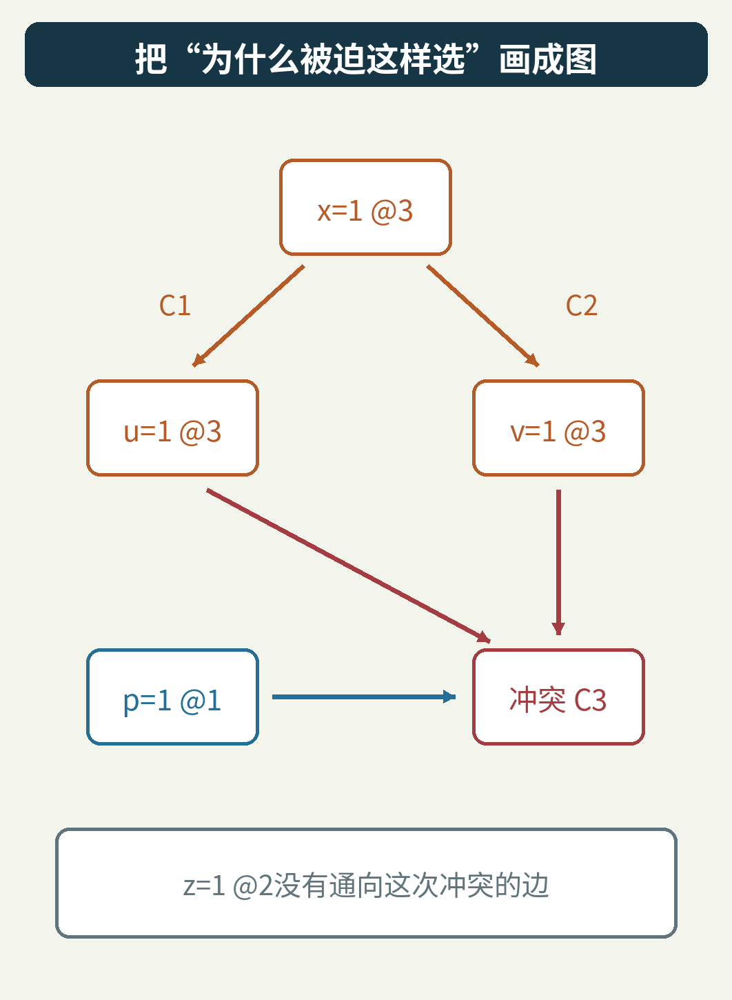

这类图叫**蕴含图**。在这里，它更像一张能够倒着追问的地图：当前这步为什么发生？如果答案还依赖更早的结果，就继续追。

图上有一个很值得留意的空缺：z 没有连到这次冲突。

我们明明在第二层选过 z，它也确实出现在原题 C4 里。可它与眼前这个矛盾没有关系。无论 z 是 0 还是 1，p 和 x 一起为 1，都会让 u、v 一起为 1，触犯 C3。

因此，“先撤销最近的决定，再挨个往前退”有可能做多余的工作。先别急着跳，我们还需要一条能够证明安全的新规则。

## 5. 第一次倒推：把 v 的理由代回来

失败发生在 C3：

“¬p ∨ ¬u ∨ ¬v”。

这条规则说，p、u、v 不能全为真。现在追问 v：它不是自己选出来的，而是由 C2“¬x ∨ v”推出的。

把两条规则放在一起：

- C3：¬p ∨ ¬u ∨ ¬v。
- C2：¬x ∨ v。

一条有 ¬v，一条有 v。我们可以把这对相反的项消去，再把余下的项并起来，得到：

**¬p ∨ ¬u ∨ ¬x。**

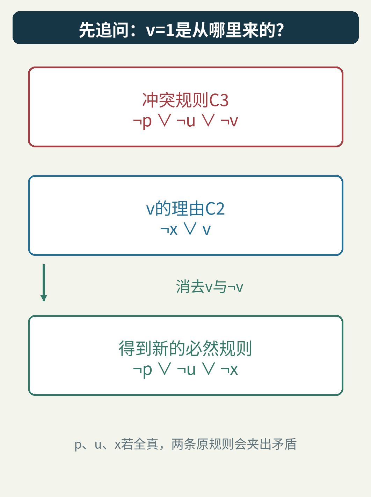

先别把它当符号戏法。它说的是：p、u、x 不能全真。

假设三者真的全真，C2 会因 x=1 而要求 v=1；C3 又会因 p=1、u=1 而要求 v=0。同一个 v 不能同时是 1 和 0。因此那个假设不成立。

这一步叫**归结**。它没有凭经验猜一个“看起来有用”的限制，而是从两条已经必须成立的规则中，推出另一条也必须成立的规则。

## 6. 第二次倒推：把 u 的理由也代回来

上一步留下的是“¬p ∨ ¬u ∨ ¬x”。其中 u=1 同样是传播出来的，它的理由是 C1“¬x ∨ u”。

再归结一次，消去 u 与 ¬u：

- 原来剩下 ¬p、¬x。
- C1 还带来一个 ¬x。
- 相同的 ¬x 写两遍没有新含义，只保留一次。

结果就是：

**C5：¬p ∨ ¬x。**

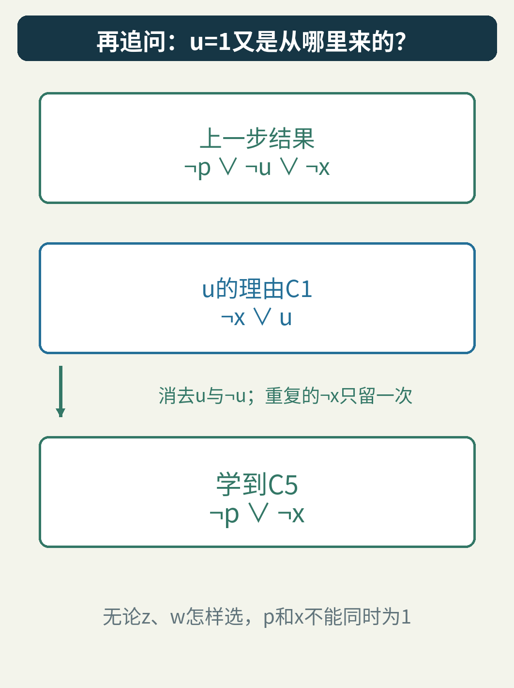

这正是最开始凭直觉看出的“p 和 x 不能同时打开”。现在，它有了由原规则一步步推出的来历。

程序把 C5 加进规则库，便完成了一次**子句学习**。

这个“学习”不需要训练集，也不靠统计置信度。它是在当前逻辑问题里，增加一条已经被原规则蕴含、但之前没有明写出来的结论。

为什么这点这么重要？因为如果新规则只是“这次失败时，碰巧 p=1、z=1、x=1，所以永远禁止这个组合”，它也许很弱；如果更莽撞地直接禁止 p=1，又会误删合法答案。

学习到“¬p ∨ ¬x”恰好抓住了这里真正的矛盾组合，并且没有给 z 添加无关限制。

## 7. 为什么学习不会把好答案一起删掉？

把刚才的归结暂时写成一般形式：

“A ∨ v”和“B ∨ ¬v”都必须成立。A、B 可以各自代表一串其他文字的“或”，不必只有一项。

如果 A 和 B 都为假，第一条会逼 v 为真，第二条又逼 v 为假，矛盾。因此 A、B 至少一个为真，也就是“A ∨ B”必须成立。

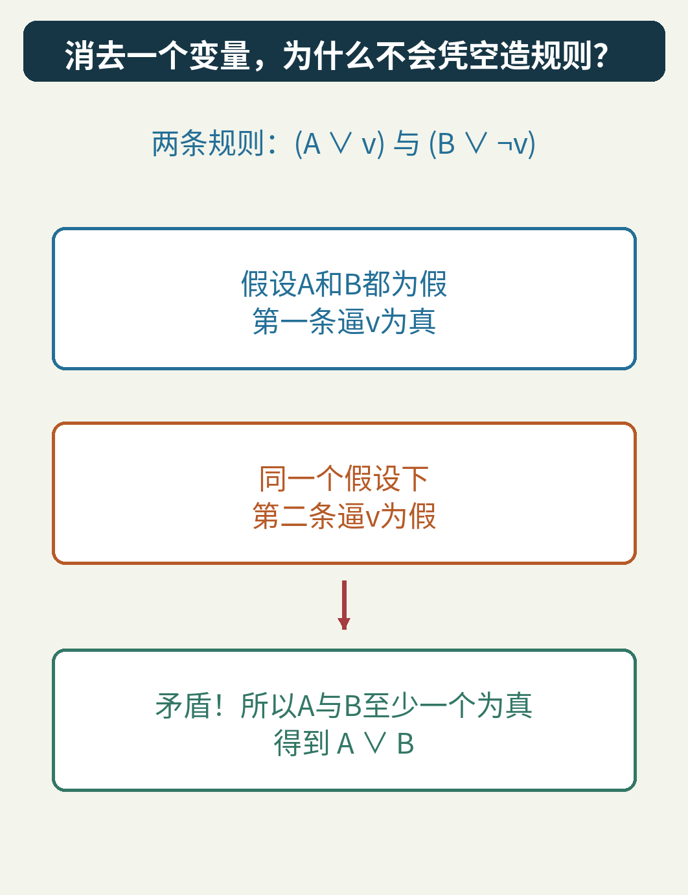

所以，任何满足原来两条规则的赋值，都一定满足归结结果。把这个结果加进去，不会丢掉原来的解。

这里也要分清一个方向：**两条原规则能够推出新规则，不等于新规则能够独自替换两条原规则。**我们把 C5 加入，而没有把 C1、C2、C3 随便删掉。

比如只留下“p 和 x 不能同时开”，就完全管不到 z、w 是否至少开一个，也不能完整表达 x 对 u、v 的要求。

安全的学习，是给原题增加一个逻辑上重复、计算上可能很有用的结论。

## 8. 为什么在 x 这里停，而不把一切追到最早？

刚才倒推时，程序先处理在赋值轨迹中更晚出现的 v，再处理 u。直到学习子句中，属于当前第三层的文字只剩下一个：¬x。

另一个文字 ¬p 所对应的赋值在第一层。

在这个小图里，从当前层决定 x=1 到冲突有两条路：一条经过 u，一条经过 v。两条路都经过 x，而 u、v 各自只挡住其中一条。

这样一个当前层赋值节点，如果所有从当前层决定通向冲突的路径都经过它，就叫**唯一蕴含点**，英文简称 UIP。常见的第一 UIP 分析，会沿赋值轨迹倒着处理理由，在得到只含一个当前层文字的学习子句时停下。

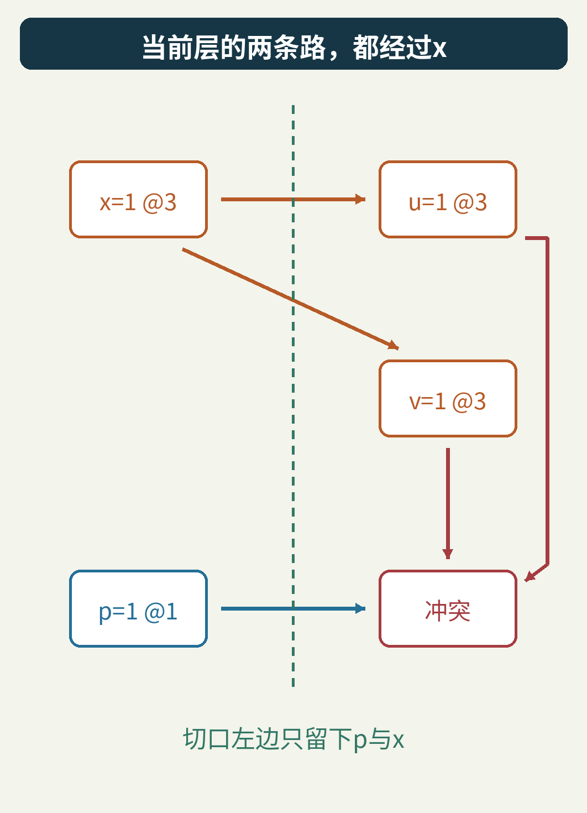

本例的第一 UIP 恰好就是决定节点 x。更大的图里，它也可能是后面被传播出来的节点，并不总是最初的决定。

为什么喜欢这个停止点？一个关键好处是：回退之后，学习子句可以马上只剩一个未定项，立刻触发新的单位传播。

也就是说，分析冲突不只是为了写一段解释，还要把解释变成下一步能直接使用的约束。

## 9. 从第三层直接跳回第一层

C5 是“¬p ∨ ¬x”。冲突发生时，p 在第一层，x 在第三层。

要撤销当前冲突，我们撤回第三层。但如果只退到第二层，z 仍然与 C5 无关。第一 UIP 的常用回跳规则是：在学习子句中，除去当前层那个文字，取其余文字所属层数的最大值。

本例只剩 p，它在第一层，所以目标就是第一层。

回跳后，原来高于第一层的赋值都撤回：z、x、u、v 回到未知；p=1 保留。

接着重新看 C5：p=1，意味着 ¬p 已经为假。为了让“¬p ∨ ¬x”成立，只能令 ¬x 为真，也就是 **x=0**。

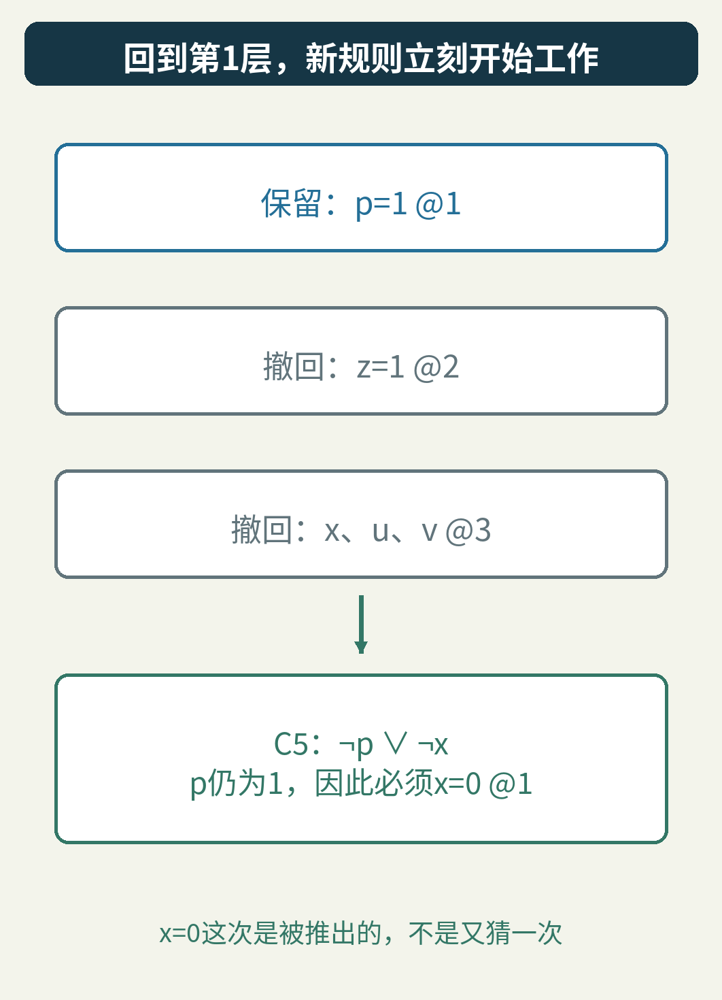

这次的 x=0 是由 C5 推出来的，记录在第一层。它不是程序又掷了一次硬币，碰巧换了个方向。

这种可以跨过中间决定层的退回，叫**非按时间顺序回溯**，也常叫回跳。

特别注意：撤回 z=1，不表示我们证明 z=1 错了。它只是发生在回跳目标之后，跟着那段临时赋值一起被撤销。之后求解器仍然可以再次选择 z=1。

原规则 C4 也还在。如果以后选择 z=0，C4 就会要求 w=1；如果选择 z=1，C4 自己已经满足。学习没有把这条支线的意义抹掉。

## 10. 把全部 64 种配置摊开检查

逻辑推导告诉我们为什么归结安全。因为这个例子足够小，我们还能用另一条路线检查实现有没有写错：枚举所有完整赋值。

附带程序分别计算：

1. 这个赋值是否满足 C1 到 C4？
2. 是否满足新学到的 C5？
3. 是否满足 C1 到 C5？

实际结果是：原问题有 24 个解，加入 C5 以后仍然是同样的 24 个解。C5 自己排除了 16 个赋值，它们全部原本就不满足原题。

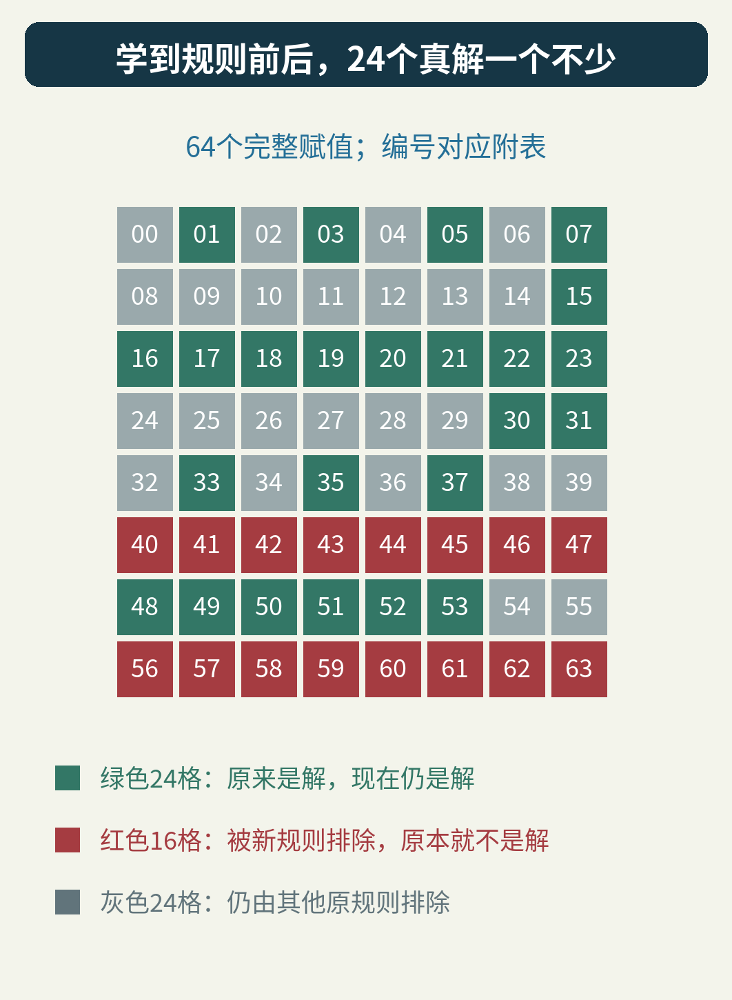

图中每格是一个完整赋值，编号对应附带的 [64 行真值表](examples/truth-table.csv)。编号按 p、z、x、u、v、w 的顺序，以 0 在前、1 在后枚举；不是搜索器实际访问这些配置的先后次序。

为什么被 C5 排除的恰好是 16 个？它只在 p=1 且 x=1 时为假，另外四个变量各有两个选择，所以共有 2⁴=16 种。

为什么原题有 24 个解？也可以手算：

- x=0、p=0 时，u、v 随便选，共 4 种；z、w 除了全关都行，共 3 种，得到 12 种。
- x=0、p=1 时，u、v 不能全开，共 3 种；再乘 z、w 的 3 种，得到 9 种。
- x=1 时，u、v 必须全开，p 必须关；只剩 z、w 的 3 种，得到 3 种。

12+9+3=24。图、代码与手算对上了。

## 11. 它挡住的是一个模式，不只是一条旧路

假设程序以后又在 p=1 的情况下，走到了别的分支。

不管 z 选 0 还是 1，C5 都会立刻推出 x=0。原先那种“先让 x=1，再传播 u、v，最后撞上 C3”的失败，不必沿两条 z 分支分别重演。

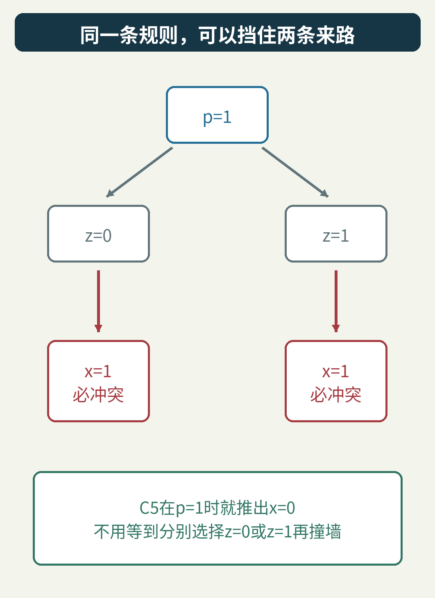

这就是学习的价值：把一次具体失败压缩成一个可复用的原因。

但别从这张小图直接读出“速度提升两倍”，更别读出“指数问题从此变容易”。不同选择策略、传播次序和输入问题，会带来不同的搜索过程。本文没有拿运行时间做工业性能比较。

学习子句也不是越多越好。它们占内存，求解器传播时还要管理它们；大型求解器会选择保留哪些、何时删除部分学到的子句，并搭配变量选择、重启等策略。这些选择影响效率，但不能允许凭空加入原题推不出的限制。

1999 年，João P. Marques-Silva 与 Karem A. Sakallah 的 GRASP 论文系统讨论了冲突分析、学习与非按时间顺序回溯。在 SAT 2003 会议的工作中，Niklas Eén 与 Niklas Sörensson 的 MiniSat 论文展示了紧凑、可扩展的求解器设计。这里的小实验只拿出其中一段可以徒手拆开的机制，并没有复刻完整求解器。[GRASP 原论文](https://people.eecs.berkeley.edu/~alanmi/courses/2005_290A/papers/grasp.pdf)、[MiniSat 论文目录](https://minisat.se/Papers.html)可作为继续阅读的起点。

## 12. 失败了一条路，整道题仍然可能有解

回跳以后，我们可以继续给未定变量赋值。例如下面这组：

p=1，z=1，x=0，u=0，v=0，w=0。

逐条检查：C1、C2 都因 ¬x 为真而满足；C3 因 ¬u、¬v 为真而满足；C4 因 z 为真而满足。C5 也因 ¬x 为真而满足。

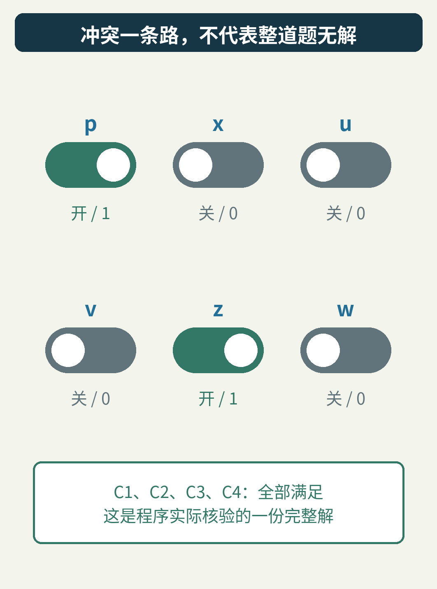

这是一份实际核验过的 SAT 答案。因此，前面的冲突绝不能被报告成“整题无解”。它只说明那个局部选择走不通。

要报告 UNSAT，也就是不可满足，需要证明所有可能性都不行。完整求解器可以不断传播、学习、回跳；如果冲突出现在没有任何可撤销自由决定的根层，就能据此认定矛盾。更一般地，检查器也可以验证一份完整的不可满足证明。本文的教学程序没有实现完整搜索循环，不把一次冲突冒充全题证明。

你可以运行附带的 [实验程序](examples/run_conflict.py)，无需安装 SAT 求解器：

```text
python examples/run_conflict.py --output my-run
```

输出目录须尚不存在，以免覆盖之前的结果。程序记录了每次赋值的层数、理由、两次归结、撤销的赋值以及回跳后的单位传播。

除了 64 个赋值逐一核对，它还做了两项检查：

- 对两次归结分别检查全部 64 个赋值，总计 128 次前提到结论的蕴含检查。
- 遍历四条原子句的 24 种扫描顺序。冲突被哪条子句先发现可能变化，但在这组固定决定下，都学到“¬p ∨ ¬x”，并回跳到第一层。

运行环境、原始输出和全部结果见 [实验说明](examples/README.md)。这不是一般 CNF 的完整 CDCL 实现；它把一个确定的小问题的推理轨迹完整展开，方便你修改、重算和查错。

最后可以给自己留两个问题：

如果把第三层的决定直接改成 x=0，还会出现刚才的冲突吗？不会；C1、C2 已经满足，u、v 也不再被它们强制打开。若 p 仍为 1，C3 仍要求 u、v 不能全开。

如果把 C3 整条移除，还能学习“¬p ∨ ¬x”吗？不能。例如 p=1、x=1、u=1、v=1、z=1、w=0，现在就是合法解。继续加那条旧结论，反而会错误地删掉它。

这两个变化指向同一件事：好用的“经验”必须保留自己的适用依据。

程序真正学会的，不是“我不喜欢这条路”，而是：**这些原规则共同保证了，这一类路必然走不通。**
