# 没有总管点名，一群服务器怎样发现谁掉队了？

六台服务器一起为一款校园游戏工作，名字是A、B、C、D、E、F。

某一刻，A给B发了一条消息：“还在吗？”

没有回音。

B可能关机了，也可能还活着，只是那条消息丢了；还可能请求到了，回信没回来。A自己的程序太忙，暂时没处理已经收到的回信，也会造成同样的表象。

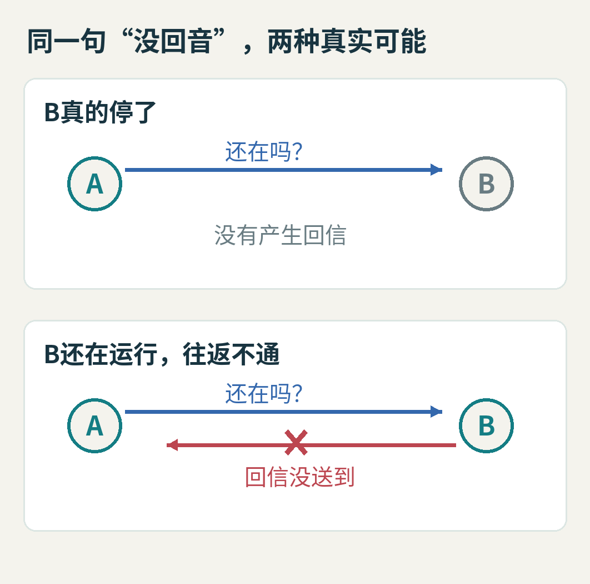

**没有回音，是一个观察；“B已经死了”，是对这个观察的解释。两者之间还有距离。**

可系统也不能一直等下去。游戏里的服务要知道接下来该联系谁，哪些伙伴可能已经离开。如果没有一台总管负责挨个点名，其他成员能不能分摊这份工作？

一个很有意思的答案叫SWIM。它把这件事拆成两件：少量地探测别人，再把成员状态的变化传开。我们用这六个名字，沿着一封没收到回复的消息，看看它如何工作。

## 1. 人人关心人人，消息会长得有多快

最直接的办法，是每台机器定时告诉所有人：“我还活着。”这样的周期性报告通常叫心跳。

六个成员，每个给其余五个发一次，就是6×5＝30封。增加到100个成员，每个要发99封，总共9,900封。若有1,000个成员，一轮就是999,000封。

这里数的是逐一发送的心跳消息，不是每封消息的字节数，也没给它们另配回信。

SWIM换了一种工作方式：每个成员在一个探测周期里，先挑一个目标，主动问一次。目标正常回复时，只需要一封PING和一封ACK。

PING可以理解为“请回答我”，ACK是“收到，我在”。它们是协议里的消息名称，不要求使用电脑命令行里的ping工具，也不必是同一种网络报文。

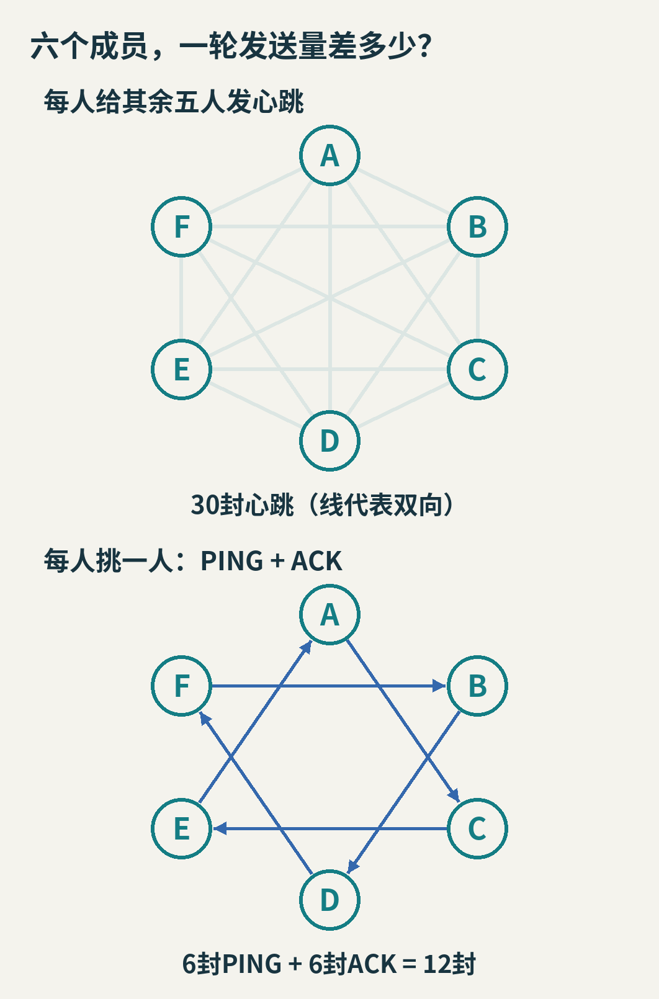

上半图每条浅线代表两端各向对方发心跳，共30封。下半图只画六封PING的方向；每封都有一封返回的ACK，因此健康情况下共12封。图里的选人只是某一轮可能出现的样子，下一轮可以不同。

省下消息以后，一个新问题立即出现：我这一轮只问了C，怎么知道B掉队了？

答案不是“每个人都立刻知道”。**让少数成员先发现线索，再让线索传播，正是这套方法愿意接受的分工。**

## 2. 每个人都有一份名单，但不是一份同步更新的公告

A、B、C等名字代表参加协议的程序进程。一个进程可以先理解为一段正在运行、能够收发消息的程序。现实中，一台物理机器可以运行多个进程；本文用“六台服务器”把它们画开。

每个成员都保存自己的成员表：知道哪些伙伴、怎样联系它们、目前怎么看待它们。

例如，A刚刚开始怀疑B，E还没听说这条消息，两人的表就可能不同。

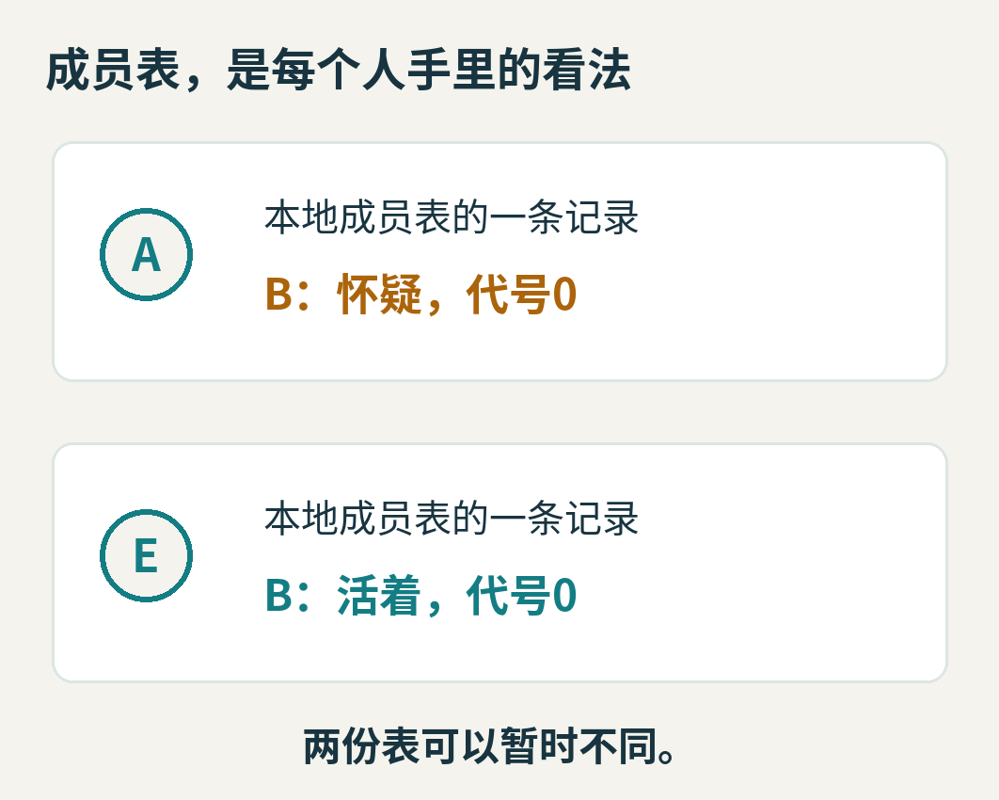

图中的“代号0”是用来区分B不同版本声明的数字，稍后会沿着B的一次反驳解释。此刻只需知道：它们不是墙上的时钟，也不是A和E对B投出的票数。

分散点名也不表示新机器会自动知道全世界。新成员通常仍需要先联系至少一个已知成员，取得加入群组的入口。本文六人预先知道彼此，专门观察此后的探测与状态更新。

这种允许成员表暂时不同的性质，就是SWIM名称中“弱一致”的含义。它解决的是成员发现与故障怀疑，不要求每次改名单时先让全体成员共同签字。

所以，下面每次说“B变成怀疑状态”，都要接着问：**在谁的表里？从什么时候开始？**

## 3. 先问B一次，给这次提问留一个编号

先看没有故障的情况。

为方便手算，我们在一个离散事件模型里规定：一次单向消息传递恰好花20毫秒；A先等100毫秒；整个探测窗口到300毫秒结束。

“离散事件”指程序直接计算下一件事情发生的时间，例如从“发送”跳到20毫秒后的“收到”，并不真的睡上20毫秒。**这些整齐的毫秒数是本例人为设置的虚拟时间，不是实测网络延迟。**

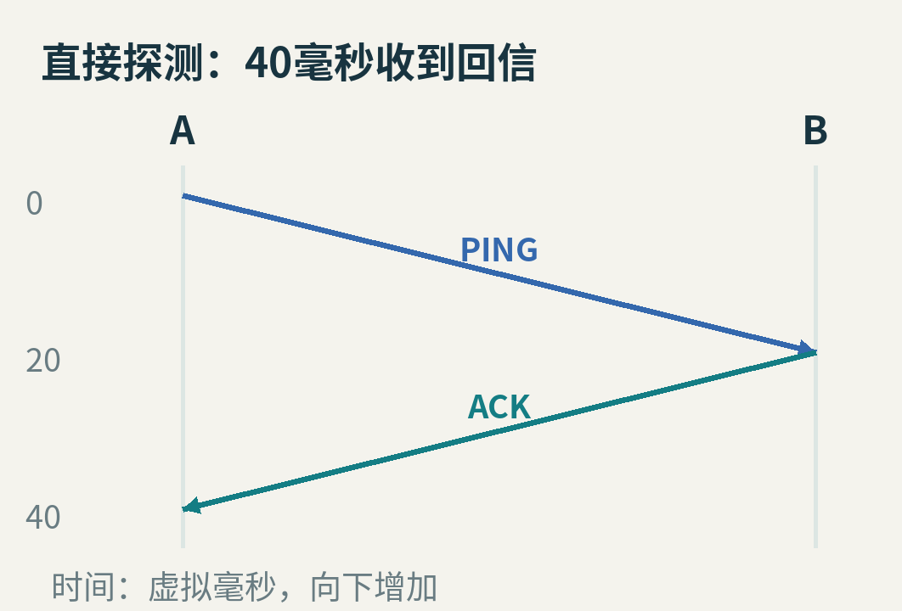

顺着图往下读：

- 0毫秒，A给B发PING。
- 20毫秒，B收到，立即发ACK。
- 40毫秒，A收到ACK。这次探测完成。

A给这次提问编号A:1，并要求回信带回对应编号。下一次是另一份提问，不能把几秒前迟到的旧回信当作这次回答。

这并不表示一封及时的ACK能保证B未来永不出错。它只说明：这次往返中，B曾经能够处理探测并发回消息。

## 4. 直路不通，找别人从旁边问一下

现在只改一个条件：A与B之间的直达消息走不通，但A到C、C到B，以及反向路径都可用。

100毫秒时，A仍没收到ACK。它不立刻把B划掉，而是挑C、D两个帮手，各发一封PING_REQ(B)：请你帮我问B，并把收到的答复转回来。

这是**间接探测**。不是让C凭印象说“我觉得B挺好”，而是让它真的完成一次带着本次编号的探测。

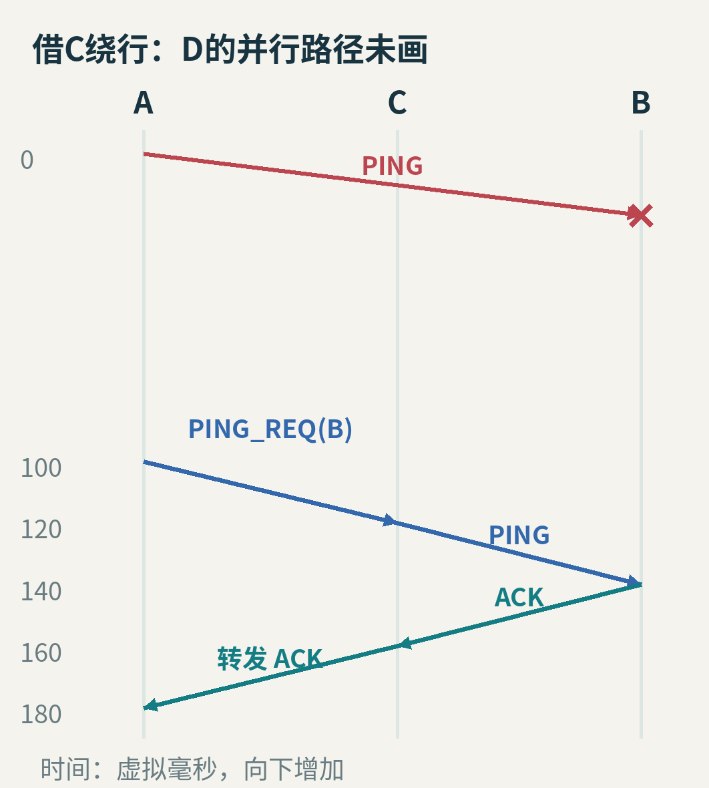

图只展开C这一条路径，D同时做相同类型的工作：

1. 100毫秒，A发PING_REQ给C。
2. 120毫秒，C收到，给B发PING。
3. 140毫秒，B收到，给C回ACK。
4. 160毫秒，C收到，把ACK转发给A。
5. 180毫秒，A收到。虽然直路没通，这次探测成功了。

为什么回信也经由C？因为如果B又直接把ACK发给A，可能再次撞上刚才出问题的那条路径。绕行需要照顾去程和回程。[原论文，第3.1节](https://www.cs.cornell.edu/projects/Quicksilver/public_pdfs/SWIM.pdf)

C和D之中，**任何一条有效路径的答复及时回来就够了，不需要多数同意**。如果D的答复稍后也回来，仍然属于A:1，不会凭空产生第二次探测。

这一轮共发出9封消息：最初的一封PING，加上两个帮手各自四封往返消息。模型确实执行并记录了这9次发送，完整记录在文末的实验材料里。

可见，“每轮先问一个”不等于“故障时也永远只发两封”。它限制了尝试的规模，而没有取消补救过程。

## 5. 还是没回音，先写“怀疑”

再改条件：B整个程序暂时不能处理探测。A直接问没有用，C、D去问也没有用。

到300毫秒，A仍没收到任何有效ACK。

如果马上写“B已经失效”，一次短暂停顿就会让一个还可能恢复的成员被赶出名单。SWIM因此加入了一层缓冲：先写**Suspect，怀疑**，并让这条怀疑传播。

在这个例子里，A从300毫秒开始再给600毫秒的怀疑窗口。没有新的有效反驳，它会在900毫秒把B标成确认失效并移出活动名单。这里的两个等待不能混在一起：100毫秒触发间接探测，300毫秒结束一次探测，之后600毫秒才是本例的怀疑等待。

现在设B在350毫秒恢复。

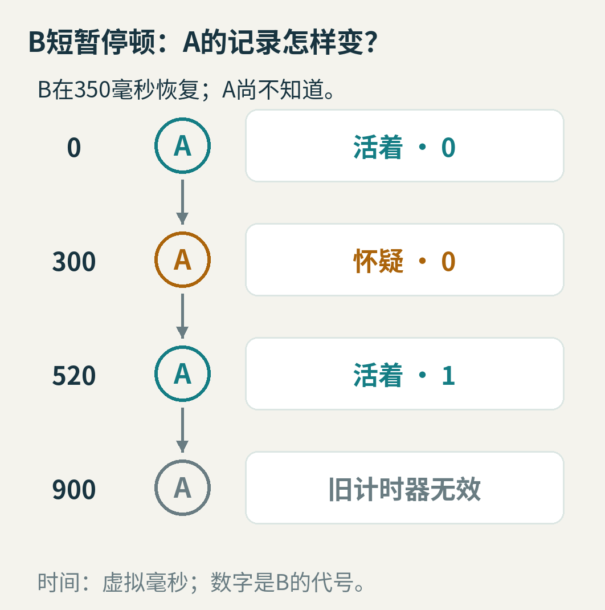

注意：350毫秒时变好的是B自身，A的表不会隔空更新。A还要收到新的信息。

怀疑期间，B仍留在可探测的成员中。否则所有人一怀疑它就再也不联系它，它反而更难让大家知道自己恢复了。

等待时间是一项取舍。短一点，真正故障可能更快被确认，但慢节点更容易来不及解释；长一点，误判可能减少，却会让系统更久保留真正失效的成员。没有一个适合所有网络与机器负载的万能毫秒数。

## 6. B怎样反驳？先得知道“大家正在怀疑我”

给普通消息顺手加上一小段成员更新，可以把新消息送到更多人那里。这叫**搭载，piggyback**：本来就要发的包，顺便携带一条状态变化。

接着运行刚才的模型。为了让过程能逐步核对，后面的联系对象与时间由我们固定安排；这是一段教学片段，不是让每个成员完整运行周期性调度的生产实现。

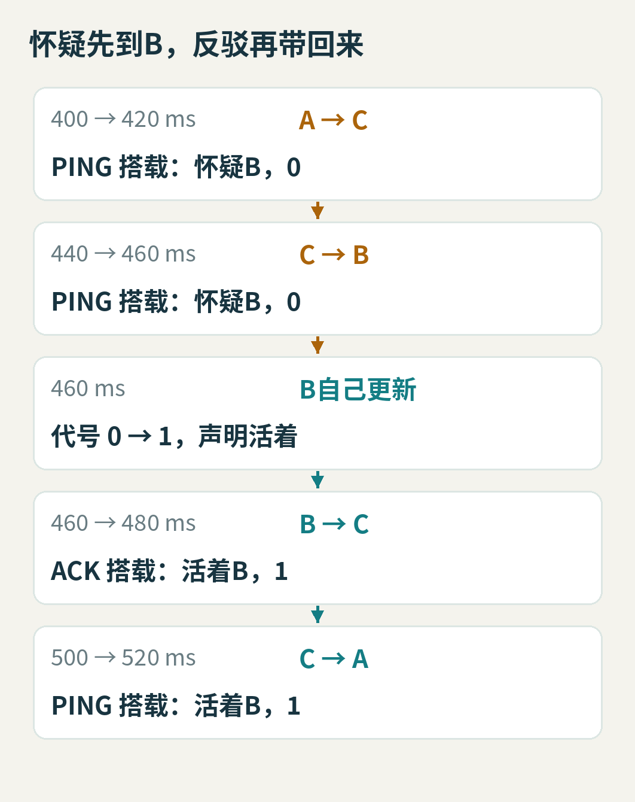

400毫秒，A向C发PING，同时搭载“怀疑B，代号0”。420毫秒，C收到这条怀疑。

440毫秒，C向B发PING，也搭载这条消息。460毫秒，已经恢复的B收到：原来别人正在怀疑我的第0版状态。

B把**自己的**代号加一，发布“B活着，代号1”。这一动作叫反驳。C收到B的ACK和新声明，再把它搭载给A。

到520毫秒，A终于看到“活着，代号1”，于是取消对第0版B的怀疑。原定900毫秒的旧计时器即使后来触发，也必须检查自己针对的仍是不是那一版怀疑；不能把已经更新的B又删掉。

这个代号的英文是**incarnation number**。可以暂时把它理解为“这个成员给自己声明加上的版本”。它不等于真实重启次数：B没有重启，也可以为了反驳怀疑而把它加一。

只有B能提高B自己的这一版本，其他成员可以转发已获知的声明，不能为了表示好心，擅自替B编出一个更新的“活着”。这个例子不处理恶意伪造消息；版本号本身也不是身份认证。

## 7. 为什么不是“最后收到的消息获胜”

网络可能把先发的消息晚送到。

假如A已收到“B活着，代号1”，之后才收到绕远路来的“怀疑B，代号0”，要不要重新怀疑？

如果总用最后到达的消息覆盖，就会把已经过时的怀疑重新扶起来。

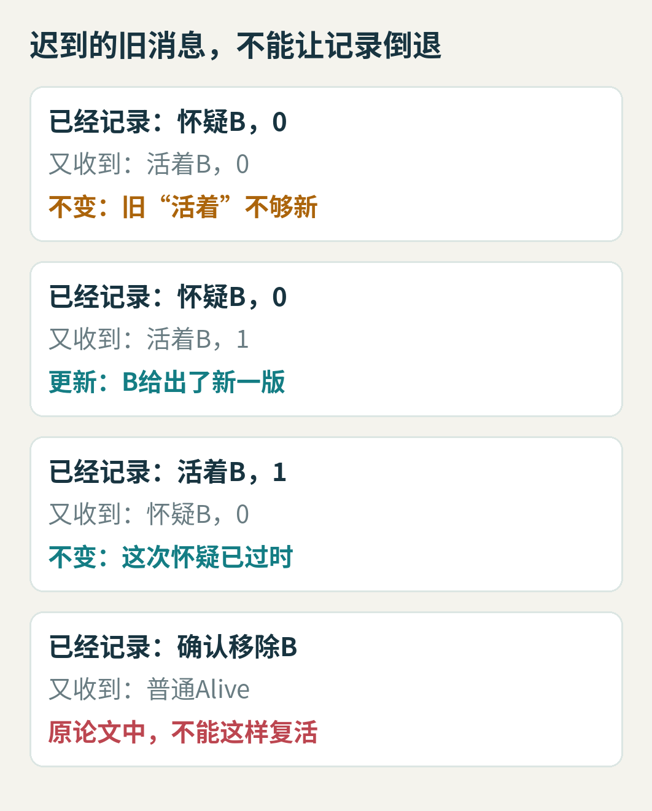

在尚未确认移除的阶段，本例按这些规则合并：

- 同一个成员，版本更高的Alive或Suspect优先。
- 版本相同，Suspect能覆盖Alive。否则旧的“我活着”会不断冲掉新的怀疑。
- 因而，Alive要反驳某一版Suspect，版本必须更高。

例如“怀疑0”遇上“活着0”，仍是怀疑；遇上“活着1”，才更新为活着。随后迟到的“怀疑0”无效。

代码还实际枚举了“活着0、怀疑0、活着1”的全部六种到达顺序。对本例初态，它们最后都得到“活着1”。这验证的是这组规则和这几个输入，不能替代对完整分布式系统的证明。

这里有一个容易被现代实现细节掩盖的边界：**2002年原论文的Confirm，也就是已经确认移除的通知，优先于普通的Alive和Suspect，不是靠随便加一个更大代号就原地复活。** 已移除成员如何重新加入，要走相应的加入与身份管理流程；本文没有实现这部分。[原论文，第4.2节](https://www.cs.cornell.edu/projects/Quicksilver/public_pdfs/SWIM.pdf)

不同后续实现可能扩充状态、重加入与冲突处理。读它们的代码时，要认准具体版本，不能把原论文、教学模型和某个软件的所有细节当成完全相同。

## 8. 一个人知道的变化，怎样变成大家知道

现在把B是否真的出故障放在一边，只观察一条成员更新怎样传播。

起初只有A知道。它联系D时，把更新搭过去；D以后联系其他人，也继续带这条更新。若不知道更新的人先来问知道的人，回来的ACK也能把更新带回去。

这种通过一轮轮局部接触扩散消息的方式，经常叫**gossip，闲话传播**，也叫传播式或流行病式传播。这里的“闲话”描述传播形状，不代表消息可以胡编。

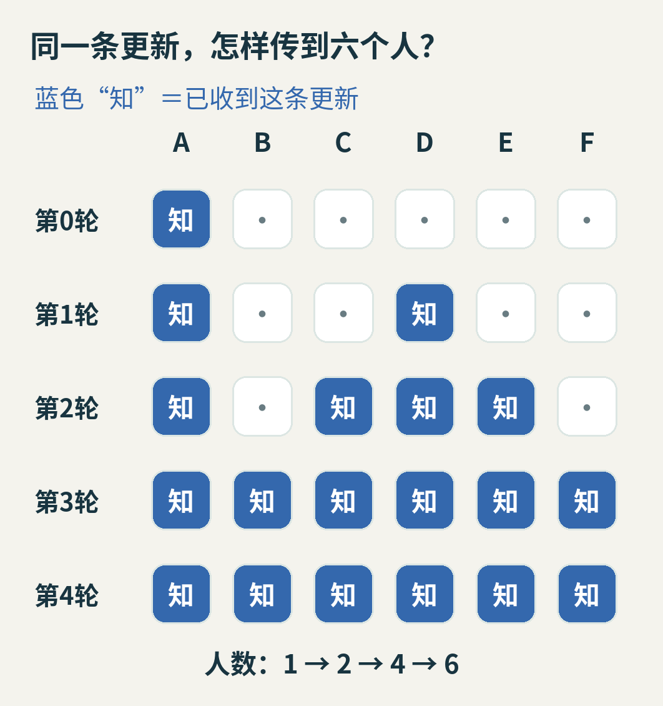

这张图来自另一个实际运行的小模型：仍是A至F，每轮每人均匀选一个其他成员；PING和ACK可以携带这一条更新；没有丢包；为便于逐轮比较，各次联系读取轮初的已知状态，下一轮再统一使用本轮的新知识。

固定随机种子2301后，知道更新的人数依次是1、2、4、6。图中“知”的格子显示具体是哪些人。它们不是为了好看而手工涂出的格子，逐次联系人保存在CSV里。

但**“这次第三轮传遍”不等于“任何规模的SWIM都保证三轮传遍”**。换随机种子、增加节点、加入丢包，轨迹都会改变。这个小模型还让唯一一条更新在八轮内一直可传播；没有模拟真实协议的更新队列拥塞与转发预算。

真正的实现不能每封包都塞进无限长的历史。原论文为待传播的更新保留计数，限制单条更新的搭载次数，并在一个包放不下所有更新时优先照顾传播次数较少的条目。这些限制提醒我们：包的个数少，不代表成员变化再多也能立刻传完。[原论文，第4.1节](https://www.cs.cornell.edu/projects/Quicksilver/public_pdfs/SWIM.pdf)

消息扩散通常很快，仍然依赖能够继续通信、成员持续运行，以及更新负载没有长期压过传播能力。隔着永久断开的网络，两边不可能靠gossip自动知道对方最新发生的一切。

## 9. “可扩展”到底省了什么

再回头看消息账本。

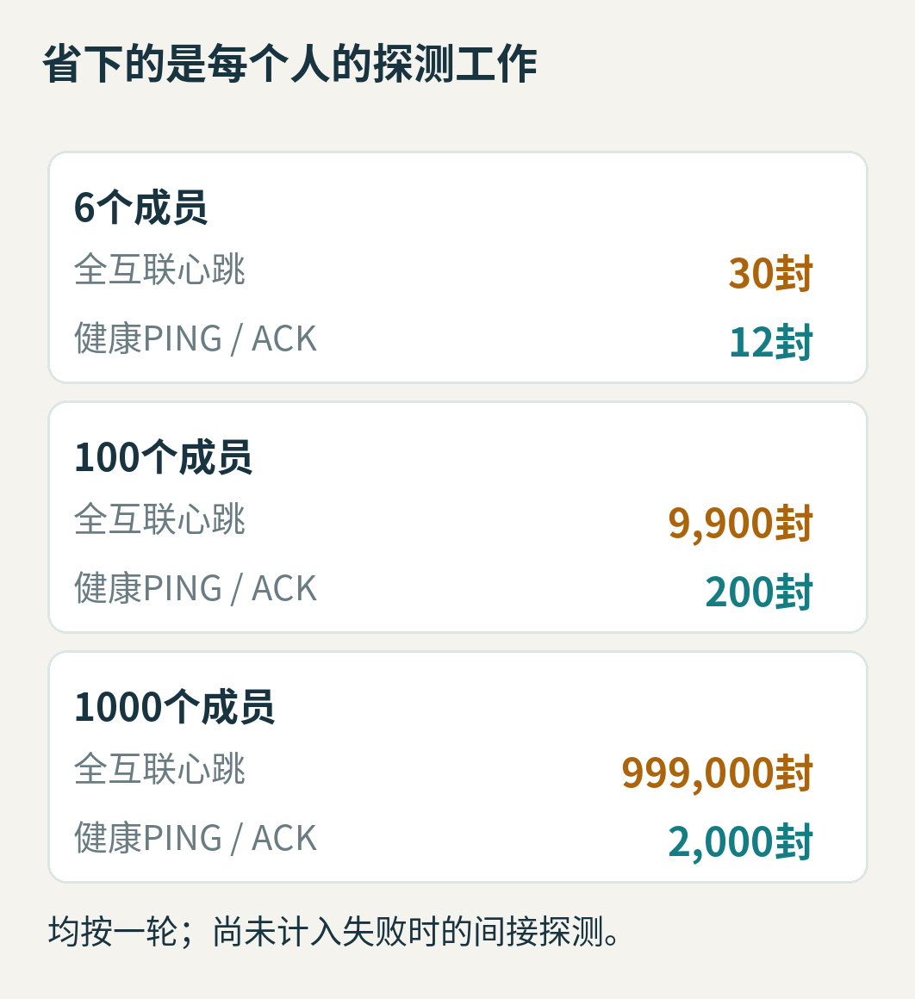

N个成员全互联发心跳，一轮是N×(N−1)封；每个成员都完成一次健康的直接探测，则是2N封。

当两个帮手同时被请求，某个失败直达探测最多还会触发两组四封消息。一般把帮手数量记作k，只要k固定，单次探测引出的消息数量就不随整个群组人数线性增加。

这里说的是探测消息工作量。还要补上三个限制：

第一，**“每个成员平均承担的工作量”不等于“每个成员每轮恰好收到一样多的包”**。碰巧很多人都选中C，C这一轮就会更忙。

第二，保存完整成员表仍然需要随成员数量增长的空间。不能把“平均探测消息量不随人数增长”，改写成“整个系统所有开销都是常数”。

第三，新成员加入、更新搭载、重传、实际软件附加的同步机制，都有自己的成本。健康情况下的2N是一个清楚的对照，不是所有运行时刻的流量上限。

## 10. 随机只挑一个，会不会一直漏掉B

会有这个风险。平均很快，与每次都快，是两回事。

先算一个我们能控制全部假设的小例子：六人里只有B停了，另外五人仍知道六人名单；每个人都独立、均匀地从其余五人中选一个。

每人没选中B的概率是4/5。五人都没选中，就是五个4/5相乘：

(4/5)^5＝0.32768。

反过来，至少有一人选中B的概率，是1−0.32768＝0.67232，约67.2%。

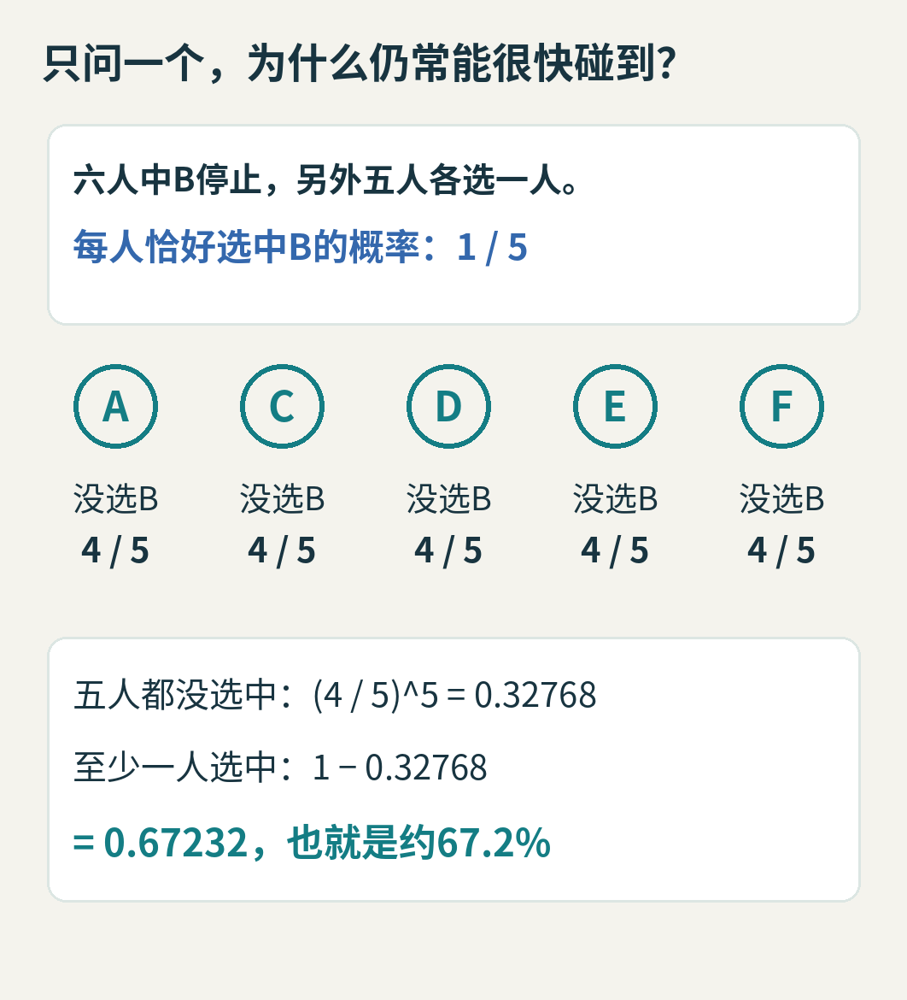

如果下一轮重新独立抽样，连续三轮全体都漏掉B的概率，就是0.32768再连乘三次，约3.52%。概率越来越小，但没有哪一轮突然变成绝对不可能。

在这个理想模型下，首次至少一人选中B所需的平均轮数约为1.49轮。这里算的是**第一次被选作探测目标**，还没把本轮超时、怀疑等待和消息传播时间加进去。

扩大到N个成员、一个已停成员时，对应概率是：

1 − ((N−2)/(N−1))^(N−1)。

随着N增加，它接近1−1/e，约63.2%。读不熟e也没关系：关键是，虽然每个人碰到B的机会变小，参与寻找B的人也变多了；这让“某个人先碰到”的机会没有随着人数增加而接近零。这里的公式是针对上述独立抽样条件重新推出来的，不是无条件保证。

原论文还讨论一种更有约束的选法：把成员名单打乱，按顺序遍历一轮，再重新打乱。这样每次遍历都会轮到列表中的每个人，不必无止境地赌独立抽签。它给探测目标的再次选择带来确定界限；这个界限仍随列表长度增长，也不等于全世界同步得到正确答案的绝对时间保证。[原论文，第4.3节](https://www.cs.cornell.edu/projects/Quicksilver/public_pdfs/SWIM.pdf)

## 11. 把探测消息真的交给操作系统，发生了什么

前面的整齐时间来自模型。为了再观察消息是否真的经过收发接口，我们还运行了一份不同的程序：在同一台电脑上创建六个UDP套接字，通过127.0.0.1互发报文。

套接字是程序向操作系统收发网络数据的接口。127.0.0.1表示这台电脑自身，所以这些包经过本机网络栈，没有去往互联网，也没有六台真实服务器。

程序在应用层故意忽略某些已经收到的报文，制造三个独立场景：正常；只忽略A到B的直达探测；B忽略所有探测。每次处理报文前，还故意安排20毫秒等待，让过程容易观察。

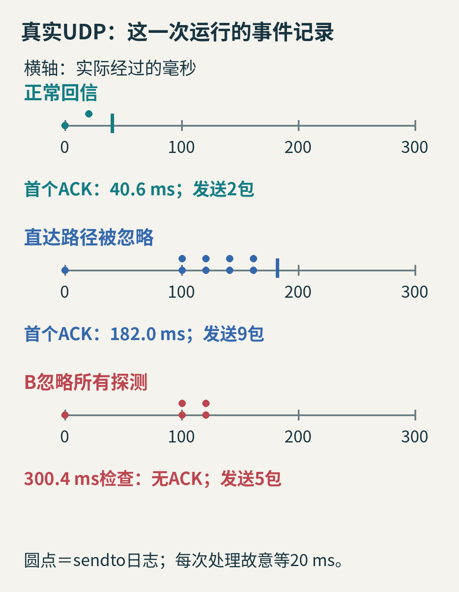

本次运行的结果是：

- 正常：发送2个UDP报文，约40.6毫秒处理到ACK。
- 直达路径被忽略：发送9个UDP报文，约182.0毫秒通过帮手处理到ACK。
- B忽略全部探测：发送5个UDP报文，到约300.4毫秒检查时仍没有ACK。

第三种为什么只有5个？因为只有最初的PING、两封PING_REQ、两封帮手PING，没有任何ACK往回走。

这些数字都来自这一次实际运行的记录。**它们不是SWIM性能跑分。** 大部分时间是人为安排的处理等待，操作系统调度会使下一次结果略有变化。应用层忽略也不是制造真实交换机丢包，更不是关掉一台物理服务器。

图中的圆点取自sendto调用日志；完整记录另有SOCKET_RECEIVE、PROCESS、APP_DROP等事件。所有发出的UDP报文在本次运行中都确实到达接收套接字，随后由故障注入规则决定是否处理。这是应用事件日志，不是抓包工具生成的pcap文件。

这份UDP实验只核验直接探测、间接转发与无回复三条路径。怀疑、版本与传播的可重复数值检查，来自前面的离散事件模型。两种实验各自回答一个问题，没有把它们冒充成完整生产级SWIM集群。

## 12. 多找几个帮手，为什么不能彻底消除误判

如果A到B不通，而C到B通，帮手非常有用。

但如果A、C、D到B都经过同一台故障交换机，多挑两个帮手也可能一起失败。若B整个进程暂停，来自哪个方向的请求都可能来不及处理。

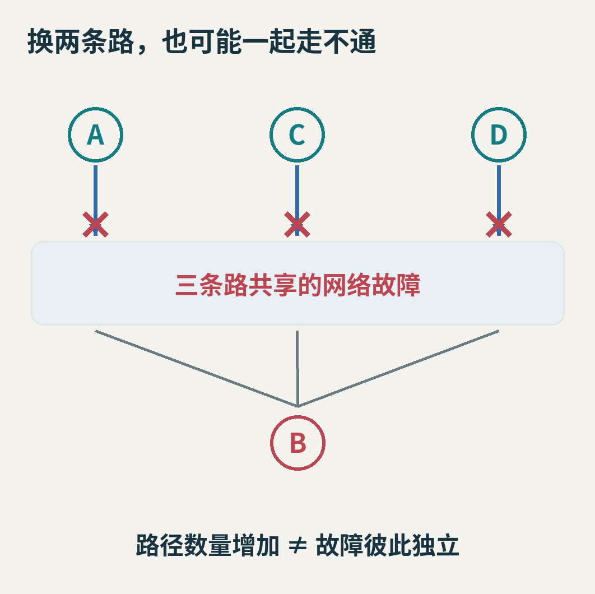

不能把三条路线机械地当作三次相互独立的抽奖。共享网络、共享主机、共同拥塞，会让失败相关联。

怀疑等待也只能给恢复留出机会。网络若一直不恢复，或者B的暂停长过等待窗口，系统仍可能把一个未来能恢复的成员判为失效。

更微妙的是：**出问题的可能是观察者A。**

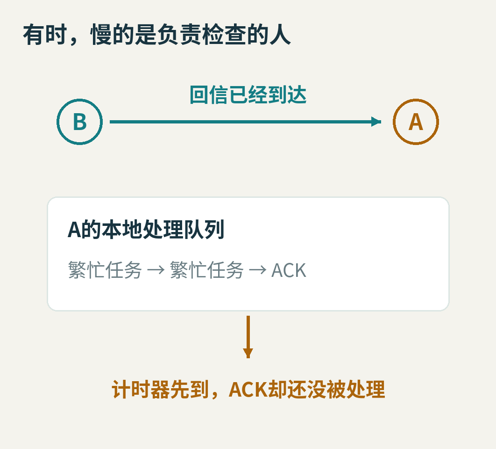

B的ACK已经到达A的本地队列，却迟迟没被处理，A的故障检测逻辑就可能错误地怀疑别人。一个很忙的观察者，可能同时觉得许多伙伴都失联了。

Lifeguard后来专门研究这个问题：把“本地检测者可能不健康”也纳入考虑。它的改进包括对本地健康状况的感知、调整怀疑行为，以及更积极地把怀疑送到被怀疑者那里。这里先记住新的观察角度，不把这些后续扩展倒写成2002年SWIM原协议已有的内容。[Lifeguard作者论文，2017年首版、2018年修订版](https://arxiv.org/abs/1707.00788)

## 13. 发现成员，不等于发放权力

回到最容易惹麻烦的一句话：“我们已经把B移除了，所以可以让别人接管它的一切。”

成员表上的移除，并没有遥控B的电源。

如果只是网络分成两边，B可能仍在另一边运行，仍能访问某些共享资源。A这边不再选它做目标，不代表B之前发出的写入请求全部消失。

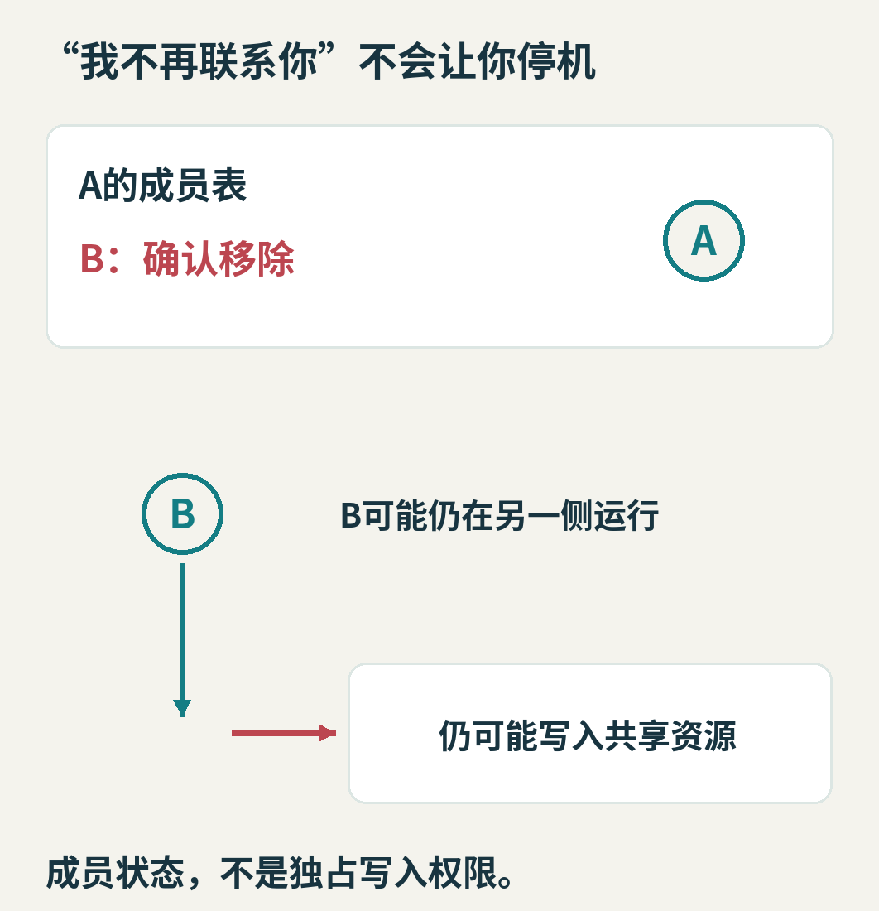

因此，SWIM状态适合提供“应该关注谁、联系谁、怀疑谁”的线索；**不能单独证明谁拥有独占写入权限，也不会自动达成一份强一致日志或安全选主结果。** 那些任务需要另外的协调与资源端保护。

Consul的官方架构说明也把gossip的成员发现与故障检测，同[共识处理](https://developer.hashicorp.com/consul/docs/concept/consensus)等职责区分开来。一个系统可以同时使用它们，但“都用在分布式系统中”不表示它们是同一个机制。[Consul官方gossip说明](https://developer.hashicorp.com/consul/docs/concept/gossip)

## 14. 这套设计最值得记住的分界线

2002年，Abhinandan Das、Indranil Gupta、Ashish Motivala在DSN会议发表SWIM论文。康奈尔大学当年的研究年报保留了这项发表记录。它的贡献不需要一个“某人灵光一闪解决全部故障”的故事来包装。[Cornell 2001—2002年报](https://www.cs.cornell.edu/annual_report/01-02/publications.htm)

从A、B、C这几封小消息里，可以看见一组很实用的分界线：

- 一次探测失败，先是一条有限线索。
- 换路径再问，可以减少由某条路径造成的误判。
- 留出怀疑窗口，给活着的成员一段纠错时间。
- 给声明加版本，避免迟到的旧消息把纠错撤销。
- 把变化顺路传开，让发现工作不用人人重复做。

最后再做两个小判断。

第一，A已经记录“B活着，代号1”，随后收到“怀疑B，代号0”。会变回怀疑吗？不会。后到不等于更新。

第二，A和C都没收到B的回复，是否已经证明B断电？仍然没有。两条失败路线可能共享同一个故障，或者两个观察者自己都很慢。

SWIM的有趣之处，正在于它没有把“不确定”藏起来。它把不确定写进状态、等待和更新规则，让一群各自只知道一部分情况的程序，能够以较少的探测工作，持续修正对伙伴的判断。

## 动手材料

[复现实验说明](README.md)列出完整输入、时间单位、故障注入位置、运行命令和限制。

- [教学模型代码](examples/run_model.py)与[逐条事件CSV](examples/events.csv)
- [成员更新合并的六种顺序检查](examples/merge-tests.json)
- [固定种子的逐轮联系人](examples/gossip-contacts.csv)
- [真实本机UDP实验代码](examples/run_udp.py)、[原始事件CSV](originals/udp-events.csv)与[本次结果](originals/udp-results.json)
- [全部原创图的重绘代码](examples/build_figures.py)
- [一手来源、素材身份与AI辅助说明](sources.md)

原创正文、教学图和原创实验数据采用CC BY 4.0；原创代码采用MIT许可。论文及外部网站由链接指向，不随本文重新授权。
