# 没有说明书的机器，怎样从输入输出猜出它的脾气？

你面前有个小加热盒。功率旋钮开到1，等了很久，盒内温度稳定在比环境高2°C的位置。

你把这一读数连续记了二十遍，给三位同学看。他们各写出一个模型，三份模型都能完美解释这二十行数据。

可当你关掉加热，三份模型的预测立刻分开了：一份觉得每秒温差会剩下一半；一份认为剩八成；另一份认为剩九成。

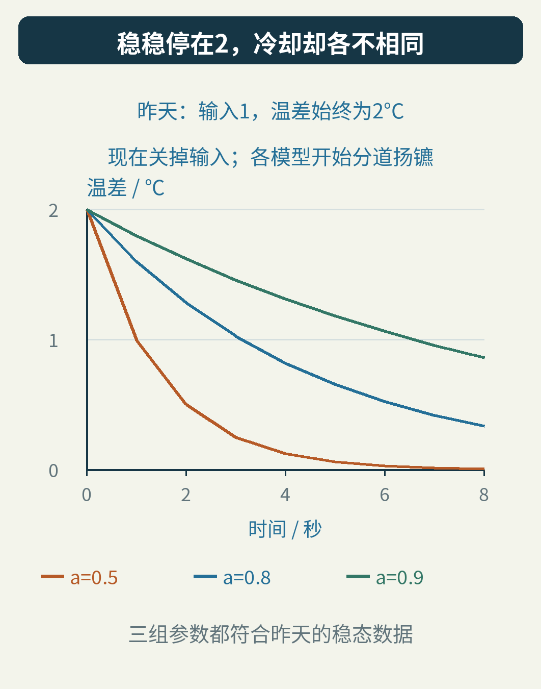

问题来了：既然昨天的数据全对，为什么今天的预测差这么远？

因为数据不只分多少，还分有没有问到关键问题。二十次重复同一种情况，有时只是把同一道题抄了二十遍。

**系统辨识研究的，就是怎样从输入和输出的记录中，建立一个能解释、预测系统行为的模型。**这既需要计算，也需要设计实验，让不同的候选模型有机会露出差别。

下面我们从两个可以手算的参数出发，再加入扰动、错误模型和一段新数据。全篇数值来自明确写出的虚拟加热盒，没有冒充真实设备测量。

## 1. 先把机器的“输入”“输出”和“过去”分清

把功率旋钮的位置叫输入u：0表示不加热，1表示这个模型里的额定功率，0.5是半功率。

把盒子高于环境温度的那部分叫输出y，单位是°C。它是温差，不是绝对温度；y=0表示盒内与环境一样暖。

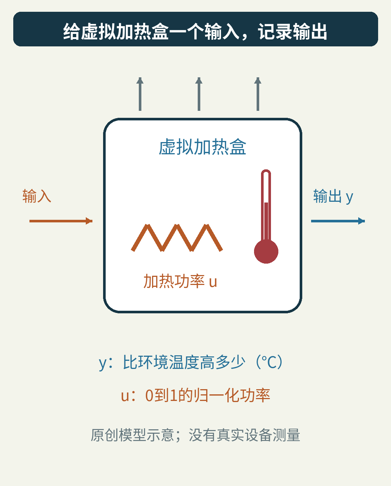

如果把旋钮从1拨到0，盒子不会瞬间凉透。它还记着刚才积累的热量。

这种“现在的输出还受过去影响”的系统，叫动态系统。用一个只看当前旋钮的公式`y = c × u`，很容易漏掉这份记忆。它会认为关掉输入的一瞬间，输出也应该变成0。

我们先选一个简单的模型家族：下一秒的温差，由“当前温差留下多少”与“这一秒的输入增加多少”组成。具体比例暂时不知道，分别记成a和b。

注意顺序：先提出模型长什么样，再用数据寻找参数。只把一堆数字交给算法，并不能省掉关于时间、输入、输出和模型结构的选择。

## 2. 一个下标，藏着一个很重要的时间约定

假设每秒记录一次。时刻编号叫k：k=0是开始，k=1是一秒后。

约定u[k]表示从时刻k到k+1这一秒里保持的输入。于是，当前读数y[k]加上这一秒的输入u[k]，对应下一次读数y[k+1]。

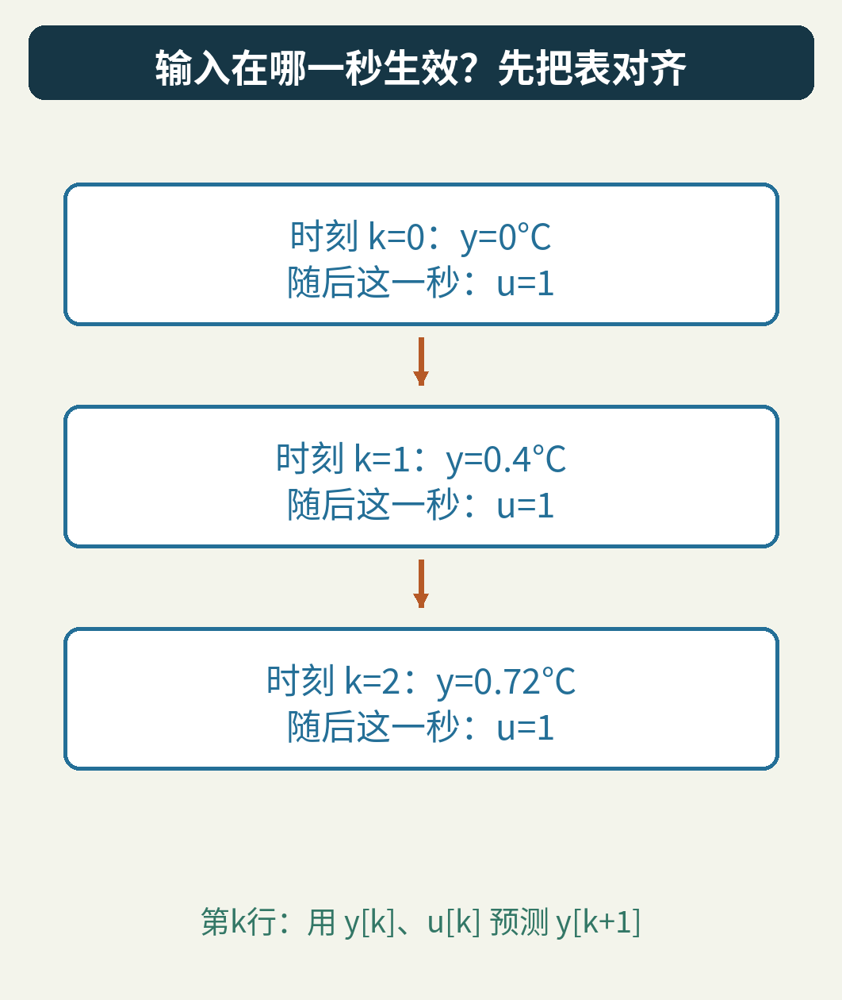

我们的候选关系是：

`y[k+1] = a × y[k] + b × u[k]`

a没有单位，表示一个1秒区间后保留下来的比例。b在此处的单位是°C，表示单位输入在这个采样区间中提供的温差贡献。它不是随便换采样间隔也不变的硬件铭牌参数。

把输出错配到前一秒或后一秒，即使每个温度数字都抄对，也可能拟合出错误的延迟与系数。系统辨识先要尊重时间顺序，不能把数据表当成可以任意打乱的独立小卡片。

## 3. 两次有区别的观察，怎样解出两个参数？

先用没有扰动的理想例子。开始时y[0]=0，把输入设为1。一秒后读到y[1]=0.4。

把它代入关系式：

`0.4 = a × 0 + b × 1`

因此b=0.4。

下一秒继续保持输入1，读到y[2]=0.72：

`0.72 = a × 0.4 + 0.4 × 1`

减去0.4，再除以0.4，得到a=0.8。

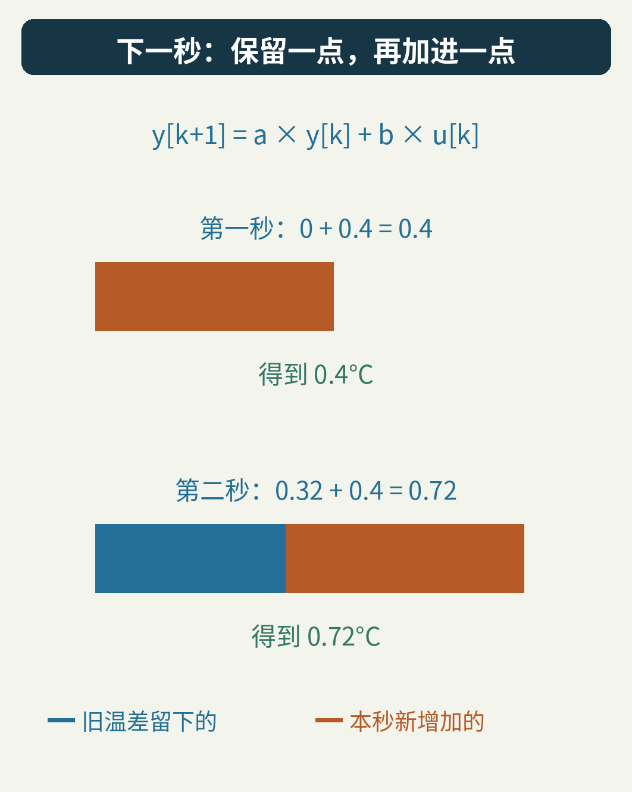

现在再看第二秒：旧温差0.4留下八成，得到0.32；加热又贡献0.4，合起来就是0.72。公式中的两个参数终于有了具体含义。

还可以把这两条观察画在参数平面里。横轴是一种可能的a，纵轴是一种可能的b。每组参数是平面中的一个点。

第一条观察要求b=0.4，是一条水平线。第二条要求0.4a+b=0.72，是一条斜线。它们相交于(0.8,0.4)。

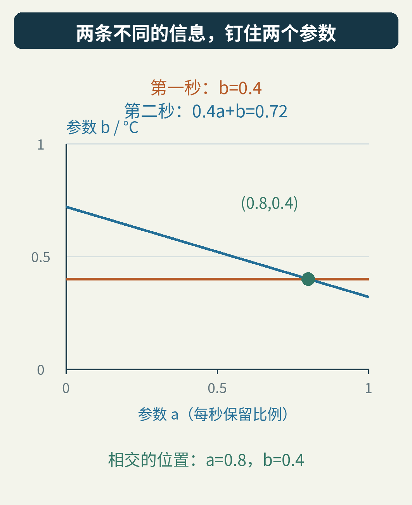

为什么这两行能区分参数？第一行的旧温差为0，单独揭示了b；第二行已有旧温差，开始包含a的信息。两行提出了不同的约束。

这只是选定的一阶、无扰动、无额外延迟模型里的结论。它没有证明任何未知机器都只要读两秒，就能彻底摸清内部结构。

## 4. 真正麻烦的地方：每条等式都差一点

如果盒子旁边有小气流，环境在变化，或者存在未建模的扰动，数据就不会每次都刚好符合那条等式。

在虚拟实验里，我们明确加一个随机扰动w[k]：

`y[k+1] = 0.8 × y[k] + 0.4 × u[k] + w[k]`

每一步w独立生成，均值为0、标准差为0.03°C，服从高斯分布。生成参数0.8与0.4由我们设定，所以实验结束后有真值可供对照。分析器只拿输入输出表，不读取那些扰动值来拟合。

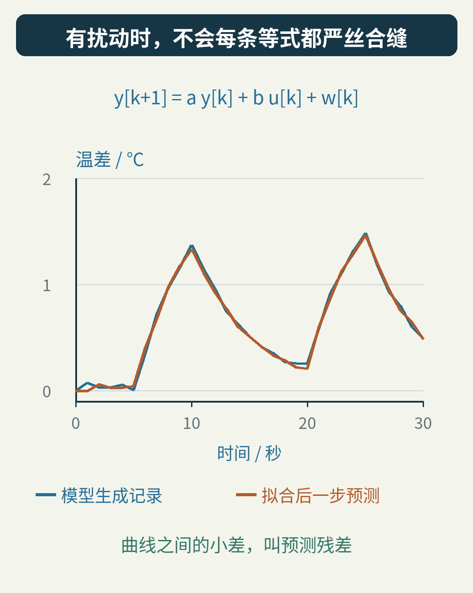

这时若仍只用两行数据，偶然扰动就可能把结果推得很远。多读一些有信息的行，通常更有机会把规律和偶然偏差区分开。

对于一组候选参数a、b，每一行都会给出一个预测：

`预测 = a × 当前温差 + b × 当前输入`

再拿实际下一秒的记录减去预测，得到**残差**。它是模型还没解释掉的那一部分。

我们让所有残差先平方，再相加，寻找使这个总数尽量小的a、b。这就是最小二乘法。平方会避免正负误差互相抵消，并让大的偏差付出更大代价。

图里每个位置是一组候选a、b，颜色表示它在同一份训练数据上的平均平方误差。深蓝区域误差小，白十字是求得的参数。

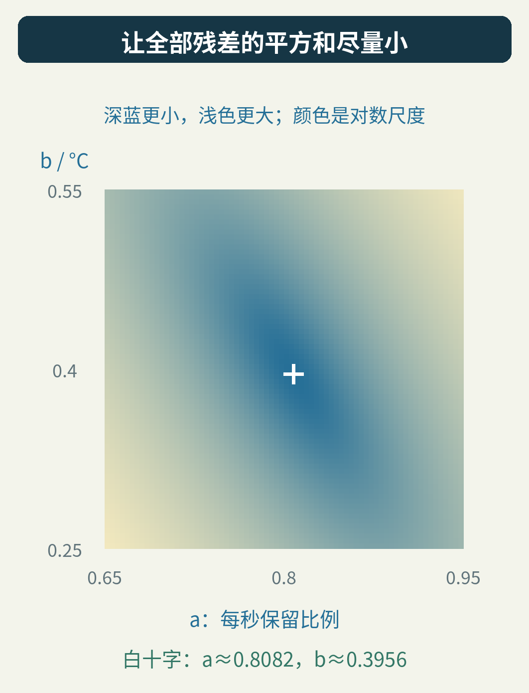

本次得到a≈0.80824、b≈0.39564，接近但不等于生成值0.8、0.4。训练数据上的一步预测均方根误差约0.03036°C。

均方根误差可以这样算：每个误差平方，取平均，再开平方。最后单位回到°C，比直接比较一长串带正负号的误差更方便。

这里特意把扰动放在递推式的最后，并使它独立于当时的过去数据。如果真实温度本身没扰动，只是温度计读数有噪声，读数又被拿来当下一行的解释变量，就会出现不同的统计问题。不能只听见“有噪声”三个字，就认定同一个最小二乘公式在所有场景都没有偏差。

## 5. 回到开头：二十行数据，为什么解不出两个数？

现在只保存已经完全稳定以后的记录：每一行都满足u=1、y=2，下一行还是2。暂时不加扰动。

代入我们的模型，二十行全都变成同一条式子：

`2 = 2a + b`

它只限定b=2−2a。a=0.5、b=1可以；a=0.8、b=0.4可以；a=0.9、b=0.2也可以。

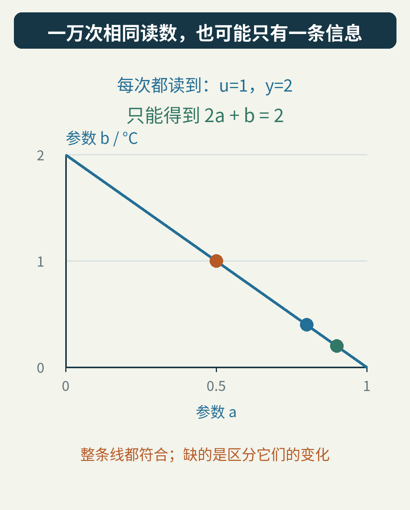

这些模型都拥有相同的稳态温差，却有不同的冷却速度。再复制一万行同样的数据，也不会让那条线突然缩成一个点。

这涉及**可辨识性**：在当前模型家族和实验条件下，不同参数能不能通过观测区分开？如果两组参数对这次实验给出完全相同的结果，计算再精细也无法替缺失的信息作证。

需要注意，我们批评的是“只保留稳态”，不是“恒定输入永远没用”。刚才从0开始的一次输入阶跃，虽然随后一直保持1，它的升温过渡就已经让这个理想两参数模型可以求解。附带程序也确实从这段无扰动阶跃恢复了0.8和0.4。

关键在于记录里有没有不同的动态情况，以及它们是否足以区分你想比较的模型。

## 6. 怎样问一个让机器更容易暴露差别的问题？

比起一直等在同一个稳态，我们让输入在0和1之间变化。每5秒允许换一次，总共记录120个1秒区间。

下面是这次实际生成的训练输入与输出。两幅图的时间轴对齐。上面是旋钮，下面是温差。

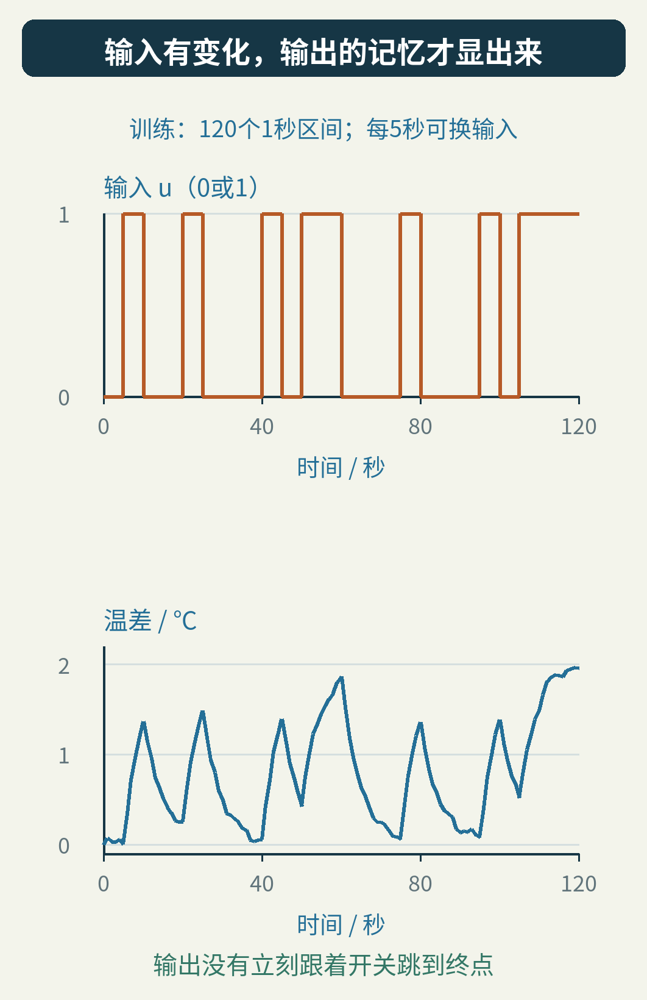

输入跳变时，输出不会跟着立刻跳到新终点。它留下的弯曲过渡，正是模型需要解释的动态信息。

系统辨识常用“激励”来描述输入如何把系统的不同响应激发出来。这个词可以先理解为：你有没有用足够有区别的问题，迫使候选模型给出不一样的回答？

“变化越快越好”也不对。若变化快到采样设备看不清，或者输入小到淹没在噪声里，数据可能仍没有用。如果系统有多种快慢过程，就需要考虑记录频率、实验持续时间和输入变化覆盖的范围。[模型与实验设计概览](https://www.mathworks.com/help/ident/gs/about-system-identification.html)

这篇的加热盒是电脑里的模型，可以放心切换。真实设备必须遵守功率、温度、速度等运行限制；不能为了让曲线丰富，随意给未知机器大幅输入。

## 7. 别用刚交过的作业，证明学生会做新题

参数是在120秒训练数据上挑出来的。再拿同一段数据展示“拟合很好”，只能说明它适应了已经见过的材料。

于是我们准备另一段80秒记录。输入包含0、0.5、1，按不同的节奏变化，扰动也使用另一个随机种子。参数固定下来，不再根据这80秒的数据调整。

这种另留一份数据检验模型的做法，就是独立验证。它可以检验模型在另一次记录上的表现，但“另一份数据”仍然要代表你关心的工作范围。[训练与验证数据的官方说明](https://www.mathworks.com/help/ident/ug/specifying-estimation-and-validation-data.html)

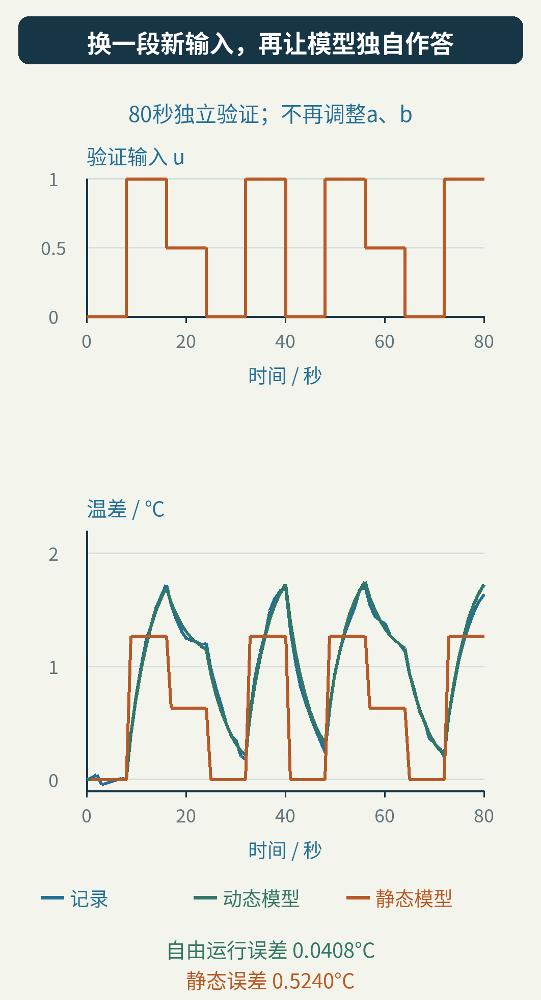

图里还放了一个故意省去记忆的对手：`预测下一秒温差 = c × 当前输入`。c也由同一份训练数据按最小二乘求出，约1.26816，不是随手选一个很差的数字。

在新数据上，动态模型自由运行的均方根误差约0.04077°C；静态模型约0.52397°C。后者的问题不仅是某几个点没对上，而是它认为关掉输入后温差应该立刻归零，漏掉了整个冷却过程。

对这个任务，带上一秒记忆的模型显然更有解释力。这个结论来自本次明确的模型与数据，不能当成“一阶模型在任何机器上都够用”的结论。

## 8. 一步预测很好，为什么长时间模拟可能仍然走偏？

这里有个特别容易混淆的区别。

**一步预测**每次都拿真实记录的当前温差作为起点，预测下一秒。下一次预测时，又拿新的真实记录作起点。它每秒都有机会被实际情况重新拉回来。

**自由运行**只在开始时拿一次真实初值，之后不断把模型自己预测的温差送回去，预测下一秒。模型要凭输入和自己的记忆走完整段。

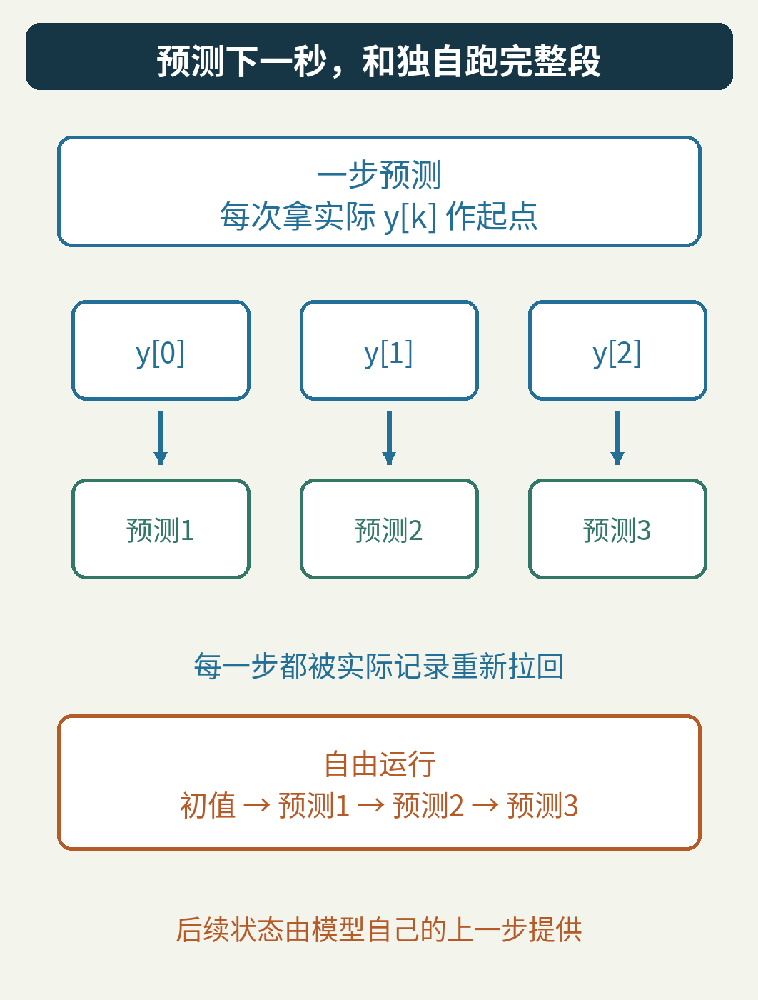

在本次独立验证中，一步预测误差约0.02942°C，自由运行误差约0.04077°C。不同，不矛盾：它们得到的信息不同。

未来每步的随机扰动不可预知。自由运行看不到这些扰动已经把真实温差推到了哪里，而一步预测能从当前实测输出间接接住过去扰动的累积影响。

若模型参数或结构有系统性偏差，自由运行还可能把偏差不断积累。所以选择模型时要问：最终用途是每秒接受新读数后预测一步，还是在没有未来读数的条件下独自模拟几十秒？评估方式应和用途对应。

## 9. 不只看一项总分，还要看误差剩下了什么

两个模型可能有差不多的总误差，但错误形状很不一样。

一个模型的残差可能只是零附近零散的小波动；另一个却总在升温时偏低、冷却时偏高。后者的残差还保留着系统规律，提醒我们有东西没有学进去。

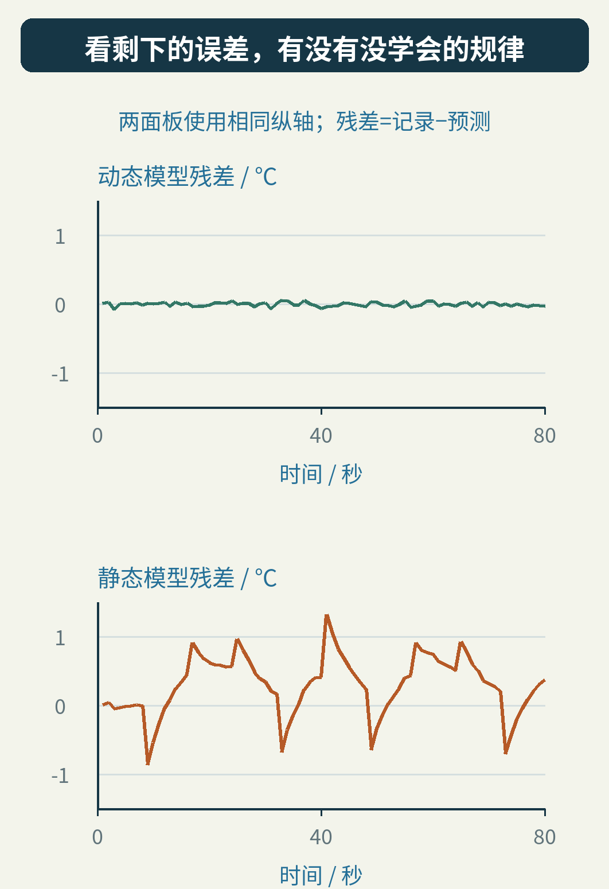

这次静态模型的残差成段保持同一方向。它不是单纯缺几位小数，而是遗漏了温度记忆。

为了把这种“相邻误差还像在接力”的现象量化，可以看残差的自相关：先减去残差平均值，再比较这一时刻的偏差与若干步以前的偏差是否经常同号、一起变化。

只隔一步时，本次静态模型的样本自相关约0.79337；动态模型约0.00994。

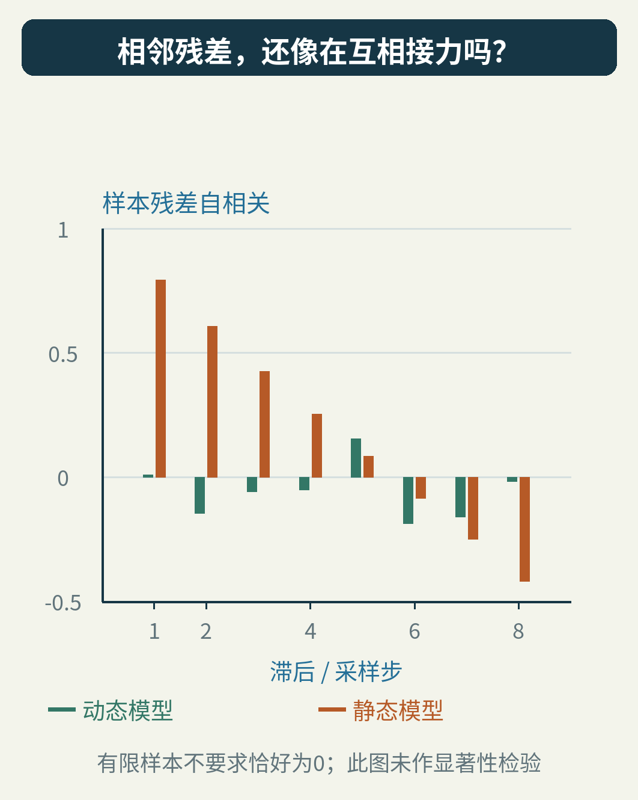

有限数据不会让正确模型的每项样本自相关都恰好等于0。图中也没有画置信带，不能只凭某根柱子略大于0就宣布统计检验失败。它展示的是本次数据中的结构线索。

正式残差分析还会检查残差与过去输入之间的关系：如果模型没解释完输入如何影响输出，残差中可能仍能找到输入的影子。对于不同噪声模型、估计方法或闭环反馈，这些判断有不同条件，不能把一条经验图形当成万能证书。[残差分析原理与适用说明](https://www.mathworks.com/help/ident/ug/what-is-residual-analysis.html)

## 10. 找到一组参数，不等于找到了不会动摇的真相

我们知道虚拟盒子由a=0.8、b=0.4生成，却估计成0.80824与0.39564。换一份随机扰动，结果还会移动。

保持同一条训练输入不变，重新生成100份独立扰动记录，每份都估计一次，得到下面这团散点。

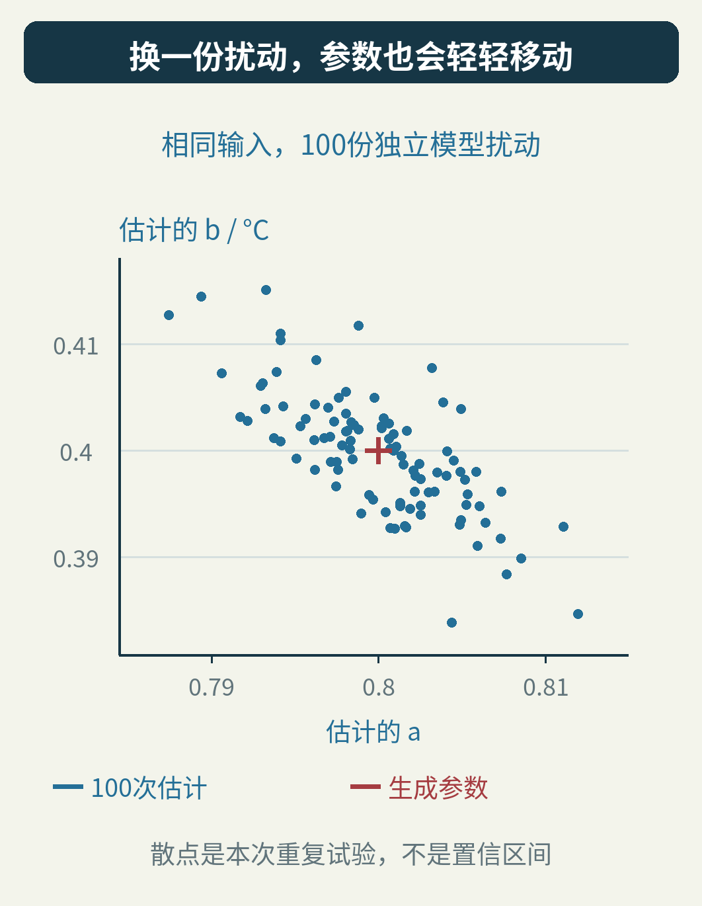

本次100次估计中，a的样本平均值约0.79995、样本标准差约0.00465；b的平均值约0.39975、标准差约0.00577°C。这是已知生成模型下的重复实验结果，不是对某台真实机器自动得到的置信区间。

如果换成信息很弱的输入、错误的噪声假设，或者用过于复杂的模型，这团散点可能变大，甚至整体偏离目标。结果报得有很多小数位，并不能替代关于不确定性的说明。

模型复杂度也有两面。增加参数，可以更灵活地贴住现有数据；但某些灵活性可能只是在追逐这次扰动。独立验证、残差结构与参数稳定性，一起帮助我们判断“多出的复杂度到底解释了什么”。

## 11. 训练范围以外，还藏着另一种无法凭空解决的歧义

假设真实加热装置有功率上限。输入从0加到1时，它按比例响应；输入再增加到2，也只能提供1那样多的功率。

另一种候选装置则会继续线性增大：输入2，贡献就是输入1的两倍。

只要过去所有输入都在0到1之间，这两种装置可以给出完全相同的记录。再精确的拟合，也无法仅凭这些记录决定超过1以后会发生什么。

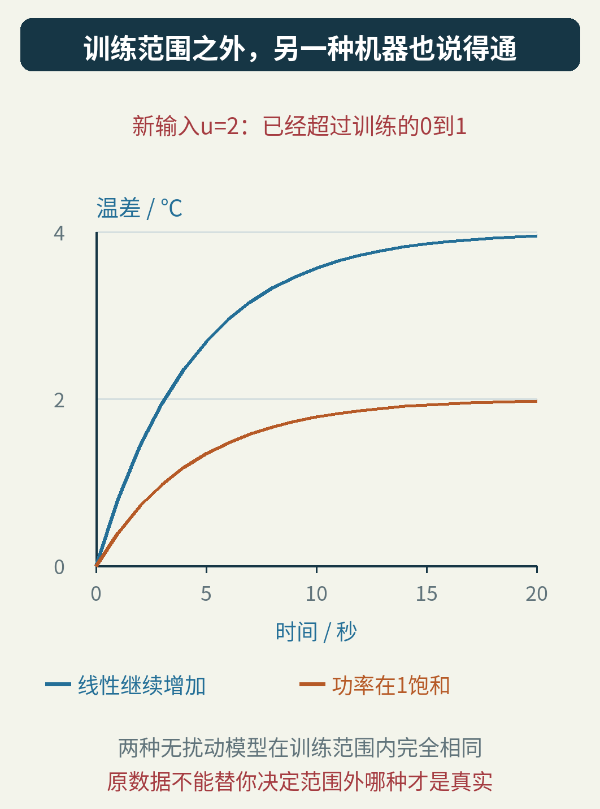

图里是两个无扰动模型的实际计算：它们从相同初值出发，一个继续按输入2加热，另一个把有效输入限制在1。没有真实设备被这样测试。

这说明模型的适用范围应该随模型一起交代。用新数据检验过0到1范围内的响应，并不自动证明更高功率、完全不同温度或不同载荷下也准确。

数据能排除已经被实验区分开的候选解释。对于从未产生差别的解释，辨识并不会凭空拥有额外证据。

## 12. 真正重要的，不是“猜出了哪两个小数”

控制研究者Lennart Ljung在2008年的系统辨识讲义里，从实际输入输出记录讲到模拟与预测、模型参数、输入信号选择，以及测量什么、何时测量。它体现了这个领域的完整问题：数据、模型结构和实验不能互相割裂。[Ljung本人讲义](https://isy.gitlab-pages.liu.se/staff/lenlj48/en/hyder/hyderabad.pdf)

我们的小盒子也走过同样的思路：先说明输入输出与采样时间，再选一类模型，利用不同观察约束参数，加入扰动后综合多行信息，最后拿没用于拟合的新记录检验。

这和“已经有一个模型，怎样估计此刻的温度或位置”不是同一个问题。后者主要在估计当前状态；这里主要在确定输入输出规律中的未知参数与结构。实际工程里两者会配合，但把问题分开有助于看清自己究竟缺什么。

如果你只记住一个画面，可以记住开头那条参数斜线：二十行稳态数据，没有把候选模型缩成唯一一点。

下一次拿到一份漂亮拟合曲线时，不妨问三个更具体的问题：记录里有哪些变化真正区分了候选模型？这组参数在没见过的数据上怎样表现？剩下的误差里，还有没有它没解释掉的规律？

这些问题，比继续给同一条曲线多添几位小数，更接近理解一台机器。

本地[运行方法与实验边界](README.md)、[完整程序](examples/run_identification.py)、[输入输出记录](examples/observations.csv)、[完整结果](examples/expected-results.json)、[来源与图像授权](sources.md)随文保存。原创正文、图像及数据采用CC BY 4.0；原创代码采用MIT许可。
