# 一只没有电脑芯片的老鼠，怎样记住迷宫？

第一次，它走进死胡同，碰墙，退回来，又试另一个方向。

第二次，把它放回起点，它却一路走向目标，先前的那些弯路消失了。

如果只看这个效果，很容易猜：里面是不是藏着一张地图？是不是把整段路线录了下来？是不是有一台电脑，先算出了最短路线？

20 世纪 50 年代，Claude Shannon（克劳德·香农）的迷宫机器提出了一种更小巧的答案：**不用记住全部经历，只在每个格子里留下一个方向。**


香农肖像：Konrad Jacobs 摄，Commons 标注权利人为 MFO，采用原有 284×400 文件，未另行修改。许可为 [CC BY-SA 2.0 DE](https://creativecommons.org/licenses/by-sa/2.0/de/)，[文件页与 VRT 授权记录](https://commons.wikimedia.org/wiki/File:ClaudeShannon_MFO3807.jpg)。摄影日期未核实；图库上传日期不是拍摄日期。

这台后来以 Theseus（忒修斯）鼠形装置闻名的机器，确实是实物。可以先看 [Nokia Bell Labs 公布的香农与 Theseus 照片](https://www.nokia.com/about-us/newsroom/media-resources/nokia-bell-labs-centennial/)，以及该机构收录的 [Theseus 影片入口](https://www.nokia.com/bell-labs/about/history/innovation-stories/information-theory-turns-75/#the-brilliance-of-claude-shannon)。照片中的装置，不是下面教学图虚构出来的历史场景。

我们接下来主要依据香农本人《Presentation of a Maze-Solving Machine》报告中的规则。那份报告讲的是一个能碰到隔板的“感知触头”版本，包含机械示意图和现场照片；不能把它和后来鼠形版本的每一处外观、继电器数量混成同一份精确规格。[原报告重印本，第 681—687 页，PDF 第 717—723 页](https://www.jonglage.net/theorie/notation/siteswap-avancee/refs/books/Claude%20Shannon%20-%20Collected%20Papers.pdf#page=717)

## 1. 先把“老鼠”拆成四件事情

想让一个东西走迷宫，至少要解决四个问题。

它要能移动。它要知道自己碰了墙。它要决定下一步往哪里走。它还要让刚才发生的事情，影响后面的选择。

香农报告中的装置有一个 5×5 的迷宫。隔板可以重排，目标可以放进不同格子的插孔。东西、南北两个方向的电机移动触头；触头碰到隔板后，电机把它退回格子中心，再选方向。

**这些动作的组织者，是继电器电路。** 没有今天意义上的处理器芯片，并不等于没有状态、逻辑和记忆。一个电路可以根据输入改变连接，保存某种状态，再让状态控制电机。

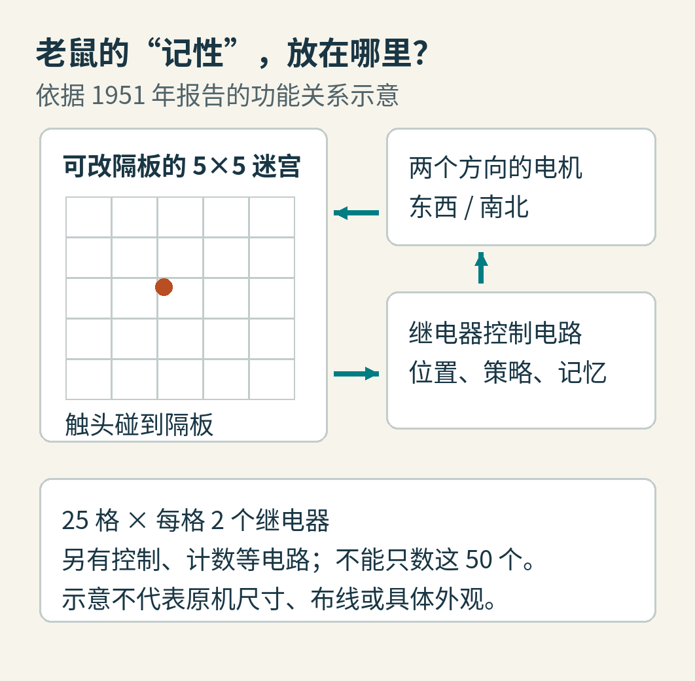

图 1 是按报告抽出的功能关系，不是原机机械结构的精确复刻。原报告的 [图 1](https://www.jonglage.net/theorie/notation/siteswap-avancee/refs/books/Claude%20Shannon%20-%20Collected%20Papers.pdf#page=718) 可看到电机、丝杠、触头、目标插孔和控制面板；[图 2](https://www.jonglage.net/theorie/notation/siteswap-avancee/refs/books/Claude%20Shannon%20-%20Collected%20Papers.pdf#page=719) 是香农与装置的照片。原件的外观请以这些资料为准。

这里有个很值得停一下的观察：看起来是“老鼠变聪明了”，真正发生变化的，却是装置中的电路状态。

## 2. 继电器怎样有“记性”？

继电器可以先理解为一个由电控制的开关：线圈通电产生磁作用，让触点改变连接状态。[OMRON 的继电器原理说明](https://www.ia.omron.com/support/guide/36/introduction.html)

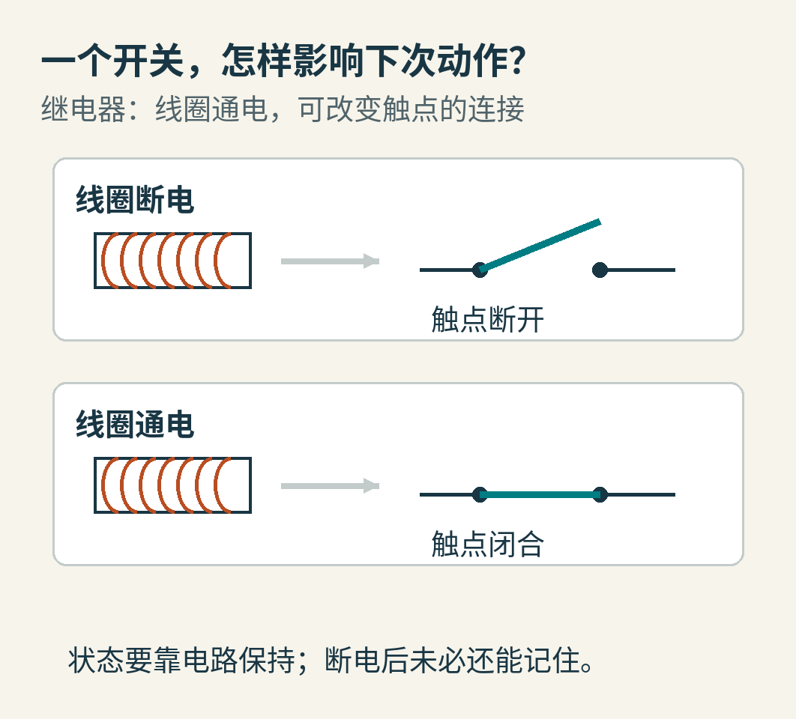

一个触点开着还是闭着，会影响下一段电路能不能通电。把触点和其他电路连接起来，就能让某些状态持续存在，直到另一信号使它改变。

不过，“继电器能参与构成记忆”，不等于“所有继电器一断电都能永久保存状态”。保持方式取决于具体电路。香农在这次演示中说明，关机后，继电器回到一种不再代表迷宫知识的初始状态。

现在设想两个可以分别处于 0 或 1 的状态量。它们能组合成：

- 00
- 01
- 10
- 11

恰好四种。用它们表示北、东、南、西，就够用了。

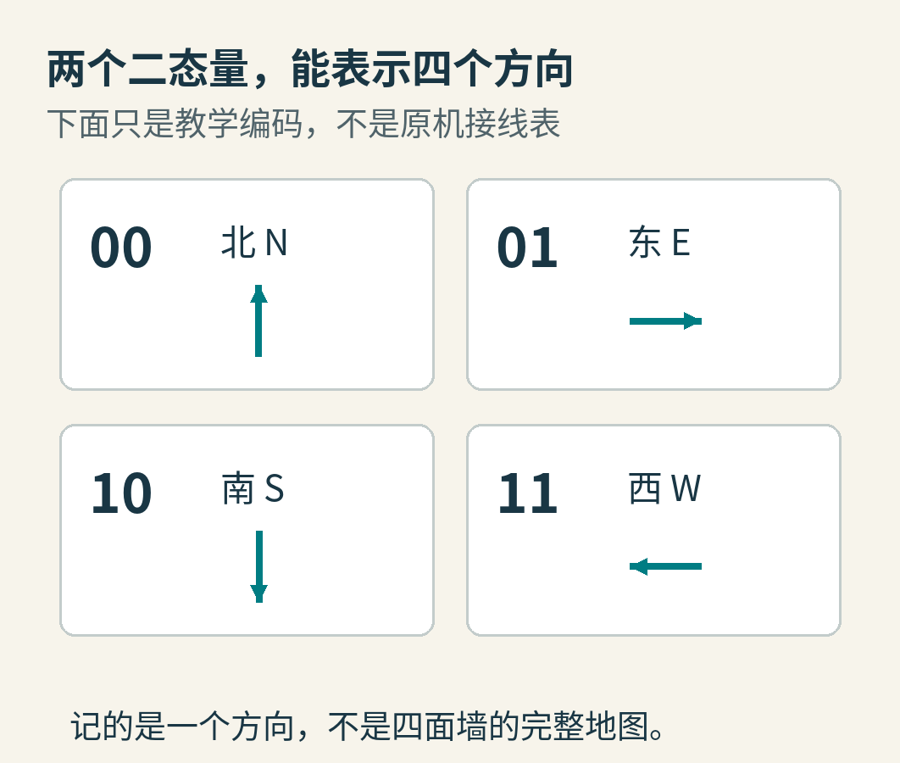

图 3 的编码是我们为方便阅读选的，并非考证出的原机接线表。历史报告直接给出的关键事实是：**每格用两个继电器，记住四个方向中的一个。**

25 格需要 50 个这样的记忆继电器。整机还要做控制、计数等工作；香农在这次报告中回答的是全机“约 75 个”，不能把 50 当成整机总数。[原报告，第 684 页](https://www.jonglage.net/theorie/notation/siteswap-avancee/refs/books/Claude%20Shannon%20-%20Collected%20Papers.pdf#page=720)

最重要的问题随之出现：一个格子只能留下一个方向，究竟该记哪一个？

## 3. 记下的不是“墙在哪里”，而是“我最后怎样离开”

假如某一格有三条通路，一个方向显然装不下完整的周围地图。

这台机器采用的办法是：在格子里保留一个方向。探路时，每次尝试会更新它；真正跨出该格后，留下的就是这次离开的方向。等整趟探索结束，曾经离开过的格子里，就保留了**最后一次离开它的方向**。

请特别留意“最后一次”。

第一次从这里往南走，后来退回来，再往东走，那么最终记住的就是东。南边那次经历并不继续占一个位置。

我们把迷宫缩成九格，字母从上到下、从左到右排。A 是起点，C 是目标。粗黑线是墙，墙之间的缺口可以通过。

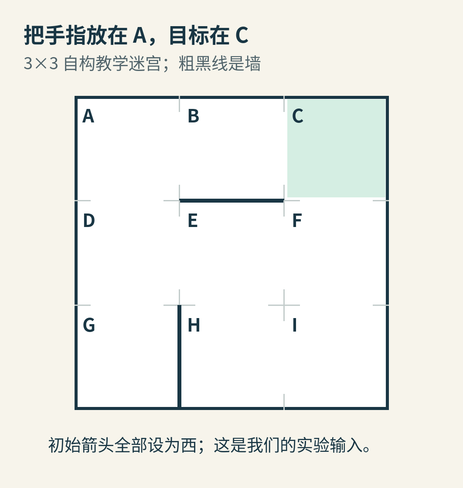

这个迷宫是本文自行构造的。它不是香农照片里隔板的抄图，后面的步数也不是历史装置实测。我们把所有初始方向都设成西，只是为了让你能一笔一笔复算。

先用眼睛看一下：从 A 到 B，再到 C，明明只要走两步。把这件事记在心里，后面它会变成一个重要反例。

## 4. 第一次探索，不是随机乱撞

“试错”不必是随机。

香农明确说，这台机器使用固定策略。探索时，读取当前格子原先记住的方向，先逆时针转 90°，再尝试。比如上次向东离开，这次先试北；北边碰墙，退回中心，再试西。

方向的顺序是：

**东 → 北 → 西 → 南 → 东。**

它还有一处加速安排：刚进入一格时，第一候选会跳过通向刚才来处的方向，避免立刻原路退回。随后碰墙再继续轮转时，不能永远禁止回头，否则死胡同里的机器就出不来了。

我们的事件级模型按这种“只跳过入格后的第一候选”的解释实现。模型将一整次撞墙与退回中心记作一个失败事件，不模拟电机连续运动、触点抖动、继电器延迟或历史线路的全部中间状态。[规则依据：原报告，第 684 页](https://www.jonglage.net/theorie/notation/siteswap-avancee/refs/books/Claude%20Shannon%20-%20Collected%20Papers.pdf#page=720)

现在实际走几步。

A 原先记西。逆时针转一下，变成南，所以走到 D。

D 也原先记西。同样转成南，走到 G。

G 再往南是外墙，退回；转到东，又是一面墙；再转到北，终于能回到 D。

这时，D 的旧记忆已经是南，因为它刚才从 D 去了 G。再来一次，先转成东，于是去 E。


这里发生了两种不同的事件：

- 碰墙：方向尝试过，箭头改了，但仍在同一格。
- 跨格：从一格进入另一格，位置真正变化。

分开计数后，图和实验就不会把“试了 14 次”误写成“走了 14 格”。

## 5. 它走完以后，只剩下一张箭头图

让同一套规则继续运行，完整的位置序列是：

**A → D → G → D → E → H → I → F → C。**

一共 8 次跨格，另外发生 6 次碰墙。

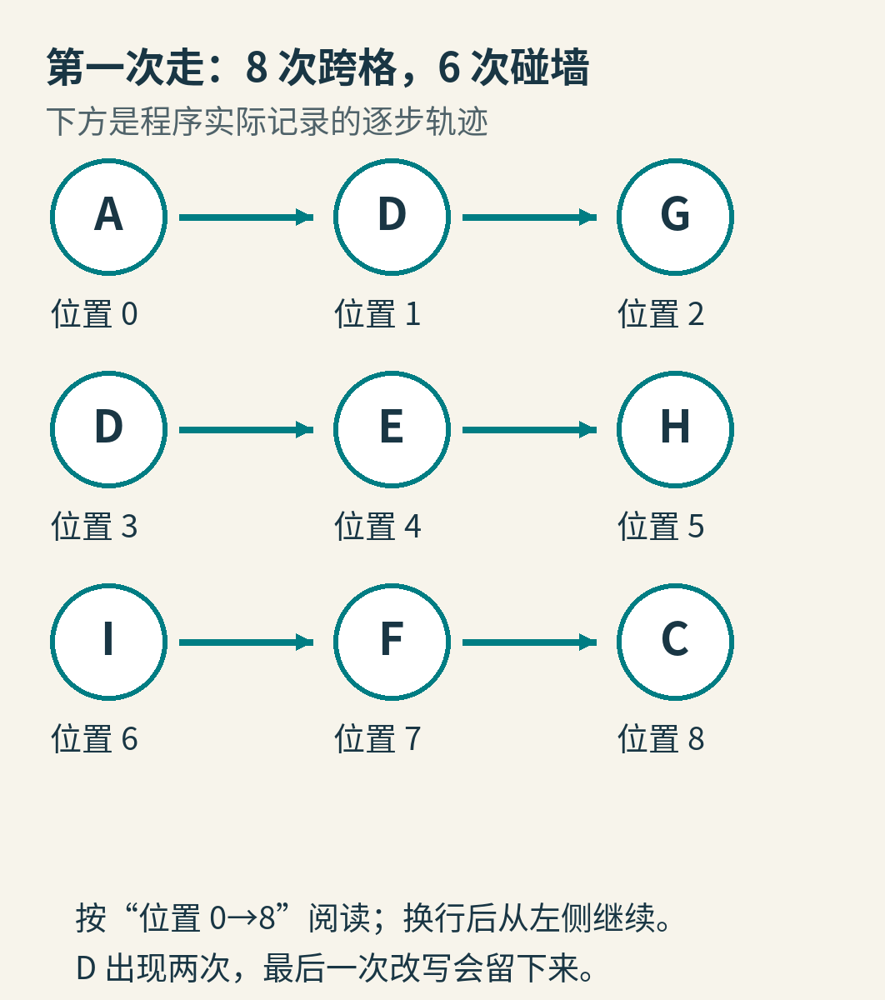

图 6 只列成功跨格后的所在位置。完整失败事件也公开在 [事件表](examples/events.csv) 中：G 的南、东两次，H 的南一次，I 的南、东两次，F 的东一次。

到了 F 时还有个细节值得手算：F 原先记西，探索第一候选是南；南正好是刚才来的 I，因此跳过它，先试东。东是外墙，再转北，进入 C。

到达 C 后，机器停止。我们把曾经过的格子里的最终记忆画出来：

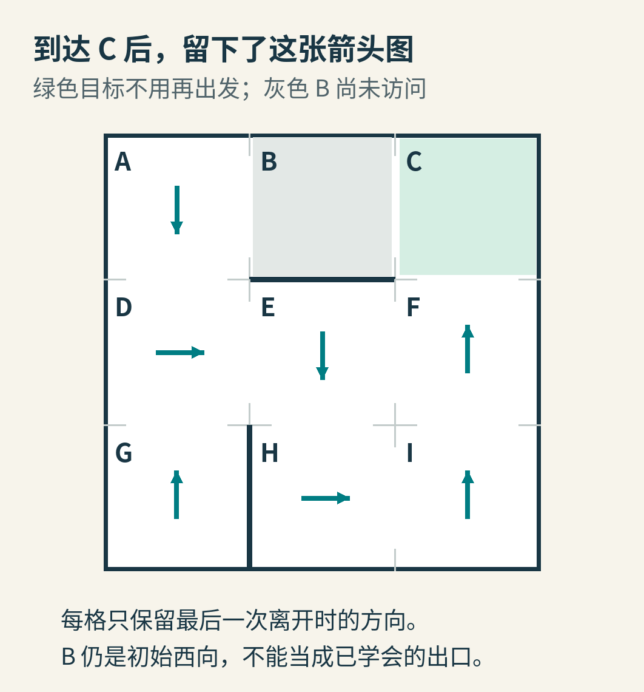

现在沿 A 的箭头试一试。

A 指向 D，D 指向 E，E 指向 H，H 指向 I，I 指向 F，F 指向 C。

G 还保留着向北的箭头，指向 D。B 则从来没被访问过，它那个初始西向状态不能当成“机器学到了 B 的出口”。

这张图不是完整地图。它更像在一些路口放下了路标：到这里，就朝这个方向走。

## 6. 死胡同是在哪里被删掉的？

第一次的轨迹里有一小段：

**D → G → D。**

重跑时，这一段为什么不见了？并不是机器额外认出了“这叫死胡同”，再用一段特殊程序删除了它。

答案只在 D 这个格子里。

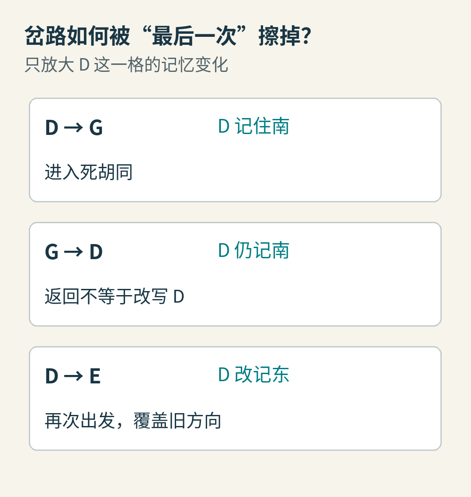

从 D 去 G 时，D 记住南。

从 G 返回 D 时，刚刚修改的是 G 的离开方向。D 还没有作出新的离开选择。

随后 D 去 E，D 的记忆被覆盖成东。于是下一次来到 D，机器直接走向 E。**旧绕路不是被逐段剪辑，而是在它的分岔处，被最后一次正确离开覆盖了。**

再从 A 出发，使用“目标策略”：不先旋转，先按本格存着的方向走。

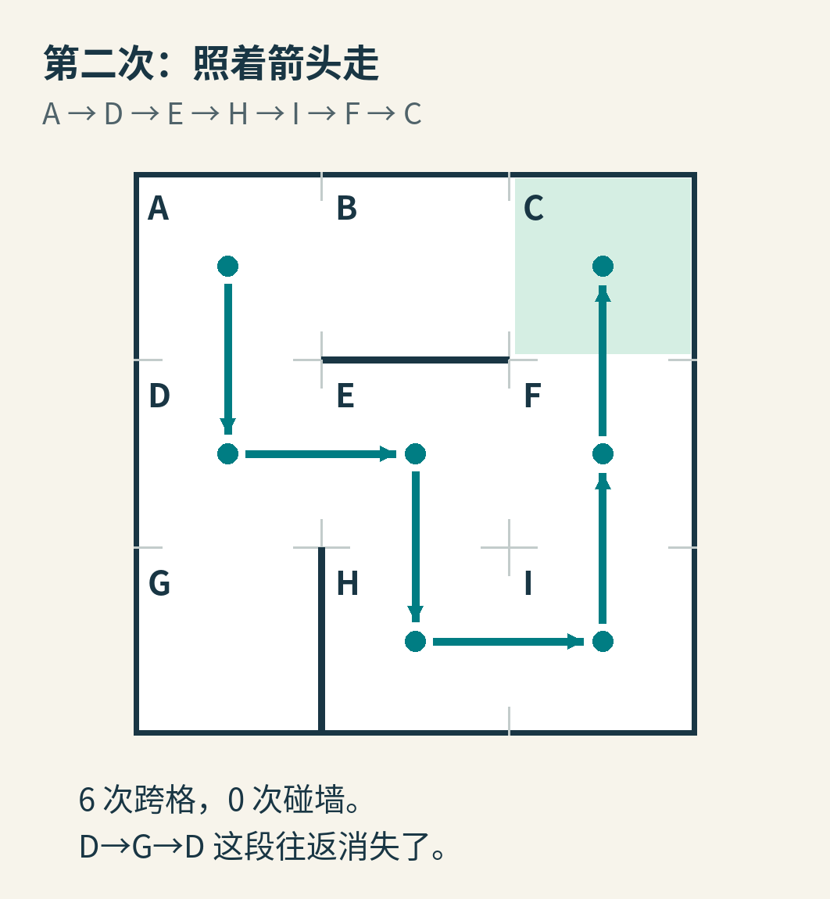

这次轨迹缩成 A→D→E→H→I→F→C：6 次跨格，0 次碰墙。

这里的“直接到达”表示没有再次探索那段死胡同，不是走直线，也不是最短路线。

## 7. 有个小证明，解释它为什么不会越走越糊涂

只看一个死胡同还不够。假如第一次探索绕过大圈子，最后的箭头会不会自己也围成圈？

我们暂时满足三个条件：

1. 已经有一趟有限的行走成功到达目标。
2. 每个到过、且不是终点的格子，留下它最后一次离开的方向。
3. 之后通道和目标都没有改变。

把第一次行走的每次离开编号，从 0 开始。A 最后离开时是 0；D 最后离开时是 3；E 是 4；H 是 5；I 是 6；F 是 7，随后到 C。

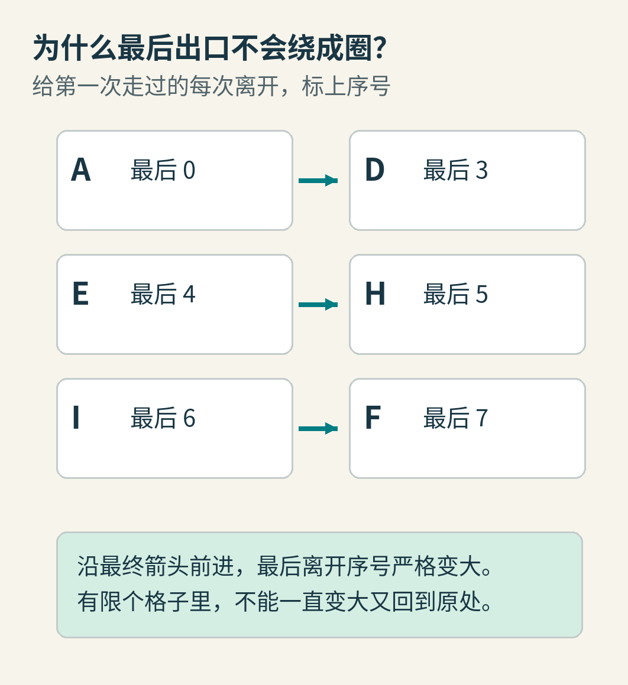

一般地，假设某格 U 的最终箭头指向 V。

这表示，在 U 的最后一次离开时，我们确实走到了 V。若 V 不是目标，那么在那次走完的旅程里，后来一定还离开过 V。

所以：**V 的最后离开，必定晚于 U 的最后离开。**

沿着最终箭头走，这个序号必须一直变大。若绕一圈回到 U，就等于要求 U 的序号比自己更大，矛盾。

因此，从任意一个这趟旅程访问过的非目标格出发，最终箭头不会陷入环，也不会指向不曾走通过的墙；沿着走会抵达目标。

这是对“最后出口”这个性质的证明，不是对历史机器每根导线的验证，也不是对任意探索程序都能找到目标的证明。**“找到之后能重放”与“第一次一定能找到”，是两个不同问题。** 香农在报告中给出其探索策略能解决有限可解迷宫的说明；我们的实验只对所列离散模型和输入范围作验证。

## 8. 记住的路线，为什么仍可能很笨？

回到最初用眼睛发现的那条路：A→B→C，只需两次跨格。

机器记住的却是六次跨格。

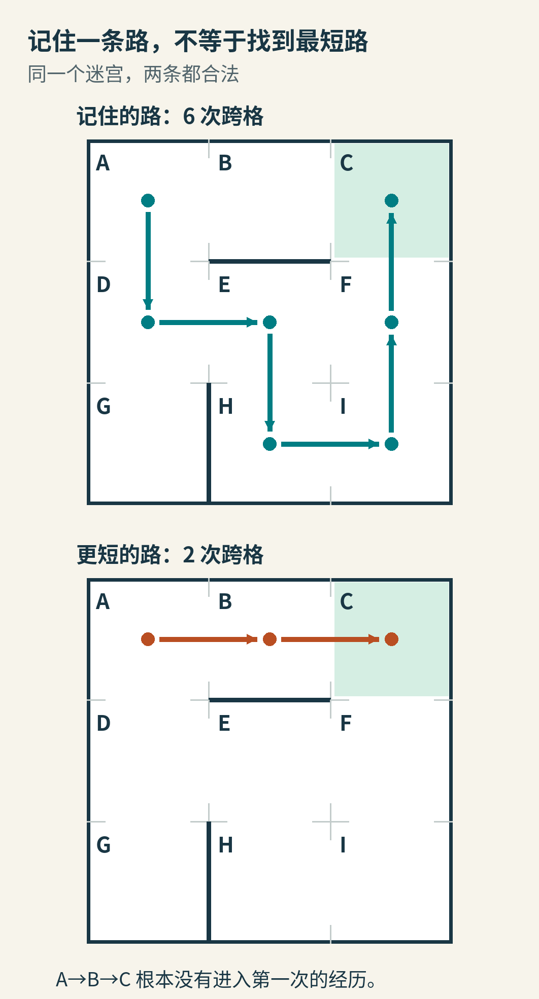

为什么会这样？因为“最后一次从哪儿离开”只回答了一个问题：**这里有一个已经用过的方向，最终能带我到目标。**

它没有回答：

- 是否还有别的路线？
- 那条路线要几步？
- 两条路线谁更短？
- 要不要为寻找更短的路，再付出探索成本？

在这次经历里，B 根本没有出现。没有比较不同路线的长度，就不能从“记住了”跳到“已经最优”。

香农在现场问答中也明确否认它必然选择最佳路线。他指出，如果要比较并改进路线，需要保存更多候选与增加比较用的电路。[原报告，第 685—686 页](https://www.jonglage.net/theorie/notation/siteswap-avancee/refs/books/Claude%20Shannon%20-%20Collected%20Papers.pdf#page=721)

本文程序用一个单独的广度优先搜索核对两步的最短路线。这个搜索仅仅是尺子，**没有偷偷放进 Theseus 的教学模型中替它带路**。

## 9. 换一个起点，它会不会什么都不会了？

如果把它放在 G 呢？

G 指向 D，然后能接上 D→E→H→I→F→C。它不必先回 A，才有资格使用原来的经验。

这正是“每个位置存方向”与“背诵从起点开始的一串动作”的区别。若只背“南、南、北、东……”这串动作，换起点通常就不管用了。按格子保存方向，来到熟悉位置时就能使用那个位置的经验。

但若放进没有访问过的 B，情况就不同。

在本文这个输入中，B 的初始西向恰好能走到 A；此后接上熟悉路线，所以会走 B→A→D→E→H→I→F→C，共 7 次跨格，0 次碰墙。

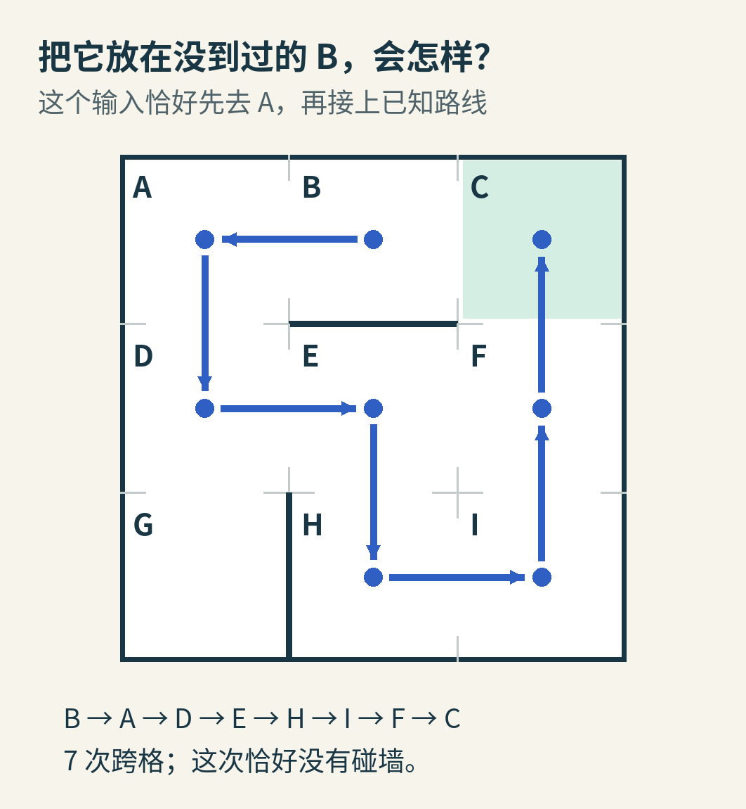

别把这个例子误读成“未知格也总能无碰撞走好”。这里恰好能走通。另一种初始方向或另一堵墙就可能使它先碰墙、退回、转向，直到接上已知区域。

原报告说目标策略在遇墙时会转 90° 再试，但仍处于目标策略；它不是“一撞墙就立刻清空记忆”。这让未知区域有机会接入已经学会的区域。[原报告，第 686 页](https://www.jonglage.net/theorie/notation/siteswap-avancee/refs/books/Claude%20Shannon%20-%20Collected%20Papers.pdf#page=722)

## 10. 改一堵墙，好记性也可能成为麻烦

现在只堵住 F 与 C 之间的通道。

目标还在 C。A→B→C 仍然可走，因此这不是一个无解迷宫。

照着旧记忆走，机器会先经过 A、D、E、H、I、F。在 F，它本想往北去 C，却碰到了新墙。转一下，往西进入 E。

问题来了：E 记着南，所以去 H；H 去 I；I 去 F；F 刚改记西，又回 E。

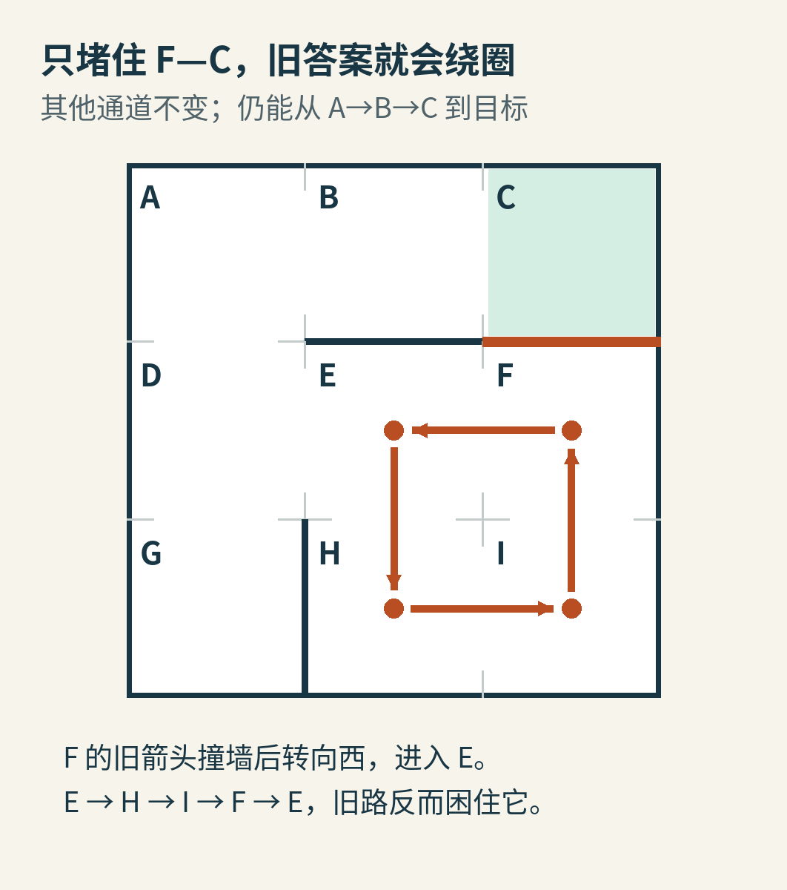

这一次，它没有不断撞同一堵墙。只撞过新墙一次，就可能在四个合法通道之间不停绕圈。

先前的小证明为什么没有救它？因为证明的条件破了。我们已经改了墙，并且在使用过程中改写了 F 的方向。眼前这张混合的新旧箭头图，不再是那趟成功到 C 的行走所留下的最终出口图。

在公开实验里，关闭策略切换，运行到 24 次跨格时仍未到 C。这个 24 是我们截断观察的长度，不是一次成功到达的用时，也不是“证明以后绝不会离开”的统计结论。环的原因可以直接读出来：E→H→I→F→E。

## 11. 怎样承认：“我记住的办法可能不管用了”？

香农的装置加了一个计数器：在目标策略中走得过久还没到目标，就切回探索。报告中给出的门槛是 24 次。[原报告，第 684—685 页](https://www.jonglage.net/theorie/notation/siteswap-avancee/refs/books/Claude%20Shannon%20-%20Collected%20Papers.pdf#page=720)

这个数与迷宫的大小放在一起看，很容易理解它的合理性：25 个格子中，一条不重复格子的到达路线最多跨过 24 条边。如果最终箭头仍然有效，就不需要无限兜圈。

这是我们利用上一节证明作出的数学解释，**不是声称找到了香农当年选择该计数值的私人动机或完整电路推导**。

本文只有 9 格，所以实验选 8 次成功跨格作为门槛。为免混淆，模型明确定义：碰墙退回不加这个计数；跨入目标时先判定成功。历史报告没有给出我们代码的完整事件时序，不能把这一定义反过来当作硬件规格。

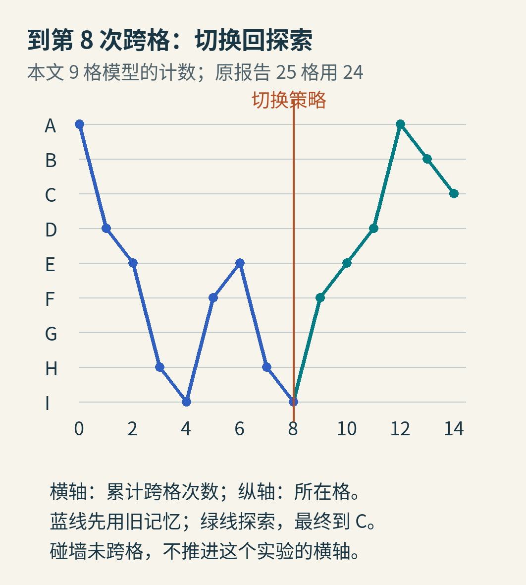

第 8 次跨格后仍没成功，模型在 I 切回探索。后面的轨迹是：

**I → F → E → D → A → B → C。**

总计 14 次跨格、7 次碰墙，重新找到目标。公开 [结果文件](examples/results.json) 中保留了每个方向尝试和切换事件。

我们切换的是选方向的方法：从“优先相信旧箭头”，改回“旋转、试错、更新箭头”。代码没有凭空加入“清空所有方向再重新开始”的指令。报告描述的是退回探索策略；具体抹除与保持状态的电路细节，不该由一个听上去顺口的“遗忘”比喻替我们补造。

同样，计数器并没有认出“墙被谁改了”，更没有理解“我的知识过时了”。它只收到一个非常朴素的信号：**按这个办法走得够久，还没有成功。**

## 12. 让每一个数字都能重新算出来

这里的图片来自同一套原始事件数据，而不是先画漂亮路线，再凑一段程序解释。

运行 [示例程序](examples/run_model.py) 会生成 [results.json](examples/results.json) 和 [events.csv](examples/events.csv)。不需要联网，也不需要安装机器学习框架：

```bash
python examples/run_model.py
```

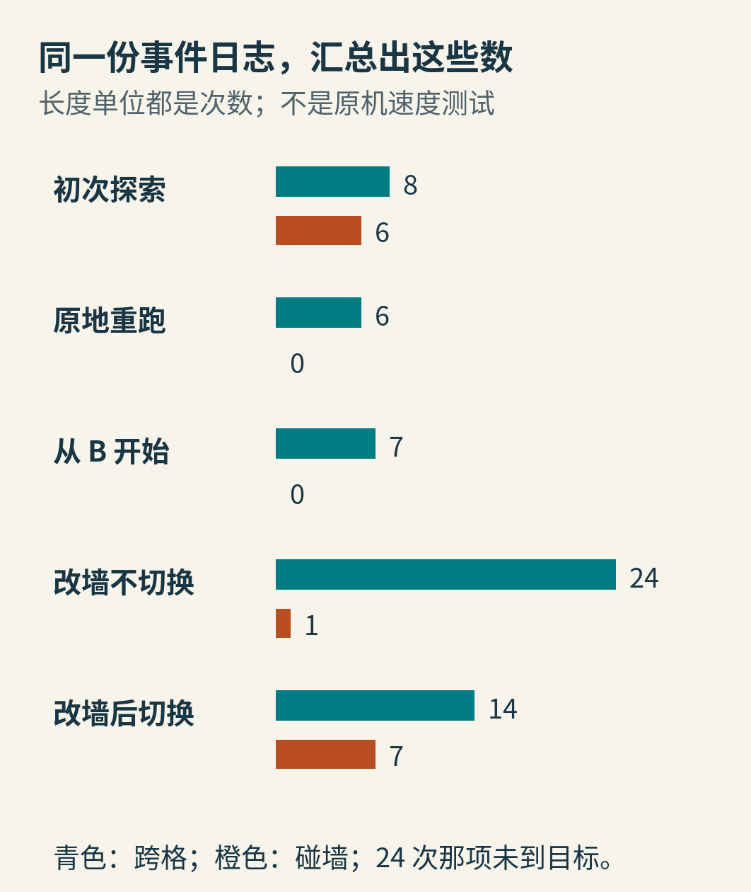

实验输入包括九格坐标、十条开放通道、初始全西方向，以及只关闭 F—C 的改墙版本。程序分别运行首次探索、原地重跑、从 B 出发、改墙后不切换、改墙后切换。

为了防止一个例子碰巧好看，程序还做了两组检查。

第一组，不依赖这套探索规则，枚举一个 2×2 方格中、最多 8 次跨边、从 A 首次到 D 就停止的全部 30 条行走，检查“最后出口”不会形成环，并逐格核对最后离开序号严格递增。

第二组，枚举 3×3 方格的全部 4096 种无向墙布局。其中有 1494 种能从 A 到 C；在本文统一初始方向和探索语义下，这些输入都成功到达，最长用了 20 次跨格。每种到达后，又检查最终箭头从 A 能在至多 8 次跨格内到达 C。

这些是实际运行的有限测试，范围很清楚：没有穷尽所有初始记忆状态，没有测原机继电器，没有证明任意规模模型的搜索上界。“1494 个输入都通过”不能替代一般证明。

想亲手玩一遍，甚至不必运行代码。画九格迷宫，准备九张写着方向的纸片，从 A 开始，走之前覆盖该格纸片。到 C 后，把手指移回 A，直接跟着纸片走。

再试三个小问题：

1. 把手指放在 G，按最终方向到 C，需要几次跨格？
2. 不改墙，只把目标从 C 改到 B，旧箭头是否仍然够用？
3. 只保留最终箭头，能否反推出第一次具体走了多少次死胡同？

第一题是 6 次：G→D→E→H→I→F→C。第二题原有“保证到目标”的结论不再适用，因为证明中固定的终点改了。第三题也不能：不同的早期绕路，可能被同一次最后离开覆盖，留下相同的最终箭头。

## 13. 它学到的，究竟是什么？

如果把“学习”说成无所不知、理解目标、自动寻找最佳策略，这只机器都做不到。

但若问一个更具体、能观察的问题，答案就很清楚：**经历是否改变了内部状态？改变后的状态，是否使它以后做出不同而有用的动作？**

第一次，它不知道该怎样到达目标。沿途的尝试改写了方向。第二次，同一个位置会触发不同的选择；死胡同不必再走，熟悉位置可以接上已有路线。环境变化后，计数器又能让它停止一味沿用旧方法。

规则本身由设计者给定。学习改变的是这些规则使用的数据。机器没有因为探索一次，就发明一套新电路。

这也解释了它为什么既令人惊讶，又很有限。一个方向足以让过去的经历变得有用，却装不下完整的历史；足以记住一条可行路，却不够据此宣称最短；足以从熟悉位置继续前进，却依赖墙与目标仍符合经验。

香农在报告末尾，把这些方向称为定义在迷宫格子上的一个向量场。这个名字听起来抽象，眼前的图却很朴素：**每个路口一个箭头。**

真正巧妙的地方，是选择了要留下什么。

它没有保存每一次碰壁，也没有把漫长探索逐步背下来。它留下的是每个地方最后一次怎样继续走。而这些局部的小记忆，恰好能拼成一条通向成功的路。

---

原始资料、图片范围与许可见 [sources.md](sources.md)；运行方法、模型约定和全部输出见 [examples/README.md](examples/README.md)。正文与原创教学图以 [CC BY 4.0](https://creativecommons.org/licenses/by/4.0/) 提供，署名 zyuanming；原创代码使用 MIT 许可。文中链接的史料、照片和影片仍归其各自权利人，不属于本文再授权范围。
