# 一盘棋有几十万种下法，电脑凭什么敢只看一小部分？

你坐到棋盘前，轮到白方。你面前有三十几种合法走法。

你可以随便挑一个。但如果想赢，你得往后想：我走这步，对手会怎么回？他这么回，我再怎么走？这么一路想下去，选择会像树枝一样分叉。

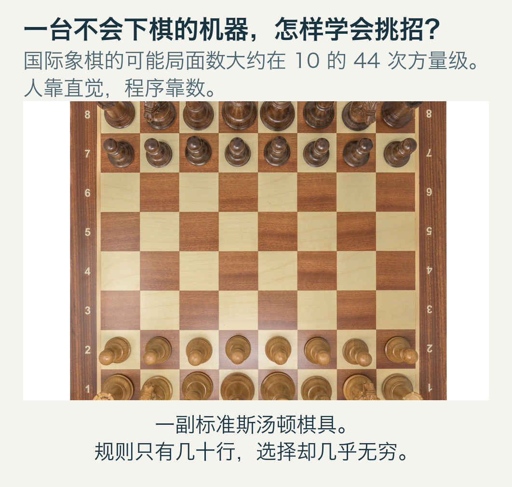

人类棋手靠经验把大部分树枝直接忽略掉。程序不会"觉得"某步棋看起来不靠谱，它只会一件事：**数**。

这篇文章要讲的，就是程序怎么把"数"变得足够快——快到能在几秒内从几十万种可能里挑出一步。核心只有三个想法：

- 把"往后想"写成一个递归公式（极小化极大）；
- 发现其中**大部分分支根本不需要算完**（α-β 剪枝）；
- 发现**不同的路会走进同一个局面**，于是只算一次（置换表与 Zobrist 键）。

本文所有数字都来自仓库里真实运行的程序：一份完整的国际象棋走法生成器（用 perft 校验过）、一份极小化极大、一份 α-β、一份带置换表的搜索。你在 `examples/` 里可以自己跑。

## 1. 先把问题变成一个可以数的东西

先看一个真实局面。

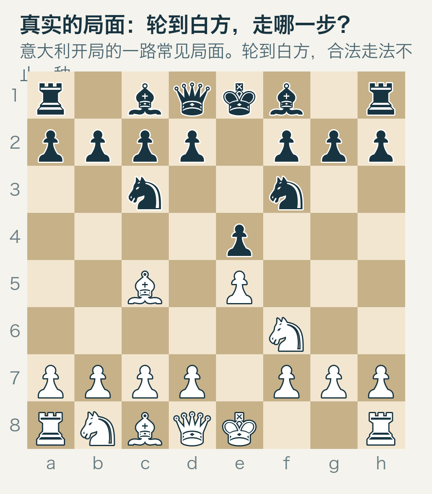

白方：王在 e1，后 d1，车 a1、h1，象 c4、c1，马 f3、b1，兵 a2 b2 c2 d2 e4 f2 g2 h2。
黑方：王 e8，后 d8，车 a8、h8，象 c8、f8，马 c6、f6，兵 a7 b7 c7 d7 f7 g7 h7。

在这个局面上，白方有多少种合法走法？答案是 **33** 种。这不是估计，是程序数出来的：搜索树在深度 1 时的节点总数是 34（1 个根节点 + 33 个子节点）。

33 不算多。真正的问题是下一层：黑方在每个子局面里也有三十几种走法。33 × 33 已经超过一千。再下一层，三万。再下一层，九十万。

这就是我们要面对的全部困难。它不是"棋太复杂"，而是**分支数在每一层都乘一遍**。

## 2. 最笨的办法：把对手的应手都列出来

假设我们只想"看一层"：我走这步，然后呢？

那就要问：对手会怎么回？对手不是观众，他也会挑对自己最好的那一步。

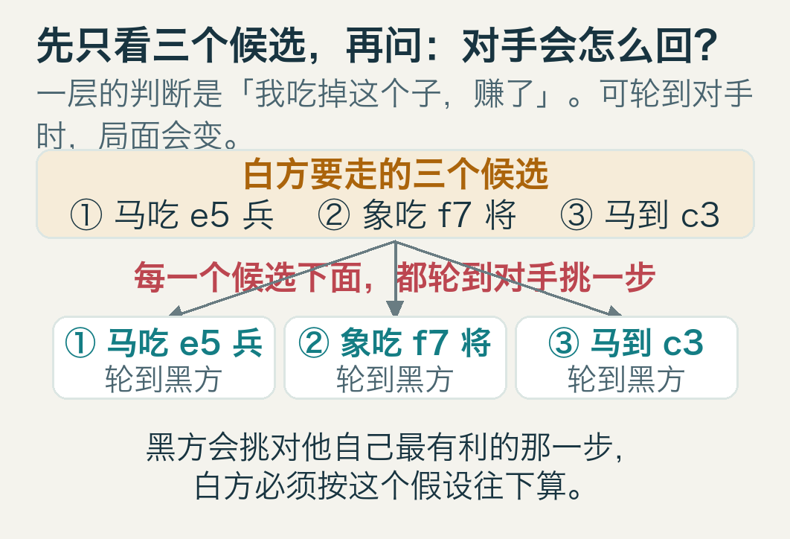

为了能在一页纸上算完，我们先只看三个候选走法：

- **① 马吃 e5 兵**（Nxe5）：白方白赚一个兵，看起来最直接。
- **② 象吃 f7 将**（Bxf7+）：白方用一个象换黑方一个兵加一个将，制造混乱。
- **③ 马到 c3**（Nc3）：不急着动手，先出一匹子。

"看一层"的判断很简单：吃掉一个兵就是赚了。可这个判断没有考虑一件事——**轮到黑方的时候，黑方也有话说**。

## 3. 再加一层：对手走完，还轮到我

于是我们把"我走一步"扩展成"我走一步，对手走一步"，然后对最后那个局面打分。

打分需要一个**评估函数**。本文用的评估函数很朴素：

```
分数 = 所有白方棋子的价值之和 − 所有黑方棋子的价值之和
     + 每匹兵/马按它所在格子的位置表加分或减分
```

棋子价值（单位是"厘兵"，一个兵 = 100）：兵 100，马 320，象 330，车 500，后 900。位置表让马往中间走加分、待在角落减分。

于是我们得到一棵两层的小树。

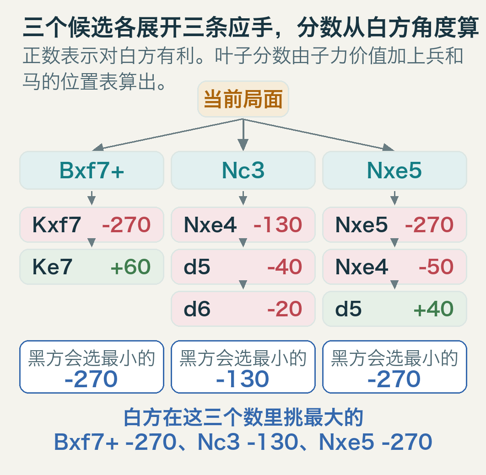

这张图上的每个数字都是程序真实算出来的。读法是从下往上：

1. 最下面一行是**叶子**：白方走了候选，黑方回了一步之后的局面分数。
2. 对每个候选，**黑方会挑分数最小的那一个**——因为分数是从白方角度算的，对黑方来说越小越好。这就是中间那层的三个数。
3. 白方在这三个数里**挑最大的**。

算出来是：

| 候选 | 黑方最好的应手带来的分数 |
|---|---|
| 象吃 f7 将 | −270 |
| 马到 c3 | −130 |
| 马吃 e5 兵 | −270 |

三个都是负数。这说明在这个评估函数眼里，**这个局面本来就对白方不利**（黑方多一个兵的结构）。但白方要做的不是"把分数变正"，而是在现有的坏局面里挑最不坏的那一步：**马到 c3**。

注意一件重要的事：白方一开始最想走的"马吃 e5 兵"，被算成了和"象吃 f7 将"一样差。因为黑方有办法把吃掉的兵拿回来。**只看一层会觉得赚了，看两层就发现是陷阱。**

## 4. 把同一件事写成递归

"我看一层、对手看一层"这套逻辑，可以原样重复下去：

- 轮到我走，我在所有走法里取**最大**的分数；
- 轮到对手走，他在所有走法里取**最小**的分数。

这个规则叫**极小化极大**（minimax）。写成代码只有几行：

```python
def minimax(pos, depth):
    moves = legal(pos)
    if depth == 0 or not moves:
        return side_score(pos)      # 叶子：直接用评估函数打分
    best = -infinity
    for mv in moves:
        child = make(pos, mv)
        value = -minimax(child, depth - 1)   # 取负号，视角换到对方
        best = max(best, value)
    return best
```

这里的 `-minimax(...)` 是技巧：与其写两套"最大/最小"的代码，不如把分数取负，**每一层都只取最大**。对手的"对我最小"，就是"对他最大"。

### 代价：树长得比算力快

同一局面、同一评估函数，只把深度从 1 加到 4：

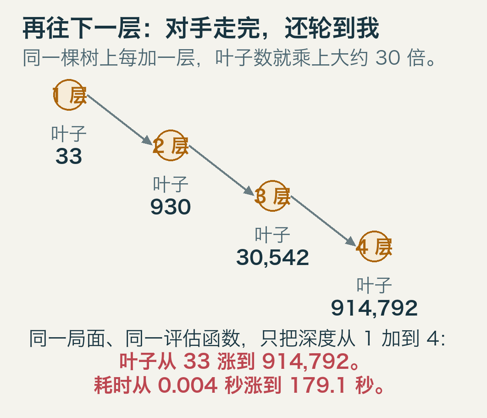

| 深度 | 叶子数 | 实际耗时 |
|---|---|---|
| 1 | 33 | 0.004 秒 |
| 2 | 930 | 0.186 秒 |
| 3 | 30,542 | 4.9 秒 |
| 4 | 914,792 | 179.1 秒 |

从深度 3 到深度 4，叶子数涨了 30 倍，时间涨了 37 倍。如果照这个速度推下去，深度 5 要一个半小时以上。

而深度 4 意味着什么？白方走一步、黑方走一步、白方走一步、黑方走一步。**才四个半回合。** 一个会下棋的人，四步之内能看到的远不止这些。

所以必须减负。好消息是：要减掉的东西非常多。

## 5. 第一次减负：有些分支不用算完

先看一个教学例子。数字是为了把规则说清楚而选的，不是真实棋局的评分。

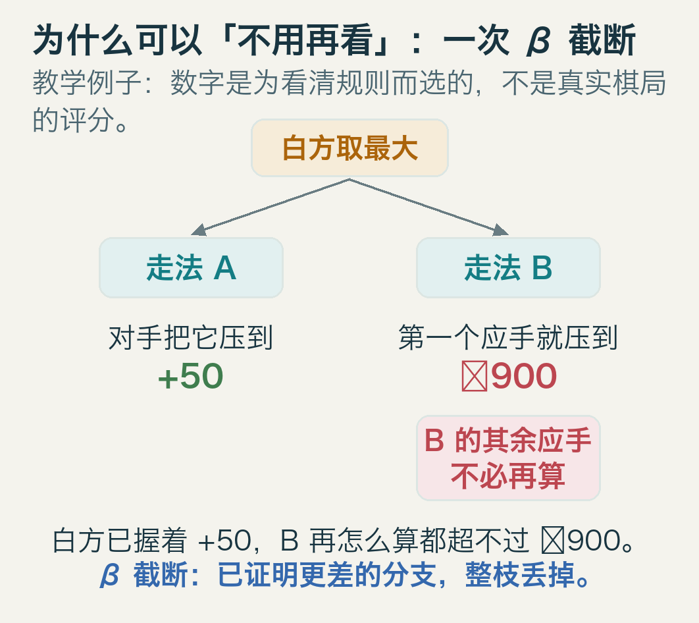

白方有两个走法：

- 走法 A：算完发现对手能把它压到 **+50**。
- 走法 B：刚算完对手的第一个应手，就把 B 压到了 **−900**。

现在问：B 剩下的那些应手还要算吗？

不用了。因为黑方**已经有一个能拿到 −900 的应手**，他一定会选它（或者更好）。B 剩下的应手无论怎么算，**都不可能让 B 超过 −900**。而白方手里已经握着 +50 的 A。B 已经被证明比 A 差了，再算下去也不可能翻盘。

这就是**剪枝**：不是"这一步看起来不好所以不算"，而是**"这一步已经被证明不可能更好，所以不用算完"**。

### 让程序自己知道这条边界

要写进代码，需要两个数跟着递归往下走：

- **α**：白方（当前这一层）**已经确保**能拿到的最低分数。
- **β**：对手**已经确保**能把白方压到的最高分数。

一开始 α = −∞，β = +∞——两边都还没有任何保证。

每算完一个分支，就把 α 或 β 收紧一点。当 **α ≥ β** 时，说明"我已经能保证拿到的东西"比"对手能容忍的上限"还要好，这个节点剩下的分支就没必要看了。

```python
def alphabeta(pos, depth, alpha, beta):
    moves = legal(pos)
    if depth == 0 or not moves:
        return side_score(pos)
    best = -infinity
    for mv in moves:
        value = -alphabeta(make(pos, mv), depth - 1, -beta, -alpha)
        best = max(best, value)
        alpha = max(alpha, best)
        if alpha >= beta:
            break            # 这一枝剩下的部分，证明不出新东西了
    return best
```

### 实测：剪掉了多少

同一局面、同一评估函数、同一深度，只把"取最大最小"换成带 α-β 的版本：

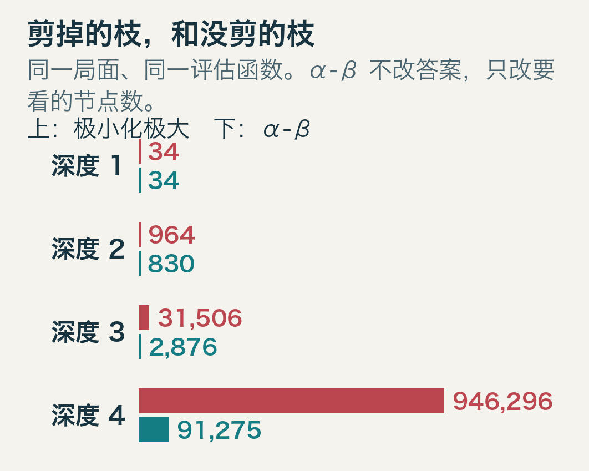

| 深度 | 极小化极大 | α-β | 倍数 |
|---|---|---|---|
| 1 | 34 | 34 | 1.0× |
| 2 | 964 | 830 | 1.2× |
| 3 | 31,506 | 2,876 | 11.0× |
| 4 | 946,296 | 91,275 | 10.4× |

深度 4：从 94 万个节点降到 9 万个，**少了 10 倍**。深度 1、2 几乎没省——因为树还太小，剪枝来不及发挥作用。**剪枝的收益随深度增长。**

### 最重要的一句话：答案没变

剪枝最容易被误解的地方是："你不看那些分支，怎么知道没漏掉好棋？"

答案在于剪枝的**条件**：只有当某个分支被**证明**不可能更好时才丢掉它。所以：

| 深度 | 极小化极大选出的走法 | α-β 选出的走法 | 分数 |
|---|---|---|---|
| 1 | Nxe5 | Nxe5 | +80 |
| 2 | Nc3 | Nc3 | −130 |
| 3 | Nc3 | Nc3 | +90 |
| 4 | Ng5 | Ng5 | −135 |

四个深度，两种算法选出的走法**完全相同**，分数也完全相同。这是本文实际跑出来的结果，不是理论保证的复述。

### 完整的代价曲线

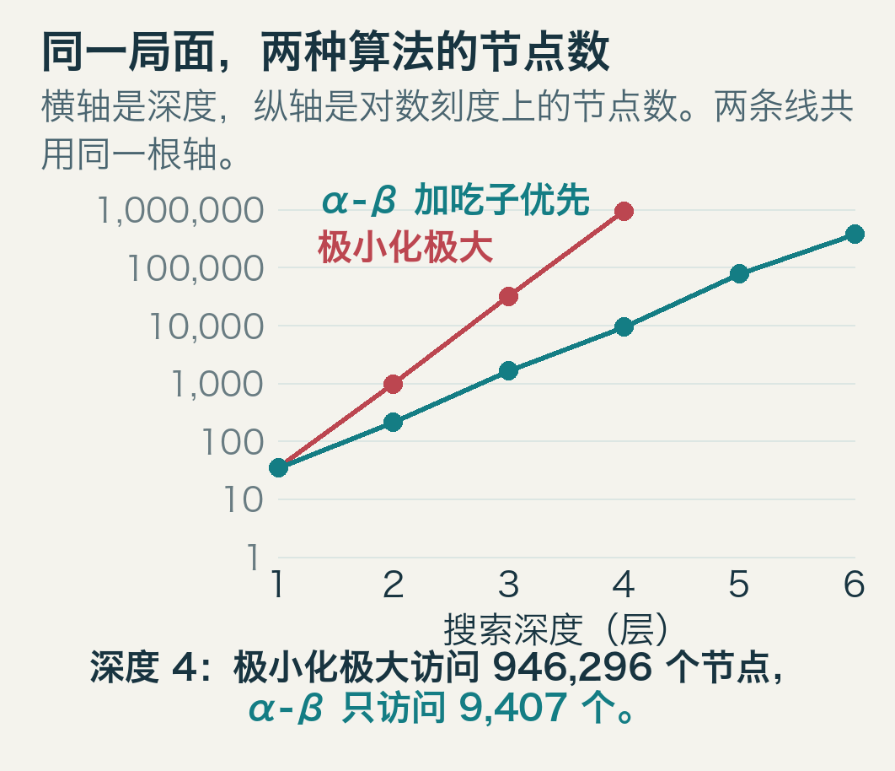

这张图纵轴是对数刻度，两条线共用一根轴。看两件事：

- 在深度 4，两条线差大约 100 倍。
- α-β 在**深度 6** 用了 371,984 个节点；极小化极大在**深度 4** 就用了 946,296 个。**α-β 多看两层，用的节点还更少。**

这就是"剪枝能换深度"的具体含义。

## 6. 剪枝靠什么：先看哪一步

α-β 什么时候能剪，取决于一件很实际的事：**你按什么顺序看走法**。

如果先看的那一步恰好是好棋，α 会立刻收紧，后面大部分分支马上被剪掉。如果先看的是最差的一步，α 一直不收紧，剪枝就几乎用不上。

我们用三种顺序跑同一个局面、同一个深度 5：

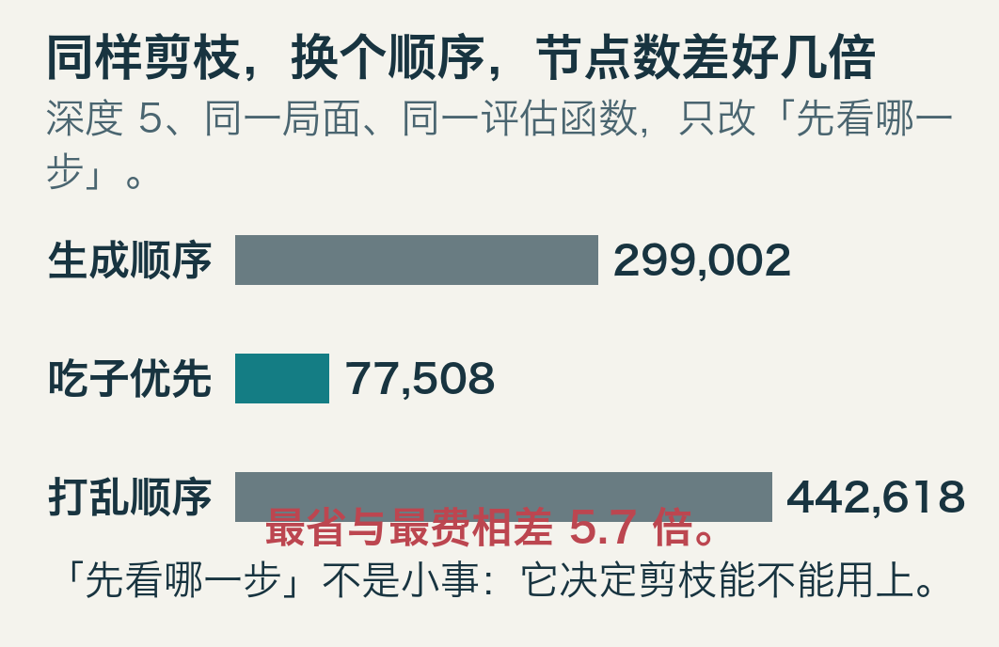

| 顺序 | 深度 5 的节点数 |
|---|---|
| 打乱顺序 | 442,618 |
| 生成顺序（兵、马、象、车、后、王的顺序） | 299,002 |
| 吃子优先（先看吃得最划算的） | 77,508 |

**最省和最费差了 5.7 倍。** 算法一个字没改，只是换了个看走法的顺序。

本文用的排序规则叫 MVV-LVA（最有价值的受害者 / 最不值钱的攻击者）：如果一步棋是"用马吃对方的车"，它的优先级最高；"用后吃对方的兵"优先级很低。原因很直观——**能赢一个大子的走法，最可能立刻证明这一枝的好坏。**

真实引擎的走法排序要复杂得多：会用上一次搜索的结论、杀手走法、历史启发等等。但出发点都是同一个：**先看最可能改变结论的那一步。**

## 7. 另一条省法：同一个局面只算一次

还有一类浪费，跟顺序无关。

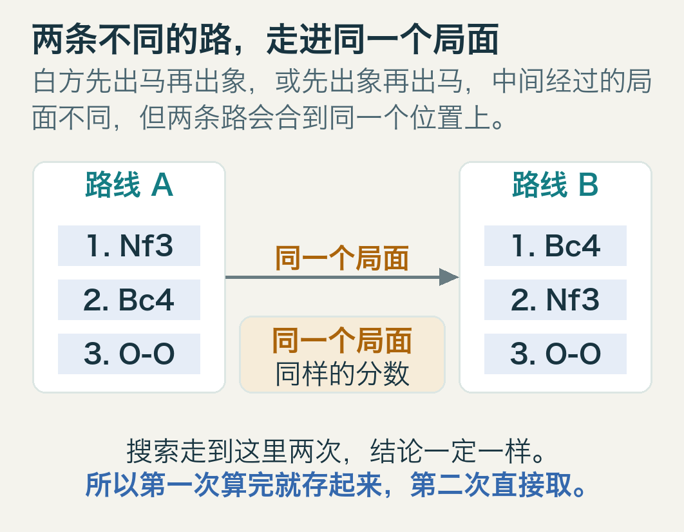

白方先出马再出象，或者先出象再出马，中间经过的局面不同，但**两条路会合到同一个位置上**。

搜索走到这个位置两次，会把它下面的整棵树算两遍。而两次的结论必然完全一样——因为局面一样、轮次一样、评估函数一样。

所以：**第一次算完就把结论存起来，第二次直接取。** 存这个结论的表叫**置换表**。

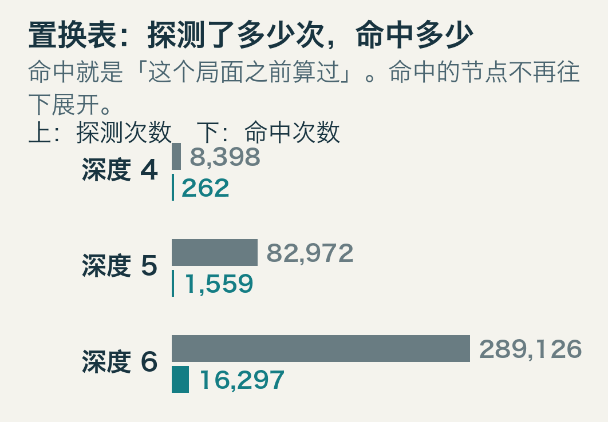

| 深度 | 探测次数 | 命中次数 | 有表时的节点数 | 无表时的节点数 |
|---|---|---|---|---|
| 4 | 8,398 | 262 | 8,398 | 9,407 |
| 5 | 82,972 | 1,559 | 82,972 | 77,508 |
| 6 | 289,126 | 16,297 | 289,126 | 371,984 |

这里有一个值得注意的**反例**：深度 4 和深度 5 时，加了置换表**反而更慢**（深度 5 从 77,508 涨到 82,972 个节点）。

原因是：置换表本身要花时间——算哈希、查表、存表。在浅层搜索里，命中的次数太少，省下的节点不够抵消这笔开销。到了深度 6，命中 16,297 次，省下 8 万多个节点，才划算。

**"加一个优化"不等于"一定变快"。** 这是工程里很常见的一件事，本文把它如实记下来。

## 8. 怎么判断"同一个局面"：Zobrist 键

置换表需要一个"局面的指纹"。最直接的办法是把 64 个格子拼成一个字符串当键——能行，但每次都要造一个新字符串，很慢。

更好的办法叫 **Zobrist 键**。

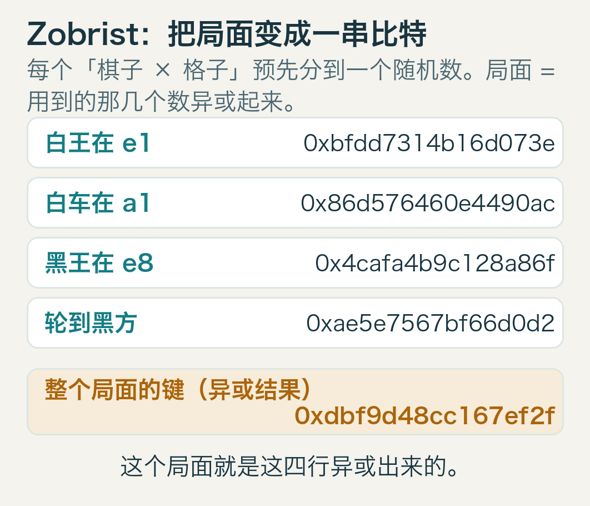

做法是：

1. 预先给每个"棋子 × 格子"组合分一个随机数。国际象棋有 6 种棋子 × 2 种颜色 × 64 个格子 = 768 个随机数，再加"轮到谁走"1 个。
2. 一个局面的键 = **把当前棋盘上用到的那些随机数异或起来**。

上面那张图是一个真实的三子局面：白王在 e1、白车在 a1、黑王在 e8，轮到黑方。四个数异或起来就是局面的键。这四个 64 位数是程序里真实的那几个（随机种子固定，可复现）。

### 为什么用异或

异或有个特别好用的性质：**同一个数异或两次会抵消**。

```
x ⊕ y ⊕ y = x
```

所以走一步棋，不需要把整个棋盘重新数一遍，只需要：


- 异或掉"离开的那个格子上原来是什么"；
- 异或掉"到达的那个格子上原来是什么"（如果是吃子）；
- 异或进"到达的那个格子上现在是什么"。

**三项异或进旧键，就得到新键。** 走一步棋的哈希更新是常数时间，跟棋盘上有多少子无关。

### 实测：十六步真实对局，一次不差

光说"理论上相等"不够。我们用一段真实的对局走法（1. e4 e5 2. Nf3 Nc6 3. Bb5 a6 4. Ba4 Nf6 5. O-O Be7 6. Re1 b5 7. Bb3 d6 8. c3 O-O）逐步验证：

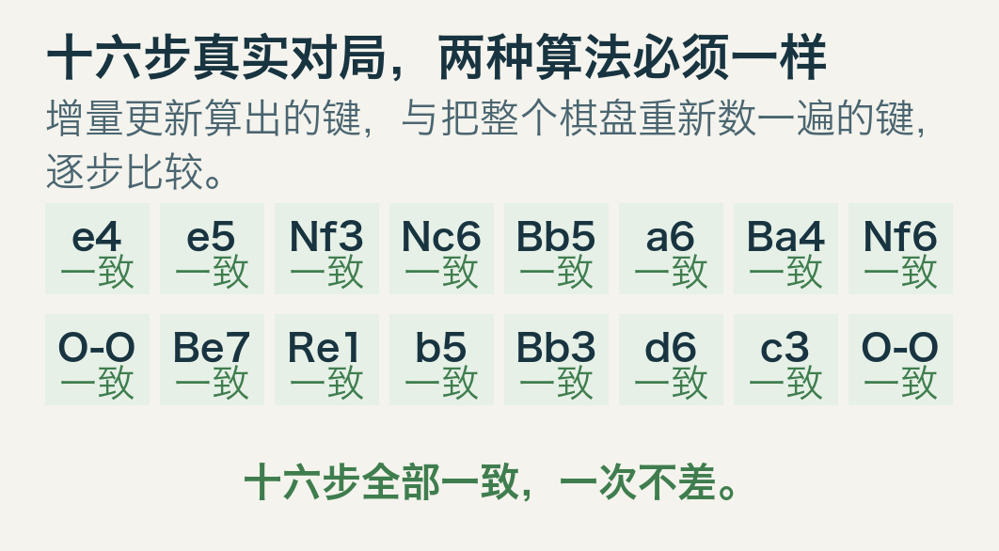

每一步都做两件事：用增量法更新键，再把整个棋盘重新数一遍算出键。**十六步全部相等。**

那会不会有两个不同局面撞到同一个键？随机抽了 3,045 个局面（从开局随机走 4,000 步得到），得到 3,045 个互不相同的键，**碰撞 0 次**。

这不是证明——**64 位空间里的碰撞概率极低，但不是零**。真实引擎因此还会在表里存一份校验信息，或者在发现异常时重新计算。本文的模型假设不碰撞，这个假设在本文的实验范围内成立。

## 9. 还有一个坑：地平线效应

前面三招（剪枝、排序、置换表）解决的都是"算得太慢"。还有一类问题，是"算得不够巧"。

看两个真实局面，同一个程序，只改搜索深度：

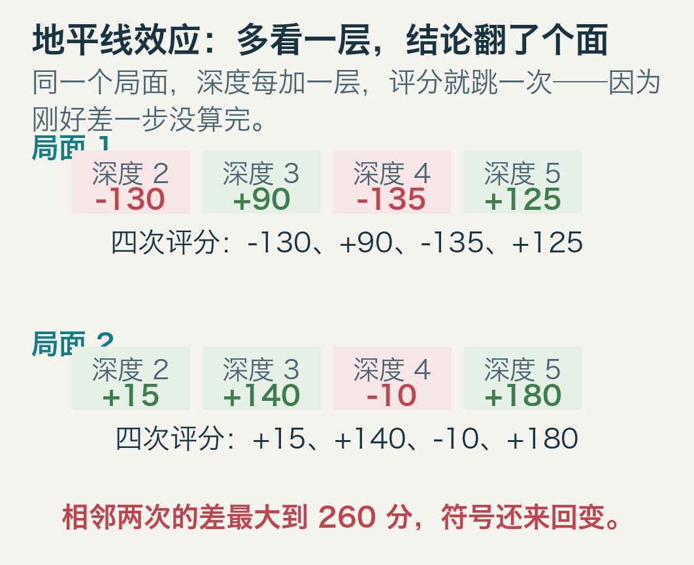

局面 1 的四次评分是 **−130、+90、−135、+125**。符号来回翻。局面 2 是 **+15、+140、−10、+180**，同样跳。

这不是程序有 bug，而是**"刚好差一步没算完"**造成的。

设想一个具体的场景：白方走了一步，黑方吃掉了白方一个兵，搜索到此结束。程序看到的是"我少了一个兵"，于是给这个局面打低分。可实际上，**白方下一步就能把这个兵吃回来**——只是这一步刚好落在搜索深度之外，程序没看到。

这条"看不见的边界"叫**地平线**（horizon）。深度每加一层，地平线往后挪一格，本来被藏起来的那步棋突然露出来，评分就跳了。

### 修法：在安静的地方才停

修法不是"再深一点"，而是**换一个停止条件**：不要在"还有子可以吃"的地方停下。

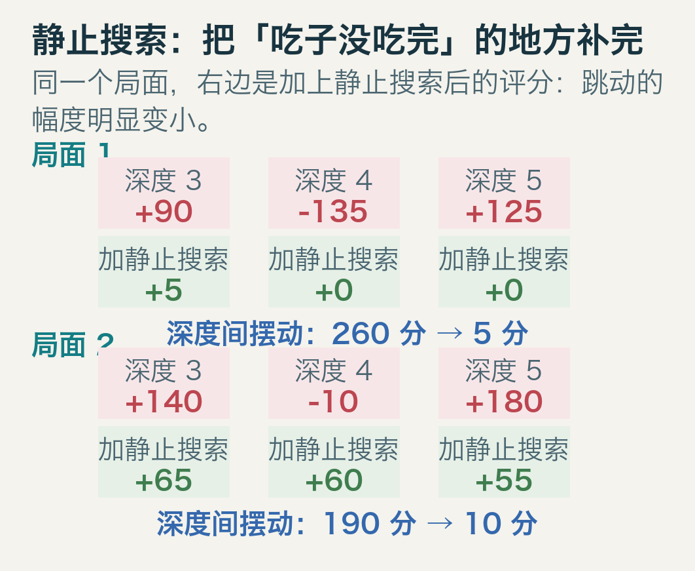

具体做法叫**静止搜索**（quiescence search）：当搜索到达深度 0 时，如果这个局面里还有吃子走法，就**只把吃子走法继续展开**，直到局面"安静"下来（没有吃子可走）为止。非吃子的走法不再展开，所以不会无限递归。

看结果：

| | 深度 3 | 深度 4 | 深度 5 | 摆动幅度 |
|---|---|---|---|---|
| 局面 1，无静止搜索 | +90 | −135 | +125 | 260 分 |
| 局面 1，有静止搜索 | +5 | 0 | 0 | 5 分 |
| 局面 2，无静止搜索 | +140 | −10 | +180 | 190 分 |
| 局面 2，有静止搜索 | +65 | +60 | +55 | 10 分 |

摆动从 260 分降到 5 分，从 190 分降到 10 分。

代价是慢：局面 1 在深度 5 从 77,507 个节点涨到 126,218 个主节点，另外还有 184,097 个静止搜索节点。**用速度换稳定**，这是这套方法里反复出现的一种交换。

## 10. 历史：这些想法是谁想出来的

### 1950 年，香农先把问题写清楚


克劳德·香农在 1950 年的论文《为下棋而编程》（*Programming a Computer for Playing Chess*）里，把机器下棋拆成了两件事，后来被称为：

- **A 型策略**：每一层都展开全部合法走法，深度固定。算得完，但看不到很深。
- **B 型策略**：先用便宜的判断砍掉大部分走法，只对少数几条深挖。看得深，但可能砍错。

本文讲的所有技巧，都是在这两条路之间找平衡：α-β 剪枝是"有证明的砍"，走法排序是"猜哪条值得先看"，静止搜索是"只在不该停的地方多看一眼"。**今天最快的程序，两个策略都在用。**

顺带说一句：香农 1948 年的另一篇论文《通信的数学理论》开创了信息论。他在这篇文章里用到的"局面打分"思路，和他在信息论里用的东西是同一套思维方式——**把模糊的问题变成一个可以计算的量**。

### 更早一步：图灵在纸上运行的程序


艾伦·图灵和 D. G. Champernowne 在 1948 年设计了 Turochamp。它做的事和本文前面那棵两层小树几乎一样：列出自己的走法、对手的应手，给每个结果打分，取最高的。吃后 10 分、吃兵 1 分。

但 Turochamp **从未在真正的计算机上运行过**。当年的机器装不下这套规则，图灵试过把它改成 Ferranti Mark 1 能执行的代码，没有成功。1952 年夏天，他和计算机科学家 Alick Glennie 下了一盘棋，方式是**由人手一步步执行程序**。图灵输了。

这个细节值得记住：**"能不能写成算法"和"能不能跑起来"是两件事。** 图灵证明了前一件，机器算力花了几十年才补上后一件。

### α-β 是谁发明的

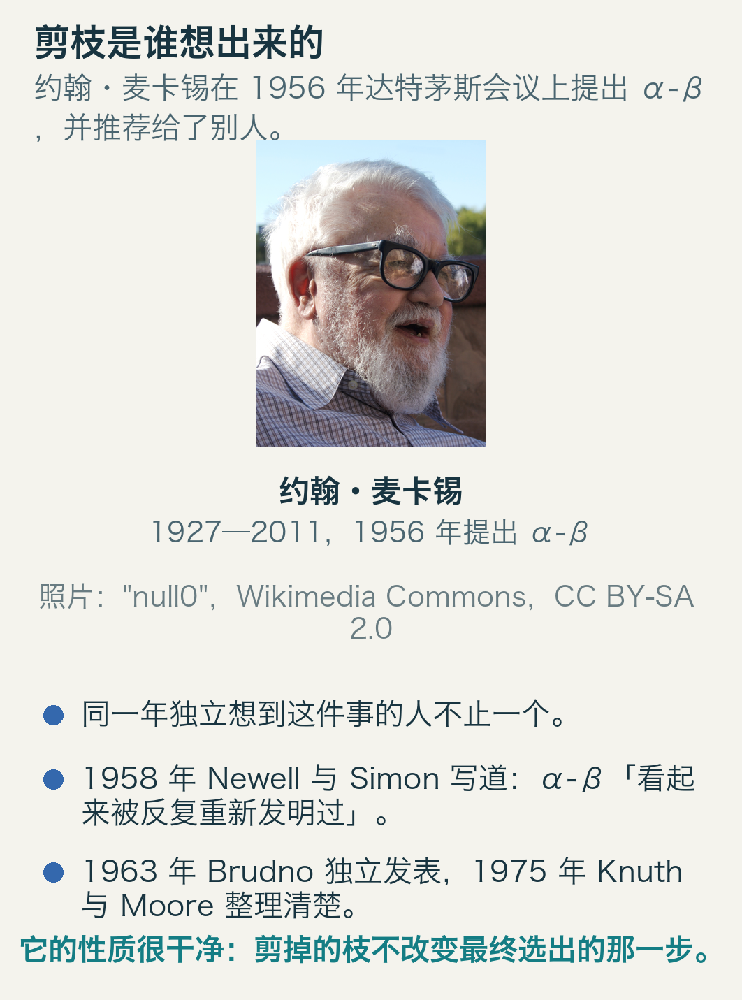

约翰·麦卡锡在 1956 年的达特茅斯会议上提出 α-β，并推荐给当时正在写棋程序的 IBM 研究员 Alex Bernstein。Bernstein 没有被说服。

后来 Allen Newell 和 Herbert Simon 在 1958 年写道，α-β"看起来被反复重新发明过"。1963 年 Alexander Brudno 独立发表，1975 年 Donald Knuth 和 Ronald Moore 把它整理成今天教科书里的样子。Judea Pearl 后来证明了它在随机叶子取值下的期望最优性。

**这不是一个人的功劳，也不是一次灵光一闪。** 一个好的想法在几年里被不同的人从不同角度想到，然后被整理、被证明、被写进教材——这是技术史上很常见的样子。

### 把棋力装进硬件

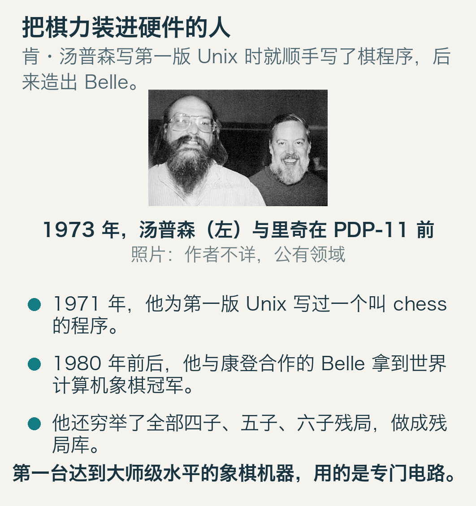

肯·汤普森（Ken Thompson）1971 年为第一版 Unix 写过一个叫 `chess` 的程序。1980 年前后，他和 Joseph Condon 合作的 **Belle** 拿到了世界计算机象棋冠军，是第一台达到大师级水平的象棋机器。

Belle 的关键不在于算法更聪明，而在于**把走法生成和局面评估做成了专门电路**。汤普森还穷举了全部四子、五子、六子的残局，做成"残局库"——一旦进入库里记录的局面，程序直接查表走"完美"的一步，不用搜索。

顺带一提，同一个人还发明了正则表达式到有限自动机的转换算法、设计了 B 语言、定义了 UTF-8 编码。**很多重要的技术突破，是同一个人在同一个时期顺手做出来的。**

### 1997 年：机器第一次赢下世界冠军


深蓝（Deep Blue）的来历是一串改名：卡内基梅隆大学的 ChipTest → Deep Thought → 1989 年 IBM 征名后叫 Deep Blue。

1996 年 2 月，它第一次和世界冠军卡斯帕罗夫交手，赢了第一局（这是历史上第一次有机器在常规时限下赢下在位世界冠军的一局），但整场以 2 比 4 输掉。1997 年 5 月升级后重赛，以 3.5 比 2.5 取胜。

1997 年那台通常搜 6 到 8 步，有些局面超过 20 步。David Levy 和 Monty Newborn 估计，每多算半步（一层），棋力大约涨 50 到 70 Elo。

有一件事最能说明它"并不懂棋"：第一局的第 44 手，程序里的一个缺陷让它进入了一个非预期的循环，它靠**随机挑一个合法走法**脱身。卡斯帕罗夫不知道这件事，把这步看似无意义的棋读成了"高深的理解"，随后一局状态下滑。卡斯帕罗夫本人否认这是焦虑所致。

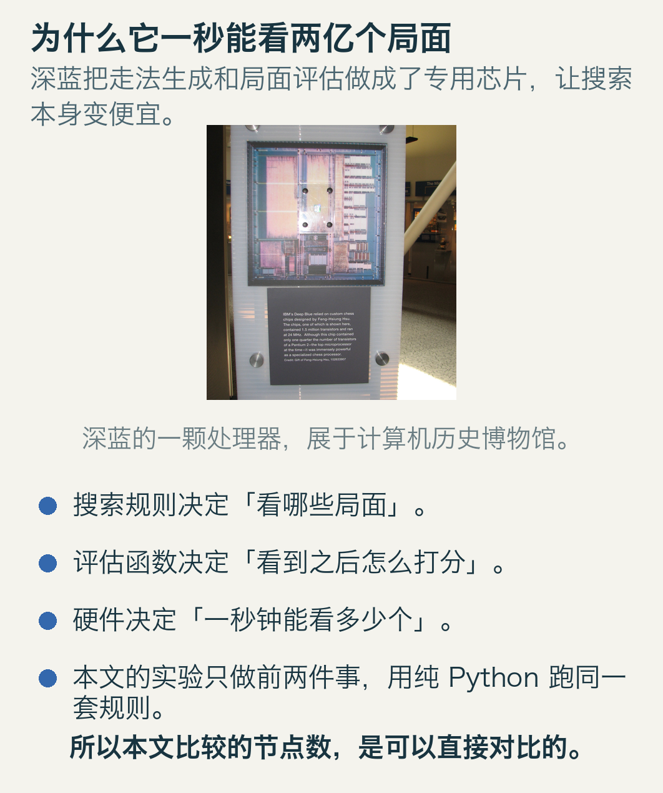

深蓝的强，来自三件不同的事叠在一起：

- **搜索规则**决定"看哪些局面"——本文讲的 α-β、走法排序、置换表；
- **评估函数**决定"看到之后怎么打分"——本文用的是最朴素的子力加位置表；
- **硬件**决定"一秒钟能看多少个"——深蓝每秒评估约两亿个局面。

本文的实验只做前两件事，用纯 Python 跑同一套规则。所以本文比较的节点数，是可以直接对比的；本文比较的**秒数**，只说明这套实现在这台机器上的速度，**不能拿来推断深蓝有多快**。

## 11. 这套方法不止用于下棋

α-β 剪枝的前提只有两条：**局面可以打分，双方轮流选择**。凡是满足这两条的问题都能用：

- 棋类游戏（围棋、象棋、五子棋）——最直接的应用。
- 规划问题：把"我做什么、环境怎么变"看成两个玩家。
- 编译器里的某些选择，也可以写成"我选一个方案，测试环境会给出最坏情况"。
- 甚至谈判策略：把对方的反应当成"最小化我的收益"。

置换表的想法更通用：**只要同一个状态能通过不同路径到达，就值得缓存它的结论**。这正是动态规划、记忆化搜索、以及各种缓存系统的核心。

Zobrist 键也走出了棋类：它被用来在材料模拟中识别晶体结构配置，是"制表哈希"（tabulation hashing）最早的一个实例。

## 12. 换一个条件，自己再走一遍

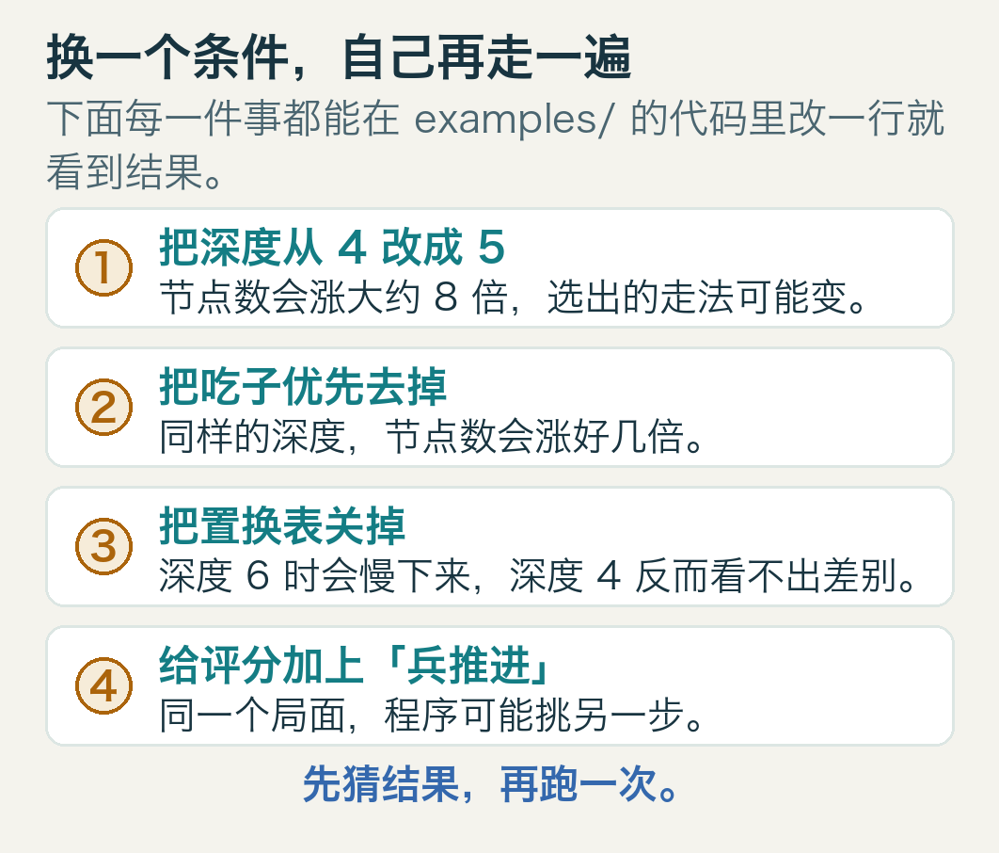

代码在 `examples/` 里，只用 Python 标准库。四个建议的改动：

1. **把深度从 4 改成 5。** 先猜节点数会涨多少，再跑。参考：本文实测 α-β 在深度 4 用 9,407 个节点，深度 5 用 77,508 个，涨了 8.2 倍。极小化极大在深度 4 用了 946,296 个节点；深度 5 本文没有跑完，按每层约 30 倍推算它要访问两千万个以上（这是推算，不是实测）。
2. **把吃子优先去掉。** 同一个深度，节点数会涨好几倍。改法是 `order='none'`。
3. **把置换表关掉。** 深度 6 会明显变慢，深度 4 反而看不出差别——甚至可能更快。想想为什么。
4. **给评估函数加一条新规则**（比如"兵越靠近对方底线加分"）。同一个局面，程序可能挑另一步。这条最能说明一件事：**搜索负责"看得远"，评估函数负责"看得准"，两者缺一不可。**

最后一个问题，留给你自己回答：**如果评估函数是错的，更深的搜索会让结果更好还是更糟？**

## 动手材料

- [走法生成、搜索、Zobrist 的完整代码](examples/engine.py)（[棋规部分](examples/chesslib.py)）
- [本文全部测量脚本](examples/measure.py)与[原始结果 JSON](examples/measurements.json)
- [地平线与静止搜索的专项测量](examples/horizon.json)
- [本文全部原创图的重绘代码](examples/build_figures.py)
- [运行环境与复现说明](README.md)
- [一手来源、素材身份与 AI 辅助说明](sources.md)

原创正文、教学图与原创实验数据采用 CC BY 4.0；原创代码采用 MIT 许可。第三方照片与论文保留各自权利，详见来源说明。

## 图片来源

- 斯汤顿棋具：Wilfredor，[Wikimedia Commons](https://commons.wikimedia.org/wiki/File:Chess_game_Staunton_No._6_top_view.jpg)，CC0。
- 克劳德·香农肖像：Konrad Jacobs，[Wikimedia Commons](https://commons.wikimedia.org/wiki/File:C.E._Shannon._Tekniska_museet_43069.jpg)，CC BY 2.0。
- 艾伦·图灵肖像：Elliott & Fry，1951 年 3 月 29 日摄，[Wikimedia Commons](https://commons.wikimedia.org/wiki/File:Alan_Turing_(1951).jpg)，公有领域。
- 约翰·麦卡锡肖像："null0"，[Wikimedia Commons](https://commons.wikimedia.org/wiki/File:John_McCarthy_Stanford.jpg)，CC BY-SA 2.0。
- 肯·汤普森与丹尼斯·里奇，1973 年：[Wikimedia Commons](https://commons.wikimedia.org/wiki/File:Ken_Thompson_and_Dennis_Ritchie--1973.jpg)，公有领域。
- 深蓝机柜：Anton Chiang，[Wikimedia Commons](https://commons.wikimedia.org/wiki/File:IBM_Deep_Blue_at_Computer_History_Museum_(9361685537).jpg)，CC BY 2.0。
- 深蓝处理器：Erik Pitti，[Wikimedia Commons](https://commons.wikimedia.org/wiki/File:One_of_Deep_Blue%27s_processors_(2586060990).jpg)，CC BY 2.0。

其余全部为本文原创绘制的教学示意图。
