# 改了三行，电脑怎样在十万行里找出它们？

你改了三行代码，按下保存。

编辑器立刻标出改动，代码评审页面把两行标红、一行标绿，`git diff` 打出一个小方块。整个过程快到你觉得它什么都没做。

可它确实做了一件事：**在一个上万行的文件和一个改过的版本之间，找出一组"最少"的增删。**

这篇文章讲的就是这件事怎么做。它看起来是个琐碎的工程问题，实际上是计算机科学里最漂亮的问题之一——**它的答案是一张网格上的最短路径。**

本文里每一个编辑距离、每一次比较、每一段 diff 输出，都来自仓库里两份真实运行的程序：一份 Myers 算法（照 1986 年论文实现），一份 patience diff。输入是两个公开仓库里的真实文件修订。你在 `examples/` 里可以自己跑。


## 1. 先看清问题


"找出改动"这句话有两个完全不同的意思：

- **哪几行的内容不一样？** 这个问题很无聊，逐行比一下就行。
- **哪几行被删掉、哪几行被插进来？** 这个问题才有意思，而且它的答案不唯一。

为什么第二个问题才重要？因为它决定了两件事：**补丁能不能应用**，以及**人能不能读懂**。

一个真实场景：你在一个 161 行的文件中间插入了 12 行。逐行比较会告诉你"从第 20 行开始，后面每一行都变了"——虽然你只插入了一段。而一个真正的 diff 会说"在第 19 行之后插入这 12 行"。**后者才是你能审核的东西。**

## 2. 最笨的办法，以及它为什么不行

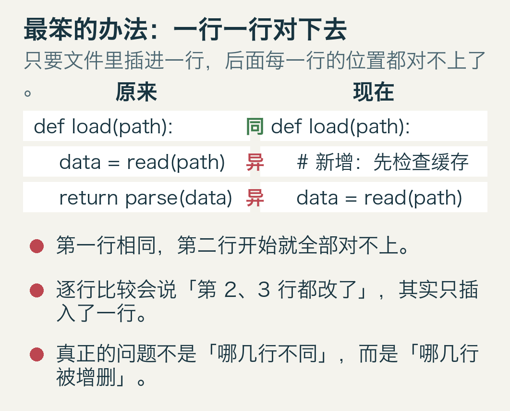

最直接的办法是把两个文件按行号对齐，逐行比较。

只要中间插入了一行，**后面每一行的位置就都对不上了**。上面的例子里，第二行开始全部标成"不同"，可实际上只是插入了一行。

所以真正的问题不是"哪几行不同"，而是：

> **从 A 到 B，最少需要删掉哪些行、插入哪些行？**

这个问题有个正式名字：**最短编辑脚本**（shortest edit script）。

注意"最短"这个词。它给了我们一个明确的目标函数——**这也是后面所有算法的出发点。**

## 3. 换一个想法：把它画成一张网格

现在做一次关键的转念。

把文件 A 的每一行放在横轴上，文件 B 的每一行放在纵轴上。两张轴交叉出一张网格，网格上的每个交点 (x, y) 表示"**A 已经用掉了前 x 行，B 已经用掉了前 y 行**"。


这张图是 Myers 论文里的原始例子：A = `abcabba`，B = `cbabac`。图上那些对角线，是两边字符相同的位置。

现在从左上角 (0,0) 走到右下角 (N,M)。每一步只能是三种：

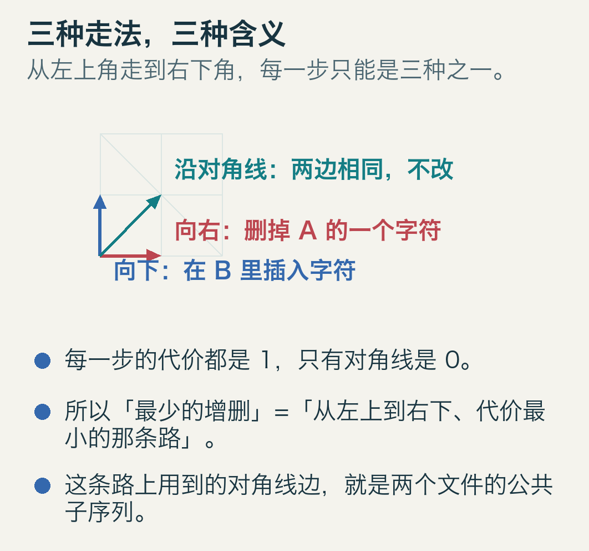

| 走法 | 含义 | 代价 |
|---|---|---|
| 向右 | 删掉 A 的一个字符 | 1 |
| 向下 | 在 B 里插入一个字符 | 1 |
| 沿对角线 | 两边这个位置相同，不用改 | 0 |

于是"最少的增删"就变成了：**从左上到右下，代价最小的那条路。**

而且这条路上用到的对角线边，正好就是两个文件的**最长公共子序列**。两个看起来完全不同的问题，在这张图上合成了一个。

## 4. 对角线：把状态压缩成一条线

如果要对每个交点都记一个"最少代价"，那就是 N × M 个格子——对一万行的文件，那是一亿个格子。太慢了。

但有个观察能救我们：

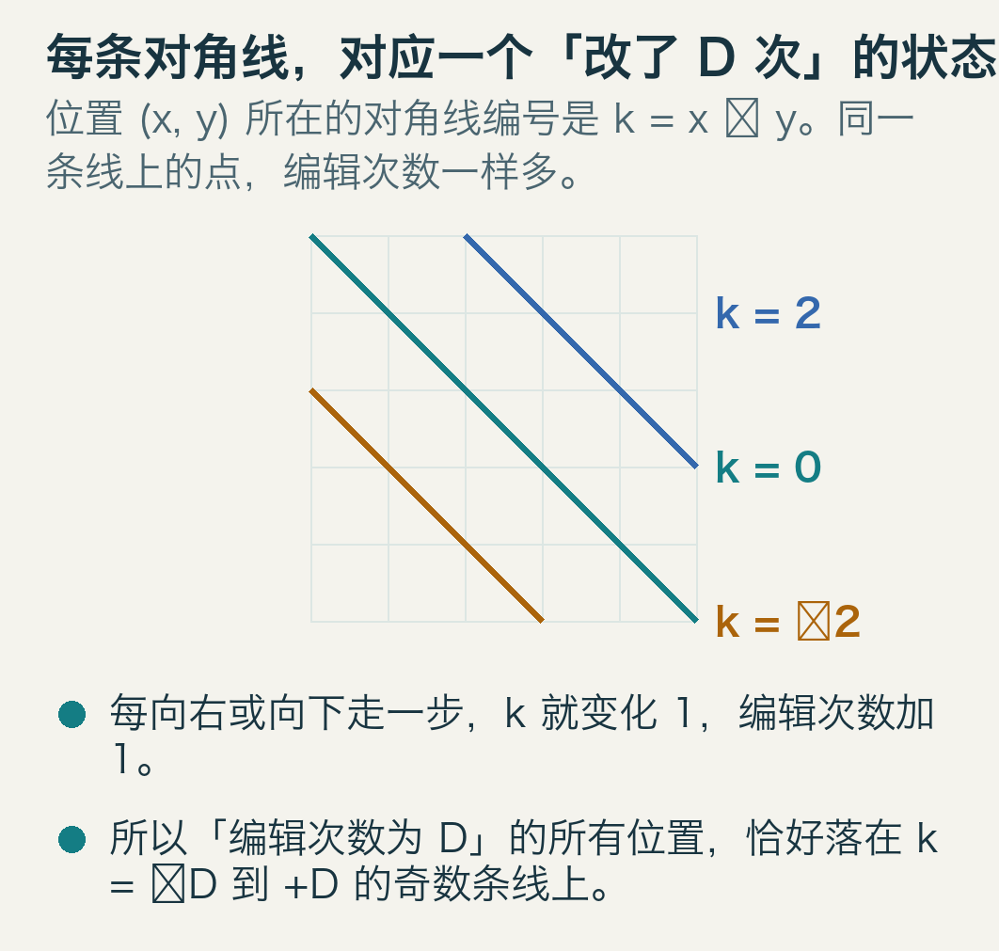

**位置 (x, y) 所在的对角线编号是 k = x − y。**

每向右或向下走一步，k 就变化 1，代价也加 1。所以在一条对角线上的所有点，**代价是一样的**。

于是可以换个说法：不用记每个格子，只记**每条对角线上"走得最远"的那个点**。

- 代价为 D 时，可能落在对角线 k = −D, −D+2, …, D 上，一共 D+1 条。
- 每条线只需要一个数字：最远的 x 是多少。

这就是 Myers 算法的全部空间。

## 5. 贪心：一层一层往外扩

有了对角线，算法就变得很短：

```
对 D = 0, 1, 2, ... :
    对每条对角线 k = −D, −D+2, ..., D:
        从 D−1 层的邻居走过来（向右或向下，代价 +1）
        然后一直沿对角线滑下去，直到字符不同为止
        如果滑到了 (N, M)，就找到了答案
```

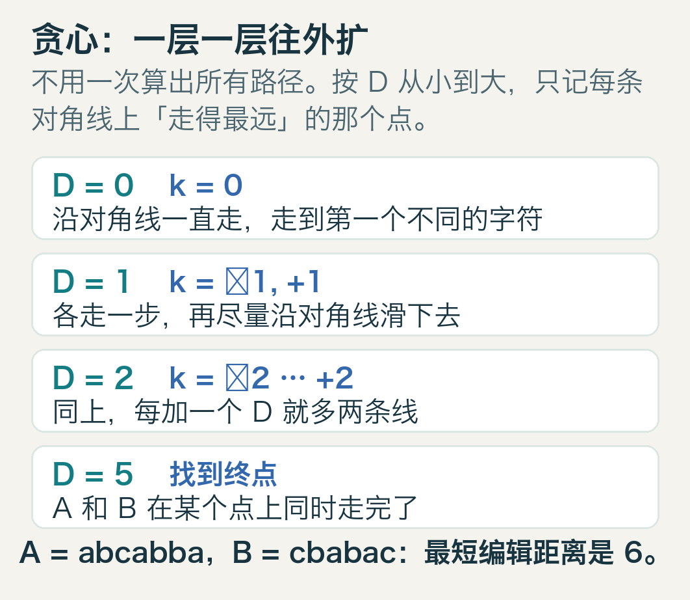

两个细节值得说清楚：

**为什么可以"一直滑下去"？** 因为沿对角线是免费的。既然免费，能滑多远就滑多远——**没有任何理由在中途停下。** 这个"尽量滑"的动作，论文里叫 snake（蛇）。

**为什么一定能找到最短的？** 因为我们是按 D 从小到大穷举的。第一次到达终点时的 D，就是最小的 D。**这是"贪心"在这类问题里少见的、能给出最优解的情形。**

### 把这六层写出来

光看伪代码还是抽象。把上面那个例子的每一层实际算出来，是这样的：

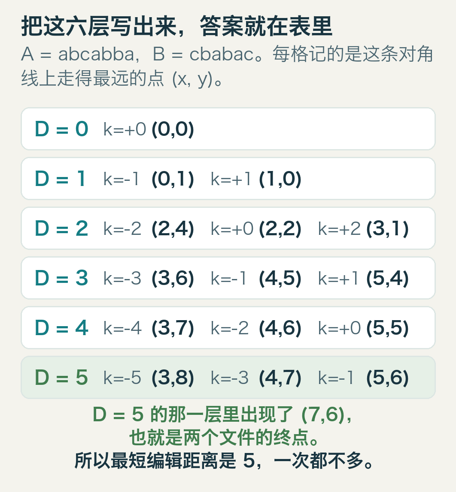

读法：

- **D = 0**：从 (0,0) 出发，想沿对角线滑下去——但 A 的第一个字符是 `a`，B 的第一个是 `c`，不同，所以一步也滑不动，停在 (0,0)。
- **D = 1**：两条对角线各走一步。k = −1 停在 (0,1)，k = +1 停在 (1,0)。都还没滑起来。
- **D = 2**：k = −2 那一格从 (2,2) 一路滑到 (2,4)——因为 A 的 `a`、`b` 和 B 的 `a`、`b` 对上了。**这是 snake 第一次真正发挥作用。**
- **D = 5**：k = +1 那一格走到 (7,6)。(7,6) 就是 A 和 B 的终点。

所以最短编辑距离是 **5**。

**注意这里没有"猜"的成分。** 每一层都是把上一层的结果加一步、再尽量滑下去，算出来的。第一次碰到终点的那一层，就是最小值。

### 回溯

找到终点只给出了 D，没有给出路径。要得到实际的编辑脚本，需要在每一层记下当时的对角线状态，然后从终点倒着走回去：

1. 看终点在 D 层的哪条对角线上。
2. 找出它从 D−1 层的哪个邻居走过来的。
3. 中间那段对角线就是一段"未改动"的内容。
4. 重复，直到回到 (0,0)。

本文的实现就是这么做的，并且在随机小输入上和动态规划逐个对照过：**400 组随机输入，脚本都能重建出 B，且编辑长度都等于动态规划的最优值。**

## 6. 在两个真实文件上跑一遍

上面都是小例子。现在换成真实的东西。

输入是公开仓库里两个文件的真实修订：

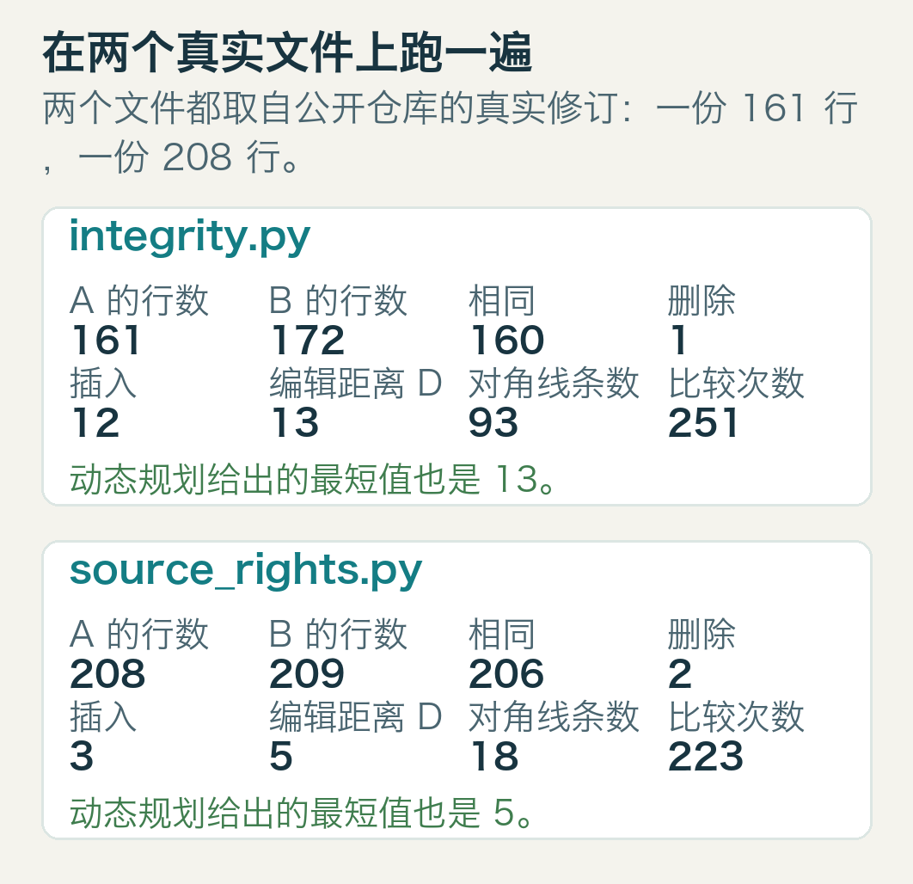

| | `integrity.py` | `source_rights.py` |
|---|---|---|
| A 的行数 | 161 | 208 |
| B 的行数 | 172 | 209 |
| 相同行 | 160 | 206 |
| 删除 | 1 | 2 |
| 插入 | 12 | 3 |
| **编辑距离 D** | **13** | **5** |
| 访问的对角线条数 | 93 | 18 |
| 元素比较次数 | 251 | 223 |
| 动态规划给出的最短值 | 13 | 5 |

最后一行的意思是：**这两次的结果都确实是最短的。** 不是"看起来挺短"，是和另一套完全不同的算法（动态规划）算出来的最优值逐位相等。

## 7. 代价：为什么是 O(ND)

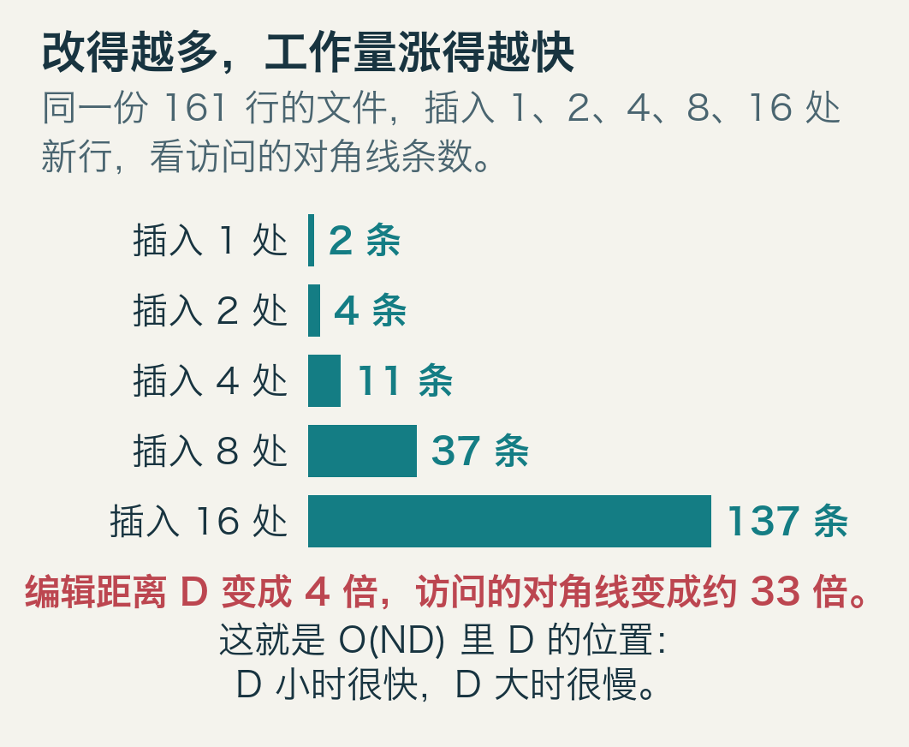

同一份 161 行的文件，插入 1、2、4、8、16 处新行：

| 插入处数 | 编辑距离 D | 访问的对角线条数 |
|---|---|---|
| 1 | 1 | 2 |
| 2 | 2 | 4 |
| 4 | 4 | 11 |
| 8 | 8 | 37 |
| 16 | 16 | 137 |

D 变成 4 倍，对角线条数变成约 33 倍。这个增长比 D² 还快一点，因为每一层的对角线数量本身就是 D+1 条。

这就是论文标题里那个 **O(ND)**：**代价与"文件总长度 × 编辑量"成正比。**

它说明了一件很实际的事：

- **改动少的时候极快。** 161 行的文件、13 处改动，访问了 93 条对角线，比较了 251 次——微秒级。
- **改动多的时候会崩。** 看两个极端：


| 输入 | 编辑距离 | 对角线条数 | 比较次数 |
|---|---|---|---|
| 文件和自己比 | 0 | 1 | 161 |
| 文件和打乱后的自己比 | 258 | 33,541 | 19,089 |

第一行：**一次多余的比较都没有**，沿对角线一路滑到底。这就是 D=0 的威力。

第二行：D 接近 2N，算法几乎退化成逐对比较。**这正是 Myers 论文自己承认的弱点**——论文里写着，当 D 很大时（比如两个完全不同的文件），Hunt–Szymanski 那套方法反而更好。

**没有一种算法在所有输入上都最好。** 这句话在这篇文章里会反复出现。

## 8. "最短"不等于"唯一"

到目前为止，算法都在回答一个问题："**一条**最短脚本是什么？"

但最短脚本通常不止一条。


我们用穷举数了几组：

| A | B | 编辑距离 | 最短脚本的条数 |
|---|---|---|---|
| `aaa` | `bbb` | 6 | 20 |
| `abab` | `baba` | 2 | 2 |
| `abcab` | `cabca` | 2 | 1 |

`abab` → `baba` 的两条最短脚本长这样：

```
第一条：  删 a   = b   = a   = b   插 a
第二条：  插 b   = a   = b   = a   删 b
```

**两条一样短，读起来完全不同。** 一条说"删掉开头的 a，在结尾补一个 a"，另一条说"在开头插一个 b，删掉结尾的 b"。

这就带来一个前面没提的问题：**算法该选哪一条？**

Myers 算法给出的是一条特定的最短脚本——由它"每层按 k 从小到大扫描"的顺序决定。换一种扫描顺序，会得到另一条同样短的脚本。

所以：

> **"最短"是一个明确的、可证明的规则。"好看"不是。**

这句话是理解 patience diff 的钥匙。

## 9. patience：换一个目标

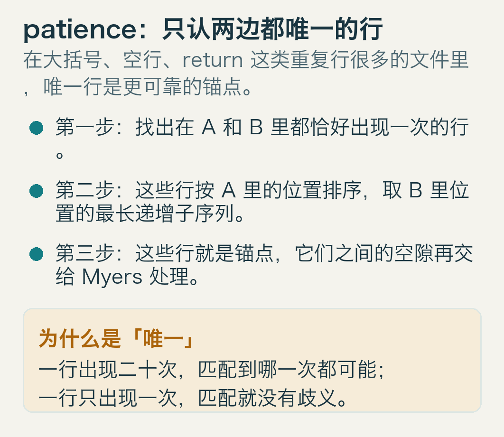

**Bram Cohen** 提出了 patience diff。它的规则和 Myers 完全不同：

1. **找出在 A 和 B 里都恰好出现一次的行。**
2. **这些行按 A 里的位置排序，取它们在 B 里位置的最长递增子序列。**
3. **这些行就是锚点。** 锚点之间的空隙，再交给 Myers 处理。

为什么是"唯一"？因为：

- 一行出现二十次（比如 `}` 或空行），匹配到哪一次都可能，锚点不可靠。
- 一行只出现一次，匹配就没有歧义。

**patience 不追求最短。** 它追求的是"锚点是明确的"。这个目标更贴近人的阅读方式：读代码的人关心的是"这个函数被移到哪了"，不是"总编辑次数少了 2"。

### 实测：输出一样，比较次数差很多

那么它在真实输入上表现如何？我们把它和 Myers 放在同一份实现里比：

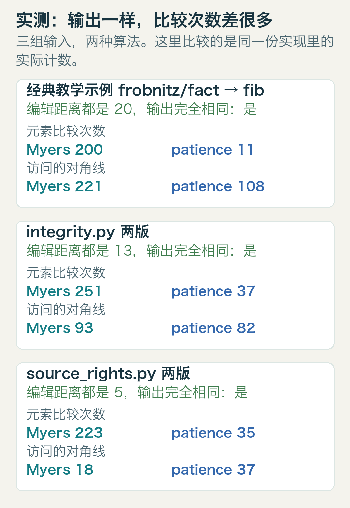

| 输入 | 编辑距离 | 输出是否相同 | Myers 比较次数 | patience 比较次数 |
|---|---|---|---|---|
| 经典教学示例（frobnitz/fact → fib） | 20 | **相同** | 200 | 11 |
| `integrity.py` 两版 | 13 | **相同** | 251 | 37 |
| `source_rights.py` 两版 | 5 | **相同** | 223 | 35 |

**在这三组输入上，输出一模一样。** 比较次数却降到了原来的 1/6 到 1/18。

但这三组输入有一个共同点：**它们的改动很干净，两边都有大量唯一行。** 换一批输入，结论就不一样了。

### 换一批输入：两种算法会给出不同的脚本

本文又跑了 20 万组随机小输入（字母表 4 个符号，长度 3 到 10）：

| 观测 | 数量 | 占比 |
|---|---|---|
| 两种算法给出**不同**的脚本 | 23,525 | 11.8% |
| 其中 patience 的公共子序列**更短**（编辑脚本更长） | 12,829 | 6.4% |
| 其中 patience 的公共子序列更长 | 0 | 0% |

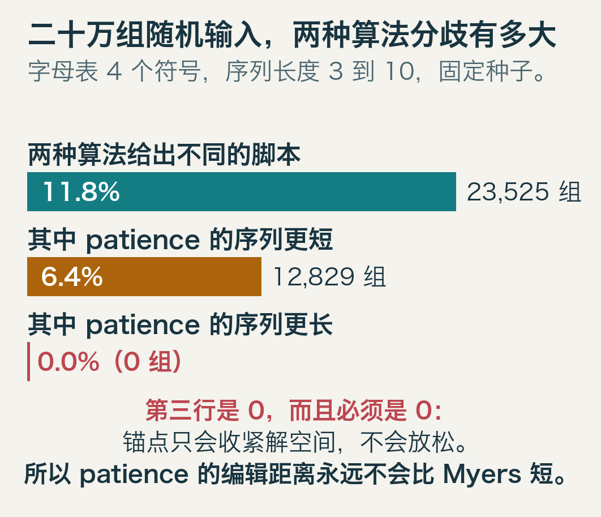

第三行是 0，而且**必须是 0**：锚点只会把解空间收紧，不会放松。所以 patience 的编辑距离**永远不可能比 Myers 更短**，只可能相等或更长。

第二行才是关键：**patience 用"更长一点的编辑脚本"换"更明确的锚点"。** 这就是它和 Myers 的根本区别——它换了一个目标函数，不是把一个算法做得更好。

**那它换得值不值？** 在本文那三组真实输入上，它没有变长（三组都是相等）。在随机输入上，6.4% 的情况下它变长了。至于"更长但更好读"这个说法，**本文没有测**——那是一个关于人的判断，需要真的看大量 diff 才能下结论。

本文能做的是把两件事分开说清楚：**patience 会改变答案（有实测数据），它是否让答案更好读（没有测）。**

### 但省下的操作，不一定省时间

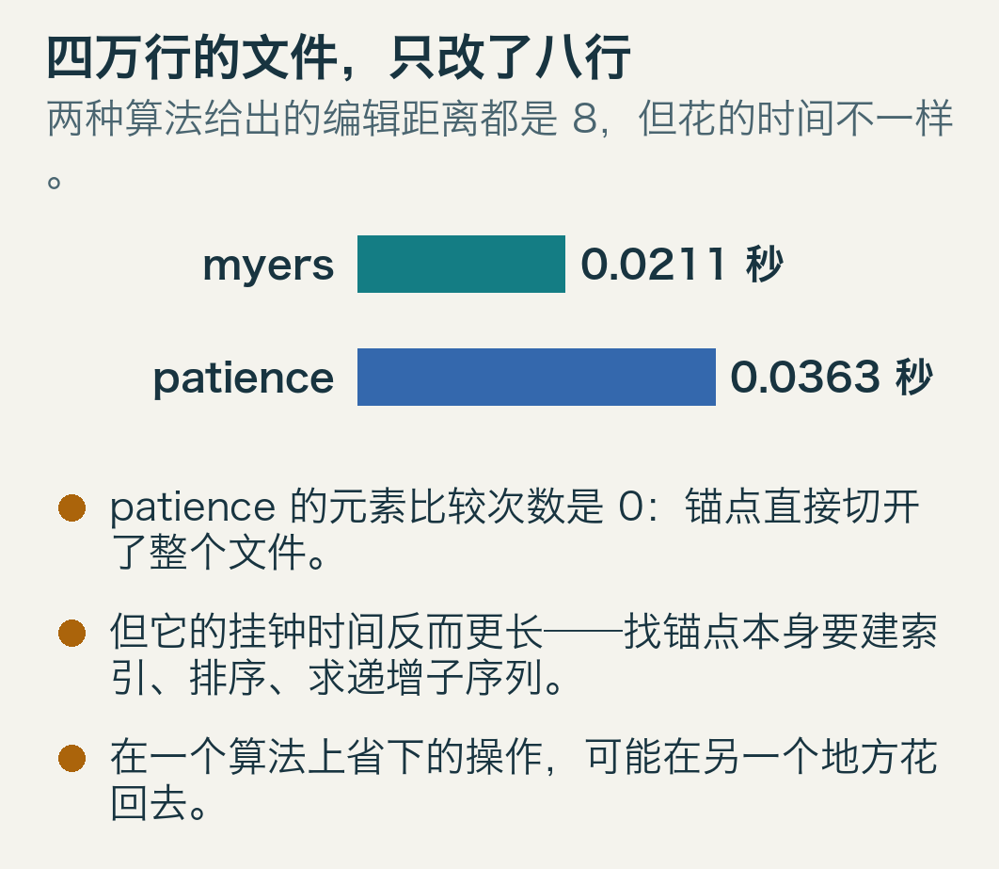

生成一个四万行的文件，插入 8 处新行：

| 算法 | 耗时 | 比较次数 | 访问的对角线 |
|---|---|---|---|
| Myers | 0.0207 秒 | 40,036 | 37 |
| patience | 0.0325 秒 | **0** | 16 |

**patience 的元素比较次数是 0**——锚点直接把整个文件切开了，一段都不需要逐元素比。

**但它的挂钟时间反而更长。**

原因不难找：patience 要先建一张"每一行出现几次"的索引、排序、再求最长递增子序列。这些工作本身要花时间，在四万行、只有 8 处改动的输入上，这笔开销比省下的比较还多。

这是一个很常见的工程现象：**在一个算法上省下的操作，可能在另一个地方花回去。** 计数好看不等于跑得快。

## 10. 真正的输出长什么样

前面都是计数。下面是程序实际吐出来的东西——输入是公开仓库里 `source_rights.py` 的两个真实修订：

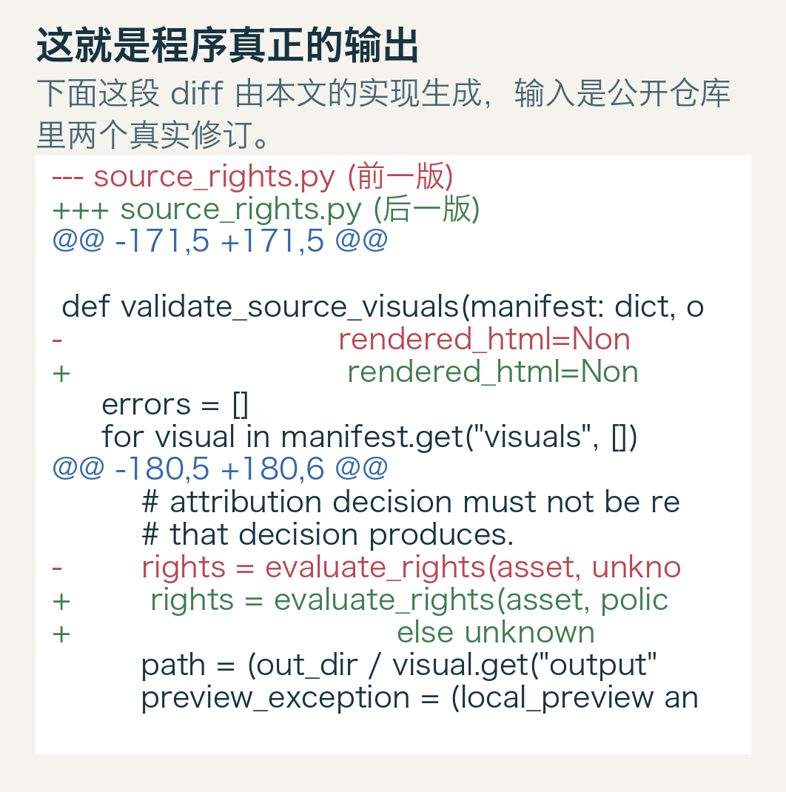

`@@ -x,y +a,b @@` 是"这里开始的一段：原文件从第 x 行起 y 行，新文件从第 a 行起 b 行"。`-` 开头是删掉的行，`+` 开头是插入的行，空格开头是两边都有的行（上下文）。

**上下文行是这个格式里最实用的设计。** 它让补丁不只是"改了什么"，还带上"改在哪"——所以一个补丁可以应用到稍微错位的文件上。

## 11. 这段历史：工具先来，论文后到

### 1970 年代：先把它做出来


`diff` 最早是贝尔实验室的工具，作者是 **Douglas McIlroy** 和 **James Hunt**。它进入 1974 年发布的 Unix 第 5 版。

1976 年，两人发表了技术报告《An Algorithm for Differential File Comparison》，说明其中的算法。（Myers 在 1986 年的论文里把这份报告引作 1975 年，扫描版报告本身标注 1976 年 7 月——两个年份都能在文献里看到。）

报告里有一句很实在的话：diff 要"在典型输入上高效地使用时间和空间"，而"典型输入"指的是"版本之间的改动"。**这是对问题性质的判断，不是对算法复杂度的追求。**

还有一件今天看起来很聪明的事：diff 的输出格式是**为行编辑器 `ed` 设计的**——一份脚本加上原文件，就能重建整个文件。McIlroy 后来回忆，他考虑过写一个后处理器来支持多种输出格式，但最后觉得"让 diff 直接生成 ed 能用的语法更省事"。

**这个决定让 diff 立刻有了实际用途**：它是版本控制系统的直接前身。

顺便说清一件常被搞混的事：1976 年那份报告的作者是 Hunt 和 McIlroy；**Hunt–Szymanski 算法是另一篇论文**——J. W. Hunt 和 T. G. Szymanski 1977 年发表在《Communications of the ACM》上的《A Fast Algorithm for Computing Longest Common Subsequences》。Myers 论文的参考文献把它们分成两条列出。

### 1984 年：让 diff 的输出能改文件

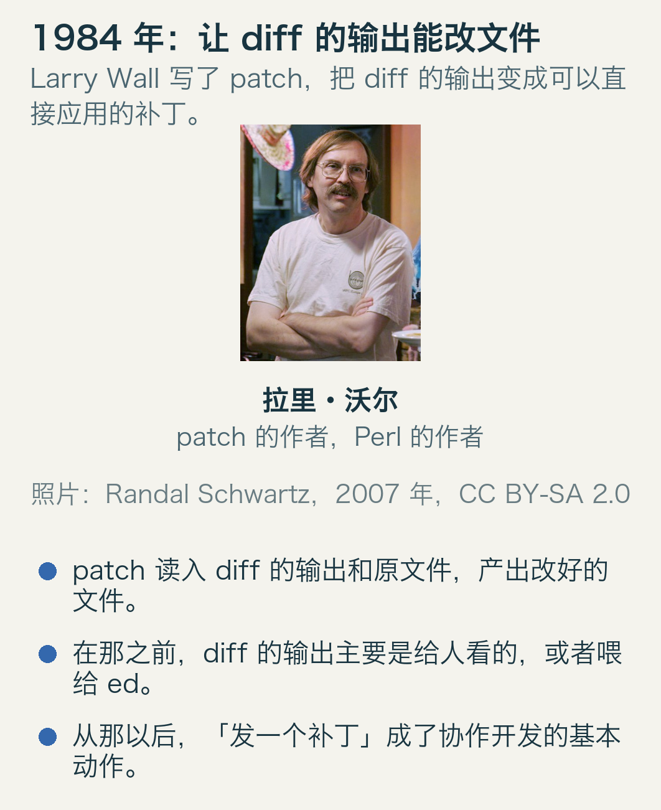

**Larry Wall** 写了 `patch`：读入 diff 的输出和原文件，产出改好的文件。

在那之前，diff 的输出主要是给人看的，或者喂给 `ed`。从那以后，"**发一个补丁**"成了协作开发的基本动作——这也是今天每一个 pull request 的祖先。

（同一个人后来写了 Perl。本文只说他与 patch 的关系。）

### 1986 年：把它变成一条最短路径


**Eugene Myers** 的论文《An O(ND) Difference Algorithm and Its Variations》把前面第 3 到 5 节讲的东西完整地写了出来：

- 把最长公共子序列和最短编辑脚本证明成同一个问题；
- 用编辑图表达；
- 用贪心在 O(ND) 时间内求解；
- 还给出了只用 O(N) 空间的改进版本。

论文里有一句很坦白的自我评价：这个算法在 D 小时很好，而"当 D 很大时，他们的算法更好"——指的是 Hunt–Szymanski 那套。

论文还提到，这个算法成了 Unix `diff` 新实现的基础，**通常比当时基于 Hunt–Szymanski 的版本快两到四倍**。

### 换一个目标：patience diff

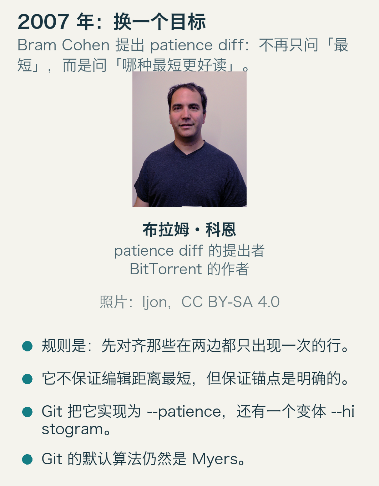

**Bram Cohen** 提出了 patience diff。（同一个人也是 BitTorrent 的作者。）

它没有追求更短的编辑脚本，而是换了一个问题：**在最短的脚本里，该选哪一条？**

Git 在 2009 年 1 月把它实现出来。提交信息里把它的目标写得很清楚：

> patience diff 算法产生的输出比经典的 Myers 算法更符合直觉，因为它**不先追求最小化增删行数**，而是尽量保住那些唯一的行。

同一份提交信息还确认了本文第 9 节描述的三个步骤：先找出两边都唯一的行，再取保持相对顺序的最长序列，剩下的部分递归处理，**在没有共同唯一行时退回 Myers**。

Git 把它实现为 `--patience`，还有一个变体 `--histogram`。而 **Git 的默认算法仍然是 Myers**——这是 Git 官方文档里写着的。

## 12. 这套方法留下的东西

- **"把两个序列的差异画成图上的路径"** 这个转念，走出了文本比较：生物信息学里的序列比对、语音识别里的动态时间规整，都是同一张图的不同画法。
- **"只记每条对角线上最远的点"** 是一种更普遍的技巧：当状态空间很大但"代价相同"的状态可以合并时，就不要逐个存。
- **"最短不等于唯一"** 这件事在工程里到处都是。排序算法、图搜索、任务调度都会遇到"多个同样好的答案"，而**选哪一个往往由使用它的人决定**。patience diff 就是这个想法的一个具体案例。
- **"省下的操作不等于省下的时间"** 也是。第 9 节那张四万行的表是最好的例子。

## 13. 换一个条件，自己再走一遍

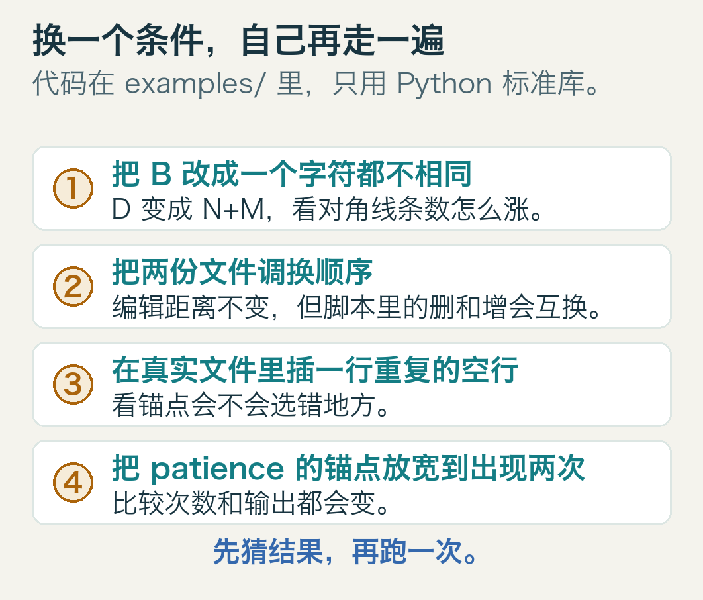

代码在 `examples/` 里，只用 Python 标准库。四个建议的改动：

1. **把 B 改成和 A 一个字符都不相同。** D 会变成 N+M。先猜对角线条数会涨到多少，再跑。
2. **把两份文件调换顺序。** 编辑距离不变，但脚本里的"删"和"插"会互换。想想为什么。
3. **在真实文件里插几行重复的空行。** 看锚点会不会选错地方。
4. **把 patience 的锚点规则放宽到"出现不超过两次"。** 比较次数和输出都会变。

最后一个问题留给你：**如果"最短"和"好读"冲突，你觉得工具应该默认选哪个？为什么 Git 的默认仍然是 Myers？**

## 动手材料

- [Myers O(ND) 算法与动态规划校验](examples/myers.py)
- [patience diff](examples/patience.py)
- [全部实验脚本](examples/run_model.py)与[原始结果 JSON](examples/results.json)
- 两个真实文件的修订原文在 `originals/pairs/`：`integrity-before.py` / `integrity-after.py`、`source_rights-before.py` / `source_rights-after.py`
- [全部原创图的重绘代码](examples/build_figures.py)
- [运行环境与复现说明](README.md)
- [一手来源、素材身份与 AI 辅助说明](sources.md)

原创正文、教学图与原创实验数据采用 CC BY 4.0；原创代码采用 MIT 许可。第三方照片保留各自权利，详见来源说明。

## 图片来源

- DEC PDP-11/40：Jeff Keyzer，[Wikimedia Commons](https://commons.wikimedia.org/wiki/File:DEC_PDP-11-40_Minicomputer,_1973,_Technisches_Museum_Wien_(edited,_white_background).jpg)，CC BY-SA 2.0。
- 道格拉斯·麦克罗伊：Denise Panyik-Dale，[Wikimedia Commons](https://commons.wikimedia.org/wiki/File:Douglas_McIlroy.jpeg)，CC BY 2.0。
- 尤金·迈尔斯：ismb，[Wikimedia Commons](https://commons.wikimedia.org/wiki/File:Gene_Myers_ISMB_2014.jpg)，CC BY 2.0。
- 拉里·沃尔：Randal Schwartz，[Wikimedia Commons](https://commons.wikimedia.org/wiki/File:Larry_Wall_YAPC_2007.jpg)，CC BY-SA 2.0。
- 布拉姆·科恩：Ijon，[Wikimedia Commons](https://commons.wikimedia.org/wiki/File:Bram_Cohen.jpg)，CC BY-SA 4.0。

其余全部为本文原创绘制的教学示意图与程序输出。
