# 这台游戏机没有显存：画面是程序追着电子束，一行一行写出来的

1977 年上市的 Atari 2600 里，没有一块叫"显存"的东西。

它只有 **128 字节**内存。不是 128 KB，是 128 字节——按一个像素占一个字节算，连屏幕的一行（160 个像素）都装不满。可它能画出整个屏幕，能跑《Pitfall!》《Adventure》《太空侵略者》，能卖到三千万台。

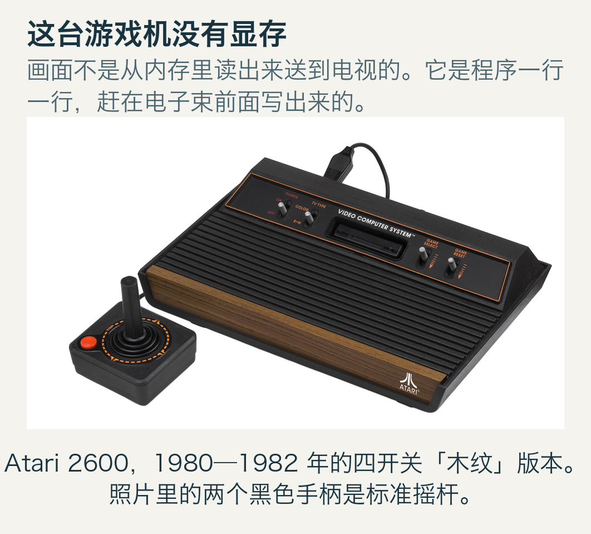

这篇文章要回答一个问题：**没有显存，画面到底是谁画的？**

答案会带你走进一个今天很少见的工作方式。程序不是"准备好一张图然后显示出来"，而是**紧跟在电子束后面跑**：光束扫到哪一行，程序就必须在那一行开始之前，把那一行要用的图形和颜色写好。写晚了，这一行就按旧数据画。

这套做法有个名字，叫 **racing the beam**——追着电子束跑。

本文里的每一个数字、每一幅画面，都来自仓库里一份可以运行的模型：一颗按真实周期计数的 6507 解释器、一颗按真实时序工作的 TIA 模型，和几段真实的 kernel 程序。你在 `examples/` 里可以自己跑，也可以改一行看画面怎么变。

## 1. 先看清对手：电视是怎么画画的

要理解这台机器，得先理解它连接的电视机。

老式显像管电视里有一束电子，从左到右扫过一行，然后回到左边，扫下一行。扫完一整屏，回到顶部重来。这个过程每秒重复 60 次。

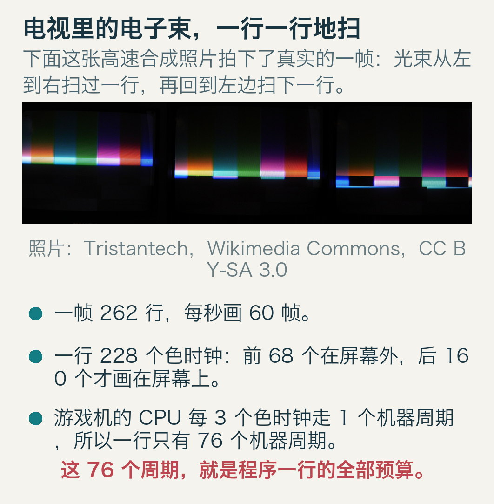

上面这张照片是一次高速合成曝光，把一帧里光束走过的路径全部拍了下来。你能直接看到它一行一行地走。

现在把它变成数字。Atari 自己的工程师 Steve Wright 在 1979 年的《Stella 程序员指南》里给出了这套时序：

- 一帧 **262 行**，每秒 60 帧。
- 一行分成 **228 个色时钟**。
- 前 **68 个色时钟**是"水平消隐"——光束正在从右边回到左边，屏幕上看不见。
- 后 **160 个色时钟**才是屏幕上真正画出来的部分。
- 游戏机的 CPU 每 **3 个色时钟**走 **1 个机器周期**。

所以：

```
228 色时钟 ÷ 3 = 76 个机器周期
```

**一行只有 76 个机器周期。** 这就是程序画一行画面的全部预算。

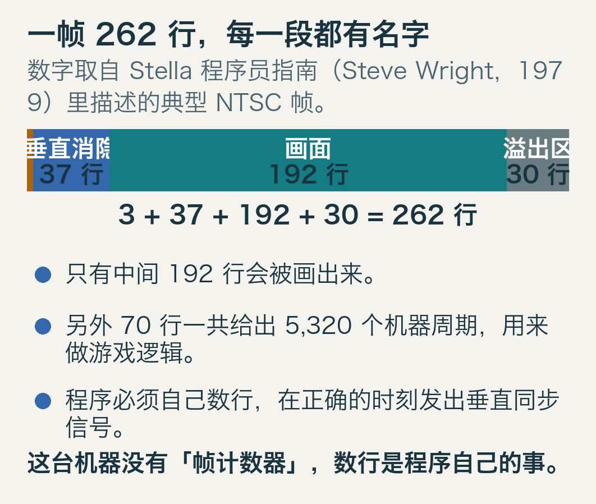

一帧 262 行分成四段：

| 段 | 行数 | 做什么 |
|---|---|---|
| 垂直同步 | 3 | 告诉电视"新的一帧开始了" |
| 垂直消隐 | 37 | 屏幕上看不见，程序做逻辑 |
| 画面 | 192 | 真正被画出来的部分 |
| 溢出区 | 30 | 屏幕上看不见，程序做逻辑 |

后面 70 行一共给出 70 × 76 = **5,320 个机器周期**，游戏逻辑、读手柄、算物理都在这里做。

还有一件事值得注意：**TIA 没有帧计数器**。它不知道一帧该有多少行。数行是程序自己的责任——程序必须在正确的时刻发出垂直同步信号，数错了画面就会上下滚动。

## 2. 一行里，程序有多少时间

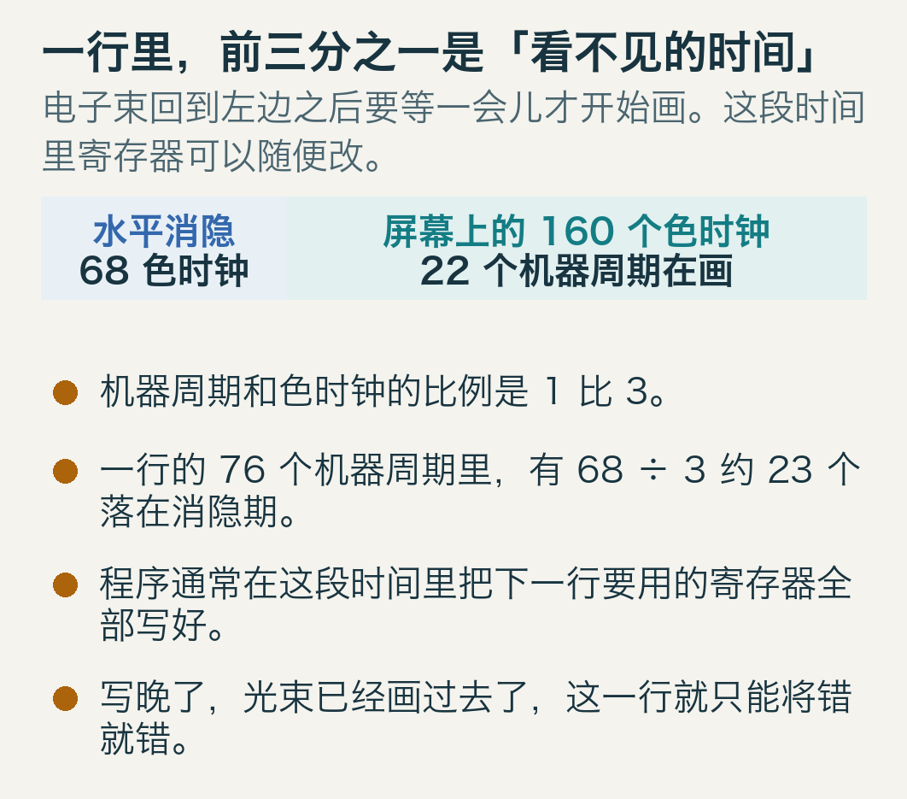

一行的 76 个机器周期里，大约 23 个落在水平消隐期（68 ÷ 3 ≈ 22.7）。这段时间屏幕上看不见，寄存器可以随便改。

所以程序的工作节奏是这样的：

1. 在这一行的消隐期里，把下一行要用的图形、颜色写进 TIA 的寄存器。
2. 光束开始画这一行，TIA 按寄存器里的内容输出 160 个色时钟的信号。
3. 程序去做别的事，或者在下一行消隐期开始时再来一遍。

**关键点：寄存器只装得下"一行"。** 它不记得上一行写了什么。

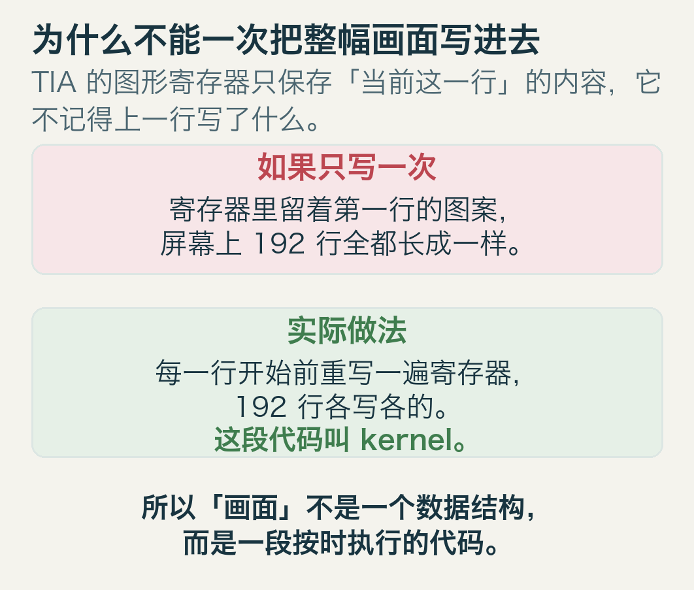

如果程序只在开头写一次寄存器，那么屏幕上 192 行会全都长成一样——因为 TIA 每一行都读同一份寄存器。

要让 192 行各不相同，就必须**每一行都重写一遍**。这段"每一行都执行"的代码，在这台机器上有个专门的名字：**kernel**（内核）。

到这里，答案已经很清楚了：

> **画面不是一个数据结构。画面是一段按时执行的代码。**

这是本文最重要的一句话。后面所有技巧，都是在回答同一个问题：**76 个周期够不够用？**

## 3. 第一件工具：让程序等光束

程序跑得比光束快得多。如果不管它，它会在光束还没画完这一行的时候就把下一行的数据写进去，画面全乱。

所以需要一个"暂停"的指令。

写一下 WSYNC 寄存器，CPU 就会停住，直到这一行结束、下一行开始的第 0 个周期才继续。

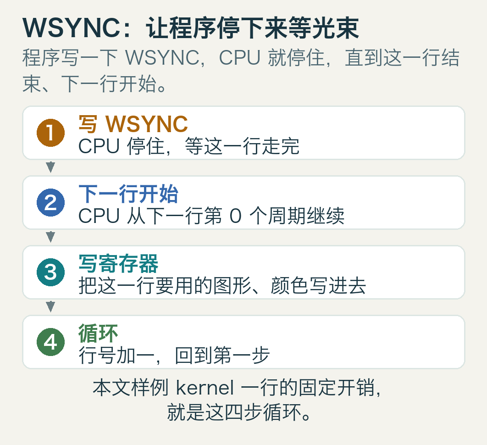

有了 WSYNC，kernel 就变成一个有固定节奏的循环：

```
每一行：
    STA WSYNC      ; 等这一行走完
    LDA 表, X      ; 取出这一行的数据
    STA PF0        ; 写进寄存器
    STA PF1
    ...
    INX            ; 行号加一
    CPX #192
    BNE 每一行      ; 192 行都画完了吗
```

在真实的芯片上，这个暂停不是靠软件轮询实现的。6507 少了几根引脚，没有中断线，但它有 RDY 引脚。TIA 在程序写 WSYNC 时把 RDY 拉低，CPU 就被硬件挂起，直到这一行结束。**这是一个为省钱而做的设计，恰好也把同步问题解决了。**

## 4. 把一行的账算清楚

现在来算本文样例 kernel 的一行开销。这不是估算，是模型逐条指令统计出来的。

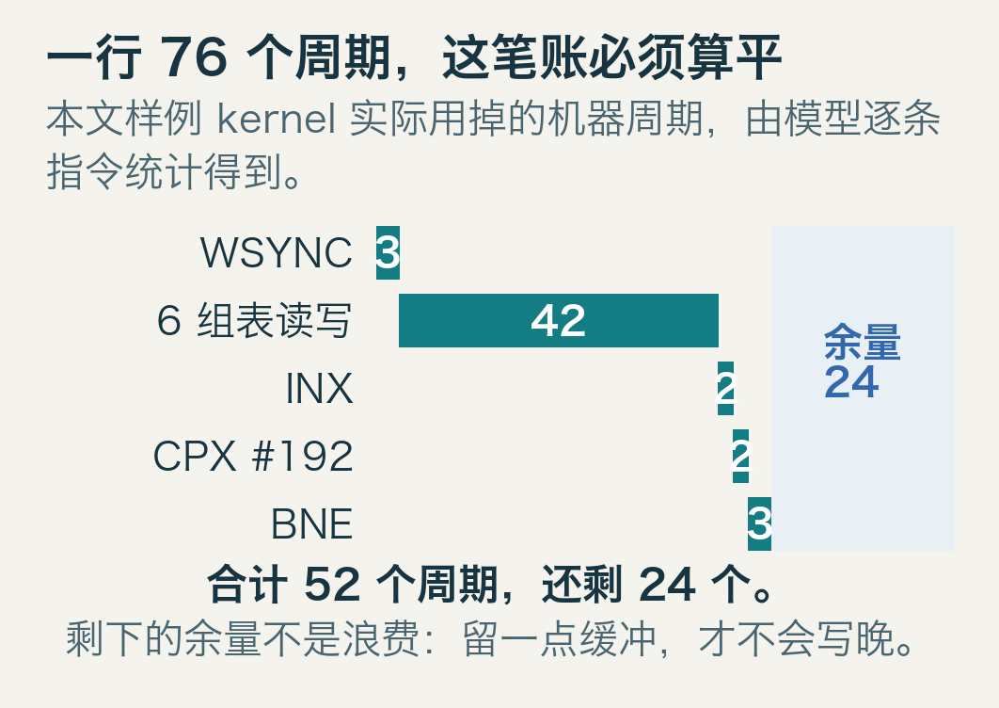

| 步骤 | 机器周期 |
|---|---|
| `STA WSYNC` | 3 |
| 6 组"取表 + 写寄存器"（每组 `LDA abs,X` 4 周期 + `STA zp` 3 周期） | 42 |
| `INX` | 2 |
| `CPX #192` | 2 |
| `BNE` | 3 |
| **合计** | **52** |

**76 减 52，还剩 24 个周期。**

这 24 个周期不是浪费。真实游戏会用它来：移动物体、读手柄、算游戏逻辑、播放声音——全都塞进"每行剩下来的这几十个周期"里。

而如果这 52 变成 84（比如多插 16 条 NOP），就超了。**超了会发生什么？** 我们后面会实际跑给你看。

## 5. 只有五个物体，怎么摆到想去的位置

TIA 能画的"活动物体"少得让人意外：

- **2 个玩家精灵**（player）：每个 8 像素宽，单色。
- **2 个导弹**（missile）：每个 1、2、4 或 8 像素宽。
- **1 个球**（ball）：1、2、4 或 8 像素宽。
- **1 个场地**（playfield）：20 位，每一位 4 个色时钟，左右镜像或复制，总共 40 个"场地像素"。

加起来：2 个 8 像素的精灵 + 3 个方块 + 一层背景。就这样。

那怎么决定它们站在屏幕的哪个位置？

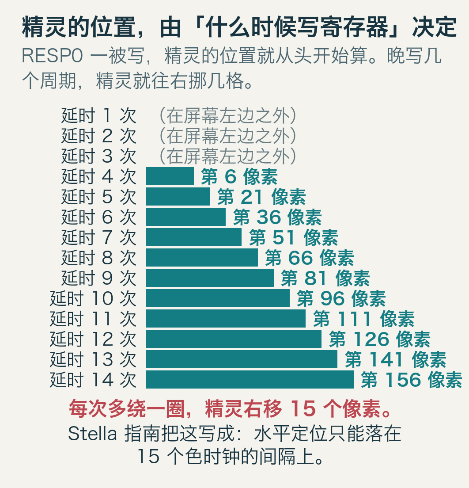

答案是：**写 RESP0 寄存器的那一刻，精灵的位置就从头开始算。**

所以"精灵放在哪里"变成了"程序在第几个机器周期写 RESP0"。晚写一个周期，精灵就往右挪 3 个像素。

程序用一个简单的延时循环来控制这件事：

```
    STA WSYNC      ; 等到这一行开始
    LDX #次数
循环：
    DEX
    BNE 循环
    STA RESP0      ; 现在写，精灵就落在这里
```

`DEX` 加 `BNE` 一共 5 个机器周期。所以每多绕一圈，精灵右移 5 × 3 = **15 个像素**。

上面那张图是本模型实测的结果：延时 4 圈落在第 6 像素，5 圈落在第 21 像素，6 圈落在第 36 像素……**每一步正好 15 个像素。**

这不是巧合。《Stella 程序员指南》写得很清楚：

> 水平定位命令只能把物体定位在 15 个色时钟的间隔上，移动寄存器负责填补空隙，把物体移动 +7 到 −8 个色时钟。

### 那 15 像素之间的空档

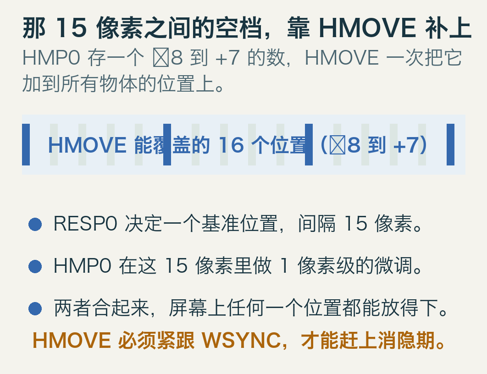

补空档的工具是 HMOVE：

1. 先把微调量写进 HMP0（−8 到 +7 之间的一个数，用 4 位存，所以是 16 个取值）。
2. 再写一下 HMOVE，TIA 就把这些微调量加到各个物体的位置上。

RESP0 给一个 15 像素间隔的基准位置，HMP0 在这 15 像素里做 1 像素级的微调。两者合起来，屏幕上任何一个位置都放得下。

指南里还有一条硬性要求：**HMOVE 必须紧跟 WSYNC**。因为它要赶在消隐期里完成，才有足够时间把位置计数器拨到位。本文的样例 kernel 就是这么写的。

## 6. 让它真的画出一帧

前面讲的都是零件。现在把它们装起来。

本文的样例 kernel 做的事情是：

1. 发垂直同步，过 37 行消隐。
2. 在消隐期里定位三个物体：两个挡板和一个球。
3. 进入 192 行的画面循环，每一行从表里取 3 个字节写 playfield、取 2 个字节写两个玩家精灵、取 1 个字节控制球。
4. 过 30 行溢出区，回到第 1 步。

跑出来的画面是这样：

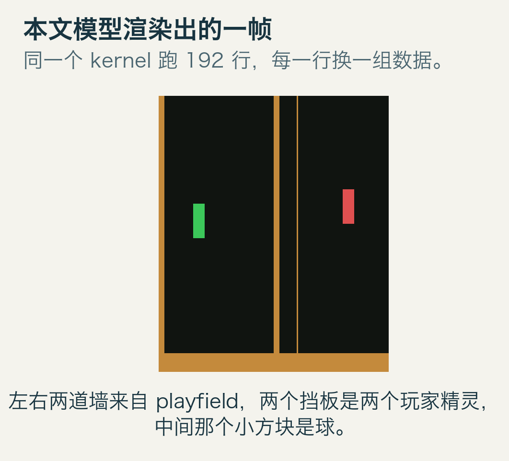

- 左右两道 4 像素宽的墙：来自 playfield 的第 4 位（镜像后右边也有一道）。
- 上下两条横线：来自 playfield 全开的那几行。
- 左边那个竖条：玩家 0，站在第 24 像素。
- 右边那个竖条：玩家 1，站在第 128 像素。
- 中间那个小方块：球，站在第 96 像素。

**这不是真实主机的截图**，是本文模型实际运行样例 kernel 得到的结果。模型里一行是 76 个机器周期，一条 `LDA abs,X` 是 4 个周期，`STA zp` 是 3 个周期——和真实的 6507 一致。

换一组数据，同一段代码画出另一个局面：

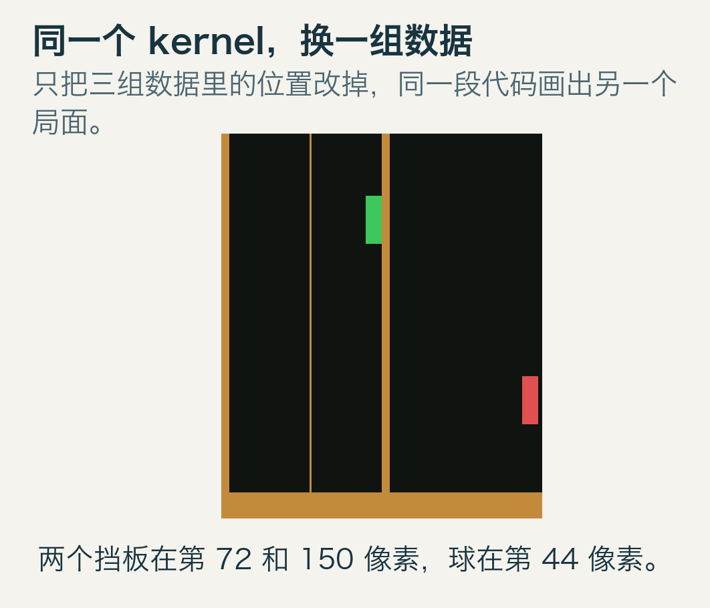

两个挡板挪到了第 72 和 150 像素，球挪到第 44 像素。**代码一个字没改。**

## 7. 少算 32 个周期，会怎样

现在做那个前面说好的实验：在每行开头多插 16 条 NOP，一共 32 个机器周期。

一行从 52 变成 84 个周期，超过了 76。

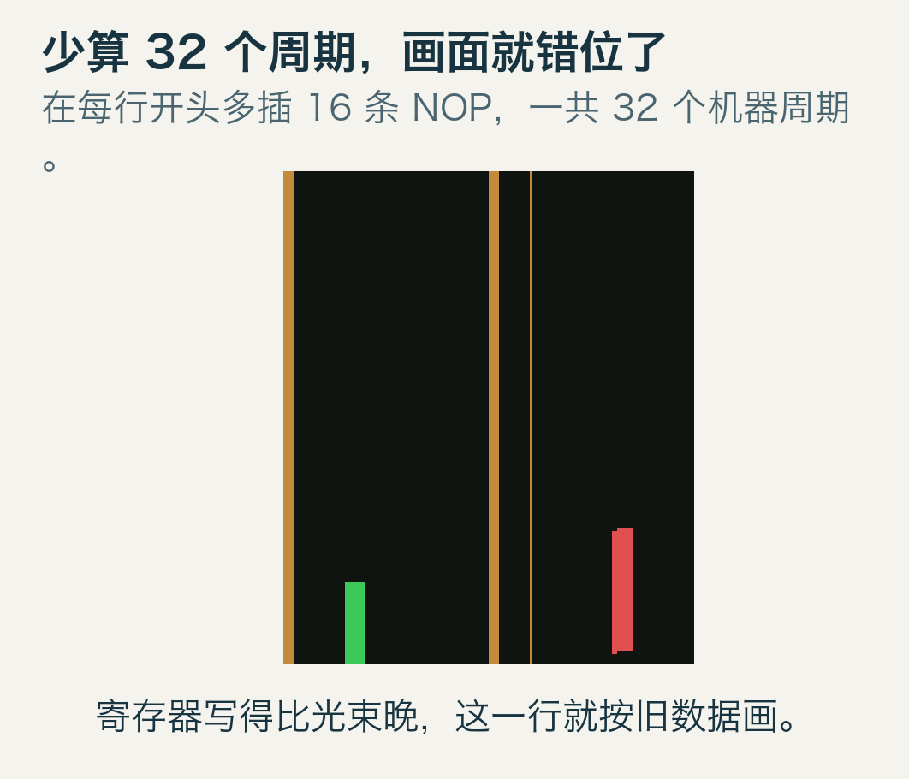

画面坏了。本文的模型统计出：**192 行里有 87 行和正常版本不同。**

原因很直接：寄存器写得比光束晚了。光束扫过某一段的时候，那段要用的数据还没写进去，于是**这一段按上一行的旧数据画**。

具体地说，模型记录到这样的时刻：第 31 行的 GRP0 是在第 177 个色时钟被写入的，而可见区域从第 68 个色时钟就开始了——**光束早就扫过去了 109 个色时钟**。

这就是"追着电子束跑"字面上的意思。**不是比喻，是硬性时序。**

真实的游戏开发者当年是靠数周期、画时间表、甚至用示波器来保证不超支的。而且他们还得留出余量，因为 NTSC 和 PAL 的时序不同，不同电视机的容忍度也不同。

## 8. 只有两个精灵，怎样画出四个东西

前面说 TIA 只有 2 个玩家精灵。那《太空侵略者》里那一排排的外星人是怎么画出来的？

第一招：**每一行换一次图形**。玩家精灵只有 8 像素宽，但它的图形寄存器每一行都可以重写。所以同一个精灵可以在屏幕上部画成外星人 A 的一行，中间画成外星人 B 的一行。指南里说，这正是《太空侵略者》家用版带来的关键突破。

第二招：**闪烁**。

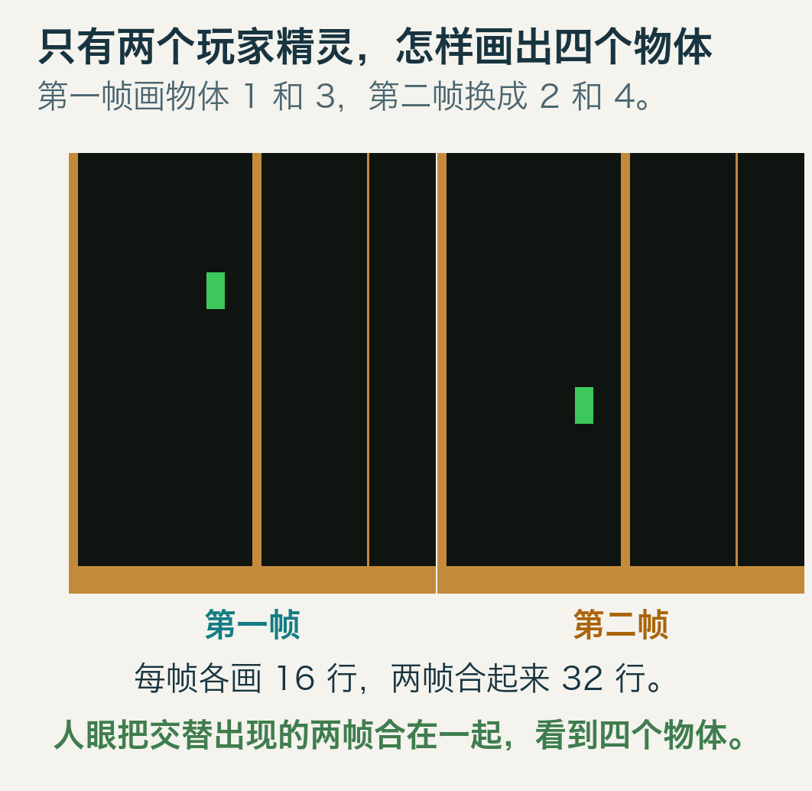

第一帧画物体 1 和 3，第二帧换成 2 和 4。每帧只画两个物体，但两帧交替出现——**人眼会把它们合成四个。**

上面两幅是模型实际渲染的两帧，第三幅是它们的合成。第一帧各画 16 行，第二帧也是 16 行，合起来 32 行。

代价是每个物体会以 30 Hz 的频率闪，而不是 60 Hz。物体少的时候看不出来，物体多的时候就会明显发抖。**这是一个用视觉暂留换物体数量的交易。**

## 9. 碰撞检测：芯片替你做了

游戏里最常问的问题是："球撞到挡板了吗？"

在普通机器上，这需要程序自己比较坐标。但在这台机器上，**芯片直接告诉你**。

TIA 里有 15 个触发器（flip-flop），对应 15 种"谁撞到谁"的组合：

| 寄存器 | 位 7 | 位 6 |
|---|---|---|
| CXM0P | 导弹 0 撞玩家 1 | 导弹 0 撞玩家 0 |
| CXM1P | 导弹 1 撞玩家 0 | 导弹 1 撞玩家 1 |
| CXP0FB | 玩家 0 撞球 | 玩家 0 撞场地 |
| CXP1FB | 玩家 1 撞球 | 玩家 1 撞场地 |
| CXM0FB | 导弹 0 撞球 | 导弹 0 撞场地 |
| CXM1FB | 导弹 1 撞球 | 导弹 1 撞场地 |
| CXBLPF | 球撞场地 | — |
| CXPPMM | 玩家 0 撞玩家 1 | 导弹 0 撞导弹 1 |

它的工作方式是：光束每画一个像素，硬件同时检查哪些物体在这个像素上是亮的。两个该碰的物体同时亮，对应的位就永久置起来，直到程序写 CXCLR 清零。

我们让球和左挡板重叠在同一个像素上，跑一遍：

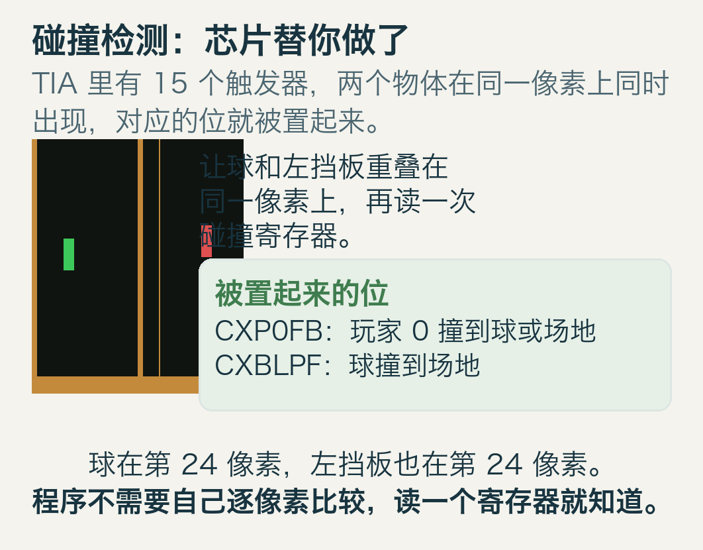

模型读到的结果是：

- **CXP0FB 位 7**：玩家 0 撞到球。
- **CXBLPF 位 7**：球撞到场地（球在第 24 像素，那里正好是左墙）。

**程序不需要自己逐像素比较。** 这是把一件软件工作搬进硬件的典型例子——省下的周期，可以拿去做别的。

## 10. 盒子里面有什么

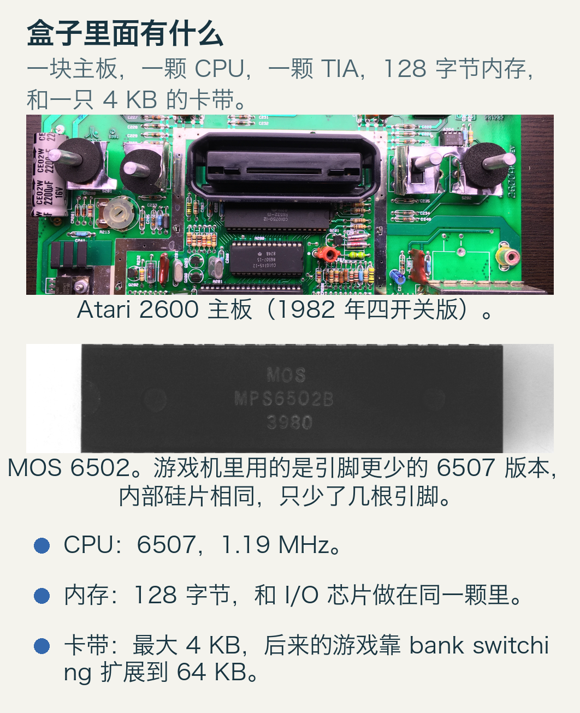

- **CPU**：MOS 6507，1.19 MHz。它是 6502 的引脚精简版：地址线从 16 根减到 13 根，中断引脚去掉了。两颗芯片用的是同一套硅片层，只差最后一层金属布线。
- **显示与声音**：TIA（Television Interface Adaptor），Jay Miner 设计。
- **内存**：128 字节，和 I/O、定时器做在同一颗芯片里。
- **卡带**：最大 4 KB。后来的游戏用 bank switching 把它扩到 64 KB。

那 128 字节是什么概念？**一屏 160 × 192 的黑白位图要 3,840 字节。** 也就是说，这台机器的内存连一屏的 4% 都装不下。

这就是为什么 TIA 必须每一行都从寄存器重新生成画面——**它根本没有地方存一整屏。**

## 11. 4 KB 里装一整个游戏

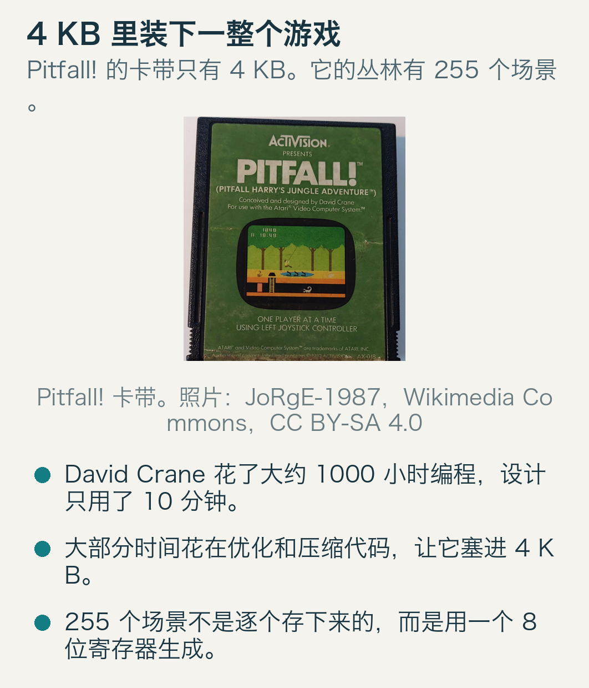

《Pitfall!》（1982）是 Atari 2600 上最畅销的非街机移植游戏。它有 255 个场景。

255 个场景，每个场景有坑、树、宝物、敌人——如果逐个存下来，4 KB 装不下。

David Crane 的做法是：**不存地图，存生成规则。**

按公开资料记录，游戏里有一个 8 位的计数器，玩家往一个方向走它加，往另一个方向走它减。这 8 位被拆开用来决定这一屏的细节：坑在哪、树在哪、宝物是什么。**255 个场景全部由这个计数器算出来，一个场景也没多存。**

Crane 说过一句话很能说明当时的处境：整个设计过程大约花了 10 分钟，之后是大约 1000 小时的编程——**大部分时间花在优化和压缩代码，让它塞进 4 KB。**

## 12. 128 字节里藏一个名字

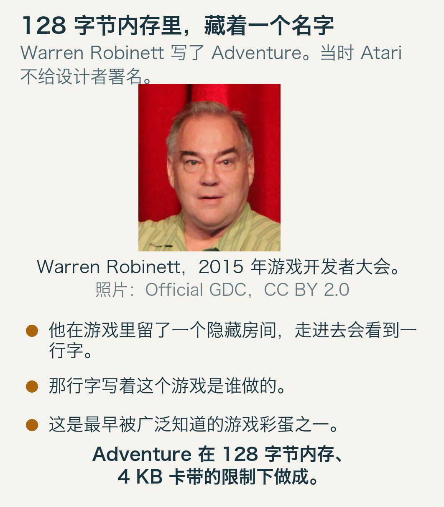

《Adventure》（1979/1980）是 Atari 2600 上最早的动作冒险游戏之一，卖了大约一百万份。它的作者是 Warren Robinett。

当年 Atari 不给游戏设计者署名——公司担心出了名的设计者会来谈条件。Robinett 的回应是在游戏里留了一个隐藏房间，走进去会看到一行字，写着这个游戏是谁做的。

这被广泛认为是最早的、也是第一个被叫做"彩蛋"（Easter egg）的游戏隐藏内容。

**注意这件事的技术背景**：《Adventure》是在 128 字节内存、4 KB 卡带的限制下做出来的。Robinett 后来回忆，他做这个游戏的灵感来自斯坦福人工智能实验室里那台机器上的文字版《Colossal Cave Adventure》——但文字版可以打印任意长的句子，而他要在一个只有摇杆作输入、128 字节内存的机器上做图形版。

## 13. 这些决定是谁做的

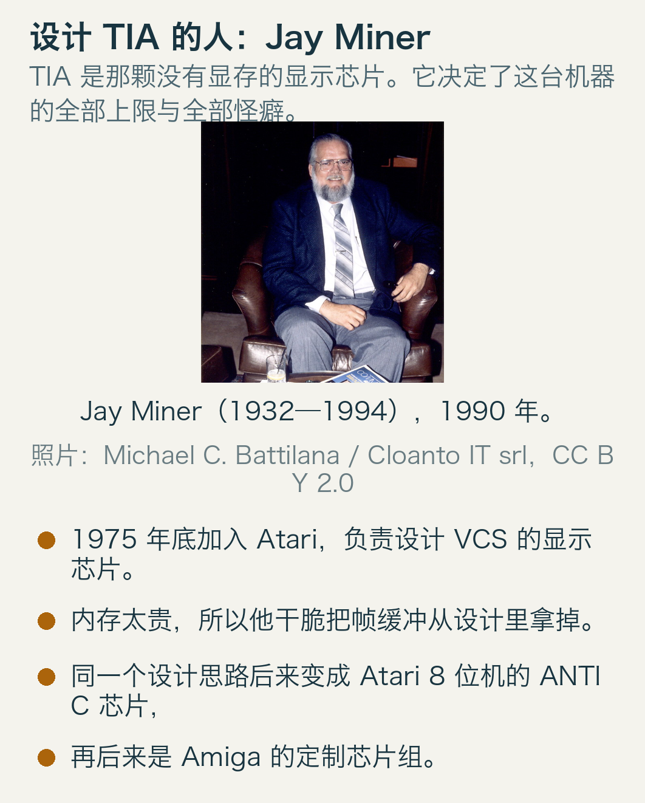

**Jay Miner** 在 1975 年底加入 Atari，负责设计 VCS 的显示芯片。

当时的背景是：内存贵到按"每兆字节几万美元"计价。用帧缓冲做一个 80 × 48 的双色画面，光内存就要几千美元。所以 Miner 干脆**把帧缓冲从设计里拿掉**。

这个取舍决定了这台机器后来的一切：它极其便宜，也极其难编程。同一个设计思路后来变成 Atari 8 位机的 ANTIC 芯片，再后来是 Amiga 的定制芯片组——Miner 因此被称为"Amiga 之父"。

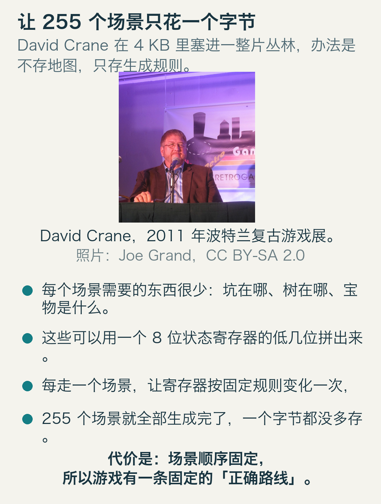

**David Crane** 1977 年加入 Atari。1979 年，他和 Alan Miller、Larry Kaplan、Bob Whitehead 一起离开，创办了 **Activision**——第一家独立于主机厂商的游戏发行公司。

离开的原因很具体：他们做的游戏占了 Atari 1978 年一亿美元卡带销售额中的六千万，而他们的薪水是三万美元。他们要求加薪，据 Crane 回忆，得到的回答是：他对这些产品的成功，并不比流水线上把卡带组装起来的人更重要。

**这件事改变了整个行业的形状。** 在此之前，主机厂商既做硬件又做游戏；在此之后，"第三方开发商"成了一个行业角色。

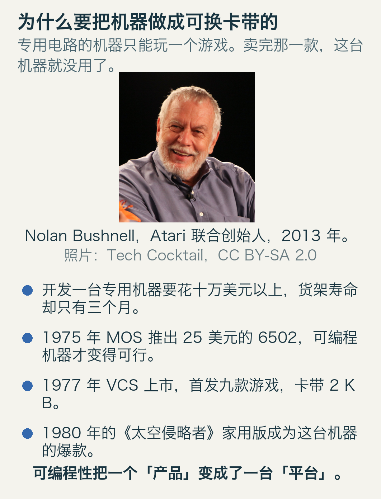

**Nolan Bushnell** 和 Ted Dabney 1972 年创办 Atari。到 1975 年，Atari 已经在街机上很成功，但 Bushnell 看到了专用电路的问题：开发一台机器要花十万美元以上，而它的货架寿命只有大约三个月。

1975 年 9 月，MOS Technology 推出 25 美元的 6502。Cyan Engineering 的工程师和 MOS 的人谈了两天，把可编程游戏机的方案画了出来。1977 年，VCS 上市，首发九款游戏，卡带 2 KB。

1980 年，《太空侵略者》的家用版成为这台机器的爆款——它需要在一行里画出远多于两个精灵的外星人，前面讲的"每行换图形"和"闪烁"两招就是那时候逼出来的。

## 14. 这套做法留下了什么

追着电子束编程在今天听起来像是一种折磨。但它留下了几样东西：

- **"每行改一次寄存器"变成了"扫描线特效"。** 今天的 GPU 早就不需要这样做了，但"在扫描线 N 上做某件事"这个想法，在模拟器、复古游戏、以及一些渲染技巧里还活着。
- **把工作搬进硬件。** 碰撞检测触发器是最早的例子之一。今天显卡里的光栅化、纹理采样、光追单元，都是同一个思路的极端版本。
- **在极端约束下做设计。** 128 字节、4 KB、76 个周期——这些数字逼出来的技巧（复用、生成而不是存储、用视觉暂留换资源），和今天在嵌入式、在移动端、在大规模系统里遇到的问题，是同一种问题。

## 15. 换一个条件，自己再走一遍

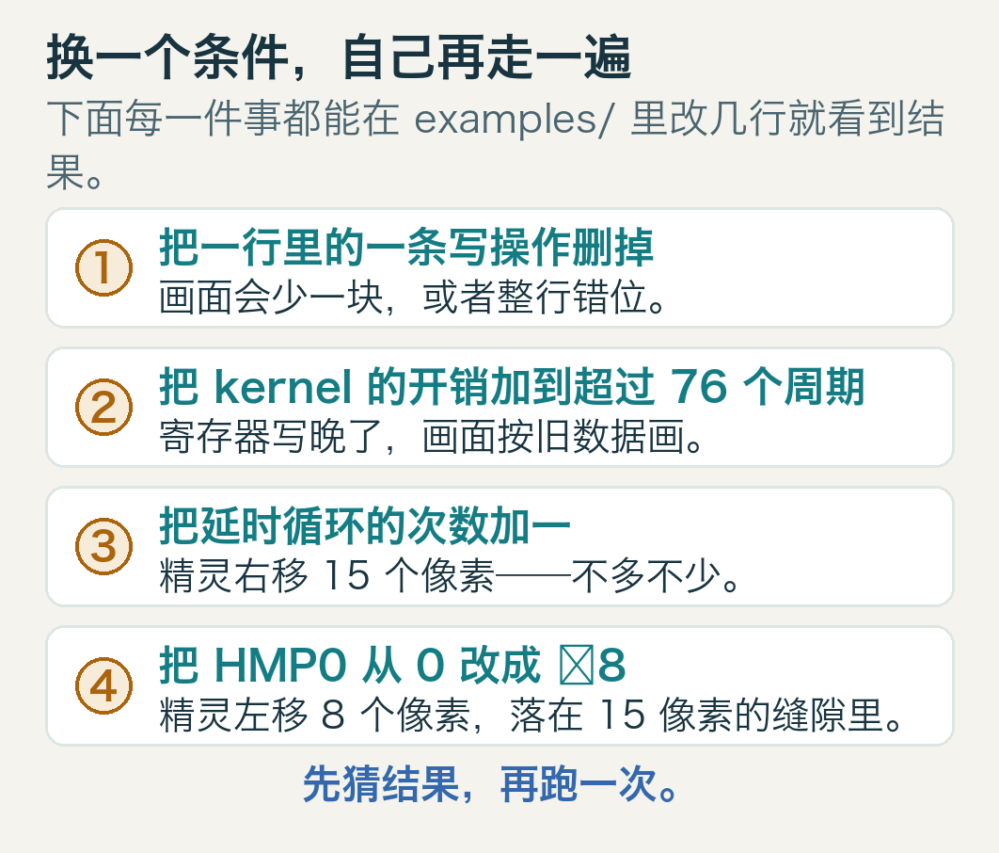

模型在 `examples/` 里，只用 Python 标准库加 Pillow（画图用）。四个建议的改动：

1. **把一行里的一条写操作删掉。** 画面上会少一块，或者整行错位。想想为什么是"少一块"而不是"整屏坏掉"。
2. **把 kernel 的开销加到超过 76 个周期。** 这就是第 7 节做的事。试试加 8 个周期而不是 32 个，看画面还坏不坏。
3. **把延时循环的次数加一。** 精灵会右移 15 个像素——不多不少。这是本文第 5 节的核心结论，值得自己验证一次。
4. **把 HMP0 从 0 改成 −8。** 精灵会左移 8 个像素，正好落在 15 像素间隔之间的缝隙里。

最后一个问题留给你：**这台机器只有 128 字节内存，却要画 192 行。如果让你来设计 TIA，你会把哪一部分工作搬进硬件？**

## 动手材料

- [TIA 显示模型](examples/tia.py)、[6507 周期解释器](examples/cpu6507.py)、[迷你汇编器](examples/asm.py)
- [样例 kernel 与帧驱动](examples/kernel.py)、[整帧运行与实验脚本](examples/run_model.py)
- [本次运行的完整结果](examples/results.json)与[模型原始输出](originals/model-stdout.txt)
- [全部原创图的重绘代码](examples/build_figures.py)
- [运行环境与复现说明](README.md)
- [一手来源、素材身份与 AI 辅助说明](sources.md)

原创正文、教学图与原创实验数据采用 CC BY 4.0；原创代码采用 MIT 许可。第三方照片保留各自权利，详见来源说明。

## 图片来源

- Atari 2600 与摇杆：Evan-Amos，[Wikimedia Commons](https://commons.wikimedia.org/wiki/File:Atari-2600-Wood-4Sw-Set.jpg)，公有领域。
- 电视扫描线高速照片：Tristantech，[Wikimedia Commons](https://commons.wikimedia.org/wiki/File:Television_Scan_Line.jpg)，CC BY-SA 3.0。
- Atari 2600 主板：Tetrodotoxine，[Wikimedia Commons](https://commons.wikimedia.org/wiki/File:Atari-2600-Four-Switch-Motherboard-Flat-1982.jpg)，CC BY-SA 4.0。
- MOS 6502 芯片：ZyMOS，[Wikimedia Commons](https://commons.wikimedia.org/wiki/File:Ic-photo-MOS--MPS6502B--(6502-CPU).jpg)，CC BY-SA 4.0。
- Pitfall! 卡带：JoRgE-1987，[Wikimedia Commons](https://commons.wikimedia.org/wiki/File:Cartucho_de_Atari_2600_del_juego_Pitfall.jpg)，CC BY-SA 4.0。
- Jay Miner：Michael C. Battilana / Cloanto IT srl，[Wikimedia Commons](https://commons.wikimedia.org/wiki/File:JayMiner1990.jpg)，CC BY 2.0。
- David Crane：Joe Grand，[Wikimedia Commons](https://commons.wikimedia.org/wiki/File:David_Crane_at_Portland_Retro_Gaming_Expo,_September_2011_(6188930829).jpg)，CC BY-SA 2.0。
- Warren Robinett：Official GDC，[Wikimedia Commons](https://commons.wikimedia.org/wiki/File:Warren_Robinett,_2015.jpg)，CC BY 2.0。
- Nolan Bushnell：Tech Cocktail，[Wikimedia Commons](https://commons.wikimedia.org/wiki/File:Nolan_Bushnell_2013.jpg)，CC BY-SA 2.0。

其余全部为本文原创绘制的教学示意图与模型渲染输出。
