# 无穷也有大小：一条对角线怎样分出两种无穷

先讲一个故事。

## 1. 一家有无穷多个房间的旅馆

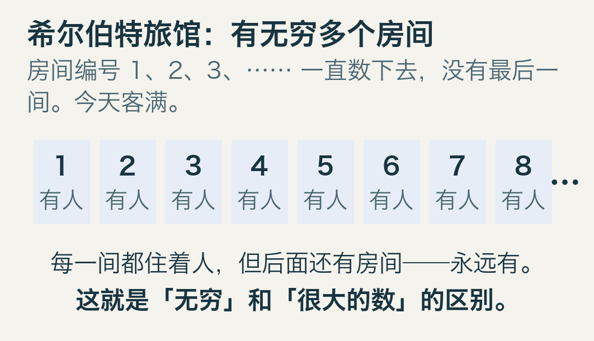

有一家旅馆，房间编号是 1、2、3、4……**一直数下去，没有最后一间。**

这一天，旅馆**客满**了——每一间房都住着人。

晚上，来了一位新客人。

老板说："没问题。"

他把 1 号房的客人请到 2 号，2 号房的客人请到 3 号，3 号的请到 4 号……**每一位客人都搬到「自己房间号加一」的那一间。**

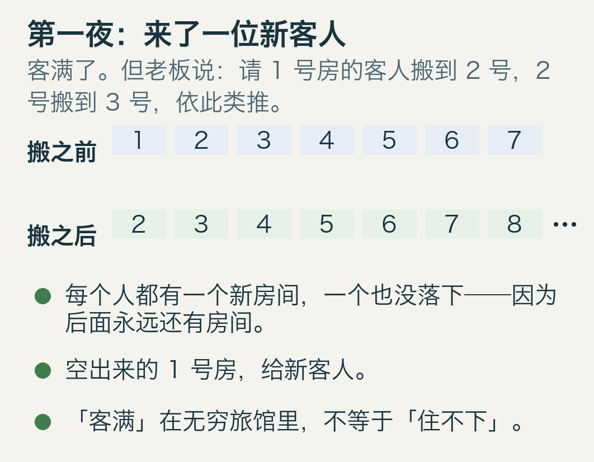

于是：

- **每一位老客人都还有一个房间**（n 号房的人去了 n+1 号，n+1 号是存在的）。
- **1 号房空出来了**，新客人住进去。

一家"客满"的旅馆，居然还住得下新客人。

这个例子叫**希尔伯特旅馆**，是数学家希尔伯特用来说明无穷集合有多奇怪的。

**奇怪的地方在于**：如果房间只有 100 间，全都住满，那就真的住不下了。但房间有无穷多间的时候，"住满"不等于"住不下"。

## 2. 第二夜：来了一辆无限长的车

第二天晚上，又来了一辆车。车上坐着**无穷多位**客人。

老板说："还是没问题。"

他让原来的客人**都搬到「自己房间号乘 2」的那一间**：

- 1 号房的人搬到 2 号
- 2 号房的人搬到 4 号
- 3 号房的人搬到 6 号
- ……

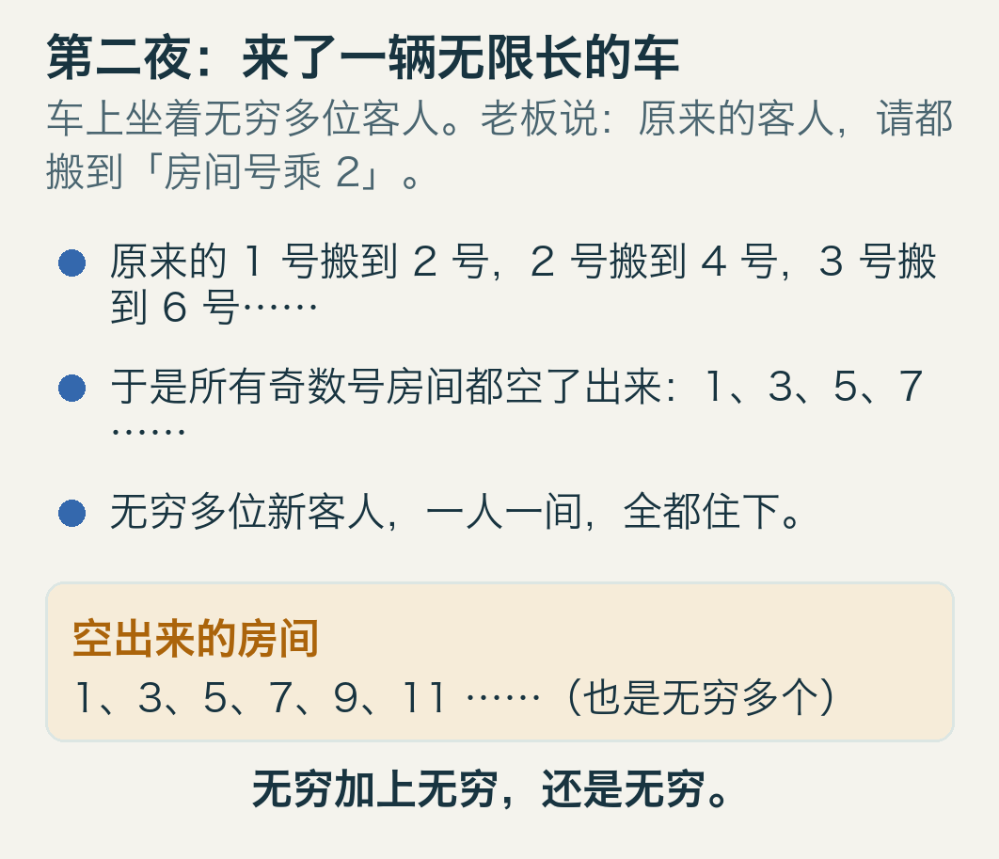

这样一来，**所有的奇数号房间都空出来了**：1、3、5、7、9、11……

无穷多位新客人，一人一间，全都住下。

**无穷加上无穷，还是无穷。**

## 3. "一样多"到底是什么意思

到这里，你可能会觉得上面那些都是在玩文字游戏。要把它说清楚，得先回答一个问题：

**"两个集合一样多"，到底是什么意思？**


回到最原始的做法。你面前有两堆石子，你想知道哪堆多。你会怎么做？

**你不会去数。** 你会从左边拿一个，从右边拿一个，配成一对；再拿一个，再配一对……

- 如果两边同时用完，**一样多**。
- 如果一边配完了、另一边还剩，**那边多**。

这件事的关键是：**"一样多"不需要数数，只需要能配对。**

对无穷集合，数学家把这件事**直接拿来当定义**：

> 两个集合"一样多"，当且仅当它们的元素能**一一配对**——每个配一个，不重复，不遗漏。

这个定义看起来简单，但它的后果非常反直觉。接下来三节就是三个例子。

## 4. 自然数和偶数，一样多

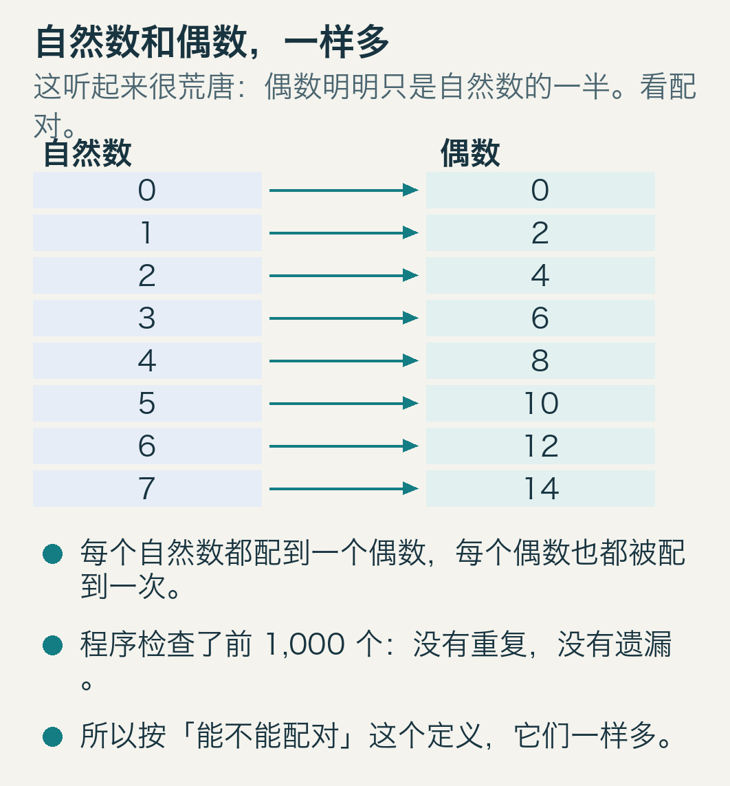

自然数是 0、1、2、3、4……
偶数是 0、2、4、6、8……

**偶数明明只是自然数的一半**，怎么可能一样多？

看配对：

| 自然数 | 偶数 |
|---|---|
| 0 | 0 |
| 1 | 2 |
| 2 | 4 |
| 3 | 6 |
| 4 | 8 |
| … | … |

配对的规则很简单：**每个自然数 n，配到 2n。**

- 每个自然数都配到了一个偶数（2n 一定是偶数）。
- 每个偶数都配到了一个自然数（偶数除以 2 一定是自然数）。
- 没有重复，没有遗漏。

程序检查了前 1000 个，确认没有重复。所以按定义——**它们一样多。**

**"一半"这个说法，在无穷面前失效了。**

## 5. 自然数和整数，也一样多

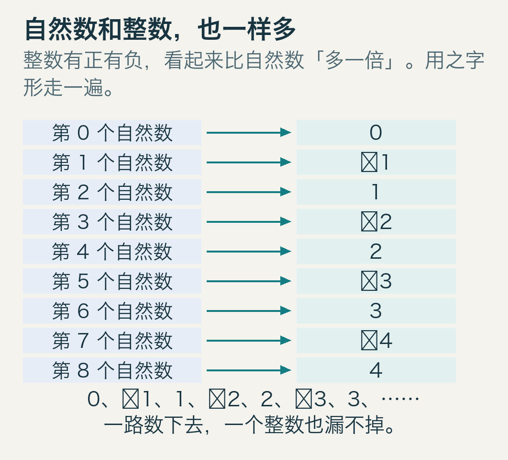

整数有正有负：…… −3、−2、−1、0、1、2、3 ……

它看起来比自然数"多一倍"。但配对的办法也有：

```
自然数  0   1   2   3   4   5   6   7   8  …
整数    0  −1   1  −2   2  −3   3  −4   4  …
```

规律是"之字形"：0 之后，先取负的 −1，再取正的 1；然后 −2、2；然后 −3、3……

**每个整数都会在某一步被数到，一个也漏不掉。** 程序把前 1000 个来回验了一遍，往返都一致。

所以自然数和整数也一样多。

## 6. 自然数和分数，还是一样多

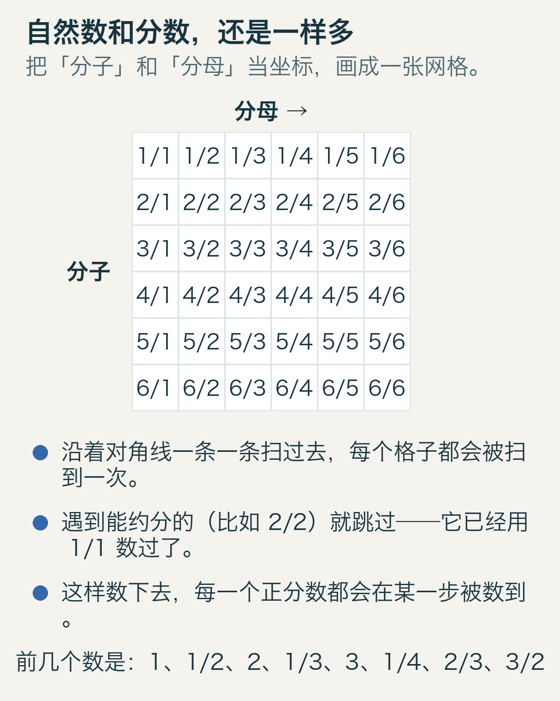

分数（有理数）看起来更多了：1/2、2/3、7/13…… 在任意两个分数之间还有无穷多个分数。

但康托尔发现了一个办法。

把**分母**当横坐标、**分子**当纵坐标，画成一张网格。网格上的每个格子就是一个分数。现在沿着**对角线**一条一条扫过去：

```
1/1
1/2 → 2/1
1/3 → 2/2 → 3/1
1/4 → 2/3 → 3/2 → 4/1
……
```

**每个格子都会被扫到一次。** 遇到能约分的（比如 2/2）就跳过——它已经被 1/1 数过了。

这样数下去，**每一个正分数都会在某一步被数到**。程序跑出来的前几个是：

```
1、1/2、2、1/3、3、1/4、2/3、3/2、4、1/5、5、1/6 ……
```

（负数分数和 0 用第 5 节那个之字形方法一起处理。）

**所以自然数、偶数、整数、分数，全都一样多。**

## 7. 换个问题：0 到 1 之间的小数呢？

上面这些集合，虽然都是无穷的，但它们有一个共同点：**能排成一张有编号的表。**

第 1 个、第 2 个、第 3 个…… 只要你能给每个元素发一个编号，它就属于这一类。这类无穷有个名字，叫**可数无穷**。

现在换一批东西试试：**0 到 1 之间的所有小数。**

比如 0.5、0.123、0.999……、0.333……（也就是 1/3）、0.70710678……

**这些小数能不能也排成一张有编号的表？**

## 8. 假设有人排好了这张表

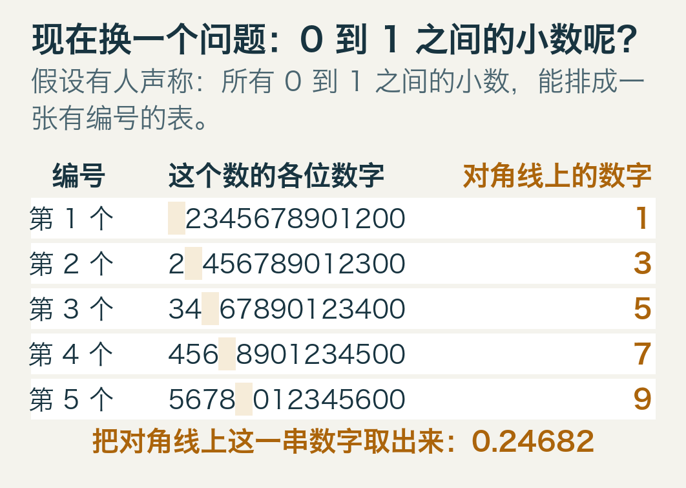

我们来做一次**反证**：先假设这张表真的存在。

假设有人声称他把 0 到 1 之间的**所有**小数都排好了，一个不漏。这张表长这样：

| 编号 | 小数 |
|---|---|
| 第 1 个 | 0.1 2 3 4 5 6 … |
| 第 2 个 | 0.2 3 4 5 6 7 … |
| 第 3 个 | 0.3 4 5 6 7 8 … |
| 第 4 个 | 0.4 5 6 7 8 9 … |
| 第 5 个 | 0.5 6 7 8 9 0 … |
| … | … |

**现在看对角线。**

- 第 1 个数的**第 1 位**是 1
- 第 2 个数的**第 2 位**是 3
- 第 3 个数的**第 3 位**是 5
- 第 4 个数的**第 4 位**是 7
- 第 5 个数的**第 5 位**是 9
- ……

把这些数字连起来，得到一个数：**0.13579……**

## 9. 把它每一位都改掉

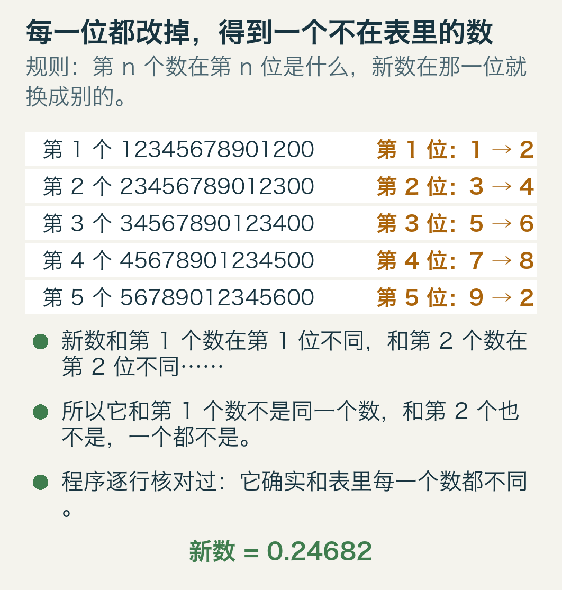

现在做关键的一步：**把这个对角线上的数字每一位都换成别的。**

比如把每一位都换成"别的数字"。一个简单的换法是：

> **把每一位数字 d，换成「d 除以 8 的余数」再加 1。**

代进去就是：1→2、3→4、5→6、7→8，8 除以 8 余 0 所以 8→1，而 **9 除以 8 余 1 所以 9→2**。

```
对角线：  0.1 3 5 7 9 …
改完之后：0.2 4 6 8 2 …
```

得到一个新数：**0.24682……**

（为什么要限制在 1 到 8？第 11 节会讲——那不是随手定的，是必须的。）

**这个新数有什么特别的？**

- 它和第 1 个数**在第 1 位不同**（一个 1、一个 2）→ 所以它**不是**第 1 个数。
- 它和第 2 个数**在第 2 位不同**（一个 3、一个 4）→ 所以它**不是**第 2 个数。
- 它和第 3 个数**在第 3 位不同** → 不是第 3 个数。
- ……

**它和表里的每一个数都不同。**

但它明明是一个 0 到 1 之间的小数。而那张表号称"包含了所有 0 到 1 之间的小数"。

**矛盾。**

程序逐行核对过：这个新数确实和表里每一个数都不同。

## 10. "那就把它加进表里不就行了？"

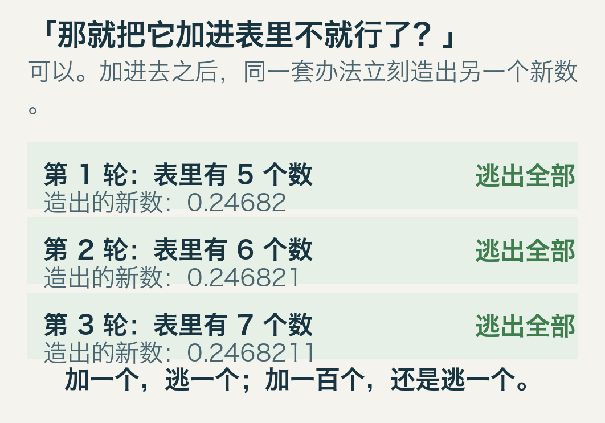

有人会这样想：既然新数不在表里，**把它加进去不就行了？**

可以。加进去之后，表里就有 6 个数了。

**然后同一套办法立刻造出第 7 个数**——它和这 6 个都不同。

再加进去？那就再逃出一个。**加一个，逃一个；加一百个，还是逃一个。**

问题不在于表排得不够长，而在于**"0 到 1 之间的小数"这种东西，根本没有办法排成一张有编号的表。**

## 11. 一个真实的坑：为什么不能出现 0 和 9


上面那个换数字的做法，其实有个陷阱。

**同一个数可以有两种写法：**

```
0.4999999……  =  0.5000000……
```

这两个写法**是同一个数**。

如果你造出来的新数尾巴上全是 9（或者全是 0），它就可能和表里某个数**"写法不同但数值相同"**——那样就没逃出去，整个论证就垮了。

所以本文的程序做了个小改动：**新数的每一位只从 1 到 8 里挑。**

这样它永远不会有 9 或 0 的尾巴，写法唯一，不会撞上这个坑。

**这不是吹毛求疵。** 一个证明里最脆弱的地方，往往就是这种"看起来显然"的细节。

## 12. 于是结论出来了

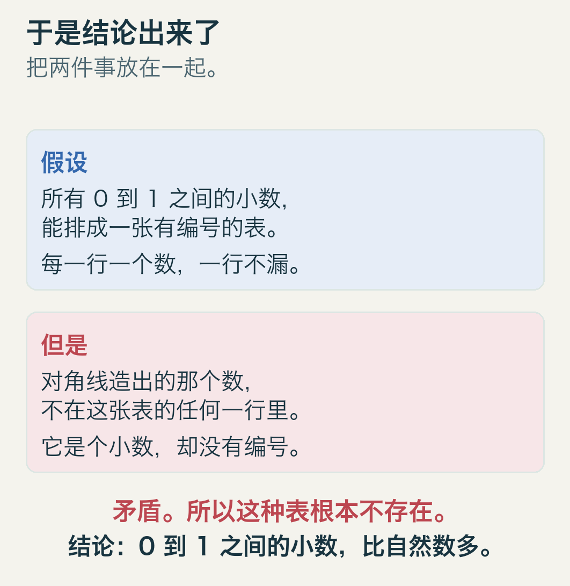

把两件事放在一起：

**假设**：0 到 1 之间的所有小数能排成一张有编号的表。

**但是**：对角线造出的那个数，不在这张表的任何一行里。

**矛盾。所以这种表根本不存在。**

结论：

> **0 到 1 之间的小数，比自然数多。**

注意这里的"多"是什么意思：**不是"多几个"，而是"根本没法一一配对"。** 你没办法给每个小数发一个编号。

## 13. 更一般的说法：子集总比元素多

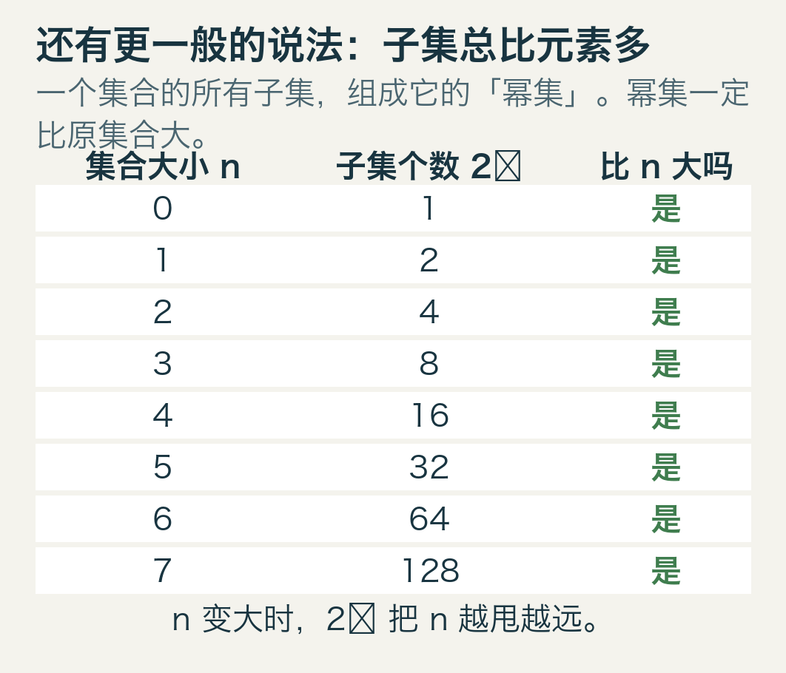

同样的道理可以用在**任何**集合上，而且更好懂。

一个集合的**子集**，就是从里面挑一些元素出来组成的新集合（也可以一个都不挑，或者全挑）。

一个集合的所有子集，组成它的**幂集**。

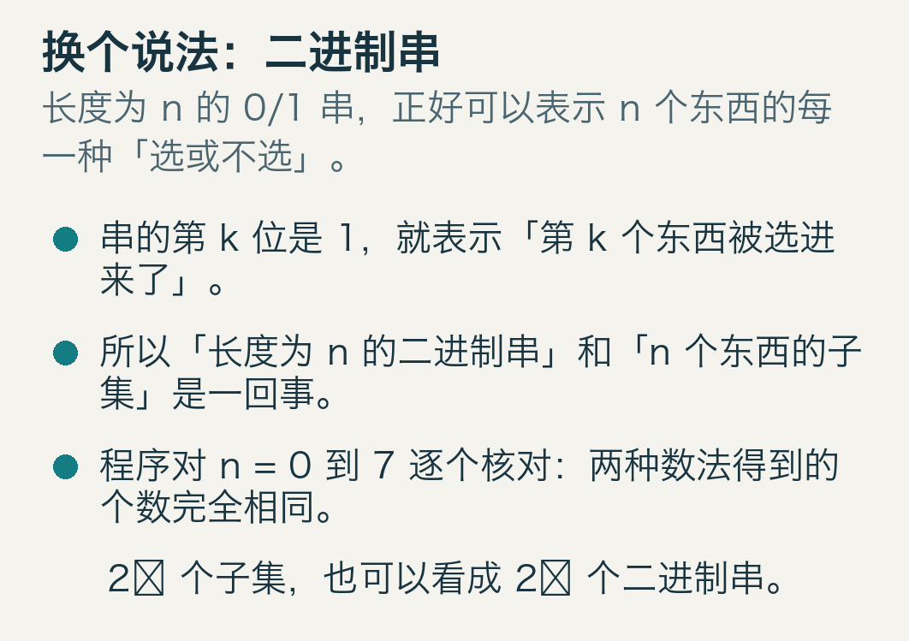

有个漂亮的对应关系：**一个子集 = 一串 0 和 1。**

- 串的第 k 位是 1，表示"第 k 个元素被选进来了"。
- 是 0，表示"没选"。

所以"n 个元素的子集个数"和"长度为 n 的二进制串个数"是同一件事。

| 元素个数 n | 子集个数 2ⁿ | 比 n 大吗 |
|---|---|---|
| 1 | 2 | 是 |
| 2 | 4 | 是 |
| 3 | 8 | 是 |
| 5 | 32 | 是 |
| 10 | 1024 | 是 |

程序对 n = 0 到 7 逐个核对，两种数法完全一致。

**n 越大，2ⁿ 把 n 甩得越远。** 所以：

> **一个集合的幂集，永远比它本身"大"**——即使这个集合本身是无穷的。

用这条规则可以造出越来越大的无穷：自然数的幂集、那个幂集的幂集、再幂集……**没有最大的无穷。**

## 14. 无穷不止一种

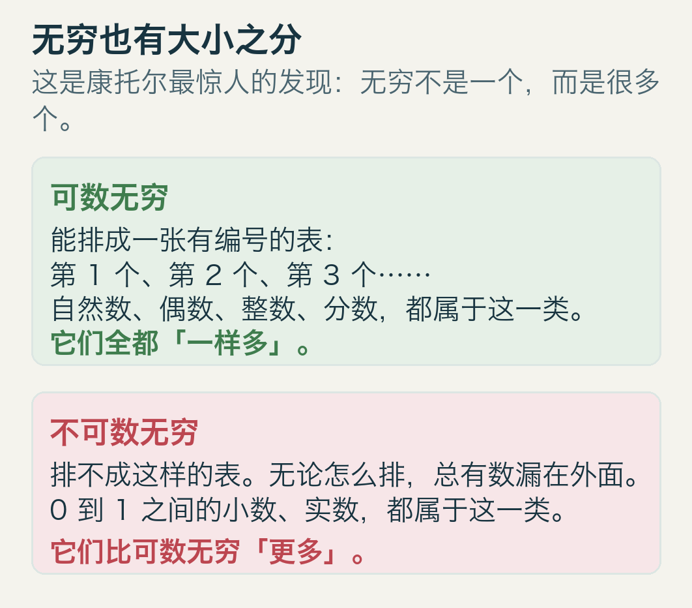

康托尔最重要的发现就是这个：**无穷不是一个东西，而是很多个不同大小的东西。**

| | 可数无穷 | 不可数无穷 |
|---|---|---|
| 能排成有编号的表吗 | 能 | 不能 |
| 包括 | 自然数、偶数、整数、分数 | 0 到 1 之间的小数、实数 |
| 大小 | 全都一样 | 比可数无穷更大 |

第一类叫**可数无穷**，第二类叫**不可数无穷**。

在这之前，"无穷"在人们心里是一个模糊的、代表"很多很多"的词。康托尔把它变成了**可以比较大小的对象**。

## 15. 当年几乎没人愿意接受


康托尔在 1874 年证明了这个结果，1891 年给出了对角线这个更漂亮的证法。

**但当时几乎没有人愿意接受。**

他的老师克罗内克强烈反对，认为这套东西根本不是数学。康托尔从 1884 年起长期陷入抑郁。

**这两件事之间的关系，后来的说法并不一致。** 有人把它归因于当时同行的敌意，也有人认为那是双相情感障碍的表现。这里只把两件事并列写出来，不下因果结论。

希尔伯特后来这样评价康托尔的工作：

> **没有人能把我们从康托尔创造的乐园里赶出去。**

今天，"可数"与"不可数"是数学专业的基础内容之一。**一个正确的结论，也可能要等一代人才被接受。**

## 16. 同一个手法，图灵用它做了什么


这个对角线手法后来走出了数学，变成了计算机科学的一块基石。

1936 年，图灵在研究"**停机问题**"时用了**形状完全一样**的论证：

- 康托尔：假设所有小数排成一张表，然后造出一个不在表里的数。
- 图灵：假设所有程序排成一张表，然后造出一个行为不同的程序。

结论也一样：**这样一张表不存在。**

也就是说：**不存在一个程序，能对"任意一个程序会不会停下来"给出正确答案。** 这不是"还没人做出来"，而是**在逻辑上做不到**。

**同一套手法，一个用来数无穷，一个用来划出计算的边界。**

## 17. 自己动手改一个条件


这一篇也只需要一支笔和一张纸。

四个建议的改动：

1. **自己配一次自然数和偶数。** 写出前十个配对，检查有没有重复或遗漏。
2. **把规则换成"每一位加 1，9 就变成 0"。** 为什么这样不行？想想第 11 节讲的那个坑。
3. **数一数 3 个东西有几个子集。** 动手全部列出来，再和 2³ = 8 对一下。
4. **想一个"比实数还多"的东西。** 提示：实数的所有子集，组成一个更大的集合。

最后一个问题留给你：

> **0 到 1 之间的分数，和 0 到 1 之间的所有小数，哪个多？**

（提示：第 6 节告诉你分数是可数的。那么小数呢？）

## 动手材料

- [配对、对角线、幂集的完整代码](examples/infinity.py)与[实验脚本](examples/run_model.py)
- [本文全部数字的原始结果](examples/results.json)与[程序原始输出](originals/model-stdout.txt)
- [本文全部原创图的重绘代码](examples/build_figures.py)
- [运行环境与复现说明](README.md)
- [一手来源、素材身份与 AI 辅助说明](sources.md)

本文只用 Python 标准库。原创正文与原创图采用 CC BY 4.0；原创代码采用 MIT 许可。

## 图片来源

本文全部配图为原创绘制，没有使用任何第三方照片或图片。
