# 0.1 + 0.2 为什么不等于 0.3？

在 Python、JavaScript、Java、C 里敲同一行代码，你会得到同一个答案：

```
>>> 0.1 + 0.2
0.30000000000000004
```

这不是 bug。换了语言、换了操作系统、换了 CPU，答案还是这个。世界上几乎所有现代计算机都遵守同一份浮点数标准（IEEE 754），所以它们犯的是同一个"错"——或者说，它们都在忠实地执行同一套规则。

这篇文章要做的，是把这套规则从头讲一遍。讲完之后，你不但知道 0.1 + 0.2 等于几，还能自己算出它**为什么**等于那个数，误差是多大，以及什么时候该担心、什么时候不用。

正文里的数字全部由 Python 标准库算出，每一张图里的数字也都由本目录的代码实际跑出来（画图另需 Pillow 与一款中文字体）。

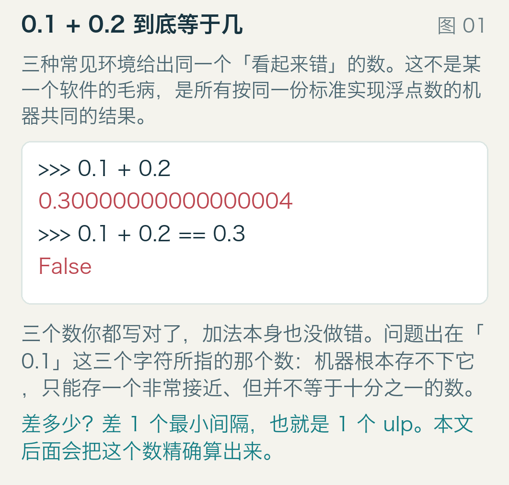

## 1. 先把现象摆出来

三个数你都写对了，加法本身也没做错。问题出在"0.1"这三个字符所指的那个数：**机器根本存不下它。**

这听起来很怪。0.1 这么简单的数，怎么会存不下？

因为机器存数用的是二进制。而我们写"0.1"用的是十进制。这两套记数法能精确表示的数，**不是同一批**。

先看一个更简单的例子。十进制的 1/3 写不完，只能写成 0.3333…，你写多少位都是近似。二进制里也有写不完的数，只不过它们不是 1/3，而是 **1/10**。

## 2. 二进制小数只认分母是 2 的幂

二进制小数的每一位代表 1/2、1/4、1/8、1/16……

所以一个数能用二进制**有限位**写完，当且仅当它可以写成若干个 2 的负幂次之和。换句话说：**约分之后，分母必须是 2 的幂。**

1/2 = 0.1₂，1/4 = 0.01₂，3/4 = 0.11₂ —— 都能写完。

1/5、1/10、1/3 —— 分母里有 5 或者 3，不是 2 的幂，**永远写不完**。

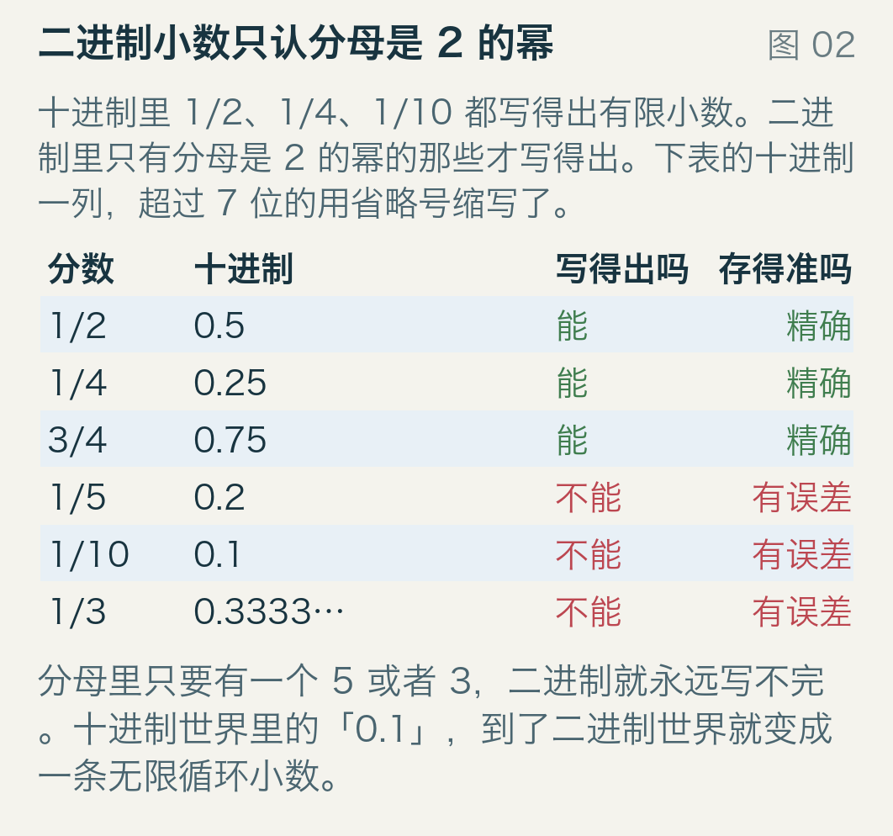

十进制世界里的"0.1"，到了二进制世界就变成一条无限循环小数。而机器只能存有限位。

## 3. 亲手把 1 ÷ 10 除一遍

十进制里做长除法，每一步是"余数乘 10，取整数位，剩下的留到下一位"。

二进制里做长除法，规则一模一样，只是把 10 换成 2。

从 1 ÷ 10 开始：

第一步，1 不够除，余数还是 1。乘 2 得 2，2 ÷ 10 得 0，余 2。

第二步，余数 2 乘 2 得 4，4 ÷ 10 得 0，余 4。

第三步，余数 4 乘 2 得 8，8 ÷ 10 得 0，余 8。

第四步，余数 8 乘 2 得 16，16 ÷ 10 得 1，余 6。

继续下去，你会得到 0.00011001100110011…。

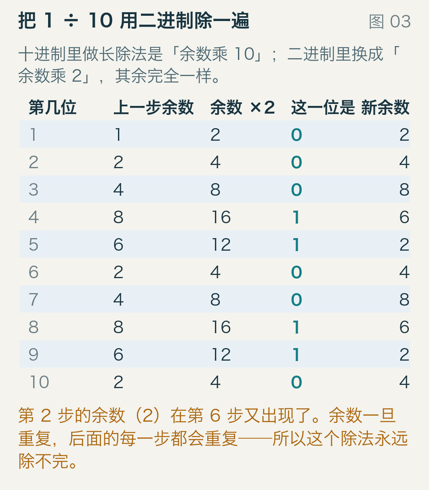

关键在于：**第 2 步的余数（2），在第 6 步又出现了。**

余数一旦重复，后面每一步都会重复。所以这个除法永远除不完。它的循环节是 `0011`，周期 4：

0.0001100110011001100110011…（`0011` 无限重复）

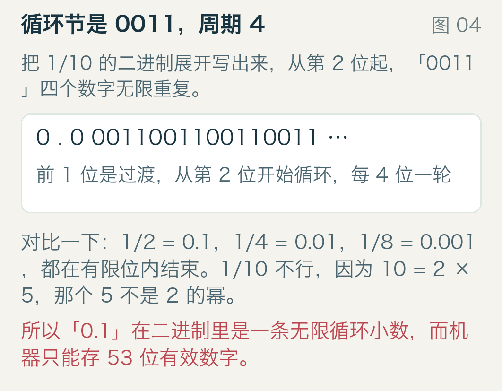

对比一下：1/2 = 0.1₂，1/4 = 0.01₂，1/8 = 0.001₂，都在有限位内结束。1/10 不行，因为 10 = 2 × 5，那个 5 不是 2 的幂。

**"0.1 存不下"不是机器的缺陷，是二进制这套记数法本身的边界。** 就像你在十进制里写不出 1/3 的有限小数一样。

## 4. 机器只留 53 位

存不下无限长的小数，那就只能存前面一段，后面的舍掉。

一个 float64（也就是 Python 里的 `float`）能存 **53 位有效数字**。第 54 位往后，只能被舍入。

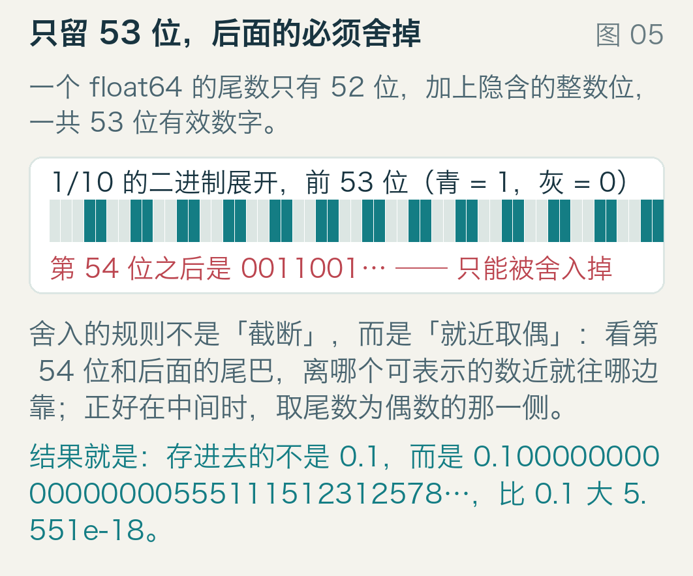

舍入的规则不是简单地"截断"，而是"就近取偶"：看第 54 位和它后面的尾巴，离哪个可表示的数近就往哪边靠；如果正好在正中间，取**尾数为偶数**的那一侧。

这条规则后面还会再出现一次，而且正是它决定了 0.1 + 0.2 的最终答案。

## 5. 一个 float64 的 64 位怎么分

64 位被切成三段：

- **1 位符号**：0 表示正，1 表示负。有了它，负数不需要单独的编码。
- **11 位指数**：存的不是指数本身，而是"指数 + 1023"，这样负数也能用无符号位表示。
- **52 位尾数**：存小数点后面的位。整数位那一位总是 1，不存，省下来多给一位精度。

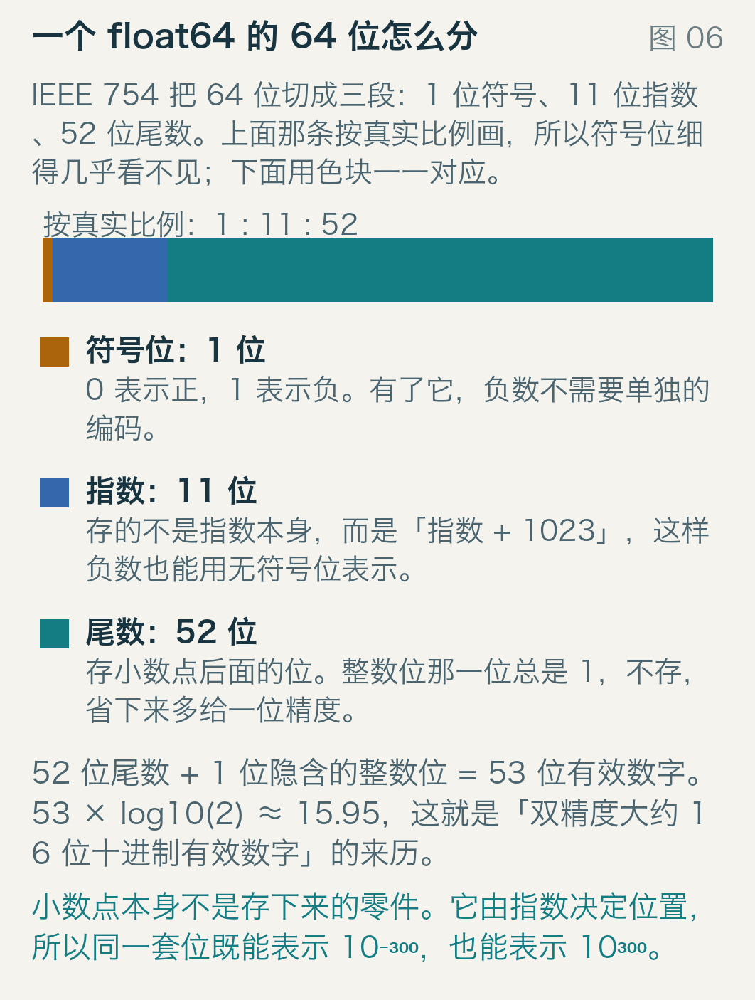

52 位尾数 + 1 位隐含的整数位 = **53 位有效数字**。

53 × log₁₀(2) ≈ 15.95，这就是"双精度大约 16 位十进制有效数字"这个说法的来历。

注意：小数点本身不是存下来的零件。它由指数决定位置，所以同一套位既能表示 10⁻³⁰⁰，也能表示 10³⁰⁰。

## 6. 存进去的到底是哪个数

把 0.1 的 64 位按上面的规则切开：

- 符号位：0（正数）
- 指数段原值：1019，减掉偏移量 1023 得 −4
- 尾数段：2702159776422298

拼回去的公式是：

```
(−1)^符号 × (1 + 尾数 ÷ 2^52) × 2^真实指数
```

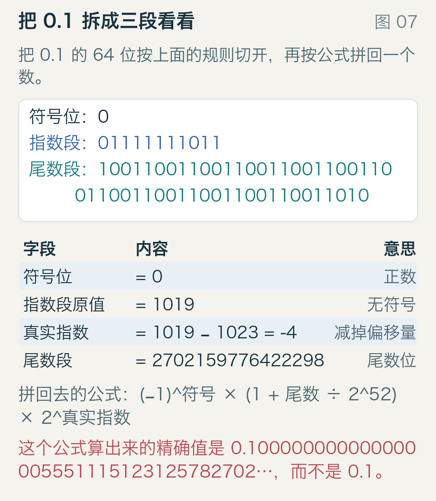

用精确分数把这个公式算出来，得到的十进制展开是：

```
0.1000000000000000055511151231257827021181583404541015625
```

它**不是** 0.1。它比 0.1 大一点点，大约大 5.55 × 10⁻¹⁸。

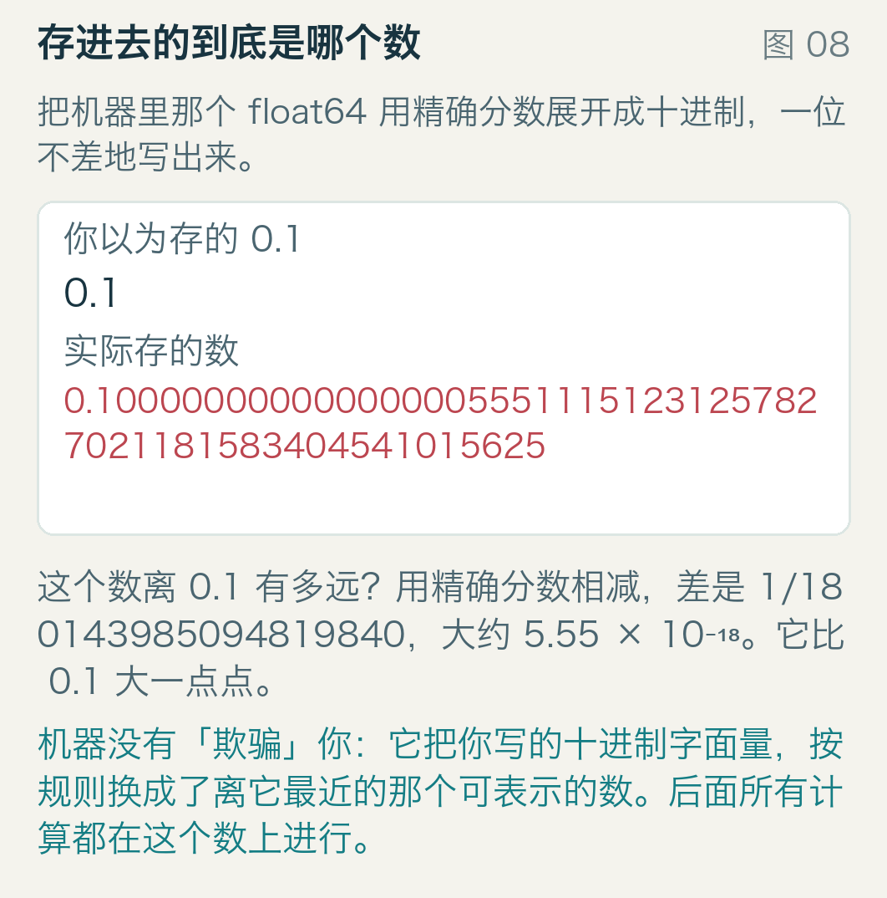

机器没有欺骗你。它把你写的十进制字面量，按规则换成了离它最近的那个可表示的数。**后面所有的计算，都是在这个数上进行的。**

## 7. 浮点数在数轴上不是均匀铺开的

这是浮点数最反直觉的一点：**相邻两个可表示的浮点数之间的距离，不是常数。**

在 1 附近，这个距离是 2.22 × 10⁻¹⁶。在 10¹⁶ 附近，它是 2。差了 16 个数量级。

这个距离有个通用叫法：**ulp**（unit in the last place，最后一个单位）。

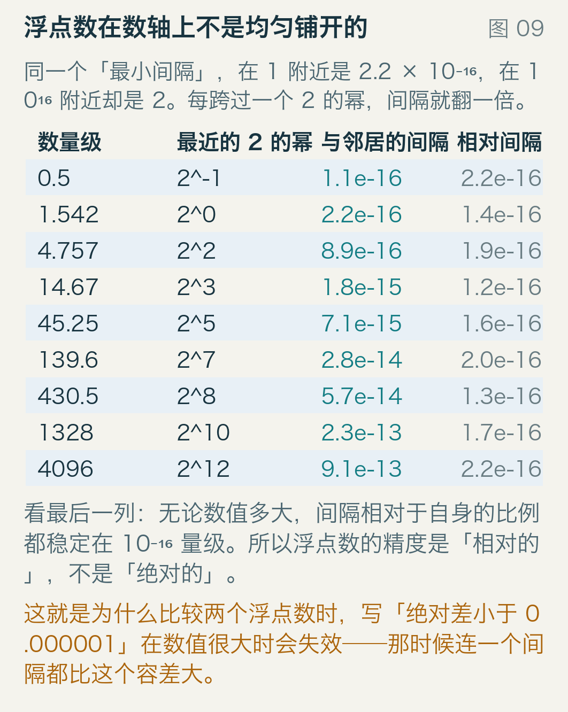

但请看上表的最后一列：无论数值多大，**ulp ÷ 数值**始终落在 1.11 × 10⁻¹⁶ 到 2.22 × 10⁻¹⁶ 之间。

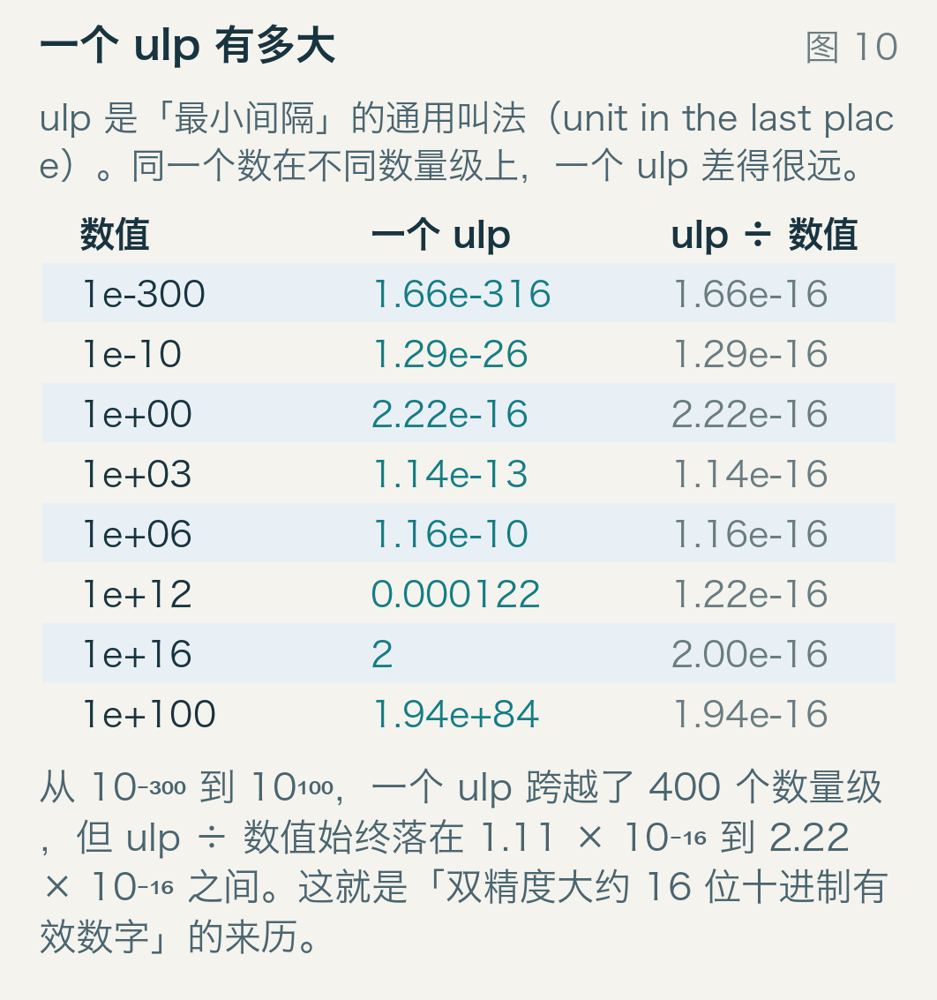

也就是说：

**浮点数的精度是"相对的"，不是"绝对的"。**

同一个数，相对精度几乎不变；但绝对误差会随数量级一起放大。

这一条推论很实用：**比较两个浮点数时，写"绝对差小于 0.000001"在数值很大时会失效**——那时候连一个 ulp 都比这个容差大。第 18 节会回到这一点。

## 8. 加法的第一步：对齐

两个浮点数相加，硬件要做的第一件事不是加法，而是**对齐小数点**。

0.1 的真实指数是 −4，0.2 的真实指数是 −3。指数不同，位权就不同，不能直接逐位相加。

所以要把较小的那个（0.1）的尾数整体**右移一位**，让两边的位权一致。

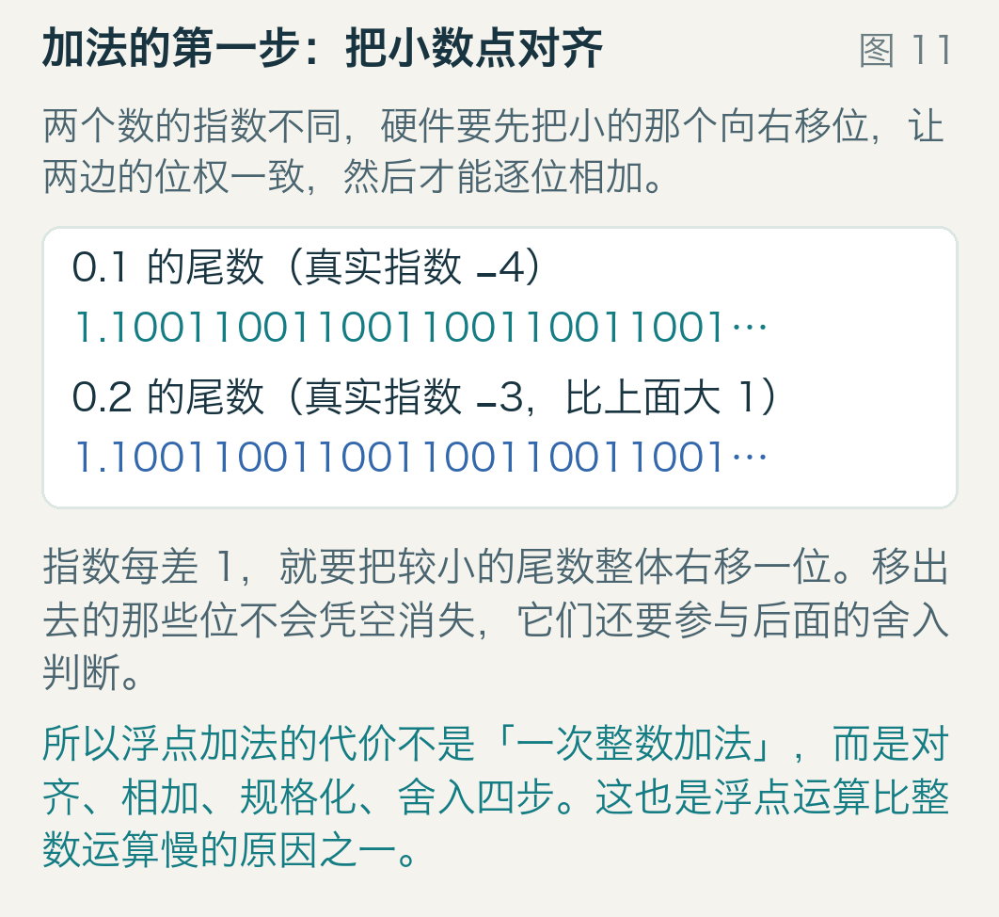

移出去的那些位不会凭空消失，它们还要参与后面的舍入判断。

所以浮点加法的代价不是"一次整数加法"，而是**对齐、相加、规格化、舍入**四步。这也是浮点运算比整数运算慢的原因之一。

## 9. 精确的和、舍入后的和、以及 0.3

现在把三个数都写成 60 位十进制展开，并排放在一起看：

- 0.1 与 0.2 的**精确和**（用有理数算，没有任何误差）
- 这个和**舍入回 53 位**之后的样子
- 你心里在比的 **0.3**（也就是机器存的 0.3）

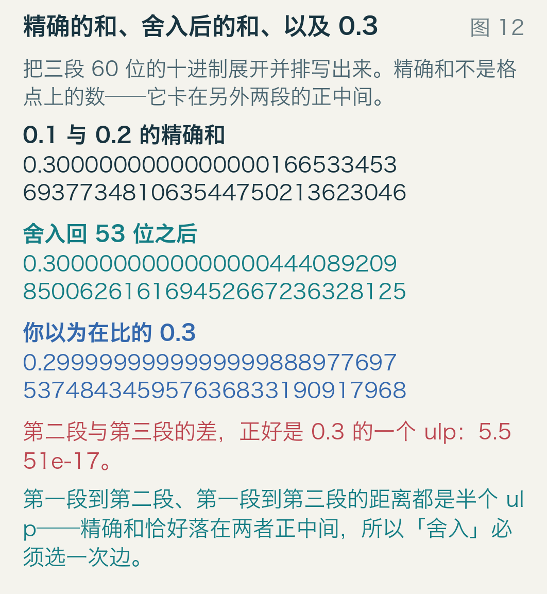

三段数字各自落在哪里：

- **精确和**是 `0.3000000000000000166533453693773481063544750213623046875`。
- **舍入回 53 位**之后是 `0.3000000000000000444089209850062616169452667236328125`。
- 机器里的 **0.3** 是 `0.299999999999999988897769753748434595763683319091796875`。

第二段和第三段的差别是 **5.551115123125783 × 10⁻¹⁷**，也就是 0.3 的**一个 ulp**。

关键是第一段：**它不是 53 位格点上的数**。它到第二段的距离和到第三段的距离**完全相等**——都等于 `1/36028797018963968`，也就是半个 ulp。换句话说，0.1 与 0.2 的精确和正好卡在 0.3 和它的上邻**正中间**，机器必须做一次选择，而它选了上邻（下一节讲这条规则）。

所以最终结果与 0.3 的差是 **5.551115123125783 × 10⁻¹⁷** —— 正好是 0.3 的**一个 ulp**。

## 10. 最后一票：正好在中间，取偶数

到这里还差最后一步：为什么舍入的结果偏向了**上面**那个数，而不是下面？

程序给出了答案。把 0.1 和 0.2 的精确和，与 0.3 的两个相邻浮点数比较：

- 下邻：`0x3FD3333333333333`，末位是 1
- 上邻：`0x3FD3333333333334`，末位是 0
- 精确和离下邻 2.7755575615628914 × 10⁻¹⁷
- 精确和离上邻 2.7755575615628914 × 10⁻¹⁷

**两边一样远。** 精确和恰好落在两个相邻浮点数的正中间。

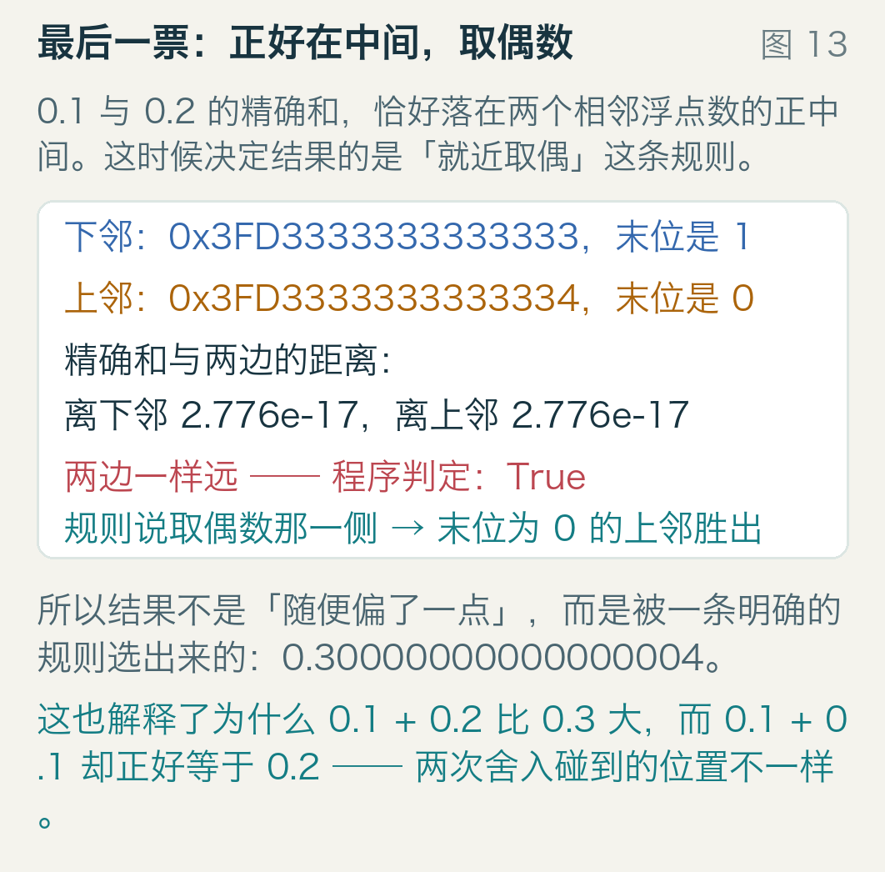

这时候"就近取偶"这条规则投出最后一票：取末位为偶数的那个，也就是上邻。

所以结果不是"随便偏了一点"，而是被一条明确的规则**选**出来的：`0.30000000000000004`。

这也解释了另一个现象：`0.1 + 0.1` 正好等于 `0.2`。

但原因不是"没踩到正中间"，而是**这次相加根本没有发生舍入**：两个 0.1 的精确和，正好就是 0.2 存的那个数。用有理数验算一下——`Fraction(0.1) + Fraction(0.1)` 与 `Fraction(0.2)` 是同一个分数——既然和本来就落在格点上，就近取偶这条规则压根没被调用。

## 11. 大数会把小数整个吃掉

ulp 随数量级放大的直接后果是：**足够大的数，加一个小数等于没加。**

在 10¹⁶ 附近，一个 ulp 就是 2。所以：

- 10¹⁶ + 1 → 还是 10¹⁶
- 10¹⁶ + 2 → 10¹⁶ + 2
- 10¹⁶ + 3 → 舍到 10¹⁶ + 4（正好在中间，取偶数）
- 10¹⁶ + 5 → 也舍到 10¹⁶ + 4

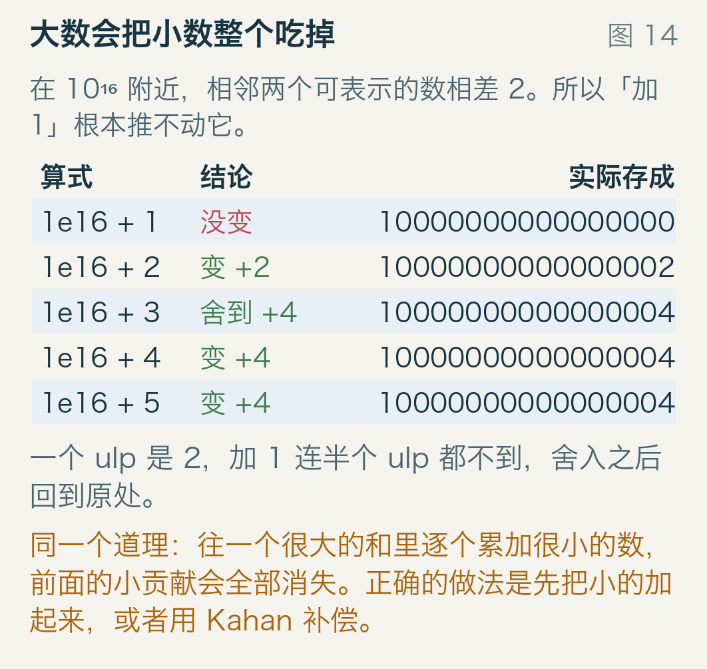

同一个道理：**往一个很大的和里逐个累加很小的数，前面的小贡献会全部消失。**

如果你要算一列数里"大数和小数混在一起"的和，正确做法是先把小的加起来（比如按绝对值从小到大排），或者用下一节的 Kahan 补偿。

## 12. 减法会吃掉有效位数

加法会丢位，减法更狠。

看 1 − cos(x)。当 x 很小的时候，cos(x) 非常接近 1，两者相减，**前面的有效位全部抵消**，剩下的全是舍入噪声。

程序把 x 从 10⁻⁴ 一直试到 10⁻⁹，用精确的幂级数当参照。表中的「还剩几位」就是**相对误差取负对数**（−log₁₀(相对误差)），也就是结果里还剩下几位可信的十进制有效数字——`0.0` 表示一位都不剩：

| x | 朴素写法 | 还剩几位 | 换成 2sin²(x/2) | 还剩几位 |
|---|---|---|---|---|
| 1e−04 | 4.999999969612645e−09 | 8.3 | 4.999999995833334e−09 | 16.1 |
| 1e−06 | 5.000444502911705e−13 | 4.1 | 4.999999999999583e−13 | 18.0 |
| 1e−08 | 0.0 | 0.0 | 5.0000000000000005e−17 | 16.2 |
| 1e−09 | 0.0 | 0.0 | 5e−19 | 16.3 |

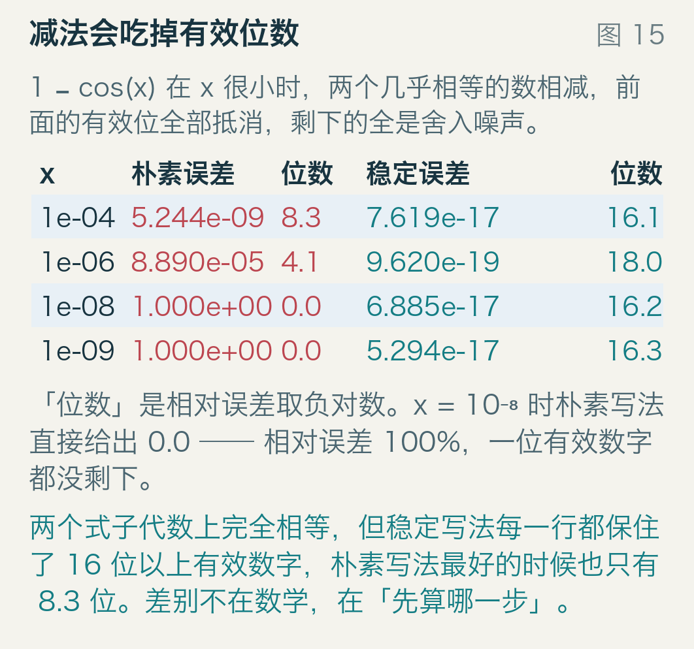

图里列的是**相对误差**——两个写法算出的值在头几位上看起来一样，真正的差别全在误差那一列。

x = 10⁻⁸ 时，朴素写法直接给出 **0.0** —— 真值是 5 × 10⁻¹⁷，一位有效数字都没剩下。

而 `2sin²(x/2)` 与 `1 − cos(x)` **在代数上完全相等**，数值上却保住了 16 位有效数字。

差别不在数学，在"先算哪一步"。

## 13. 误差会累积

单次运算的误差是 1 个 ulp 量级，但循环里累加起来就不一样了。

把 0.1 加 10 万次：

- 精确值（10 万个 fl(0.1) 的和，用有理数算）：10000 + 5.551 × 10⁻¹³，正好比一万大一点点
- 朴素从左到右相加：10000.000000018848，误差 **+1.885 × 10⁻⁸**
- Kahan 补偿：10000.0，误差 **−5.551 × 10⁻¹³**

注意"精确值"不是一万整：因为机器里的 0.1 本来就比十分之一大一点点，10 万个加起来就比一万大 5.55 × 10⁻¹³。这个偏差用 `Fraction` 算得出来，不是猜的。

同时注意 Kahan 那一行：它的结果 10000.0 反而**比精确值小** 5.55 × 10⁻¹³ —— 补偿求和不是"更准的魔法"，只是把误差压得更小、更可控。

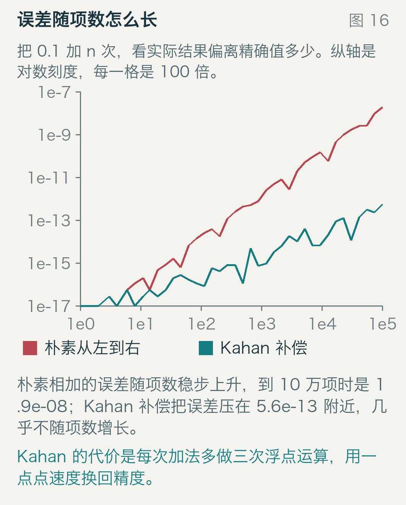

朴素相加的误差随项数**稳步上升**；Kahan 补偿把它压在 10⁻¹³ 附近，几乎不随项数增长。

Kahan 补偿的做法是：每次加法时，把"本来会丢掉的那几个低位"单独存在另一个变量里，下一次再加回去。代价是每次加法多做三次浮点运算——用一点点速度换回精度。

如果这列数的大小相差悬殊，换顺序的效果更明显。同一列两万个数（量级从 1 跨到 10⁻¹⁵），四种求和方式的误差：

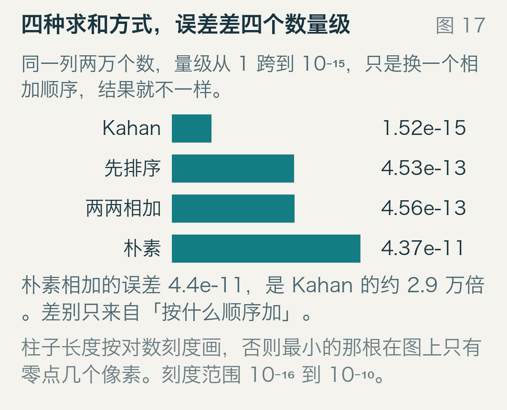

朴素相加的误差 4.4 × 10⁻¹¹，是 Kahan 的约 2.9 万倍。差别只来自"按什么顺序加"。

## 14. 同一个公式，换个写法就准了

前面说的问题是"两个几乎相等的数相减"。既然病根在这里，那就**换一个不含相减的等价写法**。

解方程 x² − 10⁸x + 1 = 0。两个根一个是 10⁸ 量级，一个是 10⁻⁸ 量级。

| 求法 | 大根 | 小根 |
|---|---|---|
| 教科书公式 | 100000000 | 7.451e−09 |
| 避开相减的写法 | 100000000 | 1.000e−08 |

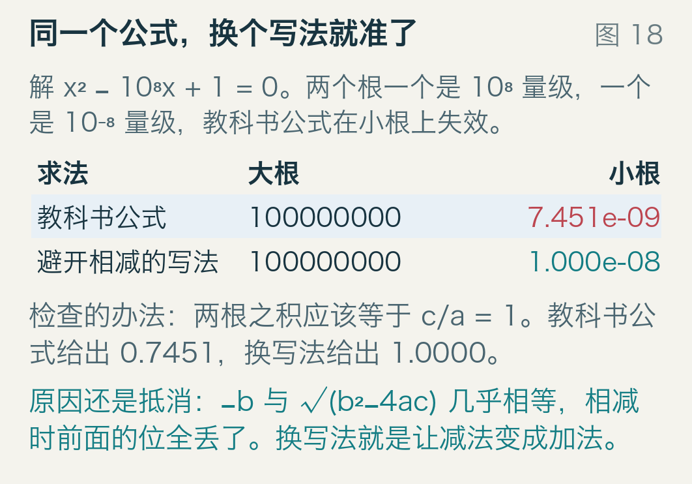

检验的办法：两根之积必须等于 c/a = 1。教科书公式给出 **0.745058**，错了 25%；换写法给出 **1.000000**。

原因还是抵消：−b 与 √(b²−4ac) 几乎相等，相减时前面的位全丢了。换写法就是让减法变成加法——先用 −b 的符号确定 q，再让小根等于 c/q。

这个技巧在数值计算的教材里通常叫"数值稳定的求根公式"，它解决的不是数学问题，是**算术问题**。

## 15. 几个特殊值

IEEE 754 给"除以零""零除以零"这些没有数学答案的运算也留了位置。它们**不抛异常**，而是变成特定的值。

| 写法 | 结果 | 位模式（十六进制） |
|---|---|---|
| 0.0 | 0.0 | 0x0000000000000000 |
| −0.0 | −0.0 | 0x8000000000000000 |
| 1/0.0 | inf | 0x7FF0000000000000 |
| −1/0.0 | −inf | 0xFFF0000000000000 |
| 0.0/0.0 | nan | 0x7FF8000000000000 |
| 1e308*10 | inf | 0x7FF0000000000000 |

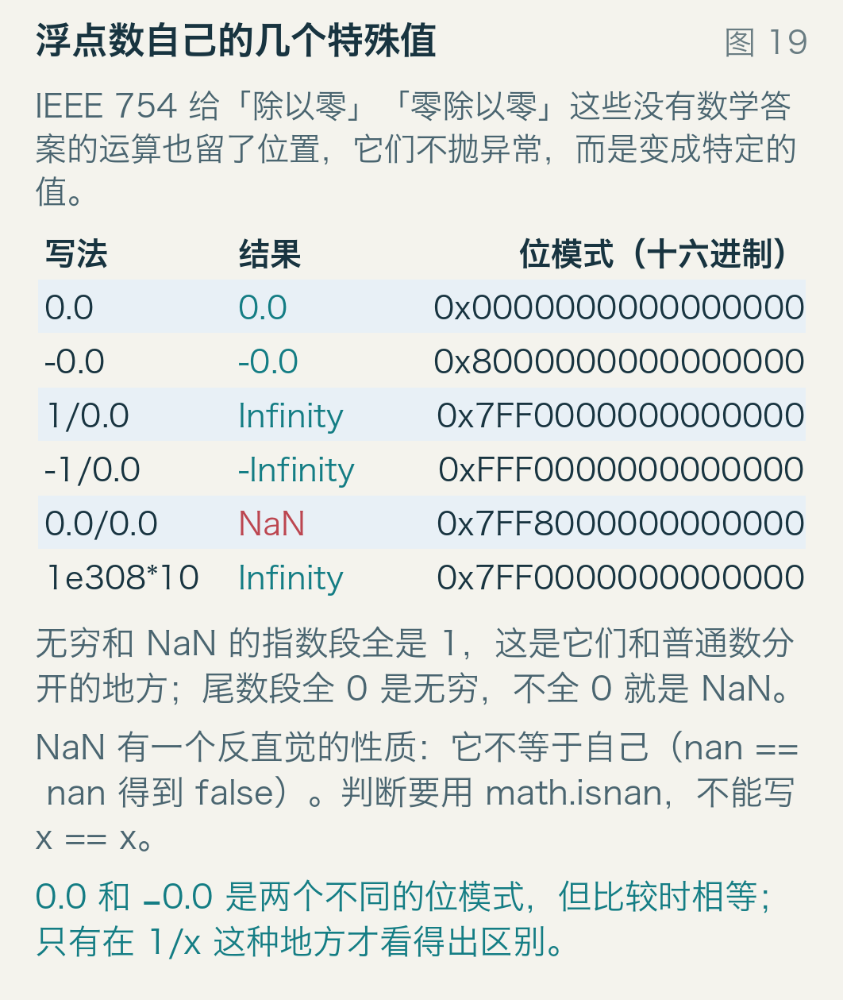

无穷和 NaN 的指数段全是 1，这是它们和普通数分开的地方；尾数段全 0 是无穷，不全 0 就是 NaN。

**NaN 有一个反直觉的性质：它不等于自己。** `nan == nan` 得到 `False`。判断要用 `math.isnan`，不能写 `x == x`。

另外，`0.0` 和 `−0.0` 是两个不同的位模式，但比较时相等（`0.0 == -0.0` 是 `True`）。只有在 `1/x` 这种地方才看得出区别：`1/0.0` 是 `inf`，`1/-0.0` 是 `-inf`。

## 16. 最靠近 0 的地方

指数段有 11 位，能表示的指数范围有限。正常数的间隔随指数变化，到了 2⁻¹⁰²² 以下，整数位不再隐含为 1，间隔固定成最小的一格（2⁻¹⁰⁷⁴），一路铺到 0。

这一段数叫**次正规数**（subnormal）。

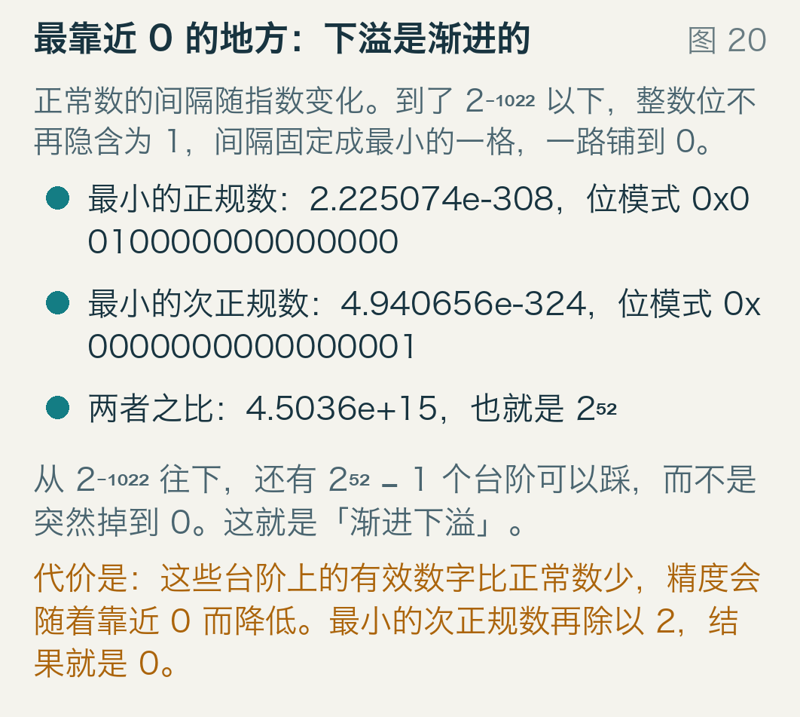

- 最小的正规数：2.225074 × 10⁻³⁰⁸，位模式 `0x0010000000000000`
- 最小的次正规数：4.940656 × 10⁻³²⁴，位模式 `0x0000000000000001`
- 两者之比：4503599627370496，也就是 2⁵²

从 2⁻¹⁰²² 往下，还有 2⁵² − 1 个台阶可以踩，而不是突然掉到 0。这叫**渐进下溢**。

代价是：这些台阶上的有效数字比正常数少，精度会随着靠近 0 而降低。最小的次正规数再除以 2，结果就是 0。

## 17. 把位当成整数来用

浮点数的位模式不只是给硬件看的。**理解了格式本身，就可以拿它做别的事。**

最著名的例子是 Quake III 里的平方根倒数（`1/√x`）。它的做法是：

1. 把 float32 的位当成整数 `i`；
2. 算 `magic − (i >> 1)`，其中 magic = `0x5F3759DF`；
3. 把结果读回浮点，得到一个粗糙但可用的初值；
4. 做几次牛顿迭代，公式是 `y ← y(1.5 − 0.5·x·y²)`。每迭代一次，误差大约被平方一次，所以三轮就能从 1.3% 掉到 10⁻¹⁴。

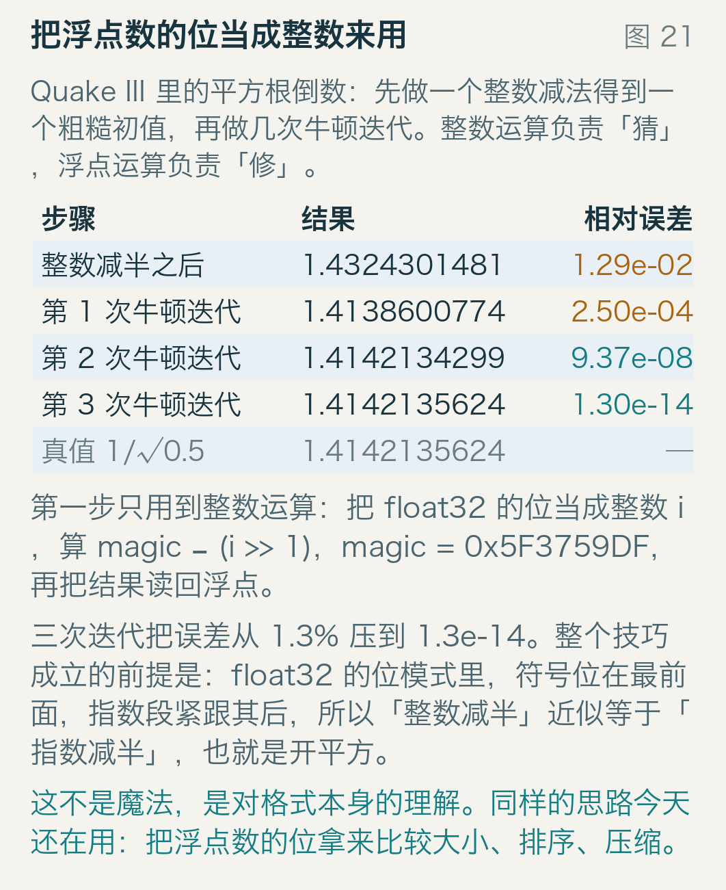

以 x = 0.5 为例：

| 步骤 | 结果 | 相对误差 |
|---|---|---|
| 整数减半之后 | 1.4324301481 | 1.29e−02 |
| 第 1 次牛顿迭代 | 1.4138600774 | 2.50e−04 |
| 第 2 次牛顿迭代 | 1.4142134299 | 9.37e−08 |
| 第 3 次牛顿迭代 | 1.4142135624 | 1.30e−14 |
| 真值 1/√0.5 | 1.4142135624 | — |

第一步只用到整数运算，误差 1.3%；三次迭代之后误差降到 1.3 × 10⁻¹⁴。

这个技巧成立的前提是：**float32 的位模式里，符号位在最前面，指数段紧跟其后**，所以"整数减半"近似等于"指数减半"，也就是开平方。

这不是魔法，是对格式本身的理解。同样的思路今天还在用：把浮点数的位拿来比较大小、排序、压缩。

## 18. 容差该按比例给，不能按绝对值给

回到第 7 节的推论。判断两个浮点数"差不多"，如果写死一个绝对容差，会发生什么？

以容差 1e−9 为例：

| 数值 | 一个 ulp | 容差相当于 | 能用吗 |
|---|---|---|---|
| 1e−06 | 2.12e−22 | 4.72e+12 ulp | 可以 |
| 1e+00 | 2.22e−16 | 4.50e+06 ulp | 可以 |
| 1e+06 | 1.16e−10 | 8.59e+00 ulp | 可以 |
| 1e+12 | 1.22e−04 | 8.19e−06 ulp | 不行 |
| 1e+15 | 1.25e−01 | 8.00e−09 ulp | 不行 |

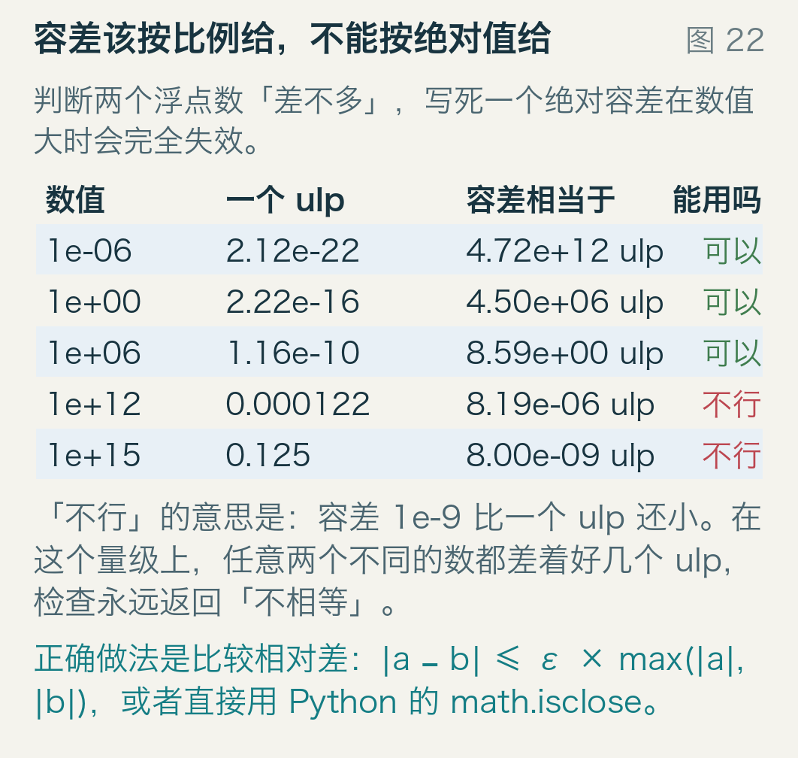

"不行"的意思是：容差 1e−9 **比一个 ulp 还小**。在这个量级上，任意两个不同的数都差着好几个 ulp，检查永远返回"不相等"。

正确做法是比较**相对差**：

```
|a − b| ≤ ε × max(|a|, |b|)
```

Python 的标准库里就有现成的：`math.isclose(a, b, rel_tol=1e-9)`。

## 19. 什么时候可以放心用浮点

把前面的结论收一收：

- **不要用 `==` 比较浮点数。** 用 `math.isclose`，并且给的是相对容差。
- **不要假设 `a + b + c == a + (b + c)`。** 浮点加法不满足结合律。
- **不要在数量级悬殊时逐个累加。** 先排序，或者用 `math.fsum`（它内部做的就是精确求和）。
- **警惕两个几乎相等的数相减。** 如果公式里出现 `f(x) - g(x)` 而 `f ≈ g`，找等价的改写。
- **需要精确的十进制运算时，用 `decimal.Decimal` 或 `fractions.Fraction`。** 但要注意：`Decimal` 也有精度上限，它解决的是"十进制表示精确"，不是"无限精度"。
- **需要钱、计数、编号时，用整数。** 分而不是元，是最省事的做法。

反过来说，这些场合可以放心用：

- 图形、物理、信号处理——这些领域本来就有噪声，1 个 ulp 的误差淹没在模型误差里。
- 迭代收敛的算法——只要每步误差不放大，浮点够用。
- 任何"结果本来就是近似"的计算。

浮点数不是"坏掉的十进制"。它是自己的一个数系，有自己的间隔、自己的特殊值、自己的舍入规则。**理解它，比绕开它划算。**

## 20. 自己动手

下面每一行都可以直接在 Python 里敲一遍。先猜结果，再对照。

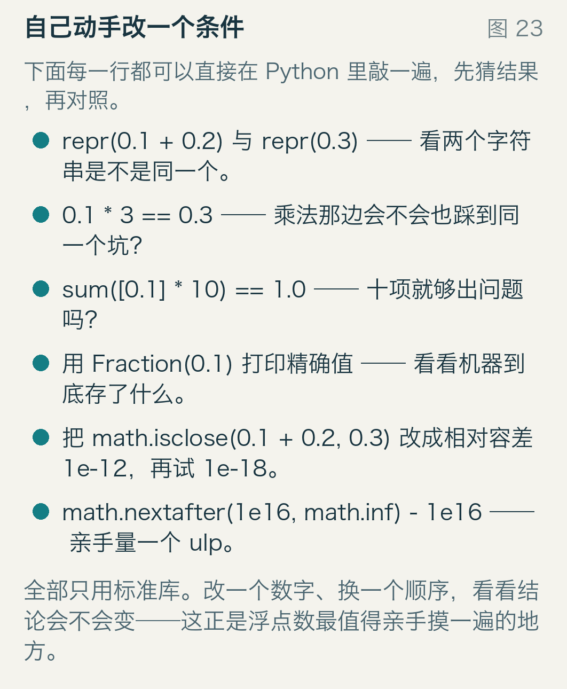

1. `repr(0.1 + 0.2)` 与 `repr(0.3)` —— 看两个字符串是不是同一个。
2. `0.1 * 3 == 0.3` —— 乘法那边会不会也踩到同一个坑？
3. `sum([0.1] * 10) == 1.0` —— 十项就够出问题吗？
4. `Fraction(0.1)` 打印精确值 —— 看看机器到底存了什么。
5. 把 `math.isclose(0.1 + 0.2, 0.3)` 的相对容差从默认的 1e−9 改成 1e−18，再试一次。
6. `math.nextafter(1e16, math.inf) - 1e16` —— 亲手量一个 ulp。

全部只用标准库。改一个数字、换一个顺序，看看结论会不会变——这正是浮点数最值得亲手摸一遍的地方。

## 动手材料

代码在 `examples/` 目录里，运行说明见 [README.md](README.md)，全部数值结果见 [examples/results.json](examples/results.json)。图和正文都从那里读。

## 图片来源

本文 23 张正文图与 1 张封面全部由 `examples/build_figures.py` 用 Python/Pillow 原创绘制，**没有使用任何第三方照片、图表或截图**，因此不涉及第三方素材的授权与署名。图中的位模式、十进制展开、误差数值全部由程序算出并从 `examples/results.json` 读取；图内的说明文字由作者撰写，但其中的数字同样是算出来的。详细尺寸、最小字号与身份见 [examples/figure-metadata.json](examples/figure-metadata.json)。
