# 七座桥，为什么一座都走不通？

1736 年，普鲁士的哥尼斯堡（今天的俄罗斯加里宁格勒）。

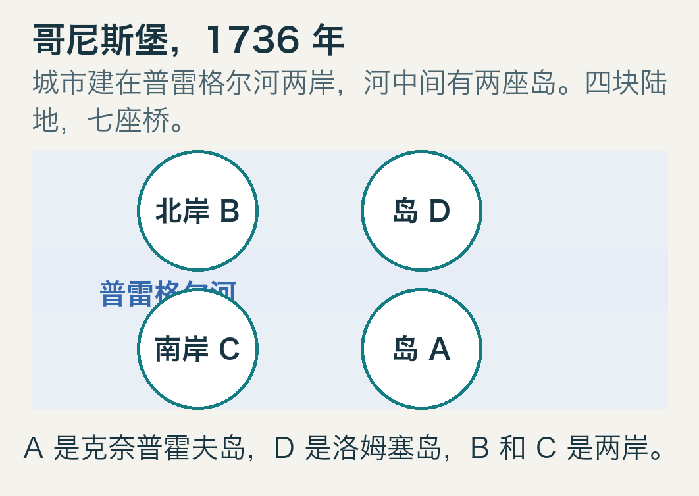

这座城市建在普雷格尔河上。河中间有两座岛，把城市分成了**四块陆地**：

- **A**：克奈普霍夫岛（河中间的大岛）
- **B**：北岸
- **C**：南岸
- **D**：洛姆塞岛（东边那块）

四块陆地之间，架着**七座桥**。

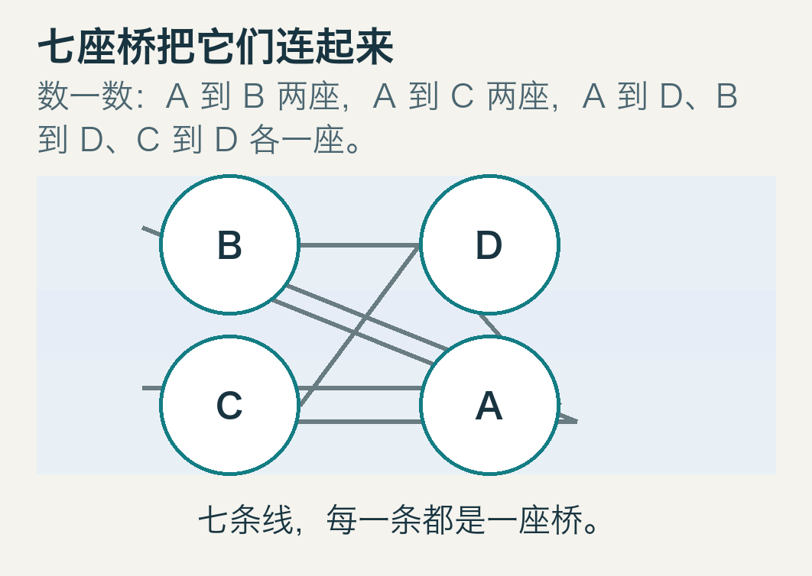

城里流传着一个问题：

> **能不能走一趟，把七座桥每座都恰好走一次？**

"恰好一次"的意思是：不能漏掉任何一座，也不能有任何一座走两遍。起点和终点在哪都行。

无数人试过，谁也没走通。但"我没走通"和"走不通"是两回事——也许只是还没找到对的路。

**这一年，数学家莱昂哈德·欧拉证明了：这条路线根本不存在。**

而且他证明的方式，比结论本身重要得多：**他没有去试任何一条路线。**

这篇文章讲的就是他怎么做到的。你不需要任何数学基础，只要会数数。

## 1. 先把规则说清楚

题目里有两件事必须说明白，否则容易钻空子：

- 你不能坐船、不能游泳、不能从别的地方绕到另一块陆地上——**只能走桥**。
- 走到一座桥的中间再退回来，不算"走完这座桥"。你必须从一头走到另一头。

在这个规则下，"一趟走完七座桥"就是：找一条路线，让它**把七条线每条都恰好用一次**。

## 2. 最直接的办法：试

最笨的办法是一条一条试。

从 A 出发，走这座桥到 B，再走那座桥回 A……试到某一步发现无路可走，退回来换一条。

七座桥的走法总数不算天文数字，程序几毫秒就能全部试完。**结果是一条也走不通。**

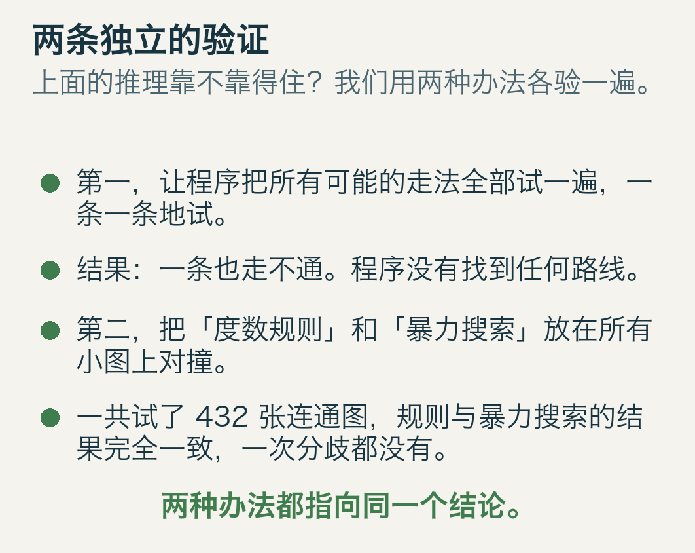

但这里有个问题：**"我试完了所有走法，都不行"这个结论，只在桥的数目很少的时候才可信。** 如果是一百座桥呢？走法的数量会爆炸到试不完。

欧拉要的不是"我试过了"，而是"**我能说清楚为什么它一定不行**"。

这就是数学和碰运气的区别。

## 3. 关键的一步：把形状扔掉

欧拉做的第一件事，是**把地图扔掉**。

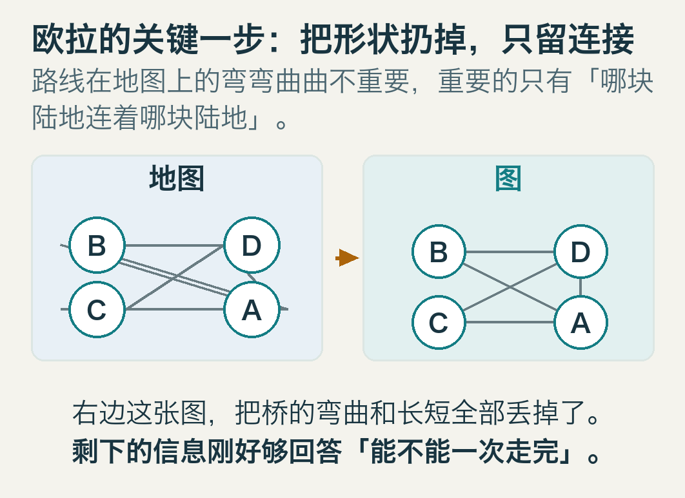

他注意到：

- 你在每块陆地上怎么绕、走的是哪条小巷、桥是直的还是弯的、两块陆地相距多远——**这些全都跟问题无关**。
- 唯一有关系的，是**哪块陆地连着哪块陆地，以及连了几座桥**。

于是他做了一次抽象：

- 每块陆地画成**一个点**；
- 每座桥画成**一条线**，连在它两端的点上。

地图上那些弯弯曲曲的形状全被丢掉了，剩下的东西叫**图**（graph）。

**这一步是整篇文章最重要的地方。** 它把一个"走路"的问题，变成了一个"点和线"的问题。而点和线是可以数的。

欧拉自己在论文里说得很清楚：这类问题只跟"连接的方式"有关，跟形状和距离无关。这句话在当时是全新的——**它是今天整个图论的起点。**

## 4. 数一个数：度数

现在给每块陆地数一个数。

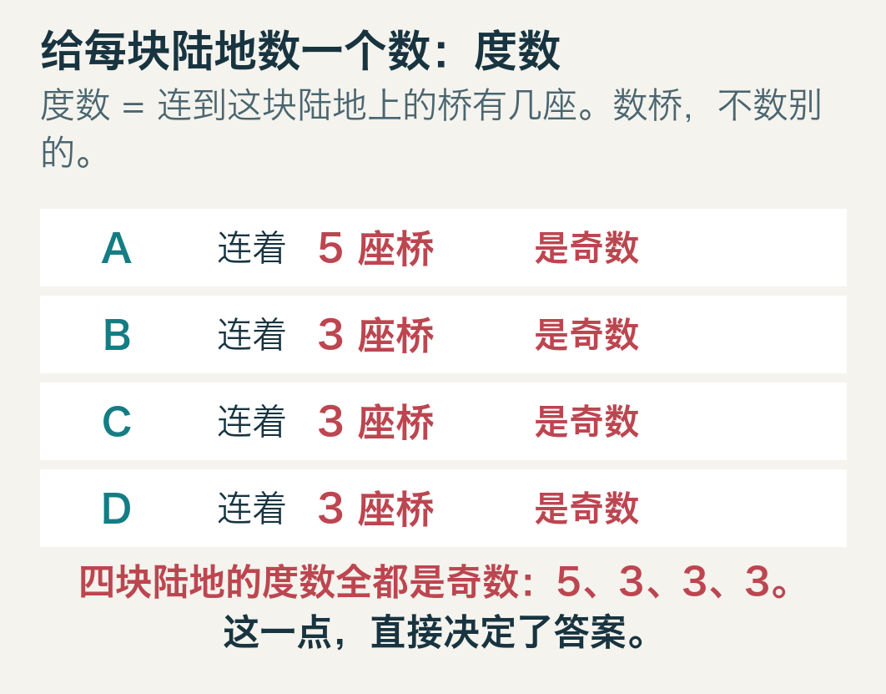

**度数 = 这块陆地上连了几座桥。**

数一数：

| 陆地 | 连着几座桥 | 度数 |
|---|---|---|
| A（克奈普霍夫岛） | 到 B 两座、到 C 两座、到 D 一座 | **5** |
| B（北岸） | 到 A 两座、到 D 一座 | **3** |
| C（南岸） | 到 A 两座、到 D 一座 | **3** |
| D（洛姆塞岛） | 到 A、B、C 各一座 | **3** |

注意：**四块陆地的度数全都是奇数**——5、3、3、3。

这一点，直接决定了答案。接下来看为什么。

## 5. 核心推理：进去一次，就得出来一次

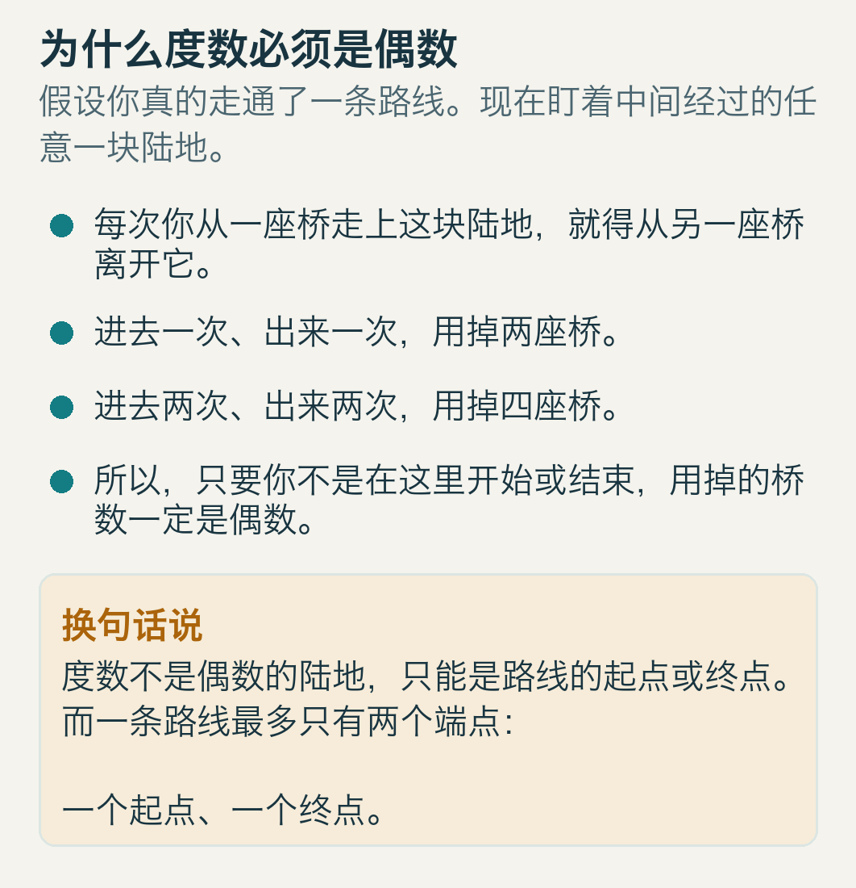

现在假设你**真的**走通了一条路线。

盯着这条路线经过的**任意一块陆地**，比如 B。假设你不是在 B 出发，也不是在 B 结束——**B 只是你路过的一个地方。**

那么：

- 你从某座桥**走进** B。
- 你总得离开 B 吧？那你从另一座桥**走出去**。
- 进去一次、出来一次，用掉了 **2** 座桥。

如果你后来又路过 B 一次：再进去一次、再出来一次，用掉 **4** 座桥。

**关键就在这里**：只要你不在 B 出发或结束，你在 B 用掉的桥，永远是"成对"的。

所以：

> **一块陆地的度数，如果不是偶数，那它只能是这条路线的一头一尾。**

## 6. 于是矛盾出现了

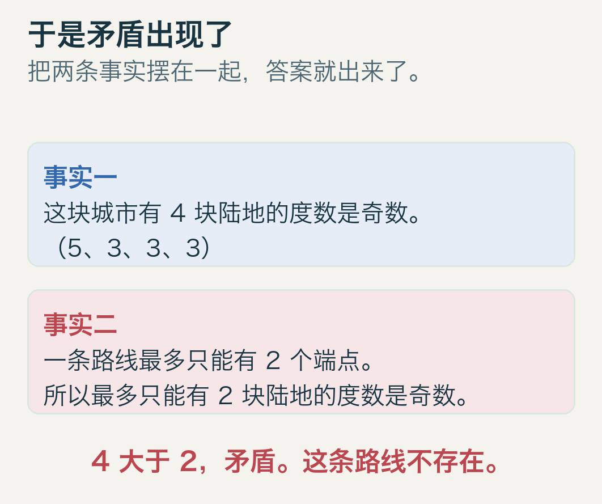

把两条事实摆在一起：

**事实一**：哥尼斯堡有四块陆地，度数分别是 5、3、3、3——**四块全都是奇数**。

**事实二**：一条路线只有**两个端点**：一个起点、一个终点。所以最多只能有**两块**陆地的度数是奇数。

**4 大于 2。矛盾。**

所以这条路线不存在。**不是"很难找"，是"根本不存在"。**

这个推理里没有试过任何一条路。你只要数四个数，就能确定一个走了几百年没人走通的答案。

## 7. 这个规则还能用在哪：一笔画

同样的问题，换一个样子就是小时候玩过的**一笔画**：能不能不抬笔、不重复地画完一个图形？

判据完全一样。

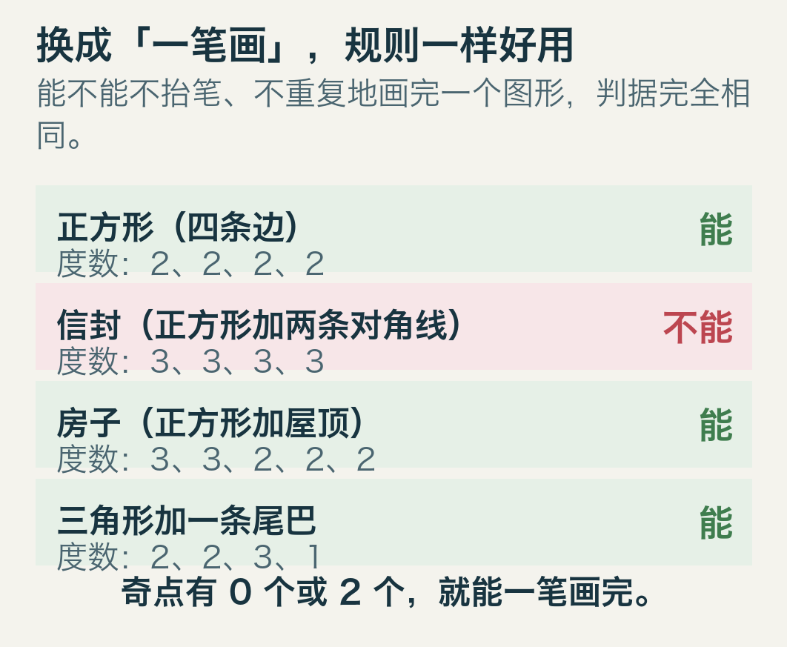

我们让程序判了四个图形：

| 图形 | 各点度数 | 奇点个数 | 能不能一笔画 |
|---|---|---|---|
| 正方形 | 2、2、2、2 | 0 | **能** |
| 信封（正方形加两条对角线） | 3、3、3、3 | 4 | **不能** |
| 房子（正方形加屋顶） | 3、3、2、2、2 | 2 | **能** |
| 三角形加一条尾巴 | 2、2、3、1 | 2 | **能** |

信封那个图形，和哥尼斯堡是同一类：**四个奇点，走不通。**

## 8. 三种情形，两个名字

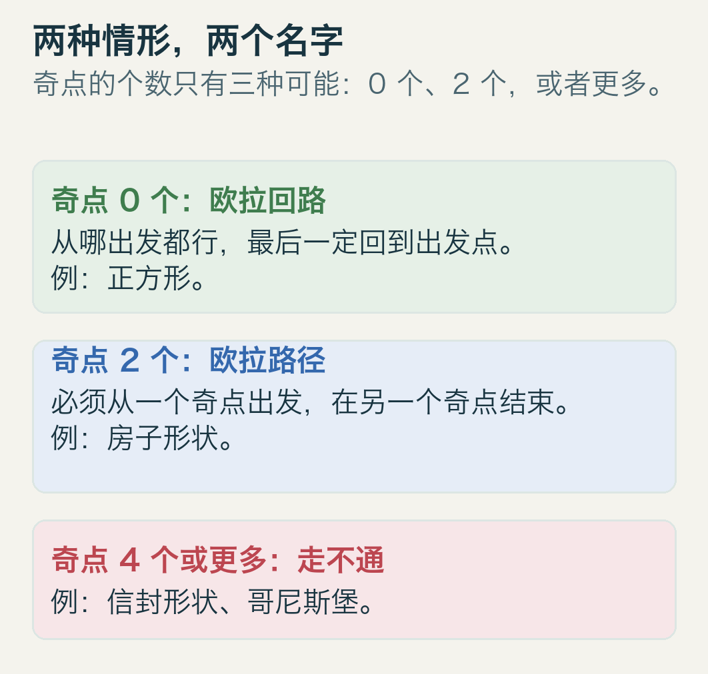

奇点的个数，只有三种可能：

**奇点 0 个：欧拉回路。** 从哪出发都行，最后一定回到出发点。这种走法叫**欧拉回路**。

**奇点 2 个：欧拉路径。** 必须从一个奇点出发，在另一个奇点结束。这叫**欧拉路径**。

**奇点 4 个或更多：走不通。**

顺便说一下，这个判定条件分两步才完成：

- **欧拉在 1736 年给出了这个条件，并证明了"不满足就一定不行"**（必要性）。
- **"满足就一定行"（充分性）那一半，直到 1873 年才由 Carl Hierholzer 补上证明。**

Hierholzer 顺带给出了一个能**实际找出路线**的算法。所以今天你要走一条欧拉路径，程序用的就是他 150 年前的方法。

## 9. 三百多年后，答案变了

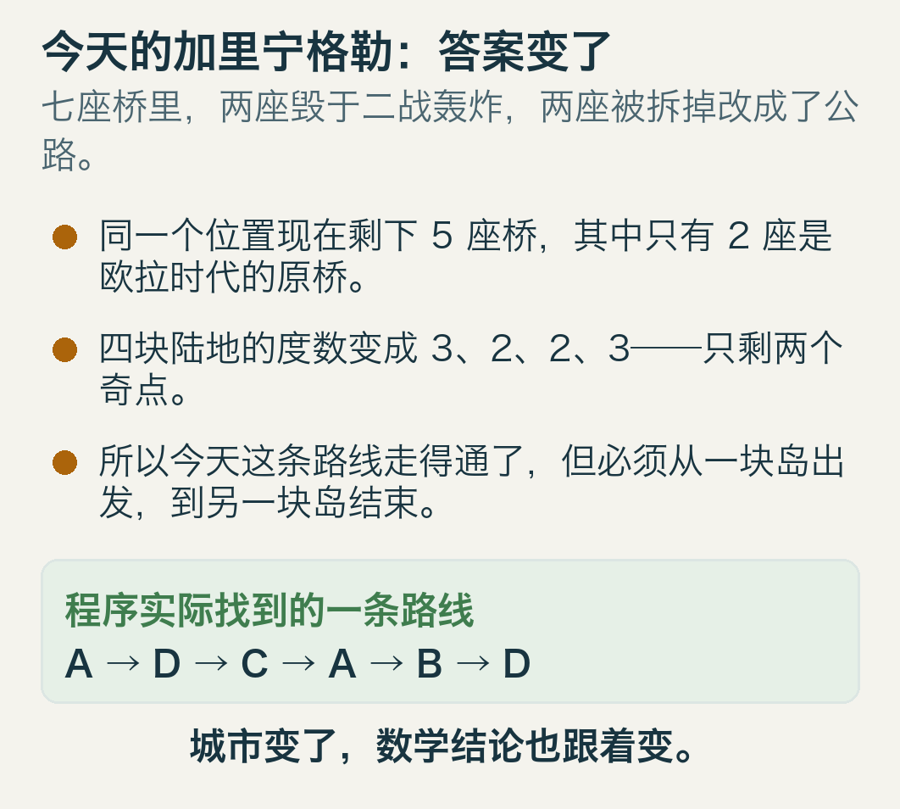

故事到这里还没完。

哥尼斯堡在二战中被轰炸，**七座桥里有两座没能留下来**。后来又有两座被拆掉，改成了公路。同一个位置，现在剩下 **5 座桥**，其中只有 2 座是欧拉时代的原桥。

重新数一遍度数：**3、2、2、3**——只剩**两个**奇点。

所以：

> **今天这条路线走得通了。** 但必须从一块岛出发，到另一块岛结束。

程序实际找出来的一条路线是：

```
A → D → C → A → B → D
```

**城市变了，数学结论也跟着变。** 这是数学和现实之间一种很有意思的关系：数学本身不会变，但它对现实的结论，取决于现实长什么样。

## 10. 如果允许重复走几趟呢

现实里的很多问题，比"恰好走一次"宽松：**允许重复走几趟，只要每条路都走到就行。**

送信、扫雪、收垃圾，都是这种问题。

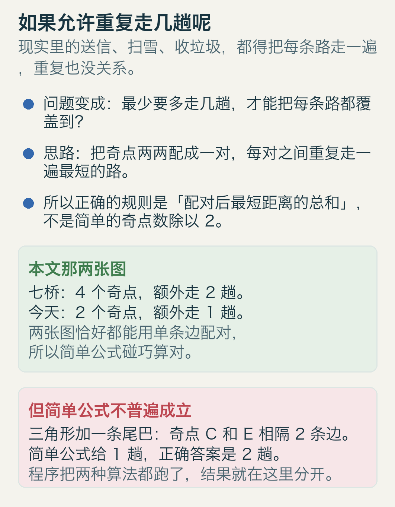

问题变成：**最少要多走几趟？**

思路是这样的：重复走一趟，相当于把**两个奇点配成一对**，让它们的度数变成偶数。所以问题变成：**怎么配对，让重复的趟数最少？**

一个很自然的想法是：

> 奇点个数 ÷ 2

代进去：哥尼斯堡有 **4** 个奇点，所以额外走 **2** 趟；今天只剩 **2** 个奇点，额外走 **1** 趟。

**这个公式在本文这两张图上是对的。但它并不普遍成立。**

看这个图形：一个三角形 A-B-C，再从 C 拉出一条尾巴 C-D-E。

- 度数：A=2、B=2、C=3、D=2、E=1
- 奇点只有两个：**C 和 E**
- 按上面的公式，应该是 2 ÷ 2 = **1** 趟

**但实际上是 2 趟。** 因为 C 和 E 中间隔着 D，你要把整条尾巴走完再回来，C-D 和 D-E 都得各重走一遍。

所以正确的规则是：

> **把奇点两两配对，让每一对之间的最短距离加起来最小；这个总和就是最少重复趟数。**

程序把两种算法都跑了：本文那两张图**恰好**都能用单条边配对，所以简单公式碰巧算对了。换成上面那个三角形加尾巴，两个结果就分开了（1 对 2）。

**"在一个例子上成立"和"普遍成立"是两件事。** 这是这一节最值得记住的地方。

这个问题有个名字叫**中国邮递员问题**，1960 年代由中国数学家提出。它有个很好的性质：**能精确求出最优解**，不像"旅行商问题"那样难到至今没有高效算法。

（顺便说，旅行商问题问的是"每个城市都去一次、路程最短"，跟邮递员问题的区别是：邮递员要覆盖每条**路**，旅行商只要覆盖每个**城市**。一字之差，难度天差地别。）

## 11. 最出人意料的用处：拼 DNA

你可能会觉得，七座桥是一道三百年前的谜题，跟今天没关系。

**它在今天有一个你意想不到的用处。**

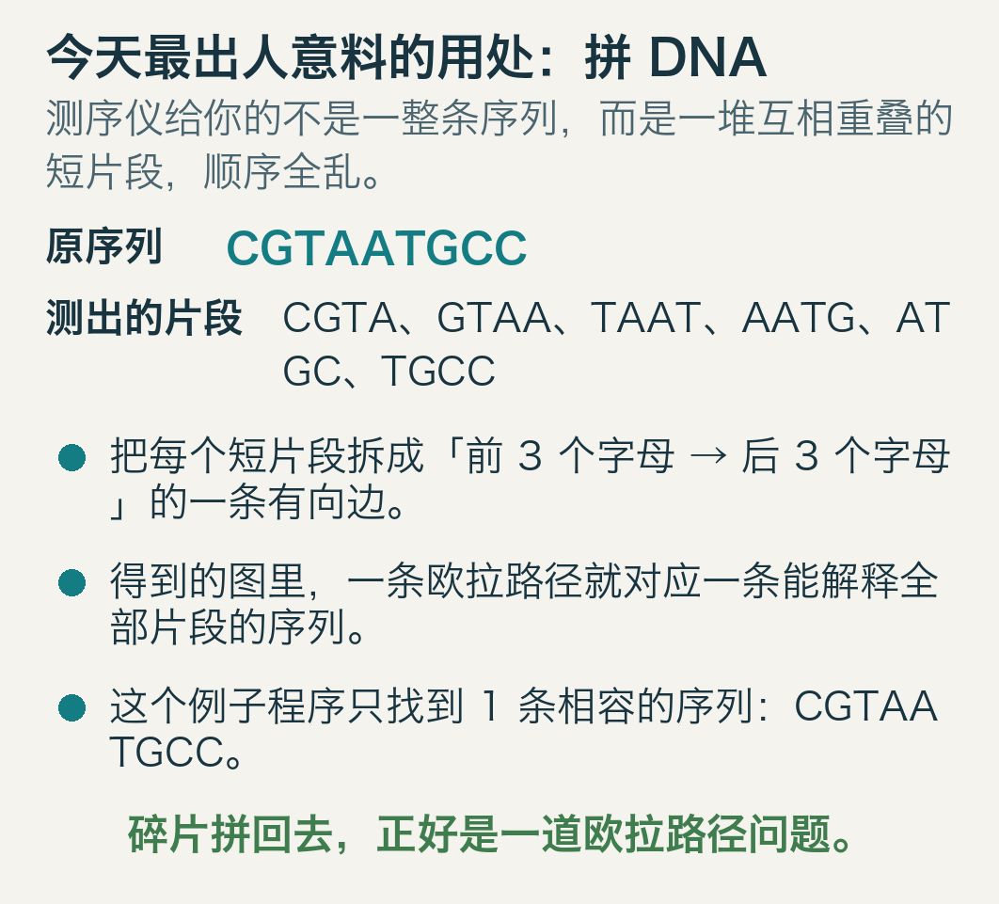

事情是这样的。测序仪读 DNA 的时候，**它读不出一整条序列**。它只能读出很多**很短的重叠片段**，而且这些片段的**顺序是乱的**。

比如真实序列是：

```
CGTAATGCC
```

测序仪交给你的是这些片段（顺序打乱）：

```
CGTA、GTAA、TAAT、AATG、ATGC、TGCC
```

**现在请把它们拼回原来的顺序。**

欧拉的方法在这里出现了。把每个片段看成一条**有向的边**：前 3 个字母指向后 3 个字母。

- `CGTA` 就是 `CGT → GTA`
- `GTAA` 就是 `GTA → TAA`
- ……

每个片段都变成一条边，所有片段合起来就是一张图。接下来：

1. **在这张图上找一条欧拉路径**——每条边恰好走一次。
2. 沿着这条路径，把字母接起来，就是原序列。

这个例子程序找到了唯一的一条路径，拼出来的正是 `CGTAATGCC`。

**三百年前为散步发明的方法，成了今天基因组组装里的一种基本工具。** 这类图现在叫 **de Bruijn 图**。

## 12. 但重复的片段会让它失效

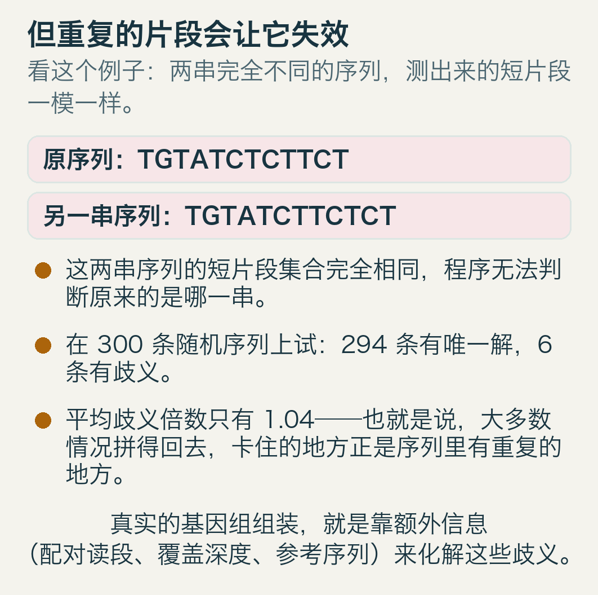

欧拉路径不一定只有一条。看这个例子：

```
原序列：      TGTATCTCTTCT
另一串序列：  TGTATCTTCTCT
```

这两串序列**不一样**。但它们的短片段集合**完全相同**。

所以程序看到那堆片段时，**根本无法判断原来的是哪一串**。这不是程序不够聪明，是信息本身不够——**两个不同的答案，产生了完全相同的数据。**

在 300 条随机序列上试了一遍（长度 8 到 12 个字母，k = 4——这是玩具规模，不是真实基因组）：

| | 数量 |
|---|---|
| 短片段能唯一确定序列 | **294** 条 |
| 有歧义（2 条或更多答案） | 6 条 |
| 平均歧义倍数 | 1.04 |

也就是说：**大多数情况拼得回去，卡住的地方正好是序列里有重复的地方。**

真实的基因组组装就是在这里花掉大量精力的。它靠**额外信息**来化解歧义：把同一段读很多遍（覆盖深度）、用两端都能读到的配对片段、或者拿一个已知的近亲基因组当参照。

**这道题的核心困难，和哥尼斯堡是同一个：你手上的信息，够不够唯一地决定答案。**

## 13. 1736 年那篇论文

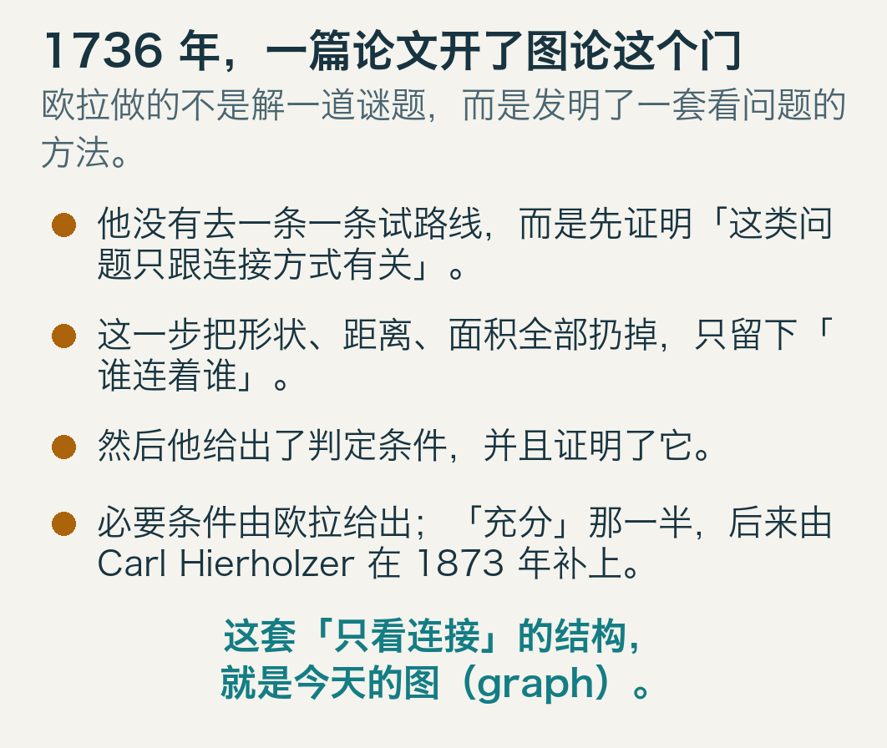

欧拉这一年发表的论文，题目大意是"关于位置几何的一个问题"。它的价值不在于解决了那道谜题——**谜题本身没多大意思**。

它的价值在于**方法**：

1. **先问"这个问题到底依赖什么"。** 他发现只依赖连接方式，不依赖形状。
2. **把不相关的信息全部扔掉**，得到一个更简单的结构（图）。
3. **在这个结构上找一个能判定的性质**（度数的奇偶性）。
4. **证明了"不满足就一定不行"**（必要性）。"满足就一定行"那一半，要等 1873 年 Hierholzer 来补。

这四步，是数学建模的标准流程。**今天你在任何一本讲"怎么把现实问题变成数学问题"的书里，看到的都是这套流程。**

而欧拉当年面对的困难，不只是想不出答案，而是**当时根本没有一套现成的语言能把这个论证写清楚**。他得先发明那套语言。

这就是为什么人们说：**图论从 1736 年这篇论文开始。**

## 14. 自己动手改一个条件


这一篇你完全不需要电脑——**一支笔和一张纸就够了**。

四个建议的改动：

1. **给七桥加一座桥。** 加在哪两块陆地之间，才能让路线走得通？（提示：要让奇点的个数从 4 变成 0 或 2。加一座桥会让它连着的两块陆地的度数各加 1。）
2. **拆掉一座桥。** 拆哪一座，能让奇点从 4 个变成 2 个？
3. **把第 7 节那四个图形自己画一遍。** 先按度数判断能不能一笔画，再动手画，看判断对不对。
4. **把 DNA 例子的 k 从 4 改成 3 或 5。** 歧义会变多还是变少？为什么？

最后一个问题留给你：

> **如果一个图形的奇点有 6 个，至少需要抬几次笔才能画完？**

（提示：每抬一次笔，就多出一条独立的路线。一条路线能处理 2 个奇点。）

## 动手材料

- [图算法与判定规则的完整代码](examples/graphs.py)与[实验脚本](examples/run_model.py)
- [本文全部数字的原始结果](examples/results.json)与[程序原始输出](originals/model-stdout.txt)
- [本文全部原创图的重绘代码](examples/build_figures.py)
- [运行环境与复现说明](README.md)
- [一手来源、素材身份与 AI 辅助说明](sources.md)

本文只用 Python 标准库。原创正文与原创图采用 CC BY 4.0；原创代码采用 MIT 许可。

## 图片来源

本文全部配图为原创绘制，没有使用任何第三方照片或地图。
