# 换，还是不换？

假设你站在一个游戏节目的舞台上。

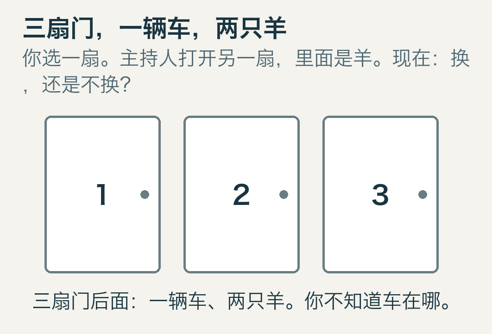

主持人指着三扇关着的门，告诉你：

- 三扇门后面，**一辆汽车，两只羊**。
- 你只能选一扇。选中的那扇门后面是什么，那东西就归你。
- 你不知道车在哪一扇后面。主持人知道。

你选了 **1 号门**。

主持人没有马上打开它。他走到 **3 号门**前面，把它推开——里面是一只羊。

然后他转过身来问你：

> **"你要不要改成 2 号门？"**

现在场上还剩两扇关着的门：你选的 1 号，和主持人没开的 2 号。车一定在这两扇中的一扇后面。

**换，还是不换？**

大多数人第一次听到这道题，会觉得"两扇门，一扇有车，那不就是一半一半吗？换不换都一样"。

这个感觉非常强，强到 1990 年这道题登上美国《Parade》杂志的专栏之后，**大约一万名读者写信到杂志社说作者答错了**，其中近一千人拥有博士学位。

但答案是：**换。换的胜率是不换的两倍。**

这篇文章不要求你会编程，也不要求你学过概率。我们只用两种办法把这件事算清楚：**把所有可能的情形一个一个列出来数**，以及**真的用程序跑二十万次**。两种办法会给出同一个答案。

## 1. 先把规则说清楚

这道题最容易出错的地方，不是算不出来，而是**题目本身没说清楚**。

关键在于主持人。他不是随便推开一扇门——他**知道车在哪**，而且他有一套必须遵守的规矩：

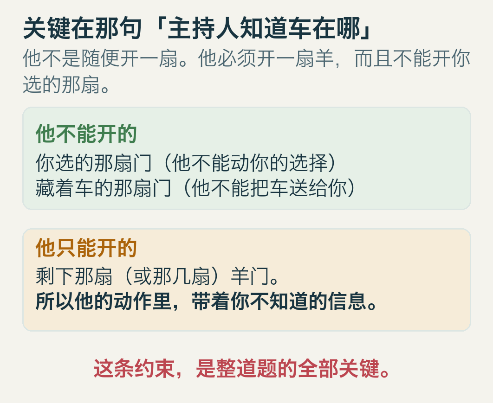

- 他**不能**开你选的那扇门。
- 他**不能**开藏着车的那扇门。他必须开一扇羊门。
- 他**一定会**问你换不换。他不会只在某种情况下才问。

这三条合起来，意味着他的动作**带着信息**。

举个对比就明白了。假设主持人根本不知道车在哪，他只是随便推开一扇门，结果碰巧是羊——那他的动作就纯属运气，什么信息也没带。这两种情况看起来一模一样（都是"他开了一扇门，里面是羊"），但答案完全不同。我们后面会算出这个差别。

**先记住这句话：概率不只取决于你看到了什么，还取决于这件事是怎么发生的。**

## 2. 最可靠的办法：把情形全部列出来

遇到这种"感觉说不清"的概率题，有一个笨但绝不会错的办法：**把所有可能的情况列成一张表，然后数。**

这道题的情况到底有多少种？我们一个个数：

- 车可能在 **1 号、2 号或 3 号**门后面 —— 3 种
- 你可能选 **1 号、2 号或 3 号**门 —— 3 种

3 × 3 = **9 种情况**。每一种出现的可能性是一样的。

那主持人开哪扇门，是第 10 个变量吗？**不是。** 因为规则已经把他的选择定死了：

- 如果你选的门**正好**是车，那么另外两扇都是羊，他随便开哪一扇都行。
- 如果你选的门**不是**车，那么另外两扇里一扇是车、一扇是羊，他**只能**开那扇羊门。

所以主持人开哪扇门，不是一个新的独立变量。**不过要留意一种情况**：如果你一开始就选中了车，那么另外两扇都是羊，他**有得选**——这时开哪扇由他自己定（第 10 节会看到，他选哪一扇会影响条件概率）。但无论他选哪一扇，九种情形的**总数**不变，所以下面的计数照样成立。

## 3. 九种情况，一个一个数

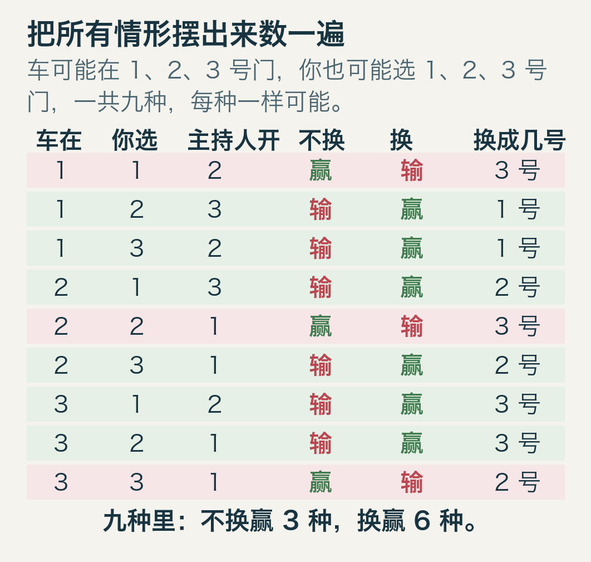

上面这张表是程序真的跑出来的一遍，但你可以自己手算验证。我们举其中两行看看怎么读：

**第一行**：车在 1 号门，你选了 1 号门。你选对了。主持人从 2、3 里随便开了一扇（这里开 2 号），剩下 3 号。
→ **不换：赢。换：输。**

**第二行**：车在 1 号门，你选了 2 号门。你选错了。剩下 1 号和 3 号，其中 1 号是车，所以主持人**只能**开 3 号。剩下 1 号。
→ **不换：输。换：赢。**

九行全部数完：

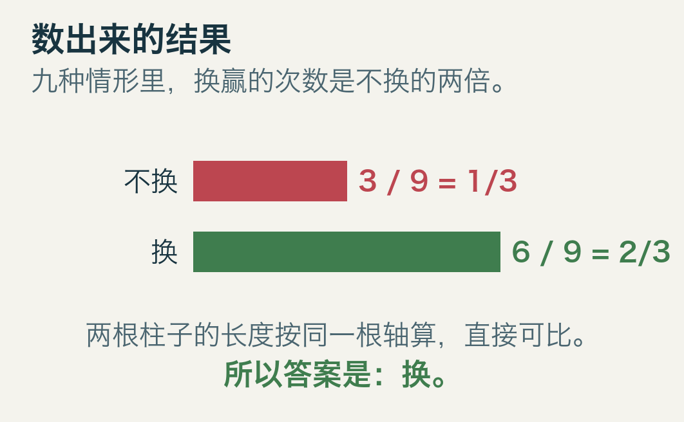

| | 赢的次数 | 胜率 |
|---|---|---|
| 不换 | **3** 次 | 3/9 = **1/3** |
| 换 | **6** 次 | 6/9 = **2/3** |

**换的胜率是不换的两倍。** 这个结论没有用到任何公式，就是数出来的。

你也可以自己动手验一遍：拿三张纸条，写上"车""羊""羊"，扣过来洗一洗，然后重复上面的规则做十几次，记下"不换赢了几次、换赢了几次"。次数少的时候数字会乱跳，但做的次数越多，越会往 1/3 和 2/3 靠。

## 4. 为什么直觉会说是"一半一半"

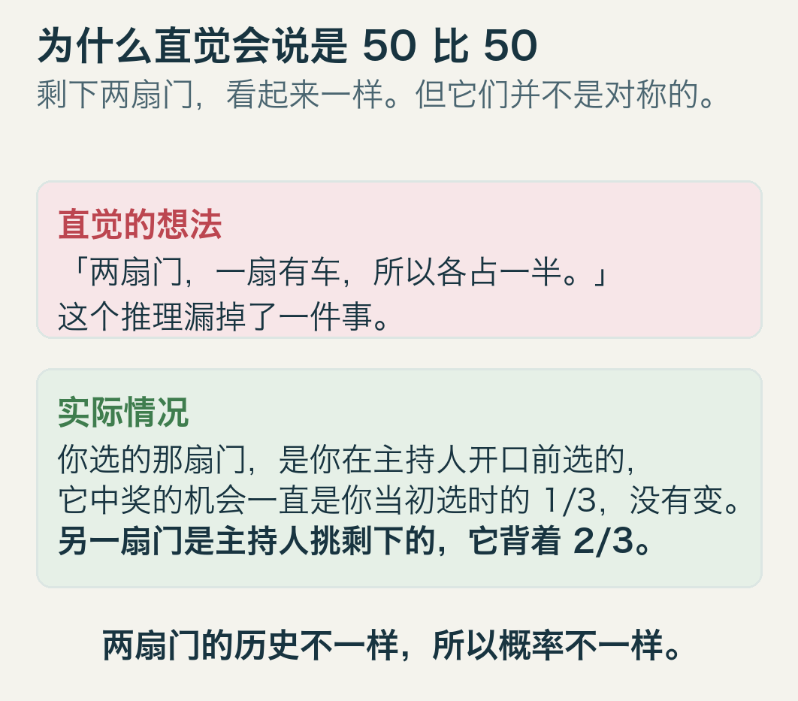

"剩下两扇门，车在其中一扇后面，所以各占一半"——这个推理听起来无懈可击，问题出在**它把两扇门当成对称的了，但它们并不对称**。

想一想这两扇门的"经历"：

- **1 号门**是你选的。你在主持人开口之前就选了它。它中奖的机会，从那一刻起就是 **1/3**，而且主持人开了一扇羊门这件事，**没有改变**它中奖的可能性。
- **2 号门**是主持人**挑剩下的**。他不能开你的门，也不能开车门——所以他避开 2 号门不打开，这件事本身就说明问题。如果 2 号门后面是羊，他本来是可以把它打开给你看的。现在 3 号被排除了，**那 2/3 就全落在 2 号门上**。

换一个说法：**你当初选错的概率是 2/3。** 如果你一开始就选错了（概率 2/3），那么车一定在另外两扇里。主持人把那两扇中的一扇羊门排除掉之后，剩下的那扇**必然**是车。

所以：

> **只要你一开始选错，换就一定赢。而你一开始选错的概率是 2/3。**

这句话是整道题最短的解释。

## 5. 用贝叶斯再算一遍

如果你愿意看公式，这里还有第三种算法。它叫**贝叶斯公式**，做的事就是"看到新证据之后，怎么更新原来的判断"。

设你的选择是 1 号门，主持人打开了 3 号门。我们要算的是：**在这个观察之下，车在 1 号门的概率是多少？**

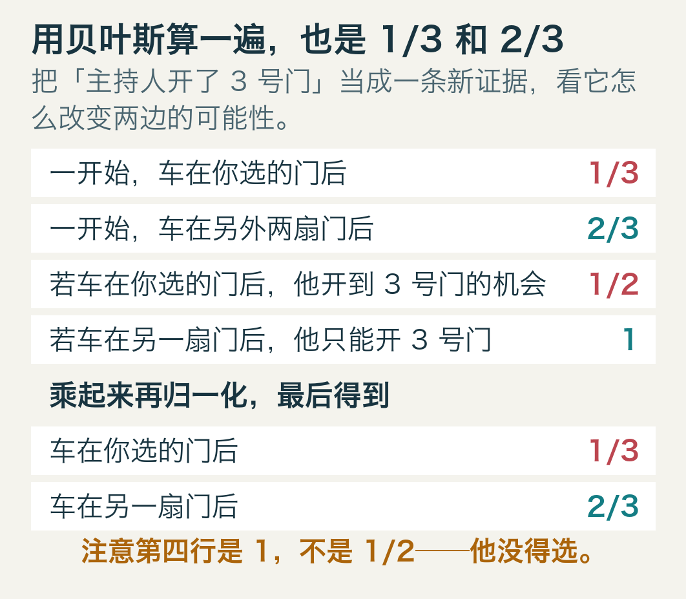

| 步骤 | 车在 1 号门后 | 车在 2 号门后 |
|---|---|---|
| 一开始的可能性 | 1/3 | 1/3 |
| 若如此，他开到 3 号门的机会 | **1/2** | **1** |
| 相乘 | 1/6 | 1/3 |
| 归一化后 | **1/3** | **2/3** |

关键在第三行那两个数为什么不一样：

- 如果车在 **1 号门**（也就是你选对了），那么 2 号和 3 号都是羊。主持人**有得选**，他开 2 号或 3 号各占一半。所以他开到 3 号的机会是 **1/2**。
- 如果车在 **2 号门**，那么 2 号是车、3 号是羊。主持人**没得选**，他只能开 3 号。所以他开到 3 号的机会是 **1**。

"没得选"这件事本身就是信息。他把 3 号门打开这个动作，在"车在 2 号"的世界里是必然发生的，在"车在 1 号"的世界里只有一半机会发生。所以这个观察**更支持**"车在 2 号"。

## 6. 真的跑二十万次

前两节是算出来的。现在让程序真的去玩二十万次这个游戏。

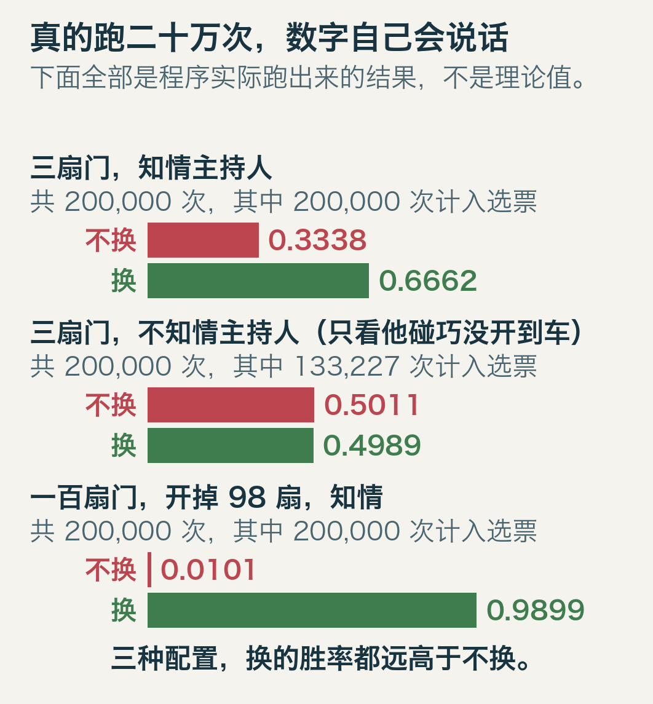

| 配置 | 不换的胜率 | 换的胜率 |
|---|---|---|
| 三扇门，开 1 扇（主持人知情） | 0.3338 | **0.6662** |
| 一百扇门，开掉 98 扇（知情） | 0.0101 | **0.9899** |
| 十扇门，开掉 8 扇（知情） | 0.1001 | **0.8999** |

三扇门那一行：0.6662 和 2/3 = 0.6667 只差 0.0005。这不是巧合——**试验做得越多，结果越贴近真实概率**。

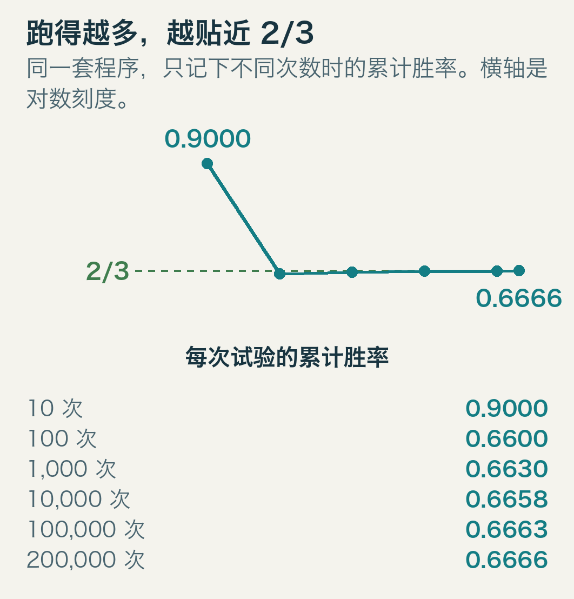

看这张收敛图。只跑 **10 次**的时候，换的胜率是 0.9——离 2/3 差得远，因为次数太少，运气占主导。跑到 **1,000 次**就降到 0.663，**20 万次**是 0.6666。

**"跑了十次，结果和理论不一样"不是理论错了，是次数不够。** 这是概率题里另一个常见的坑。

## 7. 把"主持人知道答案"这一条去掉

现在做这道题最有意思的一个实验。

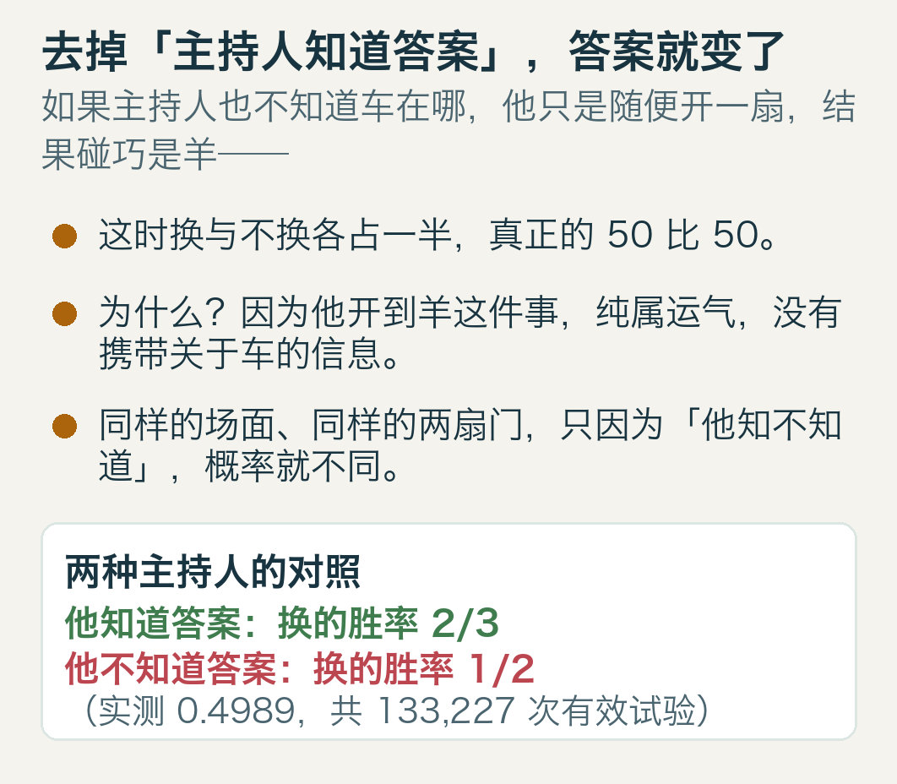

假设主持人**也不知道**车在哪。他随便推开一扇不是你的门，结果**碰巧**是一只羊。

表面上你看到的东西和原来完全一样：三扇门、你选了 1 号、主持人开了 3 号、里面是羊。但这次答案变了：

| 主持人 | 换的胜率 |
|---|---|
| 他知道答案 | **2/3** |
| 他不知道答案 | **1/2** |

程序跑出来的是 0.4989，就是 1/2。

为什么？因为他开到羊这件事，这次**纯属运气**。他本来有可能开到车（那样游戏就结束了，我们也不会看到现在这一幕）。把"他运气好"这种情况筛掉之后，剩下的局面里两扇门真的对称了。

**同样一个场面，只因为"他知不知道"，概率就不同。** 这是这道题最值得记住的一课：

> 你观察到的现象，和这个现象是**怎么产生的**，两者一起决定了概率。

## 8. 把门加到一百扇，直觉就追上来了

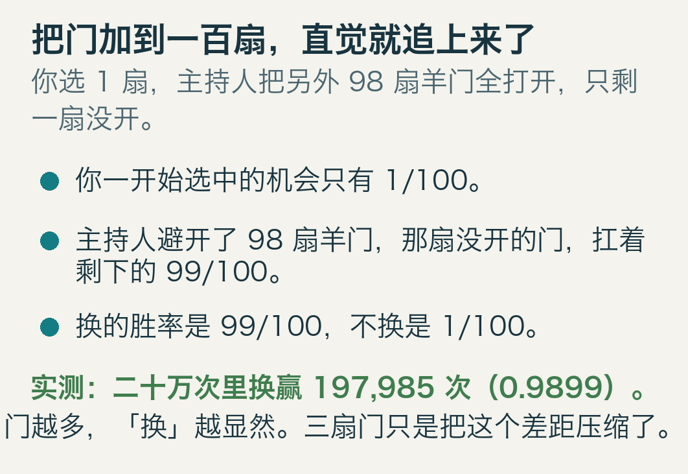

如果你还是觉得 2/3 难以接受，把这个版本想一遍：

**一百扇门，一辆车。** 你选 1 号门，选中的机会只有 1%。

然后主持人——他知道车在哪——把另外 99 扇门里的 **98 扇羊门**全部打开，只留下一扇没开，比如 77 号门。

现在只剩两扇门：你选的 1 号，和 77 号。

**你换不换？**

几乎所有人都会立刻说"换"。因为 77 号门是主持人**绕开了 98 只羊**才留下来的，它几乎不可能是随便剩的。

一百扇门的情况下，换的胜率是 **99/100**，程序实测 0.9899。

**三扇门只是把这个差距压缩了**：1/3 对 2/3，差距没有 1% 对 99% 那么刺眼，所以直觉就迷糊了。但背后的道理是同一个。

顺带说一句，这个"一百万扇门"的版本，正是当年专栏作者 Marilyn vos Savant 用来解释这道题的说法。她的原话大意是：**"你会飞快地换到那扇门上去，对吧？"**

## 9. 写成一般公式

把上面的规律写成公式，就是：

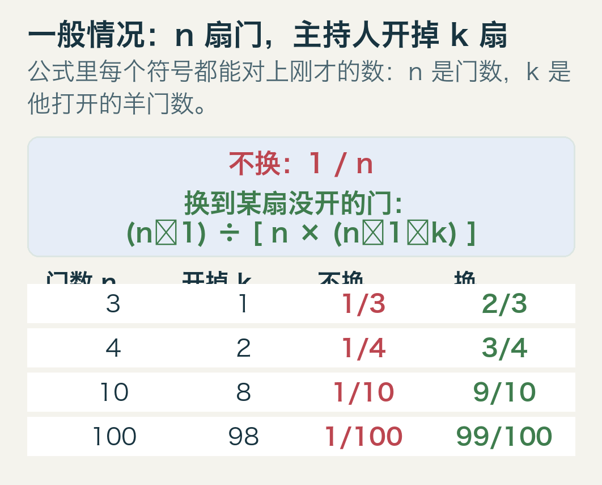

- **不换的胜率 = 1 / n**
- **换到某扇没开的门 = (n − 1) ÷ [ n × (n − 1 − k) ]**

其中：

- **n** 是一共有多少扇门；
- **k** 是主持人打开了几扇羊门。

代进去验一下：

| 门数 n | 开掉 k | 不换 | 换 |
|---|---|---|---|
| 3 | 1 | 1/3 | 2/3 |
| 4 | 2 | 1/4 | 3/4 |
| 10 | 8 | 1/10 | 9/10 |
| 100 | 98 | 1/100 | 99/100 |

**不换的胜率永远是 1/n**，因为你一开始就是在一共 n 扇门里瞎选。这一点跟主持人做什么完全无关。

## 10. 一个容易漏掉的细节

到这里，答案已经很清楚了。但还有一层，是很多人（包括一些教材）会讲错的地方。

我们前面一直说"换的胜率是 2/3"。这个 2/3 是**在不知道主持人开了哪扇门的情况下**算的。如果你**已经看到他开了 3 号门**，那条件变了。

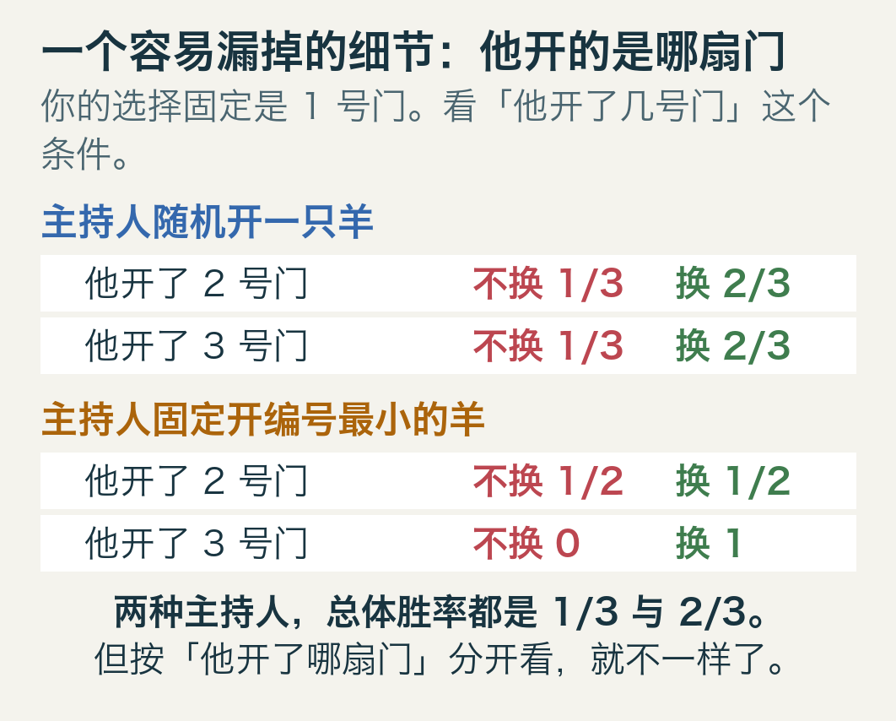

我们固定你选 1 号门，然后看两种不同的主持人风格：

**风格一：他随机开一只羊。** 那么无论他开的是 2 号还是 3 号，换的胜率都是 **2/3**。

**风格二：他固定开编号最小的那只羊。** 这时候就不一样了：

- 如果他开了 **2 号门**，换的胜率是 **1/2**。
- 如果他开了 **3 号门**，换的胜率是 **1**（必胜）。

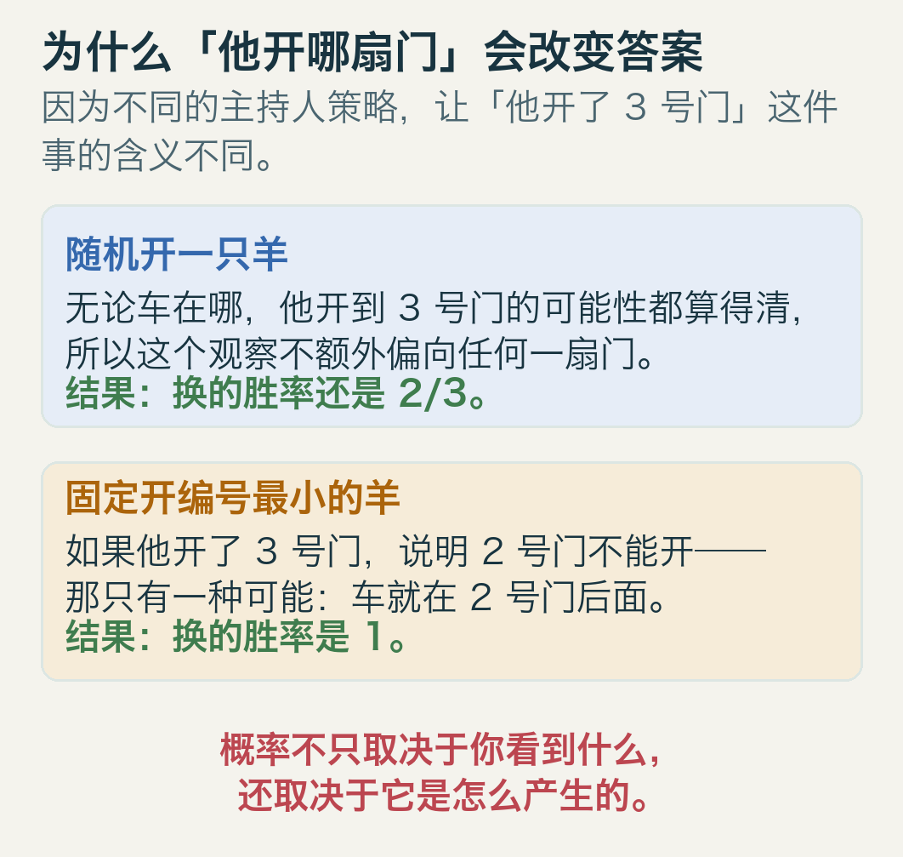

为什么开 3 号门就意味着必胜？因为他的规矩是"开编号最小的羊门"。如果 2 号门是羊，他就该开 2 号；他开了 3 号，说明 **2 号门不能开**——而 2 号门不能开只有一种原因：**车就在 2 号门后面**。

但注意：**两种风格下，总体胜率都是 1/3 与 2/3。** 程序把这两种风格的所有情况都枚举了一遍，加起来完全一样。

这就是概率论里一个很容易搞混的区别：

- **P(换会赢)** —— 不管他开哪扇门，都是 2/3。
- **P(换会赢 | 他开的是 3 号门)** —— 这个取决于他的策略。

**"条件概率"这四个字，说的就是后面这一种。** 加了条件之后，答案可以变，因为条件本身携带了信息。

## 11. 这道题是怎么出名的

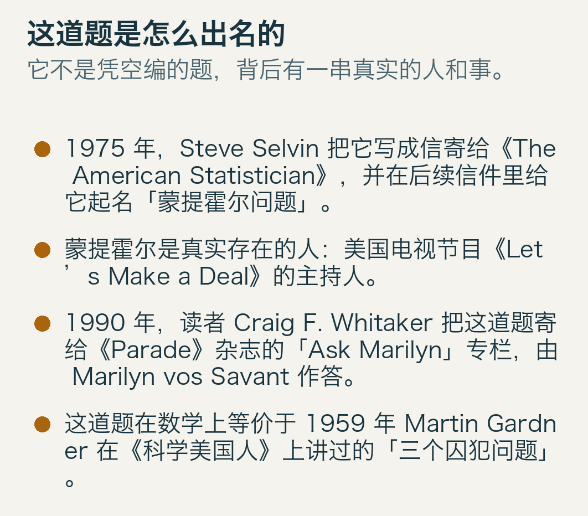

这道题不是凭空编出来的，它有一串真实的人和事：

- **1975 年**，加州大学伯克利分校的统计学家 **Steve Selvin** 把它写成信，寄给期刊《The American Statistician》，并在后来的信里给它起了"蒙提霍尔问题"这个名字。
- **蒙提霍尔是真实的人**：他是美国电视节目《Let's Make a Deal》的主持人。这道题的场景就是照着他的节目编的。
- **1990 年**，一位读者 **Craig F. Whitaker** 把这道题寄给《Parade》杂志的"Ask Marilyn"专栏，专栏作者 **Marilyn vos Savant** 给出的回答是"应该换"。
- 这道题在数学上**等价于 1959 年 Martin Gardner 在《科学美国人》上讲的"三个囚犯问题"**，我们下一节就讲它。

## 12. 专栏登出之后发生了什么

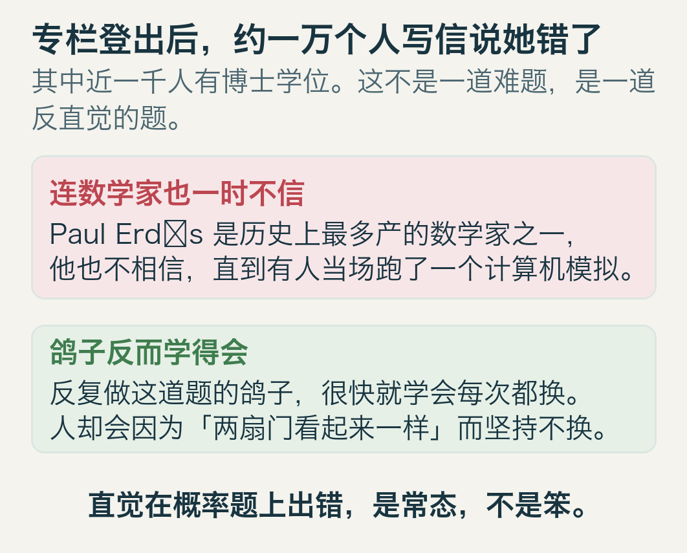

接下来的事情，是这道题真正出名的地方。

《Parade》登出这道题之后，**大约一万名读者写信到杂志社**，其中**近一千人拥有博士学位**，绝大多数人说 vos Savant 答错了。有的人措辞相当不客气。

更值得注意的是：**即使给了他们解释、模拟结果和正式证明，很多人仍然不接受。**

连 **Paul Erdős** 也不信。他是二十世纪最多产的数学家之一，据说他一开始也认为答案是 1/2，直到有人**当场跑了一个计算机模拟**给他看，他才改变看法。

有一个对比很有意思：**鸽子反而学得会。** 研究人员让鸽子反复做这道题，鸽子很快就学会每次都换——因为它们不管"道理"，只看哪种做法拿到的奖励多。人却会因为"两扇门看起来一样"而坚持不换。

**直觉在概率题上出错是常态，不是笨。** 一万个写信的人里有很多是受过严格训练的专业人士。这件事说明的不是他们不聪明，而是**人的直觉在概率面前特别不可靠**。

## 13. 同一个问题，换个壳子：三个囚犯

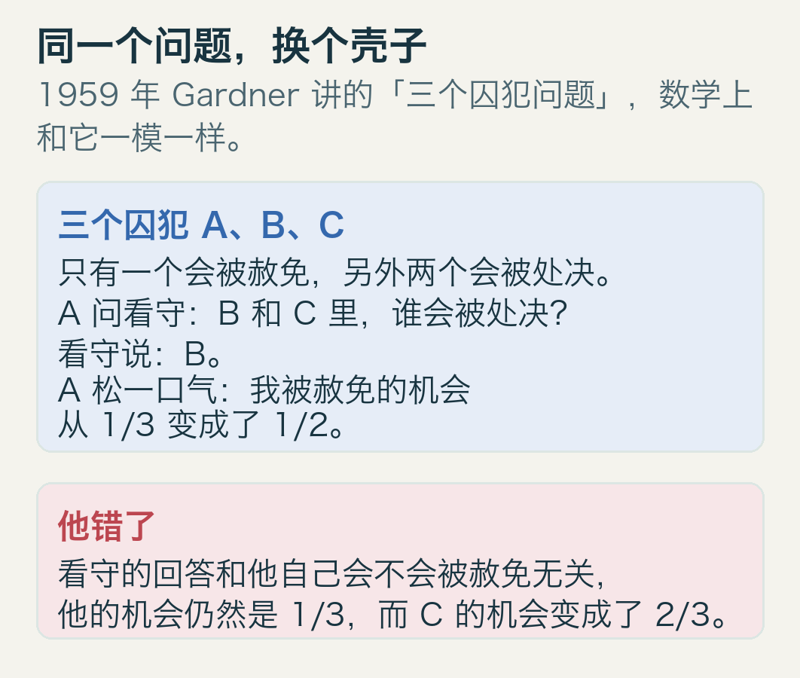

1959 年，Martin Gardner 在《科学美国人》上讲了这么一道题：

三个囚犯 **A、B、C** 被关在单独的牢房里，明天只有一个会被赦免，另外两个会被处决。每个人都知道这件事。

A 问看守："B 和 C 里，谁会死？"

看守说："B 会死。"

A 松了一口气：**"那我能活下来的机会从 1/3 变成 1/2 了！"**

**他错了。**

看守的回答**和 A 自己会不会被赦免没有关系**——不管 A 是死是活，B 和 C 里至少有一个会死，看守总能说出一个名字来。所以这条信息完全没有更新 A 的处境。

A 的机会仍然是 **1/3**。而 **C** 的机会变成了 **2/3**——因为看守在"能说的名字"里避开了 C，这个"避开"才携带了信息。

这和蒙提霍尔问题**在数学上是同一个问题**：

| 蒙提霍尔 | 三个囚犯 |
|---|---|
| 三扇门 | 三个囚犯 |
| 车 / 羊 | 赦免 / 处决 |
| 你选的门 | 囚犯 A |
| 主持人开的那扇门 | 看守说的那个名字 |
| 换门 | —— |

**同一个结构，换了身衣服，就又有大批人答错。** 这说明出错的原因不在题目的表面，而在于我们脑子里那个"剩下两个就是各一半"的直觉。

## 14. 这类错误为什么这么顽固

最后说一点"为什么"。

这类现象在心理学里有个名字，叫**"等可能性偏见"**：当一个随机过程的结果看起来对称时，我们倾向于认为每种结果的可能性相等。

在这道题里，剩下的两扇门**看起来**完全一样：都是关着的，都没有被打开过，都可能有车。所以大脑自动给它们各分了一半。

但**概率不是由东西现在长什么样决定的，而是由它能被产生出来的方式决定的**。1 号门和 2 号门现在看起来一样，但：

- 1 号门是你**随便**选的；
- 2 号门是主持人在**知道答案**的前提下，从剩下的门里**挑出来**的。

它们的历史不同，所以概率不同。

> **看起来对称，不等于真的对称。**

这句话不只在概率题里有意义。它也是统计学里很多陷阱的根源：幸存者偏差、辛普森悖论、抽样偏差——本质都是"两组数据看起来可以比，但其实产生方式不一样"。

## 15. 自己动手改一个条件

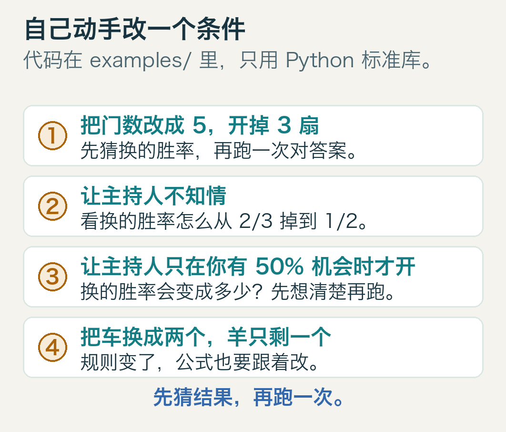

这道题的好处是，你不需要任何工具就能做实验。**用三张纸条、一个朋友，就能把上面大部分结论验一遍。**

四个建议的改动：

1. **把门数改成 5，主持人开掉 3 扇。** 先用手算公式猜一下换的胜率，再算一遍。
2. **让主持人不知情。** 规则改成"他随便开一扇，如果开到车就重新来"。看换的胜率怎么从 2/3 掉到 1/2。
3. **让主持人只在你有 50% 机会时才问。** 比如规则改成"他只在车在你选的门后面时才问你换不换"。这样换的胜率是多少？先想清楚再算——这一题的答案会让你重新理解"他一定会问"这条规矩有多重要。
4. **把车改成两辆，羊只剩一只。** 规则变了，公式也要跟着改。

最后一个问题留给你：

> **如果主持人只在"你选对了"的时候才问你换不换，你换不换？为什么？**

（提示：这道题里"他一定会问"是前提条件，去掉它，整个答案就塌了。）

## 动手材料

- [枚举、公式与模拟的完整代码](examples/monty.py)与[实验脚本](examples/run_model.py)
- [本文全部数字的原始结果](examples/results.json)与[程序原始输出](originals/model-stdout.txt)
- [本文全部原创图的重绘代码](examples/build_figures.py)
- [运行环境与复现说明](README.md)
- [一手来源、素材身份与 AI 辅助说明](sources.md)

本文只用 Python 标准库，不需要安装任何东西。原创正文与原创图采用 CC BY 4.0；原创代码采用 MIT 许可。

## 图片来源

本文全部配图为原创绘制，没有使用任何第三方照片。
