# 为什么炉子总是差那一点点？PID 控制器怎样学会自己找目标

把一台烤箱设到 180 °C，它真的会停在 180 °C 吗？打开温度计看看，通常你会发现它停在 176 或者 183，然后在 180 附近慢慢来回晃。

这不是烤箱坏。**几乎所有靠"测量—比较—调整"工作的机器，都会表现出同样的几种毛病**：永远差一点、冲过头、反应太慢、或者一换环境就失灵。而修这些毛病的办法，一百年前就有人写下来了，只有三项。

这篇文章要做的，是从一台最简单的炉子开始，把这三项一项一项加进去。每一项加进去之前，你会先看到"不加它会出什么问题"；加进去之后，你会看到"它到底解决了什么、又带来了什么新麻烦"。全程只用 Python 标准库，**每一张图里的曲线和数字都是本目录的程序实际跑出来的**，不是画上去的。

读完你会知道：

- 为什么"差多少补多少"永远补不平；
- 积分项为什么能补平，代价是什么；
- 微分项为什么能压住超调，代价又是什么；
- 为什么同一个控制器，换一个采样周期、或者加 15 秒延迟，就从"稳"变成"荡"；
- 怎么让两个 PID 串起来，把一个会倒的杆子立住。

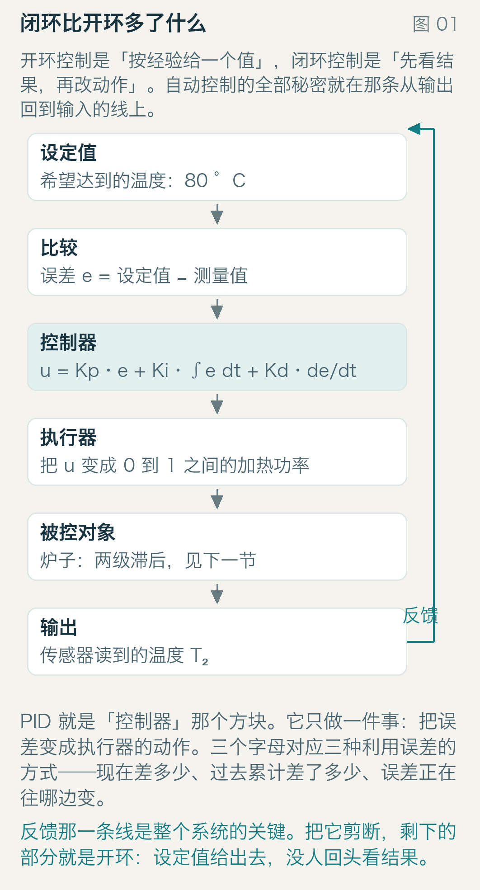

## 1. 先分清开环和闭环

假设你要烤东西，需要 180 °C。

**开环**的做法是：查一下手册，"180 °C 大概对应旋钮的 6 档"，然后拧到 6 档，走人。你从来没有回头看过温度计。这种方式的问题不是"旋钮不准"，而是**你放弃了纠正的机会**：今天室温 12 °C，明天 30 °C；今天烤一盘，明天烤三盘。同样的 6 档，结果不会一样，而你对此一无所知。

**闭环**的做法是：先拧一个值，看一眼温度计，发现是 150，就再拧大一点；再看，165；再拧……直到 180。这时候你做的事情里包含了一个完整的回路：

- 一个**设定值**（想要 180）；
- 一个**测量值**（温度计读到的数）；
- 一个**误差**（设定值减测量值）；
- 一个**控制器**（你，决定接下来怎么拧）；
- 一个**执行器**（旋钮，把决定变成实际的加热功率）；
- 一个**被控对象**（炉子本身）。

PID 就是上面那个"控制器"方块。它不关心炉子是什么做的、有没有风扇、是不是微波炉。**它只做一件事：把误差变成一个动作。** 三个字母代表三种利用误差的方式——现在差多少、过去一共差了多少、误差正在往哪边变。

把反馈那条线剪断，剩下的就是开环。整篇文章讲的，都是怎么设计这条线上那个方块。

## 2. 最原始的办法：只有开和关

不用任何参数的最简单控制器是开关式：低于设定值就全功率加热，到了就关掉。家里的恒温器、电熨斗、老式空调都是这个逻辑。

它有个必然的后果：**一定会来回震荡**。

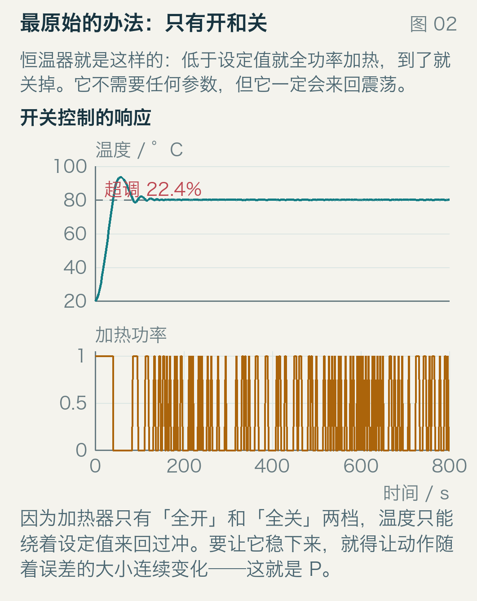

原因很直白：加热器只有"全开"和"全关"两档，没有中间状态。温度到了 80 °C 时，炉子其实还在往上冲——因为加热元件的热量还没散出去。等你关掉，它已经冲到 93.4 °C 了。程序跑出来：**超调 22.4%，峰值 93.4 °C**，来回晃了 110 秒才落进允许范围。

要让它稳下来，就得让动作**随着误差的大小连续变化**：差得多就加得猛，差得少就加得轻，正好到了就不加。这就是 P。

## 3. 先造一个能跑的炉子

后面所有实验都作用在同一个模型上。它必须足够简单，能心算；也必须足够真实，会震荡、会饱和、会受延迟影响。本文用的是**两级滞后**：

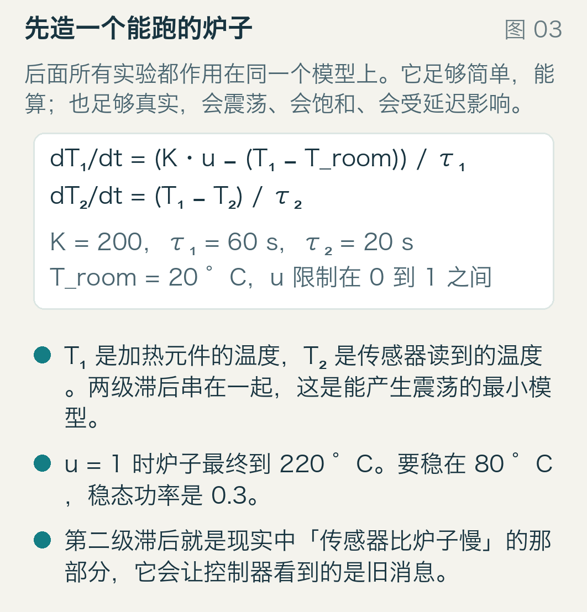

```
dT1/dt = (K·u − (T1 − T_room)) / τ1
dT2/dt = (T1 − T2) / τ2
```

- `T1` 是加热元件的温度，`T2` 是传感器读到的温度。
- `K = 200`：功率全开（`u = 1`）时，元件最终会比室温高 200 °C。
- `τ1 = 60 s`、`τ2 = 20 s`：两个"时间常数"，意思是"要跟上变化，大概需要这么久"。
- 室温 `T_room = 20 °C`，`u` 只能在 0 到 1 之间（加热器不能倒着吸热）。

三件事值得先算一遍：

1. **`u = 1` 时炉子最终到 220 °C**（20 + 200）。所以要让炉子稳在 80 °C，稳态功率必须恰好是 `(80 − 20) ÷ 200 = 0.3`。记住这个 0.3，后面反复要用。
2. **一级滞后配纯比例控制永远不会震荡**。闭环只剩一个实极点，把热量慢慢灌进去，温度就单调上升，仅此而已。（加上积分项就不同了——那又是一个二阶系统，见第 7 节。）**至少要两级滞后才可能震荡**——这也是为什么真实的炉子、热水器、电机都会晃：加热元件和传感器各是一级。
3. **第二级滞后就是"传感器比炉子慢"的那部分**。控制器看到的是二十秒前的世界。这个细节在后面会变成一个真正的麻烦。

代码在 `examples/control.py` 的 `Thermal` 类里，用最简单的显式欧拉法一步步积分。炉子的实验里积分步长就是控制周期（默认 0.1 秒，第 15 节会专门改它）；只有第 21 节的倒立摆用 0.01 秒。

## 4. 只有 P：差得越多，加得越猛

比例控制的公式只有一行：

```
u = Kp · e
```

`e` 是误差（设定值减测量值），`Kp` 是一个系数。差 60 度就加得猛，差 1 度就加得轻。

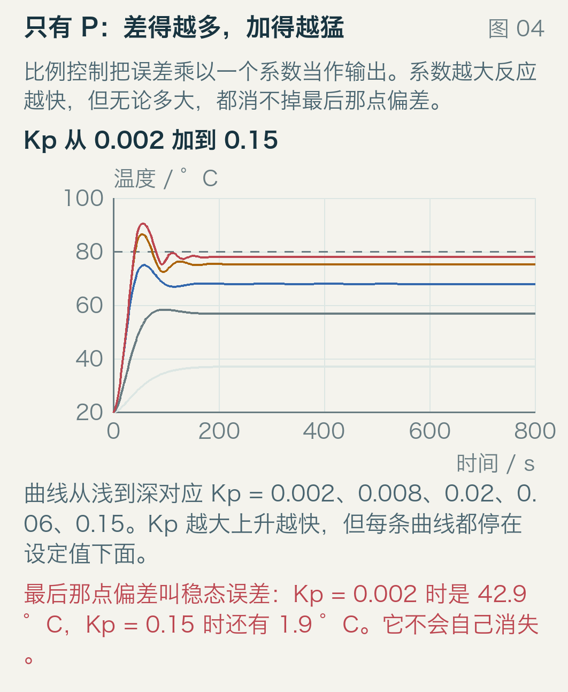

把 `Kp` 从 0.002 一路加到 0.15，会看到两件事：

- **`Kp` 越大，上升越快。** 这符合直觉。
- **但每一条曲线都停在设定值下面**，而且永远不会自己爬上去。

`Kp = 0.002` 时停在 37.1 °C，离目标差 42.9 度。`Kp = 0.15` 时停在 78.1 °C，还差 1.9 度。**误差变小了，但没有消失。** 这个"最后剩下的偏差"叫**稳态误差**。

## 5. 那点偏差到底是从哪来的

这不是程序不准，是纯代数问题。稳态的时候，温度不再变化，所以：

- 控制器不再改变输出：`u = Kp · e`；
- 炉子也必须自洽：`T2 = 20 + 200 · u`（因为稳态时 `T1 = T2`，热量进出平衡）；
- 而误差的定义是 `e = SP − T2`。

三个式子联立，消掉 `u` 和 `T2`：

```
T2 = (20 + 200·Kp·SP) / (1 + 200·Kp)
e  = (SP − 20) / (1 + 200·Kp)
```

设定值减室温是 80 − 20 = 60，于是 `e = 60 / (1 + 200·Kp)`。

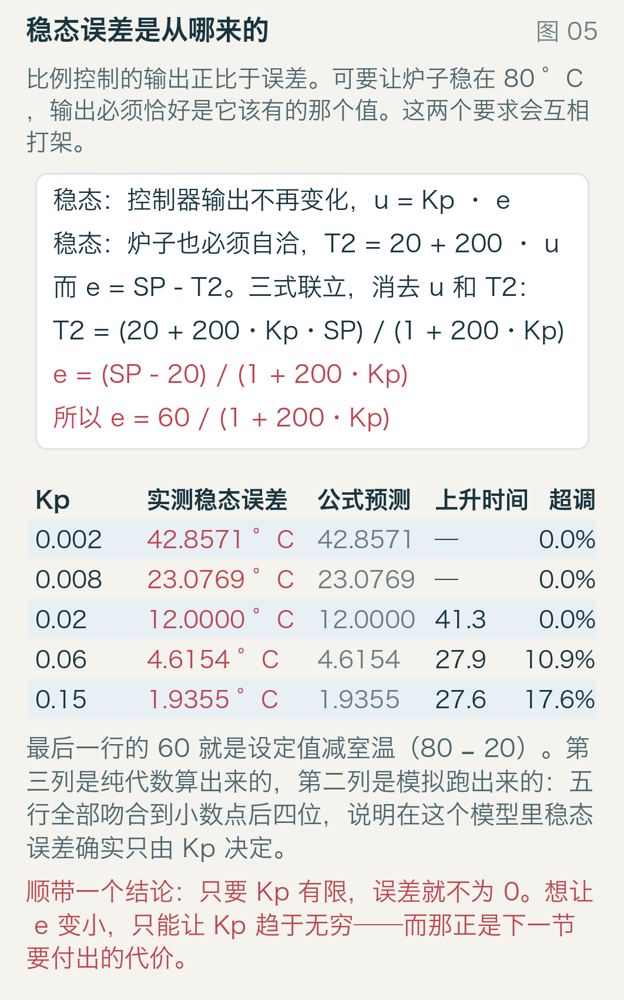

**这张图的第二列是模拟跑出来的，第三列是上面那个公式算出来的，五行全部吻合到小数点后四位。** 这不是巧合——在这个模型里，稳态误差确实只由 `Kp` 决定，跟积分、微分都无关。

公式还直接告诉我们一件事：**只要 `Kp` 是有限的，`e` 就不为 0。** 想让 `e` 变小，只能让 `Kp` 越来越大。而 `Kp` 大了会出别的事。

## 6. 把 Kp 调大的代价

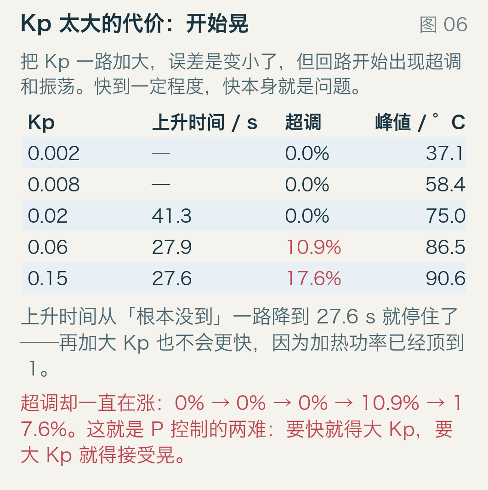

把 `Kp` 继续加大，上升时间确实一路缩短：41.3 s → 27.9 s → 27.6 s。然后它就**停住了**——因为加热功率已经顶到上限 1，再大的 `Kp` 也变不出更多热量。

但超调开始涨：0% → 0% → 0% → **10.9%** → **17.6%**。

为什么会冲过头？因为在温度接近设定值的时候，炉子里还存着大量的热。`Kp` 越大，控制器在这一段的输出就越大，等误差终于变成零，那些存下来的热还在往里灌，温度就冲出去了。

**这就是 P 控制的两难**：要快，就得大 `Kp`；要大 `Kp`，就得接受晃。

一个自然的想法是：既然稳态误差是"一直差着的那点"，那我把它**累计起来**不就好了？

## 7. 加上 I：把历史的账也算进去

积分项的公式是：

```
u = Kp · e + Ki · ∫e dt
```

`∫e dt` 的意思是"误差在时间上的累积"。只要还有偏差，它就一直在往同一个方向加。哪怕偏差只剩 0.1 度，累积得够久，它也会变成足够的功率。

于是稳态误差的僵局被打破了：**误差不为零，积分项就继续涨；积分项涨了，温度就继续升；温度升到设定值，误差才归零。** 稳态误差必然为零。

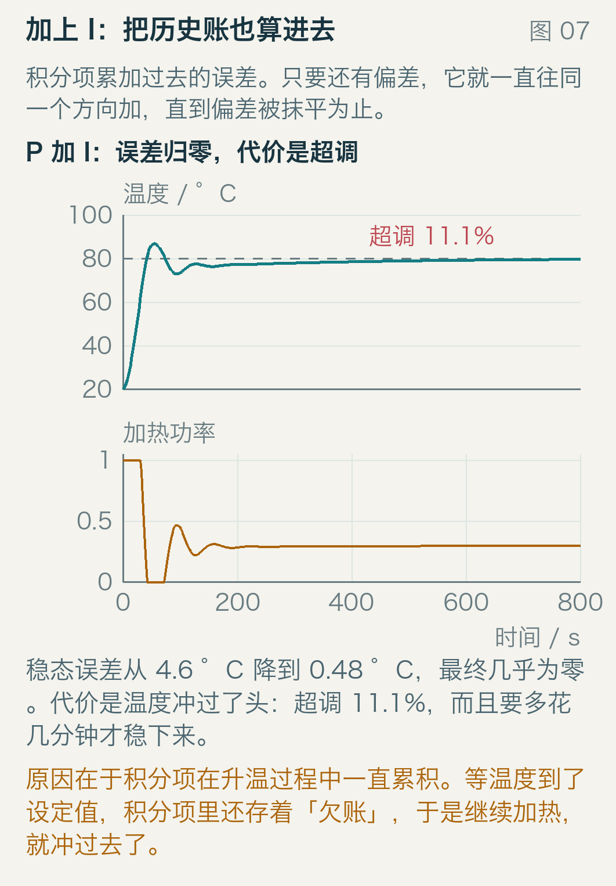

程序跑出来：稳态误差从 4.6 °C 降到 **0.48 °C**，最终几乎为零。代价是**温度冲过了头：超调 11.1%**。

原因是积分项在升温过程中一直在记账。等温度到了设定值，账上还存着一大笔"欠账"，于是它继续加热，就冲过去了。**积分项记的账，是要还的。**

## 8. 积分给得越多，冲得越远

`Ki` 决定积分项累积的快慢。

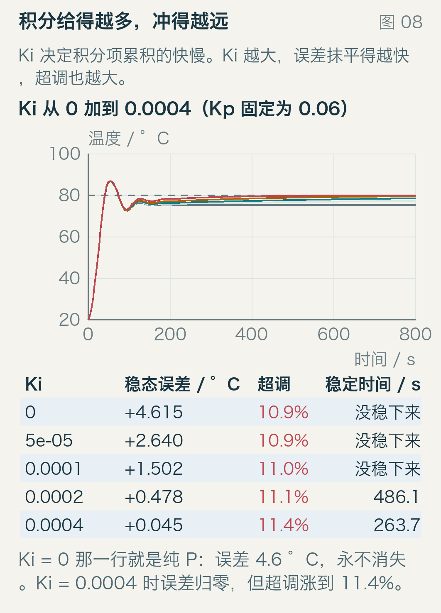

| Ki | 稳态误差 | 超调 | 稳定时间 |
|---|---|---|---|
| 0（纯 P） | +4.615 °C | 10.9% | 没稳下来 |
| 0.00005 | +2.640 °C | 10.9% | 没稳下来 |
| 0.0001 | +1.502 °C | 11.0% | 没稳下来 |
| 0.0002 | +0.478 °C | 11.1% | 486 s |
| 0.0004 | +0.045 °C | 11.4% | 264 s |

规律很清楚：**`Ki` 越大，稳态误差抹得越干净，超调也越大。** 而且注意最后一列——`Ki` 太小时回路根本稳不下来（误差一直在慢慢往下爬，落不进 ±2% 的范围）。

`Ki` 不是"越大越好"，也不是"越小越稳"。它是在"误差抹得多干净"和"冲得多远"之间选一个位置。

## 9. 再加上 D：看误差正在往哪边变

到这一步，超调还是个问题。而超调的本质是：**误差已经很小了，但误差还在快速缩小，热量还在往里灌。** 这时候最该做的事情是提前松油门。

微分项做的就是这个：

```
u = Kp · e + Ki · ∫e dt + Kd · de/dt
```

`de/dt` 是误差的变化率。误差正在快速缩小时，它是一个大的负数，把输出往下压。

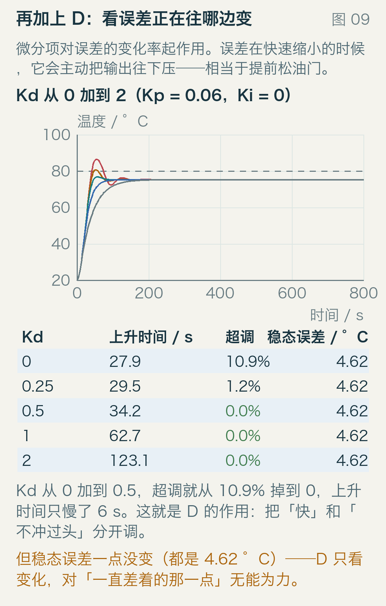

| Kd | 上升时间 | 超调 | 稳态误差 |
|---|---|---|---|
| 0 | 27.9 s | 10.9% | 4.62 °C |
| 0.25 | 29.5 s | 1.19% | 4.62 °C |
| 0.5 | 34.2 s | **0.00%** | 4.62 °C |
| 1.0 | 62.7 s | 0.00% | 4.62 °C |
| 2.0 | 123.1 s | 0.00% | 4.62 °C |

`Kd` 从 0 加到 0.5，**超调就从 10.9% 掉到 0，上升时间只慢了 6 秒**。这就是 D 的价值：它把"快"和"不冲过头"这两件事分开了，让你能各调各的。

但同时看最后一列：**稳态误差一点没变，全都是 4.62 °C。** D 只看"正在变多少"，对"一直差着的那一点"完全无能为力。这也解释了为什么三项要一起用——它们管的是三件不同的事。

## 10. 四种组合摆在一起

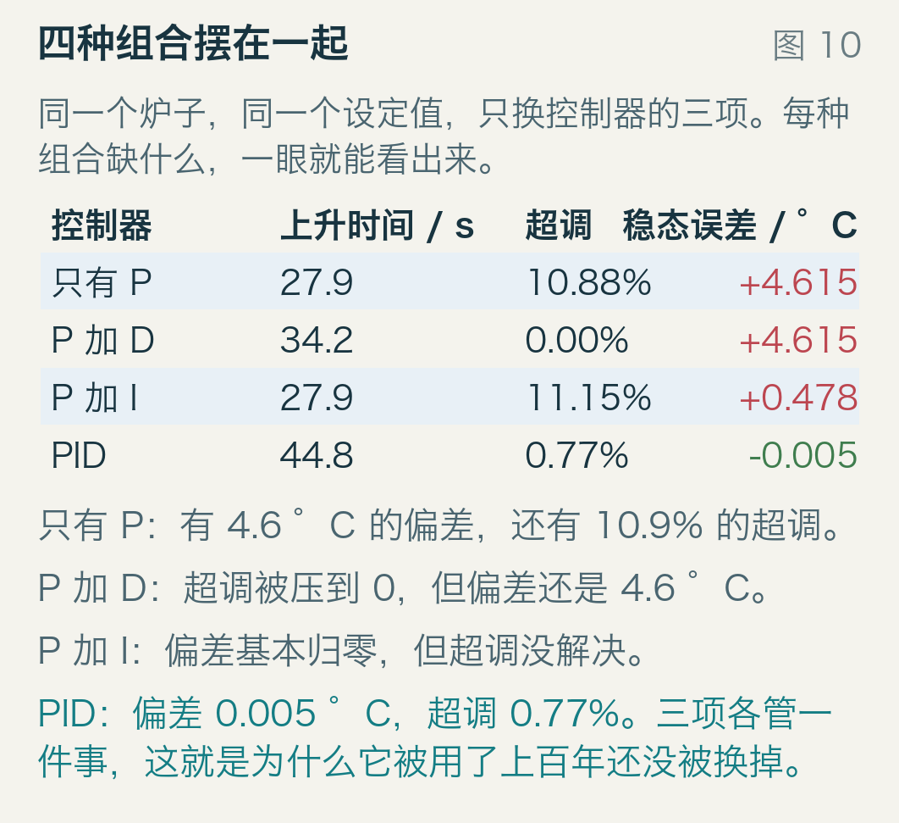

| 控制器 | 上升时间 | 超调 | 稳态误差 |
|---|---|---|---|
| 只有 P | 27.9 s | 10.88% | +4.615 °C |
| P 加 D | 34.2 s | 0.00% | +4.615 °C |
| P 加 I | 27.9 s | 11.15% | +0.478 °C |
| **PID** | 44.8 s | 0.77% | **−0.005 °C** |

每一行缺什么，一眼就能看出来：

- **只有 P**：快，但有偏差，还晃。
- **P 加 D**：不晃了，偏差还在。
- **P 加 I**：偏差没了，晃还在。
- **PID**：两样都没了。代价是慢——上升时间从 27.9 s 拖到 44.8 s，但它换来了 **77.5 秒**就完全稳定；前三行里，PI 要 486 秒才稳下来，只有 P 和 P 加 D 压根没稳下来（一直在 ±2% 之外晃）。

**三项各管一件事**，这就是为什么这套东西被用了上百年还没被换掉。

## 11. 写进程序里长什么样

计算机里没有"连续"，只有一帧一帧地算。把三项写成每一帧执行的代码，就是所谓的位置式 PID：

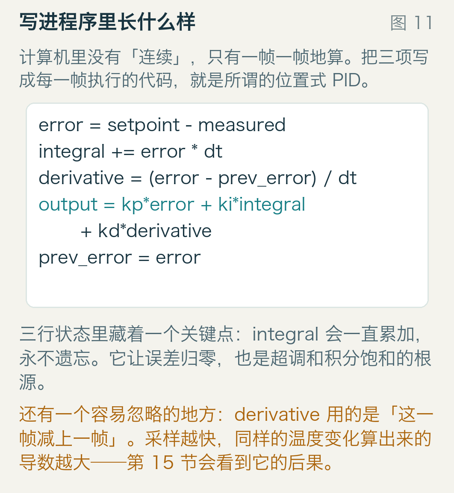

```python
error = setpoint - measured
integral += error * dt
derivative = (error - prev_error) / dt
output = kp*error + ki*integral + kd*derivative
prev_error = error
```

六行，没有一行是多余的。但有三处值得停下来看：

- **`integral` 永不遗忘。** 它一路累加，这是误差能归零的原因，也是超调和"积分饱和"的根源（第 13 节）。
- **`derivative` 用的是"这一帧减上一帧"。** 采样越快，同样的温度变化算出来的导数越大。这句话在第 15 节会变成一个具体的问题。
- **`output` 必须被限幅。** 加热功率最大是 1，代码里必须真的把它卡住——而且卡住之后，`integral` 怎么办，是另一个问题。

## 12. 三项各自在什么时候出力

把 PID 的三个分量单独画出来，就能看清谁在什么时候说话。下面那张图的上半部分是温度响应，下半部分是同一组参数下三项各自的值；黑线是三项之和，也就是控制器**想要**给出的功率。

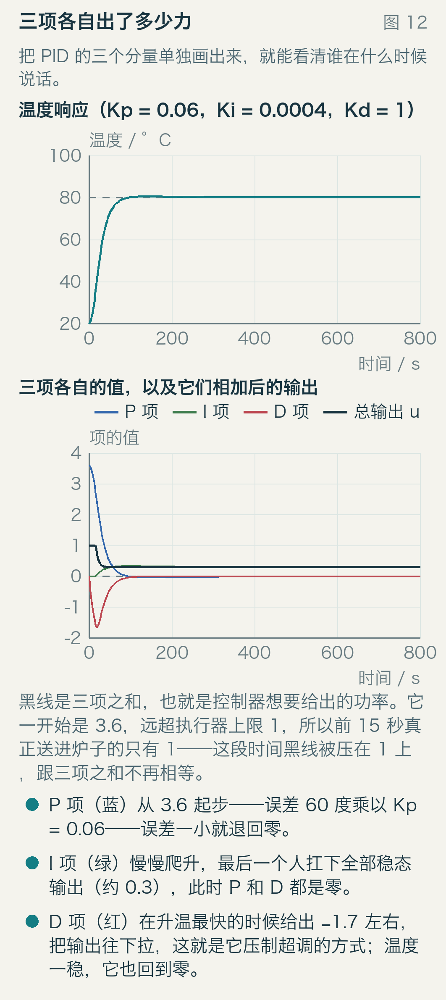

- **P 项只在误差大的时候出力。** 一开始误差 60 度，乘以 `Kp = 0.06` 得 3.6——远超执行器上限 1，所以前 15 秒三项之和一直大于 1，黑线被压在 1 上，跟三项之和不再相等（第 13 节会讲这件事的后果）。误差一小，P 项就退回零。
- **I 项慢慢爬升。** 它起步很慢，但最后一个人扛下全部稳态输出——大约 0.3，正是第 3 节算出来的那个数。**稳态时全部输出都由积分项提供，P 和 D 都为零。** 这是理解 PID 的一个关键画面。
- **D 项在升温最快的时候给出很大的负值**（这一组参数下最低到 −1.7 左右），把输出往下拉。这就是它压制超调的方式：在温度冲得最猛的那一刻踩刹车；温度一稳下来，它也回到零。

## 13. 积分饱和：账记多了，就还不清

积分项"永不遗忘"这件事有个副作用。

假设执行器已经满功率（`u = 1`），误差还是很大——比如设定值定得太高，炉子根本达不到。这时候积分项**仍然在继续累积**，因为误差确实存在。等温度终于爬到设定值附近，账上已经存了一大笔，只能靠"反向超调"来还：温度冲过去，误差变负，积分项才慢慢往下走。

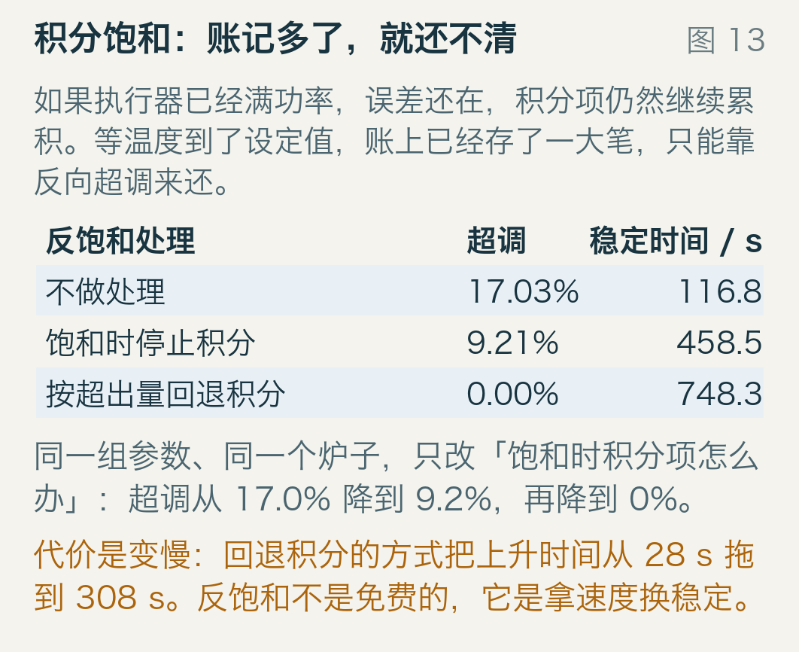

用一个会饱和的例子来测：`Kp = 0.05`（一开始 P 项就是 3.0，早就超过上限 1 了），`Ki = 0.0002`。同一组参数、同一个炉子，只改"饱和时积分项怎么办"：

| 反饱和处理 | 超调 | 稳定时间 |
|---|---|---|
| 不做处理 | 17.03% | 116.8 s |
| 饱和时停止积分 | 9.21% | 458.5 s |
| 按超出量回退积分 | **0.00%** | 748.3 s |

**超调从 17.0% 降到 9.2%，再降到 0%。** 但看最后一列：代价是变慢——回退积分的方式把上升时间从 27.8 s 拖到 307.5 s。

反饱和不是免费的。它是**拿速度换稳定**。工程上要选哪个，取决于你的炉子能不能容忍超调：烤面包不能超，预热可以。

## 14. 微分踢：换设定值的时候输出会跳一下

还有一个 D 项特有的坑。

误差的定义是 `设定值 − 测量值`。如果**设定值**突然变了（比如用户把 80 改成 90），误差在一帧之内从 0 跳到 10，`de/dt` 算出来是 `10 ÷ 0.1 = 100`。乘上 `Kd = 1`，微分项瞬间给出 100 的输出。

这就是"微分踢"（derivative kick）。

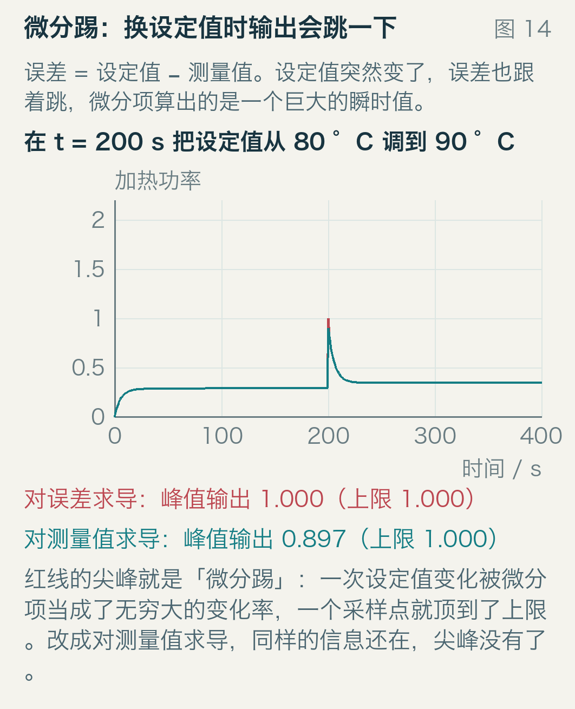

修法很简单：**不要对误差求导，改成对测量值求导。**

```
derivative = -(measured - prev_measured) / dt
```

设定值跳变时，测量值还没有动，所以导数不会跳。而系统真正需要的信息——"温度正在往哪边变"——一点没丢，因为测量值的变化就是误差的变化（设定值不变时）。

程序在 `t = 200 s` 把设定值从 80 调到 90，跑出两个版本：

- 对误差求导：峰值输出 **1.00**（顶到上限了）；
- 对测量值求导：峰值输出 **0.897**。

有意思的是，**这一次两者的温度曲线几乎完全一样**（峰值 89.883 与 89.886 °C）。原因是本文的加热功率上限只有 1，微分踢算出来的 100 被限幅削掉了，剩下的差别已经小到看不出来。

如果换一个功率余量更大的执行器——比如上限是 5——那个尖峰就会真的冲出去，温度也会跟着多冲一截。**"这个坑在我这里没炸"不等于"这个坑不存在"。**

## 15. 采样太慢，等于蒙着眼睛开车

控制器不是连续的，它每隔 `dt` 秒才看一次温度。两次之间发生了什么，它完全不知道。

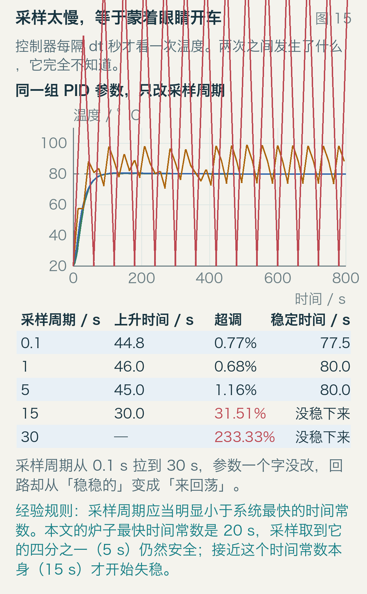

同一组 PID 参数，只改采样周期：

| 采样周期 | 上升时间 | 超调 | 稳定时间 |
|---|---|---|---|
| 0.1 s | 44.8 s | 0.77% | 77.5 s |
| 1 s | 46.0 s | 0.68% | 80.0 s |
| 5 s | 45.0 s | 1.16% | 80.0 s |
| 15 s | 30.0 s | **31.51%** | 没稳下来 |
| 30 s | 0 s | **233.33%** | 没稳下来 |

从 0.1 s 拉到 5 s，几乎没影响——**参数一个字没改，回路还是稳的**。但到 15 s 就开始荡，到 30 s 直接失稳：温度冲到 220 °C（炉子的物理上限），误差 −140 °C。

为什么会这样？关键在于**控制器每算一次，输出就要保持不变，维持 `dt` 秒**。`dt = 30 s` 时，一次决定要管 30 秒——比炉子第二级的时间常数（20 s）还长。控制器在这一整段时间里没法改主意，等它下一次看到温度，早就冲过头了。`dt = 0.1 s` 时它每秒有十次机会修正，情况完全不同。

换句话说，**采样慢等价于在回路里加了一段延迟**——正是下一节要讲的那个 PID 真正打不过的对手。

经验规则：**采样周期应当明显小于系统最快的时间常数**。本文的炉子最快的时间常数是 20 s；采样取到它的四分之一（5 s）时，上表里的超调仍只有 1.16%，稳定时间 80.0 s，比 0.1 s 只差 2.5 s——"远小于"其实不是必须的。真正开始出问题是在 15 s，也就是接近这个时间常数本身的时候。反过来说，一个"必须每 10 毫秒算一次"的控制器，控制对象的时间常数通常在零点几秒的量级。

## 16. 延迟：PID 真正打不过的对手

比采样慢更糟的是**延迟**。

延迟的意思是：控制器此刻的动作，要过一会儿才被炉子看到。比如传感器装在炉子另一头，热空气传过去要 20 秒；或者阀门本来就有机械行程。在这 20 秒里，控制器以为自己的动作没起作用，于是继续加力。等它终于看到效果，早就加过头了。

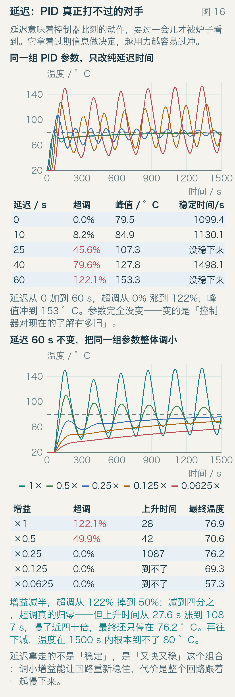

同一组 PID 参数，只改纯延迟：

| 延迟 | 超调 | 峰值 | 稳定时间 |
|---|---|---|---|
| 0 s | 0.00% | 79.5 °C | 1099.4 s |
| 10 s | 8.21% | 84.9 °C | 1130.1 s |
| 25 s | **45.56%** | 107.3 °C | 没稳下来 |
| 40 s | **79.60%** | 127.8 °C | 1498.1 s |
| 60 s | **122.10%** | 153.3 °C | 没稳下来 |

延迟从 0 加到 60 秒，**超调从 0% 涨到 122%，峰值冲到 153 °C**。参数完全没变。变的是"控制器对现在的了解有多旧"。

延迟和滞后不是一回事。滞后（时间常数）是"反应慢但方向对"：增益降下来，回路会更慢、稳态偏差更大，但它始终收敛。**延迟是"信息本身过时了"**——减小增益同样能让回路重新稳住，但那是靠把整个回路一起放慢换来的。下面那张图的下半部分就是这件事：超调确实能压到零，代价是上升时间从 27.6 s 变成 1087 s。延迟拿走的不是"稳定"，而是"又快又稳"这个组合。这也是为什么工程上会花大力气把传感器装到离执行器近的地方，或者用"预测模型"来补偿延迟。

一个常用的经验判断是：**延迟与主要时间常数之比超过约 0.3，PID 就明显吃力**；超过 1，基本要靠更复杂的控制器。本文的炉子时间常数 60 s，延迟 25 s 时比值已经 0.42，超调就冲到 45%。

## 17. 让系统自己说出该用多大参数

前面都是"手动试参数"。有没有系统一点的办法？

有。1942 年 Ziegler 和 Nichols 提出的整定法至今还在用，步骤只有三步：

1. **只用 P**（把 I 和 D 关掉），从小到大加 `Kp`，直到响应不再衰减、开始等幅振荡。这个增益叫**极限增益 `Ku`**。
2. 量出这个等幅振荡的**周期 `Tu`**。
3. 按固定比例换算出 `Kp`、`Ki`、`Kd`。

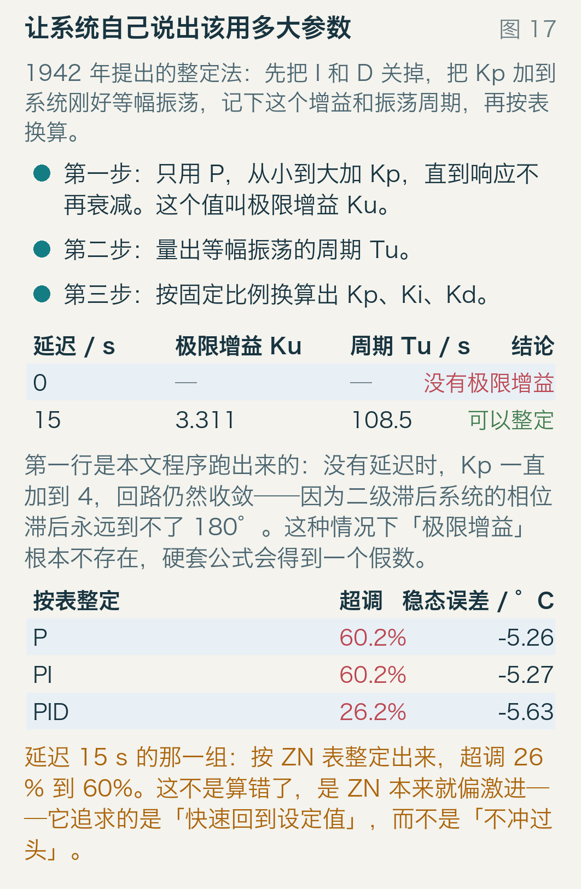

本文的程序真的去"加 `Kp`"了（用二分法搜索，判断标准是振荡幅度是否还在衰减），结果有一个**意料之外但很有教育意义**的发现：

**没有延迟时，根本不存在极限增益。** `Kp` 一直加到 4，回路仍然收敛。

原因是：振荡的来源是**绕一圈之后负反馈变成了正反馈**——被延迟了半个周期的信号回到入口时，本该"刹车"的动作正好赶上了"加油"的时机。滞后越多，越容易凑够这半个周期。而两级滞后能提供的滞后是有限的：它最多逼近半个周期（也就是常说的 180°），**永远到不了"滞后正好半个周期、同时增益还等于 1"的那个临界点**。这时候"极限增益"这个概念本身就不成立，硬套公式只会得到一个假数。

（第一版的程序确实在单滞后对象上搜出过一个 `Ku = 37.2`。但那不是回路在震荡，是**积分本身**在震荡：`Kp = 37.2` 时闭环时间常数只剩 0.008 s，比 0.1 s 的积分步长还小，显式欧拉法自己就开始振铃，稳态上的起伏约 0.3 °C——幅度小得看不出来，却足以让"振荡是否衰减"的判据读出"不衰减"。判据量到的是数值噪声，不是被控对象。）

加上 15 秒延迟以后，极限增益就真的存在了：**`Ku = 3.311`，`Tu = 108.5 s`**。按 ZN 表整定，跑出来的结果是：

| 按表整定 | 超调 | 稳态误差 |
|---|---|---|
| P | 60.22% | −5.259 °C |
| PI | 60.18% | −5.267 °C |
| PID | 26.22% | −5.635 °C |

**超调 26% 到 60%。** 这不是算错了，是 ZN 方法本身就偏激进——它追求的是"快速回到设定值"，而不是"不冲过头"。工程上的常见做法是**把 ZN 给出的参数再打折**（比如增益乘 0.5），换更少的超调。

## 18. D 项真正的代价：它放大了噪声

到这里 D 项看起来很好用：压超调、不用等。但现实里的传感器读数不会那么干净。

温度传感器的读数里总有随机跳动——可能是 ±0.4 °C 的噪声。而 D 项算的是"这一帧减上一帧"，**噪声正好是它最敏感的东西**：真实的温度变化很慢，噪声变化很快，于是微分项几乎全部在响应噪声。

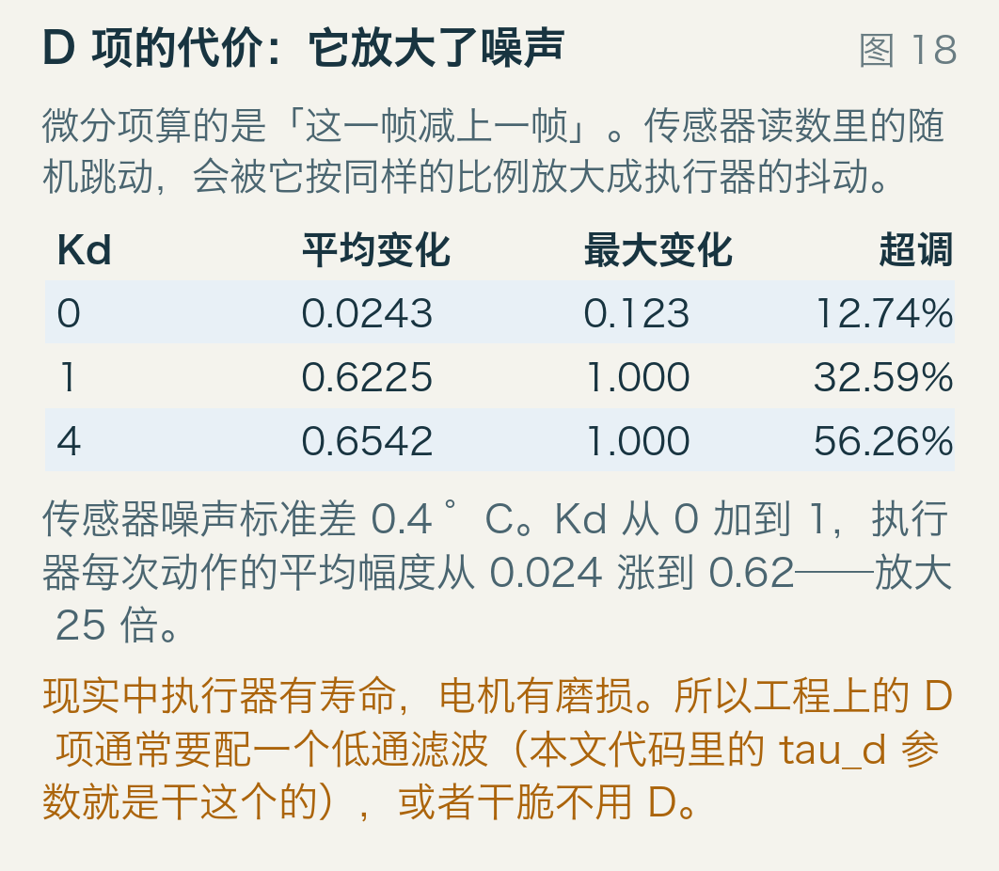

给传感器加一个标准差 0.4 °C 的随机噪声，同一组参数只改 `Kd`：

| Kd | 相邻两次输出的平均变化 | 最大变化 | 超调 |
|---|---|---|---|
| 0 | 0.0243 | 0.123 | 12.74% |
| 1 | 0.6225 | 1.000 | 32.59% |
| 4 | 0.6542 | 1.000 | 56.26% |

`Kd` 从 0 加到 1，**执行器每次动作的平均幅度从 0.024 涨到 0.62——放大 25 倍**，最大变化直接顶到上限。而且超调也从 12.7% 涨到 32.6%，温度最终停在 98 °C 而不是 80 °C。

为什么加了噪声之后 D 反而害了自己？因为噪声让 D 项不停地大幅抖动输出，**这些抖动本身就在往系统里灌热量**，积分项还得去补偿它，回路就被搅乱了。

现实中的执行器有寿命，电机有磨损，阀门有行程次数。所以工程上的 D 项通常要配一个**低通滤波**（本文代码里的 `tau_d` 参数就是干这个的），把高频噪声滤掉再求导；或者干脆不用 D，靠更保守的 `Kp` 和 `Ki` 来凑。

## 19. 扰动来了，谁先扛住

前面测的都是"从室温加热到设定值"。但控制器的另一个重要工作是**抗扰动**：设定值没变，是外部条件变了。

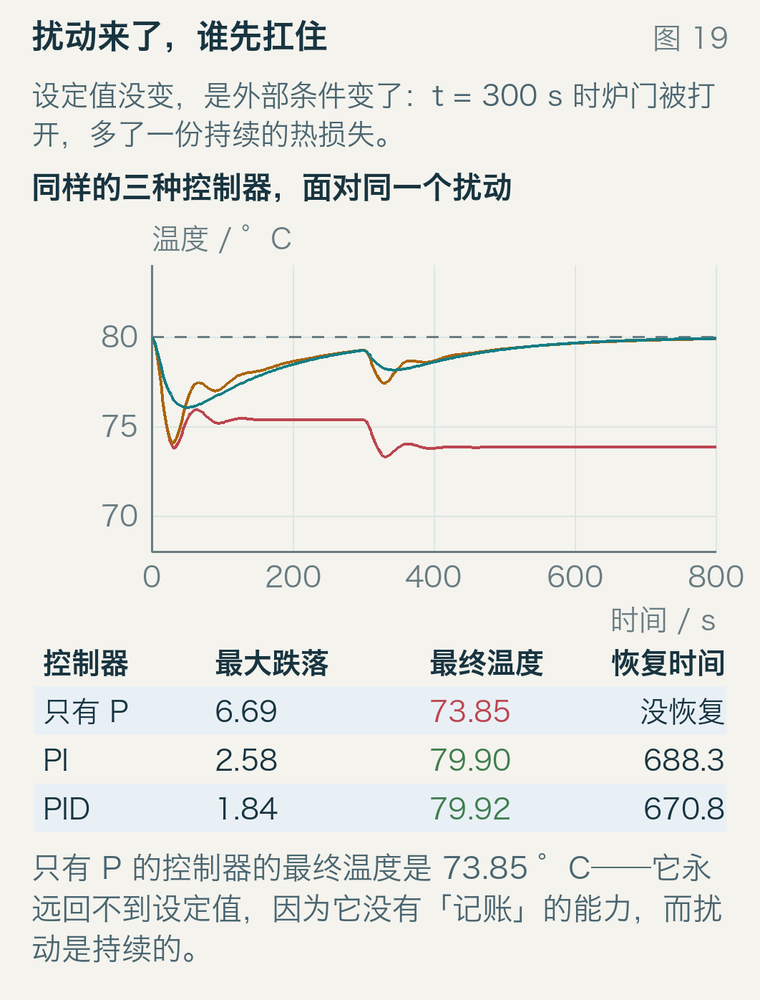

程序让炉子在 `t = 300 s` 时"被打开炉门"——多了一份持续的热损失，温度开始往下掉。三种控制器的反应：

| 控制器 | 最大跌落 | 最终温度 | 恢复时间 |
|---|---|---|---|
| 只有 P | 6.69 °C | 73.846 °C | 没恢复 |
| PI | 2.58 °C | 79.902 °C | 688.3 s |
| PID | 1.84 °C | 79.922 °C | 670.8 s |

三个数各自讲一件事：

- **跌落幅度**取决于反应速度。P 项越大、D 项在，越早察觉，掉得越少。
- **最终温度**是决定性区别。只有 P 的控制器停在 73.85 °C——**它永远回不到设定值**，因为它没有"记账"的能力，而扰动是持续的，需要一个持续的额外输出来抵消。这个额外输出只能由积分项提供。
- **恢复时间**都不短（600 多秒），因为积分项本来就是个慢性子。

这就是第 5 节的结论在扰动情形下的翻版：**稳态误差不是"加热不够"的问题，是"控制器结构里缺一项"的问题。**

## 20. 执行器顶到头的时候

还有一个现实的边界：**执行器有上限**。

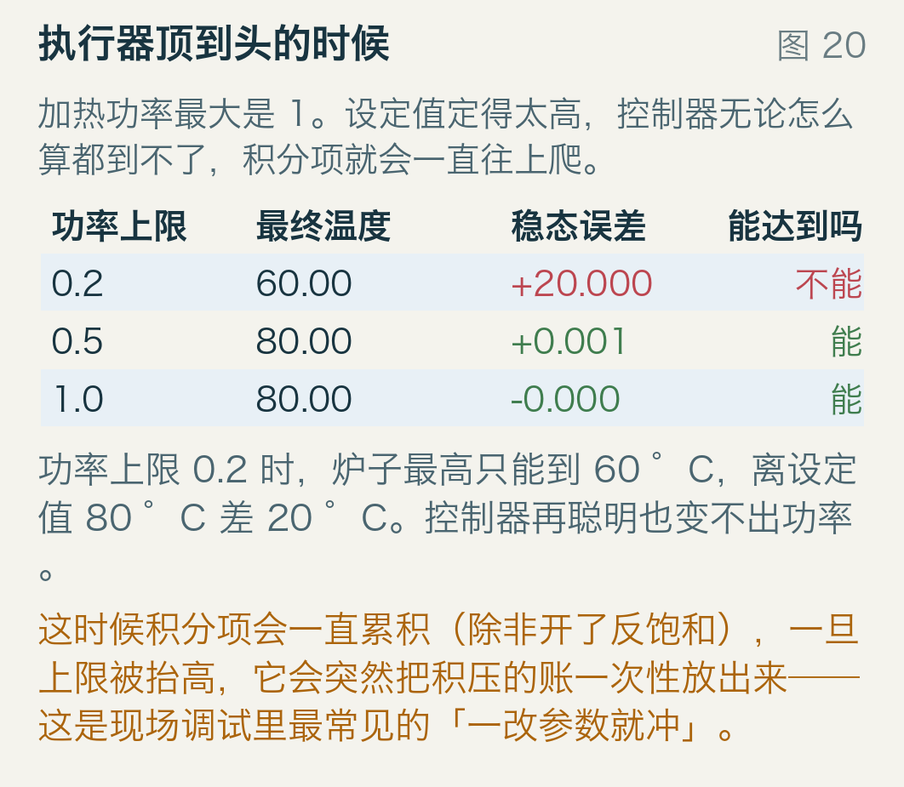

把加热功率的上限从 1 降到 0.5，再降到 0.2：

| 功率上限 | 最终温度 | 稳态误差 | 能达到吗 |
|---|---|---|---|
| 0.2 | 60.00 °C | +20.00 °C | 不能 |
| 0.5 | 80.00 °C | +0.001 °C | 能 |
| 1.0 | 80.00 °C | −0.000 °C | 能 |

上限 0.2 时，炉子最高只能到 60 °C（20 + 200 × 0.2），离设定值 80 差 20 度。**控制器再聪明也变不出功率。** 这时候积分项会一直往上爬（除非开了反饱和），一旦上限被抬高，那笔账会一次性还出来，造成一个大超调。

这一节和第 13 节合起来是同一件事的两面：**积分项假设"我加力，系统就会有反应"。执行器饱和时这个假设不成立，积分项就开始积累一个无法兑现的承诺。**

## 21. 同一套想法，用在会倒的东西上

前面所有例子都是"稳定的"对象：你不管它，它自己会停在某个温度。现在换一个**不稳定**的对象——小车上的倒立摆。

杆子会倒，小车只能左右推。它有三个额外的麻烦：

1. **不稳定**：不控制的话，杆子以指数速度倒下。程序实测：从 0.05 rad 出发、推力始终为零，**0.75 秒**角度就超过 0.5 rad（约 29°），也就是一眨眼的事。
2. **非线性**：小角度下可以近似成线性，角度一大就完全不是那回事。
3. **一个执行器要管两个目标**：既要把杆子立住，又要把小车开到指定位置。

**一个 PID 管不过来**，因为这两个目标会打架：想把车往右开，就得先把杆子往右倾；但杆子往右倾又会让它加速倒下。所以要用**串级控制**：两个 PID 串起来，各管一层。

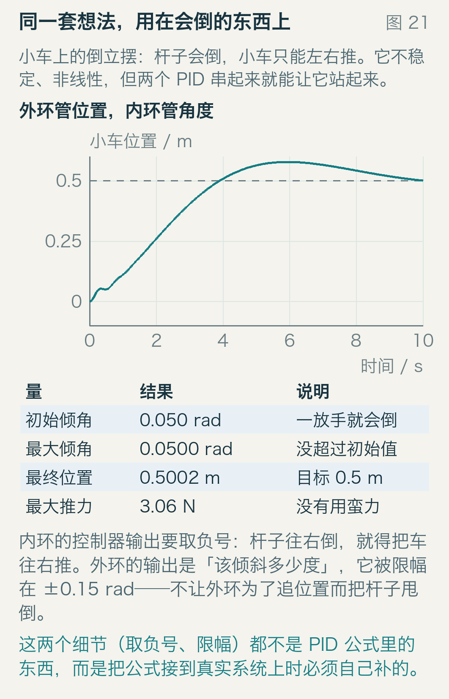

- **外环**（慢）：输入是小车位置误差，输出**不是力**，而是"杆子应该倾斜多少"。目标是 0.5 m，当前位置 0，它就要求"往右倾一点"。
- **内环**（快）：输入是杆子角度与目标倾角之差，输出是推力。

程序跑出来：

| 量 | 结果 | 说明 |
|---|---|---|
| 初始倾角 | 0.050 rad | 约 2.9°，一放手就会倒 |
| 最大倾角 | 0.050 rad | 没超过初始值 |
| 最终位置 | 0.5002 m | 目标 0.5 m |
| 最大推力 | 3.06 N | 没有用蛮力 |

**杆子从头到尾没有比初始时刻更歪过**，而小车同时走到了 0.5 m 并停住。这就是串级的威力：外环负责"去哪里"，内环负责"别倒下"，两层各管一件事。

但这里有两个细节**不在 PID 公式里**，是必须自己补的：

- **内环的输出要取负号。** 杆子往右倒，就得把车往右推（而不是往左）。这个符号搞反了，系统会瞬间发散。它不是公式的一部分，是物理的一部分。
- **外环的输出要限幅。** 外环的输出被卡在 ±0.15 rad。为什么？因为如果外环为了追位置而要求"倾 45 度"，内环会拼命加速，杆子还没立住就先摔了。**限幅是在告诉外环："你可以指挥，但别指挥得太过分。"**

这两个细节值得单独记住：**把公式接到真实系统上时，一半的工作量在公式之外。**

## 22. 它在哪些地方真的在跑

PID 不是实验室里的玩具。下面这些设备里，跑的都是同一套三项相加的逻辑：

- **恒温箱、热水器、3D 打印机的热床**——温度环，最常见的一阶加滞后对象。
- **汽车定速巡航、无人机的姿态环**——后者通常用串级 PID，和倒立摆一个套路。
- **硬盘磁头定位、光刻机的工件台**——高速高精度位置环。
- **电厂锅炉、化工反应釜**——分布式控制系统里的绝大多数回路仍然是 PID。
- **游戏里的相机跟随、角色转向平滑**——用的也是同一套公式，只是 `dt` 是一帧。

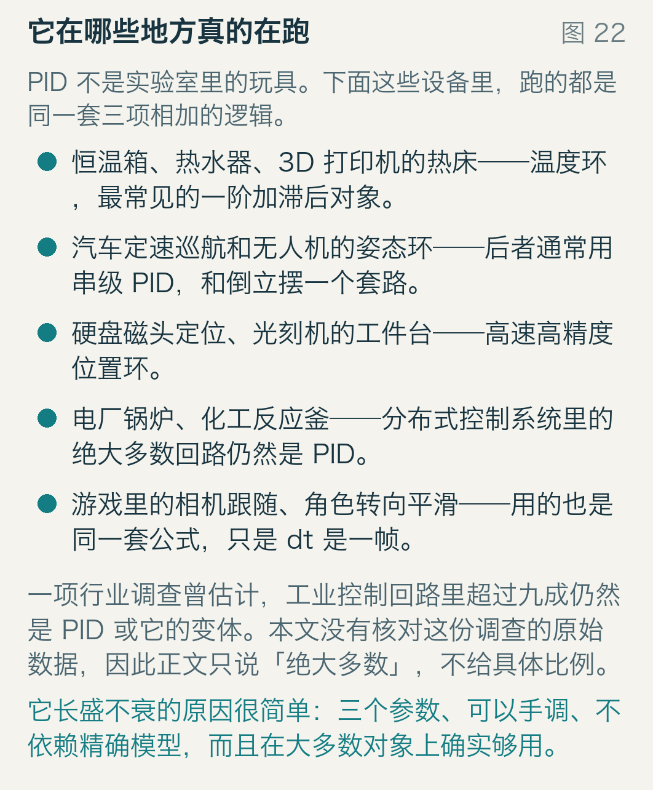

一项常被引用的行业调查曾估计，工业控制回路里超过九成仍然是 PID 或它的变体。**本文没有核对这份调查的原始数据**，所以正文只说"绝大多数"，不给具体比例。

它长盛不衰的原因很简单：**三个参数、可以手调、不依赖精确模型，而且在大多数对象上确实够用。** 你不需要知道炉子的传热系数是多少，只要会看曲线、会调三个数。

## 23. 一百年前，它是在船上被发明出来的

PID 的第一次系统描述出现在 **1922 年**，作者是俄裔美国工程师尼古拉斯·米诺尔斯基（Nicolas Minorsky），对象是**军舰的舵机**。

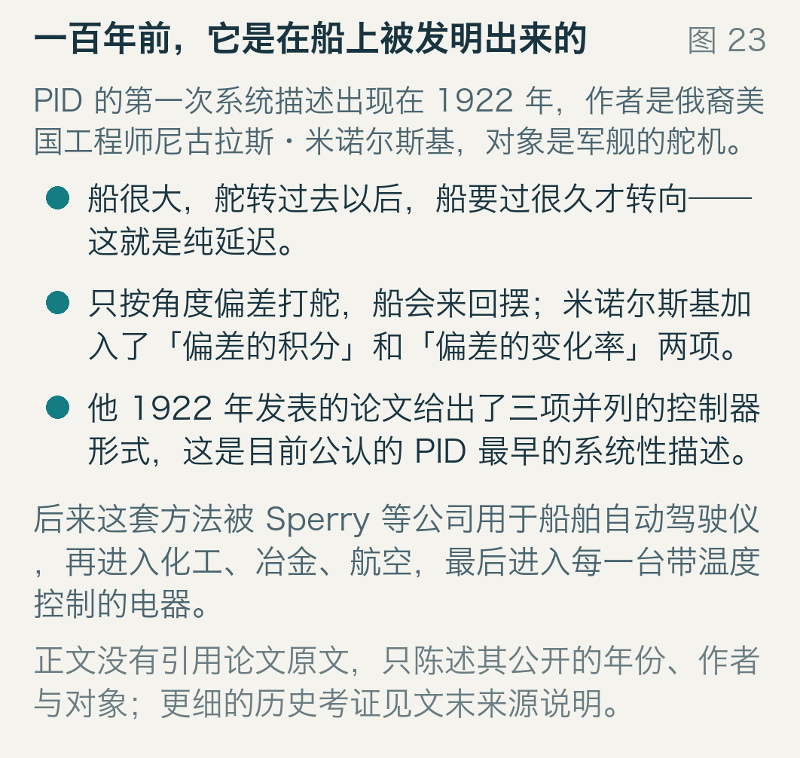

为什么是船？因为船完美地踩中了前面第 16 节讲的那个坑：

- 船很大，舵转过去以后，船要过很久才转向——**这就是纯延迟**。
- 只按角度偏差打舵（纯 P），船会来回摆，因为舵效有延迟。
- 米诺尔斯基的做法是加入"偏差的积分"和"偏差的变化率"两项——**正是本文第 7 节和第 9 节讲的那两项**。

他 1922 年发表的论文给出了三项并列的控制器形式，这是目前公认的 PID 最早的系统性描述。

后面的事情顺理成章：这套方法先被 Sperry 等公司用于船舶自动驾驶仪，再进入化工、冶金、航空，最后进入每一台带温度控制的家用电器。

**从船舵到烤箱到无人机，中间隔了一百年，公式一个字没改。** 这不是因为它完美，而是因为它把"用误差修正动作"这件事拆成了三个恰好互相独立的方面——快、准、稳，各一个旋钮。

（本文没有查阅 1922 年论文原文，只陈述其公开的年份、作者与对象；更细的历史考证见 `sources.md`。）

## 24. 自己动手

下面每一行都能在本目录的代码里改一个数字重跑。**先猜结果，再对照。**

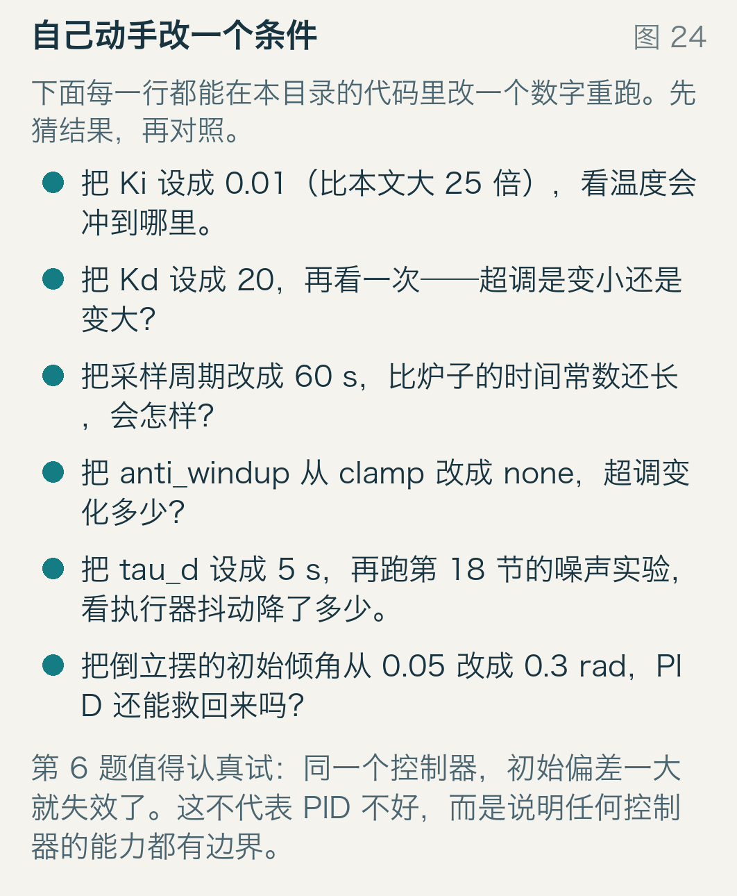

1. 把 `Ki` 设成 0.01（比本文大 25 倍），看温度会冲到哪里。
2. 把 `Kd` 设成 20，再看一次——超调是变小还是变大？
3. 把采样周期改成 60 s，比炉子的时间常数还长，会怎样？
4. 把 `anti_windup` 从 `clamp` 改成 `none`，超调变化多少？
5. 把 `tau_d` 设成 5 s，再跑第 18 节的噪声实验，看执行器抖动降了多少。
6. 把倒立摆的初始倾角从 0.05 改成 0.3 rad，PID 还能救回来吗？

第 6 题值得认真试：**同一个控制器，初始偏差一大就失效了。** 这不代表 PID 不好，而是说明任何控制器的能力都有边界——而"知道边界在哪"比"会用公式"重要得多。

## 收尾：三项各管一件事

把全文压缩成一张表：

| 项 | 它在回答什么问题 | 它能解决什么 | 它的代价 |
|---|---|---|---|
| P | 现在差多少？ | 让系统动起来 | 稳态误差；Kp 大了会超调 |
| I | 过去一共差了多少？ | 消除稳态误差、抗持续扰动 | 超调；积分饱和 |
| D | 误差正在往哪边变？ | 压制超调、加快收敛 | 放大噪声；微分踢 |

真正让 PID 难用的从来不是这三项本身，而是**公式之外的六件事**：

1. 执行器有上限（第 20 节）；
2. 积分项不知道这件事（第 13 节）；
3. 设定值会跳变（第 14 节）；
4. 传感器有噪声（第 18 节）；
5. 信息有延迟（第 16 节）；
6. 采样不是连续的（第 15 节）。

**这六件事没有一件在 PID 的公式里。** 而它们决定了这个控制器在你的系统上到底能不能用。

## 动手材料

代码在 `examples/` 目录里，运行说明见 [README.md](README.md)，全部数值结果见 [examples/results.json](examples/results.json)。图和正文都从那里读。

```sh
python examples/run_model.py        # 全部实验，写 results.json
python examples/build_figures.py    # 重绘全部正文图与封面
```

只用 Python 标准库（绘图另需 Pillow 与一款中文字体）。

## 图片来源

本文 24 张正文图与 1 张封面全部由 `examples/build_figures.py` 用 Python/Pillow 原创绘制，**没有使用任何第三方照片、图表或截图**，因此不涉及第三方素材的授权与署名。图中的曲线、指标与数值全部由程序实际算出，没有手写数字。详细尺寸、最小字号与身份见 [examples/figure-metadata.json](examples/figure-metadata.json)。
