# 五台机器，怎么决定"现在是什么"？

想象你在写一个"只能有一份"的东西：一个账号余额、一个集群的配置、一个"谁是主库"的标记。

你可以把它存在一台机器上。简单，快，然后——那台机器坏了。

于是你把它存到五台机器上。现在每台机器都坏了也没关系，只要还有一台活着。但新的问题立刻出现了：

- 客户端把"余额改成 100"发给谁？
- 如果只发给了两台，另外三台还是旧值，哪一边算数？
- 一台机器联系不上——它是坏了，还是只是网络卡了？
- 如果两台机器都认为自己是主，同时接受写入，谁说了算？

**这些问题的答案是同一个词：多数票。** 而把"多数票"变成一套能真正运行、能容忍机器随时坏掉的协议，就是这篇文章要讲的事。

要讲的是 Raft。它不新（2014 年发表），也不快，但它是目前最被广泛使用的一致性协议：etcd、Consul、TiKV、CockroachDB、Kafka 的 KRaft 模式，用的都是它。

**正文里的状态、日志和计数，都是本目录的程序实际跑出来的。** 程序是一个 900 多行的 Raft 模拟器，只用 Python 标准库，你可以自己重跑。

唯一的例外是第 15 节那张复现 Raft 论文 Figure 8 的状态表：那个交错顺序太特殊，随机日程碰不上，所以状态是照着论文的描述**手工搭出来**的，再交给程序检查提交规则。这一点在那一节和 `sources.md` 里都写明了。

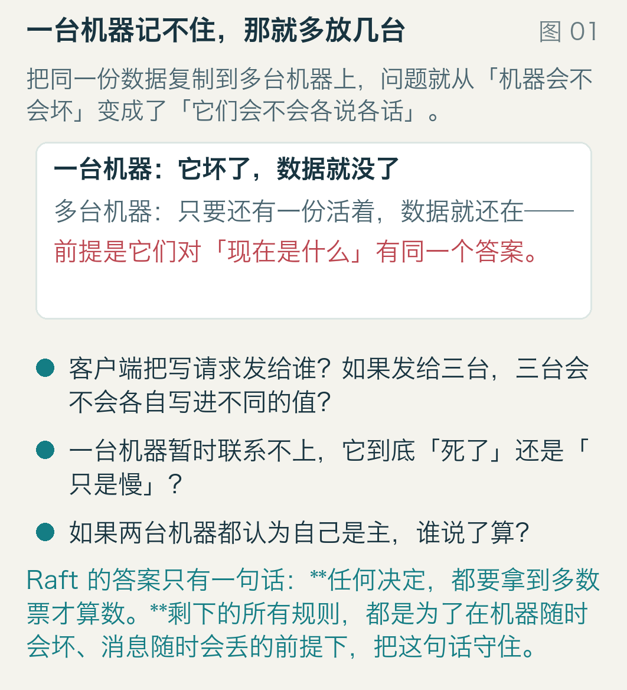

## 1. 先把问题缩小到一个可以回答的形式

上面那些问题听起来很多，其实可以合并成一句：

> **在一个随时会有机器坏掉、消息随时会丢的系统里，怎样让所有机器对"已经发生的事"有一致的记录？**

注意这句话里没有"快"、没有"高性能"、没有"分布式事务"。Raft 只解决这一件事，而且只在一个前提下工作：**大多数机器是好的，消息最终能送到**。它不处理"多数机器同时坏掉"，也不处理"消息永远丢了"——那些情况下它选择停下来，而不是猜。

这句话里还有一个词很关键：**"已经发生的事"**。不是"所有机器都同意的事"，而是"已经被确认的事"。这个区别是整篇文章的核心，第 14 节会看到它如何变成一条精确的规则。

## 2. 多数票：为什么是"过半"，不是"全部"

要求全部机器同意，坏一台就全停。所以要求"过半同意"。

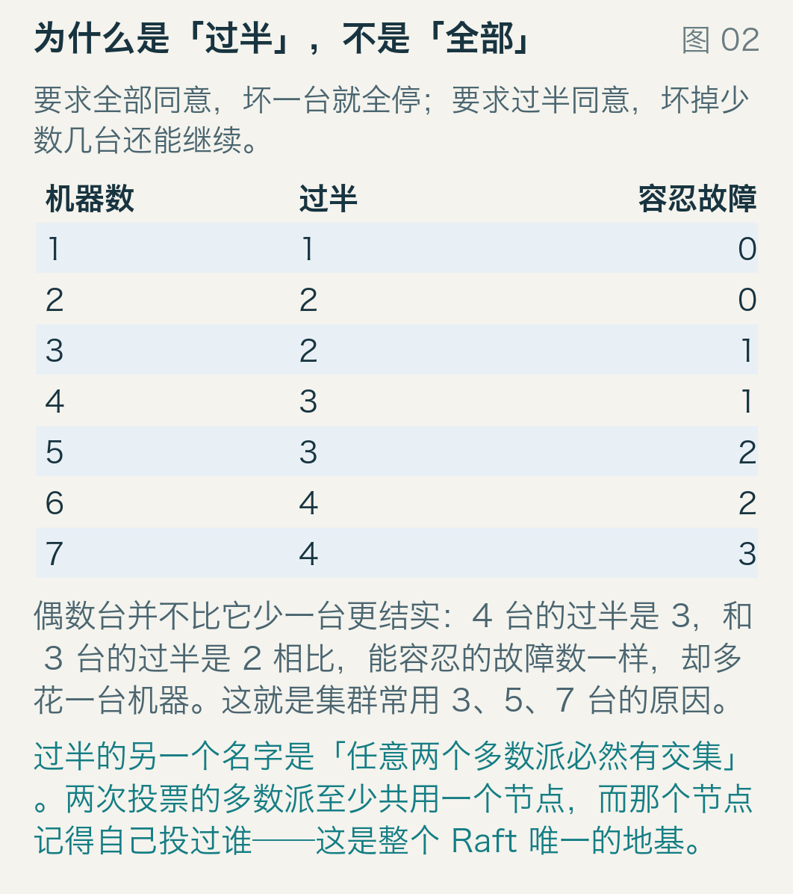

| 机器数 | 过半 | 容忍故障 |
|---|---|---|
| 1 | 1 | 0 |
| 2 | 2 | 0 |
| 3 | 2 | 1 |
| 4 | 3 | 1 |
| 5 | 3 | 2 |
| 6 | 4 | 2 |
| 7 | 4 | 3 |

看一眼这张表就明白两件事：

- **偶数台不划算。** 4 台能容忍 1 台坏，3 台也能容忍 1 台，但 4 台要多花一台机器。所以集群规模通常是 3、5、7。
- **成本是对数增长的收益，线性增长的开销。** 从 3 台到 5 台，能容忍的故障从 1 台变成 2 台，机器多了 67%。

"过半"还有一个更重要的性质，它是整个 Raft 唯一的地基：

> **任意两个多数派，必然至少有一个共同的成员。**

这个道理简单到近乎显然：两个集合各占一半以上，它们的并集就超过总数了，所以不可能不相交。用鸽笼原理说，就是"装不下"。

为什么它重要？因为**投票是"每人在一个任期里只能投一票"**。如果两次投票的多数派一定有交集，那个交集里的机器就不可能同时投给两个人。这一句话就排除了"同一任期出现两个领导"——不需要任何更复杂的机制。

## 3. 任期：把"谁说了算"变成一个数字

Raft 给时间编了号，叫**任期（term）**。它是一个只增不减的整数，每个节点各自记着。

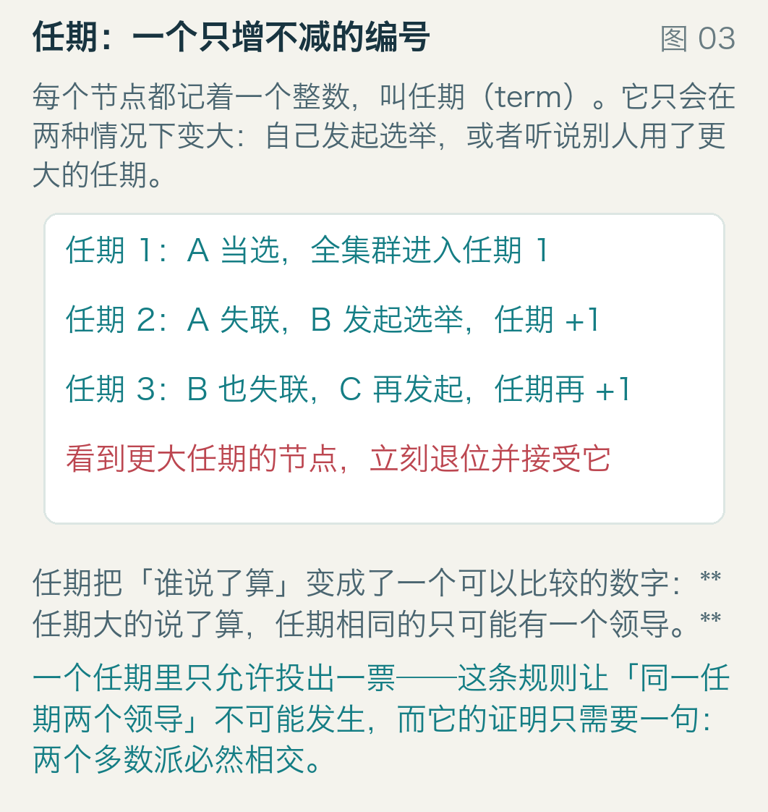

规则只有三条：

1. 自己发起选举时，任期 +1。
2. 听说别人的任期比自己大，立刻把自己的任期改成对方的，并且**退位**（如果原来是领导）。
3. 任期相同的两个节点，不可能同时是领导。

第三条是第 2 节那个鸽笼原理的直接结论。第一条和第二条合起来保证任期只会往上走。

任期的作用是把"谁说了算"变成一个**可以比较的数字**：任期大的说了算；任期相同的时候，最多只有一个人是领导。后面所有关于日志的规则，判断依据都是"这条日志属于哪个任期"。

## 4. 一次选举，从头到尾

现在集群里还没有领导。谁来当？

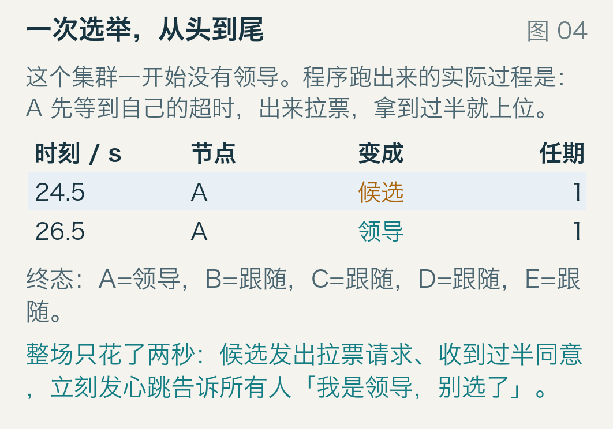

每个节点都跑着一个**选举计时器**。程序实际跑出来的过程是：

- `t = 24.5 s`：节点 A 的计时器先到点，它把自己变成**候选**，任期 +1（从 0 到 1），然后向所有能联系上的节点发出**拉票请求**。
- 拉票请求里带着两条信息：**我的最后一条日志的索引和任期**（第 13 节会讲为什么）。
- `t = 26.5 s`：A 已经收到过半的同意票（包括自己那一票），于是成为**领导**。

从超时到当选，两秒。

这里有两个细节值得注意：

- **候选给自己投票。** 五台机器里，领导需要 3 票，所以只要再拿到 2 票。
- **一旦当选，立刻发心跳。** 心跳是"我是领导，别选了"的通知，同时也是日志复制请求（第 9 节）。

如果这一轮没拿到过半呢？那就等着超时，任期 +1，再来一次。第 6 节会看到，这个"再来一次"如果设计得不好，会永远循环下去。

## 5. 心跳：为什么领导在位时没人出来选

心跳和选举超时是一对**互相配合的计时器**。


- 领导每 **8 秒**给所有跟随者发一次心跳。
- 跟随者收到心跳，就把自己的**选举计时器清成 0**。
- 跟随者的选举超时是 **15 到 30 秒之间随机取的一个值**。
- 只要心跳不断，计时器永远到不了超时，就没人发起选举。
- 心跳一断（领导崩了，或者网络断了），计时器涨到超时，选举开始。

关键是**这两段时间必须拉开差距**：心跳间隔要明显小于选举超时。本文用 8 秒对 15–30 秒。

这里有个容易想错的地方：心跳间隔 8 秒、最小超时 15 秒，并**不**意味着"要丢两次心跳才会有人怀疑"。丢一次心跳就会留下 16 秒的空档，已经超过 15 秒——超时值恰好取得最小的那些跟随者，这时就会发起选举。第 11 节里领导崩溃后 16.5 秒选出新领导，正是这个量级。

反过来，如果心跳间隔比选举超时还长，集群会陷入一种荒唐的状态：**没人坏，但大家都在不停地选举**。

## 6. 如果所有人的超时都一样

现在把五个节点的选举超时全部设成 20 秒——**完全一样**。其他一切不变，跑 600 秒。

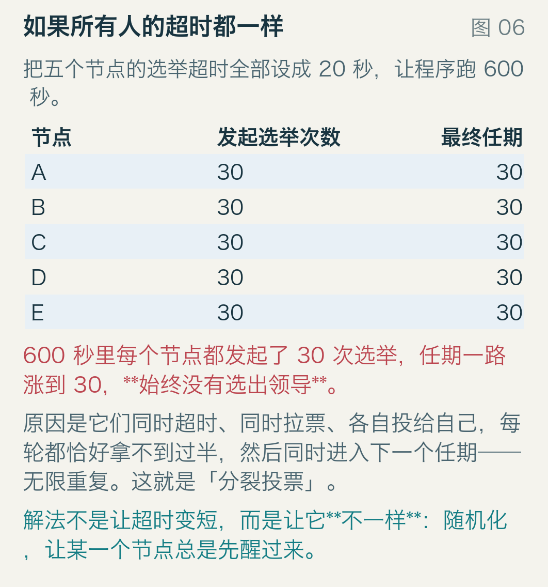

程序跑出来的结果是：

| 节点 | 发起选举次数 | 最终任期 |
|---|---|---|
| A | 30 | 30 |
| B | 30 | 30 |
| C | 30 | 30 |
| D | 30 | 30 |
| E | 30 | 30 |

**600 秒里每个节点都发起了 30 次选举，任期一路涨到 30，始终没有选出领导。**

为什么？因为它们的计时器同时到点，于是同时变成候选、同时任期 +1、同时把票投给自己，然后同时向别人拉票。每个人手里都只有自己那一票，谁都拿不到 3 票。这一轮结束后，它们又同时超时，进入下一个任期——**无限重复**。

这叫**分裂投票**（split vote）。它不是 bug，是"对称性"的必然结果：五个完全一样的节点，在同一个时刻做同一件事，凭什么有一个能赢？

## 7. 解法：让它们不一样

修法简单得有点粗暴：**把选举超时随机化**。

超时改成 15 到 30 秒之间随机取值，其余全部不变。同样跑 600 秒，换 40 个不同的随机种子各跑一次：

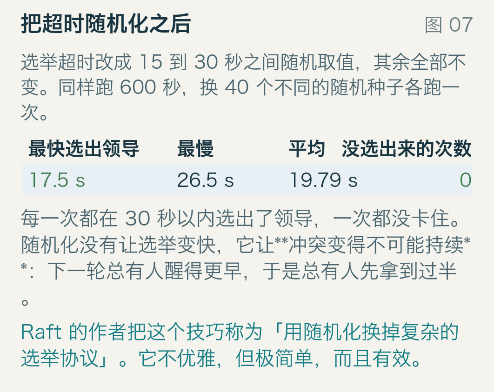

| 最快选出领导 | 最慢 | 平均 | 没选出来的次数 |
|---|---|---|---|
| 17.5 s | 26.5 s | 19.79 s | **0** |

**40 次运行，每一次都在 30 秒以内选出了领导，一次都没卡住。**

随机化没有让选举变快——它让**冲突变得不可能持续**。哪怕这一轮真的撞车了，下一轮总有人醒得更早；早醒的那个人先拉票，别人还没来得及超时，就收到了拉票请求并投了票。撞车可以发生一次，但不能连续发生。

Raft 的作者把这个技巧称为"用随机化换掉复杂的选举协议"。它不优雅，但极简单，而且有效——这也是 Raft 整个设计风格的缩影：**宁可引入一点随机性，也不引入一套需要证明的复杂规则**。

## 8. 日志：每台机器都存着同一份清单

选举只决定"谁说了算"。真正要复制的东西是**日志**。

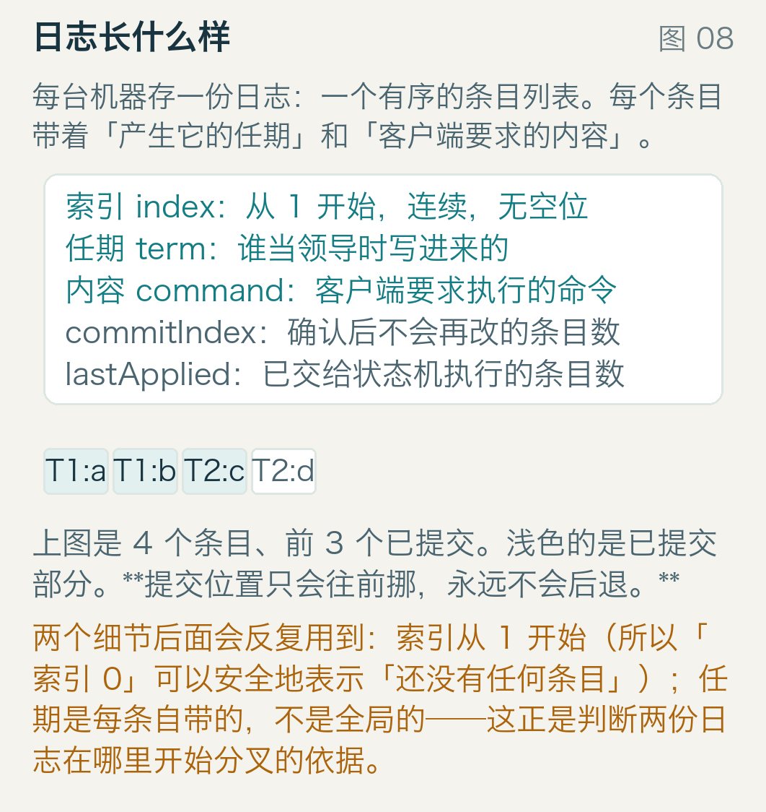

日志是一个有序的条目列表，每个条目带三样东西：

- **索引 index**：从 1 开始，连续，不许有空位。
- **任期 term**：这条是谁当领导的时候写进来的。
- **内容 command**：客户端要求状态机执行的命令。

另外每个节点还记着两个位置：

- **commitIndex**：已经确认"再也不会被改"的条目个数。这个位置**只会往前挪，永远不会后退**。
- **lastApplied**：已经交给状态机执行的条目个数。（第 20 节那个真实 bug 就出在这一项上：两台机器的 commitIndex 一模一样，lastApplied 走过的路径却不一样。）

两个细节后面会反复用到：

- **索引从 1 开始**，所以"索引 0"可以安全地表示"还没有任何条目"——第 12 节的回退逻辑就靠这个。
- **任期是每条自带的**，不是全局的。所以比较两份日志时，可以逐条看"这一条的任期是多少"——这正是判断两份日志在哪里开始分叉的依据。

## 9. 一次客户端写，消息长什么样

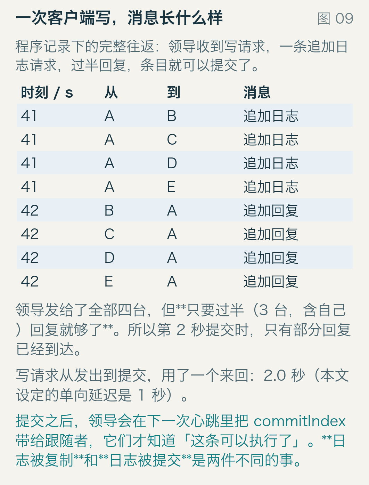

程序记录下了完整的往返：

| 时刻 | 从 | 到 | 消息 |
|---|---|---|---|
| 41 | A | B | 追加日志 |
| 41 | A | C | 追加日志 |
| 41 | A | D | 追加日志 |
| 41 | A | E | 追加日志 |
| 42 | B | A | 追加回复 |
| 42 | C | A | 追加回复 |
| 42 | D | A | 追加回复 |
| 42 | E | A | 追加回复 |

领导把请求发给**全部四台**，但**只要过半（含自己 3 台）回复就够了**。这一轮里，四台都在一秒内回了，所以领导在第 42 秒就提交了——从发出到提交，**一个来回，2 秒**（本文设定的单向延迟是 1 秒）。

这里有一个必须分清的差别：

> **"日志被复制"和"日志被提交"是两件事。**

- 复制：某个跟随者的日志里有了这条。
- 提交：**多数派**的日志里有了这条，领导把 commitIndex 往前挪。

提交之后，领导会在下一次心跳里把新的 commitIndex 带给跟随者，跟随者才知道"这条可以执行了"。**在那之前，跟随者手里有一条自己都不确定会不会被撤销的日志。**

## 10. 机器越多，提交不会变慢，消息会变多

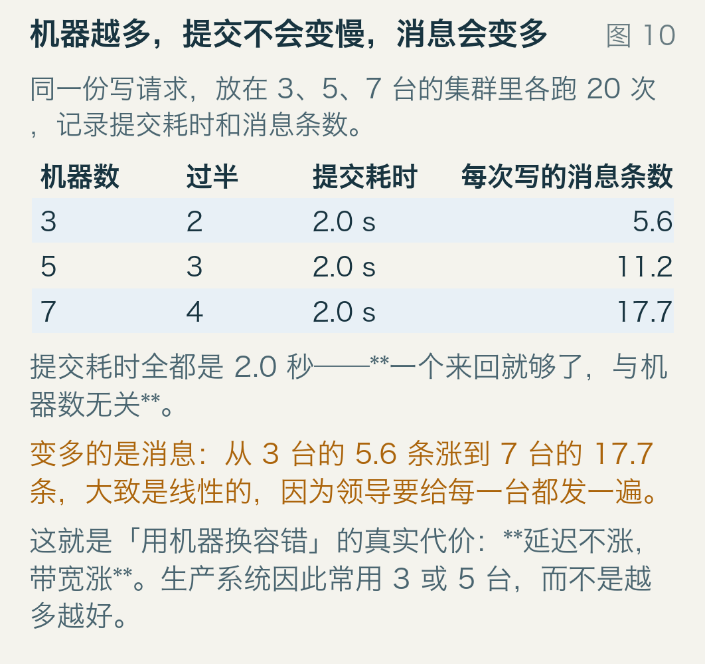

同一份写请求，放在 3、5、7 台的集群里各跑 20 次：

| 机器数 | 过半 | 提交耗时 | 每次写的消息条数 |
|---|---|---|---|
| 3 | 2 | 2.0 s | 5.6 |
| 5 | 3 | 2.0 s | 11.2 |
| 7 | 4 | 2.0 s | 17.7 |

**提交耗时全都是 2.0 秒。** 因为提交只需要一个来回，与机器数无关——多出来的机器不会让往返变长。

变多的是消息：从 3 台的 5.6 条涨到 7 台的 17.7 条，大致是线性的，因为领导要给每一台都发一遍。

这就是"用机器换容错"的真实代价：**延迟不涨，带宽涨**。生产系统因此常用 3 或 5 台。7 台能容忍 3 台坏，但每条写请求要发 6 遍——如果你的机器故障率没那么高，这笔账不划算。

## 11. 领导崩了，日志会不会丢

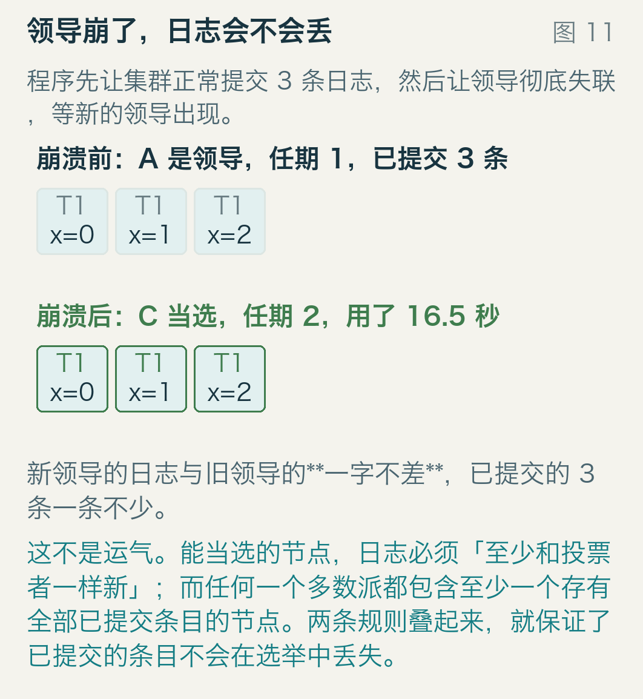

程序先让集群正常提交 3 条日志，然后让领导彻底失联。结果是：

- 崩溃前：A 是领导，任期 1，已提交 3 条，日志是 `T1:x=0`、`T1:x=1`、`T1:x=2`。
- 崩溃后：**C 在 16.5 秒后当选，任期 2**，日志与 A **一字不差**。

新领导的日志一条不少。这不是运气，是两条规则叠起来的结果：

1. **能当选的节点，日志必须"至少和投票者一样新"**（第 13 节的选举限制）。
2. **任何一个多数派，都包含至少一个存有全部已提交条目的节点。**

如果一个节点缺少某条已提交的日志，那么存着那条日志的机器会拒绝投票给它。它需要过半的票，但过半里必然有人存着那条日志——所以它拿不到过半。**"缺日志"这件事本身，就把它挡在门外了。**

## 12. 两份日志对不上，怎么办

如果集群从没出过岔子，日志永远是齐的。但真实系统里一定会有分叉：某个跟随者在领导崩溃前只收到了一部分条目。

程序构造了这样一个场景：老领导把两条新条目只复制给了 B（五台里只有两台有，不构成多数派），然后彻底失联；剩下的三台选出了新领导 C，C 写入了自己的条目。

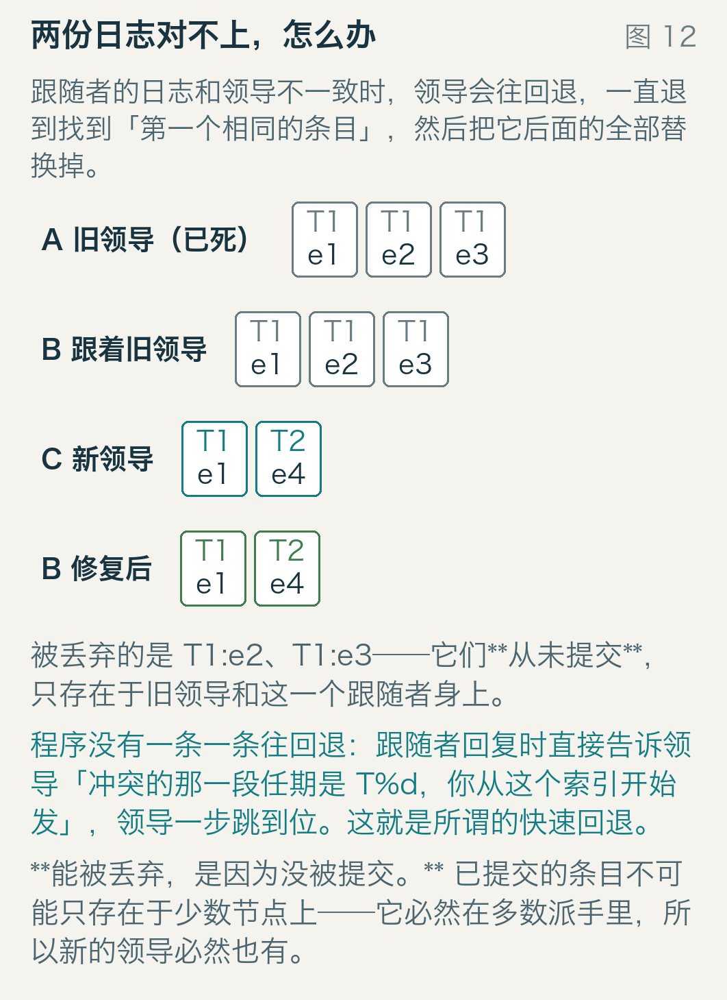

| 节点 | 日志 |
|---|---|
| A 旧领导（已死） | `T1:e1`、`T1:e2`、`T1:e3` |
| B 跟着旧领导 | `T1:e1`、`T1:e2`、`T1:e3` |
| C 新领导 | `T1:e1`、`T2:e4` |
| B 修复后 | `T1:e1`、`T2:e4` |

C 把自己的日志推给 B 时，会带上"我认为我们一致到哪个位置为止"（上一次的索引和任期）。B 检查发现：索引 1 的任期一致，索引 2 的任期是 1，而 C 给的是 2——**从这里开始分叉了**。

于是 B 把索引 2 之后的全部**截掉**，换成 C 的。`T1:e2` 和 `T1:e3` 就这样消失了。

**它们能被丢弃，是因为它们从未被提交。** 已提交的条目不可能只存在于少数节点上——它必然在多数派手里，所以新领导必然也有。这条推理是第 14 节那条规则的基础。

还有一个工程细节：程序**没有一条一条往回退**。B 在回复里直接告诉 C"冲突的那一段任期是 T1，你从这个索引开始发"，C 一步跳到位。这叫快速回退，是 Raft 相对早期 Paxos 实现的一个实用性改进。

## 13. 选领导时，日志不够新的人选不上

拉票请求里为什么必须带上"我的最后一条日志的索引和任期"？


因为投票者要用它做一次比较，规则是**先比任期，再比索引**：

- 最后一条的**任期**更大 → 更新。
- 任期相同，**索引**更大 → 更新。
- 任期更小 → **无论索引多长，都算落后。**

第三条容易被忽略，但它正是第 15 节那个反例的关键。举个例子：

- 节点 X：1 条日志，最后一条的任期是 6。
- 节点 Y：100 条日志，最后一条的任期是 1。

按这条规则，**X 比 Y 更新**。听起来荒谬——Y 明明多 99 条日志。但 Y 的那 100 条全都来自任期 1，而 X 见过任期 6 的世界。X 可能知道一些 Y 完全不知道的事，而 Y 手里那些任期 1 的条目，可能正是 X 当选后要覆盖掉的。

换成具体数字就清楚了：假设另外几台机器在任期 3 的时候，把索引 3 上的一条命令提交了。Y 的索引 3 上却是一条任期 1 的条目——**同一个位置，两条不同的命令**。Y 的日志从索引 3 起就和已提交的那份分叉了，后面那 97 条全部建立在这个分叉之上。

**长度不能告诉你日志从哪里开始分叉，任期可以。** 这就是为什么比较必须从任期开始，而不是从长度开始。

这条规则叫**选举限制**。它的作用是把"已提交的日志"和"未来的领导"绑在一起：**想当领导，先证明你手里有全部该有的东西。**

## 14. 「多数派都有」不等于「可以提交」

这是 Raft 里最容易写错、也最值得单独讲的一条规则：

> **只有当前任期的条目，才能通过"多数派已复制"来提交。**

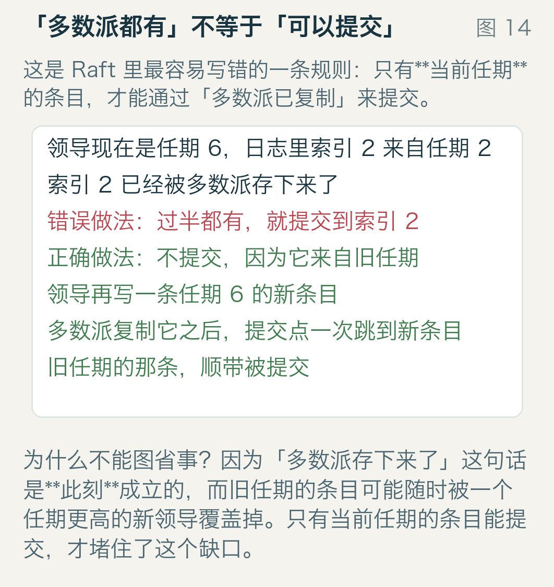

设想领导现在是任期 6，它的日志里索引 2 来自任期 2。现在索引 2 已经被多数派存下来了——**按"过半就提交"的直觉，这时候就该提交了。**

**不对。** 正确做法是：不提交，因为索引 2 来自旧任期。

那什么时候提交？领导继续写入一条任期 6 的新条目。当**这条新条目**被多数派复制之后，提交点会一次跳到新条目——旧任期的那条，顺带被提交了。

为什么不能图省事？因为**"多数派存下来了"这句话只在此刻成立**。旧任期的条目随时可能被一个任期更高的新领导覆盖掉——只要那个新领导能当选。而"能不能当选"又取决于选举限制，选举限制又允许"任期更新但索引更短"的节点当选。

这些规则互相咬合，缺口就在这里。**只有当前任期的条目能提交，才堵住了它。**

## 15. 把这条规则去掉，会丢什么

光说不够，来看具体的。下面这个状态直接照抄 Raft 论文里的那张图（Figure 8）。五台机器，索引 1 早已提交，索引 2 上有分歧。

先看它是怎么走到这一步的，否则表里的任期数字会像是凭空冒出来的：

1. S1 当选**任期 4** 的领导，把索引 2（一条**任期 2** 的条目 `T2:b`）复制给了 S2。S3、S4、S5 手里只有索引 1。
2. S1 失联。S5 当选**任期 5** 的领导，在日志的索引 2 写下 `T5:c`——同一个位置，不同的内容。
3. S5 也失联。S1 重新上线、再次当选**任期 6**，把自己那条 `T2:b` 推给了 S3。

三步之后，五台机器长这样（任期数字直接取自论文那张图：S4 从没听到过更新的消息，所以停在 2。本文的程序不重演这段历史，只接收这个状态，然后检查两种提交规则各自会做出什么决定）：

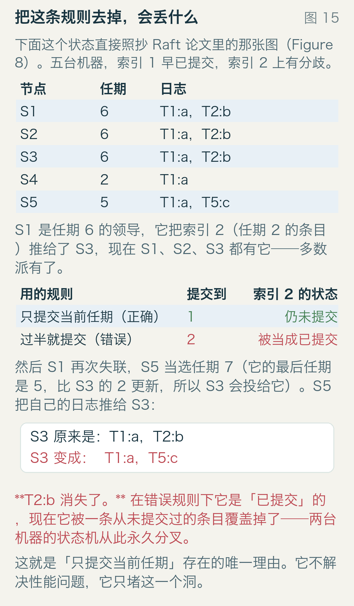

| 节点 | 任期 | 日志 |
|---|---|---|
| S1 | 6 | `T1:a`、`T2:b` |
| S2 | 6 | `T1:a`、`T2:b` |
| S3 | 6 | `T1:a`、`T2:b` |
| S4 | 2 | `T1:a` |
| S5 | 5 | `T1:a`、`T5:c` |

S4 一直没听到任何消息，任期停在 2；S5 停在它当选时的任期 5。而 S1、S2、S3 三台（多数派）手里都有索引 2 了——**多数派有了**。

| 用的规则 | 提交到索引 | 索引 2 的状态 |
|---|---|---|
| 只提交当前任期（正确） | 1 | 仍未提交 |
| 过半就提交（错误） | 2 | 被当成已提交 |

然后 S1 再次失联，S5 当选任期 7。S5 能当选吗？能——**S5 的最后一条任期是 5，比 S3 的 2 更新，所以 S3 会投给它。**

S5 上任后把自己的日志推给 S3：

- S3 原来是：`T1:a`、`T2:b`
- S3 变成：  `T1:a`、`T5:c`

**`T2:b` 消失了。** 在错误规则下它是"已提交"的，现在它被一条从未提交过的条目覆盖掉了——S3 的状态机和其他机器从此永久分叉。

这就是"只提交当前任期"存在的**唯一**理由。它不解决性能问题，不解决可用性问题，它只堵这一个洞。而为了堵这个洞，你愿意付出的代价是：**领导者换届后的第一批写，要等到有一条当前任期的条目被多数派复制，才能连带把之前的条目提交掉。**

## 16. 网络断开：旧领导还以为自己是领导

前面讲的都是"机器坏了"。但分布式系统里更常见的是**网络断开**——机器都好好的，只是互相联系不上。

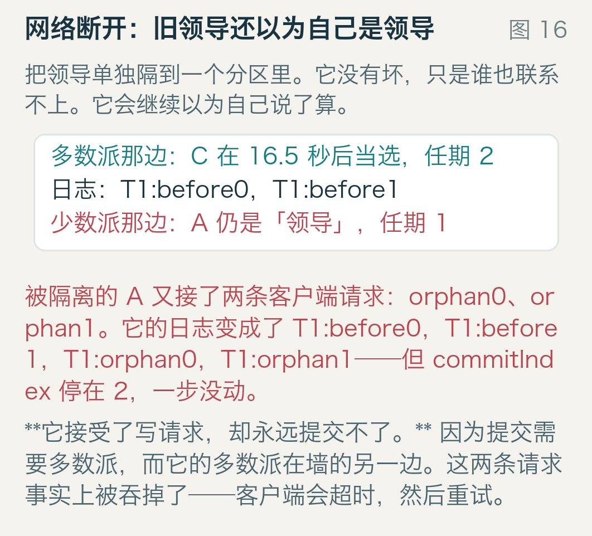

程序把领导 A 单独隔到一个分区里：

- 多数派那边（4 台）：**C 在 16.5 秒后当选，任期 2**，日志 `T1:before0`、`T1:before1`。
- 少数派那边（1 台）：**A 仍然是"领导"，任期还是 1。**

A 没有坏。它只是谁也联系不上，而它自己不知道。于是它继续接受客户端请求——程序让它又接了两条：`orphan0` 和 `orphan1`。

它的日志变成了 `T1:before0`、`T1:before1`、`T1:orphan0`、`T1:orphan1`，但 **commitIndex 停在 2，一步没动。**

> **它接受了写请求，却永远提交不了。**

因为提交需要多数派，而它的多数派在墙的另一边。这两条请求事实上被吞掉了——客户端会超时，然后重试（或者放弃）。从客户端角度看，这两条写"没有成功"，而这是正确的：**它们确实没有成功。**

这一节还顺带说明了一件事：**领导不是"被选举出来的身份"，而是"能拿到多数票的临时状态"**。A 并不需要被"罢免"才会失去领导地位——它只要拿不到多数票，就已经不是领导了，只是它自己还不知道。

## 17. 网络恢复：那两条请求去哪了

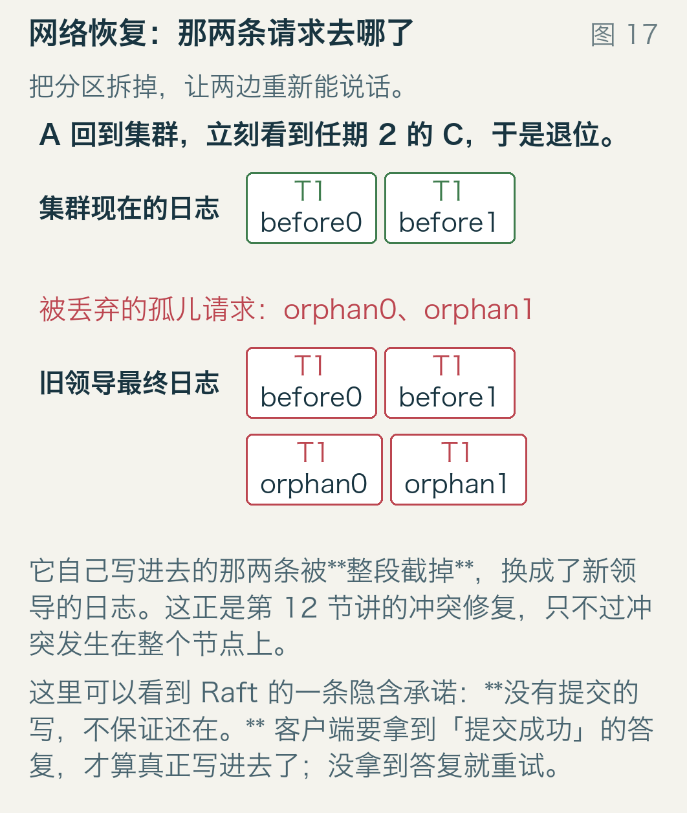

把分区拆掉，让两边重新能说话。A 回到集群，立刻看到任期 2 的 C——**任期比自己大，于是退位**，接受 C 的日志。

结果是：

- 集群现在的日志：`T1:before0`、`T1:before1`
- 被丢弃的孤儿请求：`orphan0`、`orphan1`
- 旧领导最终日志：`T1:before0`、`T1:before1`、`T1:orphan0`、`T1:orphan1`

等等——旧领导自己的日志里**还留着**那两条？是的。它只是在索引 2 之后被 C 的日志覆盖了；但它自己那两条 `orphan` 在 C 的日志里没有对应位置（C 的日志只有 2 条），所以它们**还在 A 的本地日志里**，只是 commitIndex 还是 2，永远不会被执行。

这个细节值得停一下：**"被丢弃"和"被删除"不是一回事。** 那两条条目物理上还在 A 的磁盘上，但它们永远不会被提交、永远不会被执行。安全性关心的是"会不会被执行"，不是"字节还在不在"。

（Raft 的规则是「**只有冲突才删除**」：索引相同、任期不同才截断。A 的那两条孤儿在 C 的日志里没有对应位置，所以它们不构成冲突，也就没被删掉。真实实现通常会把这种多余的尾巴一并修剪，但即使不修剪也不影响安全性——安全性关心的是「会不会被执行」，不是「字节还在不在」。）

这里可以看到 Raft 的一条隐含承诺：

> **没有拿到"提交成功"答复的写，不保证还在。**

客户端要拿到明确答复才算写成功；没拿到答复就重试。**重试可能造成重复执行**，所以状态机通常需要按请求编号去重——这一层通常不放在 Raft 里，而是放在上层应用里。

## 18. 加机器：一次只加一台

集群规模不是一成不变的。加机器看起来简单，其实有个坑。

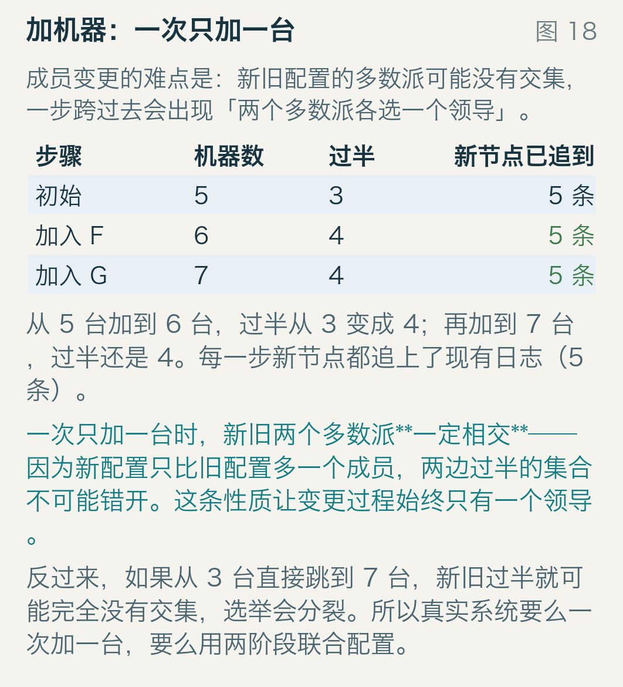

| 步骤 | 机器数 | 过半 | 新节点已追到 |
|---|---|---|---|
| 初始 | 5 | 3 | 5 条 |
| 加入 F | 6 | 4 | 5 条 |
| 加入 G | 7 | 4 | 5 条 |

难点在于：**新旧两个配置的多数派，可能完全没有交集。**

上表是本文那五台机器实际跑出来的；下面这个「从 3 台直接跳到 7 台」是假想的极端情况，用来把这个坑放到最大。节点还是 A 到 G 这一组：旧配置是 3 台（A、B、C），多数派只要 2 台，比如 `{A, B}`；新配置是 7 台，多数派要 4 台，比如 `{C, D, E, F}`。这两个集合可以完全错开——于是 A、B 可能选出一个领导，C、D、E、F 选出另一个。**同一时刻两个领导。**

Raft 的解法很朴素：**一次只改一台。** 从 5 台到 6 台，新旧两个多数派一定相交——因为新配置只比旧配置多一个成员，两边过半的集合不可能错开。这条性质让变更过程中始终只有一个领导。

（另一条路是两阶段"联合配置"：先进入一个"新旧配置都算数"的中间态，两边各自过半才算数，再切到新配置。本文的模拟器只实现了一次加一台这一种。）

## 19. 让程序自己去找反例

到这一步，我们已经讲了很多规则。但怎么知道**实现**真的守住了它们？

手写几个场景是不够的——你只能测到你想得到的那些情况。所以程序做的是：**随机地崩机器、随机地切网络、随机地发写请求，每一步都检查四条安全性性质。**

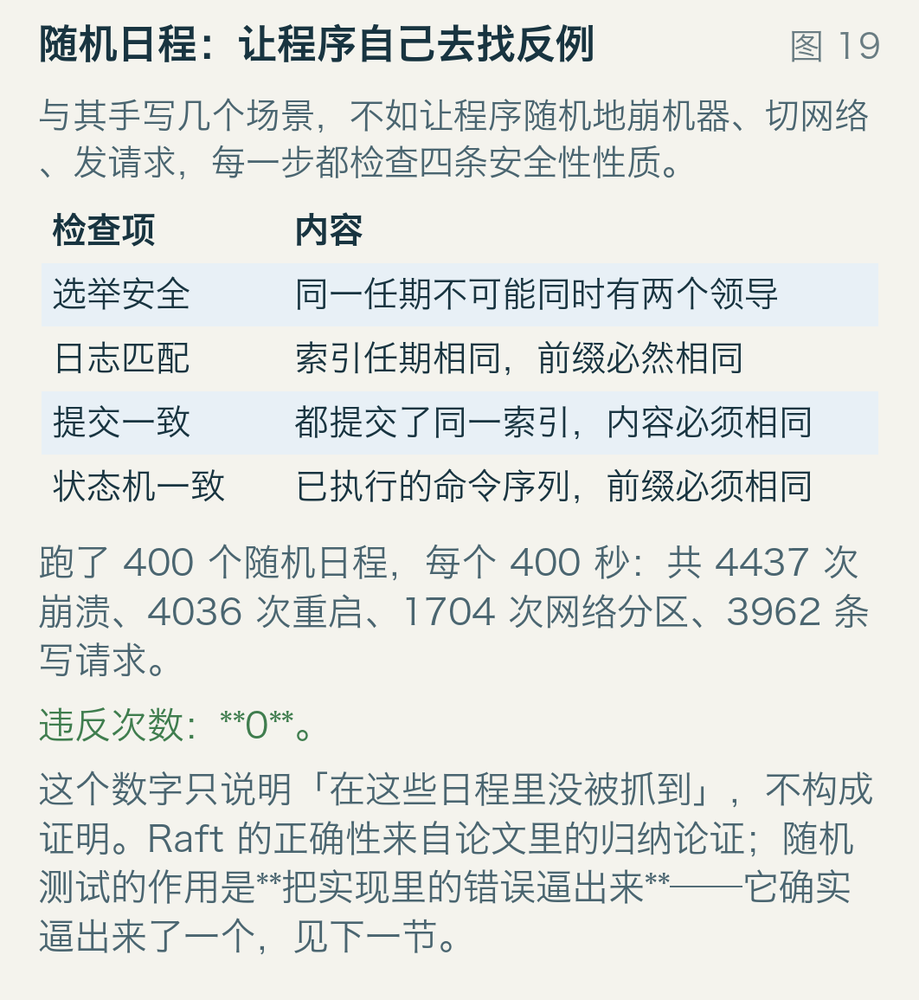

四条性质是：

| 检查项 | 内容 |
|---|---|
| 选举安全 | 同一任期不可能同时有两个领导 |
| 日志匹配 | 索引任期相同，前缀必然相同 |
| 提交一致 | 都提交了同一索引，内容必须相同 |
| 状态机一致 | 已执行的命令序列，前缀必须相同 |

其中第一条**每一步都要检查**（因为它是"任何时刻"的性质），其余三条在最后检查。

跑了 400 个随机日程，每个 400 秒：

- 崩溃 4437 次
- 重启 4036 次
- 网络分区 1704 次
- 写请求 3962 条
- **违反次数：0**

这个 0 只说明"在这些日程里没被抓到"，**不构成证明**。Raft 的正确性来自论文里的归纳论证；随机测试的作用是**把实现里的错误逼出来**。

顺带说一个诚实的发现：把提交规则改错（第 14 节那条），再跑 400 个随机日程，**违规次数还是 0**。原因是 Figure 8 那个交错顺序太特殊了，随机碰不上。这一条比前面任何一条都值得记住：

> **随机测试能证明"有 bug"，不能证明"没 bug"。**

## 20. 检查器抓到的第一个真错误

不过随机测试确实抓到了一个错误，而且是本文写作过程中最有价值的一次失败。

第一次跑完 300 个随机日程，出现了 1 次违规（种子 62）：**B 和 E 两台机器已经执行过的命令序列不一样了。**

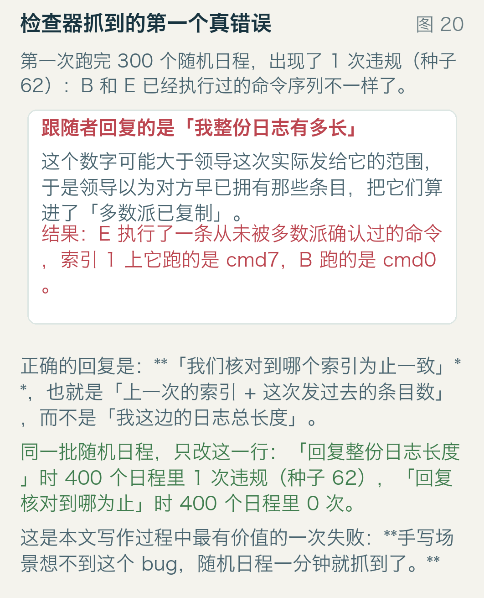

具体到状态：两台机器最后的日志完全相同、`commitIndex` 都停在 8，可是索引 1 上，B 执行的是 `cmd0`，E 执行的却是 `cmd7`——而 `cmd7` 后来被日志修复覆盖掉了，最终哪台机器的日志里都没有它。

也就是说，**E 执行了一条从未被多数派确认过的命令**。状态机一旦执行就无法回退，两台机器的结果从此对不上。

这里正是第 8 节那个 `lastApplied` 的意义：`commitIndex` 只说明「哪些条目被确认了」，`lastApplied` 才说明「状态机已经吃进去哪些」。两台机器的 `commitIndex` 都停在 8，看起来完全一致；真正分叉的是 `lastApplied` 一路走过来的那条路径。

排查下来，是跟随者回复的内容写错了：

- **错误的写法**：回复"我整份日志有多长"。
- **正确的写法**：回复"我们核对到哪个索引为止一致"，也就是"上一次的索引 + 这次发过去的条目数"。

为什么错的那版会出事？因为"我整份日志有多长"这个数字，可能**大于**领导这次实际发给它的范围。领导会因此以为对方早就拥有了自己这边还没复制过去的条目，把它们一起算进"多数派已复制"——于是提交了一条并没有真正达成多数派的条目。

同一批随机日程，只改这一行：

| 回复方式 | 违规次数 |
|---|---|
| 回复整份日志长度（错误） | 1 / 400（种子 62） |
| 回复核对到哪为止（正确） | **0 / 400** |

**手写场景想不到这个 bug，随机日程一分钟就抓到了。** 这就是为什么第 19 节那四条性质值得写成代码，而不是写在纸上。

（为了让你能自己重现它，模拟器里留了一个开关：`reply_rule='whole_log'` 会故意用回错误写法。）

## 21. 它在哪些系统里跑

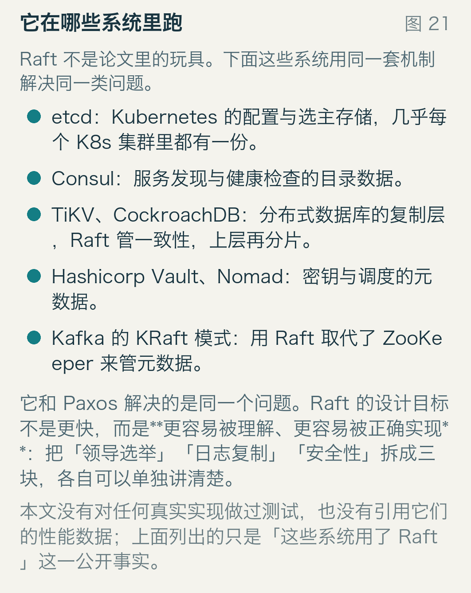

- **etcd**：Kubernetes 的配置与选主存储。几乎每个 K8s 集群里都有一份 etcd。
- **Consul**：服务发现与健康检查的目录数据。
- **TiKV、CockroachDB**：分布式数据库的复制层。Raft 管一致性，上层再分片。
- **Vault、Nomad**：密钥与调度的元数据。
- **Kafka 的 KRaft 模式**：用 Raft 取代了 ZooKeeper 来管元数据。

它和 Paxos 解决的是同一个问题。Raft 的设计目标不是更快，而是**更容易被理解、更容易被正确实现**：把"领导选举""日志复制""安全性"拆成三块，各自可以单独讲清楚，而且每一块都有一条能一句话说完的规则。

（本文没有对任何真实实现做过测试，也没有引用它们的性能数据；上面列出的只是"这些系统用了 Raft"这一公开事实。）

## 22. 自己动手

下面每一条都能在本目录的代码里改一个数字重跑。**先猜结果，再对照。**

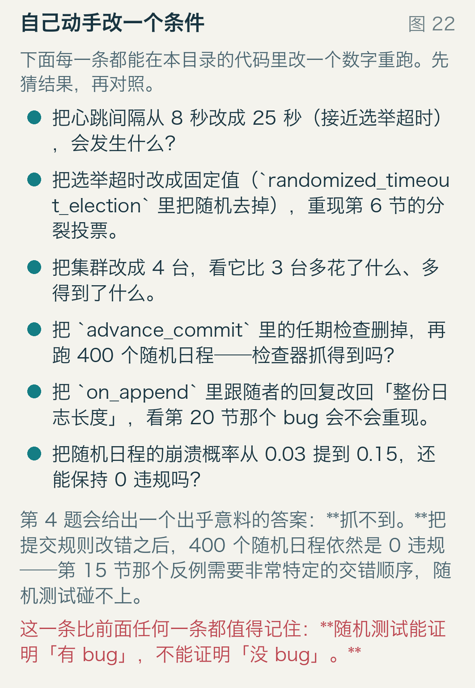

1. 把心跳间隔从 8 秒改成 25 秒（接近选举超时），会发生什么？
2. 把选举超时改成固定值，重现第 6 节的分裂投票。
3. 把集群改成 4 台，看它比 3 台多花了什么、多得到了什么。
4. 把 `advance_commit` 里的任期检查删掉，再跑 400 个随机日程——检查器抓得到吗？
5. 把 `on_append` 里跟随者的回复改回"整份日志长度"，看第 20 节那个 bug 会不会重现。
6. 把随机日程的崩溃概率从 0.03 提到 0.15，还能保持 0 违规吗？

第 4 题的答案出乎意料：**抓不到。** 第 15 节那个反例需要非常特定的交错顺序，随机测试碰不上——这也是为什么论文要用一张手画的图来讲它，而不是用一堆模拟结果。

第 5 题则相反：**一定能重现**，而且很快。同一个检查器，对一种 bug 灵敏，对另一种 bug 完全不敏感。**知道自己的测试对什么不敏感，比知道它能测出什么更重要。**

## 收尾：所有规则都在守住同一句话

把全文压缩成一张表：

| 规则 | 它守住了什么 |
|---|---|
| 过半才算数 | 任意两个决定必然有交集 |
| 一个任期只投一票 | 同一任期不可能有两个领导 |
| 随机化选举超时 | 分裂投票无法持续 |
| 日志必须连续、无空位 | 比较两份日志时能定位分叉点 |
| 选举限制（比任期再比索引） | 缺已提交日志的节点当不上领导 |
| 只提交当前任期的条目 | 已提交的条目不会被覆盖 |
| 一次只加一台机器 | 新旧多数派必然相交 |

它们看起来是七条独立的规则，其实都在守住同一句话：

> **任何被确认的事，都已经被多数派记住；而任何多数派，都足以让这件事在将来被重新发现。**

第 20 节那个 bug 之所以危险，就是因为它让领导以为"多数派已经记住"——而实际上没有。

## 动手材料

代码在 `examples/` 目录里，运行说明见 [README.md](README.md)，全部数值结果见 [examples/results.json](examples/results.json)。图和正文都从那里读。

```sh
python examples/run_model.py        # 全部实验，写 results.json
python examples/build_figures.py    # 重绘全部正文图与封面
```

只用 Python 标准库（绘图另需 Pillow 与一款中文字体）。

## 图片来源

本文 22 张正文图与 1 张封面全部由 `examples/build_figures.py` 用 Python/Pillow 原创绘制，**没有使用任何第三方照片、图表或截图**，因此不涉及第三方素材的授权与署名。图中的日志、状态、计数与时间线，凡属实测场景的都从 `examples/results.json` 读取；少数示意图（如日志结构、选举限制的反例状态）是手工排布的教学示意，不是模拟输出。详细尺寸、最小字号与身份见 [examples/figure-metadata.json](examples/figure-metadata.json)。
