# 明明又是 A，为什么这次比较不算数？把 ABA 问题放慢到六步

你检查了一眼栈顶：A。算好下一步，刚要动手，线程被切走了。回来一看，栈顶还是 A。那不就说明原计划还能用吗？

未必。最容易漏掉的不是“现在读到了什么”，而是：**你算出的那个新值，依赖哪些已经可能过期的事实？**

这篇不从难读的并发代码起步。先只用 A、B、C 三个节点，亲手把一次错误拼出来；再让小程序穷举所有保持线程内部顺序的交错。最后给 A 带上版本票，看看它挡住了什么，又没有挡住什么。

## 1｜CAS 很守规矩，它没有答应替你记历史

CAS 是 compare-and-swap，比较并交换。这里用强 CAS 的抽象语义：把共享位置的当前值与 expected 比较；相等便写入 desired，并返回成功，否则不写、返回失败。整个比较和写入是不可分的一次原子动作。这里不模拟弱 CAS 的伪失败。

例如 CAS(head, A, C) 只问“此刻 head 是否等于 A”。它不问“自从我上次读它以后，有没有别人碰过它”。后一件事不在这条原语的基本契约里。

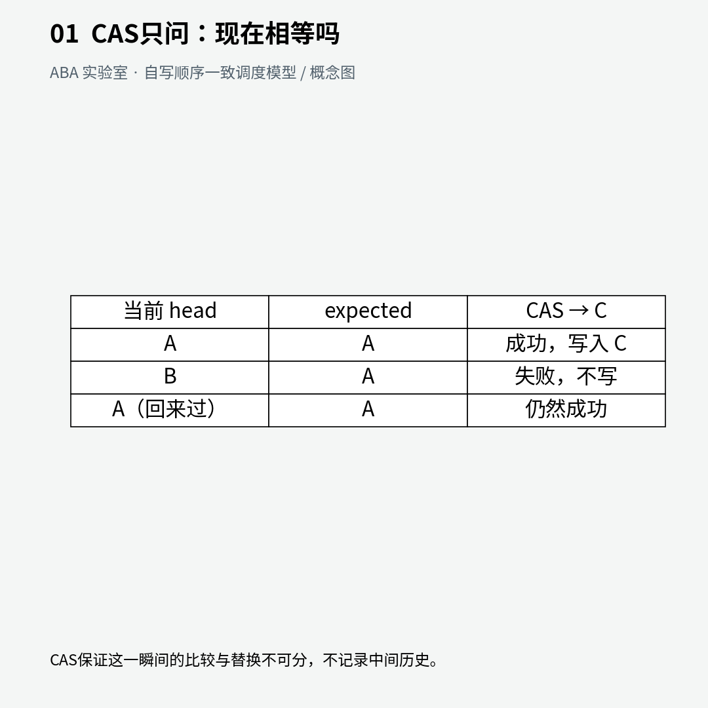
图1｜CAS 的当前值比较：A 离开又回来，单独比较指针仍会通过。

Boost.Lockfree 的官方原理说明把版本计数与指针一起原子更新，作为处理这类问题的一种方法，同时提醒原子操作位宽受平台限制。本文只借这个机制起点，不把该文档里的特定地址位数例子当作所有现代机器的事实。[Boost 官方原理说明](https://www.boost.org/latest/doc/html/lockfree/rationale.html)

## 2｜先把“值相同”和“是同一个节点”拆开

初始栈是 A → B → C → 空。head 指向 A；A.next 指向 B；B.next 指向 C。

这里 A、B、C 是不同节点的稳定编号，不是三个节点所装的数据值。两个不同节点可以都存数字 7，数据值相等不代表地址相等；同一块地址以后也可能装另一个对象，地址相等又不自动代表对象生命周期相同。

为了把问题拆干净，下面的程序**根本不释放节点存储**。节点永远存在于一个字典里，拿出去的节点仍可读取。这样即使暂时没有悬空指针，也能单独看见链接过期。它是允许节点取出后重新放入的侵入式教学栈，不是假装已经实现了安全的生产容器。

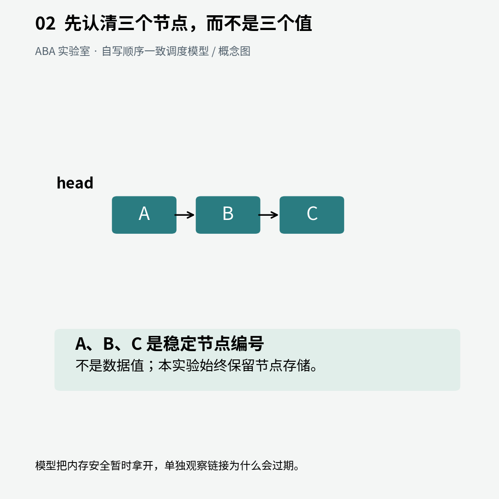
图2｜初始 A→B→C；字母标识节点，存储始终保留，不模拟地址回收。

要弹出栈顶，读者线程 R 准备做三步：

1. 读 head，把 A 记为 expected。
2. 读 A.next，把 B 记为 following。
3. CAS(head, expected, following)。成功后，它认为自己移除了 A。

关键是第二步。following 是线程自己的局部值，不是一根会自动随 A.next 变化的“实时导线”。

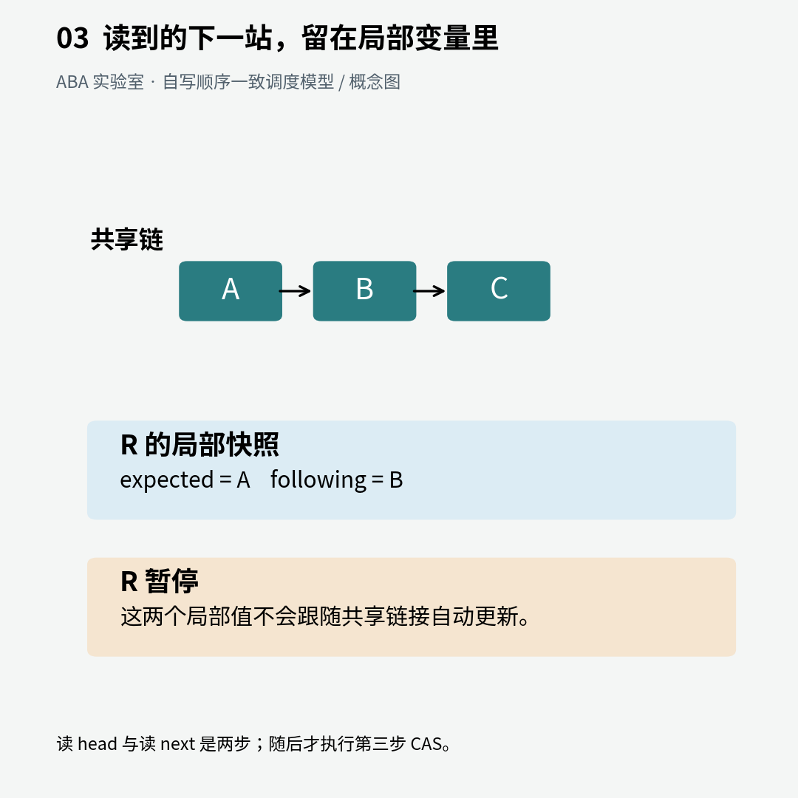
图3｜R 保存 expected=A、following=B 后暂停；局部快照不会自动刷新。

## 3｜别人做的每一步都正常，旧计划却已经坏了

让另一个线程 W 连续做三个正常栈操作：

- 弹出 A，栈剩 B→C。
- 弹出 B，栈剩 C。
- 把刚才的 A 放回，设置 A.next=C，栈变 A→C。

W 手里还拿着 B，没有把它放回。注意：A 的编号没变，但它的 next 已经变了。

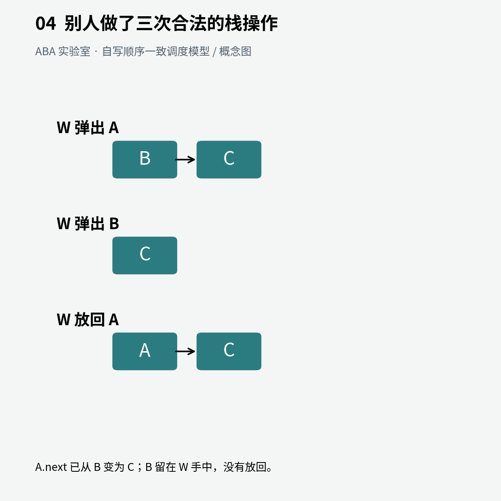
图4｜W 的三步实际改变了链接：A→B→C，最终变为 A→C，B 留在栈外。

现在 R 恢复。它执行的仍是 CAS(head, A, B)。head 确实是 A，所以原子比较成功，把 head 改成 B。结果栈变成 B→C。一个早已被 W 拿走、没有重新入栈的 B，又被接回来了。

CAS 没有违反自己的规格。失效的是使用者的推理：“head 还是 A，所以我曾读到的 A.next=B 仍然有效。”前半句不能推出后半句。

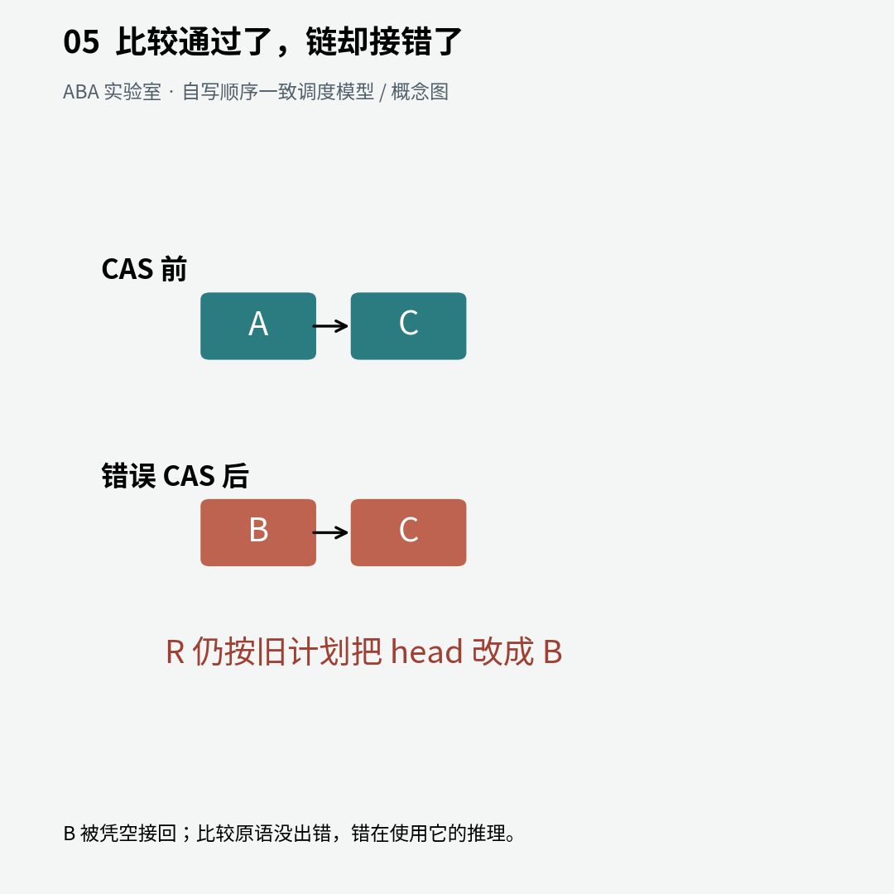
图5｜错误发生在成功 CAS：本该从 A→C 弹出 A，却把旧的 B→C 接回。

这里常说的 ABA，描述的是被比较的状态出现了“原值→别的状态→原值”。中间并不只准有一个 B。我们的 head 历史是 A→B→C→A，照样属于这个模式。不要把术语里的 B 和本文的具体节点 B 强行一一对应。

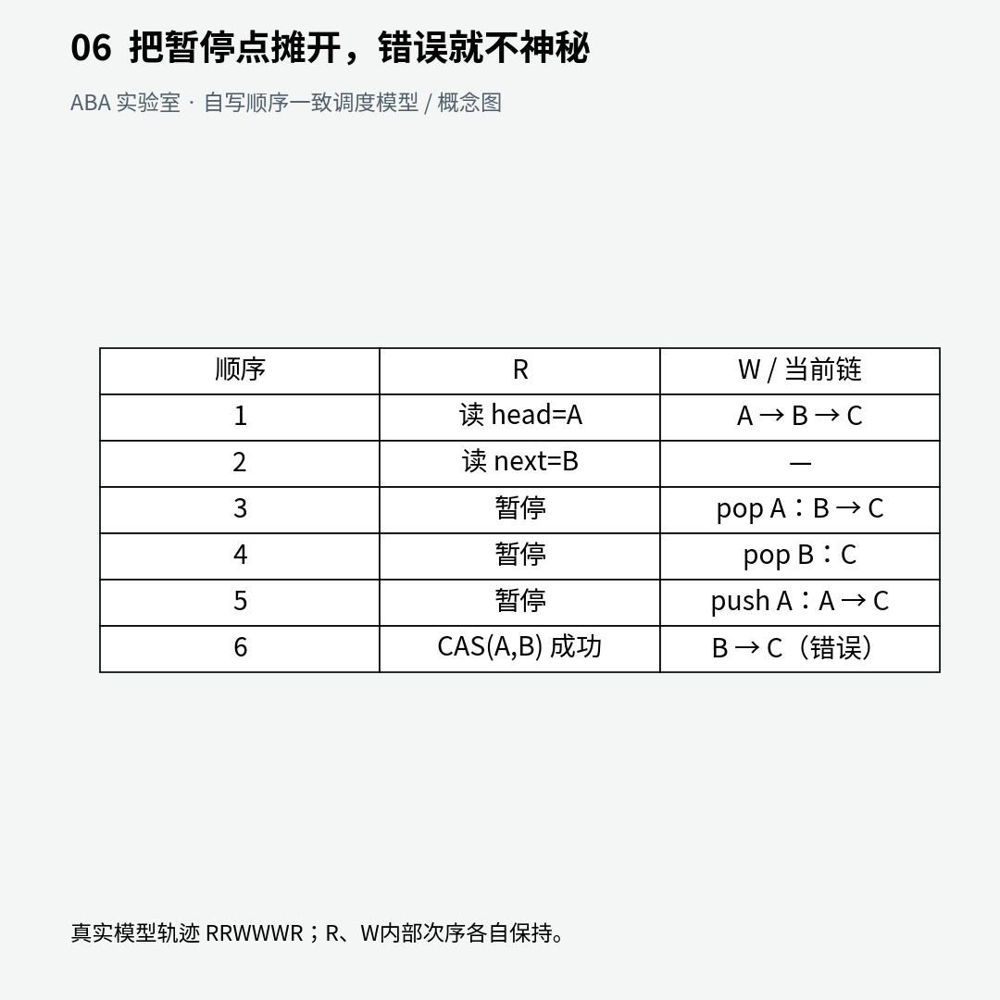
图6｜RRWWWR 的完整六步轨迹：R 先读两次，W 做三次操作，R 最后比较交换。

如果把栈当作抽象对象，这段结果也说不通：W 已经拿走 A 和 B，只把 A 放回；随后 R 又拿走 A，剩下应该是 C，而不是 B→C。R 的操作虽然横跨 W 的三次操作，但 W 返回的节点次序约束了能安排的顺序；不能仅说“把 R 想象成早一点执行”就让 B 合法复活。

## 4｜见到 A→别的值→A，先别急着报错

假设共享对象只是一个整数寄存器，操作规格是“如果当前值是 10，就改成 11”。别人先改成 9 再改回 10，后来这次 CAS 成功，未必破坏任何规格。它原本就只关心当前值。

而我们的栈操作不仅关心 head 的当前编号，还依赖先前读出的 next。这个隐藏依赖才让返回同值变得危险。

所以判断 ABA 风险，要写出一句完整的话：**我根据哪个旧观察算出了 desired？CAS 的相等条件，真的足以重新验证它吗？**

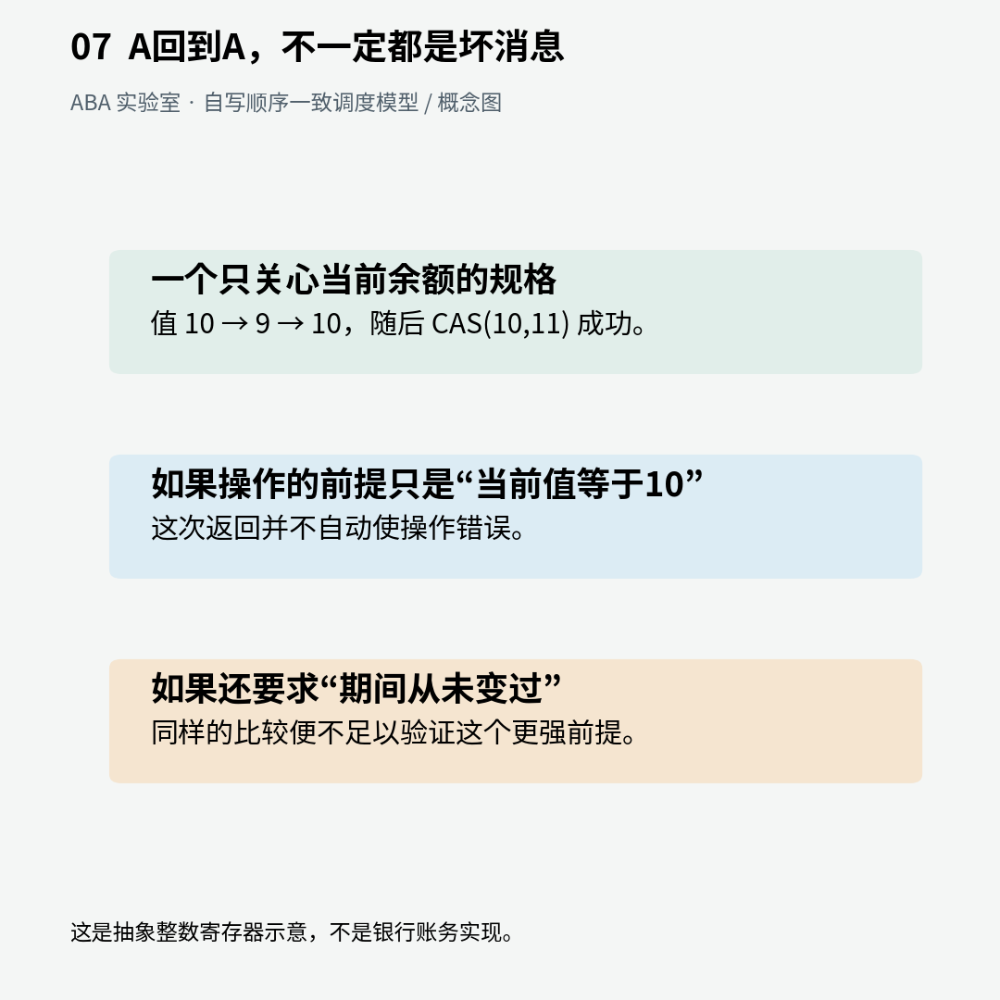
图7｜同值返回是否危险取决于规格：只检查当前值，与要求期间从未变化，是不同前提。

## 5｜不靠“刚好倒霉”：把二十种交错都跑一遍

R 有三个步骤，W 也有三个步骤。只保留各自内部顺序，把它们合成六步，总共有组合数 C(6,3)=20 种。比如 RRRWWW 是 R 全做完以后 W 才开始；RRWWWR 是刚才的失败轨迹。

下面的模型把 W 的每次完整 pop/push 当作一个原子步骤，R 的一次尝试拆成读头、读 next、CAS 三步。W 的第一次 pop 拿到了谁，后续就把那个实际节点放回，不预先假定永远拿到 A。这一点让不同交错都能按自己的真实状态执行。

我们给“过期成功”一个可检查定义：在 R 的 CAS 成功的瞬间，它缓存的 following 不等于当前栈顶的真实 next。这个定义检查的是本例需要的链接前提，不是通用线性化检查器。

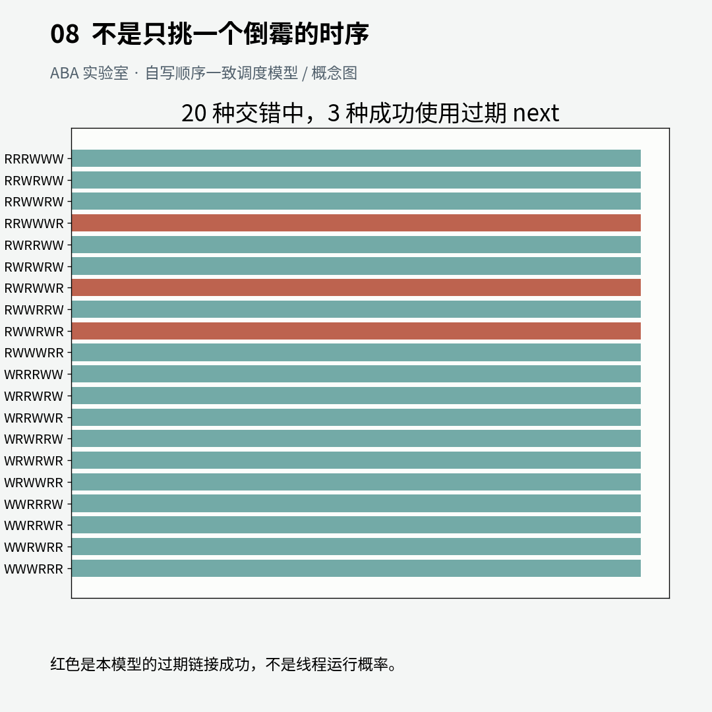
图8｜穷举二十种交错，三种把过期 next 成功写入；红色不是概率估计。

实际输出是 8 种 CAS 成功，其中 3 种使用过期链接。三条见证分别是 RRWWWR、RWRWWR、RWWRWR。后两条说明，问题不只会出现在“刚好读完 next 才暂停”的那一个位置。

这个实验没有真实线程、缓存层或操作系统调度，更没有弱内存重排。它采用顺序一致的交错模型：每一步在一条全局顺序中执行。连这么友好的模型都能出错，就足以否定这段裸指针算法；反过来，有限模型没找到错，并不能证明生产代码安全。

## 6｜版本票：让“回来过的 A”和“原来的 A”不再相等

把 head 从一个编号改成一对值：(节点编号, 标签)。每次成功改变 head，标签加一；读快照时一起读，CAS 时一起比，一起写。

起点是 (A,0)。W 做完三次操作后，得到 (A,3)。R 拿着的仍是 (A,0)，现在相等检查就会拒绝它。R 应重新读取、重新计算，而不是坚持把 B 写回去。

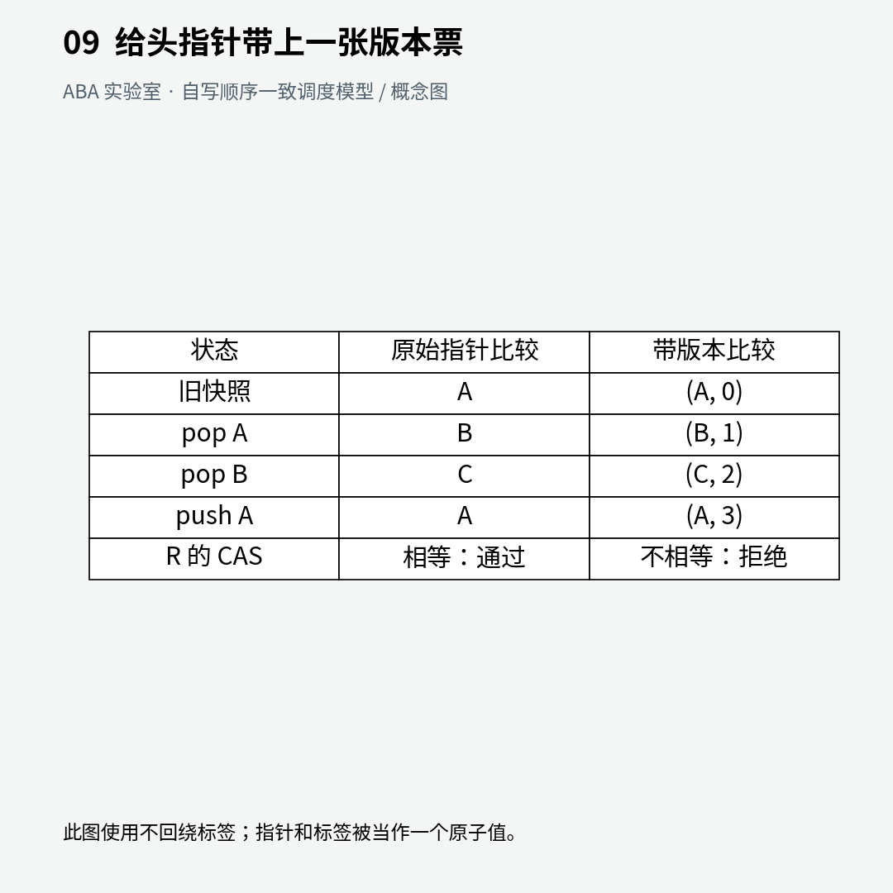
图9｜不回绕版本把旧 (A,0) 与回来后的 (A,3) 区分开，旧 CAS 被拒绝。

在我们的二十种交错里，换成一位、两位、三位或不回绕标签，过期成功数都降到零。但这个小结果特别容易把人骗得过于乐观。


图10｜三步干扰范围内，四种标签模式都没有过期成功；这是有边界的枚举结果。

一位标签只有 0 和 1，两次更新就能回到旧值；只是这组三步干扰没有碰到能同时让指针和标签都回来、又让旧 next 过期的成功时序。**测过的场景没出错，不等于标签位数已经足够。**

## 7｜标签也会 ABA：四次变化，把两位计数绕回零

让 R 仍然先保存 A 和 B。W 这次弹出 A、弹出 B、推入一个独立节点 D、再放回 A。head 的变化是：

(A,0) → (B,1) → (C,2) → (D,3) → (A,0)。

两位标签按模 4 加一。原子比较看到的整对值回来了，但 A.next 现在是 D，不是 B。R 的旧 CAS 又会通过。

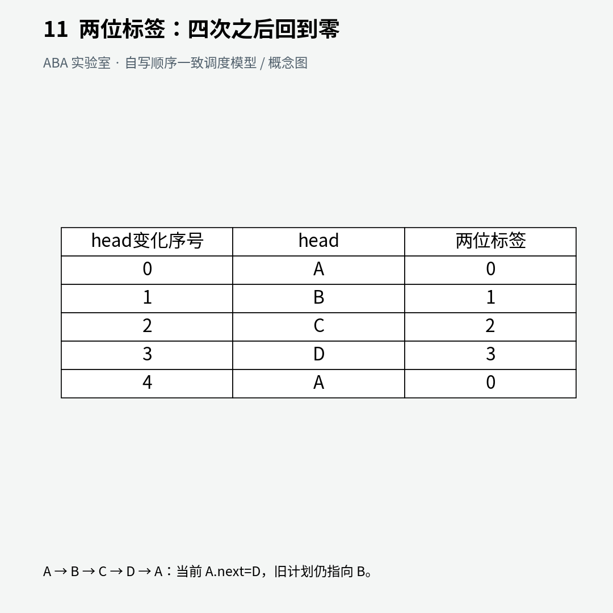
图11｜两位标签经过四次 head 改变回到零，旧 next=B 与当前 next=D 已经不一致。

为了枚举更多暂停位置，扩展程序还在最后加一次 pop 和一次把刚拿走的节点放回，共六个 W 步骤。和 R 三步合起来有 C(9,3)=84 种交错。实际过期成功数依次是：无标签 8，一位 8，两位 4，三位 0，不回绕 0。

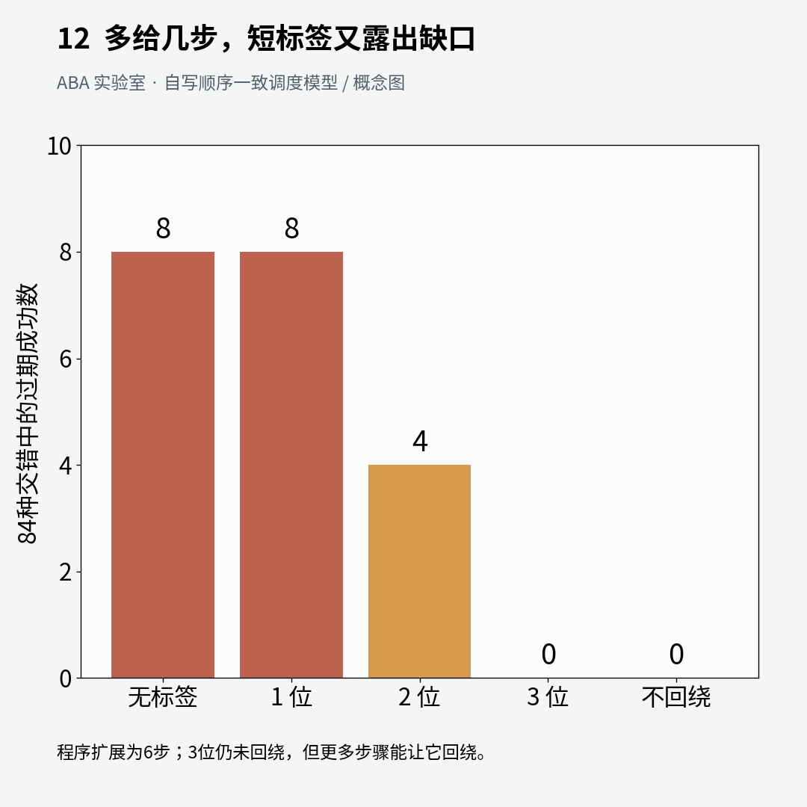
图12｜六步干扰的八十四种交错暴露了短标签回绕；三位在这个有限窗口内尚未出错。

三位不是魔法。我们还构造了 b=2 到 16 的回绕轨迹：先做 A→B→C→D→A 的四次变化，然后反复弹出、放回 A，每轮再加两次。累计恰好 2^b 次时，head 又是 (A,0)，而 next 仍是 D。每条轨迹都由程序实际生成，并非用“测试过很多次”来代替理由。

工程上更宽的计数可以显著推远回绕，但要给出绝对保证，必须结合旧观察可以存活多久、这期间最多多少次更新、是否存在不回绕的身份方案等具体前提。用“现实中不可能”代替前提，就把一个正确性问题偷偷改成了风险假设。

## 8｜票和人必须一起验，不能分两次盖章

把指针和计数放进一个结构体，还没完成任务。如果先读指针，再读标签，或者分别比较、分别写回，中间仍能穿插别人的操作；读到的还可能是一对从未同时存在过的值。

这里要求的是整个二元组的原子读与原子比较交换。目标平台能否提供相应位宽的原子操作，语言库是否在该类型上使用锁模拟、对齐是否满足要求，都要另查。不能把某个架构示例里的空余指针位，未经验证就拿来随意塞标签。

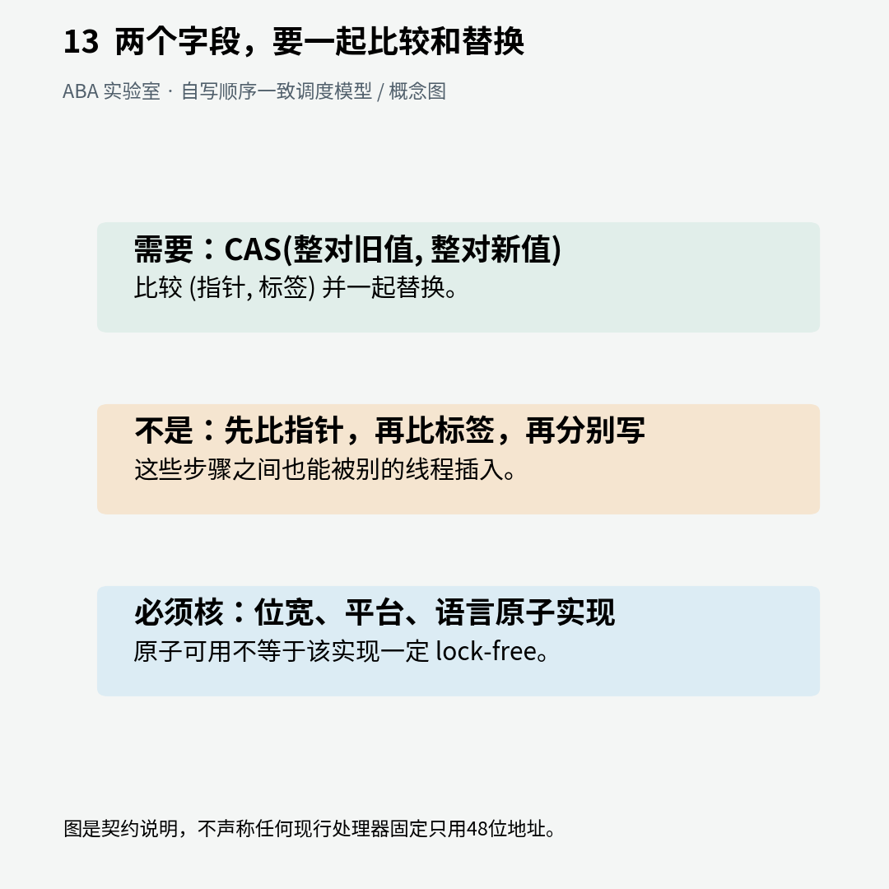
图13｜原子性覆盖整对值，而不是给两个普通字段分别做检查；位宽和 lock-free 支持须另核。

我们的 Python 程序把指针和标签的相等判断放进同一个不可插入其他调度步骤的分支，只是在定义教学原子步骤。它并没有因此变成一个跨线程无锁数据结构；Python 的元组、字典、循环也不提供这里所需的生产级进展保证。

## 9｜能识别旧票，不代表旧节点还活着

再把之前刻意拿开的内存释放放回来。R 读到 A 的地址，W 将 A 移除并释放，R 接着读取 A.next。即使稍后的带标签 CAS 必然失败，这次读取也已经可能访问了无效内存。

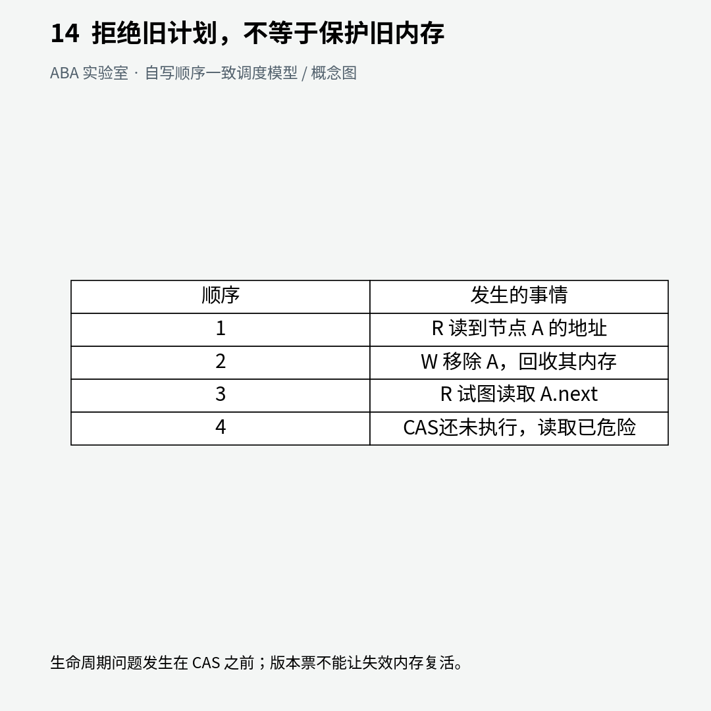
图14｜悬空读取可以发生在 CAS 之前；版本验证和对象生命周期保护是不同责任。

版本比较主要验证“旧计划是否仍对应当前被比较状态”。内存回收协议需要回答“线程还可能解引用时，节点能不能被释放或复用”。它们可以配合，但不能把一方当成另一方的替身。

反过来，仅仅不 free 也不总够：本文从始至终没有释放任何节点，仍然通过移除、改链、重新插入同一个节点制造了逻辑 ABA。某些回收方案能在其完整协议和数据结构约束下同时挡住特定的复用 ABA，但不能把这个结论随意扩展到允许任意重插节点的所有结构。保护指针的完整发布、再次验证和退休扫描留给下一篇，这里不塞一个缺步骤的“简易修复”。

## 10｜三个看上去相近，其实不在同一层的词

线性化关心结果：能不能把并发操作安排成符合抽象规格、又尊重真实先后约束的顺序，每次像在调用和返回之间某一瞬间生效。

lock-free 关心整体进展：在相应执行与原子操作假设下，系统中的操作能持续完成，而不是某个暂停线程把所有人卡死。它不承诺你挑中的那一个线程一定很快完成。

wait-free 更强，要求每个操作都有自身步数的界限。用了 CAS，并不能自动得到这两个进展性质；重试、分配、回收等都要纳入分析。

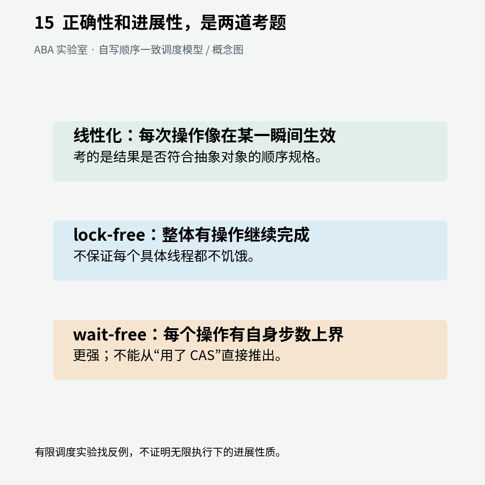
图15｜结果正确、整体有进展、每个操作有界，是不同层次的要求，有限实验不证明无限执行。

1998 年 Michael 与 Scott 的原论文在讨论修改计数时明确保留其有限性问题，也把线性化和非阻塞进展分开讨论。本文只据已读到的相应定义与段落定位这些概念，不转用其机器性能结果。[原论文，§3–4 与相关脚注](https://www.cs.rochester.edu/u/scott/papers/1998_JPDC_nonblocking.pdf)

## 11｜实验能帮你找错，但要把边界贴在结果旁边

附录只依赖 Python 标准库。运行 `python aba_lab.py`，会打印两组枚举结果。0 表示只比较节点，None 表示数学上不回绕的整数标签，1–16 表示模 2^b 的有限标签。标签模式 0 的内部计数仍递增用于观察，但完全不参与比较。

模型只有 R 的一次尝试，没有重试循环；W 的每个操作已经被抽象成一个原子动作；所有节点一直存在；没有数据竞争语义、分配器、真实地址、弱内存序或硬件时钟。`stale` 只在成功提交瞬间核旧 next 是否过期，不是完整栈规范的自动证明器。

枚举有 C(n+m,n) 个调度，这是组合爆炸，不是线性算法。当前模型节点数固定为四，每次运行记录全部步骤与字典快照；输出量和运行步数随调度长度增长。回绕演示显式输出 2^b+1 个头状态，因此时间和存储都随 2^b 增长，不是常数成本证明。

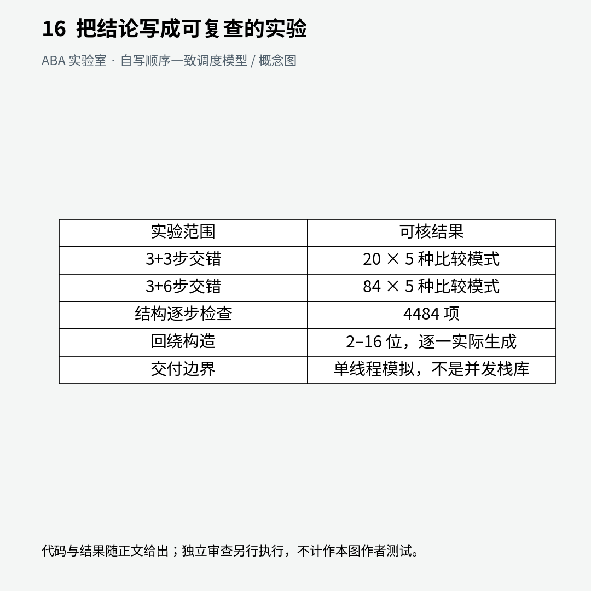
图16｜两组调度、五种比较模式、4484项结构检查与2–16位回绕构造；全是本地模型结果。

最值得带走的不是“以后看见 CAS 就加一个 tag”。而是一张小清单：旧计划依赖什么？这次相等比较验证了哪些依赖？标签会不会重用？节点还活着吗？结果与进展分别有什么证据？能把这五个问题答清楚，比背下 ABA 三个字母更有用。

## 附录｜可运行的完整模型 aba_lab.py

保存为 aba_lab.py 后，以 Python 3 运行；无需第三方库。

```python
"""Sequentially consistent toy scheduler, NOT concurrent production code."""
from itertools import combinations

def schedules(n, m):
    if type(n) is not int or type(m) is not int or min(n, m) < 0:
        raise ValueError('nonnegative integer lengths required')
    for selected in combinations(range(n + m), n):
        positions = set(selected)
        yield ''.join('R' if i in positions else 'W' for i in range(n + m))

def run(schedule, bits=0, extended=False):
    # bits=0: compare pointer only; None: unbounded tag; 1..16: modular tag.
    if bits is not None and (type(bits) is not int or not 0 <= bits <= 16):
        raise ValueError('bits must be None or integer 0..16')
    if type(extended) is not bool:
        raise ValueError('extended must be bool')
    program = ['pop_first', 'pop_second', 'push_first']
    if extended:
        program = ['pop_first', 'pop_second', 'push_D', 'push_first',
                   'pop_last', 'push_last']
    if (type(schedule) is not str or set(schedule) - {'R', 'W'}
            or schedule.count('R') != 3 or schedule.count('W') != len(program)):
        raise ValueError('schedule must preserve both complete programs')
    links = {'A': 'B', 'B': 'C', 'C': None, 'D': None}
    head, tag = 'A', 0
    saved, rstep, wstep = {}, 0, 0
    expected, following = None, None
    success, stale, trace = False, False, []
    def chain():
        result, p = [], head
        while p is not None:
            if p in result:
                return result + ['CYCLE']
            result.append(p)
            p = links[p]
        return result
    def change(new):
        nonlocal head, tag
        head = new
        tag += 1
        if bits not in (0, None):
            tag %= 1 << bits
    for actor in schedule:
        if actor == 'R':
            if rstep == 0:
                expected = (head, tag)
                action = 'load head'
            elif rstep == 1:
                following = links[expected[0]] if expected[0] else None
                action = 'load next'
            else:
                match = head == expected[0] and (bits == 0 or tag == expected[1])
                success = bool(expected[0] is not None and match)
                if success:
                    stale = following != links[head]
                    change(following)
                action = 'CAS success' if success else 'CAS rejected/empty'
            rstep += 1
        else:
            action = program[wstep]
            if action.startswith('pop_'):
                key = action[4:]
                saved[key] = head
                if head is not None:
                    change(links[head])
            else:
                key = action[5:]
                node = 'D' if key == 'D' else saved[key]
                if node is not None:
                    if node in chain():
                        raise AssertionError('writer cannot push a live node')
                    links[node] = head
                    change(node)
            wstep += 1
        trace.append(dict(actor=actor, action=action, head=head, tag=tag,
                          chain=chain(), links=dict(links), expected=expected,
                          following=following))
    return dict(schedule=schedule, bits=bits, extended=extended,
                success=success, stale=stale, final=chain(), trace=trace)

def census(bits=0, extended=False):
    rows = [run(s, bits, extended) for s in schedules(3, 6 if extended else 3)]
    return dict(total=len(rows), success=sum(r['success'] for r in rows),
                stale=sum(r['stale'] for r in rows),
                witnesses=[r['schedule'] for r in rows if r['stale']])

def wrap(bits):
    """An old (A,0)->B plan, after exactly 2**bits head changes (bits>=2)."""
    if type(bits) is not int or not 2 <= bits <= 16:
        raise ValueError('wrap demo needs integer bits 2..16')
    # A->B->C->D->A is four changes. Each further A->D->A adds two.
    heads = ['A', 'B', 'C', 'D', 'A']
    for _ in range(((1 << bits) - 4) // 2):
        heads.extend(['D', 'A'])
    tags = [i % (1 << bits) for i in range(len(heads))]
    return dict(bits=bits, heads=heads, tags=tags, changes=len(heads)-1,
                old_next='B', current_next='D', accepts=(heads[-1], tags[-1])==('A',0))

def test():
    assert run('RRWWWR')['stale']
    for b in (1, 2, 3, None):
        assert not any(run(s, b)['stale'] for s in schedules(3,3))
    assert run('RRWWWWRWW', 2, True)['stale']
    for s in schedules(3,6):
        assert not run(s, None, True)['stale']
    for b in range(2, 17):
        r=wrap(b); assert r['accepts'] and r['changes']==1<<b
    for args in [('RRR',0,False),('RRWWWR',True,False),('RRWWWR',17,False)]:
        try: run(*args)
        except ValueError: pass
        else: raise AssertionError('invalid input accepted')
    print('bounded schedule and wrap tests PASS')

if __name__ == '__main__':
    test()
    for extended in (False, True):
        for bits in (0,1,2,3,None):
            print(extended, bits, census(bits,extended))
```

## 短读版｜A 还是那个 A，旧计划却不一定还能用

栈从 A→B→C 开始。线程 R 读到栈顶 A，又记住 A.next=B，然后暂停。线程 W 弹出 A、弹出 B，再把 A 放回，栈已变成 A→C。

R 回来执行 CAS(head,A,B)。栈顶确实又是 A，比较成功，于是 B 被错误接回栈里。CAS 没违反契约；它只比较现在的值，不保证中间没有发生过变化。旧计划依赖的 next，才是漏验的事实。

自写调度模型穷举了 R 三步与 W 三步的20种交错，3种出现过期链接成功。让指针与版本一起原子比较，可以拒绝旧快照；但两位版本经过4次更新就会绕回零。把 W 扩成6步后，84种交错里，两位标签仍有4种过期成功。

另一个容易混淆的地方：版本票不能让已释放的节点继续安全可读；不释放节点，也不自动禁止同一节点被改链重插。内存生命周期、旧计划验证、结果线性化、整体进展，是不同责任。

长文给出16图和完整标准库代码。所有计数来自顺序一致的单线程模拟，不是生产C++内存模型证明、真实并发性能测试或无限执行的进展证明。


## 来源与素材权利

参见[来源、素材权利与 AI 辅助说明](sources.md)。
