# 一面墙没变，为什么还要算第二遍？Abrash笔下的Quake表面缓存

你在游戏里转了一点头。墙还在那里，墙上的花纹没换，灯也没动。屏幕上的墙变了形状和位置，但这是否意味着“花纹被灯照亮后的结果”也必须从头计算？

把这两个问题分开，能省下的往往不是一条乘法，而是一整段重复工作。

先把历史说准：Michael Abrash在署名文章《Quake's Lighting Model: Surface Caching》中讨论的是静态世界表面的照明与绘制，不是所有角色的统一流程。他把关键设计思路归于John Carmack；这是合作开发的技术记录，不是“一个人写出整个引擎”的故事。[Abrash原文](https://valvedev.info/archives/abrash/chap68.html)

原文把照明与纹理映射拆开，把照亮后的表面当作映射输入，并缓存它供后续帧复用。这是软件管理的中间结果，不是CPU硬件缓存；把大数组留下，也不保证它驻留CPU的高速缓存。本文聚焦软件渲染路径，不把这套安排推广成所有Quake版本或现代GPU的统一做法。

本篇不重讲BSP怎样判断遮挡，也不讲网络预测。我们只追一个问题：已经算好的表面，什么时候值得留下，什么时候必须作废？下面所有灰度图、请求串和数字，都来自文末的自写小程序，不是Quake游戏截图，也不是Pentium性能实测。

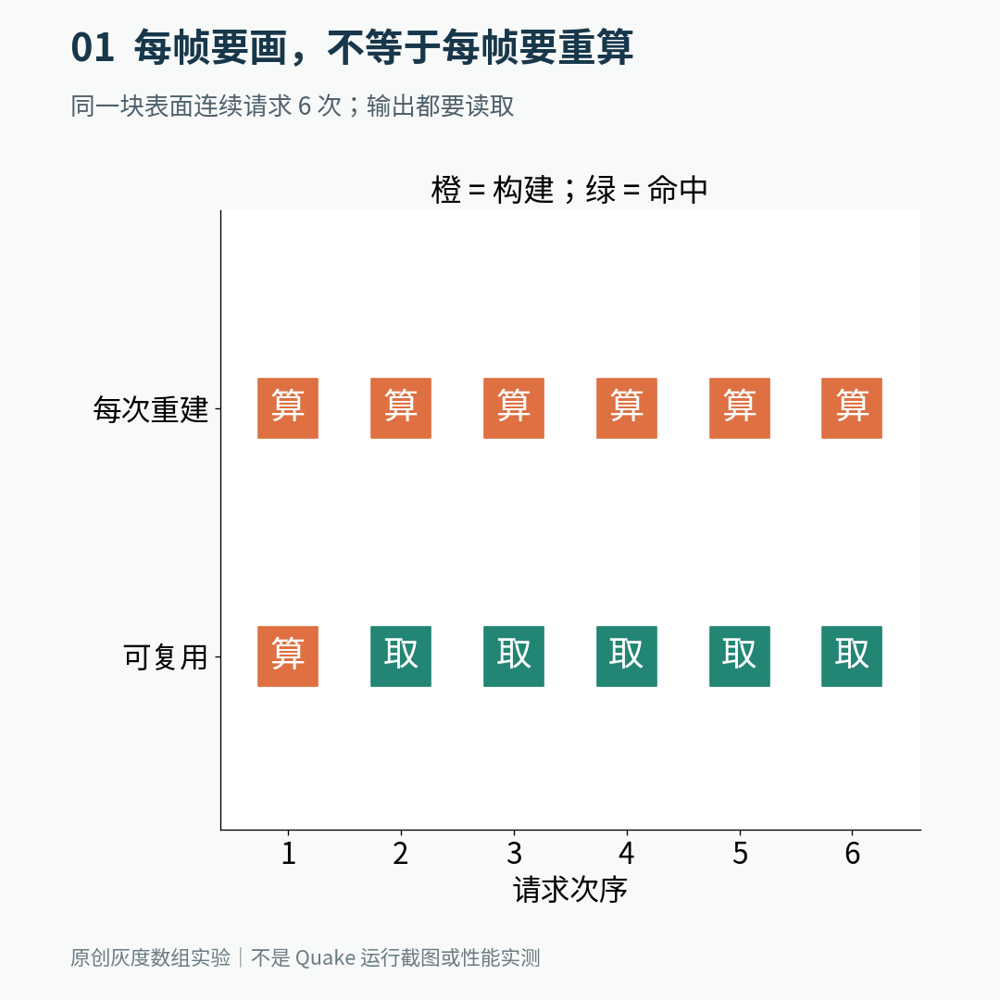

图1｜六次相同请求：无缓存构建六次，容量足够且输入未变的模型构建一次、命中五次。

## 1. 先分清三种“格子”

屏幕上的一个格子叫像素。纹理中的一个格子通常叫纹素。记录照明的采样节点又可以是另一套更稀的网格。它们不必一一对应。

想象一张方格布：布本身有花纹，台灯让某些地方更亮。眼睛移动时，布在视野中的位置会变；但只要布和灯没有变化，“布上这个位置有多亮”可以保持不变。我们先把这种与观察窗口无关的结果存下来，再按需要读取。

为了能算到每一个数，本文不用游戏素材，而造一个32×16的灰度表面。横坐标x取0到31，纵坐标y取0到15。花纹以4×4周期重复，每个2×2小块取80或200。纹理版本从0切到1，就把明暗格交换。亮度节点每隔4格放一个，在覆盖边界所需的9×5节点上给出0到255之间的数。

这些“4格”和“灰度乘法”都是教学选择，不是声称还原原引擎的数据格式。

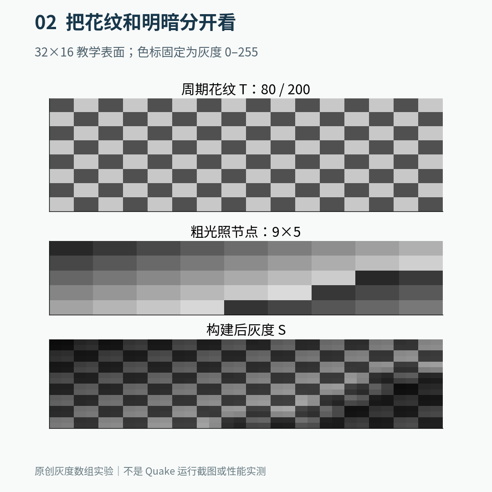

图2｜花纹、粗光照节点和实际构建结果分别可见；两种输入各自决定不同信息。

## 2. 稀疏节点之间，怎么给出亮度？

先只看左上角一格。它的四个节点亮度依次是：左上40、右上57、左下71、右下88。

要算格内(x,y)=(1,2)的位置，横向走了全宽的1/4，纵向走了全高的1/2。可以先分别在上下两条边插值，再在这两个结果之间插值；也可以直接给四角加权。

左上权重=(1−1/4)×(1−1/2)=3/8；右上1/8；左下3/8；右下1/8。四个权重非负且和为1，所以得到的数不会莫名超出这四个值的范围。

L=40×3/8+57×1/8+71×3/8+88×1/8=59.75。

程序为便于精确复现，在这一步向下取整到59。不是四舍五入，也不是先把四个贡献分别截断。把取整位置说清楚，重写代码时才能得到相同图。

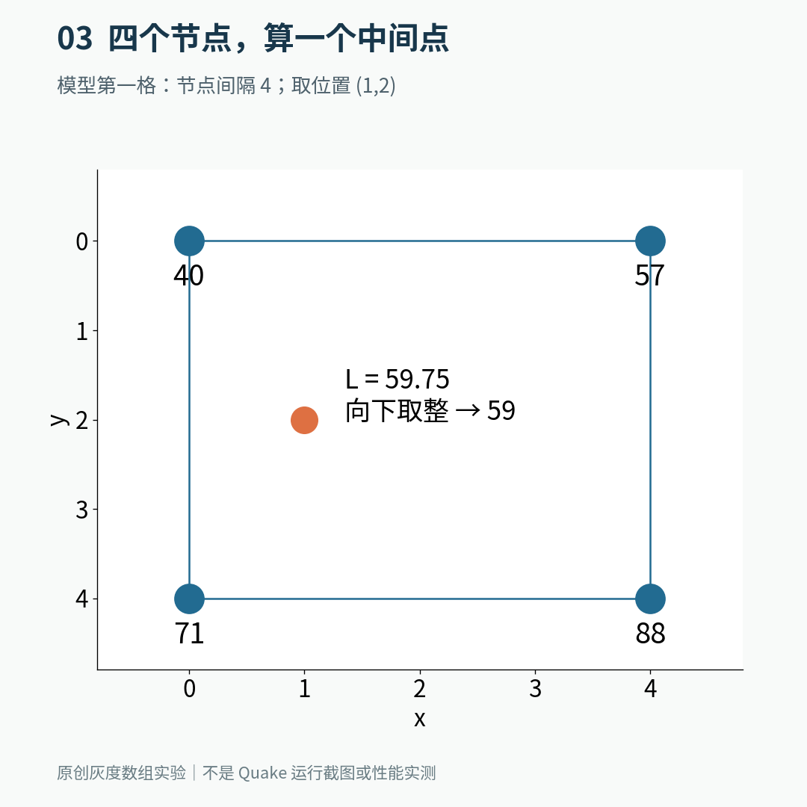

图3｜权重3/8、1/8、3/8、1/8产生59.75，模型先把光照向下取整为59。

接着，把这里的花纹灰度T与亮度L组合成输出S：

S=floor(T×L/255)。

这个位置的T为200，所以S=floor(200×59/255)=46。L=0会变黑，L=255保留原花纹值。对每个位置都做一次，就得到一张已经照亮的数组。

这只是一个清楚、可算的灰度模型。真实软件渲染还涉及调色板、整数尺度等实现选择，不能把本文乘法公式贴回历史代码，断言它逐字节相同。

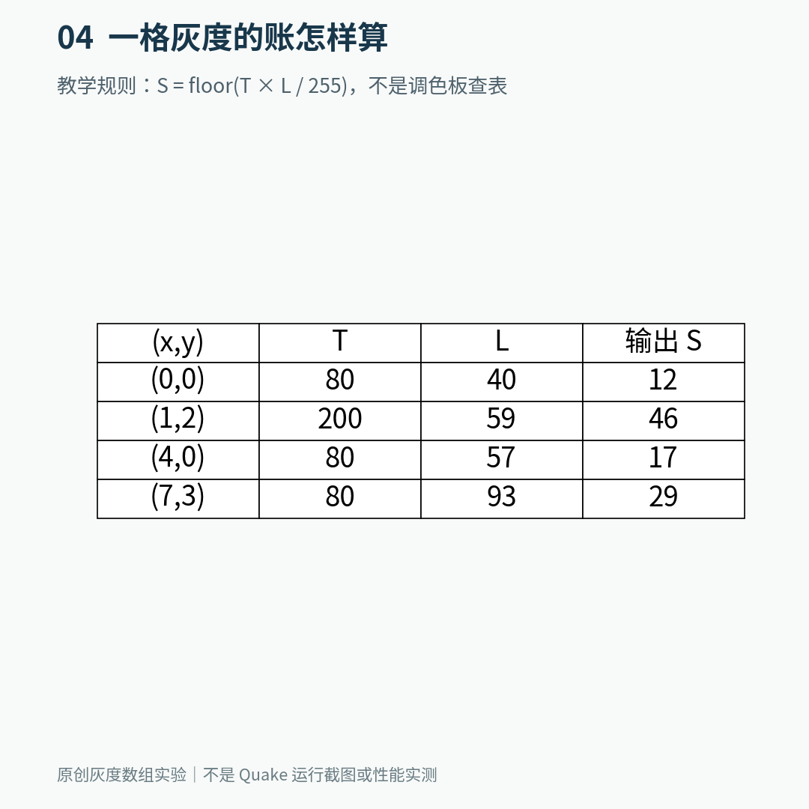

图4｜四个采样值由实际程序给出；(1,2)使用T=200、L=59，最终灰度46。

## 3. 缓存的不是一张“上帧屏幕截图”

若留下的是上帧屏幕截图，稍微转头，墙的位置就不对了。我们留下的是表面自身坐标下的数组。

图5只是两个不同的裁剪窗口，刻意不做透视。它用最小例子说明：窗口换了，所读下标变了，底下那张数组可以不变。真实渲染需要把屏幕位置映射到表面坐标；缓存不替代这个映射，也不免除每帧的屏幕输出。

因此“命中”不是“这一帧什么都不干”，而是“这一块照明与花纹的组合结果不重做”。少算的是构建工作，读取、映射和输出还在。

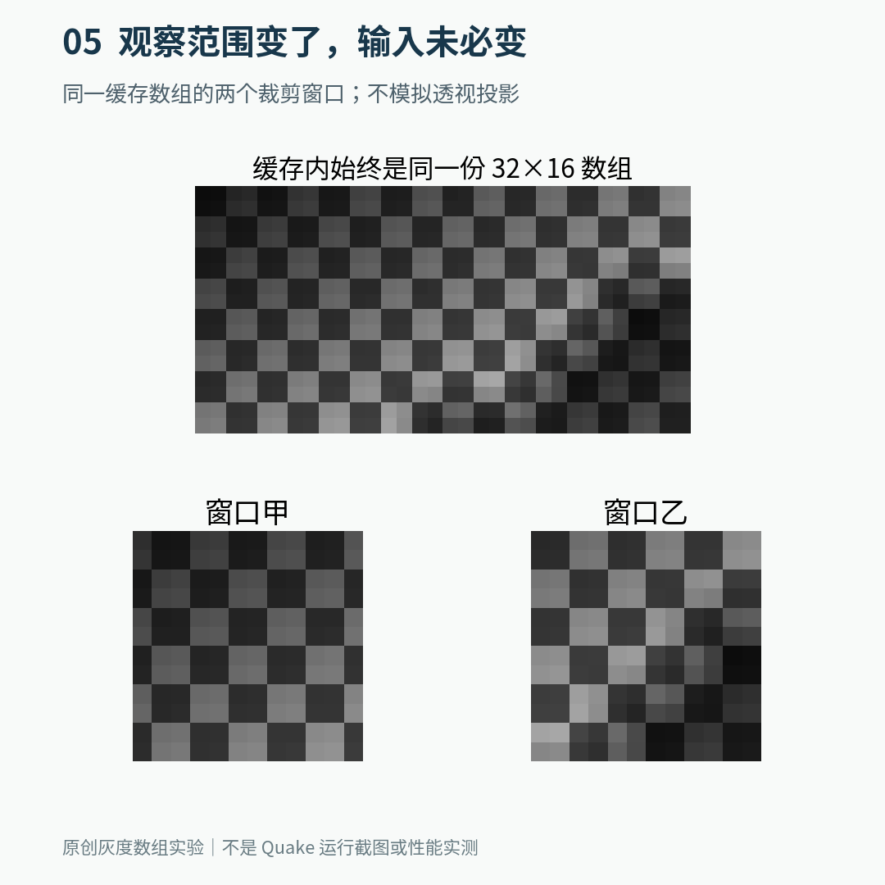

图5｜移动窗口只改变读取位置，不改变花纹或光照；两幅下图是数组裁剪，不是引擎摄像机画面。

## 4. 缓存最难的地方：知道它什么时候不再正确

把模型想成一个函数：输出由表面身份、mip级别、纹理版本、照明版本以及动态照明项决定。表面身份不同，即使当前碰巧长得一样，也分开记录。本文A、B、C的数组故意相同，只用身份来隔离缓存条目，方便看容量效应。

缓存槽按(表面名字,mip级别)查找。槽里的纹理版与照明版必须匹配；而且既不能保留上次动态照明的结果，也不能在本次有动态照明时直接复用。版本号必须由调用方真实维护：偷偷改输入却不改版本，是调用约定被破坏，不是缓存能自己猜出来的事。

这个警惕在官方代码里有具体对应：D_CacheSurface检查当前纹理、照明调整值及动态光状态；它不是只判断“指针非空”。D_SCAlloc使用rover与块管理，也不是本文的LRU。读源码时要看条件，而不只认函数名。[id官方d_surf.c](https://github.com/id-Software/Quake/blob/master/WinQuake/d_surf.c)

看下面连续七次请求。前两次输入相同，第二次命中。第三次换纹理，第四次换照明，各重建。第五次有动态项，重建。第六次动态项消失——很多第一次写缓存的人会在这里出错。

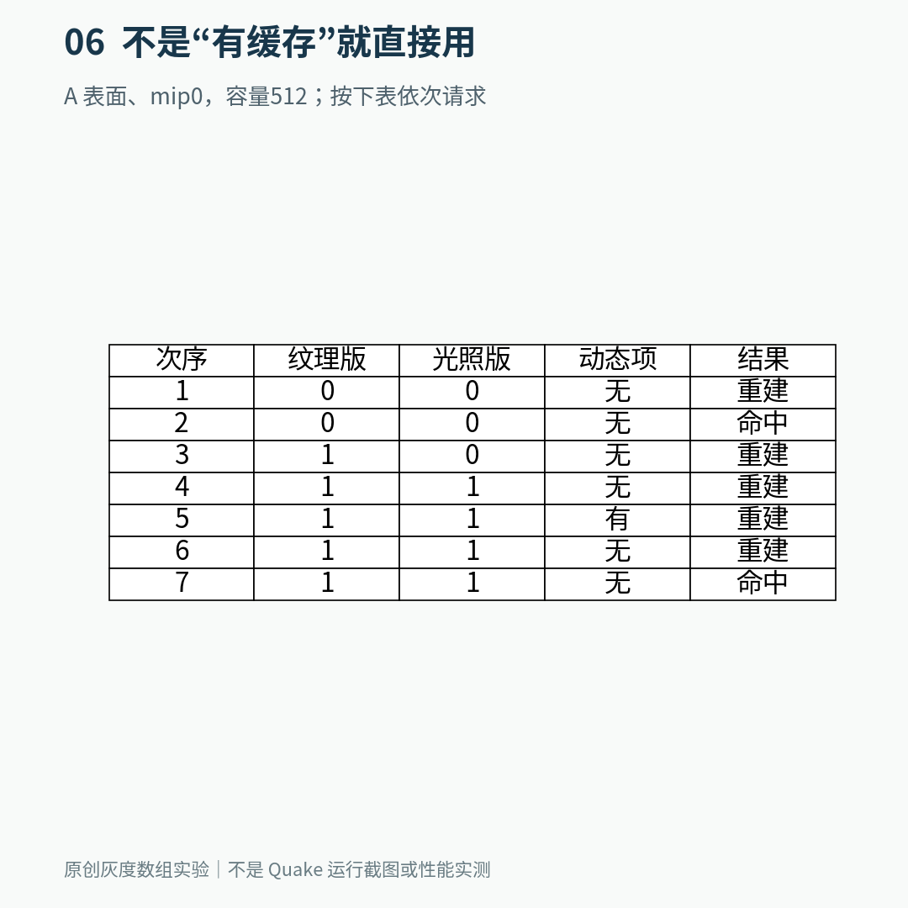

图6｜第6次动态项虽已消失，旧数组仍含动态结果，必须再构建一次；第7次才可命中。

为什么第六次还要重建？因为缓存里留下的是“有动态项的亮图”。只看当前没有动态项就直接命中，会把旧亮度继续画出来。条件必须同时看现在的请求和缓存过去存了什么。

模型把动态项简化成亮度加60并封顶255，没有模拟光源位置、衰减或阴影。即使连续两次动态项碰巧数值一样，也选择保守重建；“可能少命中”与“返回错误图”是不同的取舍。

图7给的是程序真实生成的静态、动态与差值数组。灯不在了而亮斑还在，这就是失效条件写错后肉眼能见的后果。

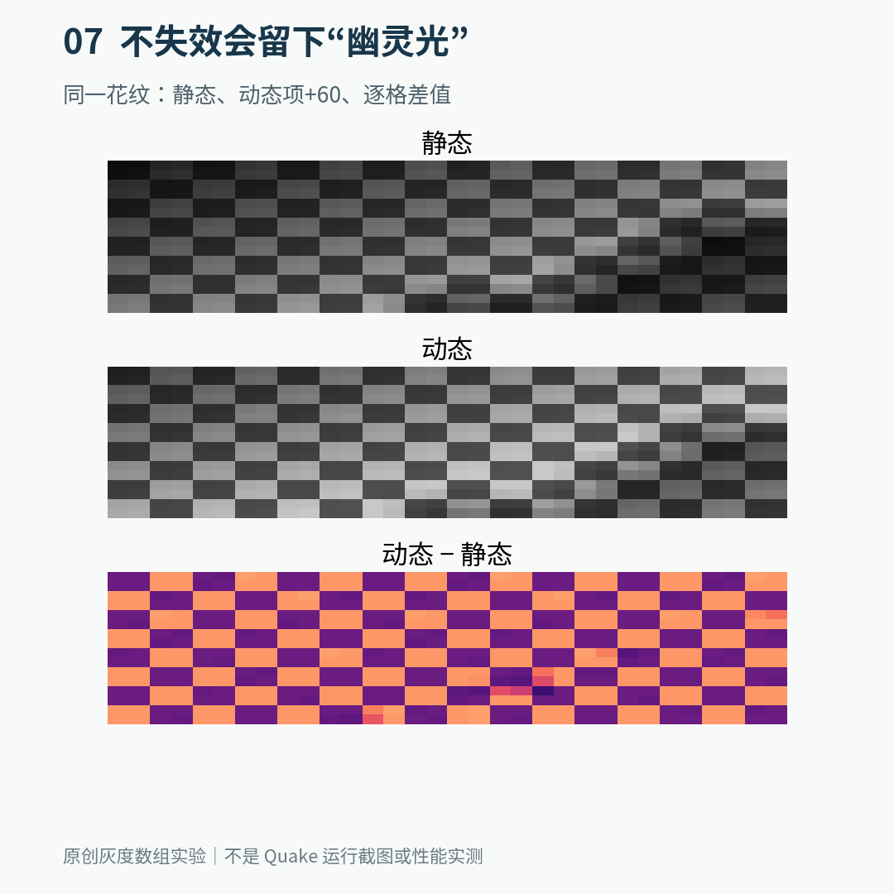

图7｜动态数组与静态数组真实不同；灯消失后若直接复用动态数组，就会保留错误亮度。差值色阶0–60。

## 5. mip不是装饰，它改变了这份结果有多大

mip可以先理解成同一内容的不同细致程度。我们对已经照亮的数组做2×2整数平均，得到宽高各减半的下一级；每级继续从上一级缩小。由于取整发生在每一级，它不保证等于最后一次把所有原始格子求大块平均。

这条构建顺序是本文模型的约定。历史引擎的纹理mip与表面构建流程不能被它替代；模型也没有根据摄像机距离自动选级别，而是让调用者明确传入0、1、2、3。

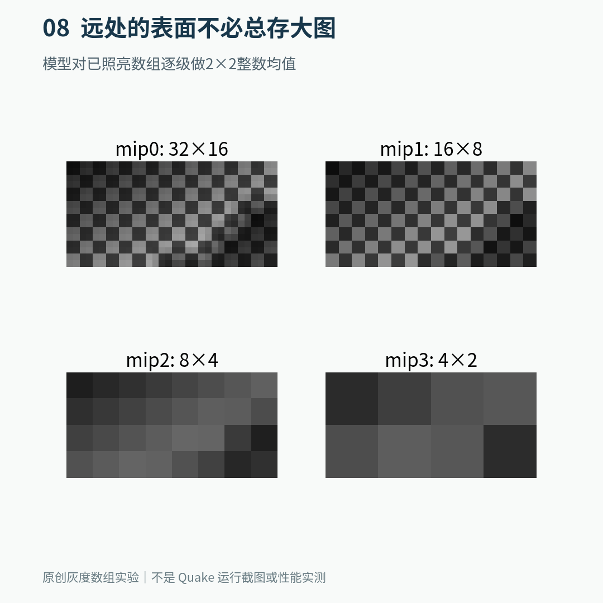

图8｜32×16、16×8、8×4、4×2四级均由程序计算；这里先照亮再缩小，不声称与Quake构建顺序相同。

把32×16存成每格一个灰度字节，需要512字节。16×8是128，8×4是32，4×2是8。若四级都保留，总有效载荷是680字节，比只留第0级多168字节；不是“用了mip就永远少占空间”。节省来自具体使用场景：对某次只需要较粗结果的请求，不必为它占用最大那份。

Python用元组和整数存储，实际进程内存远大于这些数。本文的capacity是“假如每个灰度值打包成一字节”的有效载荷预算，不是Python内存限制，也没包含索引、对象、对齐和临时数组。

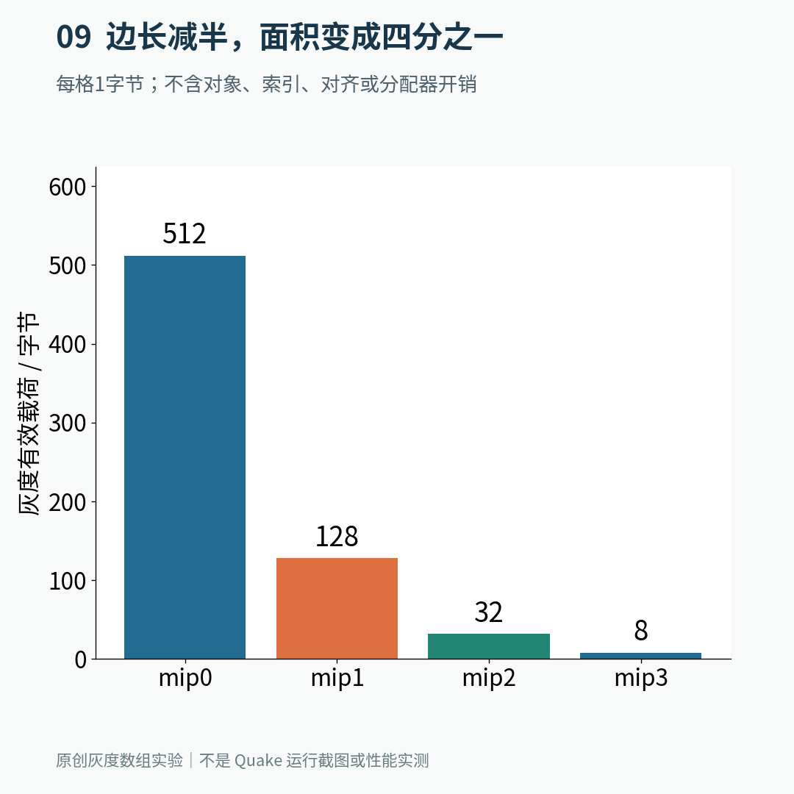

图9｜四级各占512、128、32、8字节，同时存齐共680字节；新增小级不等于免费。

## 6. 空间用满后，留谁、赶谁？

教学程序采用LRU：最近使用过的放到队尾，空间不够就从队首赶走。名字是Least Recently Used，即优先淘汰最久没被使用的条目。

容量1024能放两份mip0。请求A，留下A；请求B，队列A→B；再请求A，命中并变成B→A；请求C时，B最久没用，于是留下A→C。

这不是唯一合理策略，更不是Quake原分配器的复刻。我们故意挑一个容易手算的替换规则，把“结果是否有效”和“结果是否还在内存里”拆开：一个结果可以仍然有效，却早已被驱逐。

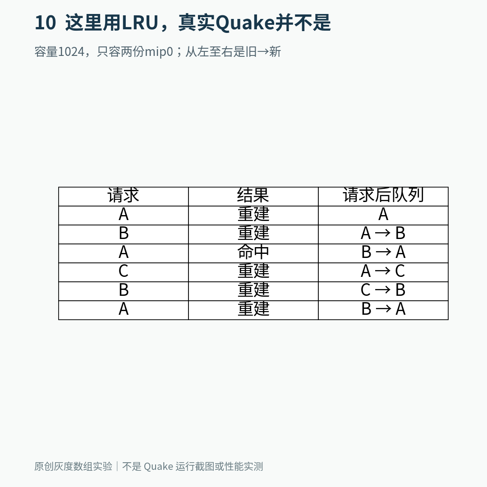

图10｜ABACBA在两槽LRU下只有第三次A命中；本文用易验证替换策略，不把它当历史rover分配器。

现在把请求串换成ABCABCABCABC。只给两份空间会怎样？每次要的恰好是已经被赶走的那份，十二次全部重建。只差一份容量，增加到1536字节，前三次构建后，后面九次全命中。

这叫工作集与容量之间的冲突，不是LRU“忘了该记什么”。工作集在这里就是反复需要的A、B、C三份。再聪明的命名也不能把三份512字节的独立结果同时塞进两份空间。别据此说所有访问模式都会有同样的阈值；换一个请求串，结果就会变。

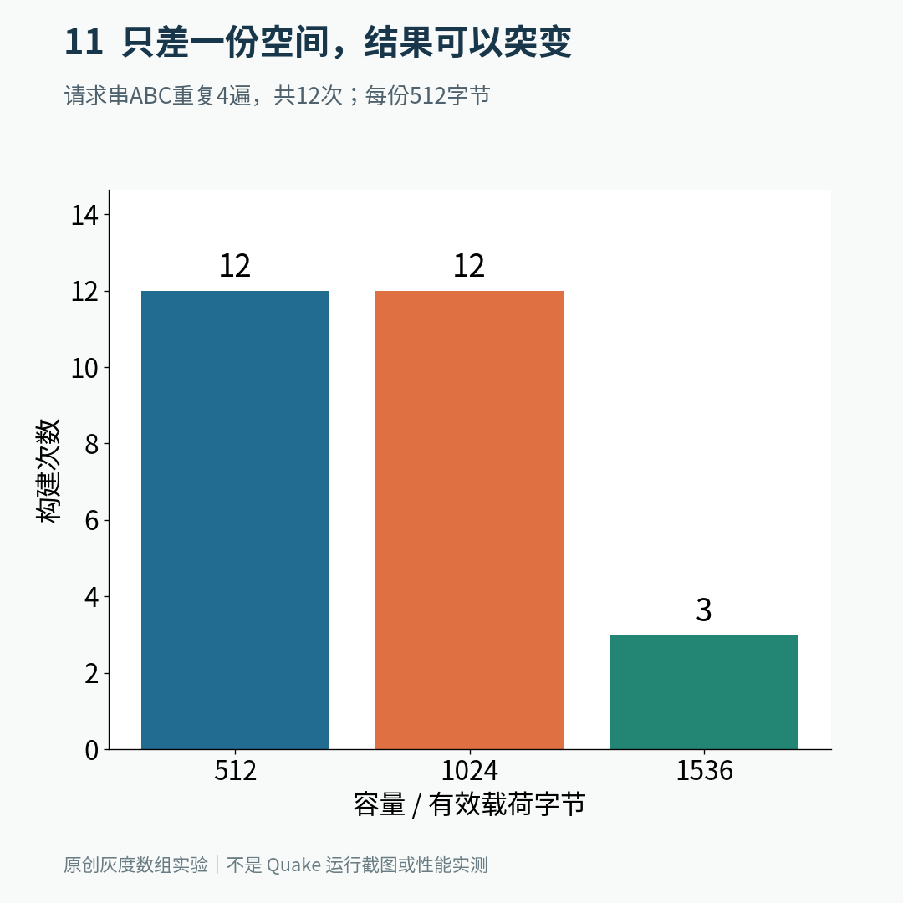

图11｜512与1024字节都构建12次；1536字节构建3次、命中9次。容量不足会反复驱逐。

## 7. “值得缓存”可以先算一笔账

设构建费为B，每次读取费为R，同一份静态结果需要N次。

每次重建：N(B+R)。只构建一次并一直保留：B+NR。理想差额是(N−1)B。

图12用B=512、R=64个假设工作单位，不是周期或毫秒。N=12时，两式分别为6912与1280。这个算式有意先忽略查找和管理开销，帮助定位节省来自哪里。

若缓存查找与管理每次多花H，缓存侧就变为B+N(R+H)。此时只有(N−1)B>NH才有净节省。构建很便宜、复用次数少、管理很贵时，缓存反而可能不划算。测量具体实现，才能给B、R、H填入有意义的时间。

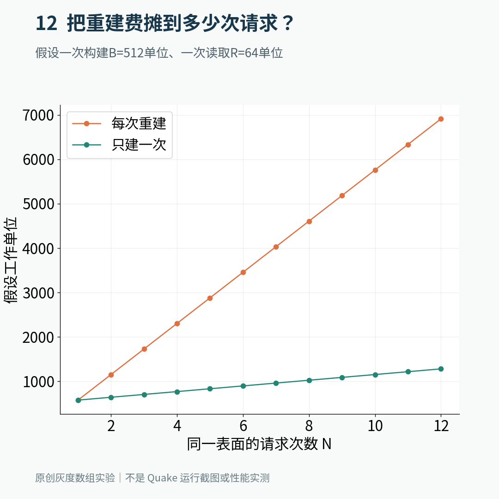

图12｜同一表面请求N次，简化费用为N(B+R)或B+NR；N=1尚无构建节省，N=12分别6912与1280。

还有一笔很容易漏掉的账：你只看到表面的一小角，程序却可能要先构建整块。

假设mip0仍构建512格，本次只读可见V格。若V=8，构建量与可见读取量之比就是64；若下一帧就再也不用这块，它的首次成本没有机会摊薄。

图13没有做遮挡计算，它只是把整块构建与部分读取的面积账摊开。要避免这个成本，可以研究延迟构建、分块、级别选择等设计；这些会引入新边界、管理和失效问题，不是免费打开一个开关。

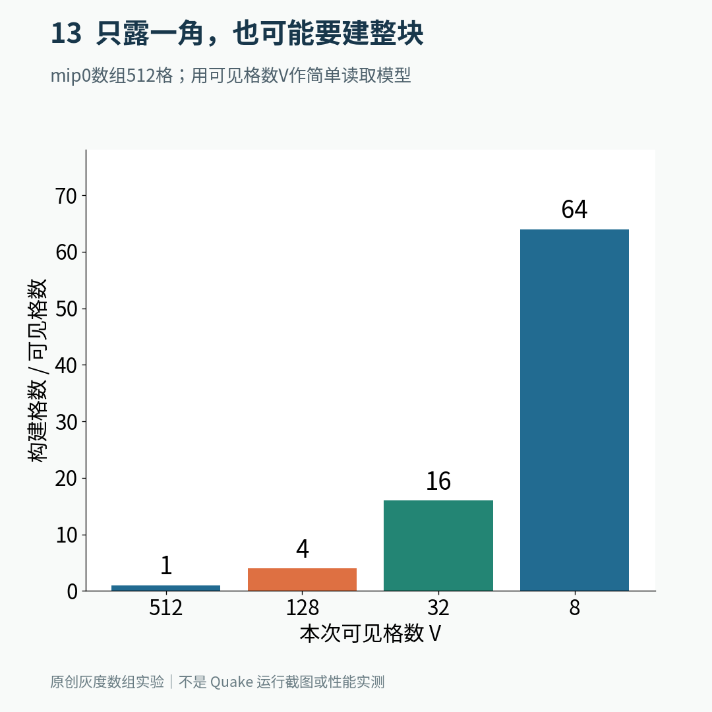

图13｜首次整块构建与可见读取的比值为1、4、16、64；缓存首次代价不能只按屏幕可见面积估计。

输入频繁改变，也会消耗本来期望的复用。图14在足够装三份的容量下比较同一个请求串：始终静态时构建3次，每次带动态项时构建12次。后者不是缓存“坏了”，而是它拒绝拿不保证正确的旧结果冒充新结果。

实际场景里，空间容量、变化频率和可见范围往往一起作用。只报一个总命中率还不够：昂贵大表面的几次失效，可能比许多很小条目的命中更重要。

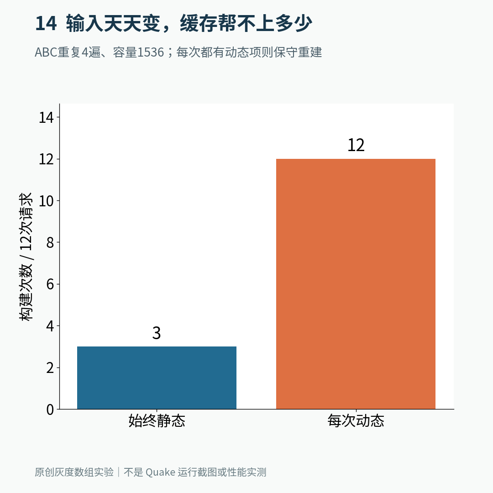

图14｜静态3次、每次动态12次；模型保守不重用动态结果，即使简化动态值碰巧相同也重建。

## 8. 少重建几次，不等于精确快了几倍

最后做一个对照：仍用1024字节容量与ABC重复四遍，但所有请求分别指定不同mip。

第0级只能放两份，装不下完整工作集，12次×512格=6144格。第1级三份只占384字节，首次3次×128格=384格；更粗两级累计96与24格。

这个“构建格数”按输出数组大小累计，用来比较有效载荷面积，不能冒充本Python程序的运算次数。程序为了容易阅读，总是先建立32×16基础数组，再逐级平均；即使最终只返回8格，也没有只算8格。真实优化实现若直接按目标级别构建，还要另外写、另外测。

这也解释了为什么不能把“面积少了16倍”写成“帧率快16倍”：还有未计入的基础构建、采样、映射、查找、分配、内存访问，以及整个游戏的其他工作。

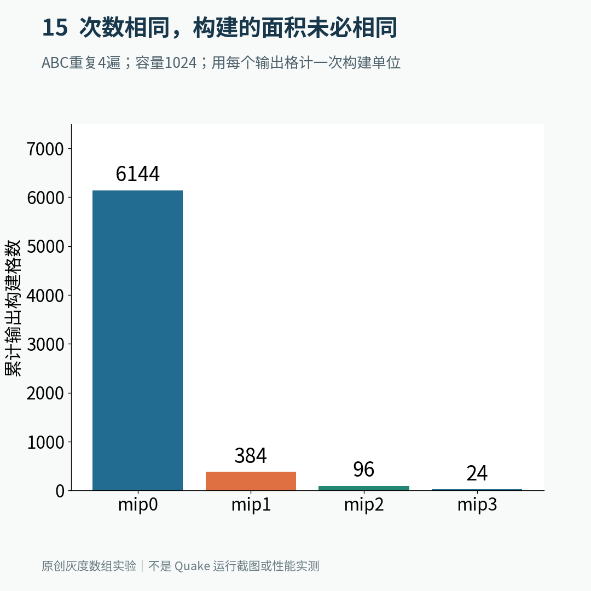

图15｜四级累计输出格数分别6144、384、96、24。仅是面积记账；Python仍先建基础数组，实际运行时间不按此缩放。

## 9. 回到Abrash：学机制，也学证据的边界

这段历史值得读，不是为了拿一个漂亮数字压倒今天的电脑，而是看工程师如何重新划分工作：把值得复用的中间结果单独留下，再为有效性和容量付账。原文的表面缓存讨论能让我们提出问题；官方实现能让我们检查实际条件；小实验能让我们亲手弄坏一个简化版本，再修好它。三者各有用处，谁都不能替另外两者完成验证。

源文件README明确把引擎代码许可与游戏数据分开，不能因为源码公开，就把游戏纹理、关卡或截图当作自由素材。[id官方README](https://github.com/id-Software/Quake/blob/master/readme.txt)

想继续探索，可以改三个参数，不必一上来写完整3D引擎：

1. 把ABC循环改成AAABBBCCC，观察两份容量的命中情况为什么不同。
2. 在第5次改变照明版本，核对“失效重建”与“被驱逐后重建”是否是不同原因。
3. 比较相同命中次数下的大、小数组构建格数，再解释为什么光报命中率不够。

预测完再运行。若结果与直觉冲突，先看请求序列、版本和容量，而不是先修改结论。


图16｜历史源码、原创简化模型与未进行的实机测量明确区分；模型正确不等于实现了Quake。

## 可以直接运行的完整模型

把下方保存为cache_lab.py，使用Python 3运行；核心只依赖标准库。默认输出应是hits=9、builds=3、built_texels=1536、used=1536。输出数组不可变，调用者不会通过返回引用偷偷改缓存内容。每个name在模型中使用同一套可选花纹/亮度公式，不代表不同游戏材质。

版本只接受整数0或1，mip只接受整数0到3，dynamic必须为bool，容量必须为非负整数；bool不冒充整数版本。容量不足一份时仍计算并返回，但不保存，所以不会凭空命中。输入数组尺寸在本例固定，时间/空间上界因此有限。若推广到W×H基础表面，构建本函数需要O(WH)时间与临时空间；多级平均的面积是递减几何和。缓存中有效载荷总量不超过capacity，索引等额外开销另算。一次失效请求可能驱逐多条，不能把它的最坏时间说成恒定；把名字长度视为有界、采用通常哈希表假设时，命中只做常数次索引/队列操作，返回数组引用而不是复制全图。

费用图中的B、R与累计输出格数是另一个明确写出的分析模型，不是上述函数的实际计时。

```python
"""Original gray-array teaching model; not Quake source or a renderer."""
from collections import OrderedDict

def surface(texture=0, light=0, mip=0, dynamic=False):
    """32x16 base, periodic 4x4 tile; bilinear 4-texel light grid."""
    if type(texture) is not int or type(light) is not int or texture not in (0,1) or light not in (0,1):
        raise ValueError('versions must be 0 or 1 integers')
    if type(mip) is not int or mip not in range(4) or type(dynamic) is not bool:
        raise ValueError('mip 0..3 and bool dynamic required')
    base=[]
    for y in range(16):
        row=[]
        for x in range(32):
            t=80+120*((x//2+y//2+texture)%2)
            gx,gy=x//4,y//4; fx,fy=x%4,y%4
            node=lambda a,b: 40+((17*a+31*b+70*light)%180)
            num=(node(gx,gy)*(4-fx)*(4-fy)+node(gx+1,gy)*fx*(4-fy)
                 +node(gx,gy+1)*(4-fx)*fy+node(gx+1,gy+1)*fx*fy)
            # Dynamic term here is deliberately simple, unlike Quake's lights.
            intensity=min(255,num//16+(60 if dynamic else 0))
            row.append(t*intensity//255)
        base.append(tuple(row))
    # Teaching choice: box-filter the already lit image (not Quake mip builder).
    for _ in range(mip):
        base=[tuple(sum(base[y+dy][x+dx] for dy in (0,1) for dx in (0,1))//4
                    for x in range(0,len(base[0]),2))
              for y in range(0,len(base),2)]
    return tuple(base)

class Cache:
    """Byte-budgeted LRU of gray values, ignoring interpreter/object overhead."""
    def __init__(self, capacity):
        if type(capacity) is not int or capacity < 0: raise ValueError('nonnegative int capacity')
        self.capacity=capacity; self.used=0; self.items=OrderedDict()
        self.builds=0; self.built_texels=0; self.hits=0
    def get(self, name, mip=0, texture=0, light=0, dynamic=False):
        if not isinstance(name,str): raise ValueError('name must be str')
        # Validate even on a would-be hit; cost is not charged to model building.
        if type(mip) is not int or mip not in range(4): raise ValueError('bad mip')
        if type(texture) is not int or texture not in (0,1): raise ValueError('bad texture')
        if type(light) is not int or light not in (0,1): raise ValueError('bad light')
        if type(dynamic) is not bool: raise ValueError('bad dynamic')
        key=(name,mip); old=self.items.get(key)
        if old and old[0:2]==(texture,light) and not old[2] and not dynamic:
            self.items.move_to_end(key);self.hits+=1;return old[3],True
        if old:
            self.used-=len(old[3])*len(old[3][0]);del self.items[key]
        out=surface(texture,light,mip,dynamic);size=len(out)*len(out[0])
        self.builds+=1;self.built_texels+=size
        if size<=self.capacity:
            while self.used+size>self.capacity:
                _,ev=self.items.popitem(last=False);self.used-=len(ev[3])*len(ev[3][0])
            self.items[key]=(texture,light,dynamic,out);self.used+=size
        return out,False

def run(names, capacity=1536, mip=0, dynamic=False):
    c=Cache(capacity); hits=[]
    for name in names:
        _,hit=c.get(name,mip=mip,dynamic=dynamic);hits.append(hit)
    return c,hits

if __name__=='__main__':
    c,h=run(list('ABC')*4)
    print(dict(hits=c.hits,builds=c.builds,built_texels=c.built_texels,used=c.used,trace=h))
```

## 短导读｜别重算没变的那一面墙

转头以后，屏幕上的墙换了位置，墙自己的花纹和照明却可能没变。Abrash关于Quake的技术记录，让人看到一种值得拆开研究的工作安排：算好的表面结果能否跨请求复用？

本篇用32×16原创灰度数组逐格算亮度，再把缓存的三道门拆开：输入还相同吗，旧结果带不带已经消失的动态项，内存里还留得住吗？ABC循环四遍，两份容量会重建12次，三份容量只建3次。改变照明则是另一回事：容量足够，也不能复用错误结果。

16幅图把插值、失效、mip面积、LRU驱逐、工作集与费用假设分别画清楚，附完整可运行代码。教学LRU不是Quake的rover分配器，灰度乘法不是历史调色板；所有数字来自明确模型，不冒充游戏截图、Pentium基准或帧率提升承诺。

---

[来源、材料权利与编写说明](sources.md)
