# 先把概率摆整齐，抽签就只剩一步：Alias method 的整数实验

## 1. 每次抽签都要走一遍队伍吗？

假设一个离线模拟器有四种结果A、B、C、D，权重是`1、2、3、4`。权重不是概率：先加起来得到W=10，再除以W，才是`10%、20%、30%、40%`。我们想反复独立抽一个结果，允许重复，权重暂时固定。

最直接的办法是做十张票：A一张、B两张、C三张、D四张。均匀抽一张就对了。但如果权重是百万级整数，真的铺出一百万张票未免笨重。另一个方向是只保留四个结果，再付出一点预处理，把以后每次抽签变成两次随机整数调用和一次判断；这里的“一点”要算账，不能只看抽签快不快。

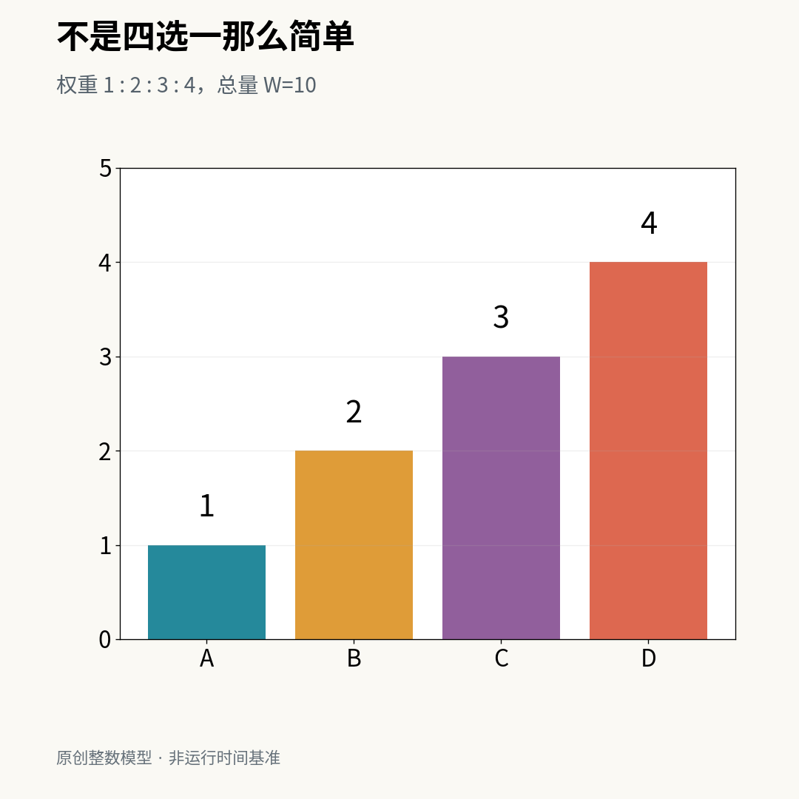
图1｜四种结果的权重分别为`1、2、3、4`，目标概率分别为`10%、20%、30%、40%`。

## 2. 先有一把正确的尺

把票号限定在`0…9`，累计边界是`0、1、3、6、10`。0落到A，`1、2`落到B，`3、4、5`落到C，`6…9`落到D。这叫按累计区间定位。只要票号真均匀，区间有几张票，结果就占几成概率。

这已经是很好的方法。顺着边界查找需要 `O(n)` 次比较，排序好的累计边界可以二分到 `O(log n)`；如果只抽几次，完全没必要为了更短的查询重建另一套数据。Alias method解决的是另一个使用场景：分布固定，后面要抽很多次，能否先把不等长区间整理成等宽的格子？它是把已有随机数换一种映射方式，并不会让随机数更“随机”。

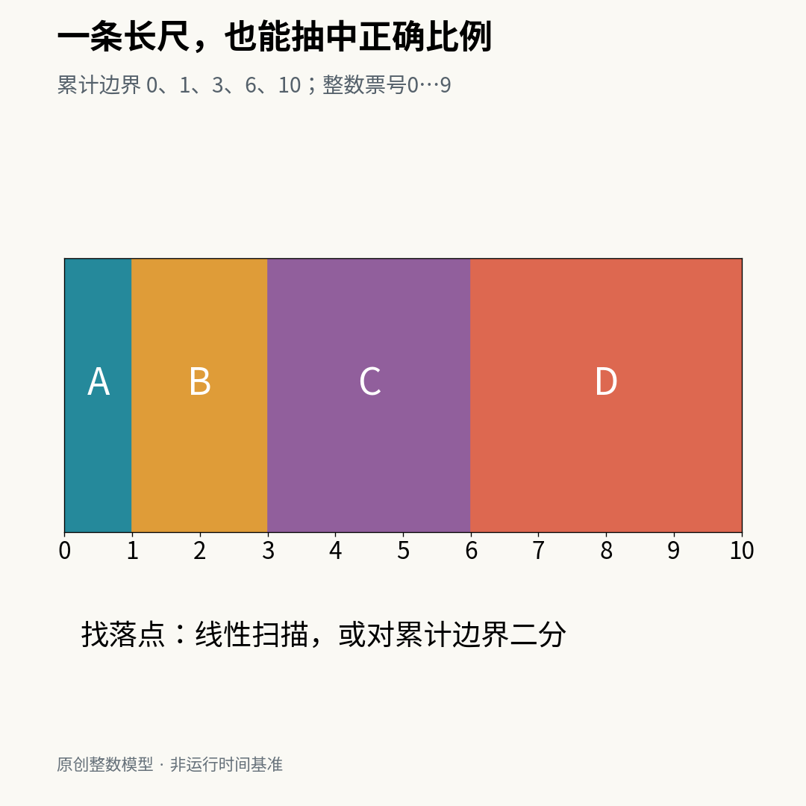
图2｜累计区间按长度分配概率；alias 把同一份分布改造成更容易定位的表，目标分布本身没动。

## 3. 不换概率，只换摆法

本文不用浮点小数建表。令 `n=4`，把每个整数权重乘以 `n`，得到 `q=[4,8,12,16]`；总质量也从 `10` 变成 `40`。我们准备四列，每列容量仍是 `W=10`，于是 `4×10=40`，刚好装满。想象每一种颜色代表一个输出。颜色可以拆开移动，但总量不能改变；只要最后从 `40` 格中均匀选一格，A 仍占 `4/40=1/10`，D 仍占 `16/40=2/5`。目标是再加一个限制：每列最多有两种颜色，其中一种是这列自己的编号。这样读一列只需要一个分界点，不必遍历很多颜色。

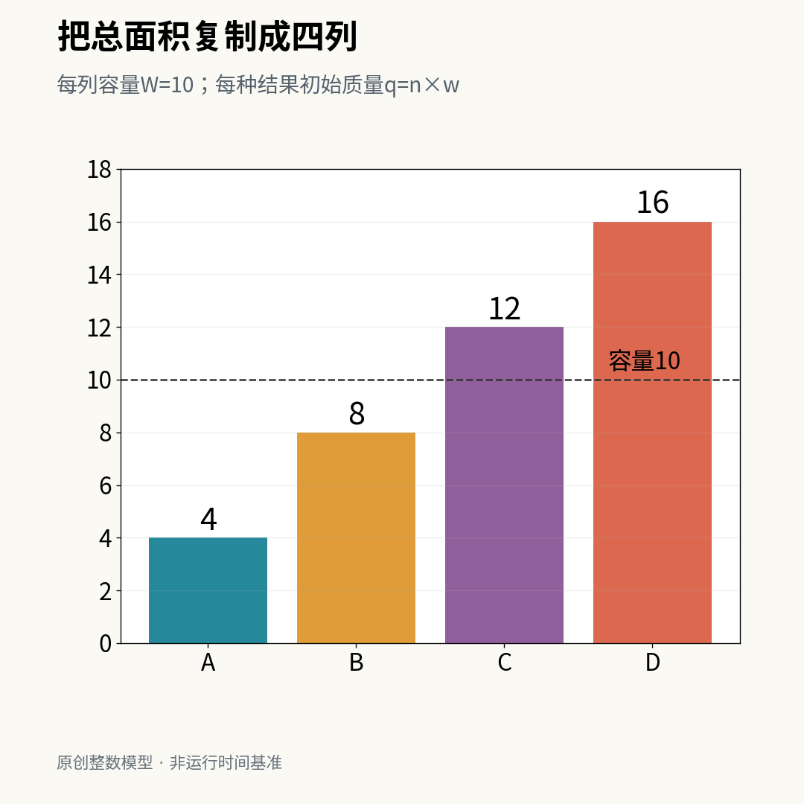
图3｜四种质量`4、8、12、16`之和为40，恰好填满4列，每列10。

## 4. 小的先封好，大的补缺口

用两个工作栈存编号：`small` 里放 `q<W` 的列，`large` 里放 `q≥W` 的列。初始 `small=[A,B]`，`large=[C,D]`。代码从栈尾取，所以先拿B与D。B只有8格，还缺2格，就从D的16格拿2格补上。这一列已经完整：票号`0…7`输出B，`8、9`输出D。把 `cut[B]=8`、`alias[B]=D` 写入表。D 并没有被删掉；它的余量变成 14，仍然足够填一列，于是回到 large。这里封好的是B列，不是说B已经被抽走；这是建表过程，任何随机抽签都还没开始。

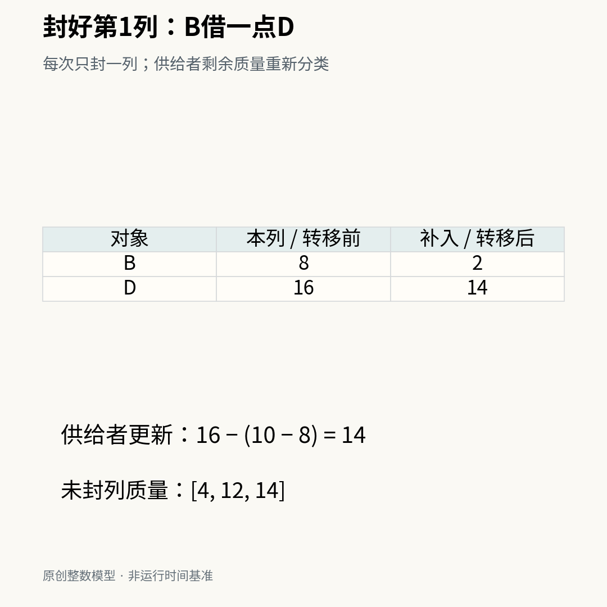
图4｜真实构造第1步：列B保留8格，另由D补2格；供给者余量为14。

## 5. 同一个供给者可以接着出场

下一次取 A 与 D；A 有 4 格、缺 6 格，于是从 D 余下的 14 格里取 6，D 剩 8。封好A列：`cut[A]=4`，`alias[A]=D`。D现在小于10，要进入small，而不是继续当“大户”。关键更新是 `q[hi]` 减去 `W−q[lo]`。别把供给者整个拿走，也别把填补量错写成 `q[lo]`。此时还没封的只有 C、D，余量 `12+8=20`，恰好是两列的容量。先前封好的列不再参与后面的选择，因此不会反复修改已经确定的分界。

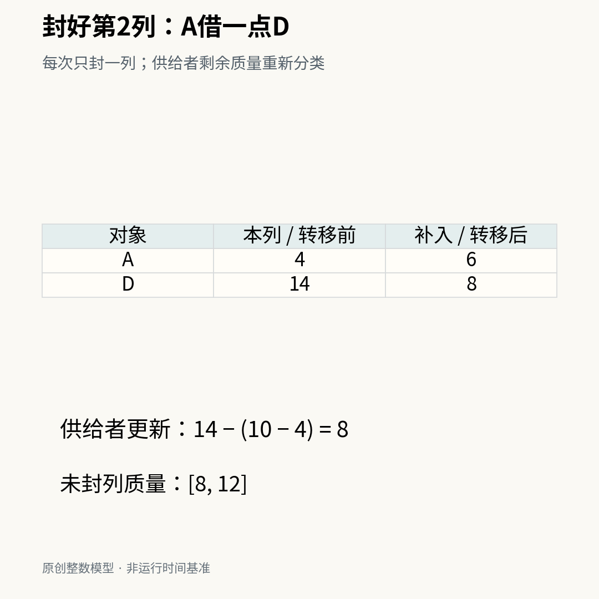
图5｜真实构造第2步：列A保留4格，另由D补6格；供给者余量为8。

## 6. 为什么这件事总能收尾？

最后D需要2格，C有12格，补完后C恰好剩10。封D列，C独占最后一列。构造得到 `cut=[4,8,10,8]`、`alias=[D,D,C,C]`。一般情况也不会凭空卡住：若还有m个未封列，它们的剩余质量总是mW。只要有一个低于W，就必定有另一个至少W，否则总和会小于mW。每配一对，封掉一列并用掉 `W`，总和关系保持不变；如果小列已经用完，剩下各列都至少 `W`，而平均恰好 `W`，所以它们只能全等于 `W`。

每一轮未封编号数减少1，最多配n−1次。栈尾弹出与追加不需要排序。这是线性建表的核心，不是“多试几次大概能填满”。

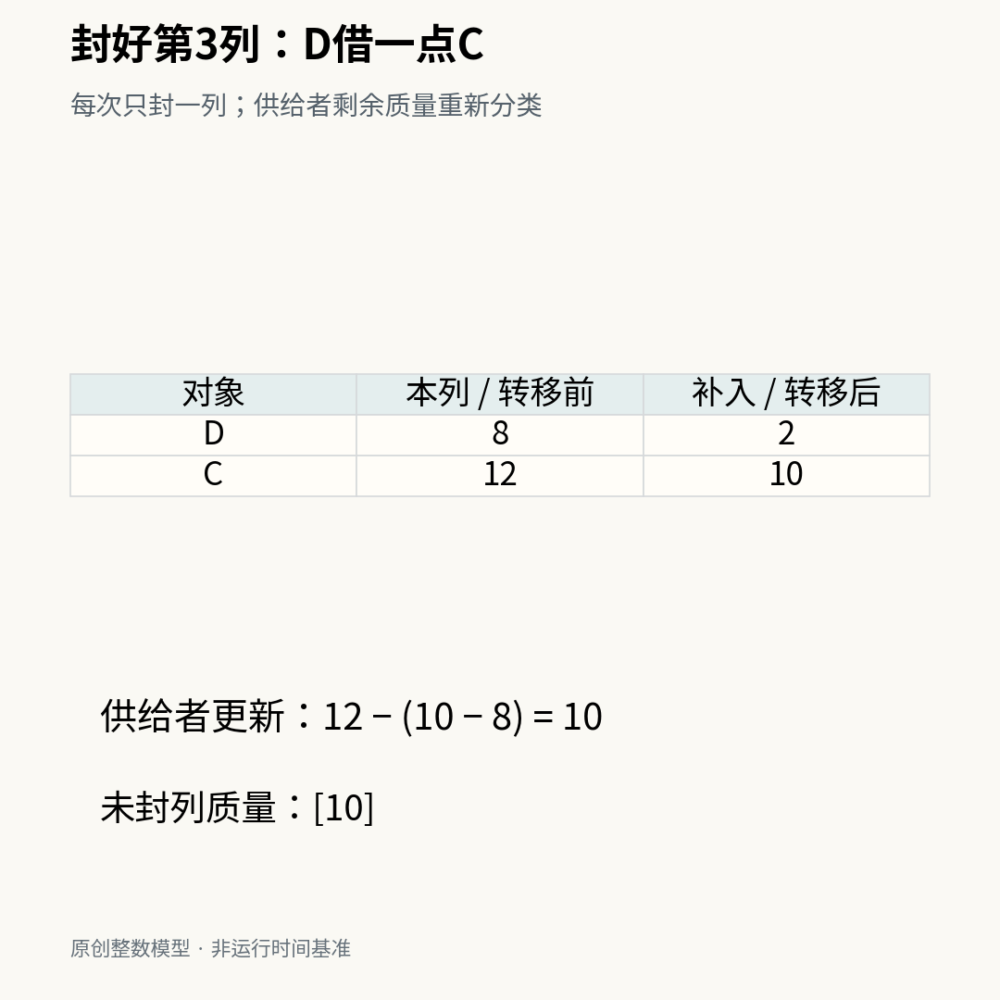
图6｜真实构造第3步：列D保留8格，另由C补2格；供给者余量为10。

## 7. 两次均匀选择，得到不均匀结果

现在先均匀选一列 `i∈{0,1,2,3}`，再独立均匀选 `ticket∈{0,…,9}`。每一个列号与票号对的概率都是1/40。颜色总格数不变，因此输出概率正确。要注意，“列被选中的概率”和“结果被选中的概率”并不是同一件事。每列都是1/4，但D除了自己的列，还住在A、B列上方；C也住在D列上方。别名表把某个结果分散到几个入口，却让每个入口只分两段，从而消除了重新抽取的空白区，不需要因抽到空格而重来。

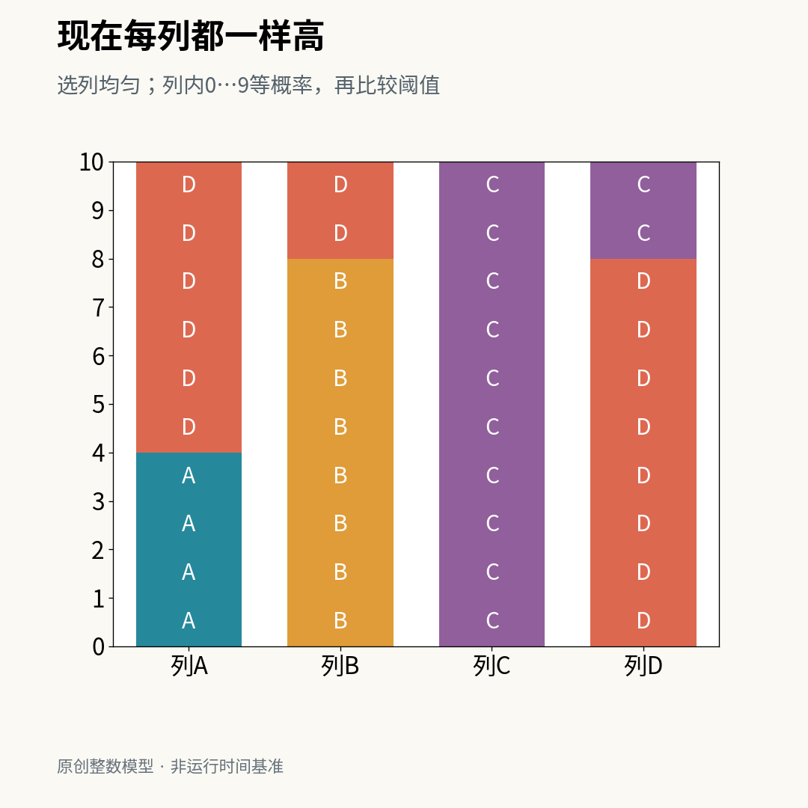
图7｜40个等概率格的颜色计数为A4、B8、C12、D16，输出概率仍为`1:2:3:4`。

## 8. 真正存储的不是四十个格子

大格图只是解释工具。真正的对象只有整数权重、总和W、n个cut、n个alias。第 i 列有 `cut[i]` 个票号输出 i，其余 `W−cut[i]` 个输出 `alias[i]`。满列的 `cut` 等于 `W`；因为 `ticket` 严格小于 `W`，永远不会走上段，所以 `alias` 可以设成自己，避免未初始化值。零高度本色也合法，意味着每张票都转向别名。不同的 `small`/`large` 取出顺序可能造出另一张同样正确的表；判断标准是最终概率，而不是表项必须与本例逐字一致。

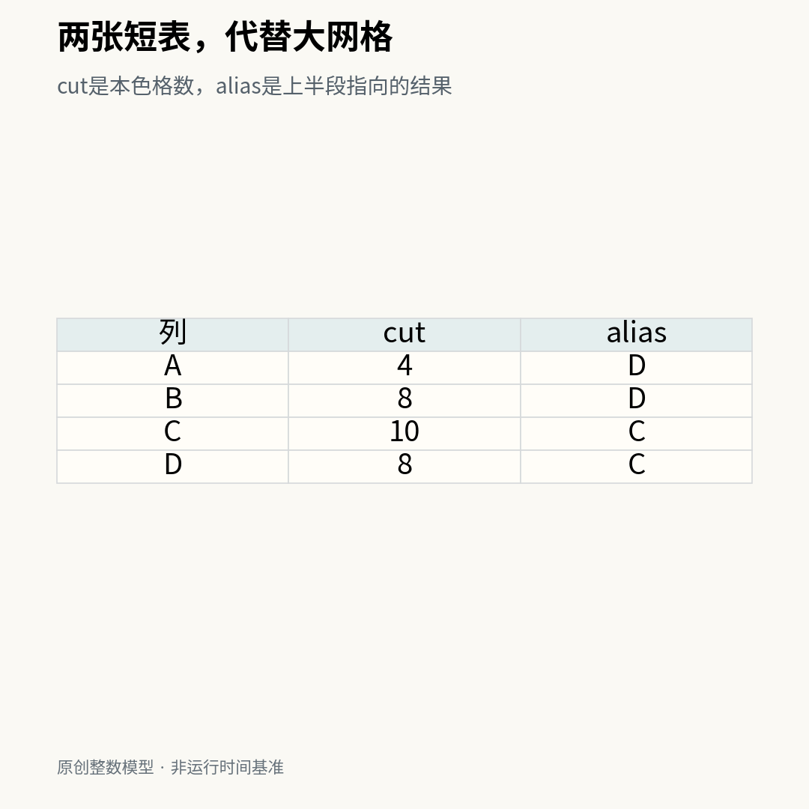
图8｜最终cut=[4,8,10,8]、`alias=[D,D,C,C]`；满列C的alias不会被合法票号使用。

## 9. 边界不是可以随手写的细节

列 A 的 `cut` 是 `4`：`ticket=3` 时输出 A，`ticket=4` 已经越过分界，应该输出 D。代码写 `ticket<cut`，不写 ≤。否则A多拿一格，所有关于面积的证明都会失效。

公开的 `cell` 入口检查列号、票号必须是普通 Python 整数，排除 `bool`，且在合法的半开范围内。`draw` 接受一个提供 `randrange` 的随机源；它检查返回值的范围，却不能替你证明随机源均匀或独立。随机源若永远返回0，算法不会把它神奇地修成正确分布；AliasTable的内部数组应由build产生，它不是接收任意伪造表结构的安全解析器。

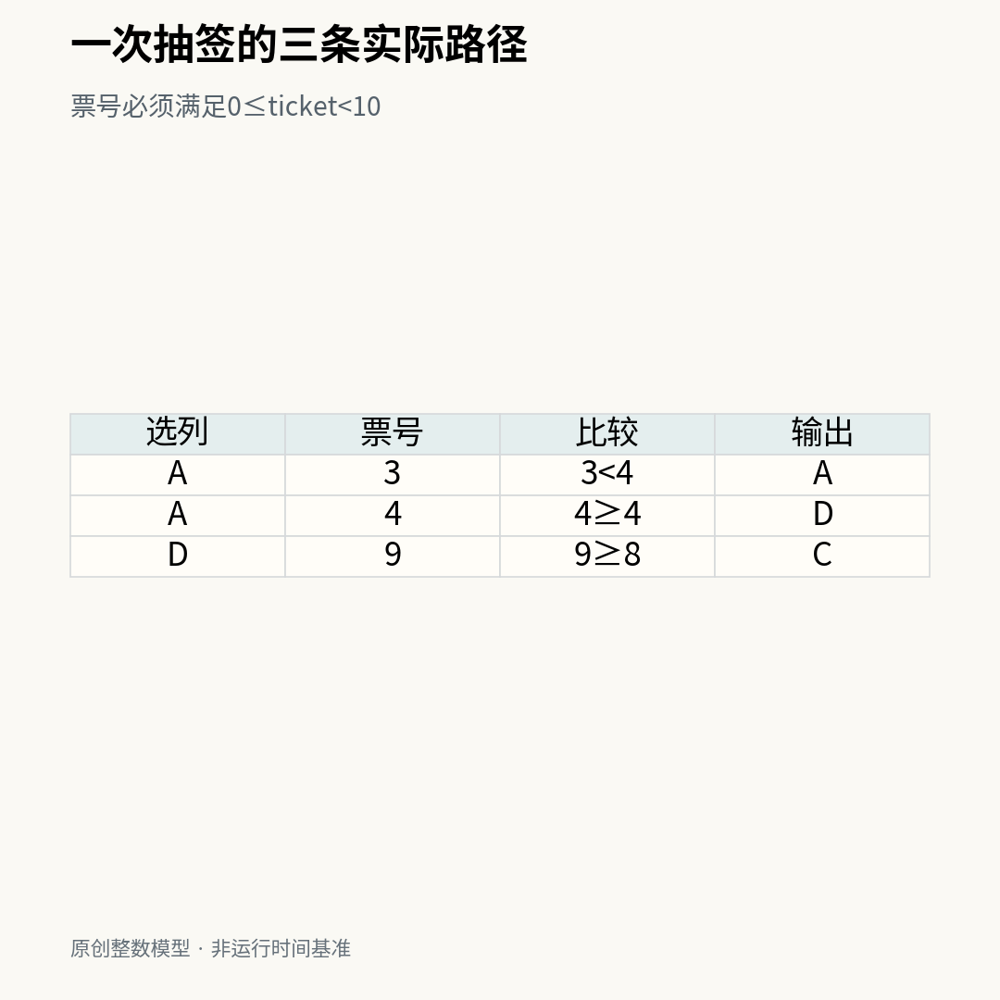
图9｜严格小于阈值才留在本列；边界票号4在列A中应输出D，而不是A。

## 10. 一条公式就能复核整张表

对于结果j，输出格数等于“j列的本色格数”加上“所有alias指向j的列的上段格数”：

`count[j] = cut[j] + Σ(i: alias[i]=j) (W−cut[i])`。再除以 `nW` 就是概率。本文 `mass()` 用这个式子精确返回 `Fraction`，无须分配 `nW` 张票。构造保持每种颜色总量 `n×w[j]`，因此 `count[j]/(nW)=w[j]/W`。满列自指时加的上段为 `0`，不会重复计数，所以这是一个精确的概率论证；后面抽十万次得到接近的频数，只是在检查实现与展示波动，不能代替它。即使某次实验刚好得到漂亮的整数比例，也不意味着程序必然正确。

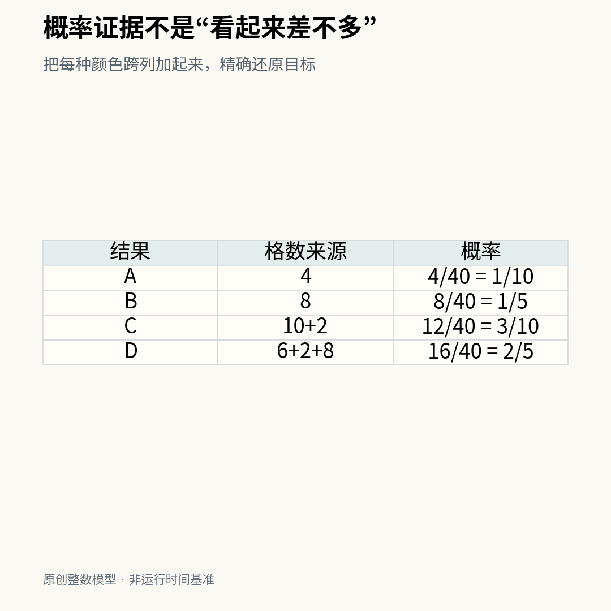
图10｜A和B只留本列；C还收到列D的2格，D分布在列A、B、D的上段或下段。

## 11. 两个很诱人的错误捷径

第一个错误是均匀选列后直接输出列号。这样四种结果各1/4，完全丢掉权重。第二个错误是拿一个均匀b位整数直接对n取余。比如`0…7`对3取余，`0、1`各出现3次，2只出现2次，已经偏了。

这里依赖随机源提供无偏randrange，而不是手写模运算。本地演示使用Python Random的伪随机序列，固定种子方便复现，不代表独立物理随机性，也不适合安全用途。理论中的两次选择要求相应的联合均匀性。调用次数固定为2，不意味着底层恰好消耗两个随机机器字：范围生成可以使用拒绝法，消耗随机位的次数会变。

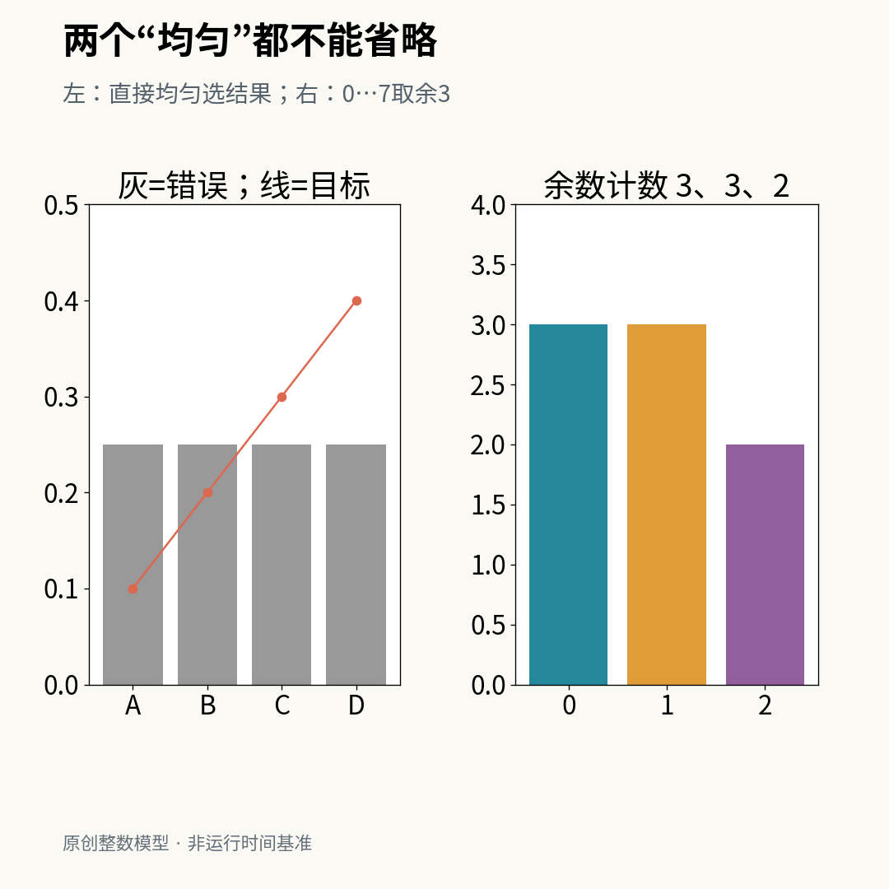
图11｜均匀选列后不能直接输出列号；随机整数简单取模也可能不均匀，8个原始值不能均分成3类。

## 12. 不妨专门试试最偏的分布

权重 `[0,0,5]` 看起来很极端，却应合法：只有 C 能出现。A、B 列的 `cut` 为 `0`，不管它们抽到什么票号都转 C。`n=1` 时唯一正权重结果也必然输出自身。全零则不同，总和为0，根本不能归一化，所以必须拒绝。

本文只接受长度 `1` 到 `10000` 的列表或元组，其中是非负整数权重，不接受负数、`NaN`、无穷或小数。现实权重当然可以不是整数；这里主动选择整数，是为了让接口讲得清楚、可精确验证。小数权重若转整数，必须先定义精度与舍入策略；随意乘100后截断，会让很小但非零的概率消失，而有理数通分虽然可行，分母与整数位数却可能很大，绝不是免费操作。

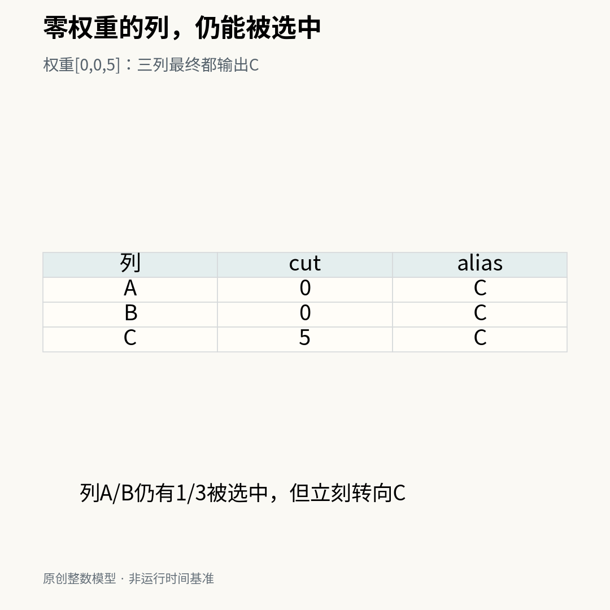
图12｜零权重列阈值为0，任何合法票号都走alias；单一非零结果仍以概率1输出。

## 13. 抽很多次，和抽走一份不是同一个任务

表造好后不随一次抽签变化，因此它是有放回抽样。A连续出现两次是允许的。若抽到A就将其删除，那是在改变下一次的条件分布，需要另一种策略或重新建表，不能继续使用原表再说“不放回”。

输入权重改变也一样。A 从 `1` 变成 `7`，新目标是 `[7,2,3,4]/16`，旧表仍然给 `[1,2,3,4]/10`。build把输入复制成不可变元组，不会监控原列表以后被怎样修改。本文不实现动态更新、多线程并发发布或表版本切换。若频繁改分布、每改一次只抽一次，累计权重树等动态结构可能更适合；不要只盯住单次查询 `O(1)`。

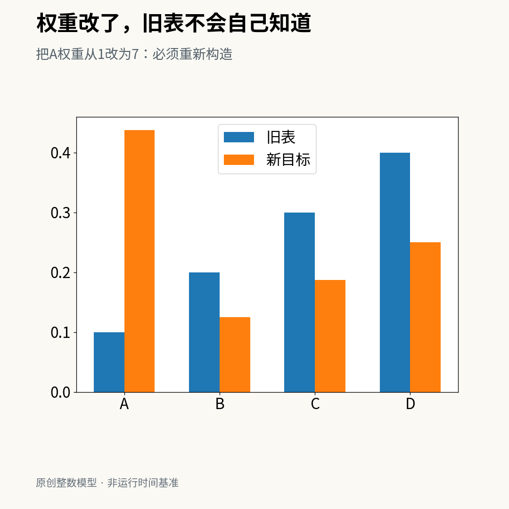
图13｜输入[7,2,3,4]的新目标不是旧表的`1:2:3:4`；本实现每次更新重建，不支持局部动态维护。

## 14. 那个O(1)里，究竟藏着什么？

在把一次整数运算和一次无偏范围抽样都视为基本操作的模型下，不保留 `trace` 的建表要做 `O(n)` 次算术与栈操作，额外存 `O(n)` 个整数；查一次表则是两次 `randrange` 加上固定数量的比较与索引。抽 `m` 次若把结果收集成列表，输出本身还要 `O(m)` 空间；Python 的整数可以任意长，因此权重占 `b` 位时，总和与阈值大约需要 `b+log₂n` 位，算术、比较与随机位生成成本不能算作硬件常数。本文用10^1000量级的大整数检验精确性，不宣称它与小整数同速。

另一个容易遗漏的成本来自教学轨迹：trace=True每轮复制未封列表，最坏O(n²)个元素的时间和存储。生产默认trace=False不做这些快照。图中只统计操作与数据，不包含墙钟测时，更没有宣称哪台机器一定快多少倍。

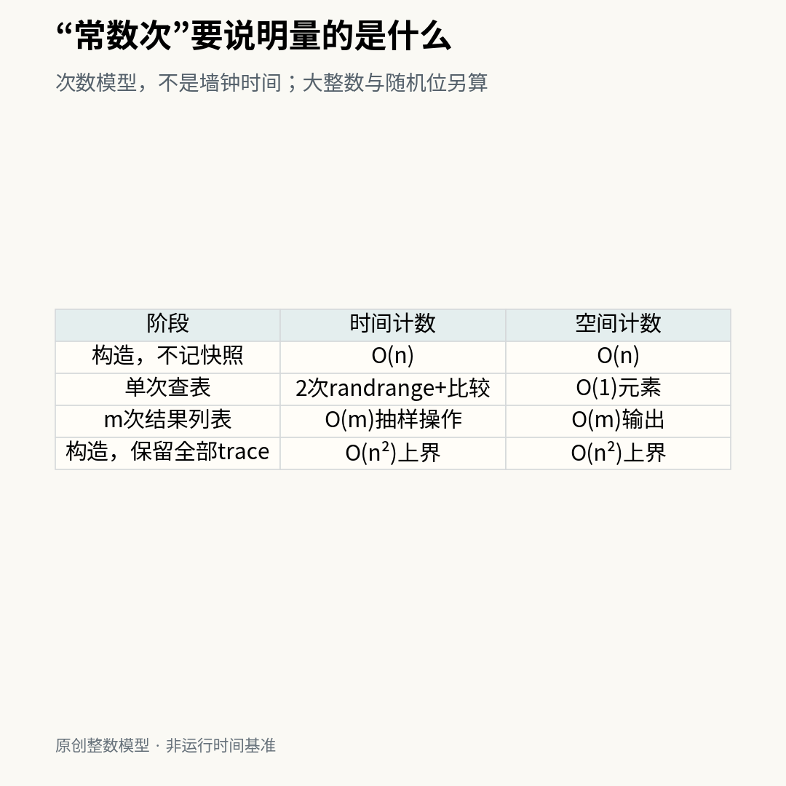
图14｜单位整数操作模型下线性建表；trace复制剩余列表可能二次，随机位生成与大整数位成本不在常数查表承诺内。

## 15. 让小输入的所有可能性都说话

作者自测枚举长度`1…6`、每项取`0…3`的权重向量，剔除全零，共5454种。对每张表真正枚举每个列号和每个整数票号，共266694个格，检查每种结果恰好占n×w[j]格。还检查每轮未封质量等于剩余列数×W，并验证配对轮数不超过n−1。

14 项错误输入覆盖空表、全零、负权重、`bool`、小数、错误容器和非法 `cell` 坐标；另外核对了含 `10^1000` 权重的 `Fraction` 结果。它们能找出很多实现错误，但仍是有限测试。没有枚举任意长度、任意权重，更没有通过这些用例证明任意外部随机生成器正确。下方附完整核心，读者可以自己换权重和随机源。

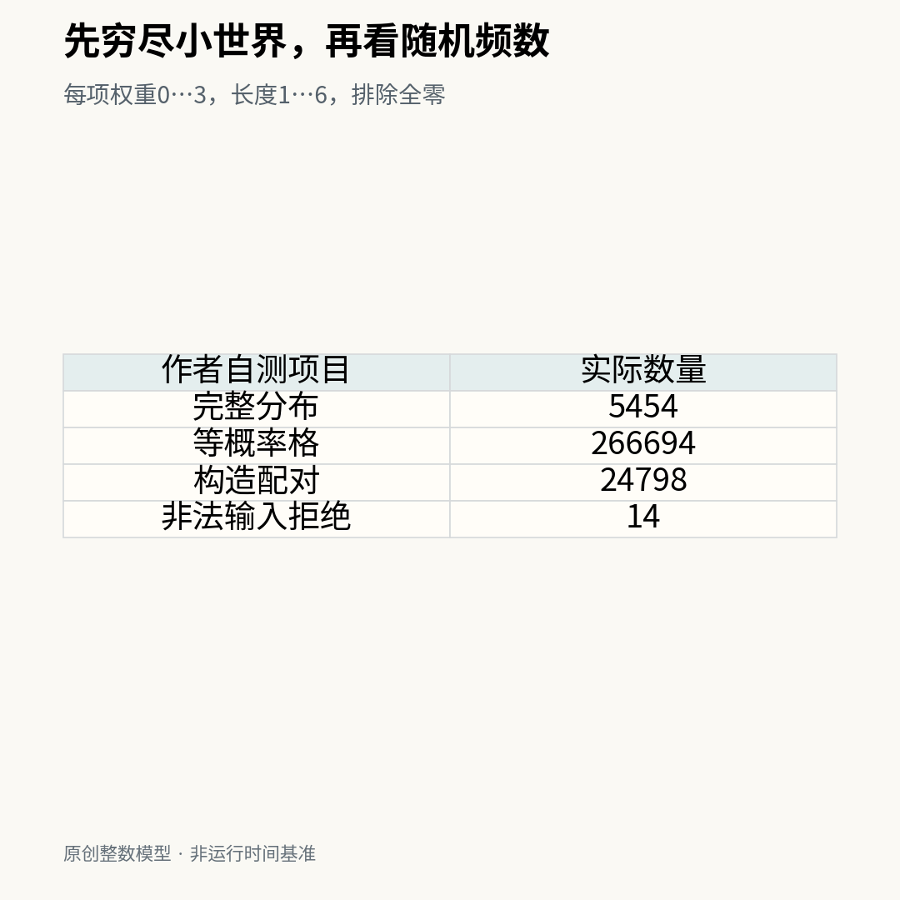
图15｜5454个整数分布逐格枚举266694格，精确输出计数均为n×w；这仍是有限实现测试。

## 16. 再回到十万次抽签

用种子 `20261023`，真实运行 `100000` 次，得到 A 9930、B 20200、C 29983、D 39887。期望计数是`10000、20000、30000、40000`。某个结果这次偏多、下次可能偏少，一千次里差上一两百也属正常波动；期望是长期平均，不是每次实验必须交出的配额。

这个方法漂亮的地方在于把一条难定位的不等长尺，改成等概率入口加二选一，并非“碰巧抽得准”。抽签时看起来只走一步，是因为建表时已经把结构整理好了。想继续探索，可以试着改变工作栈次序，比较两张不同的表是否给出完全相同的mass()；再故意把<改成≤，看看最先出错的是哪一个边界。

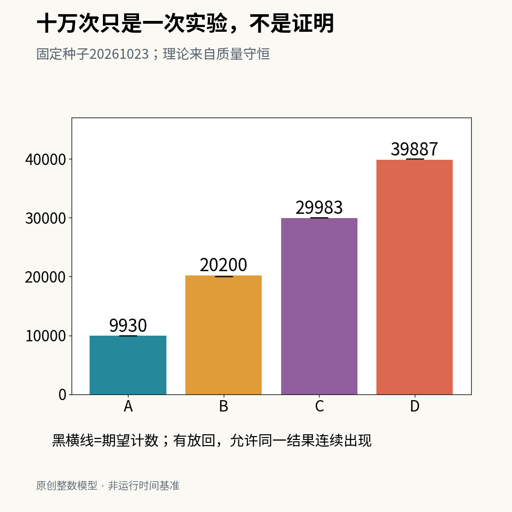
图16｜同一张表用固定伪随机种子抽100000次，实际计数`9930、20200、29983、39887`；频数误差不是精确概率误差。

## 完整可运行核心｜Python标准库

保存为alias_lab.py，直接运行可见例表及固定种子序列。构造函数不修改传入列表；只验证公开入口的既定契约，dataclass属性不是任意外部反序列化验证器。

```python
"""Exact-integer teaching alias table; standard library only."""
from dataclasses import dataclass
from fractions import Fraction

@dataclass(frozen=True)
class AliasTable:
    weights: tuple
    total: int
    cut: tuple
    alias: tuple

    def cell(self, column, ticket):
        # Table must be produced by build(); no arbitrary table parser.
        n = len(self.weights)
        if type(column) is not int or not 0 <= column < n:
            raise ValueError('invalid column')
        if type(ticket) is not int or not 0 <= ticket < self.total:
            raise ValueError('invalid ticket')
        return column if ticket < self.cut[column] else self.alias[column]

    def draw(self, rng):
        # rng.randrange(b) must supply an unbiased integer in [0,b).
        # Two independent uniform choices give the exact target law.
        return self.cell(rng.randrange(len(self.weights)),
                         rng.randrange(self.total))

    def mass(self):
        # Count cells symbolically, without allocating n*total cells.
        counts = [0] * len(self.weights)
        for i, c in enumerate(self.cut):
            counts[i] += c
            counts[self.alias[i]] += self.total - c
        return tuple(Fraction(c, len(counts)*self.total) for c in counts)


def build(weights, *, trace=False):
    if not isinstance(weights, (list, tuple)) or not 1 <= len(weights) <= 10000:
        raise ValueError('use a list/tuple of 1..10000 integer weights')
    if type(trace) is not bool:
        raise ValueError('trace must be bool')
    w = tuple(weights)
    if any(type(x) is not int or x < 0 for x in w) or sum(w) == 0:
        raise ValueError('nonnegative integer weights, positive sum required')
    n, total = len(w), sum(w)
    q = [n*x for x in w]
    small = [i for i in range(n) if q[i] < total]
    large = [i for i in range(n) if q[i] >= total]
    cut, alias = [total]*n, list(range(n))
    history = []
    while small and large:
        lo, hi = small.pop(), large.pop()
        cut[lo], alias[lo] = q[lo], hi
        before = q[hi]
        q[hi] -= total - q[lo]
        (small if q[hi] < total else large).append(hi)
        if trace:
            history.append(dict(lo=lo, hi=hi, cut=cut[lo],
                                donor_before=before, donor_after=q[hi],
                                small=tuple(small), large=tuple(large),
                                remaining=tuple(q[i] for i in small+large)))
    # Exact integers: all unsealed columns have exactly total mass.
    assert not small
    for i in large:
        assert q[i] == total
    table = AliasTable(w, total, tuple(cut), tuple(alias))
    return (table, history) if trace else table

if __name__ == '__main__':
    from random import Random
    t = build([1, 2, 3, 4])
    assert t.mass() == (Fraction(1,10),Fraction(1,5),Fraction(3,10),Fraction(2,5))
    print(t)
    r = Random(7)
    print([t.draw(r) for _ in range(12)])
    from collections import Counter
    r = Random(20261023)
    counts = Counter(t.draw(r) for _ in range(100000))
    print([counts[i] for i in range(4)])
```

## 短读版｜列均匀，结果却不必均匀
权重`1:2:3:4`并不需要每次扫描四个区间。先把它们放大成质量`4、8、12、16`，再塞进四个容量为10的列，每列只放本色和一个别名色。均匀选列、再均匀选`0…9`的票号，按阈值分流，仍然得到`10%、20%、30%、40%`。

关键在颜色总量从未改变，频数是否“看起来差不多”并不作数。两张短表取代那张大网格，小列借大列的余量补缺口，最多封 `n−1` 次就能收工。整数权重让这次实验免于浮点舍入，但大整数与无偏随机位并非零成本。它适合固定分布反复有放回抽样；一旦权重改动就得重建整张表，它不会自动变成不放回抽样，也不对随机源本身的可靠性作任何保证。

## 来源、阅读范围与图像权利
- Keith Schwarz，《Darts, Dice, and Coins》，页面标示最后主要更新2011-12-29：https://www.keithschwarz.com/darts-dice-coins/ 。实际阅读别名表构造、两工作栈及浮点限制段；本文采用自写整数权重版本、不同数例和精确枚举，非网页代码搬运。
- Michael D. Vose 原作者论文链接：https://web.eecs.utk.edu/~vose/Publications/random.pdf 。未读取论文全文，不据其未读内容作细节断言。线性工作栈方法的归属依据Schwarz已返回的明确说明。
- Schwarz的completedAliasSetup原图显示四列概率与Prob/Alias表。未确认该图可再发布的明确许可；本文不转载该图，也不描摹其复合布局。16幅均为自写程序的数值/几何图，不是历史截图、真实抽奖记录或平台预览。

---

[来源、AI 辅助与许可范围](sources.md)
