# 三个字母，为什么能变成一个小数？
## 算术编码：把整条消息放进一个越来越窄的区间

假设你要把三个字母 BAC 发给朋友。

最直接的办法是约定 A=00、B=01、C=10，再把三段拼起来。这很像给每个字母发一张独立的身份证：一个字母对应一段码，三个字母对应三段码。

算术编码换了个做法。它先不问“B 的码是什么”，而是拿出从 0 到 1 的一段数轴。看到 B，保留其中一块；再看到 A，在这一块里继续切；最后看到 C，再保留更小的一块。

如果双方切法一致，那么落在最后那一小块里的数，就能带着接收者沿原路走回 B、A、C。

这个想法听起来像把所有信息塞进一个神奇的小数。真正值得追问的却是：这个数需要写到多精确？朋友怎么知道什么时候停？计算机又不可能无限增加小数位，怎么办？

先把三次切分走完，再来回答这些问题。文中的字母、概率和消息都是为讲解自拟的，不是某种真实文件的统计结果。

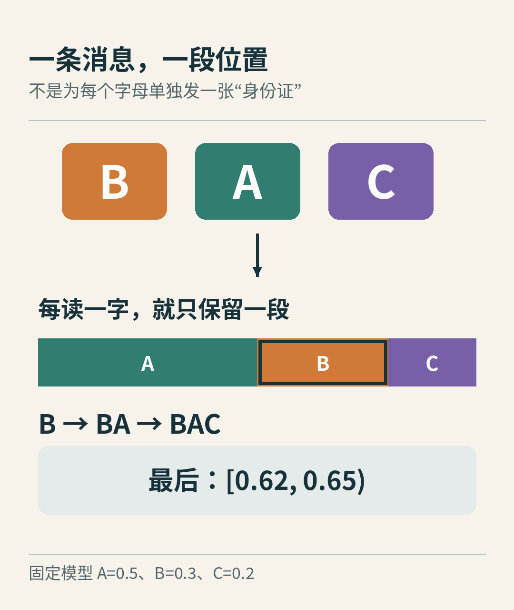

图1｜BAC 不是三个独立码字，而是一条逐步选择子区间的路径。末尾只要定位到属于这条路径的区域，就能反向识别消息。

## 一、先约定一把共同的尺子

我们暂时只允许 A、B、C 三种符号，并约定模型认为下一次出现它们的概率分别是：

- A：1/2，也就是 0.5。
- B：3/10，也就是 0.3。
- C：1/5，也就是 0.2。

这里的“模型认为”很重要。概率是编码时使用的预测，不是编码器看到这个字母之后给它评分。我们先用一张固定表，整条消息中都不修改它。

把长度为 1 的区间按 A、B、C 的顺序切开：

A 占 [0, 0.5)。
B 占 [0.5, 0.8)。
C 占 [0.8, 1)。

方括号表示包含这个端点，圆括号表示不包含。于是 0.5 属于 B，不同时属于 A；0.8 属于 C，不同时属于 B。这叫“左闭右开”，也叫半开区间。初始区间不包括 1。

为什么值得为一个括号认真？因为接收者恰好拿到边界值时，也必须只有一种答案。

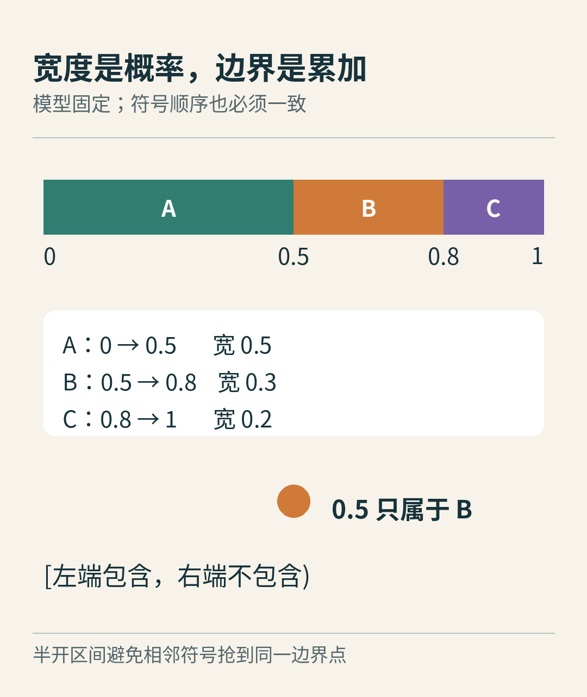

图2｜概率决定每段的宽度，累计概率决定边界。A 的右边界是 0.5，A 加 B 的右边界是 0.8；边界点只交给右侧那一段。

A 比 B 常见，所以分到更宽的区域；B 又比 C 宽。我们稍后会看到，宽的区域更容易用较短的二进制描述定位。这才是概率与压缩之间的连接。

顺序也必须约定。把 B 放在 A 前面不一定会让压缩变坏，但会改变每个符号的位置。只有频数相同、排列顺序不同，双方仍然可能解不出同一条消息。

## 二、BAC 怎样留下自己的位置

现在开始编码。手里的区间最初是 [0, 1)。

第一个字母是 B，所以选择 [0.5, 0.8)。目前只知道消息以 B 开头。它可能是 BA，也可能是 BC，还可能更长。

第二个字母是 A。这里最容易走错的一步，是又回到最初的 [0, 1) 中选 A。那样会把前面的 B 忘掉。

正确做法是在现有的 [0.5, 0.8) 里，按照同一份 0.5、0.3、0.2 的比例再切一次。现有宽度是 0.3，因此：

- BA：从 0.5 开始，宽 0.3×0.5=0.15，得到 [0.5, 0.65)。
- BB：接在后面，宽 0.3×0.3=0.09，得到 [0.65, 0.74)。
- BC：最后一段，宽 0.3×0.2=0.06，得到 [0.74, 0.8)。

我们要 A，所以保留 BA 的 [0.5, 0.65)。

第三个字母是 C。当前宽度 0.15；C 位于每次切分的最后 20%，也就是从当前左端向右走过 80% 的位置开始：

新左端 = 0.5 + 0.15×0.8 = 0.62。
新右端 = 0.5 + 0.15×1 = 0.65。

于是 BAC 得到 [0.62, 0.65)。

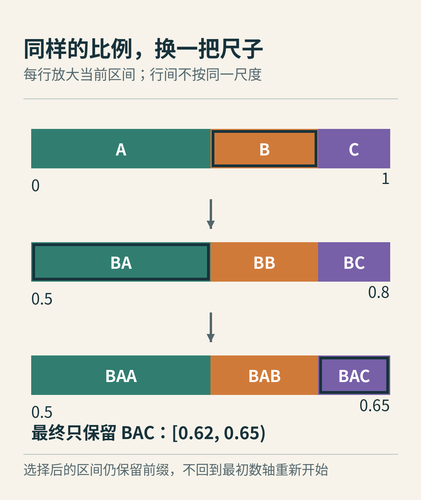

图3｜三轮切分使用同一份比例，但尺子每轮换成当前区间。放大后的各行并非共用一个全局长度尺度；端点数值保留了它们的真实位置。

最后区间里有很多数，0.625、0.63、0.64 都在里面。为了方便计算，先选 0.625，也就是 5/8。

别选 0.65。它看似只差一点，却在 BAC 的右边界之外。若按同样的规则解三个符号，会得到 BBA，而不是 BAC。

## 三、只拿到 0.625，真的能找回字母吗

暂时假设朋友已经知道消息恰好有三个符号，并且知道那张概率表及符号顺序。传递这个数的具体二进制格式，下一节再补上。

朋友先拿 0.625 对照最初的三个区域。它在 [0.5, 0.8) 内，所以第一个字母一定是 B。

接下来有两种等价的读法。

一种是在 B 那一段内部继续画 BA、BB、BC，查看 0.625 落在哪块。另一种更适合手算：把已经选中的 B 区间重新拉伸成 [0, 1)。

要重新拉伸，先减去旧左端 0.5，再除以旧宽度 0.3：

(0.625−0.5)÷0.3 = 5/12 ≈ 0.4167。

这个“局部坐标”在 A 的 [0, 0.5) 内，所以第二个字母是 A。

再把 A 拉伸成 [0, 1)：

(5/12−0)÷(1/2) = 5/6 ≈ 0.8333。

它在 C 的 [0.8, 1) 内，所以第三个字母是 C。约定的三个符号已经读完，停止。

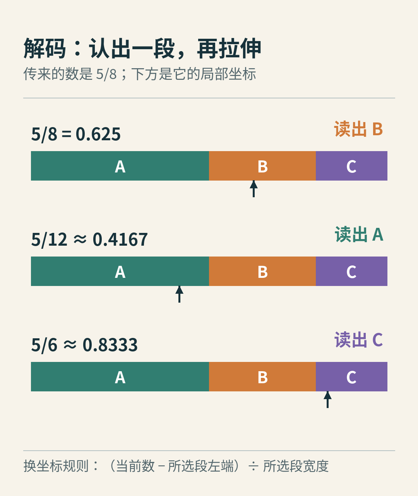

图4｜解码每次先判断所在分区，再换成该分区内的局部坐标。5/8→5/12→5/6，依次落在 B、A、C；这不是三个不同的传输数。

这里不需要猜测消息，也不需要把所有可能的消息先列出来。编码器选择分区，解码器根据位置认出分区；两边用的是同一把尺子。

如果接收者误用 A=0.2、B=0.5、C=0.3，那个同样的 5/8 会被读成 BCB。数没有损坏，双方对数的解释却已经不同。

## 四、为什么不同消息不会撞到一起

先只比较长度相同的消息。

若两个消息第一个字母不同，它们一开始就进了不相交的区域。若第一个相同、第二个不同，就在共同区域的下一轮切分中分开。一般地，找到它们第一次出现不同符号的位置，就找到两条路径分离的那一刀。

后续只能继续选择自己的子区间，不能越过已经分开的边界。因此，长度相同但内容不同的消息，最后不会占用同一块区域。

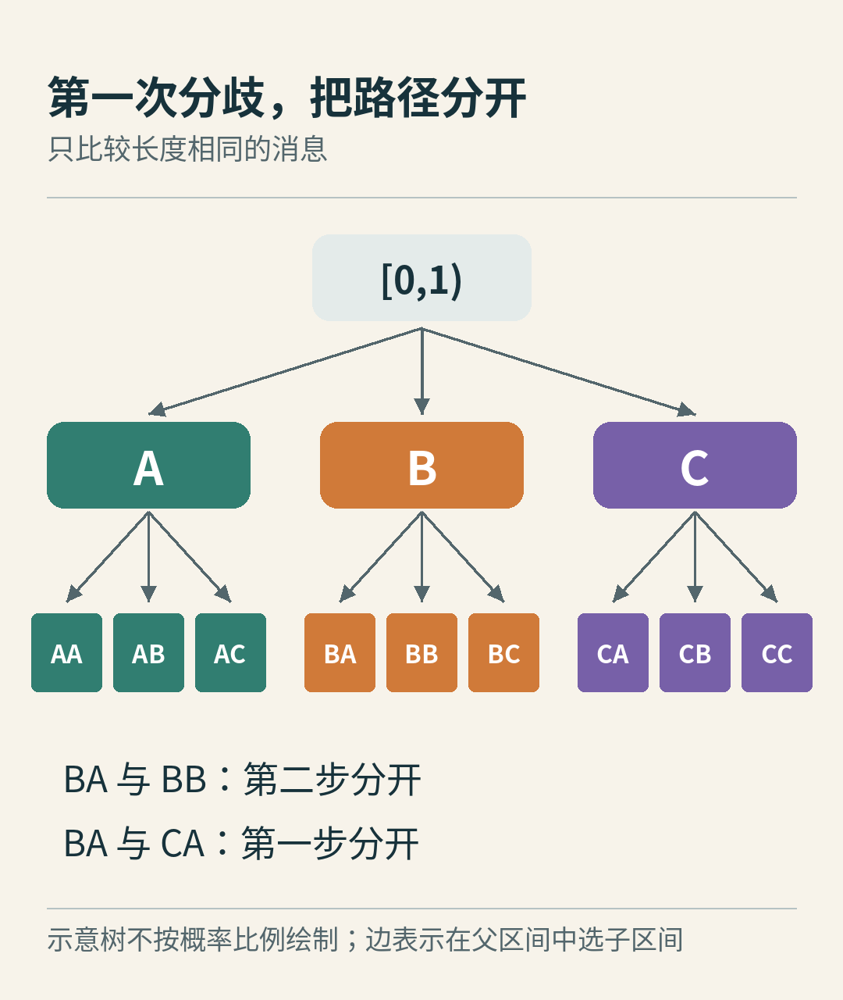

图5｜两符号消息形成九块互不重叠的区域。BA 与 BB 的第一步相同，在第二步分开；BA 与 CA 则第一步已经分开。箭头表示选择，不表示时间或概率流动。

上面有意保留了“长度相同”这个条件。A 的区域会包含 AA 的区域，AA 又包含 AAA。它们并不互斥。一个很小的数可能同时符合“一个 A”“两个 A”“三个 A”的描述。

所以，区间唯一识别的是一条已经知道何时结束的路径。结束规则不是可有可无的小附件。

## 五、“传一个小数”还没回答要传多少位

0.625 的二进制写法是 0.101，因为：

1×1/2 + 0×1/4 + 1×1/8 = 5/8。

这是不是说明只发 101 三位，就足够表示 BAC？

如果协议明确规定“这三位就是一个完整的有限小数，后面全补 0”，又另行给出消息长度，那么这个特定数确实可以使用。但这依赖补零与码字边界等约定，不能悄悄把它当成任意位流的公共前缀。

为了看清楚“位数对应多大区域”，这里采用一个更强、更容易检查的课堂规则：发出的二进制前缀所代表的整个区域，都必须落在目标区间内。

例如，前缀 101 后面还可以有任意二进制位。按标准二进制区间约定，它代表 [5/8, 6/8)，也就是 [0.625, 0.75)。这块太宽，大部分已经跑出了 BAC 的 [0.62, 0.65)。

五位前缀 10100 代表 [20/32, 21/32)，即 [0.625, 0.65625)，仍然越界。

六位前缀 101000 代表 [40/64, 41/64)，即 [0.625, 0.640625)。这次整段都在 BAC 里面。

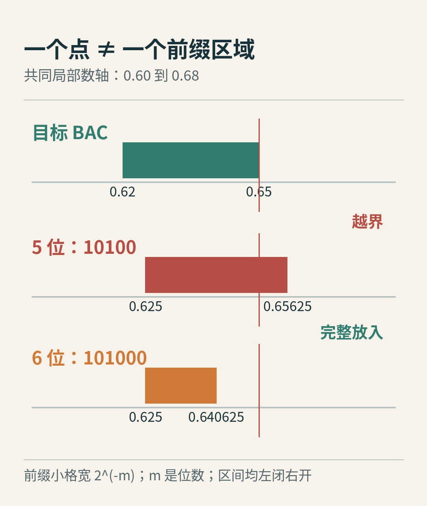

图6｜一个点落在目标里，不等于它的短前缀覆盖范围也全在目标里。五位区域从右侧越界，六位区域才完整放进去；图中各行共用同一局部数轴。

一个 m 位二进制前缀，把 [0,1) 划成宽度为 1/2ᵐ 的小格。位数越多，格子越窄，越容易放进目标区间。所谓“把消息表示成一个数”，最后仍要付出定位精度对应的比特数。

严格说，某些数有两种二进制写法，例如 0.1 与 0.01111……。这里统一使用前缀对应的半开小格，不把无限尾随 1 当成属于左侧小格的另一份边界凭证。

本文的有理数小程序会寻找“完整包含于目标区间的最短二进制小格”。这是一种明确的教学终止方案，不是在宣称所有算术编码器都输出同样的最短码。

## 六、朋友怎样知道读完了

回到 A、AA、AAA 的重叠问题。按当前概率表，它们的区间分别是：

A：[0, 1/2)。
AA：[0, 1/4)。
AAA：[0, 1/8)。

0 在这三块里。只看这个数，接收者不能凭空知道发送者想说几次 A。

一种办法是把符号数量放在包头里。例如约定“接下来的消息有 3 个符号”，解码器就执行三轮。长度字段也占空间，不能从压缩率账本中删掉。

另一种办法是把一个特殊结束符 EOF 加进字母表。它不是文件里某个普通字节的别名，而是双方约定的额外符号。发送 BAC 时，实际编码 BAC、EOF；接收者解到 EOF 才停，不把它写进还原内容。

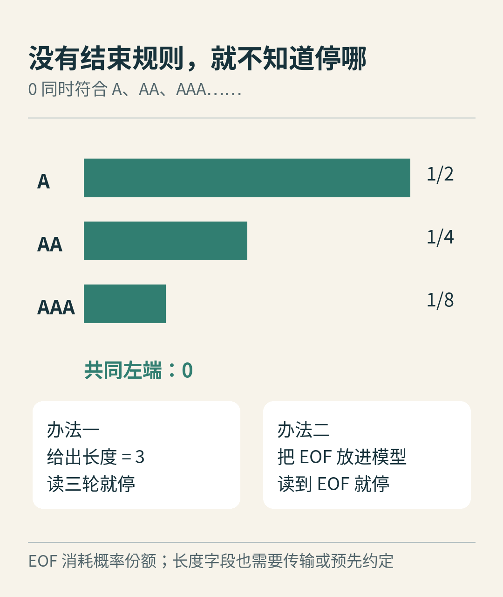

图7｜左边的嵌套区间说明，数本身不携带“停在第几轮”的意思。右边给出两种补充约定：独立长度字段，或进入模型并消耗概率份额的 EOF。

加入 EOF 会改变模型。比如把 A、B、C、EOF 的整数频数设成 5、3、1、1，总数还是 10。此时 C 的概率不再是前面的 0.2，因此这是一套新例子，不能继续沿用 BAC 的旧端点。

EOF 也不是免费晚餐。它分走一部分概率，并且本身需要编码。长度字段与 EOF 哪一种更合适，要连同分块、错误检测和格式约定一起考虑。

## 七、压缩究竟发生在哪里

在第一份固定模型里，每选一个符号，区间宽度就乘上这个符号的概率。因此 BAC 的宽度为：

0.3×0.5×0.2 = 0.03。

如果把模型理解为每次独立、概率不变的随机源，那么这个乘积也是消息 BAC 的模型概率。一般消息 x₁x₂…xₙ 的宽度就是各个符号概率的连乘。

要定位到宽度约为 p 的区域，需要的二进制精度大约是 −log₂p 位。这里 log₂ 是“2 需要乘几次”的反函数：宽度减半，定位就通常要再细一位。

BAC 的 −log₂0.03≈5.059。我们找到了六位的完整小格，多出来的是把任意位置的区间对齐到二进制格点所付出的余量。

“约 5.059 位”不是一根物理存储位被掰成了 0.059 段，也不是每一条消息都保证达到这个长度。

甚至在这个短例子里，取一套单符号 Huffman 码 A=0、B=10、C=11，BAC 就是 10、0、11，拼成五位的 10011，比我们的六位小格还短。不同消息的码长可以高于或低于自身的 −log₂p；平均效果不能靠只挑一个消息来下结论。

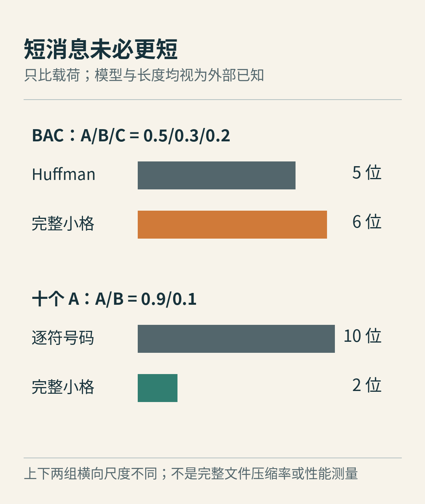

图8｜压缩率比较必须带上条件。BAC 的教学小格用 6 位，示例单符号 Huffman 码用 5 位；换成偏置二元模型下连续十个 A，小格可用 2 位，而逐符号二元码仍要 10 位。两组都未计外部已知的模型、长度和封装。

看一个更能显出区别的模型：只有 A、B，概率是 0.9、0.1。

如果每个符号都必须各自拥有非空的二进制码字，那么这两个符号至少各占一位；取 A=0、B=1，连续十个 A 就要十位。

算术编码不要求给每个 A 单独结算。连续十个 A 对应的区间是 [0, 0.9¹⁰)，右端约为 0.348678。二位前缀 00 代表 [0, 0.25)，已经能完整放进去。

在模型和长度事先已知的这个例子里，十个 A 的算术编码载荷可以是两位。不是每个 A 获得了一小截可单独剪下来的码，而是十次选择合起来只需要这么精细的定位。

反过来，十个罕见的 B 会把区域压得极窄，需要更长的表示。常见消息省下来的位，不能被误读成“任何消息都能变短”。

Huffman 编码也可以把多个符号合成一个块再建树，改善逐符号整数码长带来的限制。两者的区别不该简化成“一种能分数比特，另一种永远不能”。算术编码的实用之处在于沿途维护区间，不必为了一个很长的块，先显式列出所有块对应的庞大码表。

## 八、进一小步：为什么只多出很少的对齐余量

这一节可以稍后再读。它只针对上面的精确区间与完整二进制小格，不是整个压缩文件的大小保证。

设目标区间宽度为 w。找一个二进制格宽 δ=2⁻ᵐ，让它满足：

w/4 < δ ≤ w/2。

这样的格宽总能选到，因为相邻的二进制格宽恰好相差一倍。

从目标区间左端向右找到第一个格点。这段移动距离小于 δ；再走完一整格又花 δ。合计小于 2δ，且 2δ≤w，所以这一整格能放在目标区间内。

另一方面，格子若比目标区间还宽，肯定放不进去。于是最短可用小格的位数 m 满足：

−log₂w ≤ m < −log₂w + 2。

这个小证明给出的是精确课堂模型中的界。它没有把模型、长度、EOF、字节对齐、校验以及有限整数近似算进去。看见一个漂亮的“小于两位”，先问它在给哪一部分费用作保证。

## 九、为什么不能一直用普通小数算下去

前面的计算故意用了 1/2、3/10 这样的精确分数。Python 的 Fraction 可以保留它们，不靠四舍五入决定边界；但消息越长，分子与分母可能越来越大。

如果换成普通浮点数，会出现更直接的问题：区间宽度变得很小，而两个端点又非常接近同一个大数时，计算机可能已经没有足够精度区分它们。

仍用 A=0.5、B=0.3、C=0.2，连续输入 C。精确区间始终是：

[1−0.2ⁿ, 1)。

它一直非空，只是挤在 1 的左侧。随附演示在当前 Python 的二进制浮点环境中逐次计算，到了第 24 个 C，两个保存下来的端点都变成了 1.0。

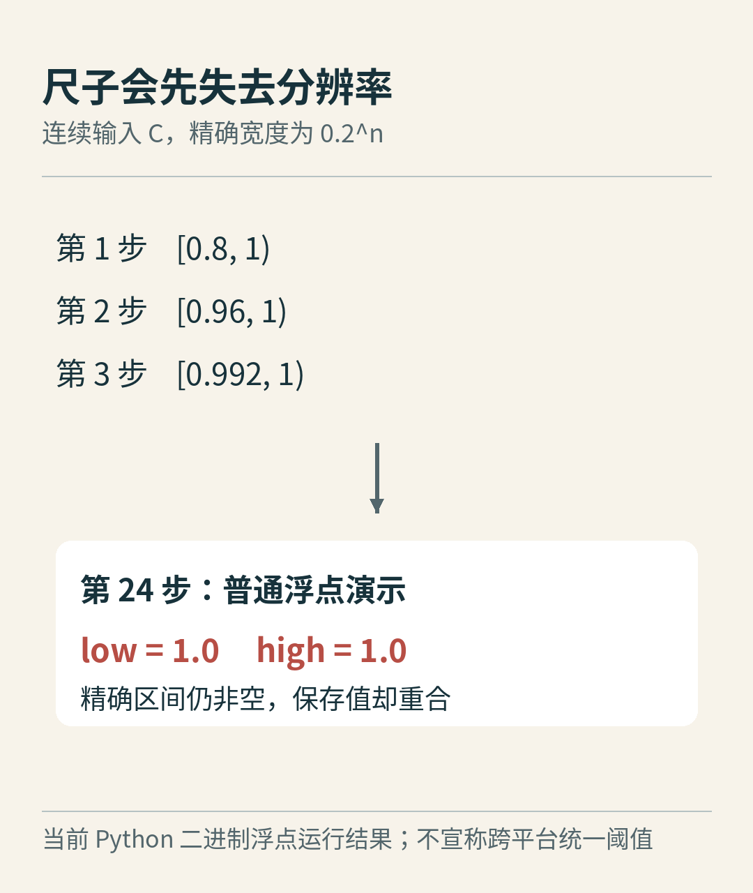

图9｜精确区间不断逼近 1，但不会在有限步里消失。普通浮点演示在第 24 步把两个端点舍入成同一个值；右侧是这一运行结果，不是所有浮点平台的统一阈值。

这时问题不是消息真的没有位置了，而是用来保存位置的尺子不够细。

实际可用的算术编码器不会把希望全部寄托在一个无限精确的小数上。它可以用有限宽度整数保存当前窗口，同时把已经确定的高位不断输出，再把剩余窗口放大。小数模型解释的是选择关系，整数实现处理的是怎样长期保留这种关系。

Project Nayuki 的教育实现就把有限状态位宽、整数区间更新和重归一化分开处理。下面用独立编写的 8 位小例子解释这些动作，不复刻某个文件格式，也不宣称与该项目逐字节兼容。[实现参考](https://github.com/nayuki/Reference-arithmetic-coding/blob/master/python/arithmeticcoding.py)

## 十、把连续数轴换成 256 个整数位置

现在刻意换一种端点约定：使用包含两端的整数区间 [low, high]。

8 位状态起初是 [0, 255]，共有 256 个整数位置。因此宽度是 high−low+1，而不是 high−low。前面连续区间用半开端点，这里用整数闭区间；两个写法不能混着套公式。

把 A、B、C 的频数写成 5、3、2，总数 T=10。相应累计频数边界是：

A：0 到 5。
B：5 到 8。
C：8 到 10。

若当前宽度为 R，所选符号的累计边界为 a、b，就用同一个旧 low 计算：

new_low = low + 向下取整(R×a/T)。
new_high = low + 向下取整(R×b/T) − 1。

末尾减 1，是因为 new_high 也包含在区间里。它使相邻区域刚好接上，不抢同一个整数位置。

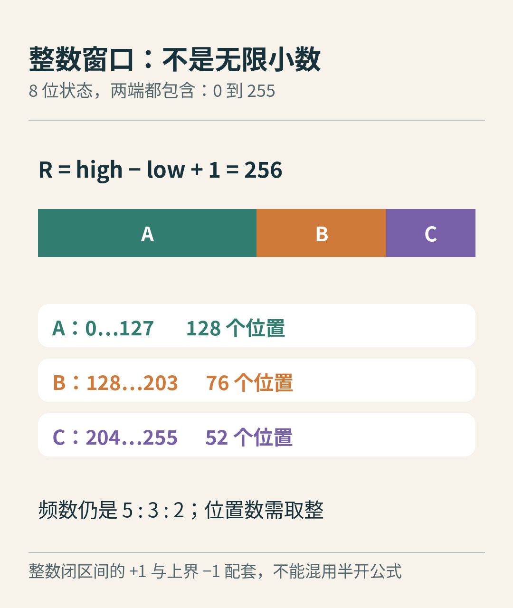

图10｜256 个整数位置按累计频数划分，A 得到 0…127，B 得到 128…203，C 得到 204…255。整数取整使份额近似于 50%、30%、20%，而不是声称完全相等。

以 B 为例：

new_low = 0 + ⌊256×5/10⌋ = 128。
new_high = 0 + ⌊256×8/10⌋ − 1 = 203。

B 得到 76 个位置，不是连续模型里恰好的 76.8 个。有限精度实现有取整误差，但只要双方使用相同规则，就能沿同样的整数分区解码。

还必须保证正频数的符号不会被挤成空区间。随附教学程序限制频数总和不超过全范围的四分之一，并在每个符号后做下面的重归一化。这是该程序采用的保守约束，不是所有实现统一的最大值。真的写 C 或 C++ 时，还需要让乘法中间结果装得进所选整数类型。

## 十一、确定的高位，先寄出去

把 0…255 写成 8 位二进制。0…127 都以 0 开头，128…255 都以 1 开头。

如果当前整个区间都在下半边，所有候选数的最高位都是 0。以后再取子区间，也不会改变这个已经确定的 0。于是可以输出它，再把剩余部分放大一倍。

如果整个区间都在上半边，最高位一定是 1。输出 1，减去 128 去掉这一位，再放大一倍。

这两个动作常记为 E1、E2。名字不重要，要抓住“整个区间都同意的位，才可以直接输出”。

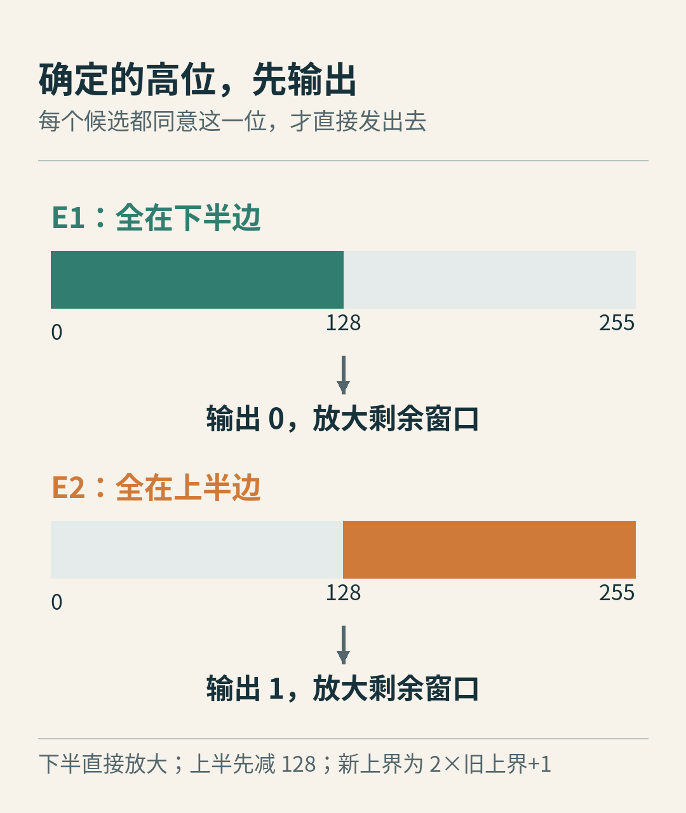

图11｜下半区输出 0，上半区输出 1，然后放大剩余窗口。这里画的是整数位置范围：上半区先减 128，再令 low×2、high×2+1；下半区直接做这一步放大。

为什么上界放大要写 2×high+1？因为原先一个整数位置代表一小格。放大后，一个旧位置要覆盖两个新位置：2×位置和 2×位置+1。下界取最左端，上界要保住最右端。

BAC 的第一步 B 得到 [128,203]，全在上半边。因此输出 1，然后：

low = 2×(128−128) = 0。
high = 2×(203−128)+1 = 151。

第二步 A 在当前 [0,151] 中占 [0,75]，全在下半边。输出 0，再放大回 [0,151]。

已经发出的位是 10。注意，这不等于“B 永远编码成 1，A 永远编码成 0”。换了前文，当前区间就会不同，同一个符号可能立刻输出几位，也可能暂时一位不输出。

## 十二、最难缠的是跨在中间的区间

第三步 C 把整数区间缩到 [121,151]。它跨过 128：左边最高位是 0，右边最高位是 1。直接输出哪一个都不安全。

可是它又完全落在中间两份四分之一区域里，也就是 [64,191]。这意味着我们还可以放大，只是要把一部分输出决定暂时欠着。

这一动作通常记为 E3：先减去 64，再放大一倍。于是：

[121,151] → [114,175]。

同时把“待定数”加 1，不立即输出新比特。新范围仍在中间半区，再做一次：

[114,175] → [100,223]。

待定数变成 2，区间变宽了，输出仍然是 10。

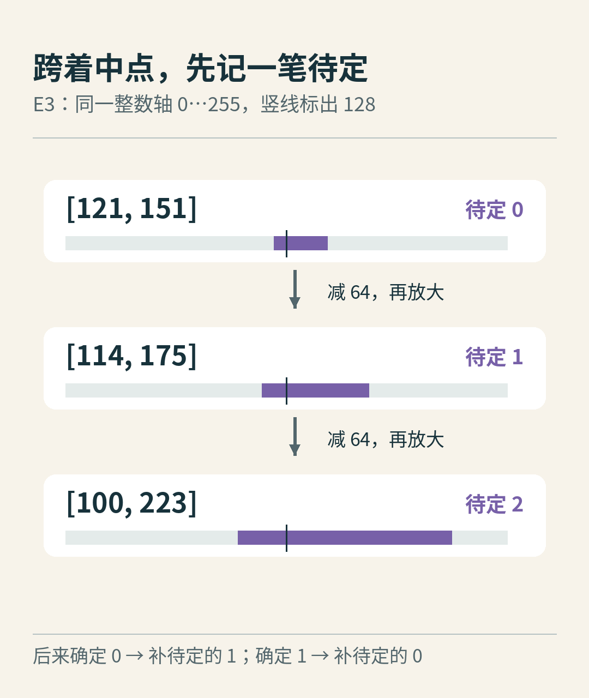

图12｜跨过中点时不能猜最高位。E3 对中间半区换坐标，区间被放大；两次缩放对应两笔待定输出，而不是删掉两个已经确定的信息位。

为什么以后能把这些位补回来？看一次 E3 的逆变换。设变换后的坐标为 y，那么变换前的坐标是 1/4+y/2。

- 若以后确定 y 在下半边，它的第一位是 0，原坐标便在 [1/4,1/2)，开头是 01。
- 若以后确定 y 在上半边，它的第一位是 1，原坐标便在 [1/2,3/4)，开头是 10。

所以这次待定的位，会是最终确定那一位的相反值：确定 0，就跟一个 1；确定 1，就跟一个 0。连续发生多次 E3，就积累相应数量的反位。

这不是猜测未来，而是把尚未确定的两种可能，以一种能在以后还原的形式保存下来。这里的 underflow 是算术编码对这类待定高位情形的常用称呼，不要把它与前面浮点数变得太小或端点重合的现象混为一谈。

## 十三、把整数版 BAC 收个尾

此时三个符号已经处理完，输出是 10，整数区间是 [100,223]，另有两笔待定。

教学程序采用一个明确的收尾规则：先再增加一笔待定；如果 low 小于 64，输出 0 并补所有待定的 1，否则输出 1 并补所有待定的 0。解码时按事先约定的消息长度停止，位流耗尽后只为内部读入补 0，不把补零当成额外传输内容。

为什么这个选择站得住？每轮重归一化结束后，区间跨越中点，而且不完全困在中间半区。若 low<64，区间至少覆盖第二个四分之一区域，可以用 01… 来收尾；否则它覆盖第三个四分之一区域，可以用 10… 来收尾。增加的那笔待定负责这两位中的第二位，先前欠下的反位按原规则一起结清。

本例 low=100，因此最后输出 1，再补三个 0，最终是 101000。

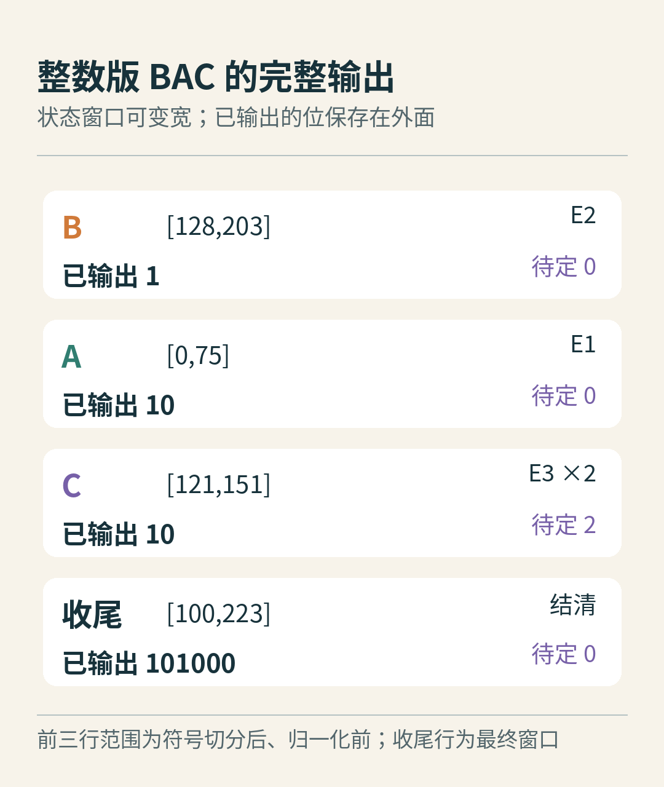

图13｜8 位整数编码器的完整轨迹。B 输出 1，A 输出 0，C 产生两次待定，收尾输出 1000。它与本例精确小格的六位结果碰巧相同，不表示两种方案对任意消息都产生相同比特串。

整数解码器也维护 low、high，并从输入流中读入一个当前 code 值。它用相同的累计频数和取整规则判断 code 属于哪一段；遇到 E1、E2、E3，就同步换坐标，并补读下一位。两边操作对称，才不会在长消息中慢慢走散。

随附程序分别实现了精确分数版本和有限整数状态版本。它们接受消息与模型，输出编码；对应解码函数还需要长度，或一份包含 EOF 的模型。它们不是生产压缩库：没有标准文件头、校验码、资源防护或格式互操作承诺，不能拿来直接解任意网上的压缩文件。

## 十四、好的预测，与正确的编码，是两件事

还记得 5/8 在一张表里读成 BAC，在另一张表里读成 BCB 吗？这给出两个不同的评价问题。

第一，能否还原。双方必须共享符号顺序、频数、取整、更新时机和结束规则。

第二，是否压得好。双方完全同步，却都把现实里很常见的符号分到很窄的区域，仍然可以正确还原，只是码可能很长。

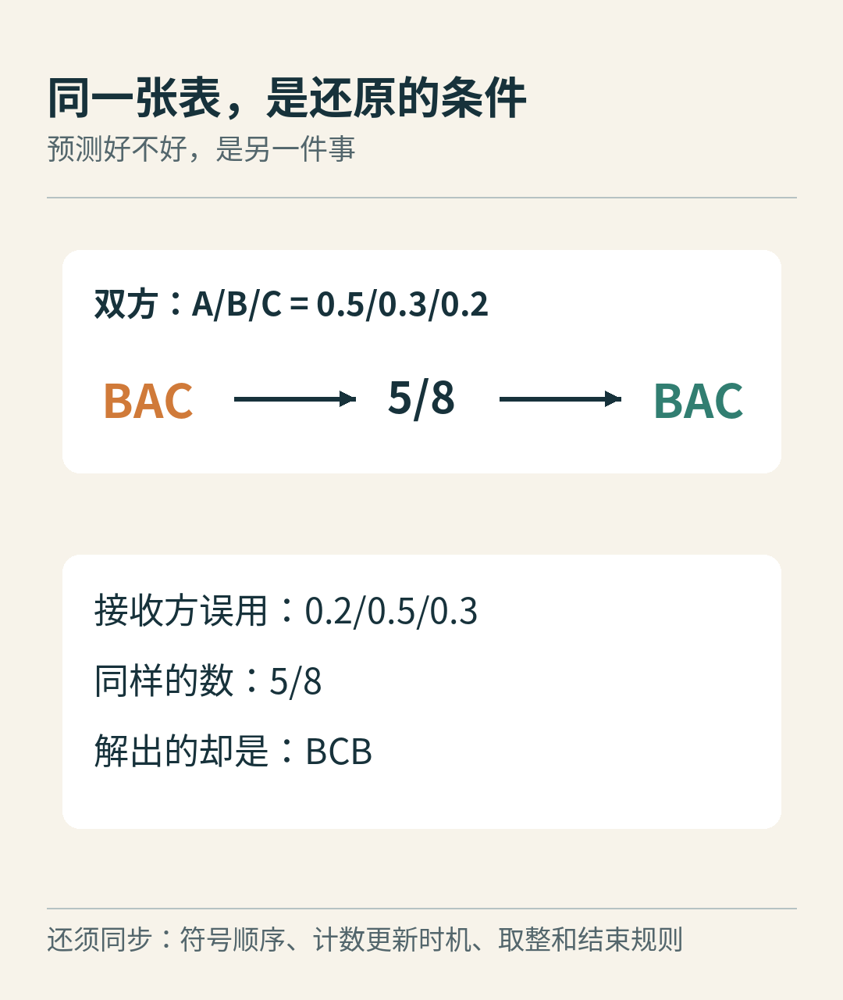

图14｜同一模型让双方同步，不等于模型预测得好。上方是一致模型的编码与解码；下方只改变接收方的概率表，5/8 就被误读成 BCB。

模型可以一直固定，也可以随着已处理的内容更新。例如双方从相同初始计数开始，每读完一个符号，就给这个符号的计数加一。发送方在编码后加，接收方在解码后加；下一轮就仍有同一张表。若一边先加再处理，另一边处理完再加，即使最终累计次数一样，中途也可能分区不同。

Project Nayuki 的项目说明分别列出了静态频数和自适应频数示例，并明确要求编码、解码在同一位置使用同一张表；零频数符号不能直接编码。这是理解实现时很有用的一条边界。[项目说明](https://www.nayuki.io/page/reference-arithmetic-coding)

至于怎样预测下一符号，既可以看总频率，也可以看已经出现的上下文。这属于模型的工作。算术编码器负责把模型给出的区间份额转成位流，不会仅凭“用了算术编码”就自动理解文本、图像或游戏状态。

## 十五、别把漂亮的载荷位数当成完整文件大小

现在可以给最开始那个问题一个不带魔法的答案。

BAC 之所以能对应一个小数，不是因为小数天然装得下无限信息，而是因为双方已经共享一套逐步切分的规则；最后的区域记录了这条选择路径。定位得越细，需要给出的比特就越多。

进入文件或网络协议，还要把那些“双方已经知道”的条件安排好：模型是预设还是随包发送？消息怎么结束？载荷如何分帧？补零和字节填充怎么解释？数据损坏后怎样发现？不是所有格式都要把这些逐项写成独立字段，但不能指望它们自动成立。


图15｜一份完整格式可能包含模型约定、长度或 EOF 规则、算术编码载荷、对齐及完整性机制。图示是责任清单，不是某个真实标准的字节布局；各框不按占用空间比例绘制。

压缩也不等于加密。拿到规则与位流的人，就可以按规则解码。一个比特出错还可能让后面的路径持续跑偏；能压得紧，与能抵抗篡改或传输错误，没有直接等号。

如果只记住一件事，不妨记住“整条消息共用一份定位精度”。它让概率可以沿消息逐步积累，而不必每到一个符号就把费用四舍五入成独立的整数位数。

## 留一个可以自己算的变化

把 BAC 换成 ABC，概率表不变。

你已经可以预测一半答案：两条消息各有一个 A、一个 B、一个 C，所以在这个固定独立模型里，最终宽度都等于 0.5×0.3×0.2=0.03。

但它们不会得到同一个区间。ABC 先选 A，得到 [0,0.5)；再选 B，得到 [0.25,0.4)；最后选 C，得到 [0.37,0.4)。BAC 则仍是 [0.62,0.65)。

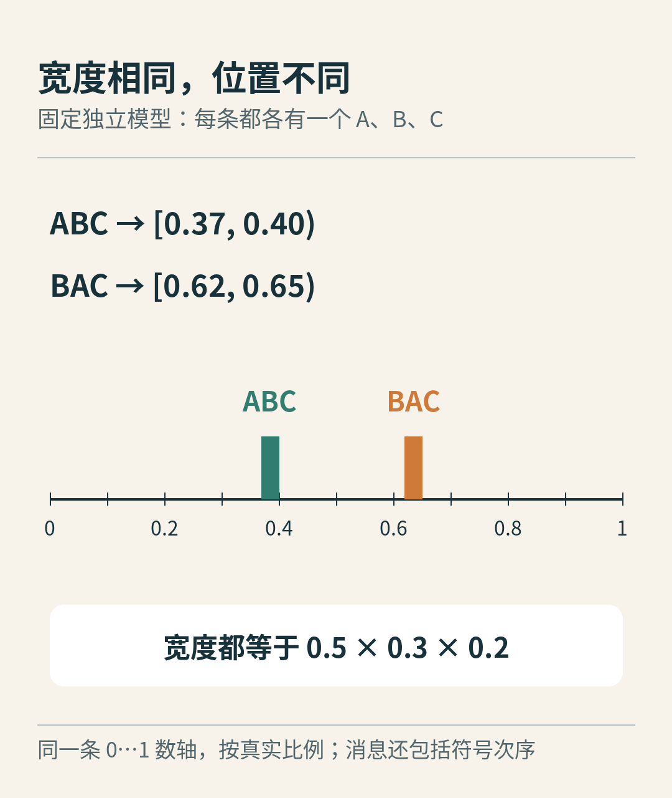

图16｜相同的符号计数可以得到相同宽度，却不代表相同位置。ABC 与 BAC 的路径次序不同，分别落在 [0.37,0.4) 与 [0.62,0.65)；数轴按真实比例绘制。

这区分了两件常被混在一起的事：概率乘积可以只由计数决定，消息身份却还包括顺序。算术编码要保住的不只是“每个字母出现几次”，而是每一步到底选择了哪一段。

### 实现与阅读说明

文中推导、BAC／ABC 算例、边界反例、教学代码和机制图为本篇独立编写，使用 AI 辅助。配图全部是程序绘制的原创解释图，没有历史照片、原论文图版或真实压缩产品测试画面。

延伸实现可读 [Project Nayuki 的项目介绍](https://www.nayuki.io/page/reference-arithmetic-coding) 与 [Python 算术编码核心](https://github.com/nayuki/Reference-arithmetic-coding/blob/master/python/arithmeticcoding.py)。前者页面标注最近更新为 2018-06-28；这不是算术编码的发明日期。本文讲机制，不对算法最早发明者或某篇历史论文作优先权归因。

## 短版正文

## 三个字母，为什么能变成一个小数？

给 A、B、C 约定概率 0.5、0.3、0.2，把 [0,1) 按这个比例切成三段。

要编码 BAC，先选 B 的 [0.5,0.8)；在里面按同样比例再切，选 A 得到 [0.5,0.65)；再选最后 20% 的 C，得到 [0.62,0.65)。

0.625 落在这里。接收者用同一张表，先认出 B，再把 B 区间拉伸回 [0,1)，继续认出 A、C。整条消息不再是三个独立码字，而是一条逐步缩小候选区域的路径。

但“一个小数”不是免费容量。区域越窄，定位越精确，通常就要更多比特。六位二进制前缀 101000 对应 [0.625,0.640625)，能完整放进 BAC 的区域；只有一个点落进去，还不能保证短前缀覆盖的整块区域也放得下。

另外，双方必须共享模型和结束规则。没有长度或 EOF，0 既可以解成 A，也可以继续解成 AA、AAA……

实际实现也不会无限堆小数位。有限整数编码器会把已经确定的高位输出，把剩下的窗口重新放大；跨在中点、暂时不能决定的位，则延后结算。概率模型决定怎么分，算术编码负责把分区选择写成位流。

这不是“所有消息都能变短”，更不是加密。它只是让一整条消息共用定位精度，避免每个符号都必须单独付出整数位数。

长文用 BAC 走完编码、解码、终止与有限整数实现，并配有 16 张原创机制图及可复算的教学代码。

## 完整可运行教学代码

下面是本文所用的完整原创教学模型 arithmetic_demo.py。将代码保存为同名文件，在已有 Python 3 环境中运行 python arithmetic_demo.py；只使用标准库，不需要安装依赖。输出为教学计算和测试结果，不是第三方文件格式兼容性或性能测评。

```python
#!/usr/bin/env python3
"""Original, standard-library-only teaching arithmetic coders.
Not a standardized or production-ready compressed file format.
Exact coder uses half-open Fractions. Integer coder uses inclusive bounds.
"""
from fractions import Fraction as F
from itertools import product
import json, random, math
from pathlib import Path

BASE = [('A',5),('B',3),('C',2)]

def validate(model):
    if not model or len({s for s,c in model}) != len(model):
        raise ValueError('Model must have distinct symbols')
    if any(type(c) is not int or c <= 0 for s,c in model):
        raise ValueError('Every count must be a positive integer')
    return sum(c for s,c in model)

def cumulative(model):
    total=validate(model); acc=0; result={}
    for s,c in model:
        result[s]=(acc,acc+c); acc+=c
    return result,total

def exact_encode(message,model=BASE):
    cum,total=cumulative(model); lo,hi=F(0),F(1); trace=[]
    for s in message:
        if s not in cum: raise ValueError('Symbol absent from model')
        a,b=cum[s]; width=hi-lo; old=(lo,hi)
        lo,hi=lo+width*F(a,total),lo+width*F(b,total)
        trace.append({'symbol':s,'before':[str(x) for x in old],
                      'after':[str(lo),str(hi)],'width':str(hi-lo)})
    return lo,hi,trace

def exact_decode(x,length,model=BASE):
    if not F(0)<=x<F(1) or length<0: raise ValueError('Out of range')
    cum,total=cumulative(model); out=[]; trace=[]
    for _ in range(length):
        for s,(a,b) in cum.items():
            left,right=F(a,total),F(b,total)
            if left<=x<right:
                old=x; x=(x-left)/(right-left); out.append(s)
                trace.append({'symbol':s,'normalized_before':str(old),
                              'normalized_after':str(x)})
                break
        else: raise AssertionError('No partition matched')
    return ''.join(out),trace

def safe_prefix(lo,hi):
    """Shortest dyadic CELL fully inside [lo,hi), not shortest point code."""
    if not F(0)<=lo<hi<=F(1): raise ValueError('Bad interval')
    m=0
    while True:
        scale=1<<m
        k=(lo.numerator*scale+lo.denominator-1)//lo.denominator
        if F(k+1,scale)<=hi:
            return (format(k,f'0{m}b') if m else '',F(k,scale),F(k+1,scale))
        m+=1

def integer_encode(message,model=BASE,bits=12):
    cum,total=cumulative(model); full=1<<bits; half=full//2; q=full//4
    if bits<3 or total>q: raise ValueError('Model too large for state width')
    lo,hi=0,full-1; pending=0; out=[]; trace=[]; stats={'E1':0,'E2':0,'E3':0}
    def emit(b):
        nonlocal pending
        out.append(b); out.extend([1-b]*pending); pending=0
    for s in message:
        if s not in cum: raise ValueError('Symbol absent from model')
        a,b=cum[s]; width=hi-lo+1
        hi=lo+width*b//total-1; lo=lo+width*a//total
        assert 0<=lo<=hi<full
        row={'symbol':s,'subdivision':[lo,hi],'events':[]}
        while True:
            old=(lo,hi)
            if hi<half:
                emit(0); kind='E1'
            elif lo>=half:
                emit(1); lo-=half; hi-=half; kind='E2'
            elif lo>=q and hi<3*q:
                pending+=1; lo-=q; hi-=q; kind='E3'
            else: break
            lo*=2; hi=hi*2+1; stats[kind]+=1
            row['events'].append({'kind':kind,'before':old,'after':[lo,hi],
                                  'emitted_so_far':''.join(map(str,out)),
                                  'pending':pending})
        assert 0<=lo<=hi<full
        row['normalized']=[lo,hi];trace.append(row)
    pending+=1
    emit(0 if lo<q else 1)
    return ''.join(map(str,out)),trace,stats

def integer_decode(stream,length=None,model=BASE,bits=12,eof=None,max_symbols=100000):
    cum,total=cumulative(model);full=1<<bits;half=full//2;q=full//4
    if bits<3 or total>q: raise ValueError('Model too large')
    if any(x not in '01' for x in stream): raise ValueError('Not bits')
    if length is None and eof is None: raise ValueError('Missing termination rule')
    if length is not None and length<0: raise ValueError('Bad length')
    pos=0
    def read():
        nonlocal pos
        b=int(stream[pos]) if pos<len(stream) else 0;pos+=1;return b
    lo,hi,code=0,full-1,0
    for _ in range(bits):code=code*2+read()
    out=[]
    for _ in range(length if length is not None else max_symbols):
        width=hi-lo+1; value=((code-lo+1)*total-1)//width
        assert 0<=value<total
        s=next(s for s,(a,b) in cum.items() if a<=value<b)
        if s==eof:return ''.join(out)
        out.append(s);a,b=cum[s]
        hi=lo+width*b//total-1;lo=lo+width*a//total
        while True:
            if hi<half:pass
            elif lo>=half:lo-=half;hi-=half;code-=half
            elif lo>=q and hi<3*q:lo-=q;hi-=q;code-=q
            else:break
            lo*=2;hi=hi*2+1;code=code*2+read()
        assert lo<=code<=hi
    if length is None:raise ValueError('EOF not found within bound')
    return ''.join(out)

def run():
    results={};lo,hi,trace=exact_encode('BAC');prefix,p,q=safe_prefix(lo,hi)
    decoded,dtrace=exact_decode(F(5,8),3)
    assert (lo,hi,prefix,decoded)==(F(31,50),F(13,20),'101000','BAC')
    al,ah,_=exact_encode('ABC');assert (al,ah)==(F(37,100),F(2,5))
    results['ABC']={'interval':[str(al),str(ah)],'width':str(ah-al)}
    results['main']={'interval':[str(lo),str(hi)],'trace':trace,
        'point':'5/8','decode_trace':dtrace,'safe_prefix':prefix,
        'prefix_cell':[str(p),str(q)],'probability':str(hi-lo),
        'ideal_bits':-math.log2(float(hi-lo)),'huffman_example_bits':'10011'}
    n=0
    for length in range(7):
        for tup in product('ABC',repeat=length):
            msg=''.join(tup);l,h,_=exact_encode(msg);code,a,b=safe_prefix(l,h)
            assert exact_decode(a,length)[0]==msg
            assert l<=a<b<=h
            if code:
                previous=1<<(len(code)-1); k=(l.numerator*previous+l.denominator-1)//l.denominator
                assert F(k+1,previous)>h
            n+=1
    results['exact_exhaustive']={'cases':n,'lengths':'0..6','status':'passed'}
    n=0;aggregate={'E1':0,'E2':0,'E3':0}
    for length in range(8):
        for tup in product('ABC',repeat=length):
            msg=''.join(tup);code,_,stats=integer_encode(msg,bits=8)
            assert integer_decode(code,len(msg),bits=8)==msg
            for k in aggregate:aggregate[k]+=stats[k]
            n+=1
    results['integer_exhaustive']={'cases':n,'lengths':'0..7','state_bits':8,
        'events':aggregate,'status':'passed'}
    rng=random.Random(20261023);n=0
    for model in [BASE,[('A',9),('B',1)],[('A',1),('B',1),('C',1)], [('A',61),('B',2),('C',1)]]:
        for i in range(200):
            msg=''.join(rng.choices([s for s,c in model],weights=[c for s,c in model],k=rng.randrange(1,501)))
            code,_,stats=integer_encode(msg,model,bits=12)
            assert integer_decode(code,len(msg),model,bits=12)==msg;n+=1
    results['integer_random']={'cases':n,'lengths':'1..500','seed':20261023,
        'models':4,'state_bits':12,'status':'passed'}
    eof_model=[('A',5),('B',3),('C',1),('#',1)];n=0
    for length in range(6):
        for tup in product('ABC',repeat=length):
            msg=''.join(tup);code,_,_=integer_encode(msg+'#',eof_model,bits=8)
            assert integer_decode(code,model=eof_model,bits=8,eof='#')==msg;n+=1
    results['eof_exhaustive']={'cases':n,'lengths':'0..5','model':eof_model,'status':'passed'}
    assert exact_decode(F(1,2),1)[0]=='B'
    assert exact_decode(F(4,5),1)[0]=='C'
    assert exact_decode(F(13,20),3)[0]=='BBA'
    assert exact_decode(F(5,8),3,[('A',2),('B',5),('C',3)])[0]=='BCB'
    assert exact_decode(F(0),1)[0]=='A' and exact_decode(F(0),3)[0]=='AAA'
    results['boundaries']={'half':'B','four_fifths':'C','BAC_excluded_right_endpoint':'BBA',
        'wrong_model_point_5_8':'BCB','length_ambiguity':['A','AA','AAA']}
    bad=0
    for action in [lambda:exact_decode(F(1),1),lambda:exact_encode('D'),
                   lambda:exact_encode('A',[('A',0),('B',1)]),
                   lambda:integer_encode('A',[('A',100)],bits=8),
                   lambda:integer_decode('101')]:
        try:action()
        except ValueError:bad+=1
        else:raise AssertionError('Expected rejection')
    results['invalid_inputs_rejected']=bad
    l,h,_=exact_encode('A'*10,[('A',9),('B',1)]);b,a,z=safe_prefix(l,h)
    assert b=='00' and h==F(3486784401,10000000000)
    results['ten_A']={'probability':str(h),'prefix':b,'cell':[str(a),str(z)],
        'ideal_bits':-math.log2(float(h)),'huffman_bits':10}
    results['integer_BAC_8']={}
    code,t,s=integer_encode('BAC',bits=8)
    results['integer_BAC_8']={'code':code,'trace':t,'events':s}
    # IEEE binary64 float demonstration, not used in either correct coder.
    l,h=0.0,1.0;collapse=None
    for i in range(1,200):
        w=h-l;l,h=l+w*.8,h
        if l==h:collapse=i;break
    assert collapse is not None
    results['naive_float_C_repeat']={'collapse_at_symbol':collapse,'low':l,'high':h,
        'meaning':'Both endpoints round to 1.0; exact interval remains nonempty.'}
    results['bit_bound_note']='Shortest contained dyadic cell length m satisfies -log2(width) <= m < -log2(width)+2.'
    results['status']='All assertions completed; tests are bounded examples, not a production proof.'
    path=Path(__file__).with_name('calculation-results.json');path.write_text(json.dumps(results,ensure_ascii=False,indent=2)+'\n')
    print(json.dumps(results,ensure_ascii=False,indent=2))

if __name__=='__main__':run()
```

## 参考实现的许可通知

下列通知属于文中参考的 Nayuki 项目，保留其版权、许可与免责原文；它不额外为本文原创图文授予开放许可。

```text
REFERENCE SOURCE LICENSE ONLY

Reference source: Project Nayuki, Reference arithmetic coding
https://github.com/nayuki/Reference-arithmetic-coding

The article's original teaching code and diagrams do not copy project files.
The following complete notice accompanies the cited reference and is retained
for any future authorized reuse of substantial portions of that software.
It does not assign a license to the article's independently created material.

Copyright © 2026 Project Nayuki. (MIT License)

Permission is hereby granted, free of charge, to any person obtaining a copy
of this software and associated documentation files (the "Software"), to deal
in the Software without restriction, including without limitation the rights
to use, copy, modify, merge, publish, distribute, sublicense, and/or sell
copies of the Software, and to permit persons to whom the Software is
furnished to do so, subject to the following conditions:

The above copyright notice and this permission notice shall be included in
all copies or substantial portions of the Software.

The Software is provided "as is", without warranty of any kind, express or
implied, including but not limited to the warranties of merchantability,
fitness for a particular purpose and noninfringement. In no event shall the
authors or copyright holders be liable for any claim, damages or other
liability, whether in an action of contract, tort or otherwise, arising from,
out of or in connection with the Software or the use or other dealings in the
Software.
```

---

[来源、AI 辅助与许可范围](sources.md)
