# 写得像公式，还要跑得像手写：Backus 团队面对的那道难题

假设你在计算一个工程问题：公式你会推，数据也齐了，真正卡住你的却是“把它变成机器能执行的一串步骤”。你花几天安排地址、跳转和临时量；改一处公式，又得检查一串细节。现在有人说：把公式交给程序，让程序替你安排这些事。

你会问什么？“能看懂我的公式吗？”是一问。“会不会跑得很慢？”是另一问。第二问不是保守，而是实际成本：省了人的劳动，如果每次计算都多耗很多机器时间，账未必合算。

Fortran 的早期故事值得看的，正是这两问如何被同时处理。这里不列语言年表，也不重讲现代浏览器里运行 Fortran 的新闻；我们沿几个小实验，理解早期编译团队为什么需要做的不止是把单词翻译成指令。

## 1. 先把人和日期放回画面

IBM 的历史介绍把1957年作为 Fortran 的商用推出年份，并指出这是一支团队的工作。[IBM：Fortran](https://www.ibm.com/history/fortran)

Backus 后来回忆：1953年末提出项目，确切日期并不确定；1957年4月开始分发系统。不能把提议、开发和交付压成一个“发明日”。下面时间线是事实的原创整理，不是当年海报。[Backus，1981正式收录版，pp.27、36、40](https://softwarepreservation.computerhistory.org/FORTRAN/paper/p25-backus.pdf)


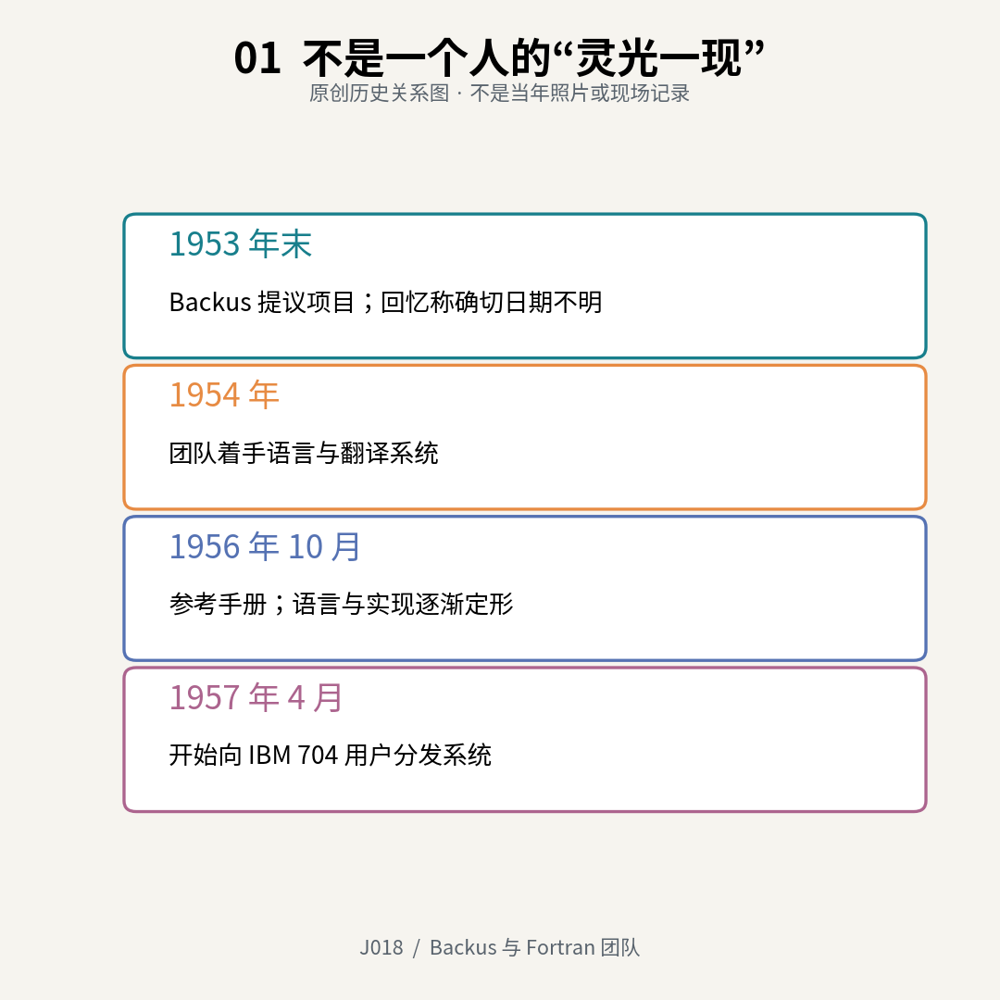

图1｜四个时间锚点，不把1953年的提议、1954年的开发和1957年的分发混作同一件事。

“第一种高级语言”也不是本文要争的冠军称号。不同资料对“高级”“代数式”“广泛使用”的定义并不相同。更具体的问题是：怎样让使用者相信，由这种语言生成的代码值得在真实机器上运行？

## 2. 编译快，与编译出来的程序快，是两回事

编译可以理解为“先安排一次执行计划”。安排计划花的时间，与照计划做事花的时间，应该记在不同的账本上。

1957年团队论文给出一项个案：47条源语句，经6分钟编译生成约1000条指令；原稿有错误，使用者定位后修改并重编译。作者自己提醒，挑选的单个案例并不能很好代表整体价值。这不是“47条=1000条”的普遍换算率，也不是“自动编程消灭了错误”的证据。[团队论文，1957，p.188](https://archive.computerhistory.org/resources/text/Fortran/102663113.05.01.acc.pdf)


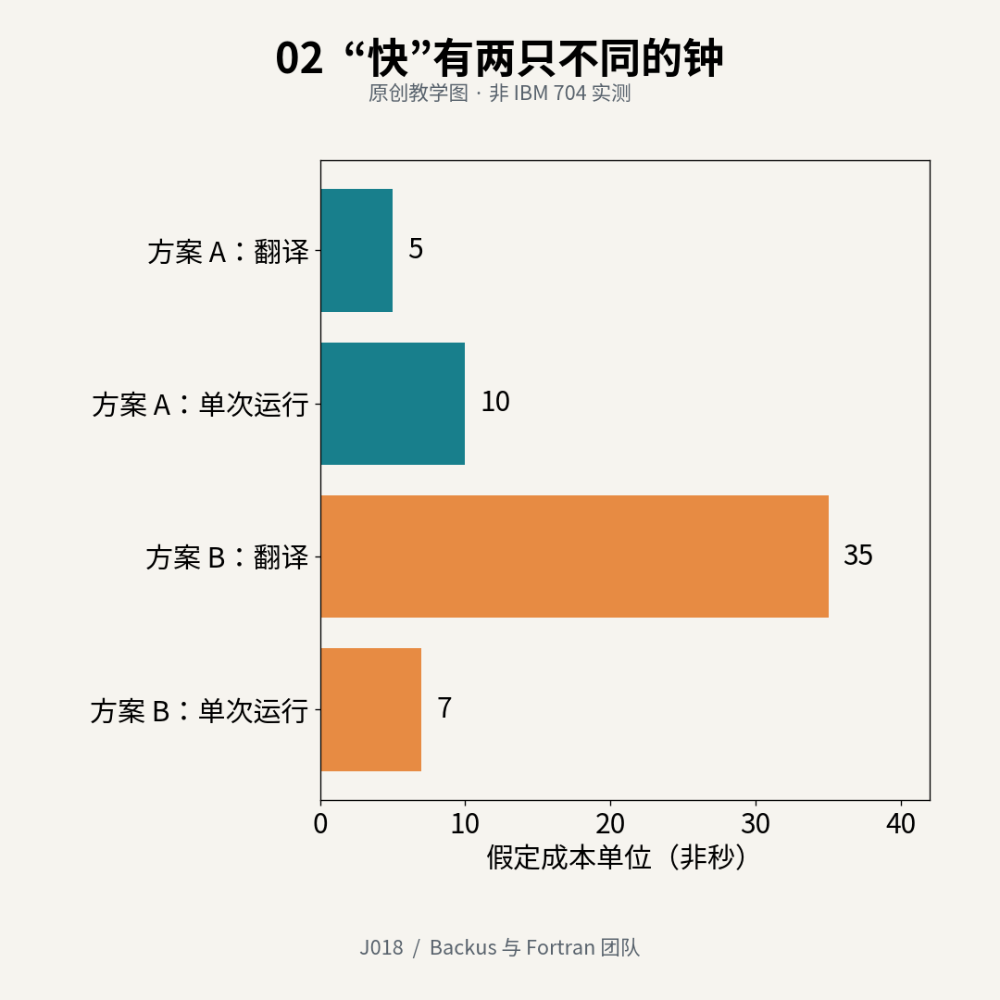

图2｜假设B翻译贵30单位、每次运行便宜3单位；比较总成本前必须先问会运行几次。

图2故意不用秒：我们不知道你的工作负载，也没有运行 IBM 704。A方案花5单位翻译，单次运行10；B方案花35单位翻译，单次运行7。B在编译阶段更慢，在执行阶段更快。只盯编译按钮转了多久，可能把真正的收益看反。

再加一项人的成本：理解问题、编写、检查和修改。源语言使问题更容易表达，是一种收益；生成代码少做无用功，是另一种收益。它们会相互影响，却不是同一个指标。

## 3. 团队不是“主角加几名助手”

Backus 的一手回忆把职责写得很具体：Sheridan处理表达式；Nelson与Ziller负责循环及下标；Haibt处理第4段的流程和频率分析；Best负责第5段的索引寄存器分配。后续调试还有Goldberg、Sayre等人的参与。图3仅选几条技术线，不是完整名单。[Backus，pp.34–36](https://softwarepreservation.computerhistory.org/FORTRAN/paper/p25-backus.pdf)


图3｜图只摘四类职责，不声称穷尽全部成员；这些阶段是协作接口，不是英雄排行榜。

一个阶段不能只把“我做完了”传给下一个阶段。它要交出能继续处理的信息：这个临时量是什么、这个循环怎样走、哪个地址还会被用到。由此可以理解一个常见误解：读源程序一遍，不等于编译器只做了一轮工作。后续阶段仍可能在已经整理好的内部表示上继续分析。

接下来四个实验，是我们自己写的极简模型。它们解释“编译时多分析一点，运行时能少做什么”，不复原历史编译器的全部算法。

## 4. 第一个实验：别把同一件事算三次

设要算 `(a+b)*(a+b)+(a+b)`。用整数 a=2、b=3，三个括号都等于5，结果为30。原样执行时，括号内做了3次加法，最后还要加一次；总计4次加法、1次乘法。

如果给 `a+b` 起个名字 t，改成 `t*t+t`，算 t 只加一次，最后再加一次：2次加法、1次乘法。


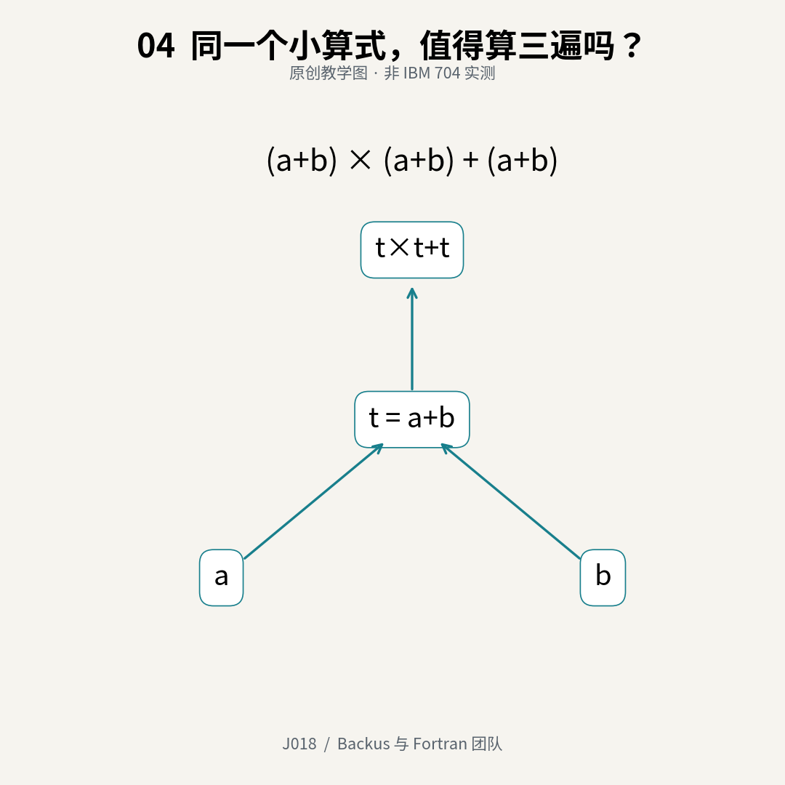

图4｜独立教学表达式：给重复的 a+b 起临时名字t。箭头表示值依赖，不是1957机器指令。

这叫复用共同的子结果。注意“共同”不只意味着字符看上去一样，还意味着值在这里确实一样。若中间修改了 a；若表达式调用会改变状态的函数；若读的是每次可能变化的外部输入，都不能只看文字便合并。

本文的 `expression` 函数只接收整数，并且中间没有赋值、副作用或外部读取，所以这个小例子的等价性可以直接用代数解释。Python整数没有固定字宽溢出；这也是模型条件，不能悄悄换成所有机器整数都适用。


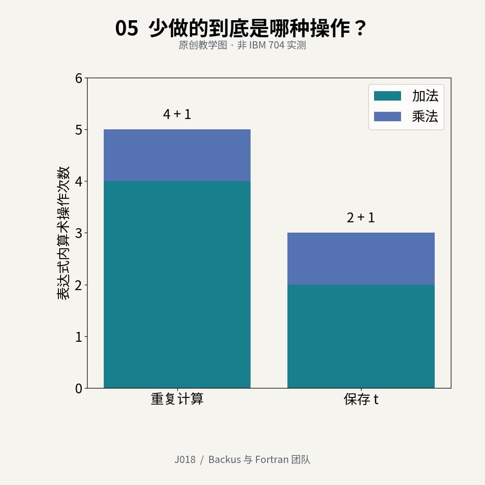

图5｜真实模型计数：加法4→2，乘法都为1；未计临时存取，因此不是总耗时结论。

这里还藏着另一笔账：保存 t 可能需要临时存储，取 t 也可能有成本。图5只数指定的加法与乘法，不把减少2次加法包装成“快了40%”。少做算术是优化机会，不是不用测量就能得到的速度比。

这与1957论文展示的想法有历史联系：其算式例子明确讨论避免重复求值以及用乘法处理平方。但本文用的是另一个自写表达式，不复制原页公式图，也不声称实现了 Sheridan 的完整翻译器。[团队论文，p.189](https://archive.computerhistory.org/resources/text/Fortran/102663113.05.01.acc.pdf)

## 5. 第二个实验：数组不是凭名字就能找到

`A[i,j]`对人来说是二维表格里的一个位置；对机器来说，它必须落到一个地址上。先约定一个玩具布局：3行4列，按列存放，每个元素占1个字，首地址100，i与j都从0起算。

那么地址就是 `100 + j*3 + i`。先装完第0列的三行，再装第1列。图6把所有12个地址直接写出来；“按列”是这次模型的明示约定，不要求你记住某种现代语言的默认布局。


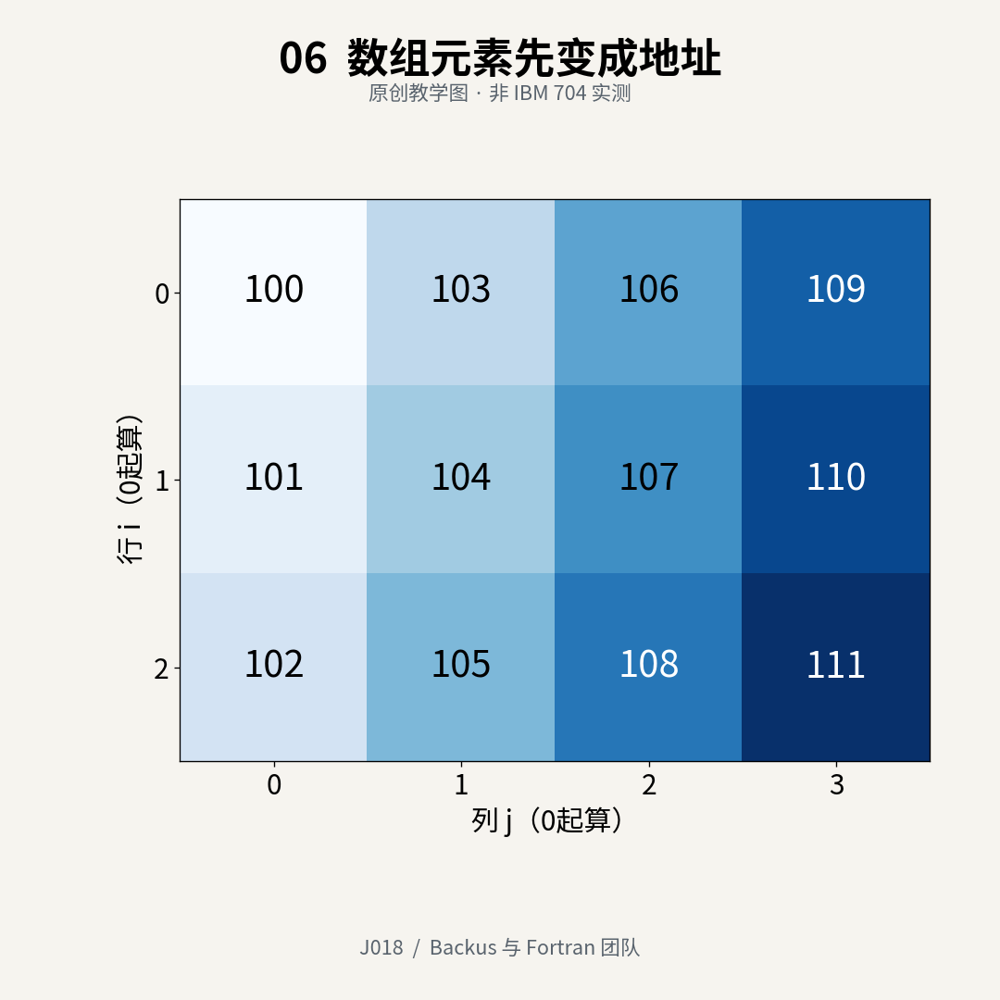

图6｜3行4列、列优先、每元素1字，首地址100：地址=100+3j+i；不是IBM原机内存截图。

如果访问顺序恰好是 j在外层、i在内层，地址序列就是100、101、102……111。第一步定好地址，后面每次加1就行，没必要对每个元素都重算 `j*3+i`。

这类思路把“每次重新组合公式”变成“沿着已有结果前进一步”。在二维场景里，编译器仍要知道循环边界、下标怎样改变以及有没有别的语句破坏这种规律。历史回忆提到的下标优化问题，正是这种从规则变化中省去地址计算的方向，而非简单删除乘号。[Backus，p.34](https://softwarepreservation.computerhistory.org/FORTRAN/paper/p25-backus.pdf)


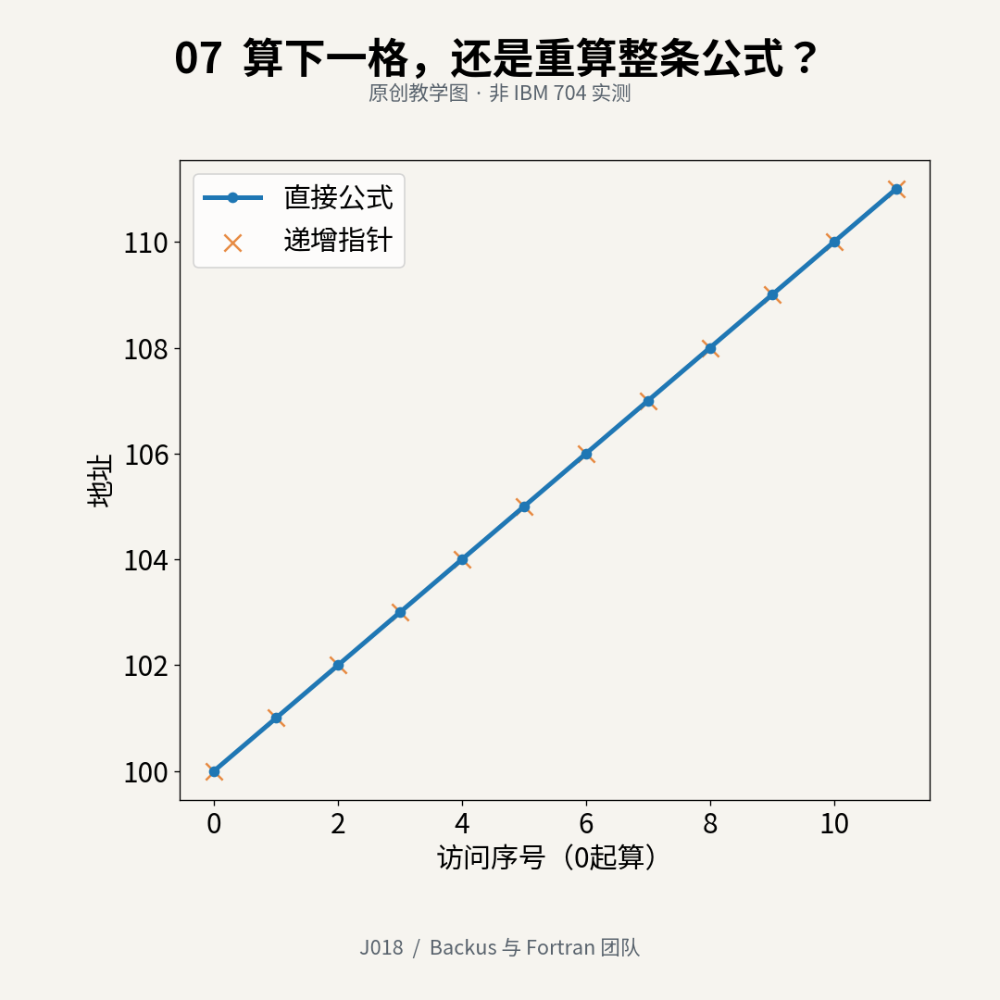

图7｜实际生成的12个地址完全重合。每次p+=1成立，是因为这里严格按列内逐行的顺序访问。

`addresses` 同时生成直接公式和递增指针两套结果，逐个地址比对。在这里，代码还会对最后一次访问执行一次无用的 `p += 1`，所以本文没有声称该Python版本已经达到最少指令数。保留这一步使循环结构更直白，也提醒我们区分“证明等价的教学实现”和“最终机器代码”。

现在破坏条件：访问索引变成0、2、1、3。正确地址应为100、102、101、103。若还傻傻地加1，第二次就错了。


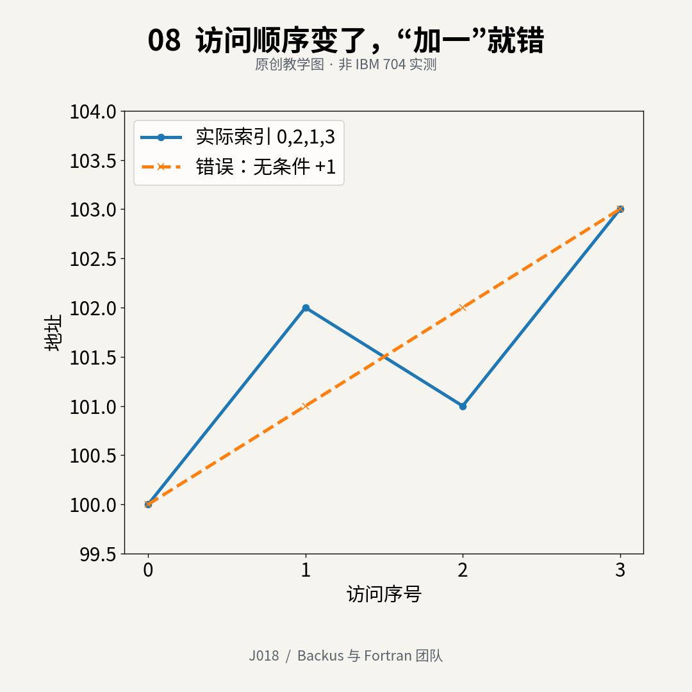

图8｜真实反例：第二次应访问102，却被天真的递增改成101；优化首先需要证明访问规律。

这个反例不是说递增法没用，而是说它需要证据。优化器如果无法证明规律，应该保留通用计算，或者生成带检查的适用路径。语言层面的限制、编译器能收集的信息与生成代码的质量，会互相牵制。

## 6. 第三个实验：同一行源代码，不一定同样“热”

有的初始化只做一次，有的循环体做一万次。对它们各省一条指令，收益完全不同。为了让这个概念看得见，图9画一个明确执行10轮的教学循环：入口1次、条件判断11次、循环体10次、出口1次。


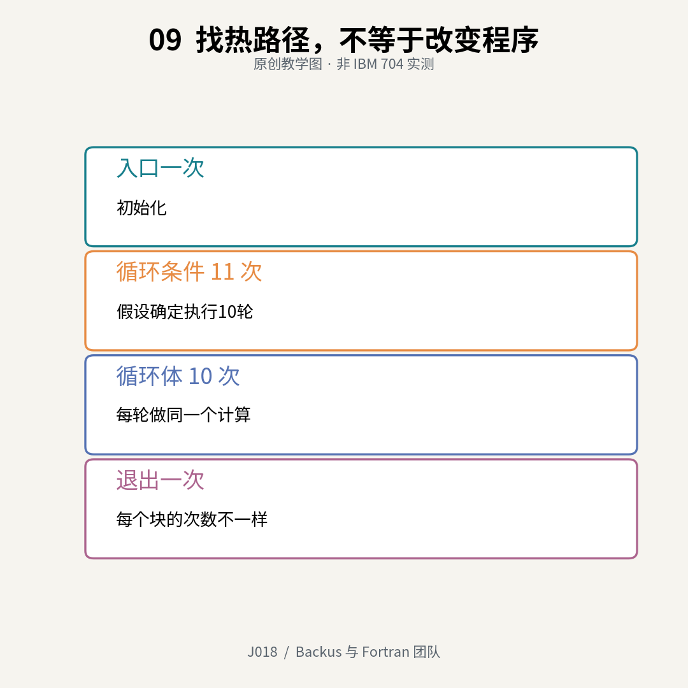

图9｜本文自设10轮循环的精确计数，用来解释频率信息；并非Haibt历史Monte Carlo实现的复刻。

最后一次条件判断负责发现“该退出了”，所以它比循环体多一次。数清这一个小差别，比笼统说“热点优化”更有帮助。

历史Haibt阶段使用流程与频率信息；本图是我们自己选择确定10轮得到的精确计数，既不是历史输入，也没有假装复原其统计模拟器。更不意味着“从图上知道执行频率，就能改变程序要算的结果”。频率用来选择安排方式，语义仍必须保留。

## 7. 第四个实验：桌上只有三个空位

临时值很多，能快速使用的存放位置有限。为了把问题压到能手算，我们不模拟整台机器，只设三个槽位：每个存一个只读名字；初始为空；每次读入成本相同；命中不用读入；没有写回、别名或函数调用。

请求序列是 `A B C A B D A B C D`。第一次用A、B、C都要装入。到第6步要用D，三个槽已经满了，必须让一个值离开。

如果整个未来序列已知，A下一步就用，B再下一步用，C最晚再用。于是让C离开，把较近要用的值留下。这就是图10使用的MIN规则：在驻留值里，选择未来最晚再用的那个；以后再也不用，视为最晚。并列时按名字确定选择，只为结果可重复。


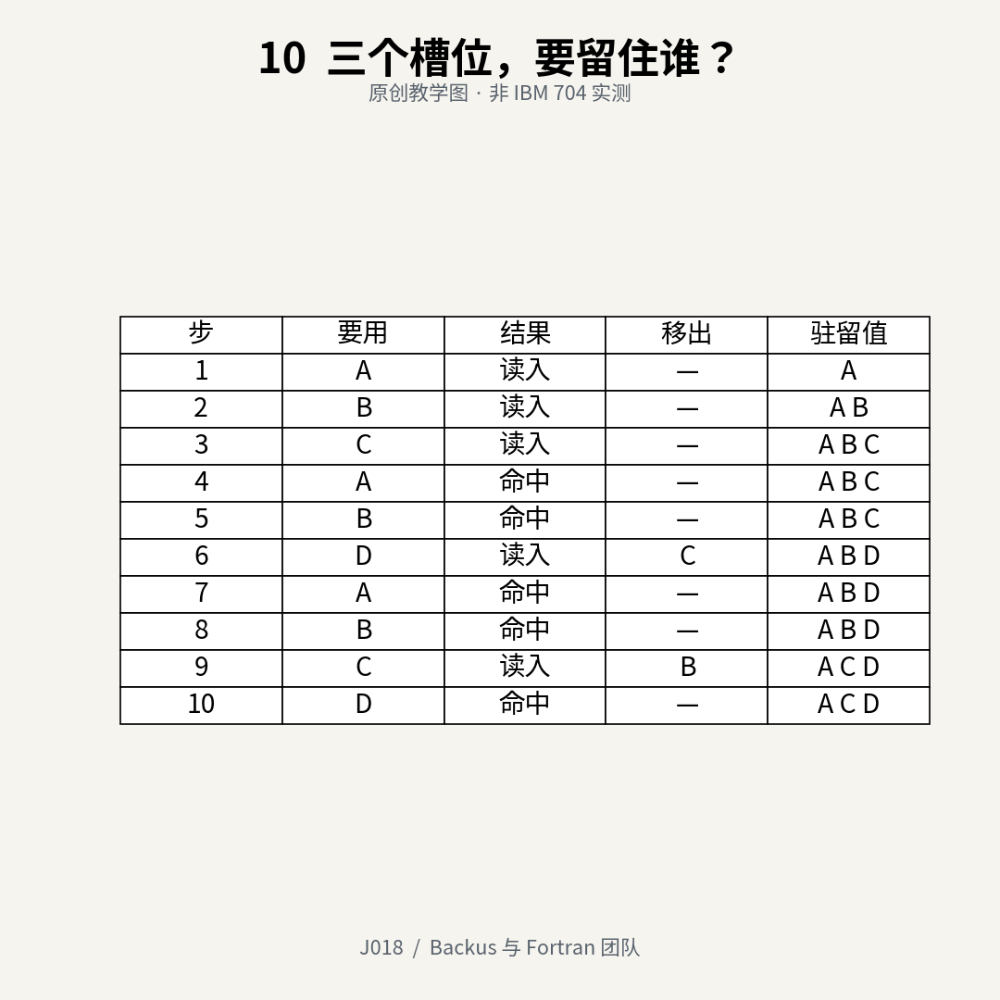

图10｜只读等价缓存模型，3槽，MIN看完整未来序列；驻留值按名字排序展示，并非真实寄存器编号。

别把这个缓存小游戏当成“我们复现了早期寄存器分配”。实际分配还要处理写入、不同指令限制、控制流、生命周期与存储一致性。这里故意扔掉那些难处，只留下一个能完整枚举答案的小问题。

`minimum_loads`从每次可能移出哪个值开始枚举所有未来状态，取最小读入次数。它是慢但直白的小型参照，不用MIN的选人规则。`cache_trace`则记录每一步。两者在短输入上比较，能帮我们发现索引、初始状态和并列处理错误。


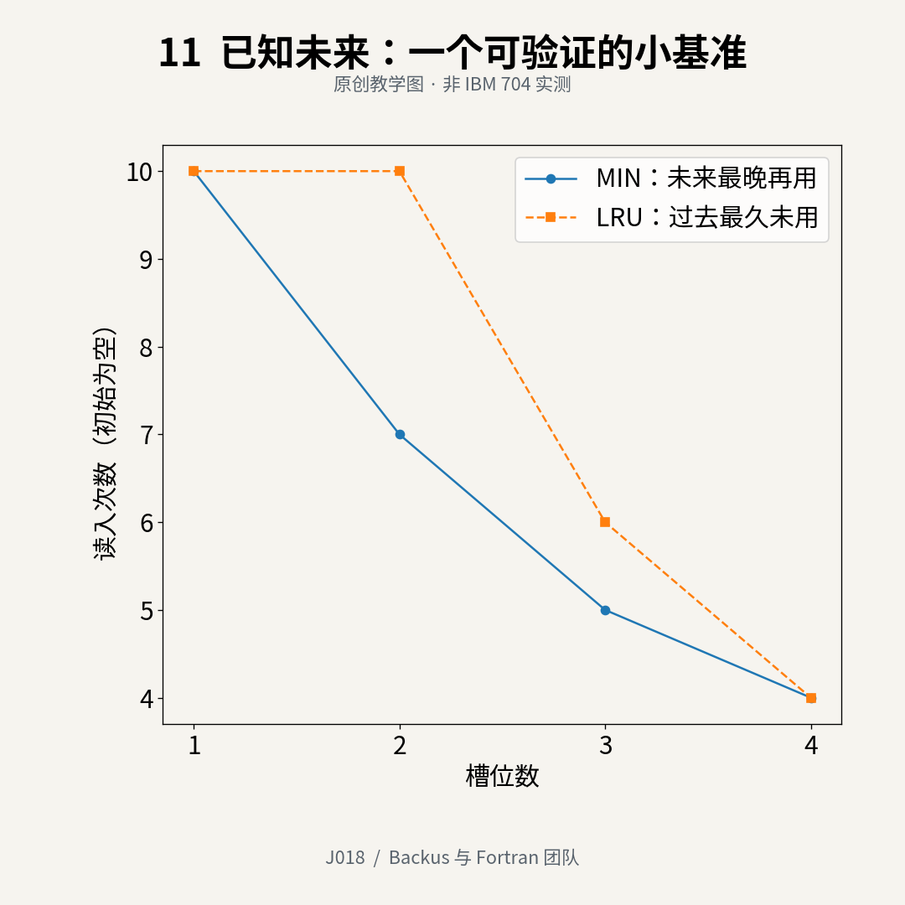

图11｜对固定序列ABCABDABCD实际模拟。只比较读取次数；没有写回、别名、控制流或调用约束。

图11另放LRU作对照：它记过去谁最久没用，并不认识未来。它不是本文建议用来替代历史寄存器分配的算法。即使某条输入上两条线重合，也只说明这条输入的读入次数相同；本图不推出所有输入上的等价或硬件速度。

## 8. 回到第一本账：多花时间分析值得吗？

设编译成本为C，每次运行成本为E，运行R次，简化总成本就是 `C + R*E`。它忽略人的劳动、I/O、启动等费用，只用来把“多分析一次，少执行许多次”的权衡说清楚。

图2里的两方案比较是：`35+7R < 5+10R`。移项得 `30 < 3R`，即R>10。第10次只是打平；若这段代码只执行一次，B未必值得。如果编译要反复重做，C也不是一生只付一次。


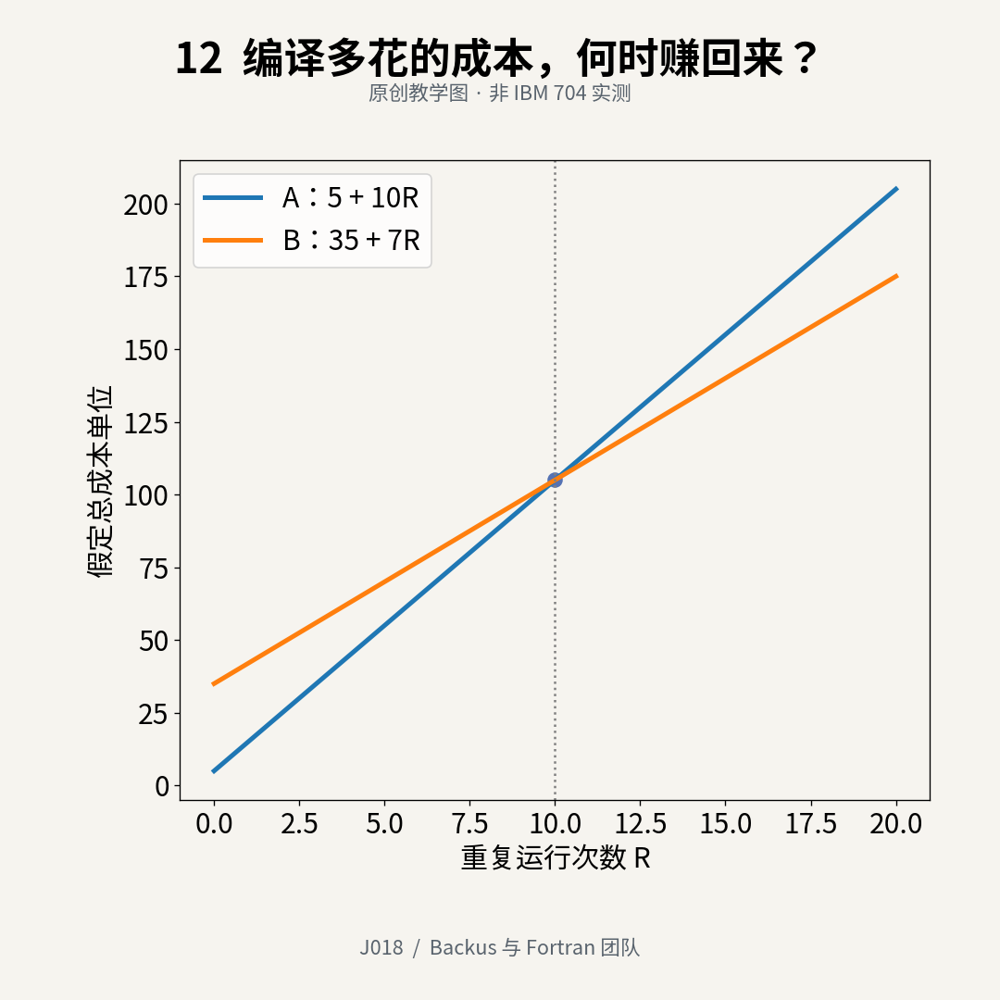

图12｜第10次两方案同为105单位；R>10时B才严格更省。参数全为教学假设。

因此“优化编译器的编译过程很慢”和“它生成的程序很快”完全可以同时为真。真实判断要把时间、内存、错误定位和工作负载放在一起，而非拿一个形容词给编译器排名。

## 9. “结果相同”比想象中挑剔

前面的表达式实验用精确整数。换成浮点，实数代数的恒等式不能随便搬来。以常见binary64下的Python计算为例：令a=10¹⁶、b=−10¹⁶、c=1，`(a+b)+c`得到1.0，而`a+(b+c)`得到0.0。后者先算b+c时，较小的1在舍入中丢失。


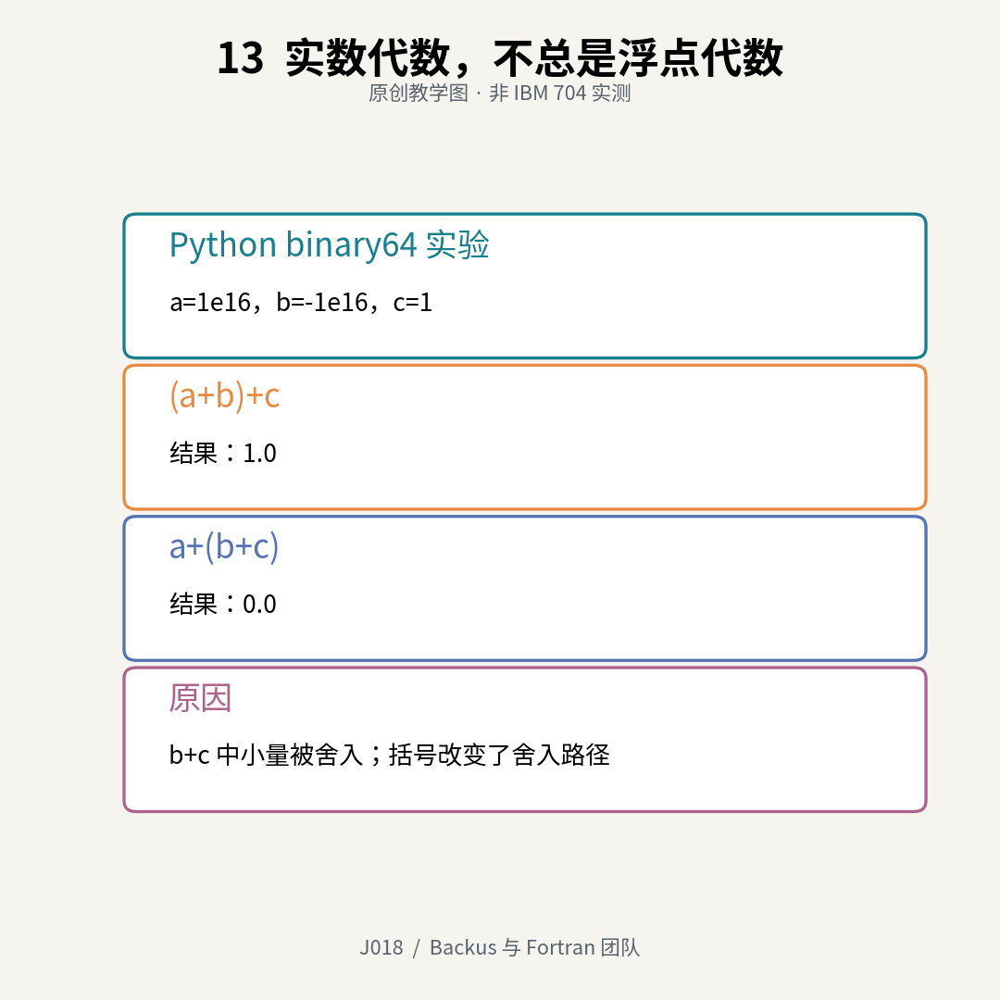

图13｜代码实际执行的binary64反例；它说明重关联要看语义，不是IBM 704数值格式实验。

这不是说所有浮点优化都非法，而是具体变换要看语言允许的行为、编译选项和数值需求。本文不宣称1957年的机器使用IEEE binary64，也不用这个现代反例去倒推早期团队“做错了”。它只是提醒今天读代码的我们：括号可能携带数值意义。

另一个更容易漏掉的条件是“这段计算原本会不会执行”。假设循环运行n次，每次都计算 `1 / denominator`。分母循环内不变，看起来很适合提到循环外。

可是取n=0、denominator=0，原程序没有一次循环，也就没有除法；外提版会提前除以零。值没改，是否抛异常却改了。


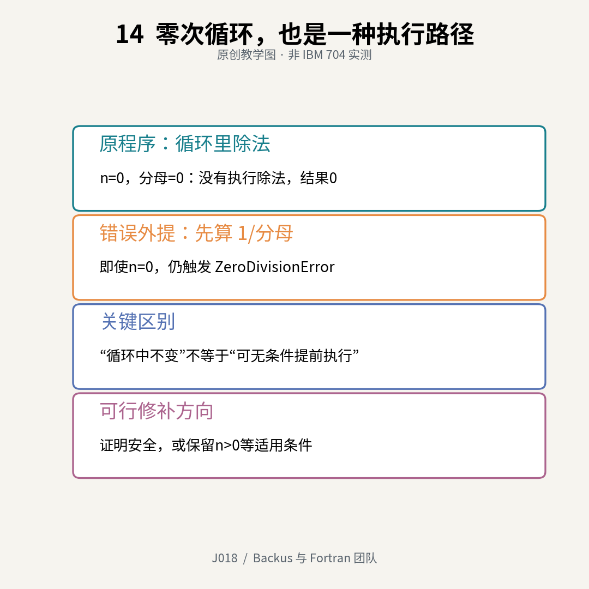

图14｜真实反例比较执行是否触发异常；本例Python range(0)语义，不是1957 DO零次规则。

本文明确使用Python `range(0)`的零次语义，不把它当成早期Fortran DO循环的规范说明。对现代编译器而言，安全外提可能依靠证明表达式不抛异常，或把适用条件保留下来。仅仅发现“不变量”不够。

## 10. 能复跑的实验，以及诚实的边界

附后的脚本不需要第三方包。整数表达式比较覆盖a、b各从−50到50；地址比较覆盖0到12行列和三个基址，含空数组；缓存比较覆盖三种名字组成、长度0到7的全部序列及容量1、2、3。


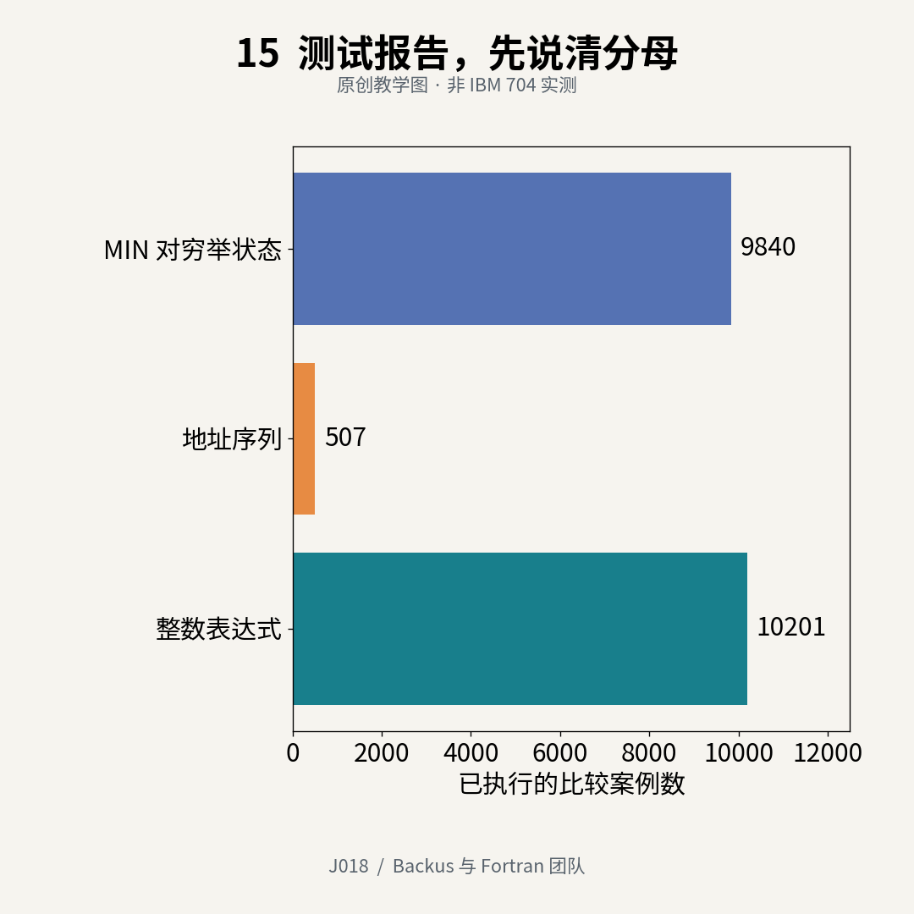

图15｜实际自测：10201个整数输入对、507组地址形状/基址、9840组短序列/容量；有限测试不是无限输入证明。

这些是作者已经运行过的自测，不冒称独立评审结论。10201是101×101；507是13×13×3；9840是3×(1+3+…+3⁷)。空序列与容量比名字数多的情况，也在范围里。缓存穷举状态法只适合小输入，不能因为这里跑得快就拿去处理真实大程序。

代码可以作为练习：把输入字母扩为4种；找一条MIN与LRU不同的最短序列；加入写回成本后，原本“只看下一次使用”的答案是否仍最佳？最后一问改变了模型，不应沿用旧结论当证明。

源语句更接近公式，只是把一个入口交给了人。入口后面仍有表达式、循环、地址、有限资源和错误处理。早期Fortran团队的意义，不必用“某个人独力创造全部现代编译技术”来夸大：把这些困难组织成一个能够使用、维护的系统，本来就是很具体的成就。


图16｜把历史事实、本文实验和不能推出的结论分开；读者可沿完整代码继续试错。

## 完整实验代码

保存下面内容为 `optimizer_lab.py`，用 Python 3 运行 `python optimizer_lab.py`。打印三组比较计数与两个反例验证。没有下载数据、网络访问或执行外来代码。

```python
"""Original teaching models; NOT a FORTRAN compiler or IBM 704 emulator."""
from functools import lru_cache
from itertools import product

def expression(a, b, reuse=False):
    # Exact integer semantics. Count only additions and multiplications below.
    if type(a) is not int or type(b) is not int or type(reuse) is not bool:
        raise ValueError("integer a/b and boolean reuse required")
    if reuse:
        t = a + b
        return t * t + t, {'add': 2, 'mul': 1}
    return (a + b) * (a + b) + (a + b), {'add': 4, 'mul': 1}

def addresses(rows, cols, base=100):
    if any(type(v) is not int for v in (rows, cols, base)) or rows < 0 or cols < 0:
        raise ValueError('integer dimensions >= 0 and integer base required')
    # Zero-based, column-major, one word per element. No arithmetic overflow.
    direct = [base + j * rows + i for j in range(cols) for i in range(rows)]
    recurrent = []
    p = base
    for _j in range(cols):
        for _i in range(rows):
            recurrent.append(p)
            p += 1
    return direct, recurrent

def cache_trace(sequence, capacity, policy='min'):
    """Read-only values, equal load cost, initially empty; not full reg allocation."""
    if type(capacity) is not int or capacity < 1 or policy not in ('min', 'lru'):
        raise ValueError('positive integer capacity and min/lru required')
    seq = tuple(sequence)
    if any(type(x) is not str for x in seq):
        raise ValueError('values are string names')
    resident = []
    last = {}
    trace = []
    for i, x in enumerate(seq):
        miss = x not in resident
        evicted = None
        if miss:
            if len(resident) == capacity:
                if policy == 'min':
                    def next_use(y):
                        return next((j for j in range(i + 1, len(seq)) if seq[j] == y), len(seq))
                    evicted = max(resident, key=lambda y: (next_use(y), y))
                else:
                    evicted = min(resident, key=lambda y: (last[y], y))
                resident.remove(evicted)
            resident.append(x)
        last[x] = i
        trace.append(dict(step=i + 1, value=x, miss=miss, evicted=evicted,
                          resident=sorted(resident)))
    return trace

def minimum_loads(sequence, capacity):
    """Exhaustive future-state oracle, small sequences only."""
    seq = tuple(sequence)
    if type(capacity) is not int or capacity < 1:
        raise ValueError('positive integer capacity required')
    if any(type(x) is not str for x in seq):
        raise ValueError("values are string names")
    @lru_cache(None)
    def solve(i, state):
        if i == len(seq):
            return 0
        x = seq[i]
        if x in state:
            return solve(i + 1, state)
        if len(state) < capacity:
            return 1 + solve(i + 1, tuple(sorted(state + (x,))))
        return 1 + min(solve(i + 1, tuple(sorted(tuple(y for y in state if y != old) + (x,))))
                       for old in state)
    return solve(0, ())

def safe_loop(n, denominator):
    # The division is conditional on there actually being an iteration.
    total = 0
    for _ in range(n):
        total += 1 / denominator
    return total

def unsafe_hoist(n, denominator):
    t = 1 / denominator
    return sum(t for _ in range(n))

def tests():
    expression_cases = 0
    for a in range(-50, 51):
        for b in range(-50, 51):
            x, _ = expression(a, b)
            y, _ = expression(a, b, True)
            assert x == y == (a+b)**2 + a+b
            expression_cases += 1
    address_cases = 0
    for r, c in product(range(13), repeat=2):
        for base in (-100, 0, 100):
            a, b = addresses(r, c, base)
            assert a == b == list(range(base, base+r*c))
            address_cases += 1
    cache_cases = 0
    for n in range(8):
        for seq in product('ABC', repeat=n):
            for cap in (1, 2, 3):
                trace = cache_trace(seq, cap)
                assert sum(t['miss'] for t in trace) == minimum_loads(seq, cap)
                assert all(len(t['resident']) <= cap and t['value'] in t['resident'] for t in trace)
                cache_cases += 1
    assert safe_loop(0, 0) == 0
    try:
        unsafe_hoist(0, 0)
    except ZeroDivisionError:
        pass
    else:
        raise AssertionError('unsafe hoist did not trap')
    assert (1e16 + -1e16) + 1.0 != 1e16 + (-1e16 + 1.0)
    return dict(expression_cases=expression_cases, address_cases=address_cases,
                cache_cases=cache_cases, zero_trip_counterexample=True,
                float_reassociation_counterexample=True)

if __name__ == '__main__':
    import json
    print(json.dumps(tests(), indent=2))
```


---

## 短导读｜让公式变成代码，还得让代码值得跑

Backus与Fortran团队面对的不只是“机器能读懂公式吗”，还有“自动生成的程序会不会浪费昂贵的运行时间”。编译时多做分析、运行时少做重复工作，是两本不同的账。

本文用16张图和完整Python实验，拆开四件事：重复子表达式为什么能复用，二维数组地址什么时候可以递增，执行频率为何重要，以及有限槽位怎样选择暂存值。随后故意破坏条件：改变访问顺序、重排浮点加法、把除法提到零次循环之外。三个反例都真的运行或按明确地址序列计算，不是口头说“优化有风险”。

历史上是团队协作，不是单人魔法；本文代码是简化教学模型，不是原编译器复原，也不是IBM 704性能测试。长文附一手来源和完整代码，适合愿意自己改一个输入、看结论怎样失效的读者。

---

[来源、材料权利与编写说明](sources.md)
