# 手够不到那个点，为什么不让关节一个个试？

屏幕上有一条三节机械臂。你拖动一个小星星，希望末端跟过去。动画程序知道每根杆有多长，却不知道三个关节各该转多少。

把三个角一起写成方程，当然是一条路。另一条路更像调整台灯：先固定其他地方，只转一个关节，让灯头离目标近一点；再换一个；转完一轮，还不够近就再来。

这就是本文要拆开的 CCD——循环坐标下降。这里的“坐标”不是屏幕的 x、y，而是待求的一组关节角。本文只做**二维、固定基座、定长杆、单个末端的位置任务**。不模拟力矩、速度、碰撞、姿态朝向或真实机械设备，不能把下面的角度直接当作实机控制命令。

读到最后，你应该能分清三句话：“这一关节已经选到当前最好的角”“整条链的距离没有再变小”“目标根本不可达”。它们不是一回事。

## 1．先从已知角度算出手在哪里

第 i 根杆长为 Lᵢ，关节的局部角为 qᵢ。本文坐标 x 向右、y 向上，正角逆时针，全部计算使用弧度。q₀ 相对世界 x 轴；q₁ 相对第一根杆的方向；再往后也是相对父杆。

所以第 i 根杆的世界方向不是 qᵢ，而是前面所有局部角的和 θᵢ=q₀+…+qᵢ。根点 P₀=(0,0)，接着算：

Pᵢ₊₁=Pᵢ+Lᵢ(cos θᵢ, sin θᵢ)。

这个“角度给定→位置得到”的过程叫正向运动学，代码中叫 fk。反向运动学恰好倒过来：末端的希望位置已知，角度未知。即使我们最终要求的是反问题，检查每次尝试是否更好，仍然靠正向计算。

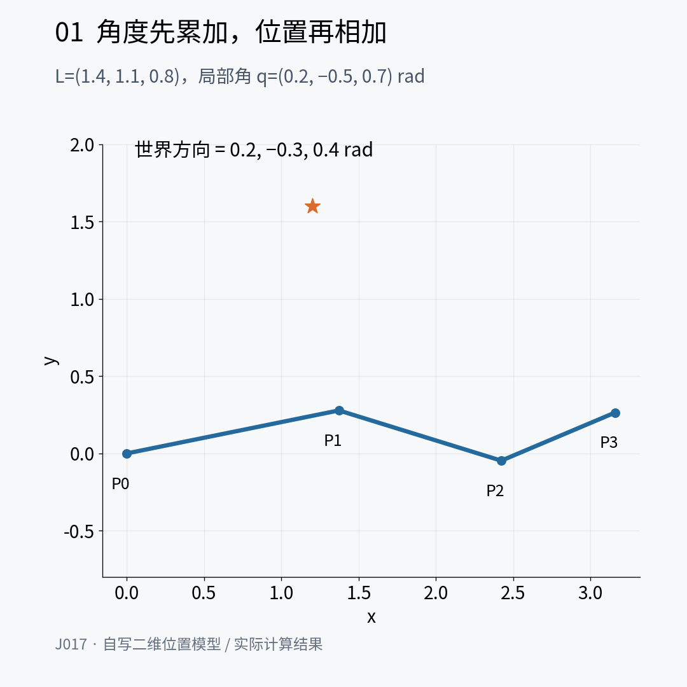

图1｜自建三杆案例：长度(1.4,1.1,0.8)，局部角(0.2,−0.5,0.7)弧度；世界方向依次是0.2、−0.3、0.4。橙色星星为目标(1.2,1.6)，不是当前末端。

## 2．把一大堆未知数，暂时缩成一个

设眼下只允许第 i 个关节动。这个关节的位置 P 不变，所有后代的局部角也不变，因此它后面的整段链像一块形状固定的物体，绕 P 旋转。末端 E 绕的是一个半径为 |E−P| 的圆，而不是沿着指向目标的直线平移。

写 u=E−P，v=T−P，转角为 δ。我们希望距离平方

f(δ)=|R(δ)u−v|²

尽可能小。把平方展开，就是 |u|²+|v|²−2 v·R(δ)u。前两项不随 δ 变化，因此要让最后的点积尽可能大。无角度限制、u 与 v 都不为零时，最好的选择是把 u 的方向对齐 v；圆的半径没有被改变。**方向对齐，不代表端点已经碰到目标**：两者离枢轴的距离可能不同。

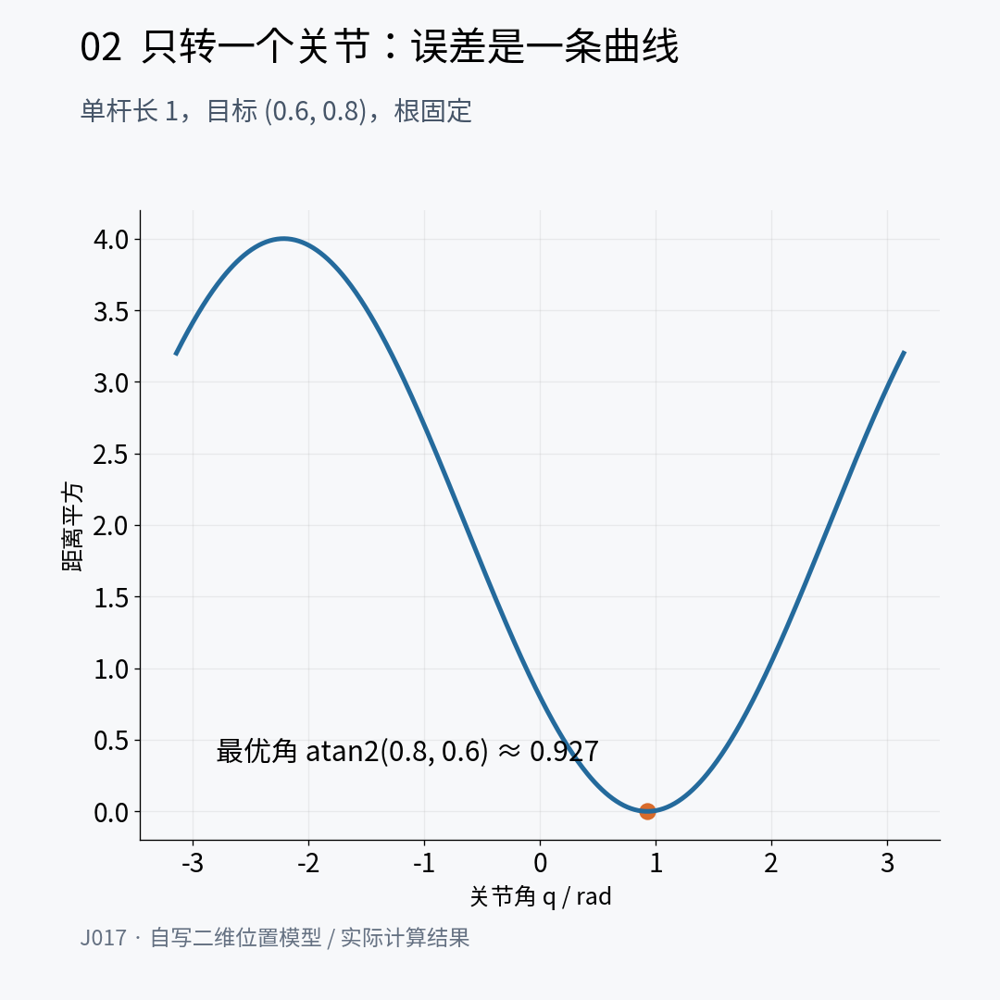

图2｜单杆长1、目标(0.6,0.8)时，真实计算的距离平方随角度变化。最低点在约0.927弧度；这个目标恰好在单位圆上，所以最低误差为零。一般半径不同则不会为零。

## 3．一个 acos 不够：还要知道往哪边转

点积能告诉你夹角的余弦，却不能区分顺时针和逆时针。二维叉积的有符号标量 ux·vy−uy·vx 提供方向；点积 ux·vx+uy·vy 提供另一部分信息。合起来：

δ=atan2(ux·vy−uy·vx, ux·vx+uy·vy)。

atan2 的第一个参数相当于正弦方向，第二个相当于余弦方向，因此可以区分四个象限。不要交换这两个参数。这里不必先把两个向量归一化；共同的正长度因子不影响 atan2 的角度。我们的数值范围也做了限制，后面会说明它不是任意大数都能直接相乘的库。

当两条射线正好反向时，+π 和−π 都完成同一次半圈旋转。无约束时都可以；一旦存在关节限位，就必须在局部角允许的范围内比较候选，不能只凭符号决定。

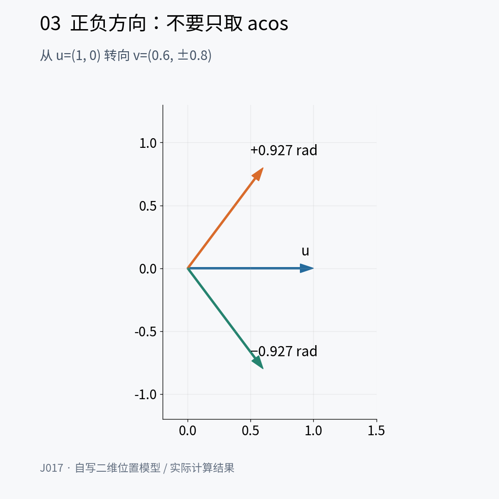

图3｜从(1,0)转向(0.6,0.8)得到约+0.927弧度，转向(0.6,−0.8)得到约−0.927弧度。两者点积相同，叉积符号相反；这不是两种不同的距离公式。

## 4．改完一个，再算下一个

本文默认从最靠近末端的关节往根部走。算出 δ 后，修改的只是 qᵢ；但正向重算时，后面的杆在世界空间都会跟着动。然后必须用**已经更新的位置**计算下一个关节，而不是先用旧姿态算好所有 δ，再一起加上去。

这个区别像轮流修正草稿：第二个人应读到第一个人的修改。如果所有人都针对旧稿修改，叠在一起可能互相抵消，也可能把已经改善的地方破坏掉。

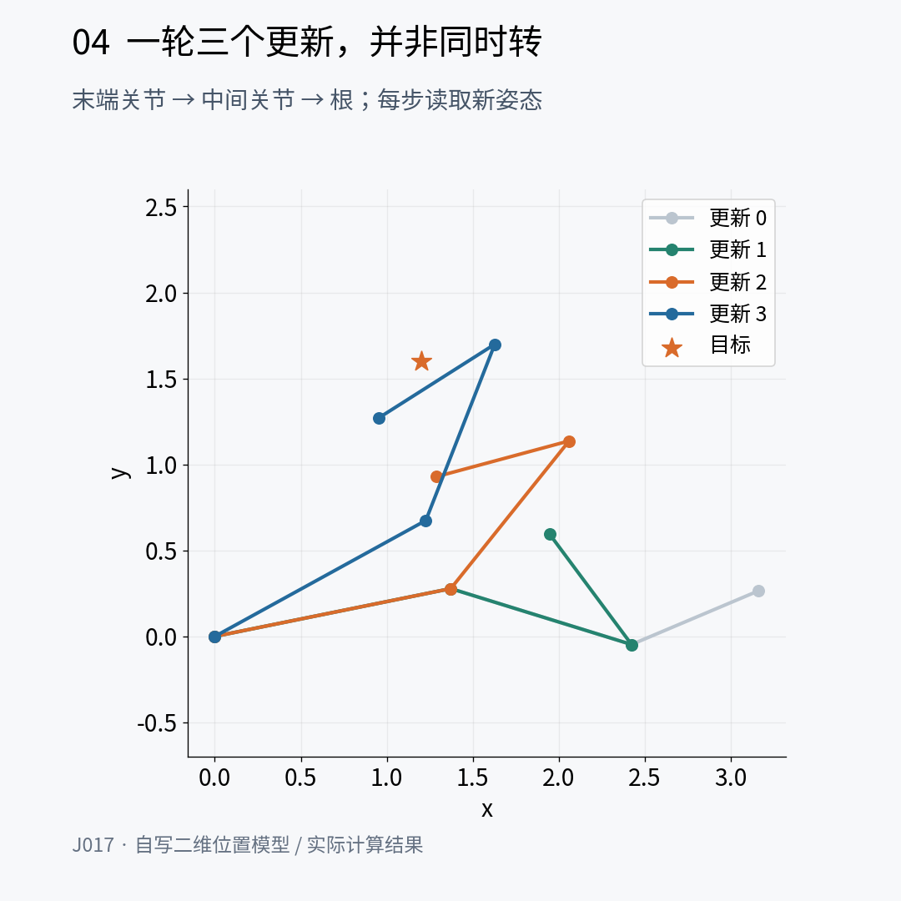

图4｜同一三杆案例的初始状态与前三次关节更新。顺序为索引2、1、0；每条链来自一次实际正向计算，目标始终是(1.2,1.6)。多条杆的重叠不是新增杆件，而是不同时间的姿态叠加。

一轮只代表每个关节获得一次机会，并不代表已经求出答案。我们把最后的角度作为下一轮起点，继续让关节轮流尝试。每次成功更新都会降低末端距离，但端点走过的路线可以弯曲。

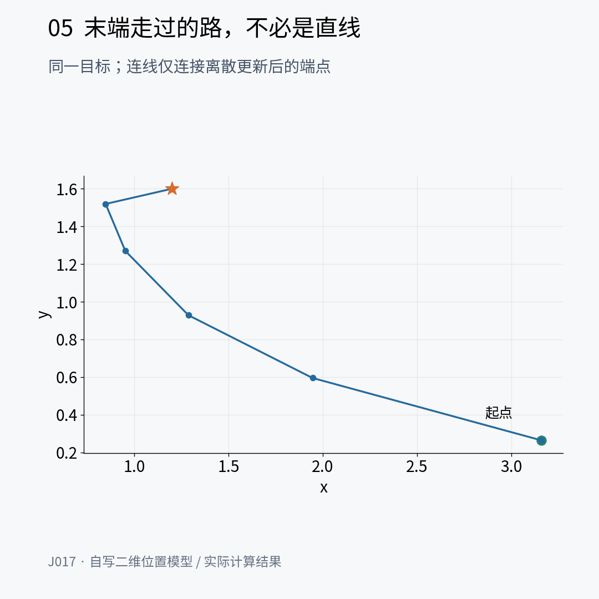

图5｜三杆案例中，每次关节尝试后的末端位置。折线仅连接离散记录，不表示杆端以恒定速度沿线运动；本文没有建立连续时间运动模型。

## 5．“越来越近”能证明什么？

在精确算术下，如果每次真的选择这一坐标上的最小值，并且旧角也属于可行集合，那么更新后的距离平方不会大于之前。距离平方又不可能小于零，于是这一串数值存在极限。

到这里为止，我们证明的是**误差值不会无限往下掉**，不是“必定到达目标”，更不是“角度一定收敛到唯一自然姿态”。一串不再明显变化的误差，可能来自解附近，也可能来自坐标方法走不出去的位置。

浮点代码再加了一层保护：把旧姿态保留为默认候选，只有重算后的距离平方严格更小时才接受新角。因此记录中的误差不增是代码的接受规则，不应把它说成浮点数精确实现了全部几何定理。

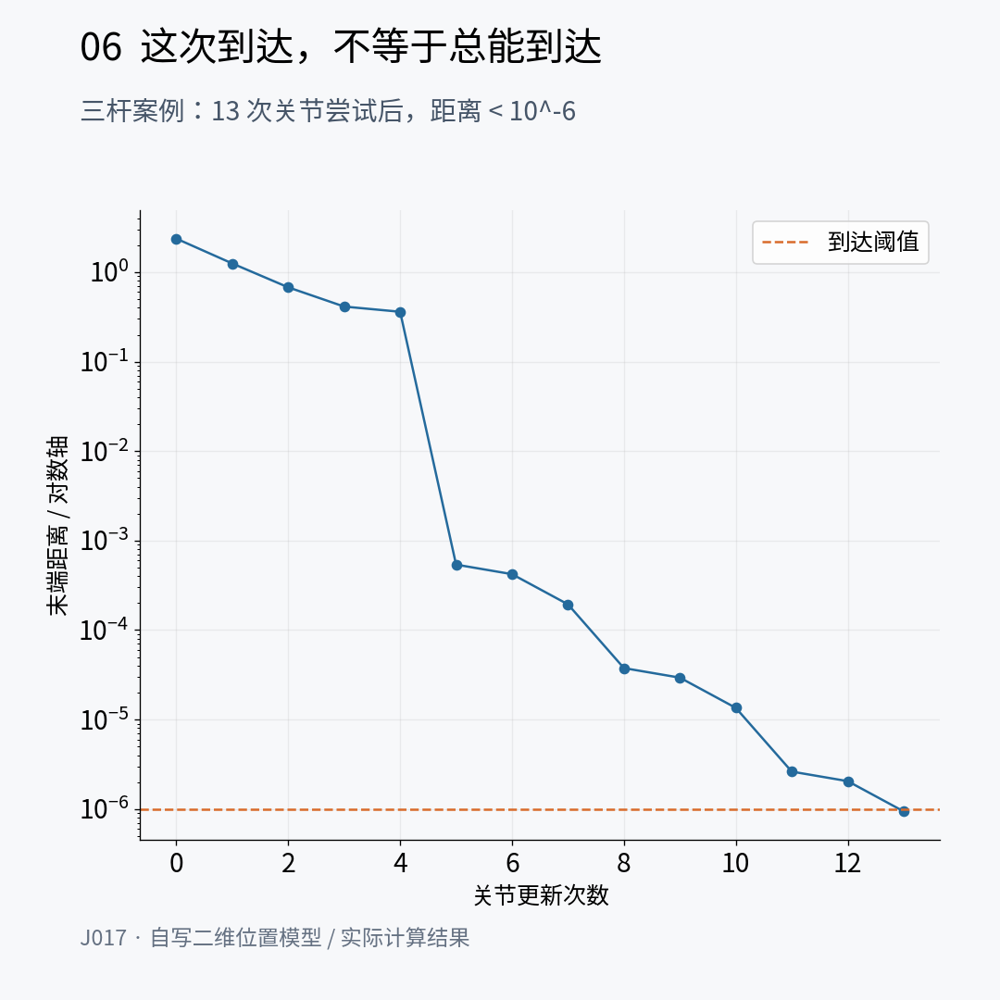

图6｜本次三杆运行13次关节尝试后，末端距离约9.41×10⁻⁷，小于10⁻⁶的到达阈值。纵轴为对数尺度；这是一个具体测试结果，不是任意链长、目标与初始角的收敛速度保证。

## 6．先分清：目标真的在手够得到的地方吗？

没有限位的两杆系统，杆长2和1，最远能伸到半径3，最近能折到半径1。半径小于1的内洞也不可达，不是所有“外圈里面”的点都能碰到。

对任意自由旋转的平面串联链，最远距离为各杆长之和 Lsum；最近距离为 max(0, 2Lmax−Lsum)。这来自三角不等式：最长杆至多被其他杆抵消它们的总长度。这里说的是无角度限制、无障碍、只要求末端位置的几何可达范围。关节限位加上之后，这个圆环不能当成完整答案。

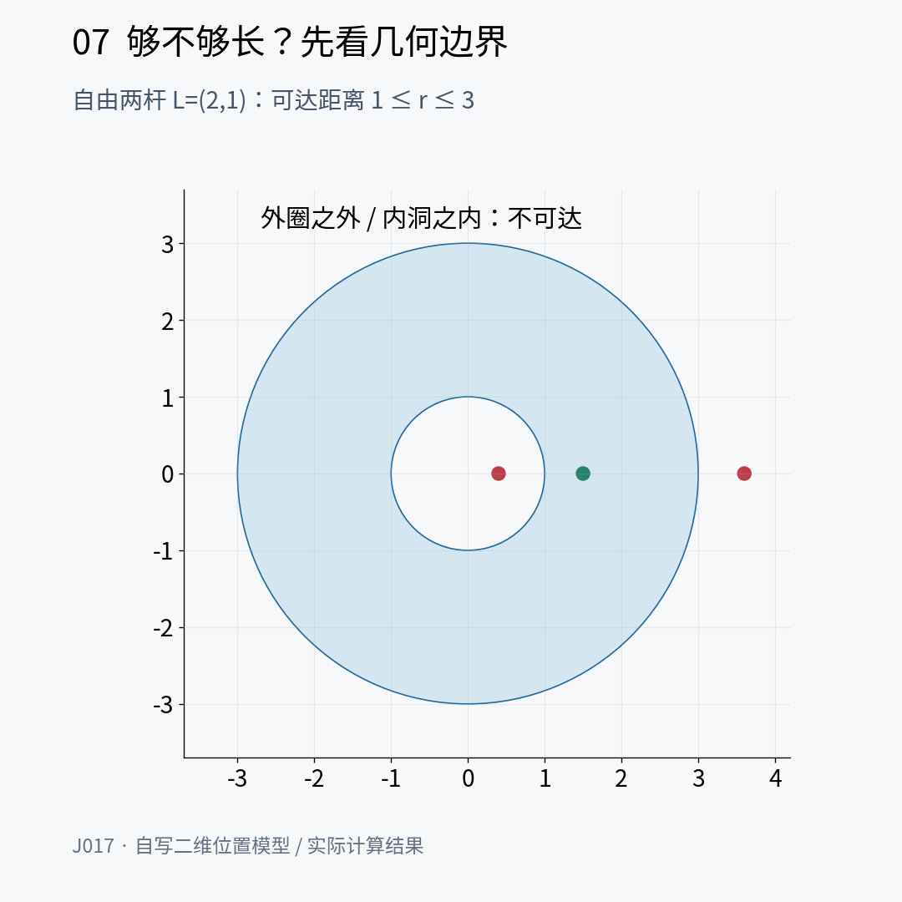

图7｜自由两杆(2,1)的几何可达圆环。点(0.4,0)在内洞，点(3.6,0)在外圈之外；(1.5,0)在圆环内。颜色不是CCD成功概率图。

三杆案例总长3.3。如果目标放到(4.2,0)，任何角度组合的末端距离都至少为0.9。我们仍让求解器尝试，看看它有没有把这个下界搞错。

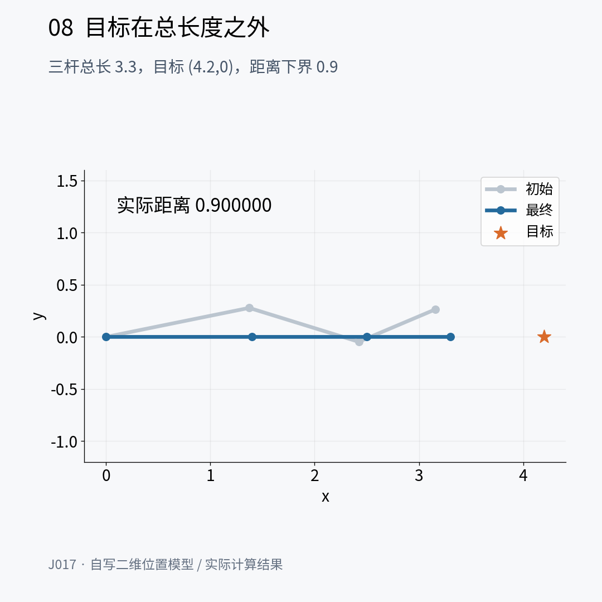

图8｜目标(4.2,0)的实际运行：最终距离约0.900000，255次关节尝试后因改善过小而停滞。0.9来自几何下界；不是看到停滞状态后才宣布不可达。

## 7．更容易误判的情况：有解，但每个关节都不想动

现在拿长度2和1的两杆，第一根指向右方，第二根向左折回；角度为(0,π)。末端在(1,0)，目标在(1.5,0)。

只转第二个关节时，它的枢轴在(2,0)。末端与目标都在枢轴左侧，当前朝向已经最接近目标；单独转它只会更远。只转根关节时，末端绕原点画半径1的圆，而目标在正 x 轴上，当前方向也已最好。两次都不动，下一轮照旧。

但这个目标明明在半径1到3之间。用两杆余弦关系可直接构造另一组角：cos q₁=(1.5²−2²−1²)/(2·2·1)=−0.6875，取 q₁=acos(−0.6875)，q₀=−atan2(sin q₁, 2+cos q₁)。把它代回正向公式，末端就落到(1.5,0)。

因此这个例子准确地说是**逐坐标最优的停滞姿态**：每个角单独改变都不能改善，却存在联合改变后的更好姿态。不要仅凭“局部最小”这个习惯叫法，额外声称它在所有方向上都是严格局部最小。

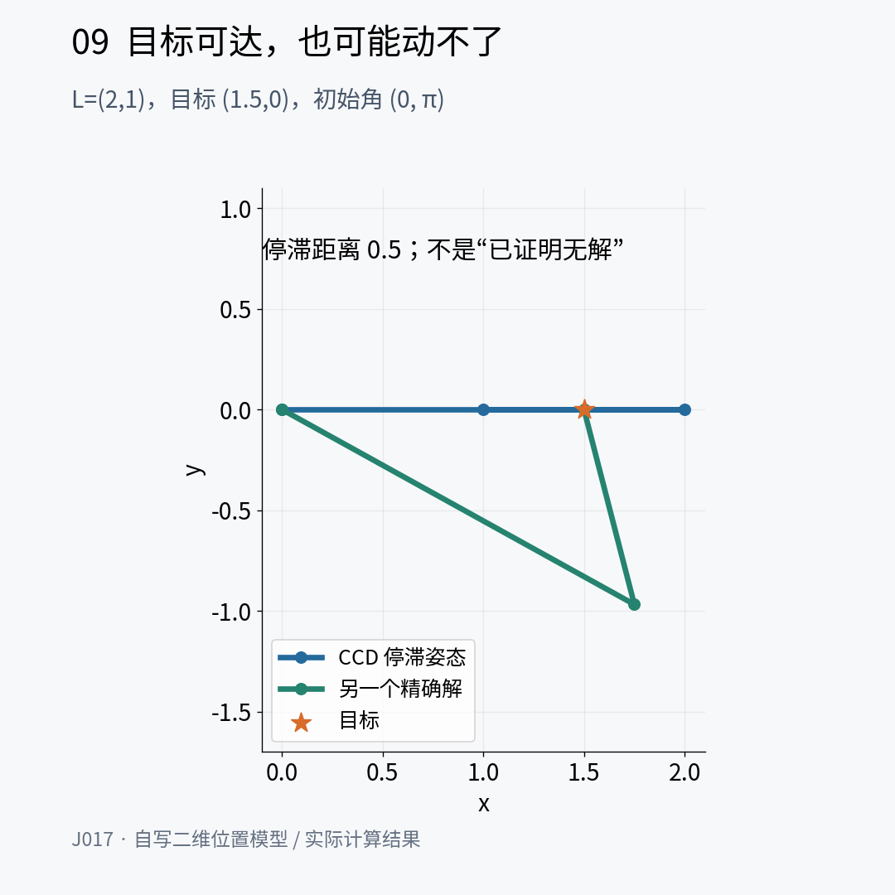

图9｜蓝色折返姿态被CCD停在距离0.5处；绿色为独立解析构造的到达姿态。绿色不是求解器偷偷算出的答案，而是用来反驳“停滞等于无解”的对照。

## 8．换起点有时有用，但别把运气写成证明

把起点改成(0.1,π−0.1)，不改变杆长与目标，再运行同一算法。本次14次关节尝试就到达了阈值。原来需要先让两个关节联合协调的局面，被这个不同起点避开了。

工程里可以使用上一帧的解、若干固定重启姿态、解析子链解或其他求解方法。代价是更多计算，以及要处理不同结果之间的姿态跳变。随机扰动不是万能药；还可能破坏动作连续性。本文只展示一个确定的重启，不实现随机救援，更不保证总能脱困。

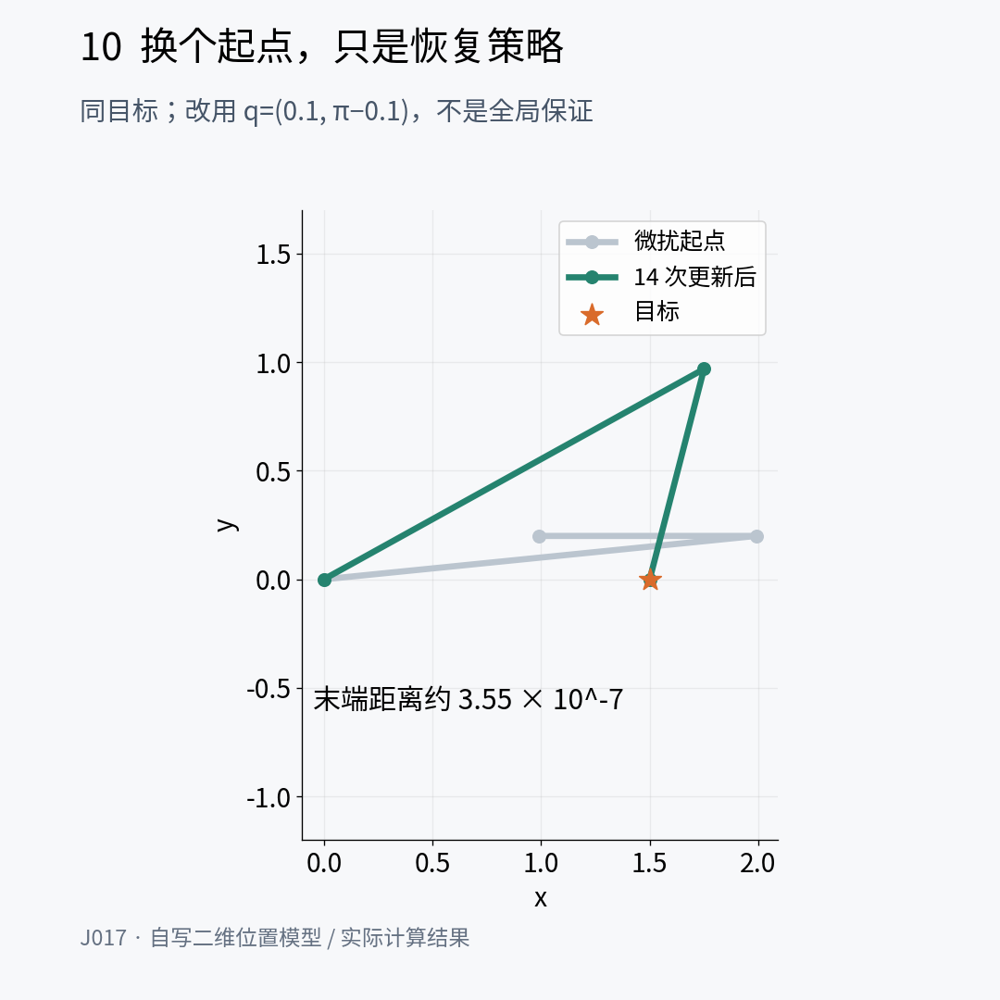

图10｜同一两杆目标，微扰起点的真实最终距离约3.55×10⁻⁷。起点改变后得到另一条计算轨迹；不能把它与图9拼成同一轮CCD的自然续接动作。

## 9．把关节限位放进问题，而不是事后补丁

很多关节只能在一段角度里转。本文允许每个局部角拥有一个闭区间[lo,hi]，位于[−π,π]内；初始角必须已经在范围内。没有“先非法伸到目标、最后再夹回去”的步骤。

若无约束最优角在允许区间内，直接比较它；若不在，最好的可行角必在区间端点，或者是另一个相差整圈的等价最优角。于是候选集合包含：当前角、两个端点、所有落进区间的 desired+2kπ。我们的角度范围保证 k 从−2到2已覆盖需要的等价候选。

为什么不用扫描几千个角？因为单关节的目标函数本来就是一个余弦形状：驻点要么是对齐的最小值，要么是反向的最大值；没有更多神秘的小波峰。枚举端点与合法对齐角，就够解决这个一维约束问题。退化向量则另行处理。

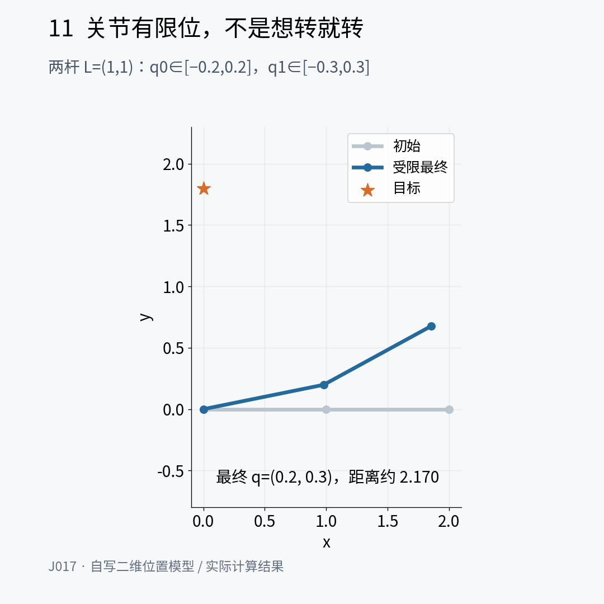

图11｜两根单位杆、目标(0,1.8)，根角限制[−0.2,0.2]、第二角限制[−0.3,0.3]。实际最后角为(0.2,0.3)，距离约2.170；无约束圆盘包含目标，不代表受限系统可达。

## 10．跨过 π 的那一刻，最容易写错

考虑单杆当前角170°，目标方向−170°，允许角度[−175°,175°]。最短转角为+20°，当前角加上它得到190°。如果机械地把190°夹到上界175°，就错过了与190°等价、并且完全合法的−170°。

这不是只要先 wrap 再 clamp 就永远没问题：周期函数在区间两个端点的距离都应比较。本文直接检查合法等价角与两个端点，不把角度直线上的“最近边界”当作圆上几何距离的最优解。

代码的 wrap 将无约束角映射到[−π,π)。有约束时不随意改写端点，因为用户给的区间是当前局部角坐标中的约定。这里没有实现跨越分支切口的单个连续弧区间，例如“170°到−170°只走短弧”；那需要另一种区间表示。

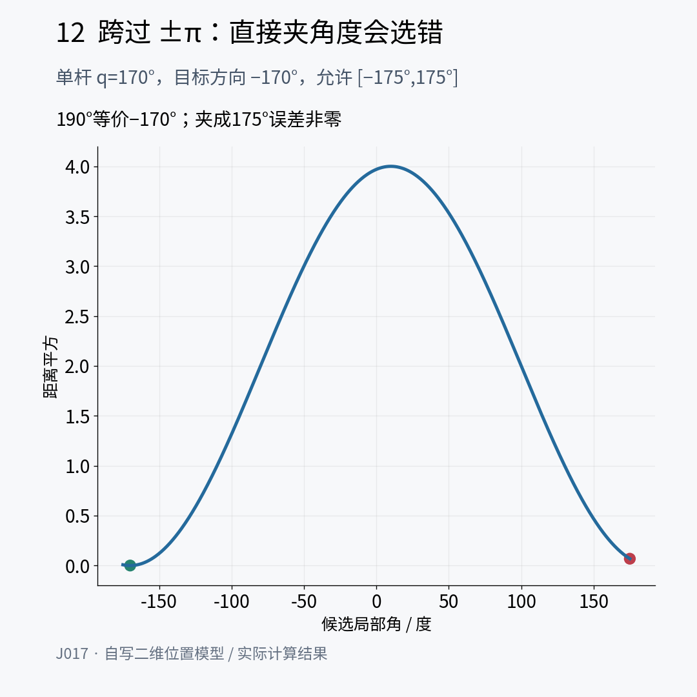

图12｜实际单杆目标函数：合法角−170°让误差为零；直接夹成175°却保留误差。图中以度便于读角，求解代码仍使用弧度。

## 11．零向量、尺度与停止条件都要说清

当 E=P 时，端点在当前枢轴上，旋转该关节不会移动端点；当 T=P 时，端点到目标的距离等于固定半径，转哪边都一样。此时不要让 atan2(0,0)替你决定算法含义。

本文对 |u| 或 |v|≤10⁻¹² 的坐标跳过更新。这个阈值采用场景长度单位，是教学模型的绝对分辨率；换到极小尺度需要重新设计。输入也被限定为1到32根杆，杆长10⁻⁶到1000，目标每个分量绝对值不超过10⁴，初始角在[−π,π]。这是明确拒绝不支持的尺度，不是声称解决了任意浮点数的稳健几何。

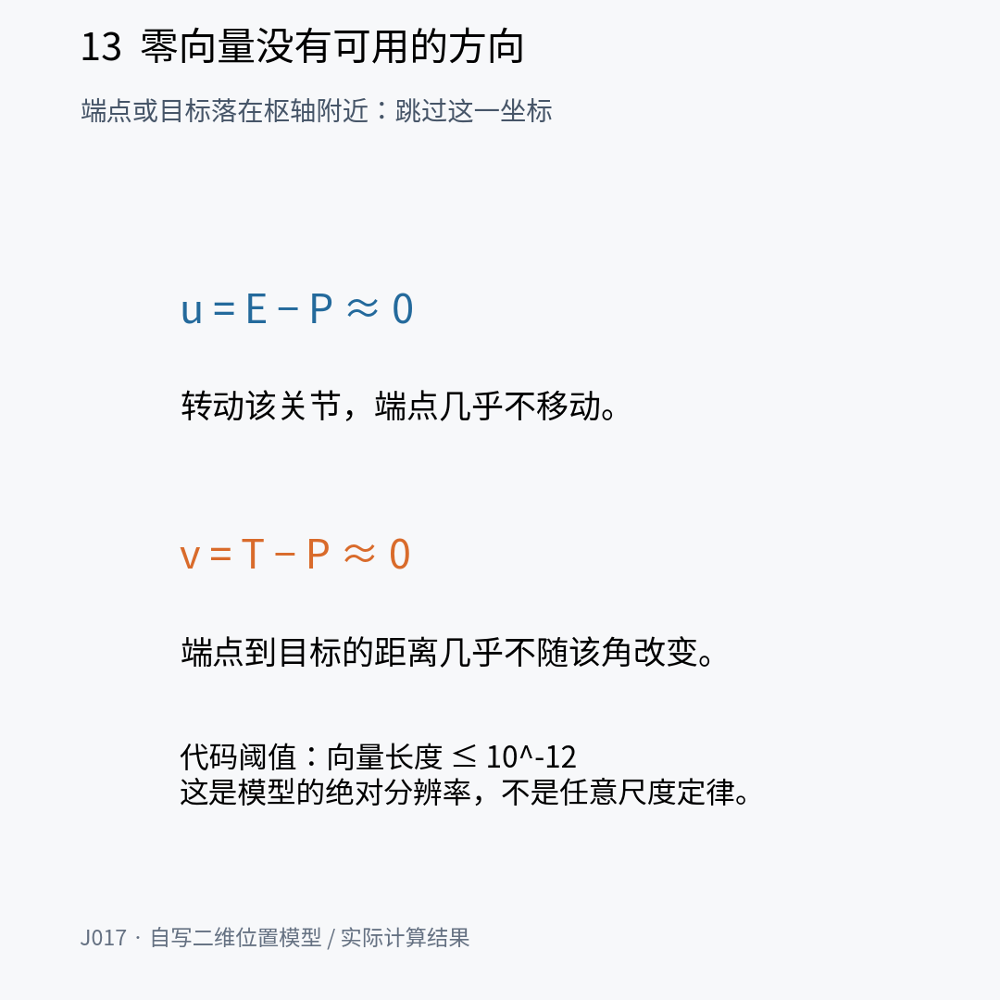

图13｜两种退化条件的区别：端点与枢轴重合时端点不动；目标与枢轴重合时距离不随角改变。代码保留旧角，没有凭空选择一个“朝向零向量”的角。

停止状态有三个：reached 是距离在容差内；stalled 是完整一轮的距离平方改善不超过10⁻¹²；budget 是耗尽用户给定的轮数。后两者都不等于“已证明无解”。到达检查在初始状态和每次尝试后执行；轮数为零也合法，意味着只检查初始姿态。

## 12．遍历顺序不是无关紧要的实现细节

从末端往根开始常常便于让末端附近的关节先工作，但这不是CCD这个数学思路唯一允许的顺序。换成从根到末端，仍然是逐坐标更新；由于后续坐标看见的是不同的中间姿态，结果可能不同。

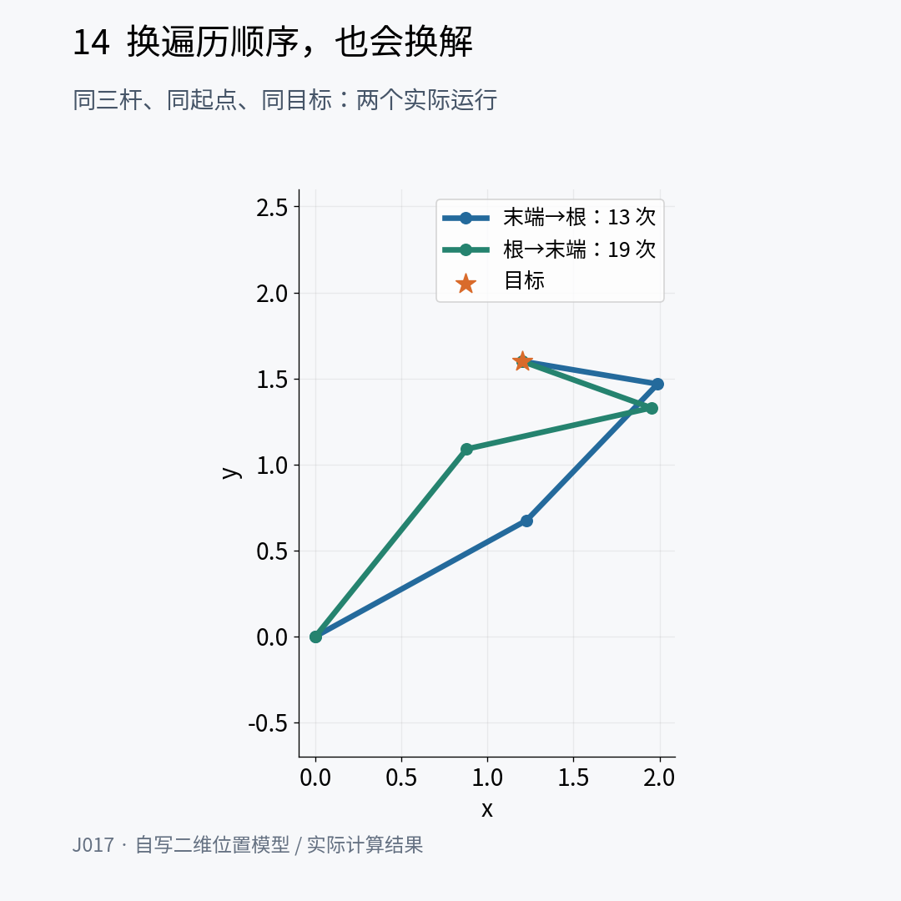

图14｜三杆同起点同目标，末端到根13次尝试达到阈值，根到末端19次达到阈值，最终姿态也不同。这里不能推广“反向总比正向快”，更不能据此决定真实人体动作是否自然。

位置误差小，只解决了“手在哪里”。手掌朝向、肘部姿态、关节偏好、碰撞、自碰撞、身体平衡都是其他要求。多个目标共享关节时，改善一只手可能拉坏另一只手；本文的单末端误差接受规则不能直接充当多目标系统的证明。

## 13．这份容易读懂的代码，付出了什么代价？

为了让每次候选都容易验证，代码每次都重新执行整条正向计算，一次FK为O(n)。一个关节至多比较固定数量的候选，一轮有n个关节，因此每轮O(n²)，K轮最坏O(Kn²)。这不是优化实现能达到的最低代价，也不是对所有CCD实现的统一复杂度结论。

为了画出每一步，返回值还存了完整轨迹：每个关节尝试都保存n个角与n+1个点。最多Kn次尝试，故轨迹占O(Kn²)空间；不保留轨迹时，当前状态与候选只需要O(n)额外空间。输入列表复制与初始检查是O(n)。不要因为算法名字短，就把这份带日志实现的时空代价也写短。

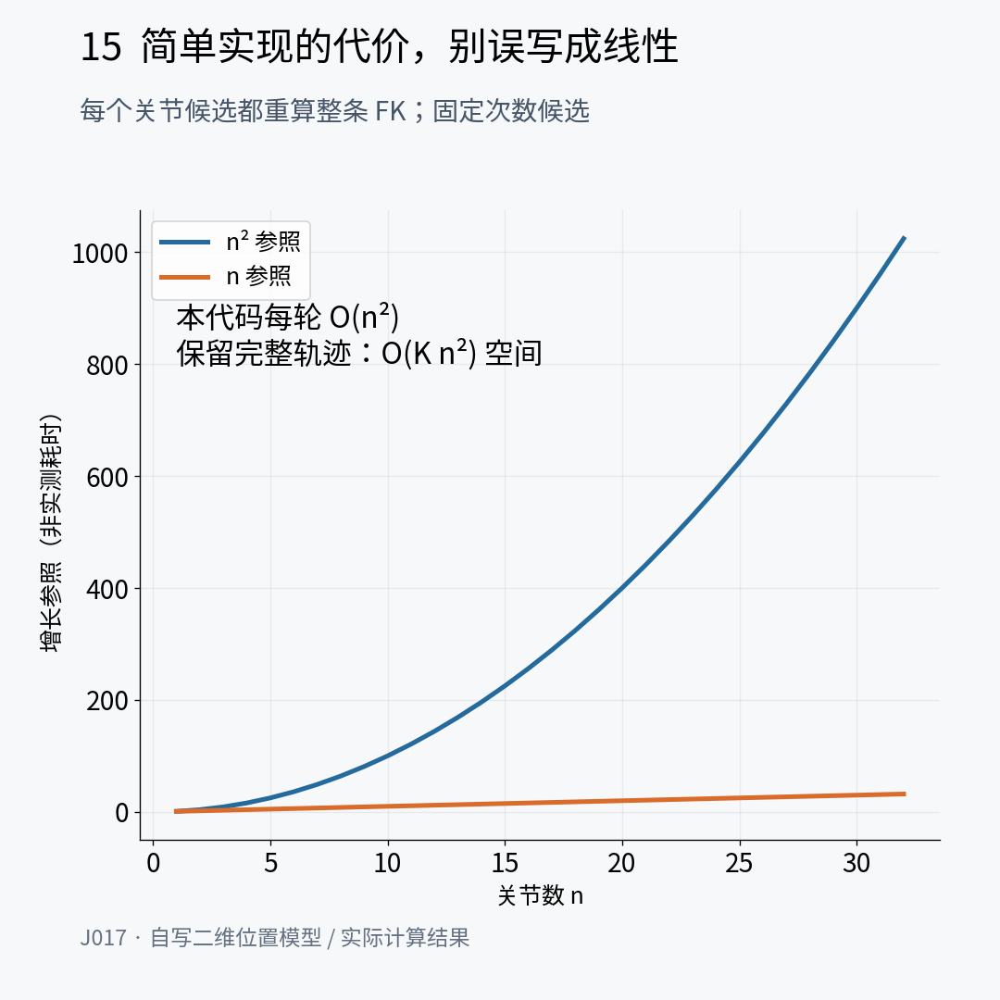

图15｜n与n²的增长参照，帮助读者理解本代码为何每轮是二次量级。纵轴不是毫秒、不是CPU计数器测量，也不是与其他算法的性能基准。

## 14．怎样测试，才能抓到一个看似会动的错误实现？

只看机械臂会不会朝目标动，远远不够。我们做了300个随机单关节问题，每个拿501个角的稠密网格作对照；参考位置用复数旋转连乘计算，避免直接重用FK的累计角公式。算法选出的误差应不高于任何网格候选，允许10⁻¹⁰的比较余量。150,300项比较通过，但有限网格仍然不是任意输入的完备证明。

另外运行200个随机完整问题，检查每个记录的误差不增、每根杆长度保持；显式边界覆盖反向射线、目标落在关节、端点近枢轴、零轮预算、已经到达、可达停滞、固定重启、外部目标下界。它们与正文的具体数值来自同一份实际运行，而不是手工填进图里的理想答案。

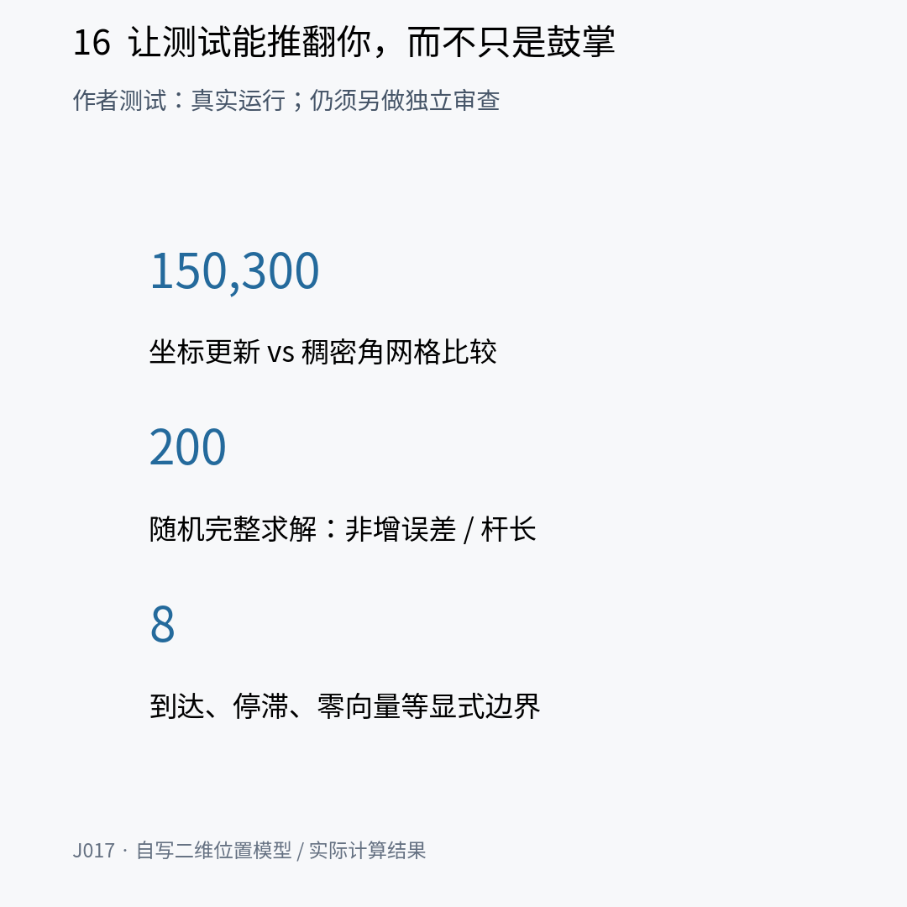

图16｜作者本地测试规模：150,300次稠密角网格比较、200次随机完整求解，以及8类显式边界。作者测试不是独立审查，也没有覆盖真实GPU、游戏引擎或机械臂硬件。

如果你想自己改一次代码，建议先故意做两件坏事：把 atan2 的叉积符号反过来；再把受限候选改成简单clamp。前者会被上下对称目标抓住，后者会被图12抓住。能指出“哪一项测试应该失败”，比看十条顺滑动画更能说明你理解了算法。

## 15．从这篇继续探索

把多余杆件的局部角固定住，相当于缩小可以协调的空间；放开它们又会增加多解与不自然姿态。反向运动学的难点不只是“把误差压低”，还在于你到底允许哪些解、希望选哪一个、愿意花多少时间找。

本文的收获可以浓缩成一个操作习惯：**每改一个角，重新计算真实末端；每说一次成功，先说清楚成功的是哪个条件。**

## 短导读｜让关节一个个试，为什么仍会卡住？

把一个三节机械臂的手移到星星上，可以不先解三个角的联立方程。CCD的做法是：暂时固定其他局部角，只转一个关节，让末端离目标更近；重新计算姿态，再轮到下一个关节。

二维中，令u为“关节到末端”的向量，v为“关节到目标”的向量，最短有符号转角来自atan2(ux·vy−uy·vx, ux·vx+uy·vy)。叉积负责区分转向，点积负责区分夹角区域。方向对齐不代表距离也对上：末端仍在自己的旋转圆上。

长文用同一份可运行Python和16幅真实计算图，带你看三个容易误判的地方：

- 三杆目标在总长度之外，距离至少0.9；这个无解结论来自几何，不来自程序“停了”。
- 两杆的目标明明可达，但每个角单独改变都不能改善；换一个起点能在这个例子中脱困，却不是一般保证。
- 当前170°、目标−170°时，先得到190°再简单夹到175°会选错；合法等价角−170°反而能精确到达。

“reached”“stalled”“budget”分别说的是容差内到达、改善过小、轮数耗尽。只有第一个是在本文位置任务意义上的成功；后两个不能自动翻译成“目标不可达”。本文只做二维位置几何，不模拟真实机械设备、关节力矩、碰撞或人体自然动作。


## 完整可运行代码：ccd_lab.py

将下面内容保存为ccd_lab.py，使用Python 3运行；只需标准库。solve是公开入口，fk与joint_step为已验证参数下的内部教学函数。

```python
"""Original educational 2-D CCD; positions only, not a robot controller."""
import math
PI = math.pi
TAU = 2 * PI

def wrap(a):
    return (a + PI) % TAU - PI

def fk(lengths, angles):
    x = y = heading = 0.0
    points = [(x, y)]
    for length, angle in zip(lengths, angles):
        heading += angle
        x += length * math.cos(heading)
        y += length * math.sin(heading)
        points.append((x, y))
    return points

def error2(point, target):
    return sum((a-b)**2 for a, b in zip(point, target))

def joint_step(lengths, angles, target, joint, interval=None):
    """Internal routine: assumes validated, feasible state from solve()."""
    points = fk(lengths, angles)
    p, e = points[joint], points[-1]
    u = (e[0]-p[0], e[1]-p[1])
    v = (target[0]-p[0], target[1]-p[1])
    old = error2(e, target)
    # Below this model's absolute resolution, keep the current coordinate.
    if math.hypot(*u) <= 1e-12 or math.hypot(*v) <= 1e-12:
        return angles[:], old
    delta = math.atan2(u[0]*v[1]-u[1]*v[0], u[0]*v[0]+u[1]*v[1])
    desired = angles[joint] + delta
    if interval is None:
        candidates = [wrap(desired)]
    else:
        lo, hi = interval
        candidates = [lo, hi]
        candidates += [desired+k*TAU for k in range(-2, 3)
                       if lo <= desired+k*TAU <= hi]
    # Keeping the old value protects against floating-point increases.
    best, best_error = angles[:], old
    for value in candidates:
        trial = angles[:]
        trial[joint] = value
        cost = error2(fk(lengths, trial)[-1], target)
        if cost < best_error:
            best, best_error = trial, cost
    return best, best_error

def solve(lengths, initial, target, limits=None, sweeps=80,
          tolerance=1e-6, reverse=True):
    """Public entry. Angles in radians; y up; relative joint angles.
    Limits are None or one closed interval per joint inside [-pi, pi].
    Returned trace includes initial state and every attempted joint update.
    """
    lengths, angles, target = list(lengths), list(initial), tuple(target)
    n = len(lengths)
    def finite(x):
        return isinstance(x, (int, float)) and not isinstance(x, bool) and math.isfinite(x)
    if not 1 <= n <= 32 or len(angles) != n or len(target) != 2:
        raise ValueError('shape')
    if not all(finite(x) and 1e-6 <= x <= 1000 for x in lengths):
        raise ValueError('lengths')
    if not all(finite(x) and -PI <= x <= PI for x in angles):
        raise ValueError('angles')
    if not all(finite(x) and abs(x) <= 1e4 for x in target):
        raise ValueError('target')
    if type(sweeps) is not int or not 0 <= sweeps <= 10000:
        raise ValueError('sweeps')
    if not finite(tolerance) or not 1e-10 <= tolerance <= 1:
        raise ValueError('tolerance')
    if type(reverse) is not bool:
        raise ValueError('order')
    limits = [None]*n if limits is None else list(limits)
    if len(limits) != n:
        raise ValueError('limits shape')
    for q, lim in zip(angles, limits):
        if lim is not None:
            if len(lim) != 2 or not all(finite(x) for x in lim):
                raise ValueError('limit pair')
            lo, hi = lim
            if not -PI <= lo <= q <= hi <= PI:
                raise ValueError('infeasible limits/initial state')
    def record(sweep, joint):
        points = fk(lengths, angles)
        return dict(sweep=sweep, joint=joint, angles=angles[:],
                    points=points, error2=error2(points[-1], target))
    trace = [record(0, None)]
    if trace[-1]['error2'] <= tolerance**2:
        return dict(status='reached', trace=trace)
    order = range(n-1, -1, -1) if reverse else range(n)
    for sweep in range(1, sweeps+1):
        before = trace[-1]['error2']
        for joint in order:
            angles, cost = joint_step(lengths, angles, target, joint, limits[joint])
            trace.append(record(sweep, joint))
            if cost <= tolerance**2:
                return dict(status='reached', trace=trace)
        if before - trace[-1]['error2'] <= 1e-12:
            return dict(status='stalled', trace=trace)
    return dict(status='budget', trace=trace)

if __name__ == '__main__':
    result = solve([1.4, 1.1, .8], [.2, -.5, .7], (1.2, 1.6))
    print(result['status'], len(result['trace'])-1,
          math.sqrt(result['trace'][-1]['error2']))
```

## 复现实验：checks/experiments.py

在ccd_lab.py旁创建checks目录，把下段保存为checks/experiments.py，运行python checks/experiments.py。只使用标准库，将测试记录写入checks/results.json和tests.json；运行会覆盖同名实验记录，不操作网络或外部平台。

```python
import sys, pathlib, math, random, json
sys.path.insert(0,str(pathlib.Path(__file__).resolve().parents[1]))
from ccd_lab import *
P=pathlib.Path(__file__).resolve().parents[1]
rng=random.Random(17023)
# Independent dense angular sampling: chosen one-coordinate result must beat grid.
cases=0
for _ in range(300):
 n=rng.randint(1,5); L=[rng.uniform(.2,2) for _ in range(n)];q=[rng.uniform(-PI,PI) for _ in L]; t=(rng.uniform(-4,4),rng.uniform(-4,4)); j=rng.randrange(n)
 lo=rng.uniform(-PI,q[j]);hi=rng.uniform(q[j],PI); lim=(lo,hi) if _%2 else None
 out,cost=joint_step(L,q,t,j,lim)
 a,b=(-PI,PI) if lim is None else lim
 for k in range(501):
  qt=q[:];qt[j]=a+(b-a)*k/500
  # Complex products, rather than fk's accumulated angle sum.
  z=0j;heading=1+0j
  for length,angle in zip(L,qt):heading*=complex(math.cos(angle),math.sin(angle));z+=length*heading
  ref=abs(z-complex(*t))**2
  assert cost<=ref+1e-10,(cost,ref)
  cases+=1
for _ in range(200):
 L=[rng.uniform(.1,2) for i in range(rng.randint(1,6))];q=[rng.uniform(-PI,PI) for l in L]; t=[rng.uniform(-5,5),rng.uniform(-5,5)];r=solve(L,q,t)
 for a,b in zip(r['trace'],r['trace'][1:]):assert b['error2']<=a['error2']
 for a in r['trace']:
  for i,l in enumerate(L):assert abs(math.dist(a['points'][i],a['points'][i+1])-l)<1e-12
main=solve([1.4,1.1,.8],[.2,-.5,.7],(1.2,1.6))
locked=solve([2,1],[0,PI],(1.5,0))
perturb=solve([2,1],[.1,PI-.1],(1.5,0),sweeps=200)
external=solve([1.4,1.1,.8],[.2,-.5,.7],(4.2,0),sweeps=200)
limited=solve([1,1],[0,0],(0,1.8),limits=[(-.2,.2),(-.3,.3)],sweeps=100)
forward=solve([1.4,1.1,.8],[.2,-.5,.7],(1.2,1.6),reverse=False)
zero=solve([1,1],[0,PI],(0,0))
assert locked['status']=='stalled' and abs(locked['trace'][-1]['error2']-.25)<1e-14
assert perturb['status']=='reached'
assert abs(math.sqrt(external['trace'][-1]['error2'])-.9)<1e-8
assert zero['status']=='reached' and len(zero['trace'])==1
# Opposite ray, exact target at joint, budget zero, stationary zero endpoint.
assert abs(joint_step([1],[0],(-1,0),0)[1])<1e-28
assert joint_step([1],[0],(0,0),0)[0]==[0]
assert solve([1],[0],(0,1),sweeps=0)['status']=='budget'
assert joint_step([1,1],[0,PI],(1,1),0)[0]==[0,PI]
results=dict(main=main,locked=locked,perturb=perturb,external=external,limited=limited,forward=forward,zero=zero)
(P/'checks/results.json').write_text(json.dumps(results,indent=2))
(P/'checks/tests.json').write_text(json.dumps(dict(dense_grid_comparisons=cases,random_full_solves=200,explicit_boundary_cases=8,status='AUTHOR_TESTS_PASS'),indent=2))
print({k:(v['status'],len(v['trace'])-1,math.sqrt(v['trace'][-1]['error2'])) for k,v in results.items()});print('grid',cases)
```

---

[来源、材料权利与编写说明](sources.md)
