# 共轭梯度：每一步都下坡，为什么还要记住上一步的方向？

电脑要求解一大组线性方程，你可能会说：求逆矩阵不就行了？数学上可以写，计算时却通常不该先把逆矩阵造出来。今天先不碰“大”字，拿两个未知数把每一步走清楚。等你看见为什么某些方向不会互相返工，再回头看成千上万个未知数，问题就没那么神秘了。

本文只讨论实数、对称正定矩阵的线性共轭梯度法（CG）。不是神经网络里的随机梯度下降，也不是所有非线性优化问题都能直接套用的算法。图里的数值来自文末自写程序；没有声称跑过某款工程软件。


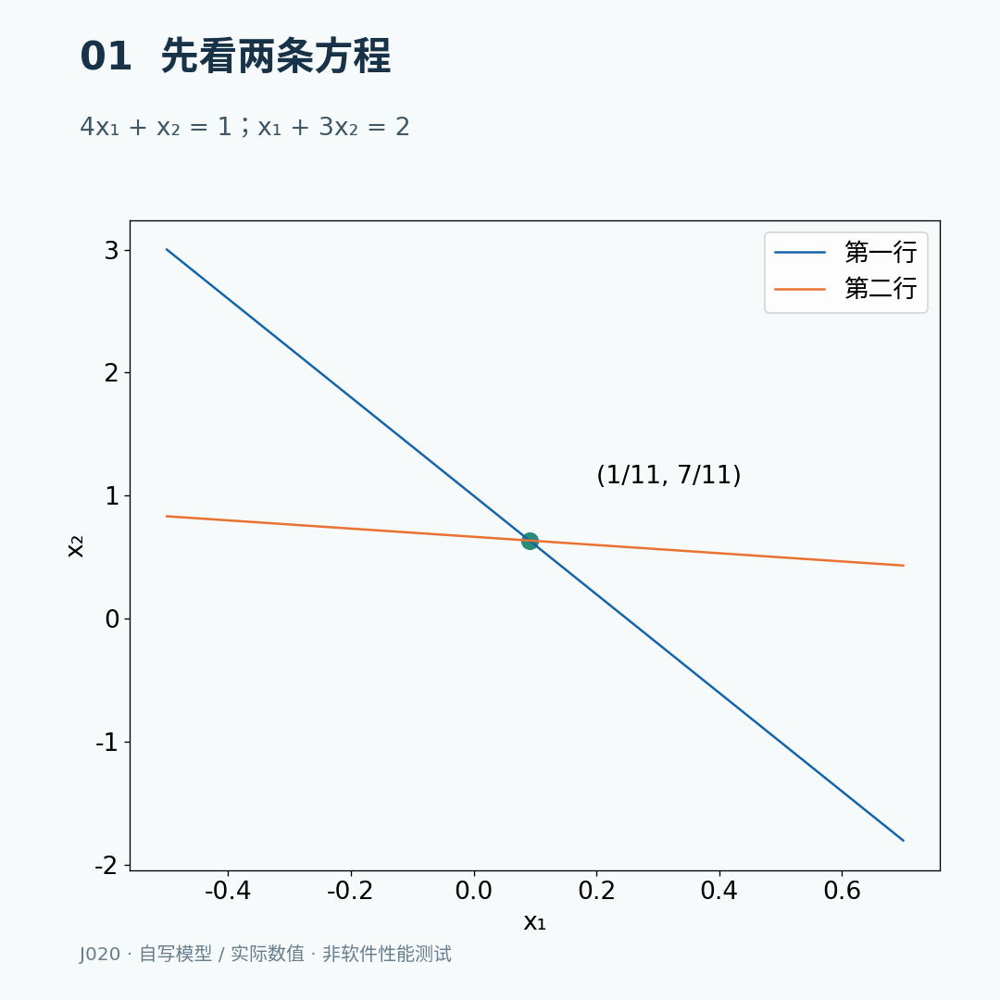

图1｜本文自己的二元系统，交点为(1/11,7/11)。


## 1. 两条直线的交点，为什么也是碗底？

用 A=[[4,1],[1,3]]，b=(1,2)。也就是4x₁+x₂=1、x₁+3x₂=2。消元得到x*=(1/11,7/11)，先把答案留在旁边，作为核对尺。

现在定义一个分数：f(x)=½xᵀAx−bᵀx。这里xᵀAx就是先算Ax，再与x逐项相乘求和；不是新的神秘运算。展开本例，f=2x₁²+x₁x₂+1.5x₂²−x₁−2x₂。

对称性让梯度恰好成为Ax−b。于是梯度为零的地方，正好满足原方程。可是零梯度也可能是山顶或鞍点，还需要“正定”：每个非零向量v都满足vᵀAv>0。它保证离开解之后，分数增加：

f(x)−f(x*)=½(x−x*)ᵀA(x−x*)>0。

所以这是一个有唯一碗底的地形，不是到处有坑的任意地形。本例vᵀAv=4(v₁+v₂/4)²+(11/4)v₂²，非零v下确实为正。


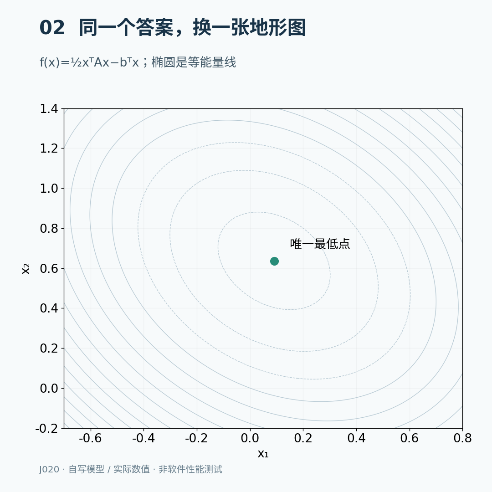

图2｜独立计算的二次函数等高线；正定使解成为唯一最低点。


## 2. “还差多少”可以告诉我们往哪走

当前估计x代回方程，得到Ax。与右端b的差r=b−Ax，叫残差。它不是解误差x−x*：前者衡量方程还差多少，后者衡量答案错了多少。

因为∇f=Ax−b，所以r就是负梯度，局部最陡的下坡方向。从x₀=(0,0)出发，r₀=(1,2)。先沿它走，写成x(α)=x₀+αr₀。方向定了，只剩一个数α要选。


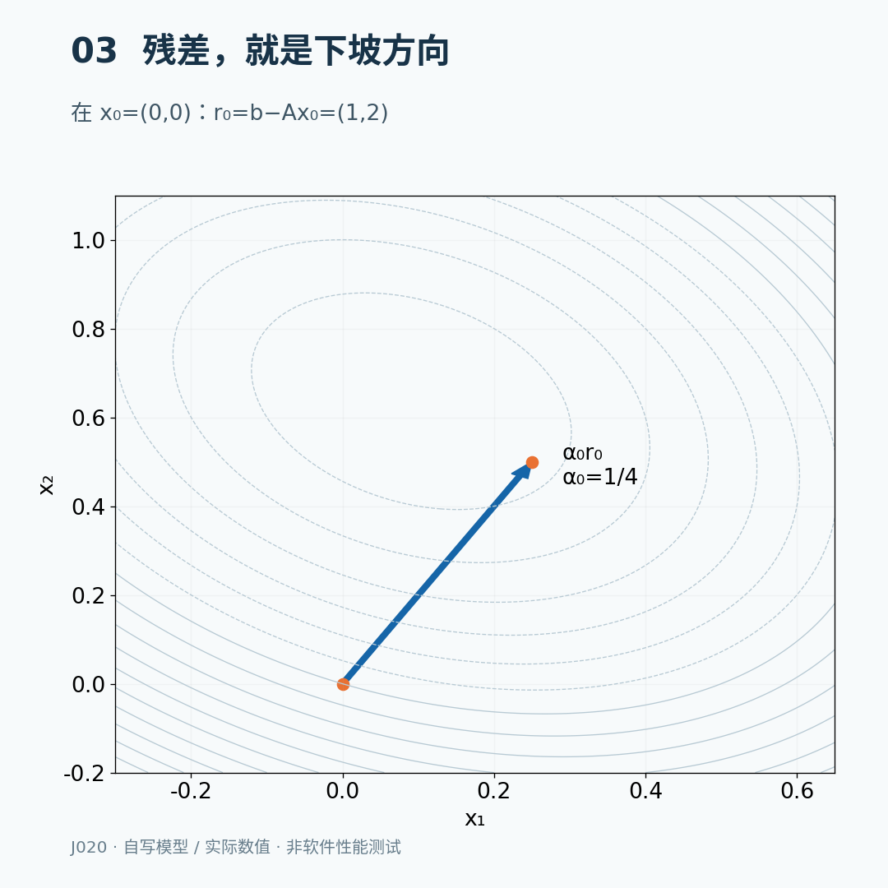

图3｜负梯度r₀与第一步位移同向，箭长为α₀r₀而非r₀本身。


把这条直线代进f，得到10α²−5α。它的导数是20α−5，故α₀=1/4。于是x₁=(1/4,1/2)，新残差r₁=(-1/2,1/4)。

一般地，沿非零p做精确的一维搜索，把f(x+αp)对α求导：pᵀ(Ax−b)+αpᵀAp=0，得到α=(pᵀr)/(pᵀAp)。正定使分母为正，沿线确有唯一最低点。若p=r，就成为α=(rᵀr)/(rᵀAr)。这叫最速下降，不是“随便选个学习率”。


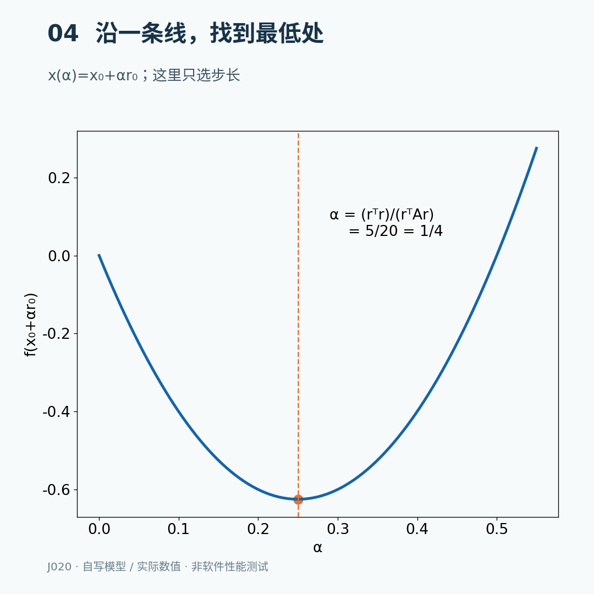

图4｜沿r₀的能量为10α²−5α；最优步长1/4。


## 3. 每次都挑最陡，为什么还在折返？

换一个便于看清问题的碗：A=diag(1,25)，b=0，解在原点，从(-2,1)出发。第二个坐标的曲率是第一个的25倍。最陡的方向受陡峭轴牵引，精确选好步长后，下一步又朝另一边。

这不是程序走错了。每一次都把当前那一条线走到了最好，只是“当前这条线最好”并不等于“接下来不用返工”。图5是真实最速下降的前12步；与图1不是同一个矩阵，别把两张图的坐标混在一起。


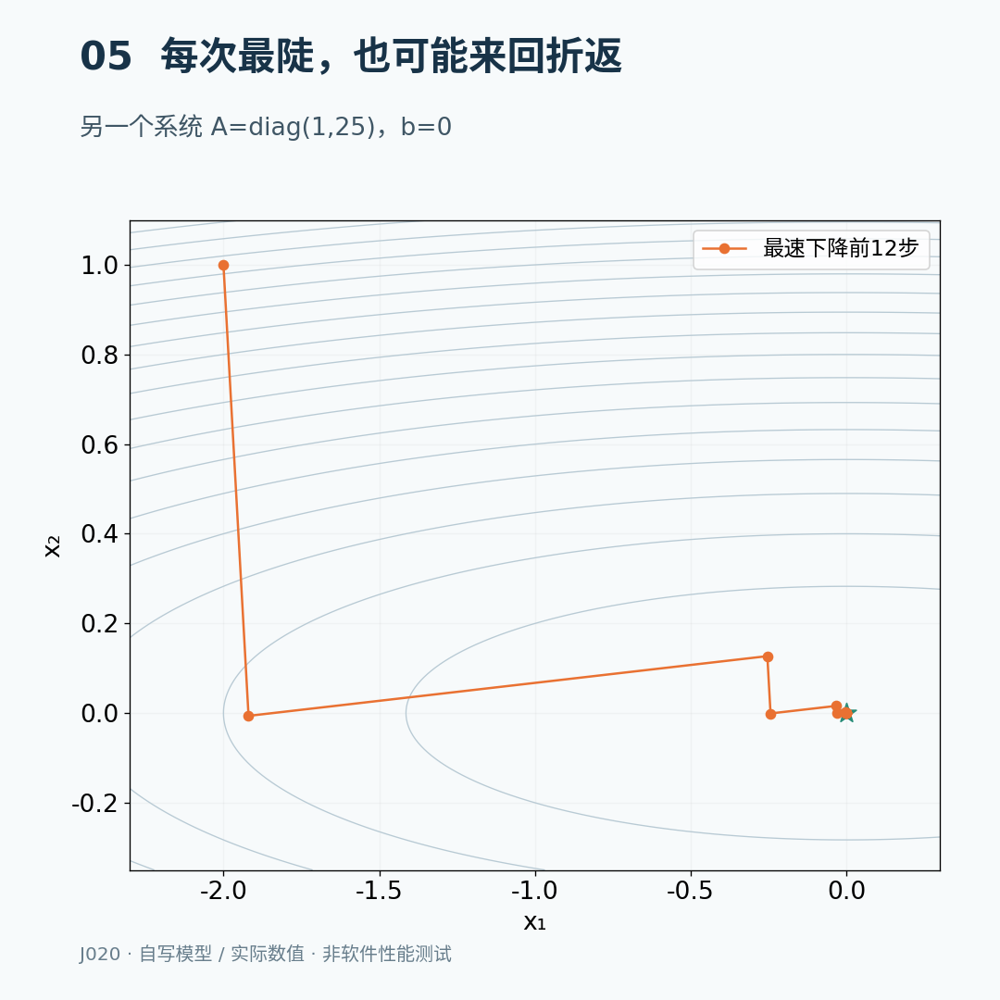

图5｜相同谷地上最速下降的真实轨迹，逐步精确线搜索仍会折返。


## 4. 需要的不是普通垂直，而是A共轭

我们希望先沿p解决一个方向的问题，再沿q走时，不把刚做好的部分搅乱。看二次式f(x+sp+tq)：其中把s和t耦合起来的交叉项是st·pᵀAq。如果pᵀAq=0，这两个方向的系数便不通过这项互相影响。这叫A共轭，也叫在A内积下正交。

普通垂直检查pᵀq=0；A共轭检查pᵀAq=0。A改变了衡量方向的尺，不能从画纸上夹角是否90度判断。

回到原来的二元系统，取p₀=r₀=(1,2)。下一方向不是直接用r₁，而是p₁=r₁+β₁p₀。要求p₀ᵀAp₁=0，就得β₁=1/16。因此p₁=(-7/16,3/8)。两方向的普通内积为5/16，不是0；A内积却正好为0。


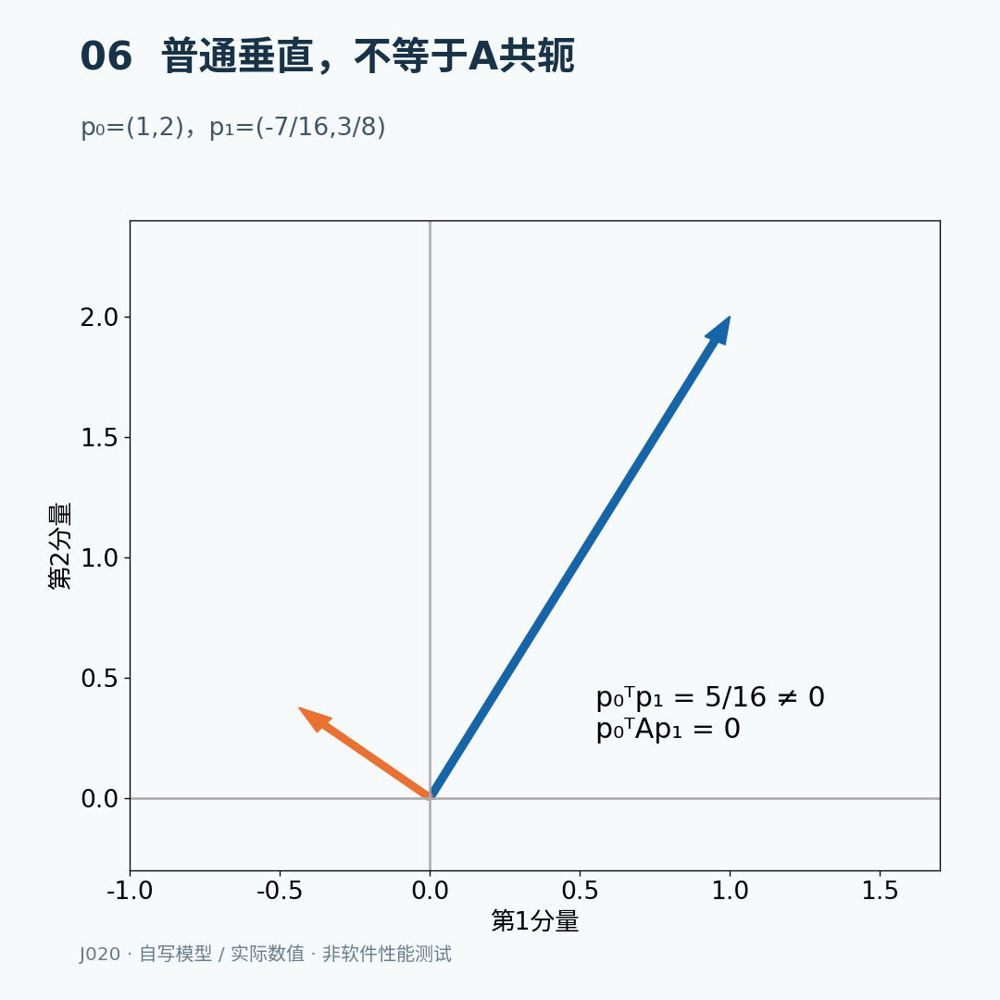

图6｜两个实际CG方向并非欧氏垂直，却在A度量下共轭。


沿p₁的步长α₁=(r₁ᵀr₁)/(p₁ᵀAp₁)=4/11。更新以后：x₂=(1/4,1/2)+(4/11)(-7/16,3/8)=(1/11,7/11)。两步走到刚才消元得到的答案。


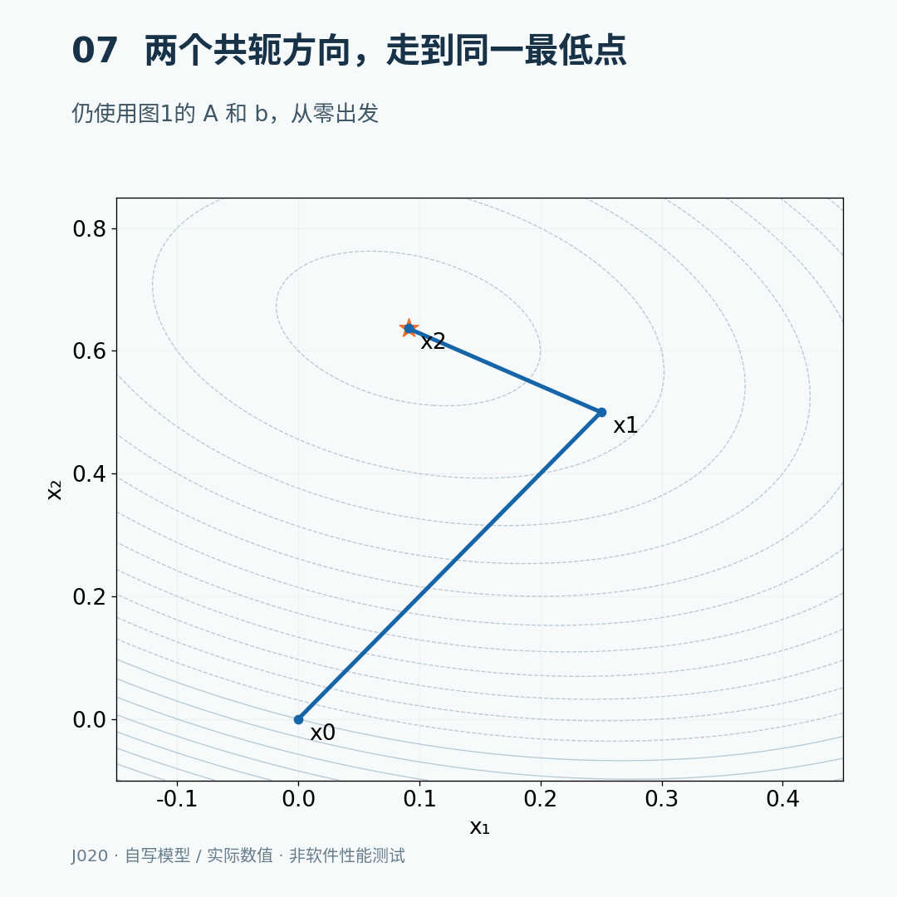

图7｜实际二元CG的两步轨迹，不代表任意浮点系统都按维数结束。


## 5. 不用相信示意箭头，把账列出来

r₀ᵀr₀=5，r₁ᵀr₁=5/16，故β₁=(5/16)/5=1/16。p₁ᵀAp₁=55/64，故α₁=(5/16)/(55/64)=4/11。图8把每次x与r都留下来，文末程序也保存了同样的trace。小例子值够小，能逐项复算，比记住一串字母可靠。

注意：共轭的是搜索方向p，普通CG中不同步的残差在精确算术下是欧氏正交的；不要把“残差互相共轭”当成名字的解释。


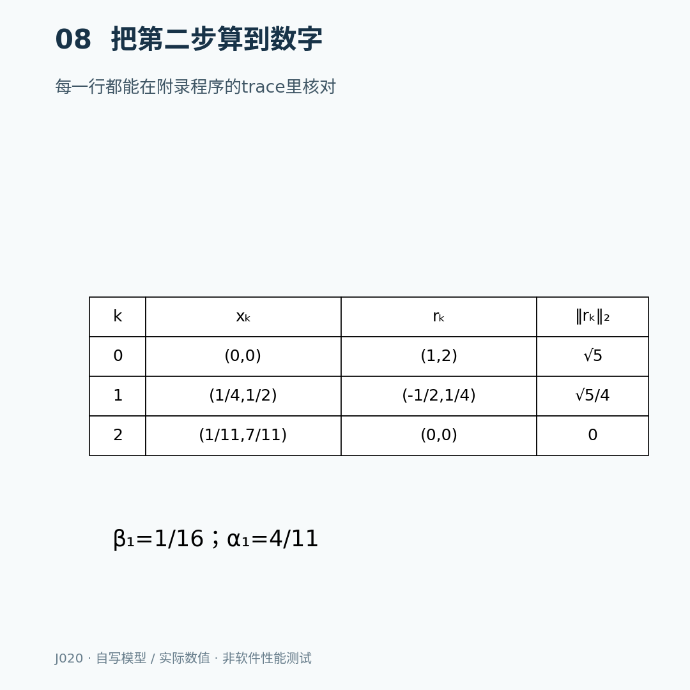

图8｜二元例的全部迭代，第二步参数β₁=1/16、α₁=4/11。


## 6. 两步的巧合，怎样推广成n维的办法？

对于固定SPD矩阵，非零、两两A共轭的方向线性无关。n维空间最多有n个这样的方向。沿每个方向把对应的一维问题解决，后面的共轭方向不把已解决的坐标重新耦合进来。因此，在精确算术、精确执行且尚未提前到解的理想条件下，CG至多n步结束；也可能更早。

这段论证解释的是线性代数性质，不是给实际电脑签“第n步必须停止”的保证书。舍入之后，方向不再完全共轭；第11图会给出超过n步的真运行。


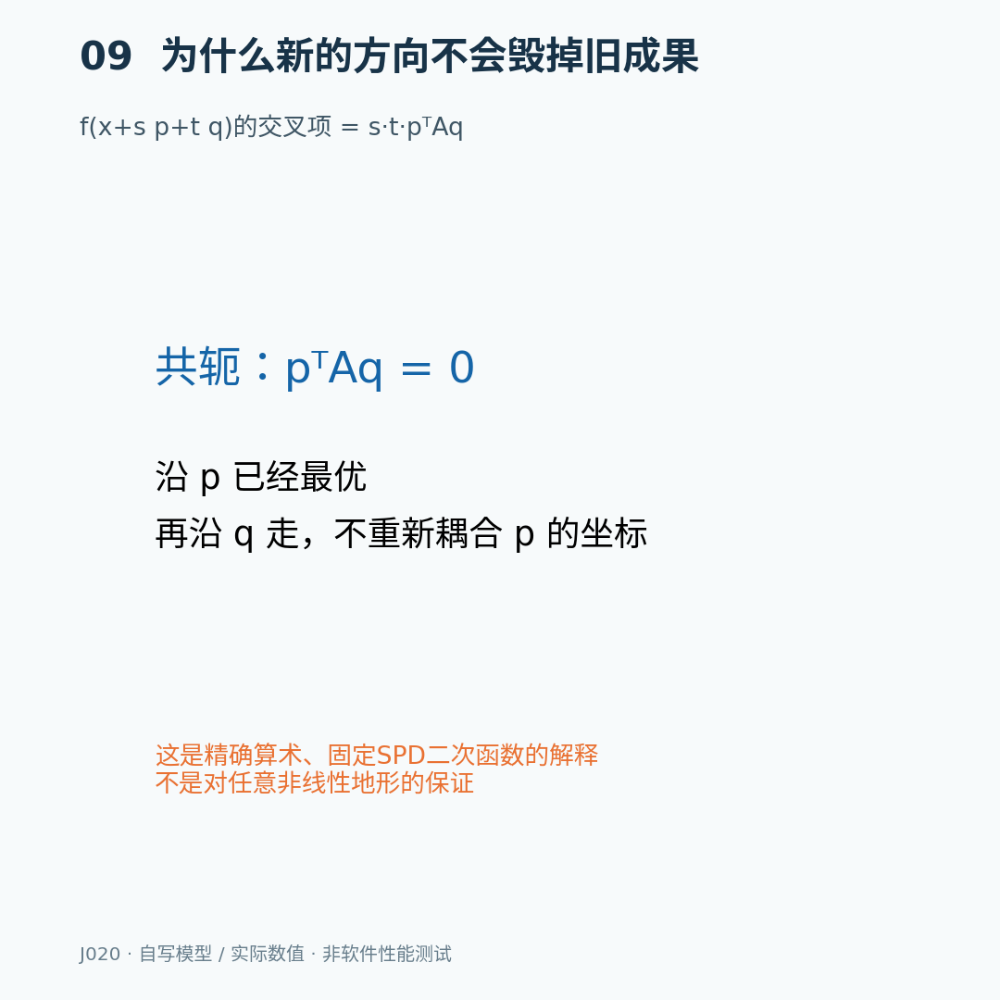

图9｜展开二次式即可看到混合项为零；这是共轭方向不互相返工的含义。


CG的好处还在于，不必每次把全部过去方向拿来做一遍正交化。在SPD的二次问题中，残差和搜索空间的正交关系让短递推足够。普通CG的配方是：

1. r₀=b−Ax₀，p₀=r₀。
2. αₖ=(rₖᵀrₖ)/(pₖᵀApₖ)。
3. xₖ₊₁=xₖ+αₖpₖ；rₖ₊₁=rₖ−αₖApₖ。
4. 若已达到停止条件，立刻结束，不再拿零残差做下一轮除法。
5. βₖ₊₁=(rₖ₊₁ᵀrₖ₊₁)/(rₖᵀrₖ)；pₖ₊₁=rₖ₊₁+βₖ₊₁pₖ。

这里α公式把一般线搜索分子pᵀr写成rᵀr，依靠的是CG在上述条件下维持的正交关系；随意造个方向p，不可以照抄这个替换。β让新残差保留一部分旧方向，恰好消掉所需的耦合，不是经验动量系数。


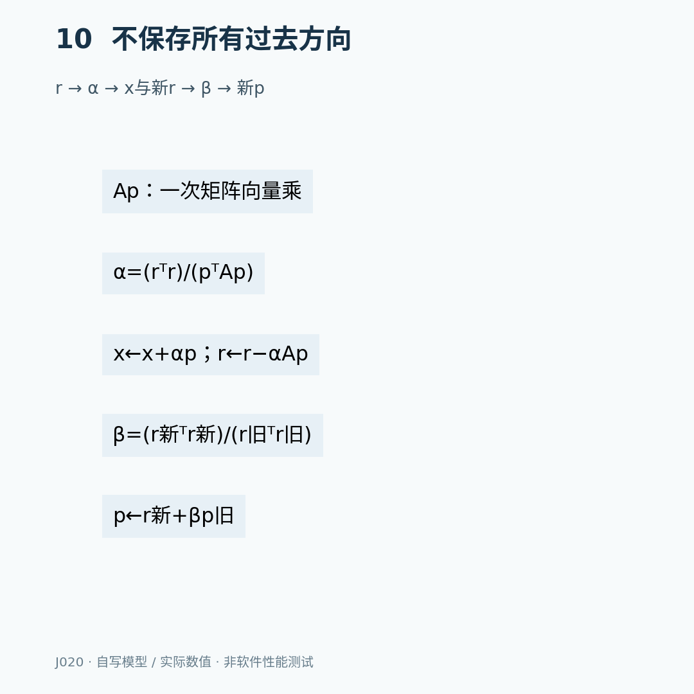

图10｜普通CG的短递推；已收敛时必须在除法之前停止。


## 7. 浮点数会把“至多n步”变成什么？

我们造一个24维对角矩阵，对角项按等比排列从1到10⁸，令b等于这些对角项，已知解就是全1。从零出发，双精度CG按真实残差阈值10⁻¹²‖b‖₂停止，本次实际走了96步，而不是24步。

这个结果是本环境、自写代码及给定输入的可复现实验，不是所有机器/CG实现都必须得到96。舍入改变了方向间的共轭性，也影响递推残差；高条件数让小误差更难处理。残差曲线还会上下起伏：即便理想CG每步改善A范数误差，也不能顺便断言欧氏残差范数每一步都下降。

条件数κ₂(A)=λ最大/λ最小描述最陡和最平的尺度差，对SPD矩阵很好理解。但收敛不只由一个比值决定，特征值是否成簇、初始误差落在哪些方向也重要。本文不把一个例子的步数拟合成通用性能公式。


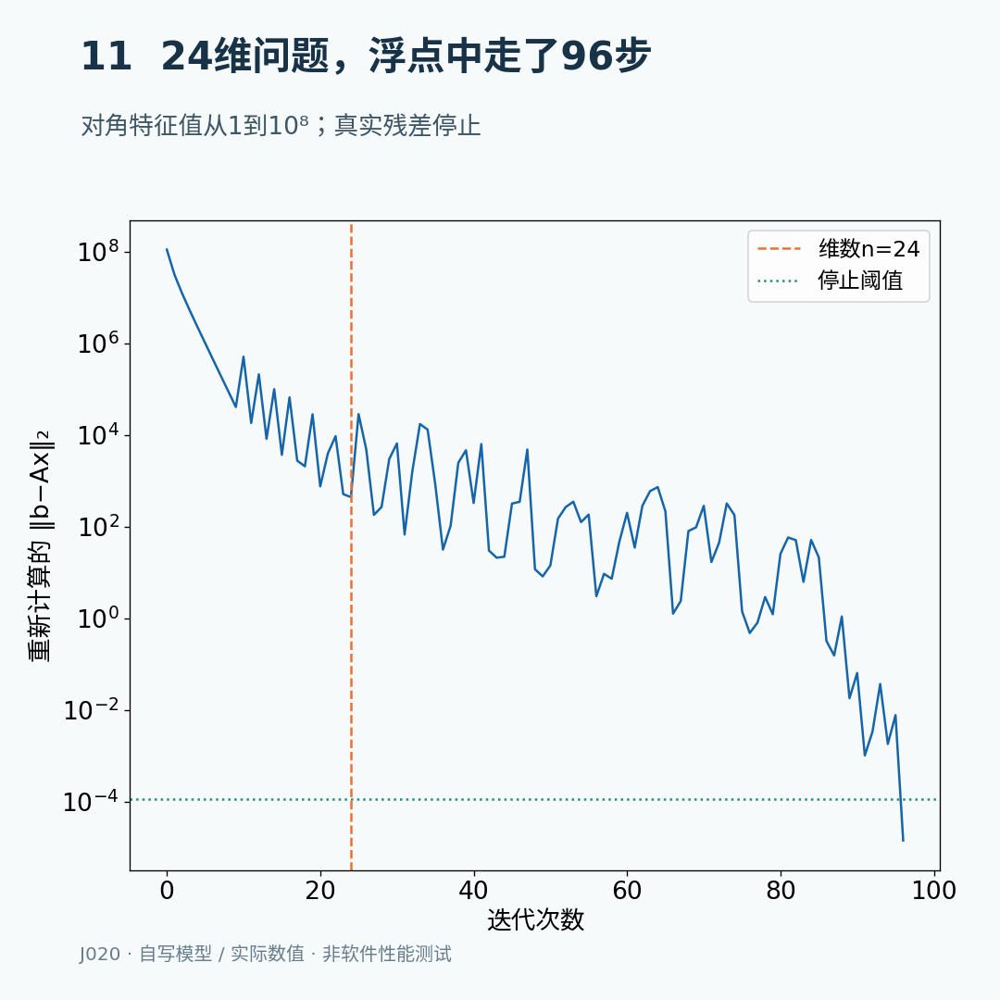

图11｜本机双精度实际运行96步满足阈值，超过维数24；残差未必逐步下降。


## 8. 程序说残差小，我能放心相信解了吗？

设A=diag(10⁻⁸,1)，真解(1,1)，你猜成(0,1)。解误差长度是1，残差长度却只有10⁻⁸。原因是小特征值把这个方向上的误差压缩了。

由r=-A(x−x*)可得‖x−x*‖₂≤‖r‖₂/λ最小；如果最小特征值很小，残差阈值本身就不能给出同样小的解误差。工程问题还要结合量纲、数据误差和要求设定阈值，不是把rtol写得越小越好。

本程序的判据为‖b−Ax‖₂≤max(atol,rtol·‖b‖₂)，相对尺度选的是右端b，不是初始残差。b=0时相对项为零，可显式给atol。maxiter耗尽只返回未收敛，不能改名叫成功。


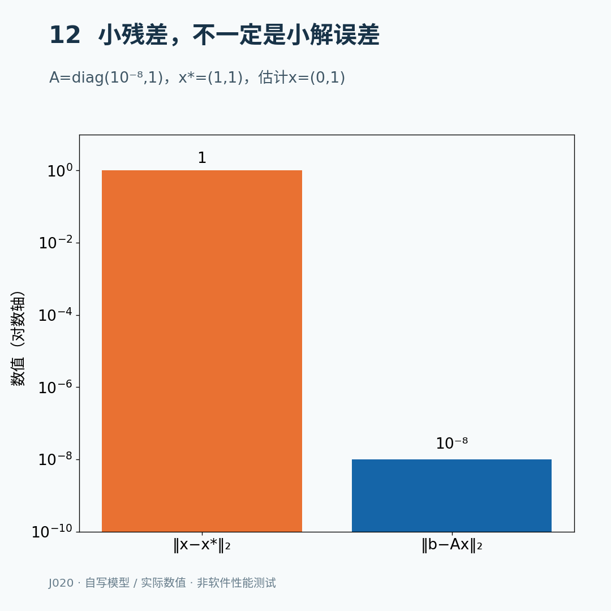

图12｜小特征值可把明显解误差压成很小残差，阈值需要结合尺度和条件性。


还有两个不同的“残差”：递推更新的r，与重新计算的b−Ax。数学上相同，浮点里可能分开。图13直接画两者差值。

为了让教学日志诚实，附录每一步额外做一次Ax，用重新计算的残差判停，递推仍照CG进行。这多花一次矩阵向量乘；它能避免只因递推值虚假接近零就宣布成功，却不会自动修复方向共轭性。本程序不偷偷重启、不把预设次数用完后当成成功。如果递推内积已非正但真实残差还没达标，明确返回breakdown；生产实现可考虑有根据的残差替换、重启或更合适的求解器。


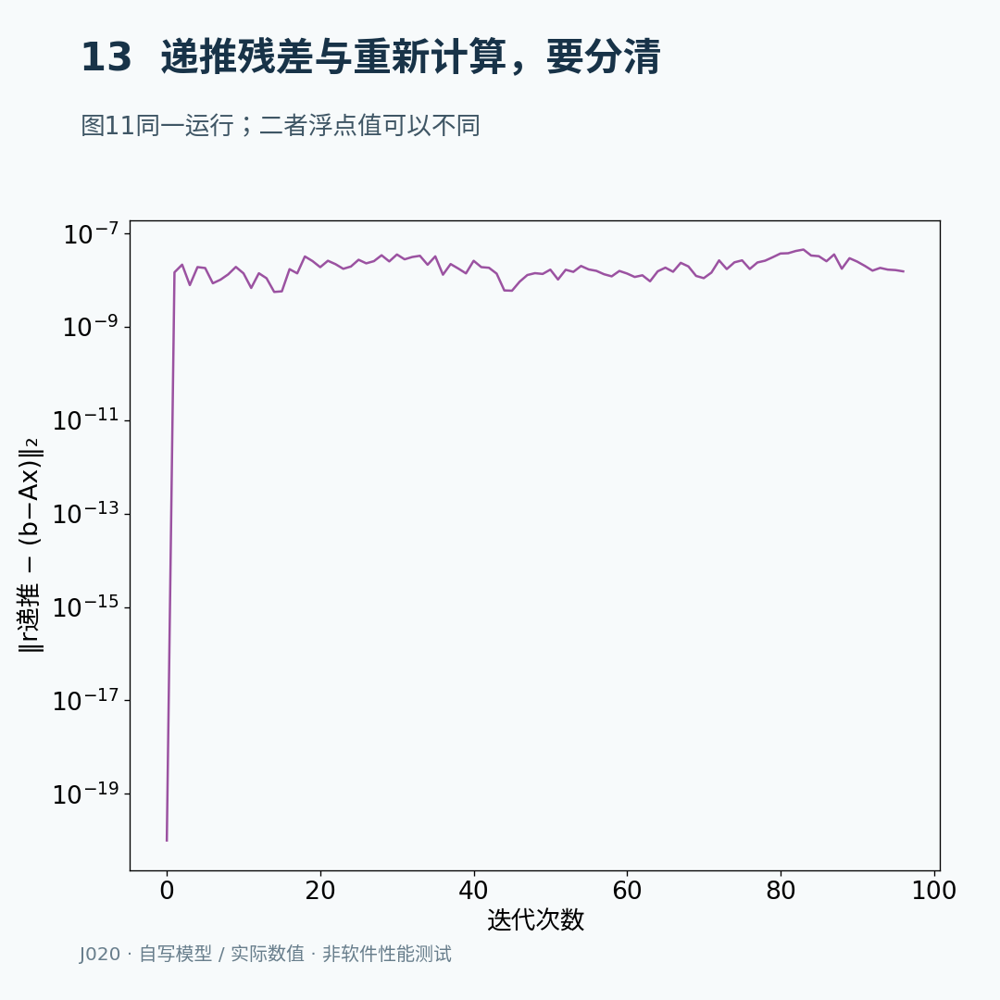

图13｜同一轨迹中的残差差距；零差距仅为对数显示截到10⁻²⁰，判停使用未裁切的重新计算残差。


## 9. 预条件不是“再求一个逆”，而是便宜地换把尺

如果各坐标尺度差很多，可以找一个SPD矩阵M，让“解Mz=r”很便宜，同时让变换后系统更容易求解。最简单的Jacobi预条件取M=diag(A)，只是逐项除以对角元素，不需要形成完整逆矩阵。

PCG改用z=M⁻¹r，初始p=z；令ρ=rᵀz，则α=ρ/(pᵀAp)，β=ρ新/ρ旧，新方向p=z新+βp旧。不能只把r除一下而保留全部普通CG公式。

严格理解时，它对应对称变换M⁻¹ᐟ²AM⁻¹ᐟ²；直接把M⁻¹A交给要求普通欧氏对称的CG接口，未必合格，因为M⁻¹A一般不对称。附录实现的是上述PCG递推。

在我们的对角例中，M恰好等于A，预条件后成为单位矩阵，所以一次就足够。它是一个有意选择的“理想校准”实验，不证明Jacobi对所有问题都强大。对非对角耦合主导的问题，可能改善不大；更复杂预条件器还要算构建、应用、存储成本。


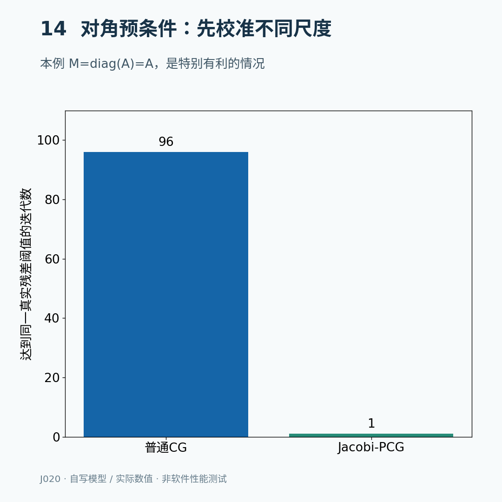

图14｜对角矩阵用自身对角预条件，一步收敛；不能推广为Jacobi总有效。


## 10. 真正的大问题，贵在哪里？

普通CG每轮主要是一回Ap，另加若干长度n的点积和向量更新。若A按稀疏格式存储，有s个非零项，理想的矩阵向量乘量级为O(s)，向量工作O(n)；不需要构造通常稠密的逆矩阵。标准短递推除矩阵外只需O(n)工作向量。这才是它处理大稀疏问题的吸引力。

但请不要把这个成本标签贴到附录不一样的实现上：附录为了让学生逐项检查，接受1到128维的稠密矩阵，先做浮点Cholesky检查，耗时O(n³)、额外O(n²)；每轮两次稠密矩阵向量乘是O(n²)，k轮迭代为O(kn²)，并保存全部trace和方向，额外占O(kn)。总量还要加矩阵和检查的O(n²)空间。这里以固定精度标量运算计成本，不把Python对象开销当成8字节数组。

即使已经做了Cholesky，为何不直接回代？做教学检查当然可以；我们保留CG，是为了观察其迭代机制。实际大型稀疏任务通常依赖矩阵生成方式或更适当的分析保证SPD，不会为了启动CG先做这份稠密检查。


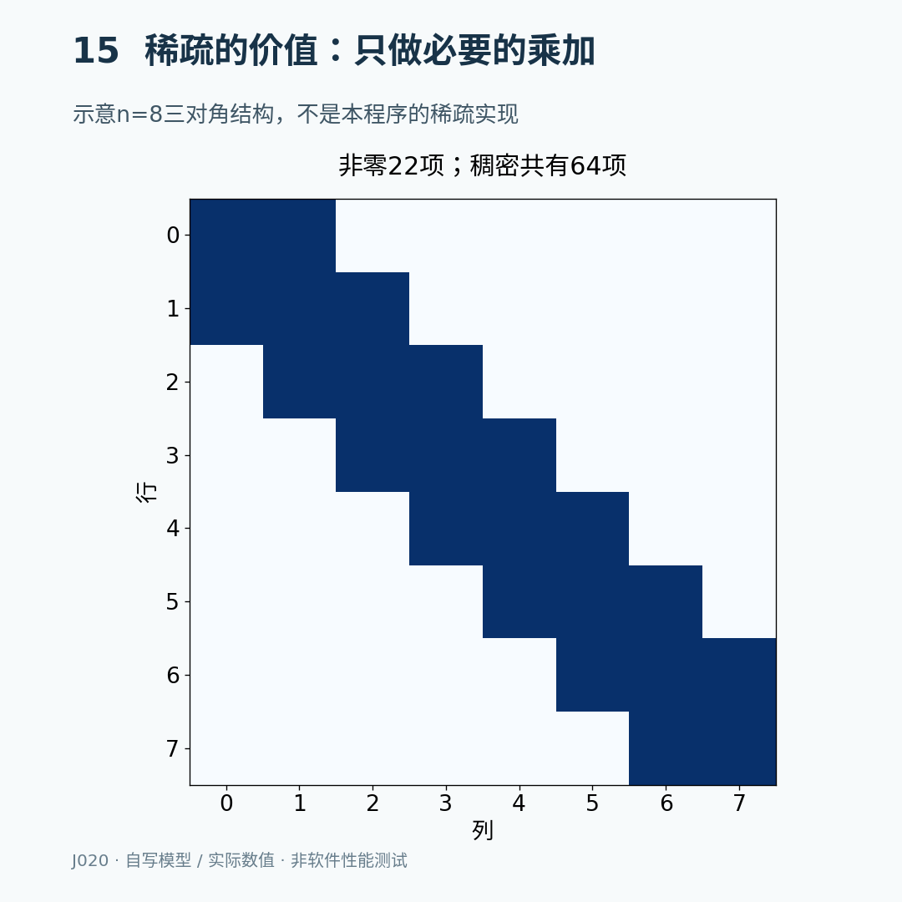

图15｜深色仅表示非零结构而非具体系数；稀疏乘法可按非零项工作，附录仍是稠密教学实现。


## 11. 不合格的输入，别让漂亮曲线掩盖它

附录要求矩阵与向量是可取长度的数值序列，元素为有限Python int/float（不接收bool），矩阵严格对称，维数1–128。对称检查用输入浮点值相等，故略不对称的数值装配会被拒绝；不会替你静默“修正”。浮点Cholesky遇非正主元拒绝，极端病态的真SPD也可能被数值检查拒绝，这不是形式化SPD证明。

方向分母pᵀAp或残差量ρ非正时返回breakdown；非有限中间值/溢出以异常报告，不返回假答案。上溢、极端下溢、任意精度求解不在这份小实验的稳健性保证内。尤其极小正数的乘积可能下溢成零，此时宁可报告失败，也不能把真实残差尚大于阈值的情况称作收敛。

作者自测包含500次随机SPD求解（普通CG和Jacobi-PCG各250次）对照NumPy直接解、12个非法输入拒绝，以及零右端、零迭代预算、初值已是解、二元共轭性的4个显式检查。它是本稿测试，不是对所有浮点数的证明。核心算法完整列在后面。


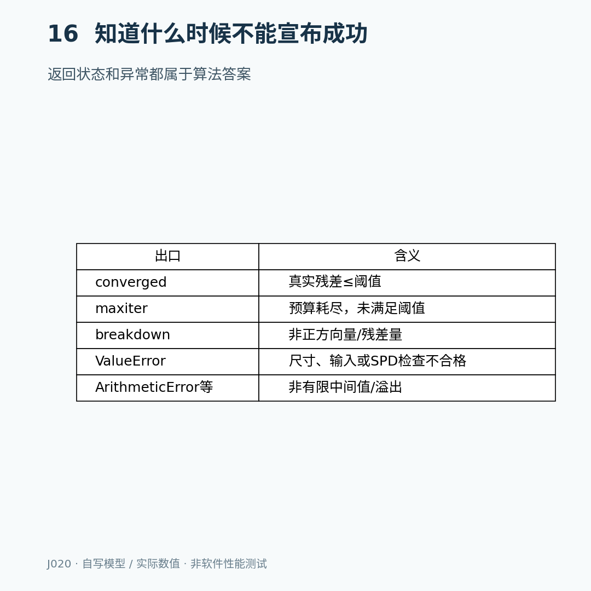

图16｜成功、未收敛与数值失效分开报告；拒绝非SPD只是有限精度检查，不是形式证明。


## 留一个能自己试的探索

把图11对角项的最大值从10⁸降到10²，再保持24维；记录步数和真实残差，不要先猜“应该24”。然后把矩阵改成有非对角项的SPD矩阵，比较Jacobi是否仍一步结束。最后改为零右端并给一个非零初值，分别尝试atol=0与合适的小正数。你会看到：方法的数学性质、浮点实现、停止标准，是三个需要一起核对的层次。

真正值得记住的不是那五行递推，而是这个问题：我新走的方向，会不会重新破坏已经解决的部分？CG在SPD二次问题中，用共轭性给了一个特别漂亮的回答。

## 短读版

最速下降每次沿当前最陡的方向走，谷地狭长时仍会折返。共轭梯度（CG）给方向换一把由矩阵A定义的尺：pᵀAq=0。二次函数展开后的交叉项消失，后面的方向不会在理想算术中把之前的方向重新耦合起来。

在A=[[4,1],[1,3]]、b=(1,2)的例子里，从零出发，CG先走到(1/4,1/2)，再到(1/11,7/11)。但“至多n步”只属于精确算术的SPD线性问题：本稿24维病态对角例实际用了96步。小残差也不自动等于小解误差，程序必须诚实报告停止标准和失败。

Jacobi预条件先按对角项调整尺度；本稿的特殊对角例一步结束，不代表它对所有矩阵都有效。16幅原创数值图从交点、等高线、共轭方向讲到浮点残差、预条件与代码成本。核心代码完整可运行，稠密教学检查和保存轨迹的成本也明确交代。

## 附录：完整可运行核心代码

保存为cg_lab.py，Python 3执行 `python cg_lab.py`。求解核心仅标准库；实验对照和制图另使用NumPy/Matplotlib/Pillow。

```python
"""Dense educational CG/diagonal PCG; not a production sparse solver."""
import math

def dot(a,b):
    v=math.fsum(x*y for x,y in zip(a,b))
    if not math.isfinite(v): raise ArithmeticError('nonfinite dot')
    return v

def mv(A,x): return [dot(row,x) for row in A]
def norm(x): return math.hypot(*x)
def finite_vector(v,n):
    if len(v)!=n: raise ValueError('dimension')
    if any(isinstance(x,bool) or not isinstance(x,(int,float)) for x in v):
        raise ValueError('real numbers only')
    z=list(map(float,v))
    if not all(map(math.isfinite,z)): raise ValueError('finite only')
    return z

def validate(A,b,x):
    n=len(b)
    if not 1<=n<=128 or len(A)!=n: raise ValueError('size 1..128')
    a=[finite_vector(row,n) for row in A]
    b=finite_vector(b,n);x=finite_vector(x,n)
    if any(a[i][j]!=a[j][i] for i in range(n) for j in range(n)):
        raise ValueError('exact input symmetry required')
    # Small dense teaching guard; floating Cholesky is not a formal SPD proof.
    L=[[0.0]*n for _ in range(n)]
    for i in range(n):
        for j in range(i+1):
            s=a[i][j]-dot(L[i][:j],L[j][:j])
            if not math.isfinite(s): raise ArithmeticError('factor overflow')
            if i==j:
                if s<=0: raise ValueError('nonpositive Cholesky pivot')
                L[i][j]=math.sqrt(s)
            else: L[i][j]=s/L[j][j]
    return a,b,x

def solve(A,b,x0=None,*,rtol=1e-10,atol=0.0,maxiter=200,jacobi=False,steepest=False):
    if type(maxiter) is not int or not 0<=maxiter<=10000: raise ValueError('maxiter')
    if type(jacobi) is not bool or type(steepest) is not bool: raise ValueError('flags')
    if jacobi and steepest: raise ValueError('demo modes separate')
    for t in (rtol,atol):
        if isinstance(t,bool) or not isinstance(t,(int,float)) or not math.isfinite(t) or t<0:
            raise ValueError('tolerances')
    n=len(b);A,b,x=validate(A,b,[0.0]*n if x0 is None else x0)
    threshold=max(float(atol),float(rtol)*norm(b))
    if not math.isfinite(threshold): raise ArithmeticError('threshold overflow')
    r=[bi-ai for bi,ai in zip(b,mv(A,x))]
    def pre(v): return [v[i]/A[i][i] for i in range(n)] if jacobi else v[:]
    z=pre(r);p=z[:];rho=dot(r,z);trace=[];directions=[]
    def record(k):
        true=[bi-ai for bi,ai in zip(b,mv(A,x))]
        if not all(map(math.isfinite,x+true+r)): raise ArithmeticError('nonfinite iterate')
        row=dict(k=k,x=x[:],r=r[:],true_r=true,recursive_norm=norm(r),true_norm=norm(true))
        trace.append(row);return row['true_norm']<=threshold
    if record(0):return dict(status='converged',x=x,trace=trace,directions=directions,threshold=threshold)
    status='maxiter'
    for k in range(1,maxiter+1):
        Ap=mv(A,p);denom=dot(p,Ap)
        if denom<=0 or rho<=0: status='breakdown';break
        alpha=rho/denom
        if not math.isfinite(alpha): raise ArithmeticError('step overflow')
        directions.append(p[:]);x=[xi+alpha*pi for xi,pi in zip(x,p)]
        r=[ri-alpha*ai for ri,ai in zip(r,Ap)]
        if record(k):status='converged';break
        z=pre(r);newrho=dot(r,z)
        if newrho<=0:status='breakdown';break
        beta=0.0 if steepest else newrho/rho
        p=[zi+beta*pi for zi,pi in zip(z,p)];rho=newrho
    return dict(status=status,x=x,trace=trace,directions=directions,threshold=threshold)

if __name__=='__main__':
    A=[[4.,1.],[1.,3.]];b=[1.,2.]
    out=solve(A,b)
    assert out['status']=='converged'
    assert abs(out['x'][0]-1/11)<1e-14 and abs(out['x'][1]-7/11)<1e-14
    print(out)
```

### 复现24维实验（完整demo.py）

另存下面为demo.py，与cg_lab.py放同目录，需要NumPy。运行 `python demo.py`。等比采样与原实验一致；不同数值环境的最后几位和步数可能不同。

```python
"""Reproduce the 24-dimensional experiment; requires NumPy and cg_lab.py."""
import numpy as np
from cg_lab import solve
values=np.geomspace(1.0,1e8,24)
A=np.diag(values).tolist()
b=values.tolist()
for jacobi in (False,True):
    out=solve(A,b,rtol=1e-12,maxiter=250,jacobi=jacobi)
    print('Jacobi' if jacobi else 'CG',out['status'],len(out['directions']),
          out['trace'][-1]['true_norm'],out['threshold'])
```

---

[来源、材料权利与编写说明](sources.md)
