# 一万行输入出了错，先别盯一万行：把失败样例一点点缩小

你收到一个能稳定触发错误的文件。它很大，里面有许多看起来无关的内容。直觉是：删掉一些，再试一次。可删哪一段？如果删掉后程序连输入都读不懂，这算找到原因，还是换了一个问题？

Delta 调试把这种手工试探变成有记录的实验。它不替你解释程序为什么错，而是帮你留下一个更容易研究的、仍然触发**同一个目标故障**的样例。本文用自己的小判定器和完整程序演示，不启动外部软件，不运行任意输入代码，也不删除你的文件。

## 1．先缩小问题的单位，而不是直接猜错误的行

把原始输入看成一串有顺序的“出现位置”。每个位置有唯一编号，内容却可以相同：两个字母 a 也必须算两个位置，不能先塞进集合去重。删减只移走位置，剩余内容保持原来的相对顺序。

我们的主例有 12 个位置，编号 0 到 11。判定器非常透明：位置 2 和 9 同时保留就返回 FAIL，否则 PASS。真实工程中，你不会预先知道这样的条件；这里把条件公开，是为了逐步核验算法，不是把难题藏进黑盒。

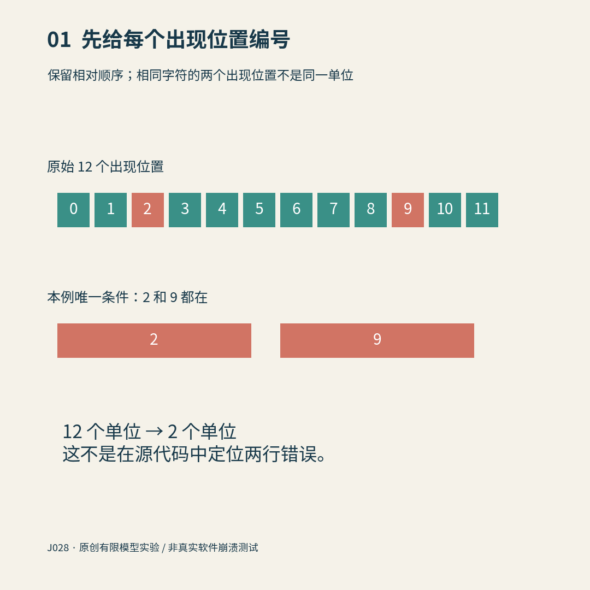
图1｜12个唯一出现位置缩为[2,9]，红色只标教学判定器要求的两个位置，不代表源代码缺陷行。

## 2．三个结果，别混在一起

FAIL：目标故障确实出现。PASS：测试正常完成，但没有出现这个目标故障。UNRESOLVED：当前实验无法回答，例如输入破坏了语法，或者环境缺失。

“又报错了”不够精确。原问题是计算结果错误，删减后变成语法错误，两者不能都叫 FAIL。判定器应当固定目标签名，例如错误类型、关键诊断或被检查的性质；否则缩减器很可能帮你找到了另一个更容易制造的错误。

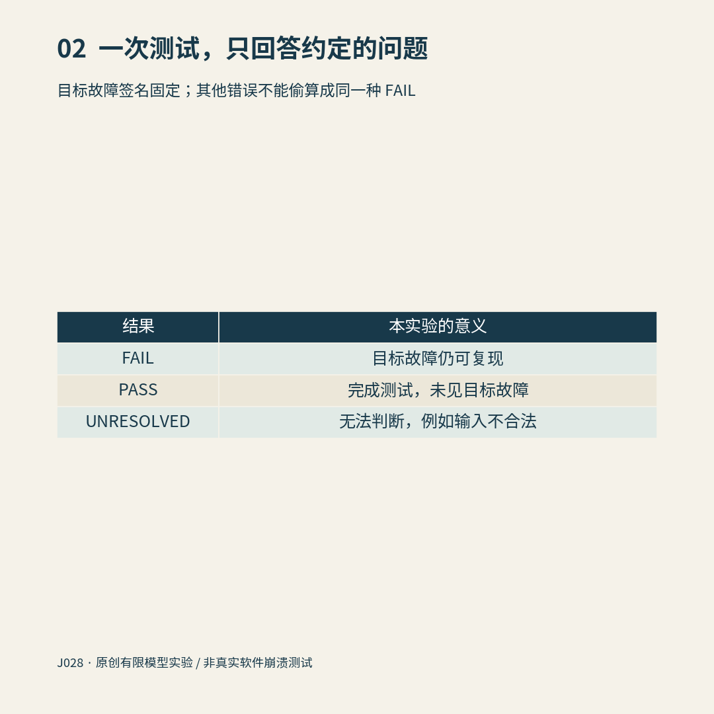
图2｜三值结果的责任分工；只有目标FAIL允许替换当前输入，无法判断不能偷偷变成通过。

## 3．为什么不是普通二分查找

原输入左右各取一半。左半含 2、不含 9，PASS；右半含 9、不含 2，也是 PASS。整体却 FAIL。

这不矛盾：故障可能来自跨边界的组合。普通二分查找有足够强的有序性质，能判定答案落在哪一侧；这里没有这种承诺。两半都不再失败，只能说明“不能这么粗地删”，而不能宣告整个输入无问题。

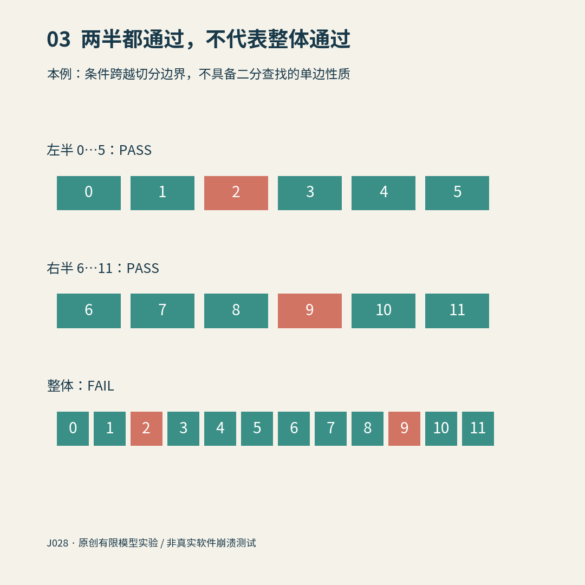
图3｜同一判定器的两半均PASS而整体FAIL，展示跨块依赖，不使用二分查找的单边假设。

## 4．把粗剪刀换成细剪刀

设当前有 m 个位置，分成 n 个连续块。本文用边界 floor(i·m/n) 均衡分块。当 m=6、n=4 时，块长度是 1、2、1、2，并不是把余数忽略掉。

每一轮先试“只保留某一块”，再试“只删除某一块”。前一种叫 subset，后一种叫 complement。这里的补集是**相对于当前输入**，不是相对于最初那个大文件；它保留当前顺序。

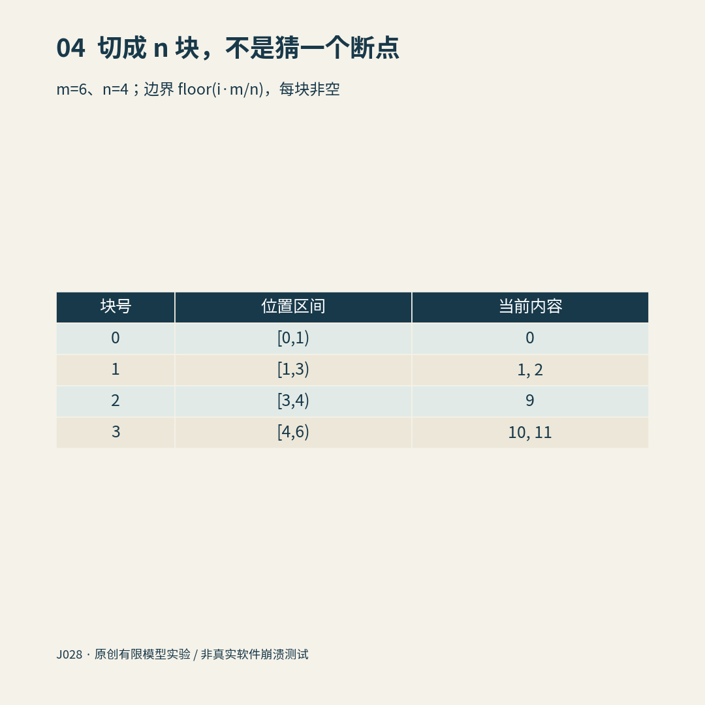
图4｜当前序列[0,1,2,9,10,11]分成四个非空块；区间指当前序列的位置，不是编号取值范围。

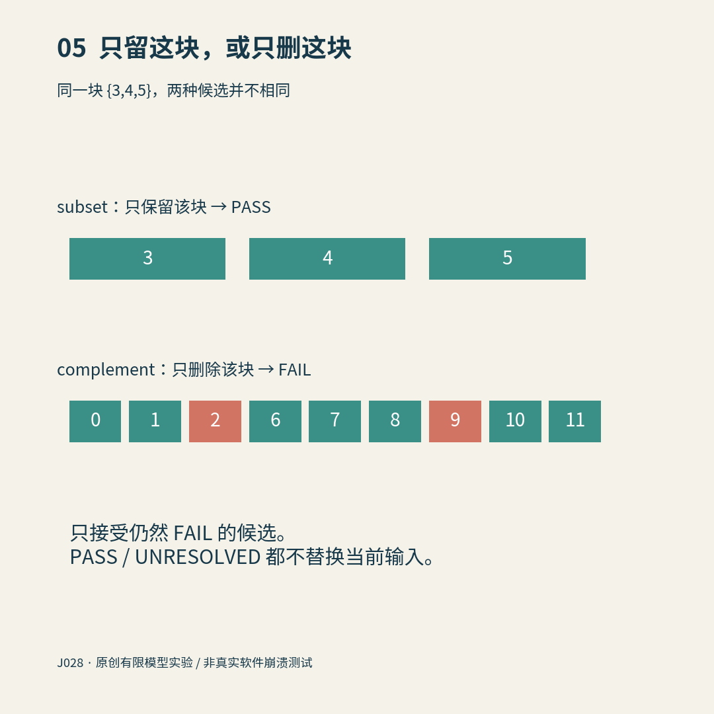
图5｜只留[3,4,5]会PASS，而只删这块仍FAIL；两种问题得到不同答案。

只要候选仍 FAIL，就真的缩短当前输入。subset 成功后，块数回到 2；complement 成功后，将块数降到 max(2,n−1)。如果本轮所有候选都不能保留目标故障，就把块数加倍，但不超过当前长度。顺序固定，便于重放，不声称是唯一或最快的策略。

## 5．真正的运行记录长什么样

主例接受的输入长度依次是 12→9→6→5→2。最后留下 [2,9]。注意第一次成功发生在尝试删除 [3,4,5] 时；不是每次都能对半砍，也不是“每一轮长度减一”。

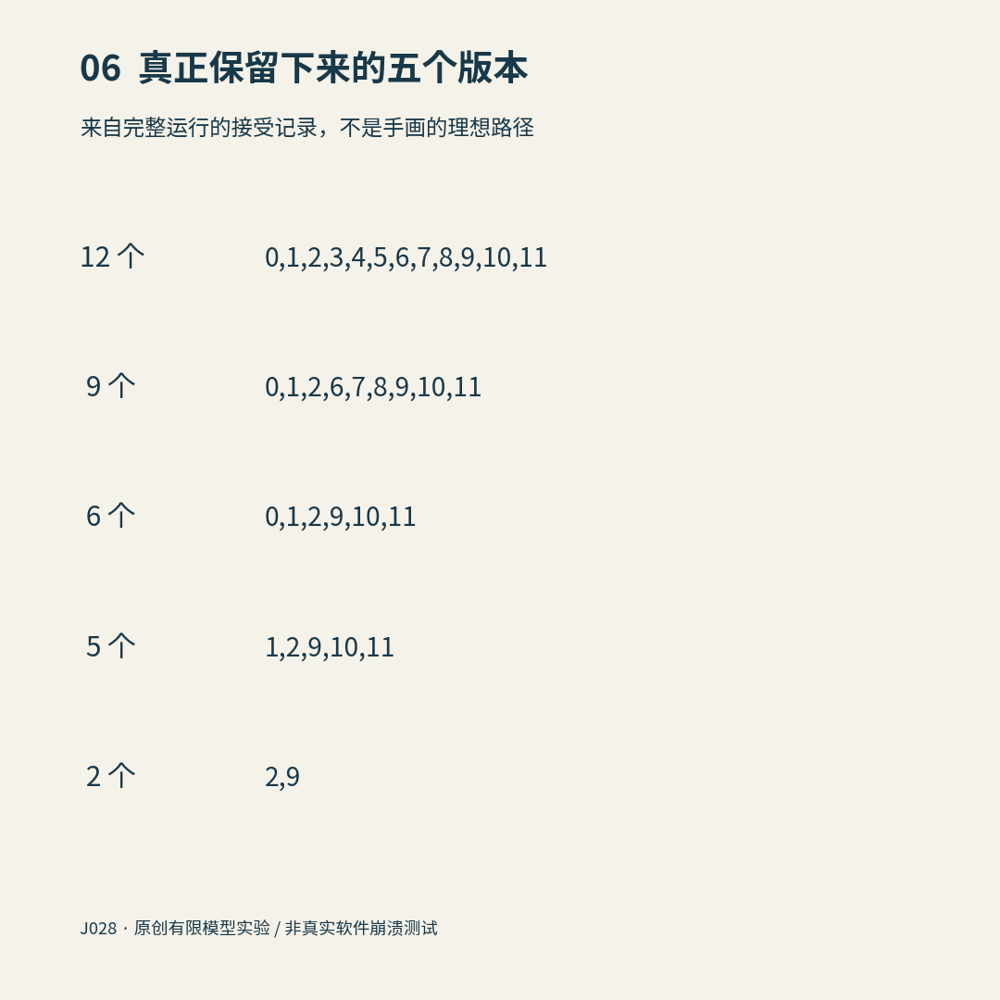
图6｜程序真实接受的五个版本；图中只显示FAIL并被保留的版本，中间未成功候选没有被伪装成删减。

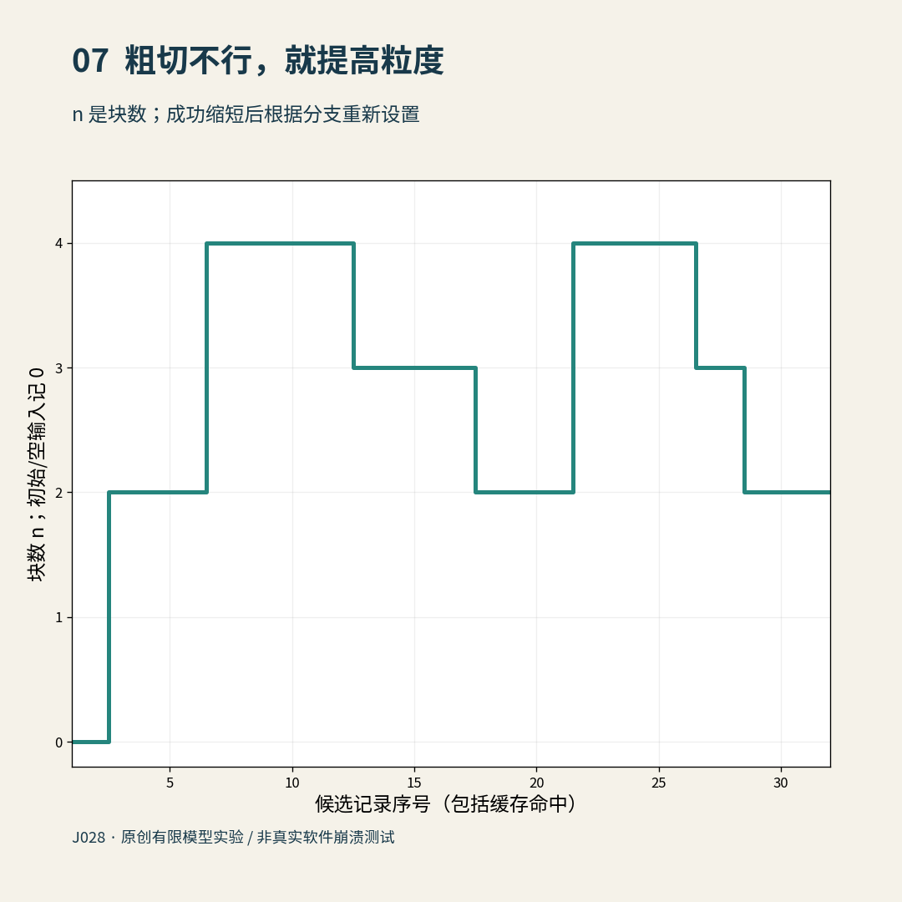
图7｜主例32条候选记录的块数n变化，初始输入与空输入预查记0；记录包括缓存命中，不等于32次外部执行。

## 6．算法为什么敢停：一个很小、很准确的保证

当块数达到当前长度时，每块只含一个位置。如果这一轮删除任何单个位置都不能再得到 FAIL，就得到了 **1-minimal**：在当前删减单位与当前判定器下，去掉任意一个位置都不能保留目标故障。

有 UNRESOLVED 时，“不能保留”可以是 PASS，也可以是无法判断，不能把它说成已证明所有单删都正确运行。算法从始至终只把 FAIL 候选接纳为新状态，因此返回值仍然是已确认失败的输入。

空输入要另查。本文先测试它；若空输入本身 FAIL，直接返回空序列。只有一个位置时，它的唯一单删就是这个已检查的空输入。于是循环的短输入边界不会漏掉这个检查。

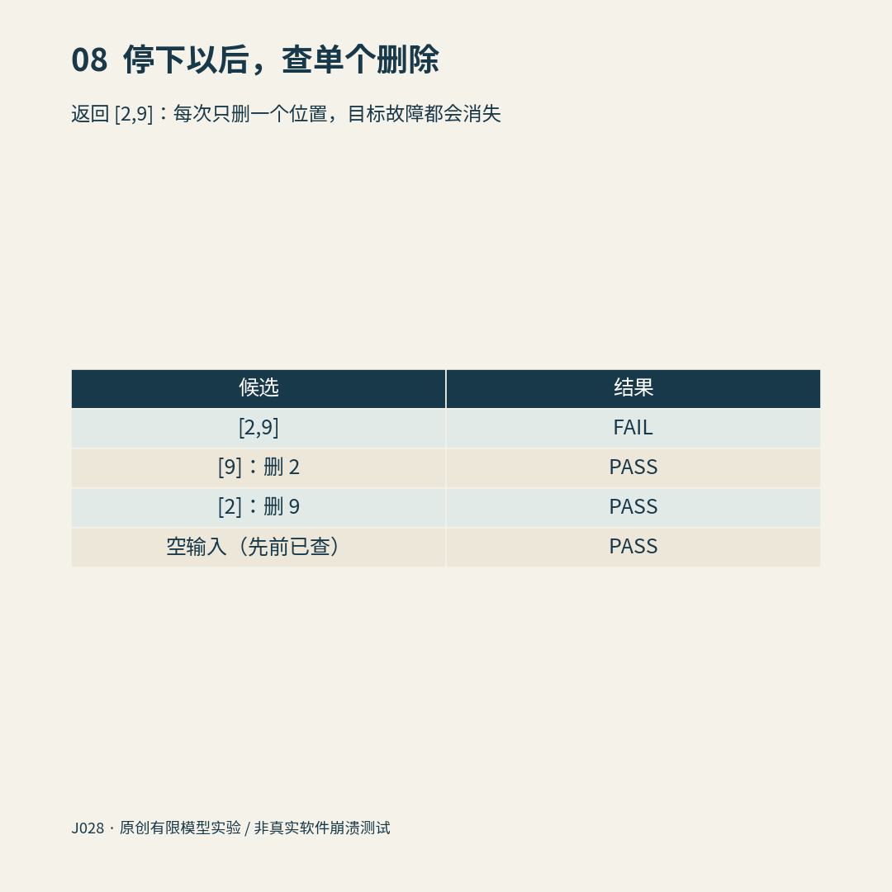
图8｜主例的单删证书：删2或删9均PASS；证书不是对所有更小子序列的穷举。

终止也容易理解：成功时长度严格减小；没有成功时块数严格增长，直到单位置粒度。有限长度下不会无限徘徊。这个推理假定测试会返回、判定保持稳定；它不解决卡死的外部进程。

## 7．最容易讲错的一句话：“已经最小了”

换一个四位置例子，分别称 A、B、C、D。判定表规定：只有 AC 和 ABCD 返回 FAIL，其他14个子序列全 PASS。这是刻意构造的非单调判定器：AC失败，加上B变ABC却通过，再加D又失败。

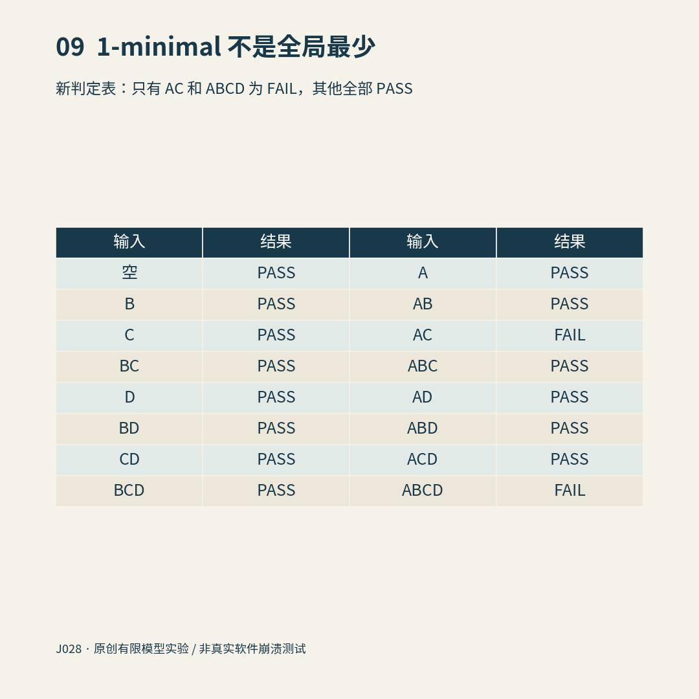
图9｜四位置例子的全部16个子序列真值表，允许直接核验，不隐藏任何失败子集。

我们的固定策略从 ABCD 开始，试 AB/CD、四个单位置、四个三位置补集，都不能缩短，最后仍返回 ABCD。它确实满足1-minimal，因为每次单删都变成PASS。但 AC 只有两个位置，而且仍失败！所以它甚至不一定是“没有任何更小失败真子集”的包含极小解，更不是全局最少位置数的解。

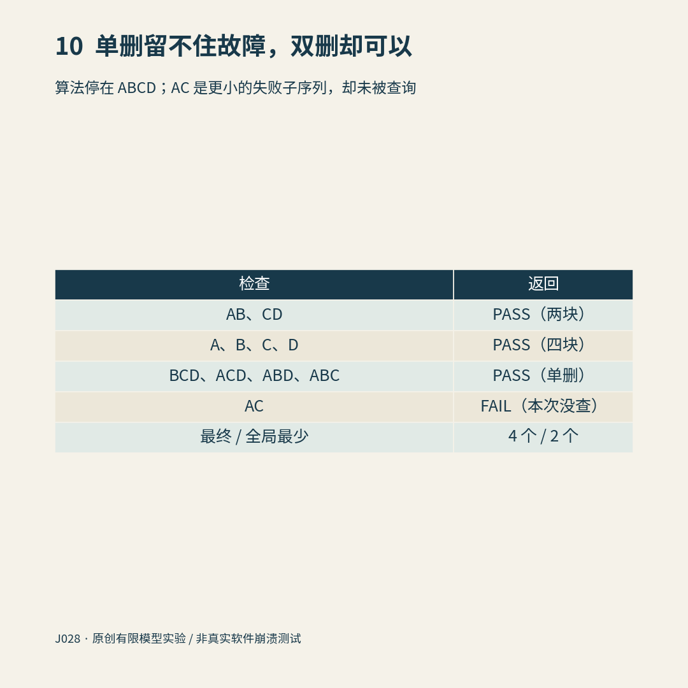
图10｜算法实际没有查询非连续组合AC；单删局部保证不能跨过一次需要同时删除两个位置的障碍。

再换个例子：只让 ABCDEF、ABC、F 失败。先试左半会接纳 ABC，之后只在 ABC 内继续删，返回三个位置；F 是另一个仅一个位置的失败解，却已被丢在当前输入外面。这说明不同尝试顺序可能找到不同答案，不能把一个小样例称作唯一原因。

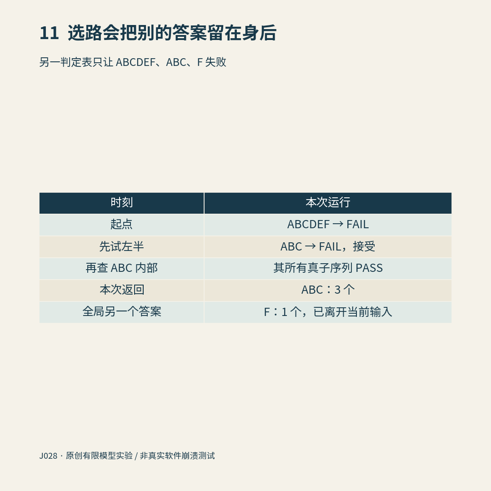
图11｜真实运行先接受ABC，再也无法找回已移除的F；全局另一个更小解仍然存在。

## 8．为什么保留语法结构有用，但不能偷偷改保证

第三个判定器要求位置0和5都在，否则UNRESOLVED；在此基础上，2和3同时出现才FAIL。程序最后留下[0,2,3,5]，24次真实判定器调用。只保留[2,3]虽然有两项“关键内容”，却不符合输入格式，不能接纳。

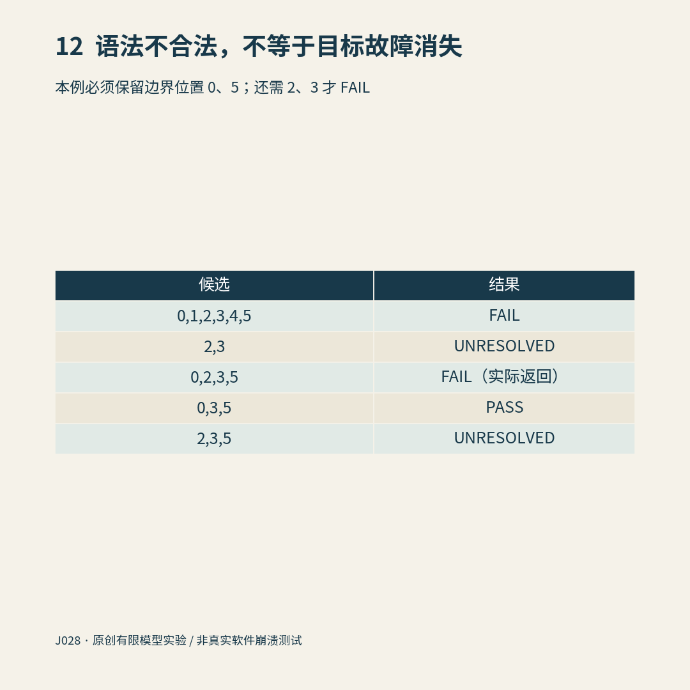
图12｜格式边界0和5也留在失败样例中；单删可能得到UNRESOLVED，而不是PASS。

实际代码缩减可以把语句、语法树节点或请求步骤作为单位，以减少无效候选。但单位变了，“删一个”的含义也变了。按整行得到1-minimal，不保证按字符还是1-minimal；只允许删除，也不保证在常量替换、表达式简化等别的变换下不可再缩。本文没有实现语法树变换，只用显式编号说明保证依赖哪套操作。

## 9．缓存能省多少，省的是哪笔钱

主例记录32个候选，其中19次真的调用判定器，13次读取缓存。它们不是同一种计数。重复候选很正常，例如把输入分成两块时，一块的补集就是另一块。

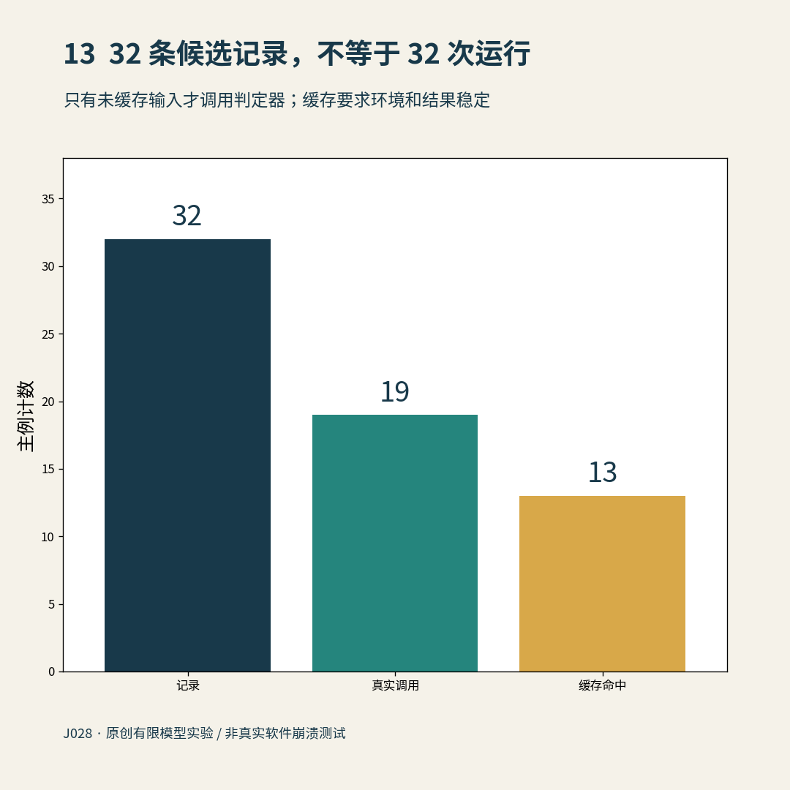
图13｜主例候选记录32、真实调用19、缓存命中13；程序记录并区分了这三项。

缓存键应当代表完整实验条件。本文输入是不可变整数元组，环境假定固定，因此只用元组作键；真实工程还可能需要程序版本、配置、随机种子和依赖状态。缓存不是让不稳定的程序变稳定，它只是记住第一次看见的答案。

图14改用“首尾两个位置同时保留”的同类判定器。输入长度4、8、16、32、64、128时，实际调用分别11、18、25、32、39、46。它展示这一组实验的趋势，不证明所有故障都这么容易缩。

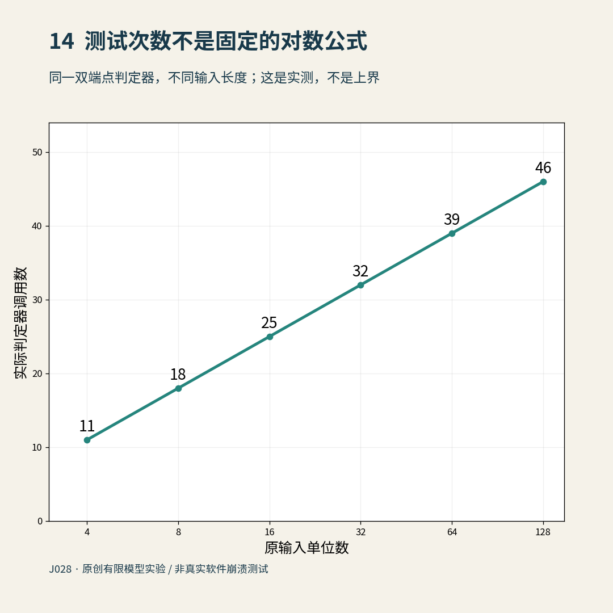
图14｜双端点条件下六个真实运行的调用数，不是用理论公式填入的数据，也不是任何系统的耗时基准。

一般有限确定判定器下，这类策略可能需要二次量级的候选尝试，而不是始终对数次。对本文实现，可以按“每次成功至少删一个位置、两次成功之间的块数按几何增长”给出O(N²)次尝试的保守计数。每次构造元组、哈希和保存完整轨迹又可能花O(N)，所以本教学实现的额外元素操作与存储的保守上界是O(N³)，不能把调用次数当总时间或内存。若一次测试最坏成本T，粗略总时间为O(N²T+N³)，这里采用字典通常期望查找成本，按整数ID操作通常单位成本计，未展开大整数比特成本。最多128个位置是教学防护，不是速度承诺。

## 10．噪声、超时与预算：不要制造假证书

我们用一个受控的有状态判定器，对同一个候选依次返回 FAIL、PASS、FAIL。它不是随机测出来的故障概率，只是把不稳定性放到桌面上。第一次FAIL被缓存后，后面的PASS可能再也看不到。前面的最小性推理此时不再成立。

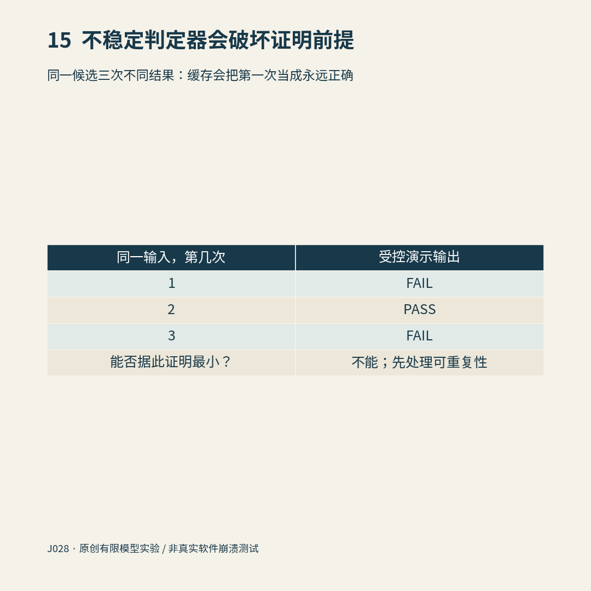
图15｜三次实际调用受控有状态判定器的输出序列，展示稳定性前提，不估计真实故障概率。

重复测试、多数票、置信界等可以用于噪声处理，但会引入另外的统计假设；本文不把它们包装成严格确定性的证明。超时一般应区分为UNRESOLVED；只有你的目标本来就是明确阈值和环境下的超时，才可能把它设计为FAIL，而且仍需处理抖动。

程序支持真实调用预算。主例预算设为5时就中止，仍保留已确认FAIL的12位置输入，状态为budget，不写one_minimal。候选记录的缓存命中不花调用额度。这个预算不限制单次回调耗时，也没有进程终止功能；本文回调全是本地有限判定表。

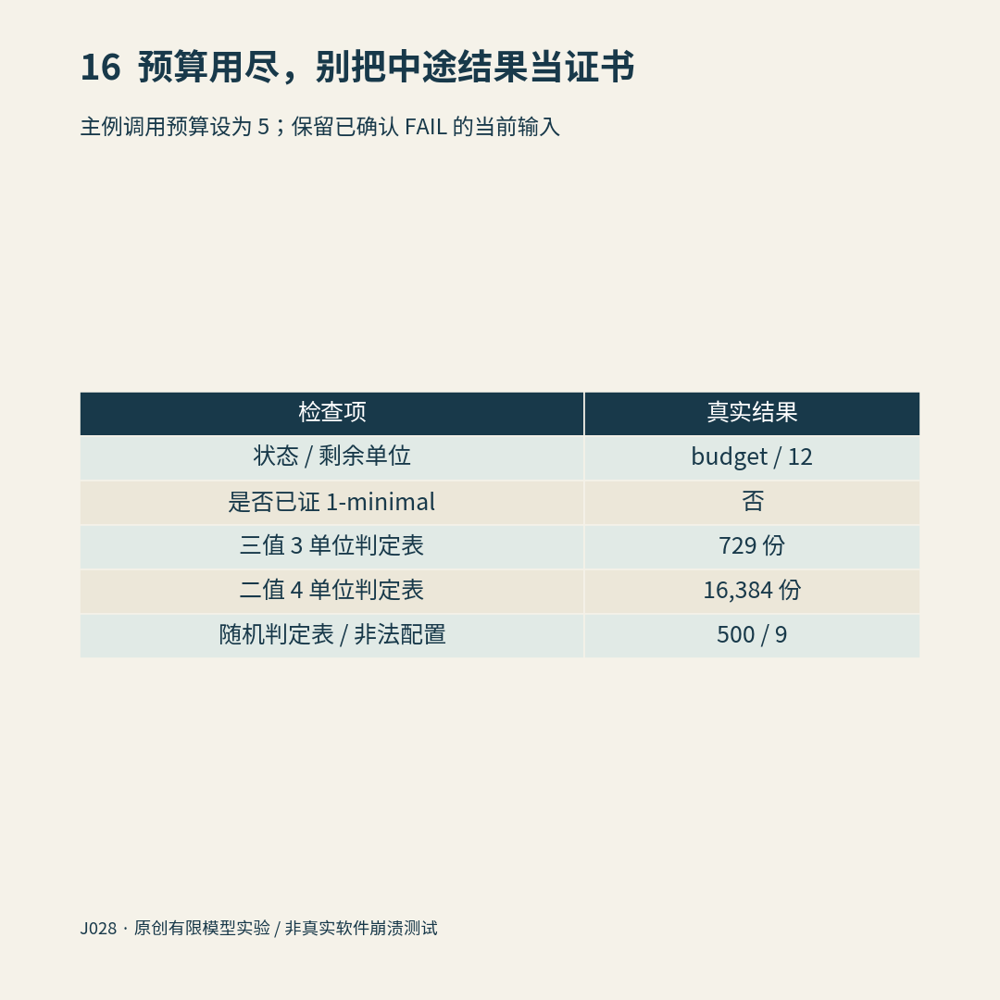
图16｜预算中止与最小性状态分开；作者还实际穷举729份三值表、16384份二值表并测500份随机表，未把有限测试称为一般证明。

这两组穷举固定空输入为PASS、完整输入为FAIL，再枚举其余子序列的结果：3位置有6个未固定结果，所以是3⁶=729；4位置有14个未固定结果，所以是2¹⁴=16384。随机表另外覆盖空输入也FAIL的情形。它们验证返回输入仍FAIL、所有单删不FAIL、缓存调用计数与预算边界，不把未测的真实软件行为纳入结论。

## 11．拿到小样例之后，才开始回答“为什么”

[2,9]仍失败，说明这两个位置在当前环境、当前删减操作和故障签名下值得研究。它没有告诉你程序里哪一个判断写错了，也没有证明这两个位置是现实世界唯一的因果解释。下一步可以做执行跟踪、检查状态变化、定位违背的性质，再写回归测试。缩减是降低阅读成本，不是自动完成根因分析。

## 附录一：完整可运行教学程序

保存为 delta_lab.py，运行 python delta_lab.py。输出两个示例的最终状态；trace保存在函数返回值中。

```python
"""Original finite-input ddmin teaching model; no external programs executed."""
PASS, FAIL, UNRESOLVED = 'PASS', 'FAIL', 'UNRESOLVED'


def reduce_input(items, test, max_calls=100000):
    """Deterministic oracle on ordered, distinct integer occurrence IDs.

    Result status 'one_minimal' is relative to this oracle and deletion units.
    'budget' retains a confirmed failing input but has no minimality guarantee.
    Oracle exceptions propagate. Cached outcomes assume stable environments.
    """
    if not isinstance(items, (tuple, list)) or len(items) > 128:
        raise ValueError('need a list/tuple of at most 128 occurrence IDs')
    if any(type(x) is not int for x in items) or len(set(items)) != len(items):
        raise ValueError('IDs must be distinct integers; values may repeat elsewhere')
    if type(max_calls) is not int or max_calls < 1 or not callable(test):
        raise ValueError('positive integer call budget and callable required')
    current = tuple(items)
    cache, trace = {}, []
    calls = 0

    def ask(candidate, phase, granularity):
        nonlocal calls
        hit = candidate in cache
        if not hit:
            if calls == max_calls:
                return None
            outcome = test(candidate)
            calls += 1
            if outcome not in (PASS, FAIL, UNRESOLVED):
                raise ValueError('oracle returned an invalid outcome')
            cache[candidate] = outcome
        outcome = cache[candidate]
        trace.append(dict(phase=phase, n=granularity, current=list(current),
                          candidate=list(candidate), outcome=outcome,
                          cached=hit, accepted=outcome == FAIL))
        return outcome

    def result(status):
        return dict(result=list(current), status=status, calls=calls,
                    trace=trace, cached_inputs=len(cache))

    if ask(current, 'initial', 0) != FAIL:
        raise ValueError('initial input must reproduce the target failure')
    empty = ask((), 'empty', 0)
    if empty is None:
        return result('budget')
    if empty == FAIL:
        current = ()
        return result('one_minimal')
    n = 2
    while len(current) >= 2:
        n = min(n, len(current))
        # Exactly n nonempty, balanced contiguous blocks, in original order.
        m = len(current)
        bounds = [(i*m//n, (i+1)*m//n) for i in range(n)]
        changed = False
        for phase in ('subset', 'complement'):
            for a, b in bounds:
                candidate = (current[a:b] if phase == 'subset'
                             else current[:a] + current[b:])
                outcome = ask(candidate, phase, n)
                if outcome is None:
                    return result('budget')
                if outcome == FAIL:
                    current = candidate
                    n = 2 if phase == 'subset' else max(2, n-1)
                    changed = True
                    break
            if changed:
                break
        if changed:
            continue
        if n == len(current):
            break
        n = min(2*n, len(current))
    return result('one_minimal')


def certificate(items, test):
    """Explicit checks, no claim of all-subset/global minimum."""
    x = tuple(items)
    return dict(outcome=test(x), single_deletions=[
        dict(removed=x[i], outcome=test(x[:i] + x[i+1:]))
        for i in range(len(x))])


def demo():
    # A target signature needs occurrence 2 before occurrence 9.
    pair = lambda x: FAIL if 2 in x and 9 in x else PASS
    a = reduce_input(list(range(12)), pair)
    # A deterministic nonmonotone table: AC and ABCD fail, all else pass.
    table = lambda x: FAIL if tuple(x) in ((0, 2), (0, 1, 2, 3)) else PASS
    b = reduce_input([0, 1, 2, 3], table)
    return a, b


if __name__ == '__main__':
    import json
    for run in demo():
        print(json.dumps({k: v for k, v in run.items() if k != 'trace'}))
```

## 附录二：完整有限实验与作者自测

在同目录建 checks 文件夹，将下列代码保存为 checks/experiments.py，运行 python checks/experiments.py。它仅运行自写有限判定器，将实验记录写到该目录下 experiments.json；不会调用外部程序。这里的有限测试不是完整一般性证明，也不是独立审查结论。

```python
from pathlib import Path
import sys,json,itertools,random
sys.path.insert(0,str(Path(__file__).resolve().parents[1]))
from delta_lab import *
p=Path(__file__).resolve().parents[1]
def all_subsets(n):
 return [tuple(i for i in range(n) if mask>>i&1) for mask in range(1<<n)]
def checked(n, values):
 ss=all_subsets(n); tab=dict(zip(ss,values)); run=reduce_input(list(range(n)),tab.__getitem__)
 out=tuple(run['result']);assert tab[out]==FAIL and run['status']=='one_minimal'
 assert all(tab[out[:i]+out[i+1:]]!=FAIL for i in range(len(out)))
 assert run['calls']==len({tuple(t['candidate']) for t in run['trace']})
 assert run['calls']<=len(ss)
 for t in run['trace']:
  assert t['outcome']==tab[tuple(t['candidate'])]
 return run
count=0
for values in itertools.product((PASS,FAIL,UNRESOLVED),repeat=6):
 checked(3,(PASS,)+values+(FAIL,));count+=1
for values in itertools.product((PASS,FAIL),repeat=14):
 checked(4,(PASS,)+values+(FAIL,));count+=1
rng=random.Random(28023)
for i in range(500):
 n=rng.randrange(1,9);vals=[rng.choice([PASS,FAIL,UNRESOLVED]) for _ in range(1<<n)];vals[-1]=FAIL
 checked(n,vals);count+=1
pair=lambda x:FAIL if 2 in x and 9 in x else PASS
main=reduce_input(list(range(12)),pair)
nonmono=lambda x:FAIL if tuple(x) in ((0,2),(0,1,2,3)) else PASS
trap=reduce_input(list(range(4)),nonmono)
syntax=lambda x:UNRESOLVED if not {0,5}.issubset(x) else (FAIL if 2 in x and 3 in x else PASS)
syn=reduce_input(list(range(6)),syntax)
order=lambda x:FAIL if tuple(x) in ((0,1,2,3,4,5),(0,1,2),(5,)) else PASS
order_run=reduce_input(list(range(6)),order)
budget=reduce_input(list(range(12)),pair,5)
assert budget['status']=='budget' and pair(tuple(budget['result']))==FAIL
assert reduce_input([],lambda _:FAIL)['result']==[]
assert reduce_input([0],lambda x:FAIL if x else UNRESOLVED)['result']==[0]
invalid=0
for args in [((),lambda _:PASS,100),([1,1],pair,100),([True],pair,100),('ab',pair,100),([0],pair,True),([0],pair,0),([0],lambda _:None,100),(list(range(129)),pair,100),([0],None,100)]:
 try:reduce_input(*args)
 except ValueError:invalid+=1
 else:raise AssertionError(args)
assert invalid==9
sizes=[]
for n in [4,8,16,32,64,128]:
 req={0,n-1};f=lambda x: FAIL if req.issubset(x) else PASS;r=reduce_input(list(range(n)),f);sizes.append(dict(n=n,calls=r['calls'],attempts=len(r['trace']),result=r['result']))
noisy_calls=[FAIL,PASS,FAIL]
noise_iter=iter(noisy_calls)
noisy=lambda same: next(noise_iter)
noise_observed=[noisy((2,9)) for _ in range(3)]
result=dict(noise_observed=noise_observed,tables=count,ternary3=729,binary4=16384,random=500,invalid=invalid,main=main,trap=trap,syntax=syn,order=order_run,budget=budget,sizes=sizes,trap_table=[dict(ids=list(x),outcome=nonmono(x)) for x in all_subsets(4)],certificate=certificate(main['result'],pair))
(p/'checks/experiments.json').write_text(json.dumps(result,indent=2));print({k:result[k] for k in ['tables','invalid','sizes']});print('main',main['result'],main['calls'],'trap',trap['result'],trap['calls'],'syntax',syn['result'],syn['calls'],'order',order_run['result'])
```

---

## 缩小失败样例，不等于找到了唯一根因

一个大输入能稳定触发目标故障。Delta调试反复尝试只保留某块、或只删除某块：仍FAIL才接纳，PASS和UNRESOLVED都不接纳。粗块不能删，就提高粒度，直到单个位置。

本文的12位置实验最后留下[2,9]，实际调用判定器19次，另有13次缓存命中。它们是原输入中的出现位置，不是程序错误行。

最关键的限制是1-minimal：任意单删都不能保留目标FAIL。它不是全局最少，甚至不一定没有更小的失败真子集。四位置反例中，只有AC与ABCD失败；本策略停在ABCD，漏掉同时删B、D才能抵达的AC。

输入单位、故障签名、环境与允许变换都决定保证范围。语法坏了是无法判断，不是目标故障复现。缓存要求可重复；预算中止只保留失败状态，不提供最小性证书。小样例让下一步分析更容易，但不会自动给出根因。

长文用16幅原创实验图和完整标准库程序，把分块、补集、真实轨迹、非单调反例、缓存和噪声边界逐项拆开。没有运行外部软件或真实崩溃命令。


## 可运行范围

文中完整标准库代码是本文重新编写的有限教学实现，不是下载或执行外站程序。输入为最多128个互不重复的整数出现ID；映射回真实内容由调用者负责。回调接收不可变元组，返回三个规定字符串之一，必须可重复且不改变环境。初始输入不是FAIL会拒绝；回调自身异常向上传播，避免把测试脚本写坏误判为目标故障。certificate只是对给定可信输入进行显式单删检查，不负责验证任意恶意对象。


## 来源与素材权利

参见[来源、素材权利与 AI 辅助说明](sources.md)。
