# 五个人都很守规矩，为什么谁也吃不上？

把“大家抢同一把锁”换成一张餐桌，问题突然变得很容易想象：五个人，每两人中间放一把叉。吃面必须同时拿到身边两把，吃完才归还。叉子够五个人轮流用，却不够五个人同时用。

每个人都照同一个流程来：先拿第一把，再拿第二把。没有偷拿，也没有重复使用。结果可能是：每个人手里都攥着一把，谁都在等别人放手。

这里最值得弄明白的，不是一个“加把锁就好了”的答案，而是三个不同问题：有没有人乱用资源？全体会不会卡住？即便有人能动，是否每个人最终都能轮到？

Dijkstra 在 EWD310 中用五位哲学家的进餐讨论这种合作难题，并指出逐个先拿一侧叉子的朴素办法可能全体停住。下面不照搬他后续的状态变量方案，而是自己做三个可执行的小模型：原样拿叉、统一编号顺序、限制入场人数。我们把反例和可达状态真的算出来，再看各自能保证什么。[原始文字](https://www.cs.utexas.edu/~EWD/transcriptions/EWD03xx/EWD310.html)

## 1｜先把“身边两把”说清楚

人编号 P0 到 P4，叉编号 F0 到 F4。本文约定 Pi 需要 Fi 和 F(i+1) mod 5。因此 P4 的两把是 F4 与 F0，编号绕回开头。

这只是标号约定，不是在复刻某一张餐桌图的左右方向。P0 和 P1 都需要 F1，不能同时吃；P0 和 P2 使用的叉不重叠，却可以同时吃。资源冲突是局部的，并非所有人都必须排成一条串行队伍。

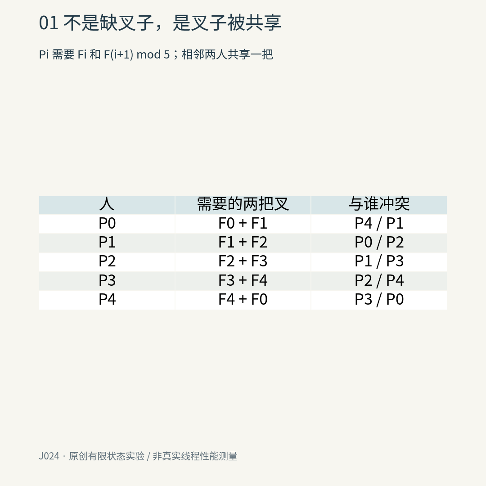
图1｜从每个人需要的叉集合看冲突；最后一行的编号通过 mod 5 回到 F0。

实际程序里，叉可以换成两把锁、两个设备，或一项工作需要同时占用的两类资源。这个比喻有边界：真实资源可能允许共享、有多个实例，或允许撤销；我们先只讨论“每把叉只有一个实例、不能被强行抢回”的小世界。

## 2｜信号量解决了哪一小步？

先只看一把叉。用一个初值为 1 的许可计数表示它可用。一次成功的 P 操作把计数减一；计数为零时，后来的 P 暂时不能成功。V 增加一个许可。

关键不只是加减，而是“看它能不能减”与“真正减掉”必须构成不可分割的动作。若两个人都先读到 1，再分别写成 0，两个人都可能误认为自己拿到了唯一许可。

Dijkstra 的 EWD123 §3.2 明确把 P 的条件判断与减一作为不可分割的完成步骤，并没有在这个基础定义里指定多个等待者中谁先成功。本文采用这个抽象，不把它等同于某个操作系统的具体 API。[信号量原始定义](https://www.cs.utexas.edu/~EWD/transcriptions/EWD01xx/EWD123.html)

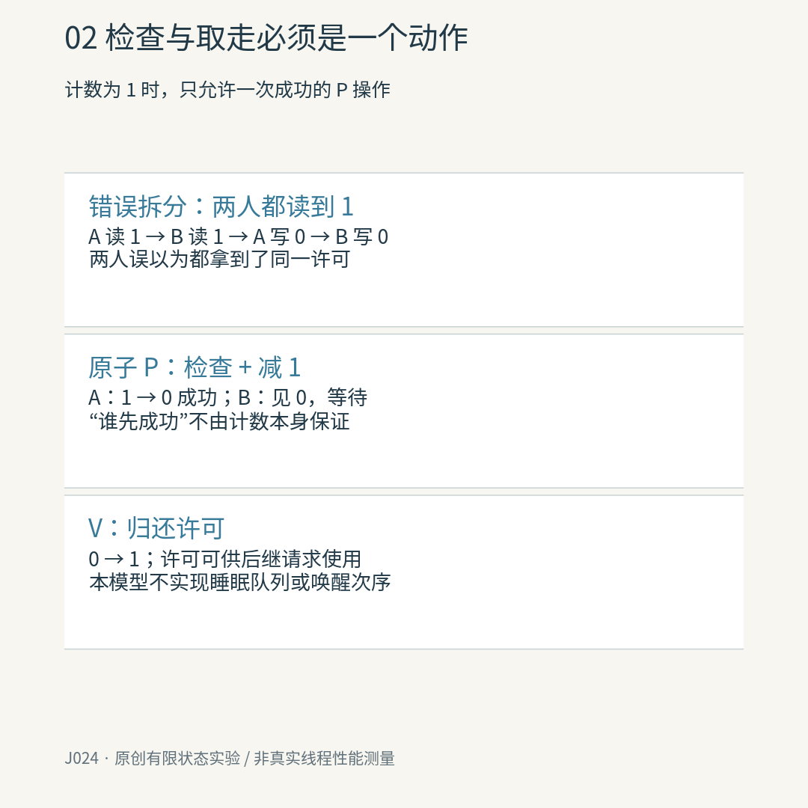
图2｜正确的原子许可操作排除了“两人都成功拿到唯一许可”，但没有自动安排两把资源的获取顺序。

一个普通计数信号量本身也未必知道“谁拥有它”。下面的模拟器会额外追踪叉的持有者，保证只由对应的人完成归还；不要把这个模型检查用的所有权账本，误认为所有信号量都具备的 API 规则。我们只使用平衡的一次获取、一次归还，因而每把叉的许可保持在 0 或 1。

## 3｜把程序位置也放进状态

仅知道“哪些叉空着”还不够。一个人可能尚未入场，也可能入场后还没拿叉。这会影响限入策略。

所以每个人有四个阶段：0 在外部准备申请；1 已入场、没有叉；2 拿到第一把；3 拿到两把、可以吃。一次 finish 把阶段 3 变回 0，同时归还两把叉及入场许可。

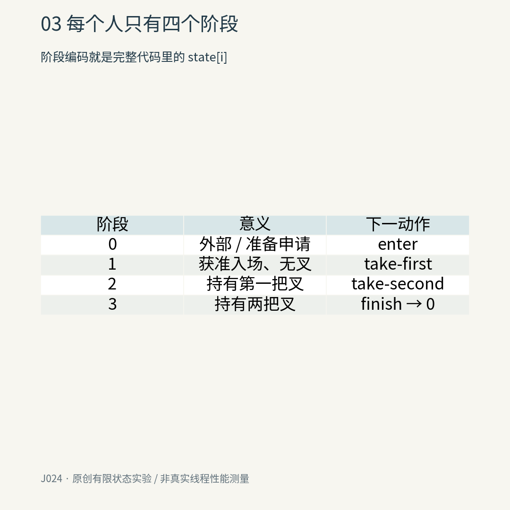
图3｜四阶段构成可重复的循环；模型把吃完后的两次放叉与离场合成一个原子 finish。

这里故意把思考时间抽掉：阶段 0 随时可以请求下一餐。把两次放叉合并也是建模选择，而非声称真实信号量支持“同时 V 两把叉”。这让状态空间小一些，但结论首先属于这个抽象。对无死锁的结构论证，关键是拿齐叉的人不会再等别的资源，且能够完成释放；若持叉线程崩溃或永远不被调度，就超出了这个前提。

## 4｜一把叉一次只给一个人，也可能全体死锁

朴素策略的顺序是 Fi、再 F(i+1)。我们从 (0,0,0,0,0) 开始，枚举每一步谁可以行动。

程序找到一条十步路径：让 P0 入场并拿第一把，再让 P1 做同样的事，如此直到 P4。结束时，状态是 (2,2,2,2,2)。每个人拿着自己的第一把，第二把却在下一个人的手里。

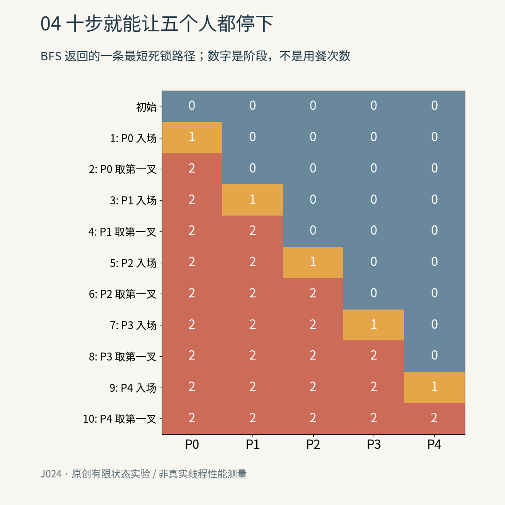
图4｜一次真实 BFS 得到的最短反例，共十次原子迁移；相同数字代表程序阶段，不代表第几餐。

为什么这是最短的？从全零到每人持一把，至少每人要入场、拿叉各一次，因此至少十步；程序展示的路径刚好达到这个下界。它并不要求五个人在物理意义上“完全同时”伸手。普通的交错就够了。

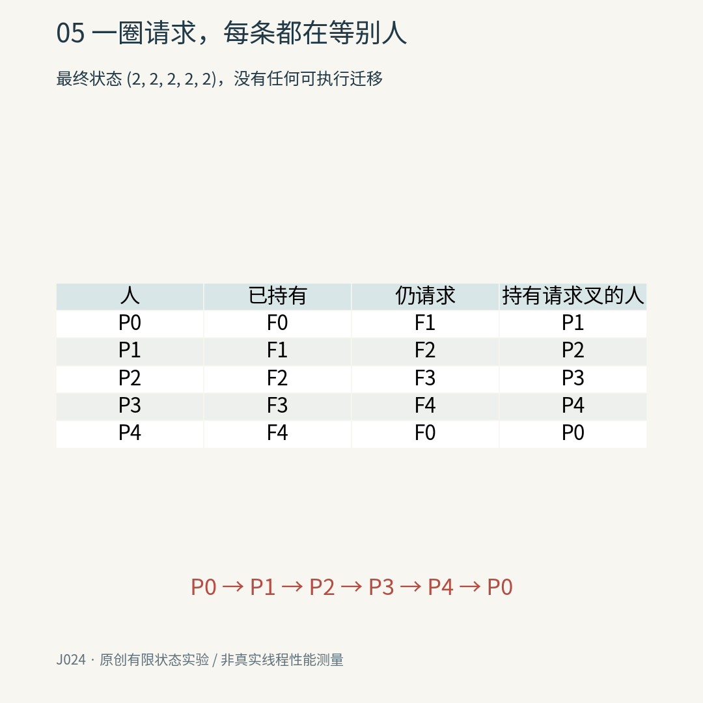
图5｜每条请求都指向下一位持有者，最后回到 P0；这个状态没有出边。

叉的互斥始终没有被破坏。恰恰因为互斥真的生效，第二次获取才停了下来。**互斥是一种安全要求：不让坏事发生；它不是让好事最终发生的全部条件。**

在这个例子中，可以看到四个因素同时存在：资源互斥、占有一部分同时等待另一部分、不允许强行剥夺、等待关系成环。打破其中某个合适的环节，就有机会排除这类死锁。


图6｜四个因素在本例里各有具体含义；不要把“资源图有环”无条件推广成任意多实例系统必然死锁。

我们没有选择“拿不到就放下再试”。那需要继续分析重试策略：五个人可能一齐拿、一齐放、一齐再来，忙得很但仍没吃上。随机退避也不等于确定的等待上界。本篇先选两种更容易讲清结构保证的改法。

## 5｜改法一：给所有叉统一排个序

别让每个人说“先拿我这边的”。让大家共同遵守同一条全局规则：编号小的先拿，编号大的后拿。

对 P0、P1、P2、P3，顺序没有变化。P4 原本是 4→0，现在改成 0→4。需要的两把没变，变的只是获取顺序。

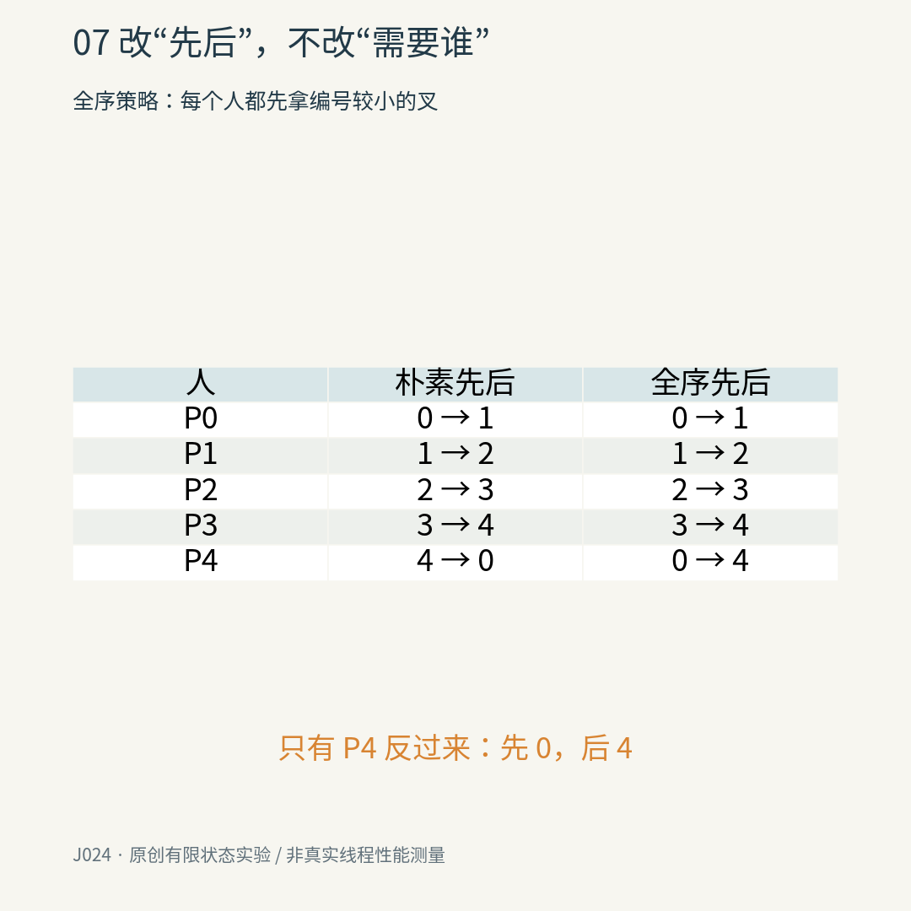
图7｜统一资源顺序只让跨越编号边界的 P4 调换先后，却破坏了朴素等待环。

为什么不是碰巧有效？假设仍有一个“拿着一把、等另一把”的环。沿环前进，每个人手里较小的编号，指向它正在等待的较大编号。这样编号必须一路严格增大。可环最终又要回到原编号，于是要求某个编号严格小于自己，矛盾。


图8｜严格递增关系不能闭成环；这是全序策略的结构理由，不只是五个人的运行截图。

这个论证需要所有参与者遵守同一个顺序，而且拿齐后不再等待其他未纳入排序的资源。只给某个函数里的两把锁排序，却在回调里又拿了一把更小的锁，前提就被破坏了。

无死锁也不是“没人会等待”。P4 可能在第一把 F0 就停住；区别是它此时没有占着 F4 去把等待链封成环。

## 6｜改法二：门口留一个空位

仍保留朴素的取叉顺序，但另设一个初值 n−1 的入场信号量。必须先取得入场许可，才可以拿任何叉。吃完释放叉后，归还入场许可。

五个人最多让四个人处于阶段 1、2、3。门外的人手里不能拿叉，这一条非常关键。如果先拿第一把，再等入场许可，就不是我们证明的协议。

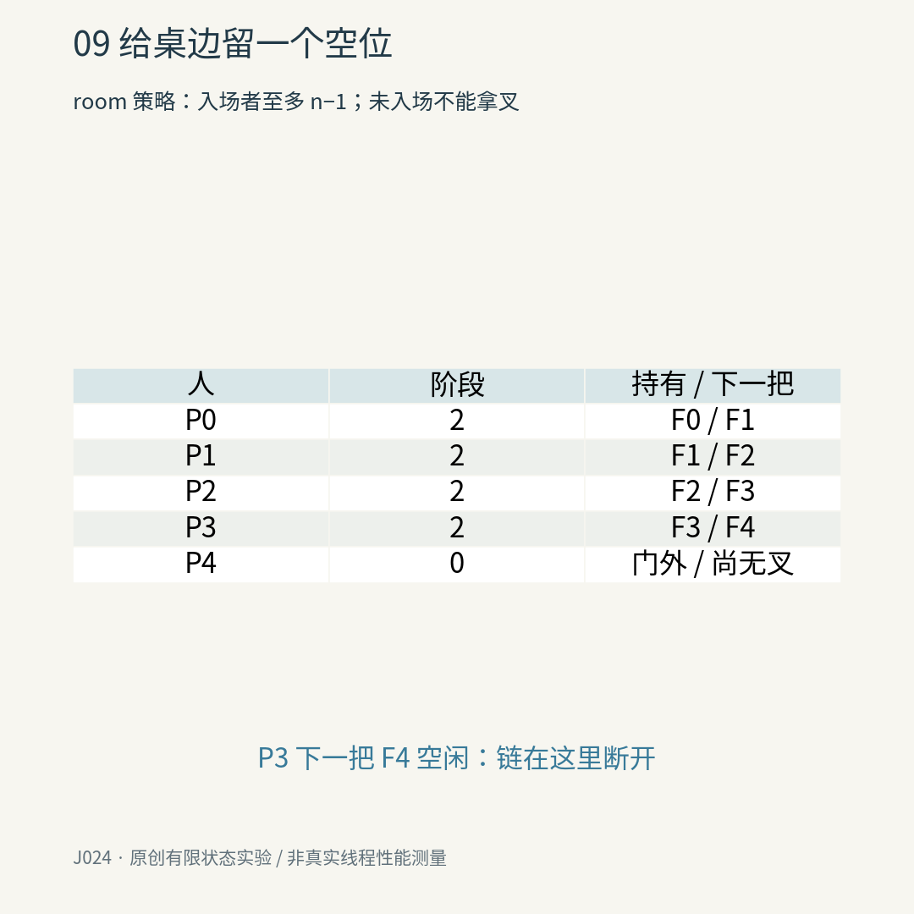
图9｜P0 到 P3 各持第一把，P4 仍在门外；F4 空闲，让 P3 的第二次获取可以继续。

这里的证明也不只是“永远有一把空叉”。即便某把空着，也要说明谁能用它。如果有人已经拿齐两把，则 finish 可执行；如果没有人拿齐，而某个入场者尚无叉，其第一把 Fi 只能被自己作为第一把持有，或被前一人作为第二把持有——后者意味着有人已经拿齐，与假设不符。因此它可以拿第一把。

剩下一种情况：所有入场者各持第一把。因为至少一人没入场，入场者不可能绕满一圈，总有一段链的末端，它的下一把叉不被持有。于是至少一个 take-second 可执行。只有无人入场时，enter 显然可执行。四种情况覆盖完，这个抽象里就不存在全体无路可走的状态。

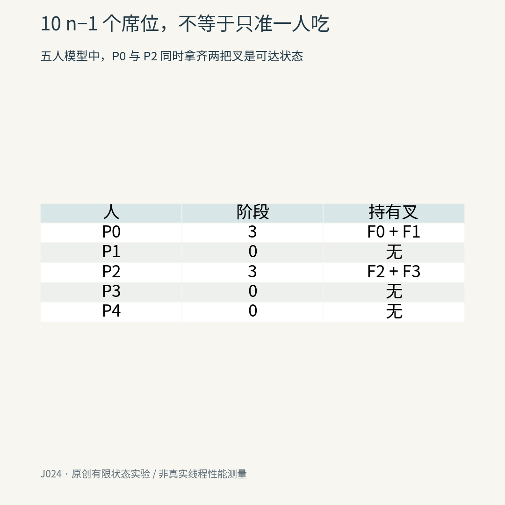
图10｜实际可达状态 (3,0,3,0,0) 中，P0 与 P2 同时持有两把叉；限入并没有把所有用餐串行化。

这个“服务员”只数桌边人数，不是一个先进先出的公平队列。限流消除了特定的闭环，不代表它已经公平分配每一次机会。

## 7｜为什么要枚举状态，而不是开五个线程试试看？

开线程跑一万次没卡住，可能只是没碰到坏的交错。我们的程序不等真实线程调度，而是把当前状态下所有可执行的下一步都列出来，逐一继续。

如果两条路径走到了同一个完整状态，未来可能性相同，可以合并。我们没有记录“已经吃了几餐”，因为这个计数不会影响下一步规则；若研究等待上界，就需要另加合适的观测或逻辑，而不是偷把缺失计数当作结论。

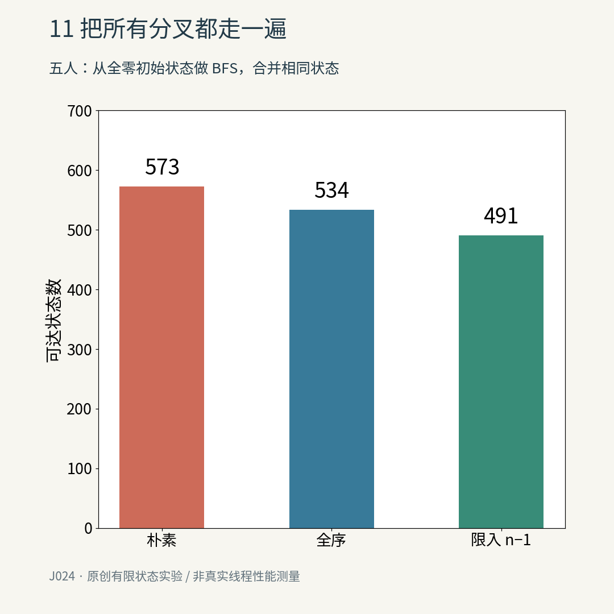
图11｜五人情况下，三种策略的完整可达状态数分别是 573、534、491；不是线程实测耗时。

完整状态枚举后，找没有任何出边的状态。朴素策略在 n=2 到 n=7 的每个模型里都出现一个死锁状态；全序和限入策略在这些模型里都没有。

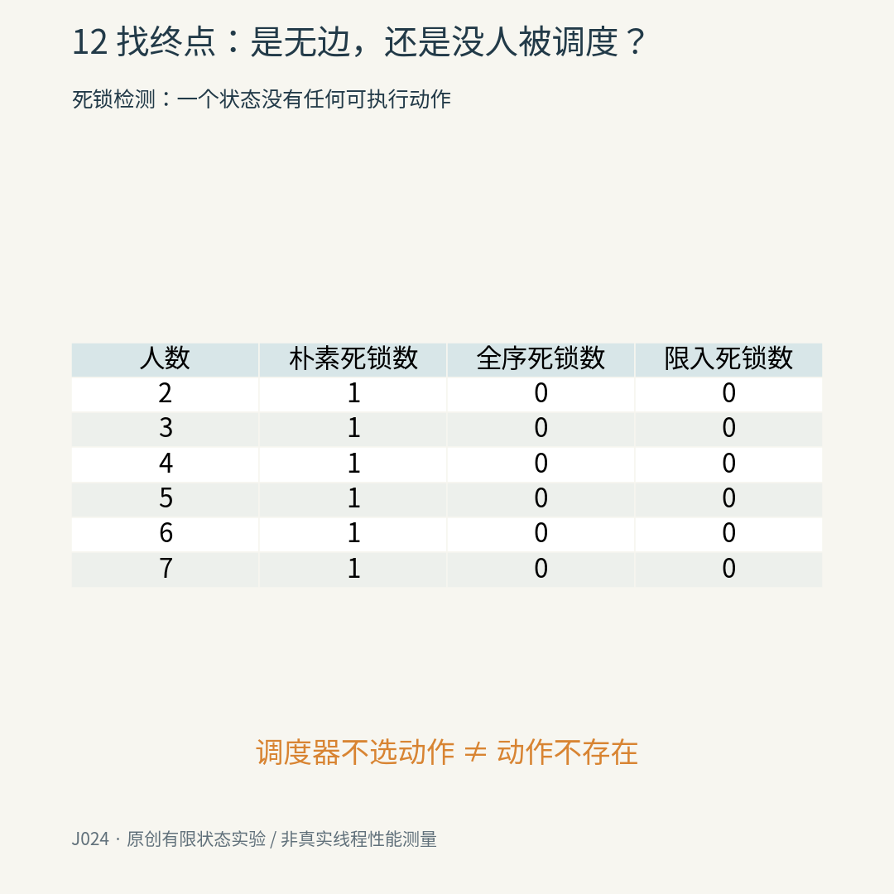
图12｜六个人数规模逐一枚举后的死锁统计；“有动作但调度器不执行”不被误计为没有出边。

这次共检查 28,806 个可达状态、155,639 条迁移。作者还另写显式持有者模型，在 n=2…5 的十二组配置中交叉比较了完整可达状态集合。每个可达状态都检查相邻者不能同时处于阶段 3、叉的所有权不冲突、限入策略的入场数不超过 n−1。

有限检查能发现实现和推理的错配，却不能独自证明所有 n 都成立。前面两个结构论证承担更一般的部分；模型检查负责核对这一份程序在这些有限配置中确实做了所说的事。

## 8｜有人在吃，不等于你终会吃到

来看三个人的全序策略。先让 P2 入场，状态变成 (0,0,1)。P2 想先拿 F0。

此后调度器一直选择 P0：入场、拿 F0、拿 F1、吃完归还。状态又回到 (0,0,1)。再重复同一圈，P0 一直吃得到，P2 一直没有拿到第一把。

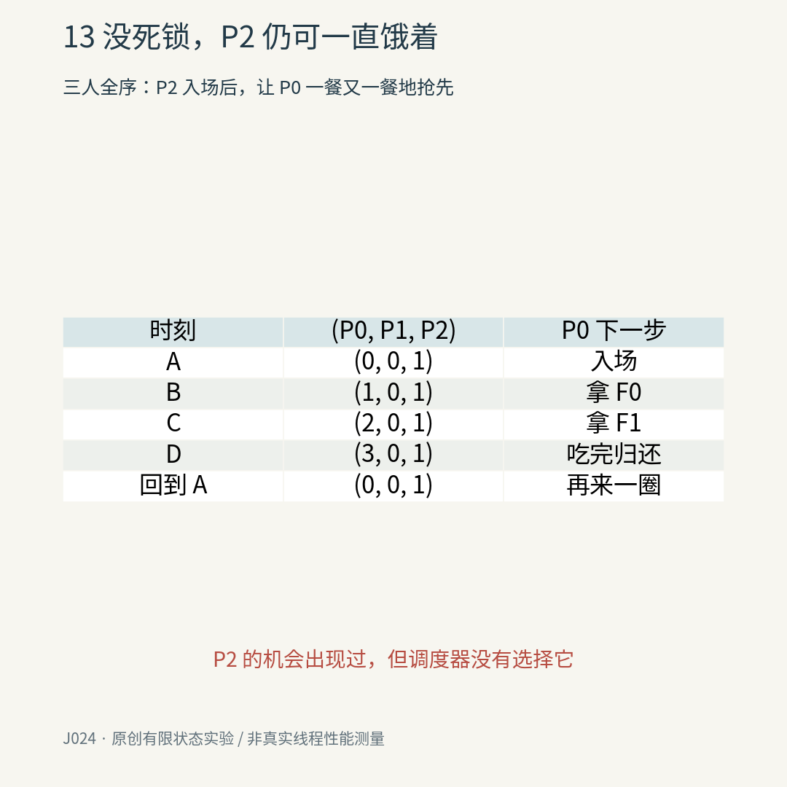
图13｜程序实际回放了这一可重复循环；每轮都有一次完成用餐，P2 却始终停在阶段 1。

这不是死锁：每个时刻都有动作可以执行。这是一个不受公平约束的调度器允许的饥饿执行。特别要注意，P2 拿 F0 的动作并非每时每刻都可执行；P0 持有 F0 时它不可执行，放下后才再次出现机会。

我们常说的弱公平，可以针对动作表述为：从某时刻开始一直可执行的动作，最终会被执行。强公平则进一步要求：如果一个动作在执行中无限次可执行，就不能从某个时刻开始再也不执行它。两者并不一样，而且“进程公平”“锁请求队列公平”也不是同一个定义。这里的区别依据 [Lamport 的 PlusCal 教程第 9 节](https://lamport.azurewebsites.net/tla/tutorial/session9.html) 中对持续使能与反复使能的定义；不是把本程序称为 TLC 验证结果。

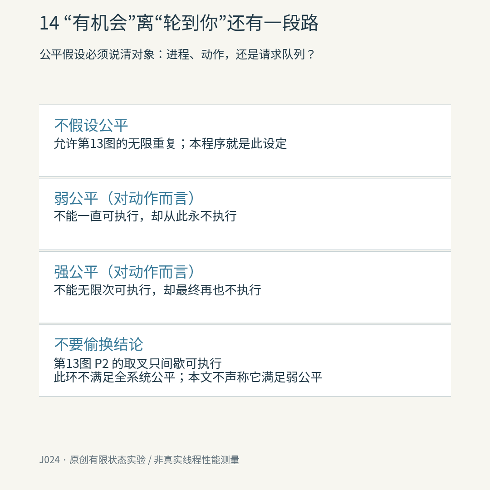
图14｜明确公平假设的对象和力度，比笼统地写“调度器是公平的”更重要。

上面的循环**没有被宣称满足全系统弱公平**：例如其他人的入场机会也被调度器忽略了。它只足够反驳“不附加任何公平条件也能保证不饥饿”。至于在某种公平条件下是否每人都会吃到，需要针对那一套完整协议另作证明。

给门口加 FIFO 队列可能有帮助，但只保证入场次序也未必处理好了入场后的叉竞争。若要给用户一个“最多等多少次”的承诺，队列规则、有限用餐时间、线程不会持叉崩溃、调度保障等前提都得落到实处。本篇没有实现或证明这样的生产协议。

## 9｜把“模型跑完”也当成有成本的事情

每个人四个阶段，粗略候选状态上界为 4ⁿ；实际许多组合因叉冲突不可达。每个状态至多 n 条出边。代码用长度 n 的 tuple 作为状态，生成下一步和字典键都带来随 n 增长的工作，而不是“查表永远没有成本”。

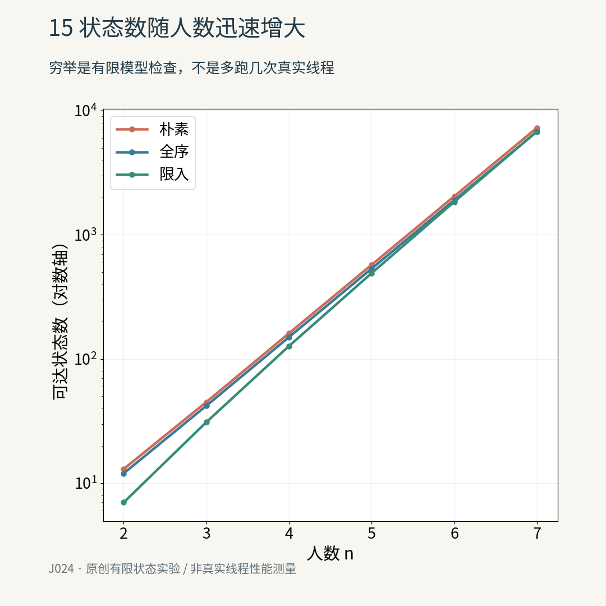
图15｜实际状态数按对数纵轴画出；人数只从 2 增加到 7，穷举规模已经明显放大。

按通常字典平均查找模型、把单个小整数操作算常数，当前实现的保守时间上界可写 O(n²·4ⁿ)：每个状态试至多 n 个动作，每次复制/比较/哈希长度 n 的状态。它保存全部带目标状态的边，保守存储上界同样是 O(n²·4ⁿ) 个标量槽位，另外还有 BFS 队列与父指针。这里说的是本实现，不是所有模型检查器都必须保存所有边。

公开 graph 和 replay 限制 n 在 2…7，目的是控制示例规模，不是说第八个人会使理论失效。它们不用线程，不模拟 CPU、内存屏障、内核睡眠队列、取消或崩溃。一次 finish 是原子动作；真实代码中分步释放的更多交错没有被这个状态图穷尽。


图16｜安全、无死锁、不饥饿各有不同的检查对象；当前模型没有把第三项悄悄算作已保证。

## 10｜可以自己改哪一处？

把 room 的容量从 n−1 改成 n，再枚举一次：你应该能看到朴素死锁回来。把 ordered 中 P4 改回 4→0，也会破坏统一顺序。不要只看最终的红绿结论，打印 witness，逐步说明谁拿着什么、下一步为什么不能走。

再问一个更难的问题：如果一位哲学家拿叉后退出了程序，谁负责归还？这已不是简单改容量能解决的事。一个好模型的价值，不仅在于告诉你“某条策略可以”，还在于让你清楚地看见：它究竟在哪些前提下可以。

### 运行完整代码

下方附录是本篇标准库模型的完整源码，存成 dining_lab.py 后运行 `python dining_lab.py`，会打印六个人数规模、三种策略的状态/边/死锁/最大同时用餐数。辅助函数 forks、owners、moves、witness 供受控模型内部使用；不要把任意损坏的状态传进去当作已验证输入。replay 对指定的行动者做校验，若选择了被阻塞的人就报错，而不是偷偷跳过这一步。

## 完整模型代码｜dining_lab.py

```python
"""Finite SC teaching model, not a semaphore implementation.
0=outside/ready, 1=admitted/no fork, 2=one fork, 3=two forks.
Each enabled transition is atomic. finish releases both forks and admission.
No fairness is imposed. Public graph() bounds n to 2..7.
"""
from collections import deque

POLICIES = ('naive', 'ordered', 'room')

def setup(n, policy):
    if type(n) is not int or not 2 <= n <= 7:
        raise ValueError('n must be an integer in 2..7')
    if policy not in POLICIES:
        raise ValueError('unknown policy')

def forks(i, n, policy):
    a, b = i, (i + 1) % n
    return tuple(sorted((a, b))) if policy == 'ordered' else (a, b)

def owners(state, policy):
    """Internal: state has validated length, phases and room capacity."""
    n = len(state)
    held = [-1] * n
    for i, phase in enumerate(state):
        a, b = forks(i, n, policy)
        for fork in ((a, b) if phase == 3 else (a,) if phase == 2 else ()):
            if held[fork] != -1:
                raise ValueError('two owners for one fork')
            held[fork] = i
    return tuple(held)

def moves(state, policy):
    """Internal: only valid states produced by graph/replay are accepted."""
    n = len(state)
    held = owners(state, policy)
    active = sum(x != 0 for x in state)
    result = []
    for i, phase in enumerate(state):
        a, b = forks(i, n, policy)
        if phase == 0:
            enabled = policy != 'room' or active < n - 1
            label = 'enter'
        elif phase == 1:
            enabled, label = held[a] == -1, 'take-first'
        elif phase == 2:
            enabled, label = held[b] == -1, 'take-second'
        else:
            enabled, label = True, 'finish'
        if enabled:
            nxt = list(state)
            nxt[i] = (phase + 1) % 4
            result.append((i, label, tuple(nxt)))
    return result

def graph(n, policy):
    """Enumerate every reachable state and labelled transition (no scheduler)."""
    setup(n, policy)
    start = (0,) * n
    parent = {start: None}
    todo = deque([start])
    edges = {}
    while todo:
        state = todo.popleft()
        edges[state] = moves(state, policy)
        for i, label, nxt in edges[state]:
            if nxt not in parent:
                parent[nxt] = (state, i, label)
                todo.append(nxt)
    return edges, parent

def witness(parent, target):
    """Internal: target is in the parent dictionary from graph()."""
    path = []
    state = target
    while parent[state] is not None:
        prev, i, label = parent[state]
        path.append((i, label, state))
        state = prev
    return list(reversed(path))

def replay(n, policy, actors):
    """Each actor chooses that actor's next enabled action; reject blocked steps."""
    setup(n, policy)
    state = (0,) * n
    trace = [state]
    for i in actors:
        if type(i) is not int or not 0 <= i < n:
            raise ValueError('invalid actor')
        candidates = [x for x in moves(state, policy) if x[0] == i]
        if not candidates:
            raise ValueError('actor is blocked')
        state = candidates[0][2]
        trace.append(state)
    return trace

def summary(n, policy):
    edges, parent = graph(n, policy)
    dead = [s for s, out in edges.items() if not out]
    return dict(n=n, policy=policy, states=len(edges),
                edges=sum(map(len, edges.values())), deadlocks=len(dead),
                max_eating=max(s.count(3) for s in edges),
                deadlock_steps=(len(witness(parent, dead[0])) if dead else None))

if __name__ == '__main__':
    import json
    print(json.dumps([summary(n, p) for n in range(2, 8) for p in POLICIES], indent=2))
```

## 短读版｜不抢错，不等于等得到

五个人都先拿一把叉，再等另一把，可能人人都守住互斥规则，却谁也吃不上。互斥只保证“一把叉不同时给两个人”，并没有保证“每个人都能凑齐两把”。

本篇用完整可运行的四阶段模型，把每一次可能的交错列出来。五人朴素策略只需十步，就能到达人人持一把、没有后继动作的死锁。

两种改法各改一个结构：所有人按全局叉编号从小到大拿，严格递增就绕不成环；或先取得入场许可，让桌边至多 n−1 人，把满圈等待链切开。第二种不是只许一人用餐：五人模型确实能让 P0、P2 同时拿齐叉。

但没死锁不等于不饥饿。一个偏心的调度器可以让 P0 吃完又吃，让 P2 的机会出现一次、错过一次。要保证“终会轮到你”，还得明确公平或队列协议，而不是把许可计数当成公平承诺。

长文给出16幅状态/数据图、完整标准库模型和失败路径。n=2…7 的三策略穷举只是有限抽象检查，不是真实线程压力测试；原子释放、无崩溃、无弱内存等边界都明写。先弄清保证了哪一件事，再谈“程序正确”。


## 来源与素材权利

参见[来源、素材权利与 AI 辅助说明](sources.md)。
