# 不只是鼠标：1968年的NLS，怎样让两个人谈同一处知识

你和同学一起筹办校园展览。资料不少，问题却很具体：

“你说的那一段在哪？”“不是旧路线，是昨天改的那份。”“我已经改好了，你怎么又覆盖回去了？”

这些麻烦不全是打字慢。它们分别关系到定位、结构、共同对象和修改规则。看1968年Engelbart团队的演示，如果只记住一个木壳鼠标，就容易错过这些更耐看的问题。本文先核历史，再用一个可以自己运行的小模型，把几个问题拆开。模型不是NLS模拟器，更不是把现代协作算法倒写进历史。

## 一、舞台上的一个人，背后的整个团队

1968年12月9日，Engelbart及其SRI团队在旧金山的FJCC展示NLS。这里采用研究机构当前演示索引的日期；历史屏幕提纲中写着12月8日，不能默默把两份材料当成没有差异。本文不据这处差异自行发明另一次演示。

1968年配套论文的署名是Douglas Engelbart与William English。机构索引的致谢段还列出制作与演示人员，包含English、Jeff Rulifson和Bill Paxton等。与其问“哪位天才发明了今天的一切”，不如问：这一组人，想让知识工作发生什么变化？

原论文把研究目标放在增强人的知识工作能力上，包含工具，也包含个人和群体的工作方式。本文的理解是：让计算机参与组织、查找和讨论材料，而不是只在最后把一份稿子打印漂亮。下面三个问题，是我为读者整理的观察路线，不是Engelbart的原话。


图1｜三条阅读问题是本文的解释框架，不是演示原始画面或逐字台词。


图2｜角色依据原论文署名及官方交互索引的贡献段，未把团队成果归给单一发明者。


## 二、提纲不是文字前面多几个数字

先忘掉历史机器，建立一份很小的校园展览文档。它有八个条目：展览下面分“路线”和“值班”，路线下面有北门入口、雨天方案；“待讨论”是另一项。

在程序里，每条有一个稳定键，例如 rain，有文字，也有一个有序子列表。这是一片森林：根条目可以不止一个，每个非根条目只有一个父项。它不是任意关系图；跨条目的引用另存，不混进父子关系。

位置1.1.2的意思是：第一个根的第一个孩子的第二个孩子。这个位置告诉我们它在结构里的哪里，却不承诺它永远在那儿。图3是程序按先序遍历实际输出，不是仿制历史屏幕。

1968论文确实讨论分层的statement与交叉引用；也明确区分随结构变化的位置号和随条目保留的名称。本文用稳定ID解释这一区别，但ID字典、点分数字、中文测试数据都是新写的，不是NLS原格式。

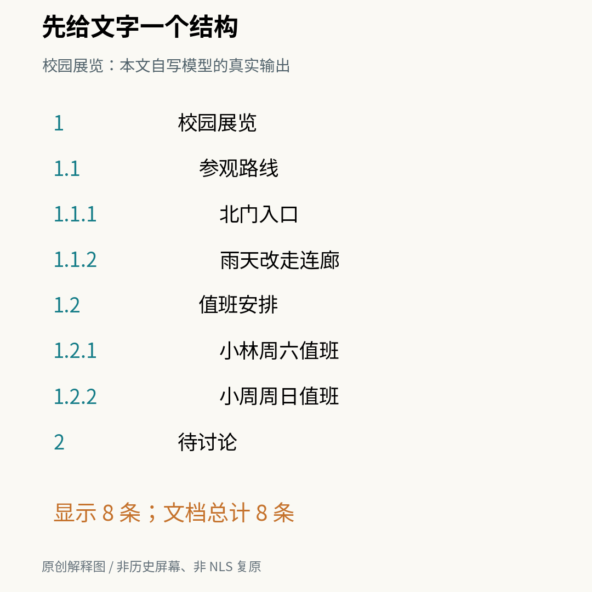
图3｜模型视图实际输出：全文八条。


## 三、隐藏细节，并没有删除细节

第一次开会只需要看总纲，于是把视图的max_depth设为1：出现“校园展览”和“待讨论”，共两条。第二次开始分工，把深度设为2，就出现四条。八条底层记录一条也没少。

“有八条”和“显示四条”不矛盾。存储结构回答资料有哪些；视图回答此刻让我看到哪些。若把折叠当成删除，下一次展开就找不回来了。

还可以只找含“雨”的文字。注意，父条目“参观路线”不含这个字，但它的孩子含有。程序必须继续走过未匹配的父项，不能因为父项被过滤就跳过整支。因此过滤结果只有rain，并保留其原位置1.1.2，不重新编号成第一条。

原论文讨论层级裁切、行截断和内容过滤。本文只实现最大深度、子串过滤、前若干Unicode码点截取；最后这一项不是历史系统的行排版，也不是按屏幕宽度切字，更不保证不拆开组合字符。

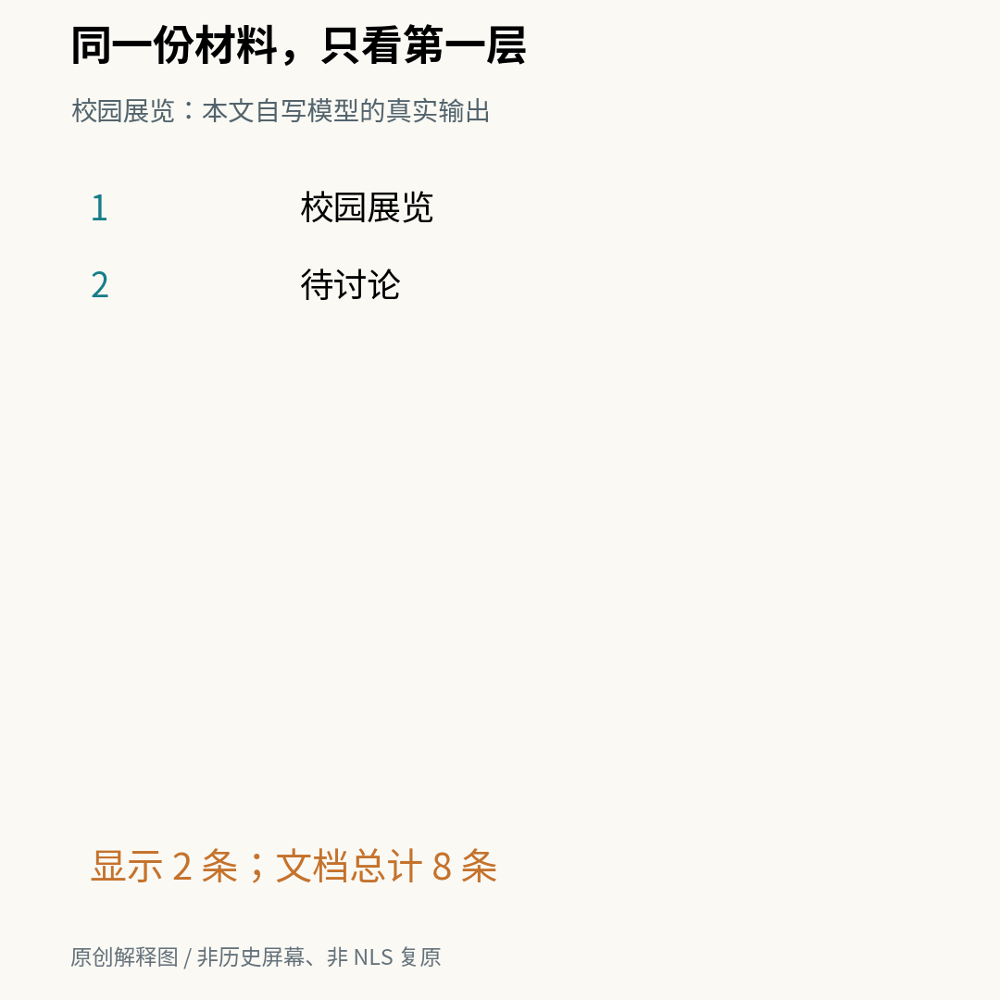
图4｜模型视图实际输出：深度=1，关键词=''，字符截取=None；隐藏不等于删除。

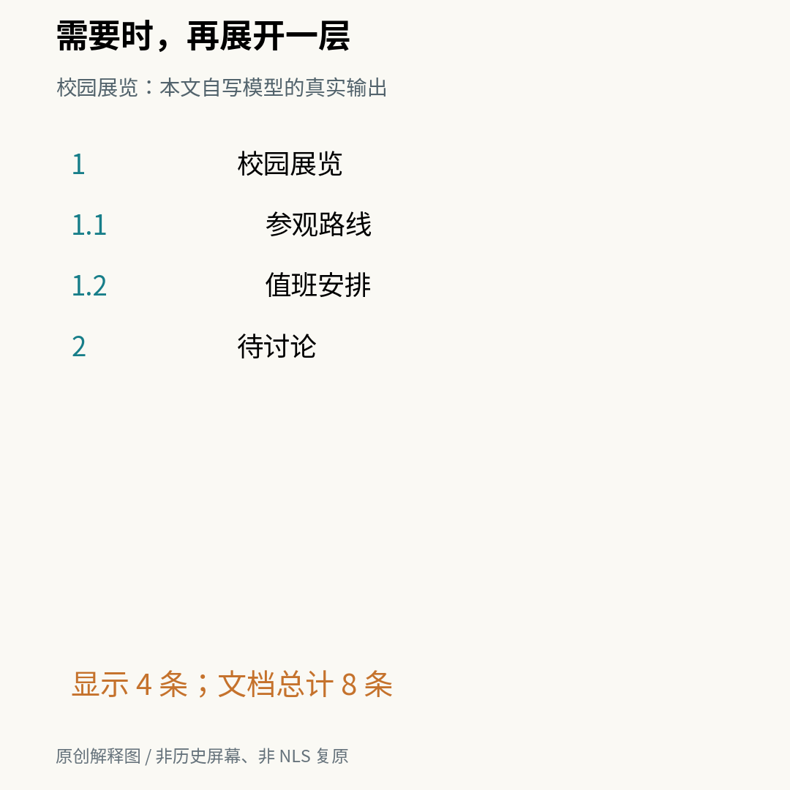
图5｜模型视图实际输出：深度=2，关键词=''，字符截取=None；隐藏不等于删除。

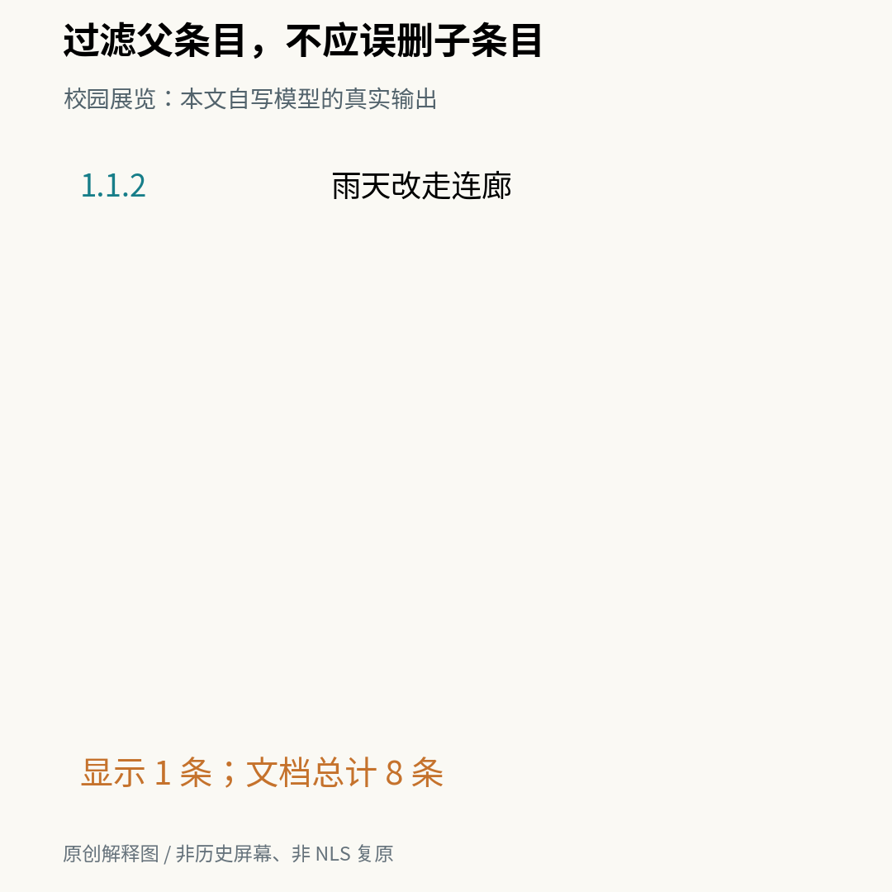
图6｜模型视图实际输出：深度=None，关键词='雨'，字符截取=None；隐藏不等于删除。


## 四、链接应该指向“谁”，还是“哪一行”？

现在把雨天方案从“参观路线”移动到“值班安排”的末尾。它的文字没变，键rain没变，但地址从1.1.2变成1.2.3。

如果备忘录只写“去旧位置1.1.2”，它就可能失效；如果指向rain，follow("memo")仍得到rain。移动整支时，下面的孩子也跟着移动，不是只复制屏幕上看见的一行。我们的例子rain恰好是叶子，代码对非叶子也按整支处理。

这里没有魔法：links字典保存的是键，而不是重新在文字里猜某个名字。名称唯一、删除如何处理、复制后指向原件还是副本，都是设计责任。本模型不实现删除与复制，也不宣称链接永不失效。这里的链接最多每个源条目一条，循环链接允许存在；follow只走一步，因此不会自己无限追下去。

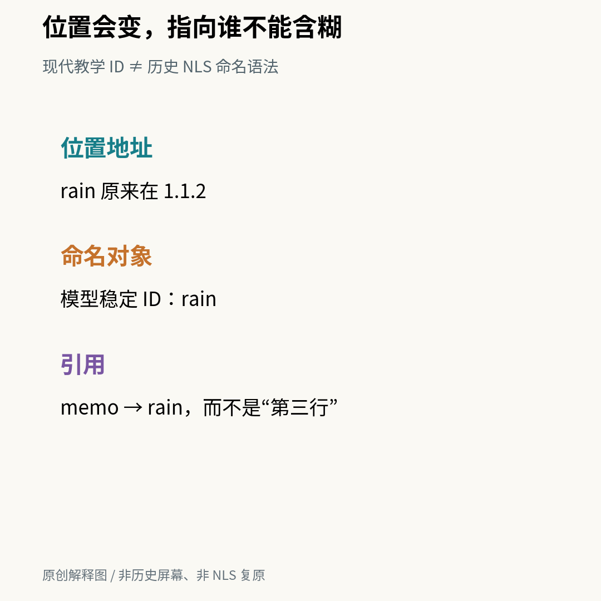
图7｜移动前 rain 的位置是1.1.2；命名引用指向对象，而位置编号依赖结构。

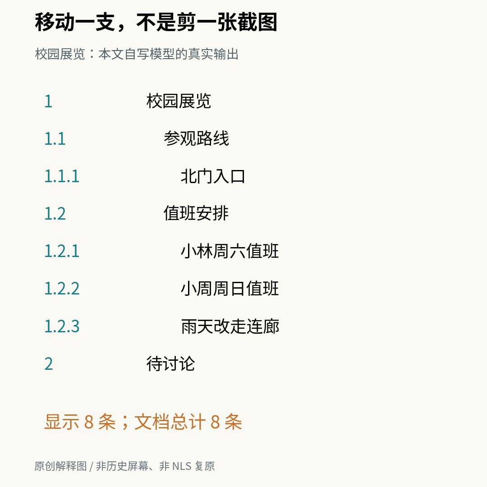
图8｜模型视图实际输出：全文八条。

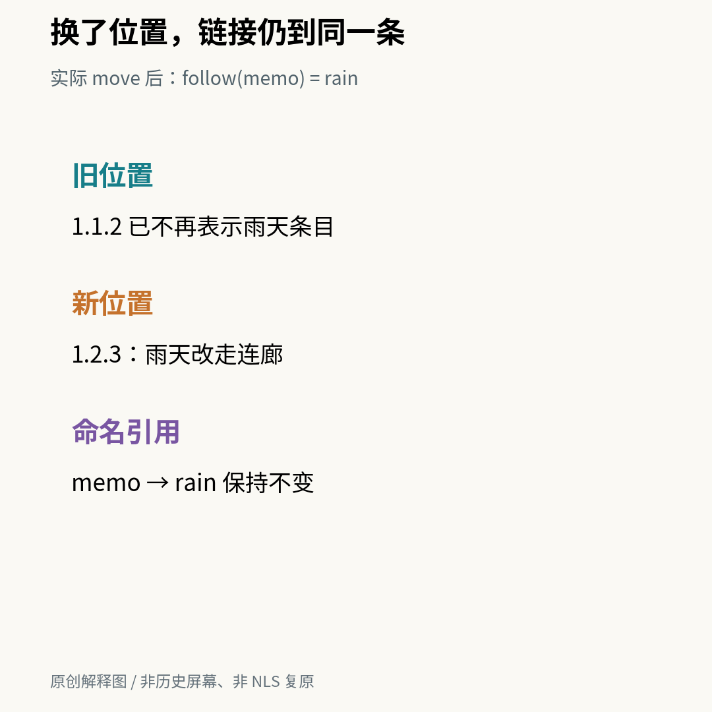
图9｜模型将rain从route移到work末尾，位置改变为1.2.3，链接仍返回rain。


## 五、能移动，还得知道什么不能移动

回到最初尚未移动rain的文档，把plan搬到自己的后代rain下面，会发生什么？plan原本通向route再通向rain；加上rain通回plan，形成一个环。以为在递归“展开下一层”，其实永远绕不出来。

move先收集整支后代，再检查新父项是否在里面。若是，抛出ValueError，原结构不变。只有检查通过，才从旧父列表移除并追加到新父列表。检查失败后“已经删掉一半”是另一类很隐蔽的错误，所以测试还保存修改前快照，比对拒绝后状态。

同一个父项下再次move，会把该支移到本父项末尾；不是空操作。公开方法假设对象仍由这些方法维护，不允许调用者任意篡改nodes、children、roots等公开Python容器。它是教学程序，不是可接收恶意对象的数据库。

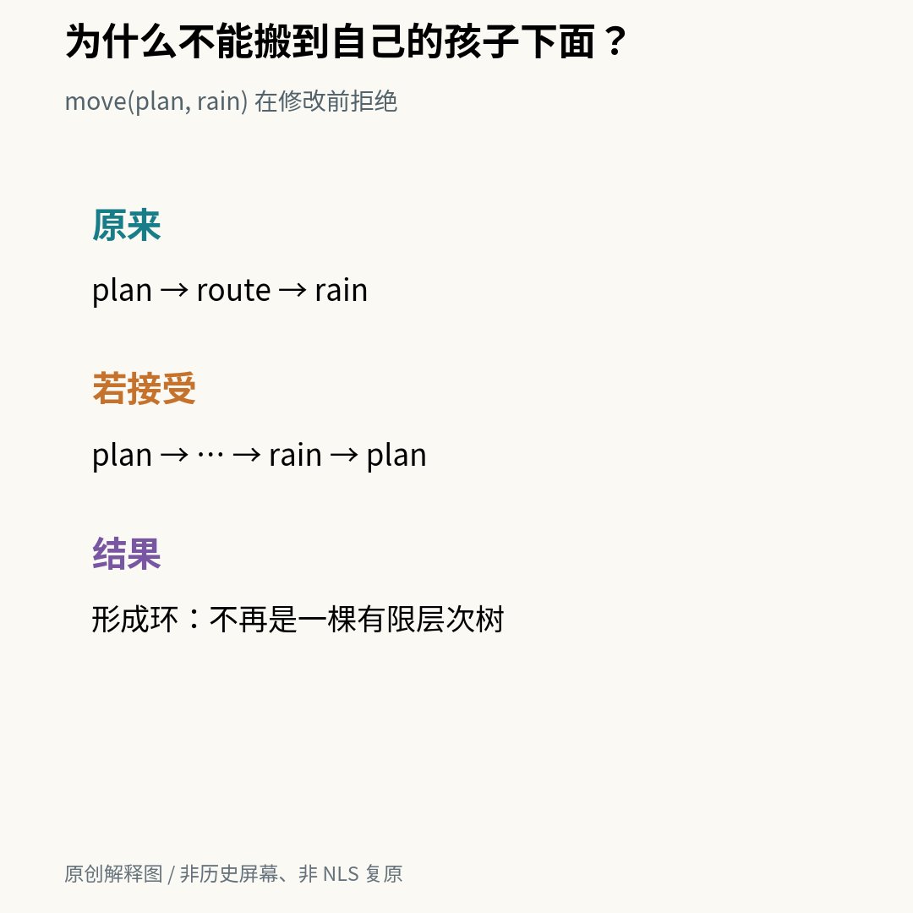
图10｜循环检查先于移除旧父项，拒绝动作必须保持原文档状态不变。


## 六、鼠标很重要，但不是全部答案

原论文的工作站图把显示器、键盘、鼠标和五键手柄放在同一工作场景里。已实际查看这张图，不过因权利边界不把扫描图复制进本文。

从交互的角度看，录入、指向、命令和反馈是不同事情。用鼠标指向条目，还要说明打算移动还是删除，以及作用于字符、条目还是整支。一个指针位置不是完整的编辑意图。

五键手柄也提醒我们：能力丰富并不自动等于第一次就好上手。不要从一场熟练操作者的演示，跳到“所有人不用学习就能高效操作”。本文不重复原论文的训练时间或速度数字，也没有重测设备。

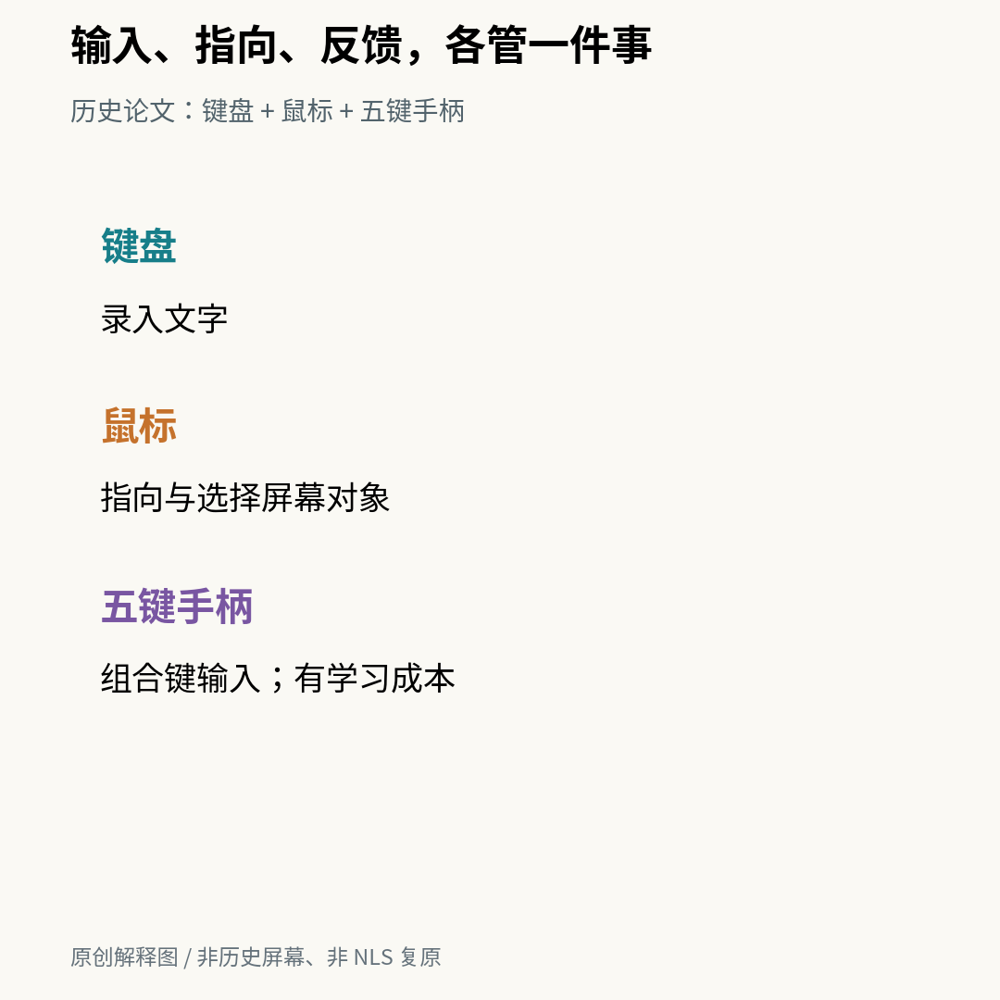
图11｜这是对设备分工的文字解释，不是描摹原照片，也不声称鼠标单独构成整个系统。


## 七、共享画面，与共同编辑，不是一句话

机构交互索引把“协作支持”放在第3卷4:46起的章节。我们核看了该章节的已发布静态预览：画面里同时有一张人的脸与文字工作区。这个静帧支持“混合呈现人和工作材料”的观察，但不够证明两个人随后怎样抢指针、怎样交接控制。本文没有观看完整运动片段，也不把索引文字冒充亲眼看到的动作。读者可从文末链接亲自进入原片。

原论文也讨论把对方摄像画面混入数据显示，并配合语音交流。值得追问的是：两个人是否在谈同一个对象？是否只是在看同一张图？谁可以改？这些是不同层次。

我们的模型允许甲看第一层、乙看第二层，实际都读同一个Document。视图不同，不必意味着文件分叉。这只是单进程共享对象，不涉及网络复制、延迟、断线或历史NLS的通信协议。

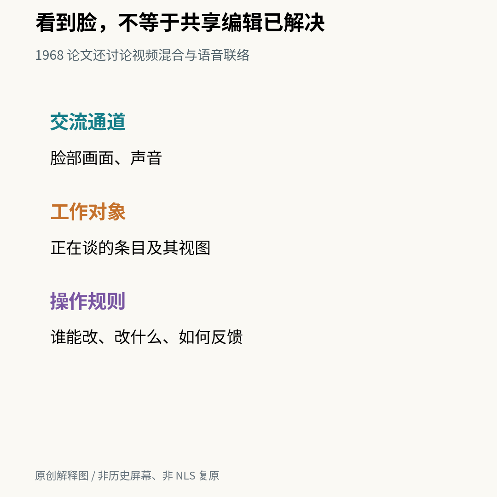
图12｜将视频交流、共享材料和编辑规则分开分析；本文未测量历史链路延迟或复原协议。

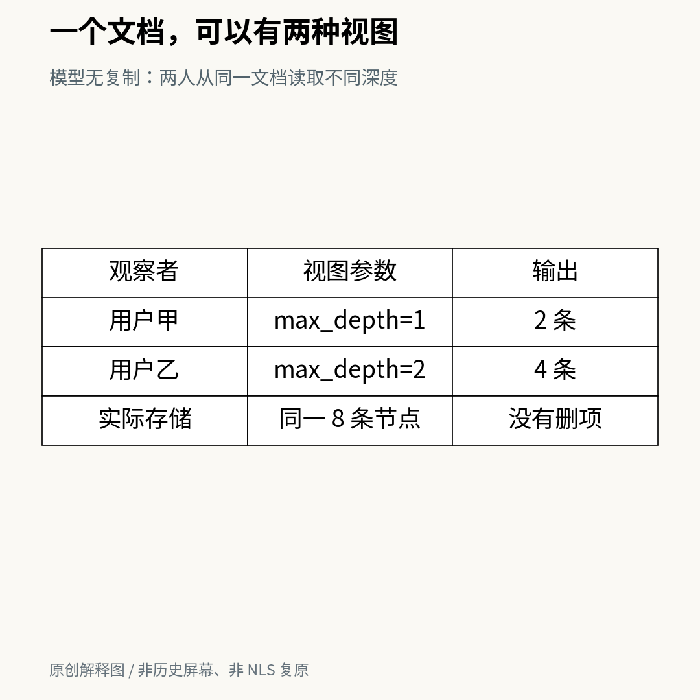
图13｜两个读者的视图不同并不意味着两份底层副本；这只是本地模型，不是复制一致性协议。


## 八、让“同时修改”暴露一个真实问题

假设甲乙都读到rain的版本0。甲把文字改成“东侧连廊”，乙想改成“西侧连廊”。若服务器不检查，后来的写入可能直接覆盖前一个人的工作。

为了把这个问题看清，我们给教学模型加一条现代规则：提交时同时带上自己读过的版本。服务器把“比较版本→改文字→版本加一”当成一次串行操作。甲带0先到，被接受，版本升到1；乙仍带0，被拒绝。输出就是True、False，最终保留东侧方案、版本1。

拒绝并不意味着乙的想法无效，只说明不能在不了解新内容时自动覆盖。乙应重读、比较，决定撤回、改写或与甲讨论。本模型不替人合并意思。

这条版本规则完全是本文自写的解释工具，绝不是根据静帧推断出来的NLS机制；没有声称1968年用了相同并发控制。四人都拿版本0提交的24种顺序中，恰好首位成功，只证明该串行模型的行为。真实多线程若把版本比较和写入拆开，结果可不同；分布式系统还要定义服务器权威、崩溃恢复和消息处理。本代码没有那些功能。

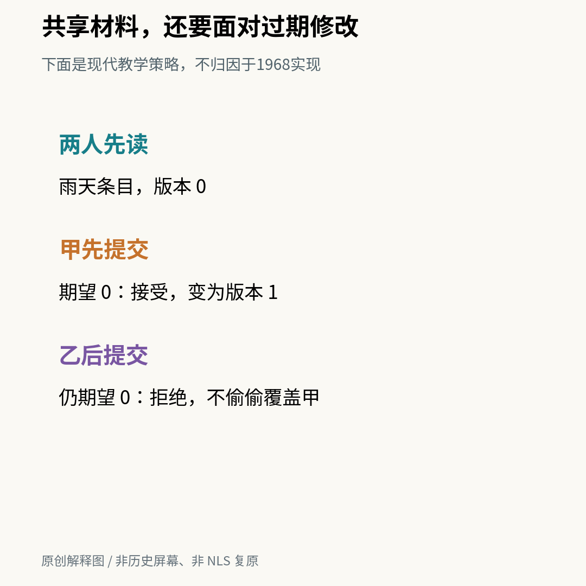
图14｜原程序真实输出为True、False；该版本检查由本文自写，不声称是NLS所用机制。

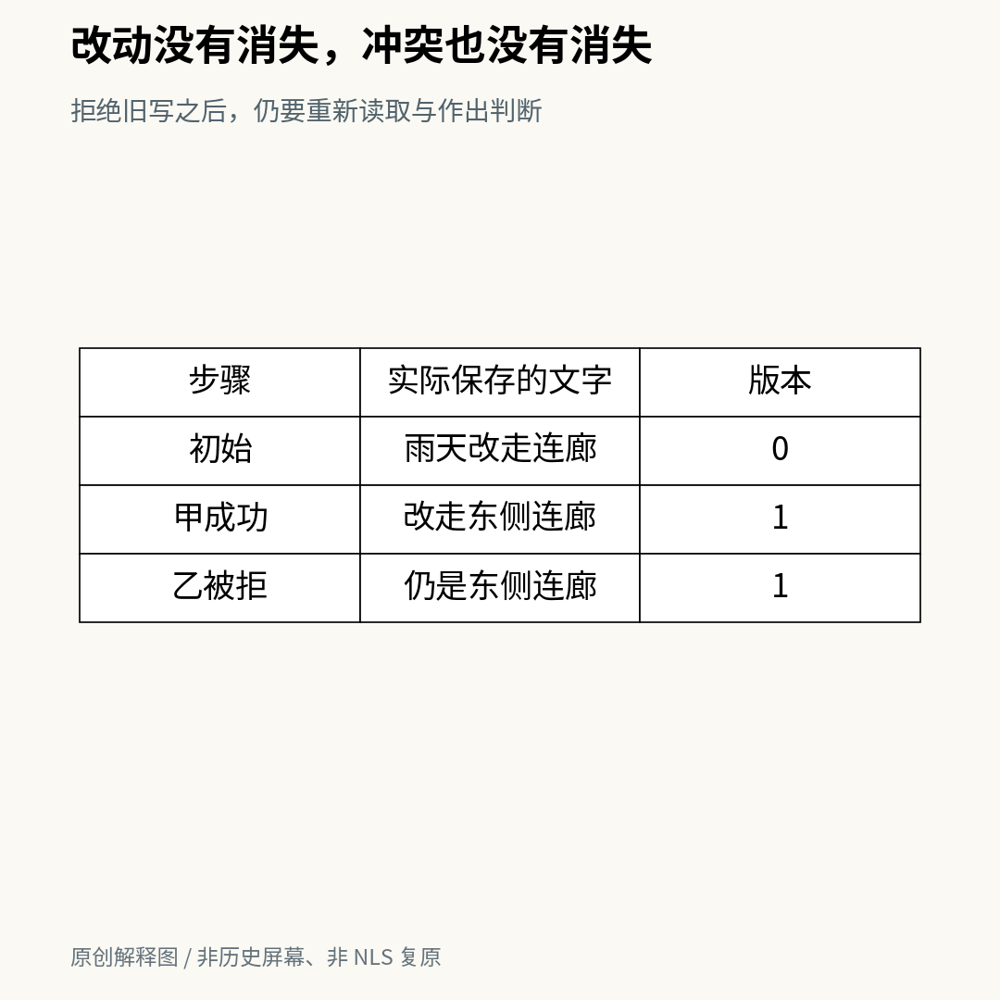
图15｜模型只串行处理一个条目的版本条件更新，既不自动合并两人的意图，也不是无锁或分布式算法。


## 九、把“看起来对”变成可检查的问题

这份模型做了200棵随机树、6000次移动尝试。独立的父指针链帮助检查深度；1038次会形成环的移动被拒绝；其余成功步骤逐节点共99240次核对深度与地址长度。另枚举四个同版本提交者的24种顺序，并检查零层视图、空字符截取、子项关键词等边界。

这不是形式证明，更不是1968系统测试报告。用自己的模型学习历史机制，最重要的一条纪律就是把“原资料说了什么”“我实现了什么”“我实际测了什么”分开。

成本也别藏起来。walk会创建所有条目的地址元组，时间和返回空间取决于所有地址长度之和，最深的一条链可到O(n²)，不是一概O(n)。move收集后代并搜索旧父列表，按条目和边计O(n)，辅助后代集合最坏O(n)。view先调用walk，再过滤及截取，另有文本查找与输出字符成本。read与edit的键查找按通常哈希表假设计算；大整数版本递增和字符串处理不应被说成无成本。这里没有性能基准。

结尾可以回到最初的校园展览：人仍然决定去哪条连廊，工具帮助大家找到同一项、看到合适的范围、察觉修改冲突。我的理解是，这比把知识工作缩成“更快地打字”更值得探索。这个结论是本文评论，不代表Engelbart、DEI或SRI发言。


图16｜这些计数来自本文Python模型的真实测试，不是1968系统性能或历史实验数据。


## 完整可运行核心代码

保存为nls_lab.py，运行python nls_lab.py。测试脚本另保留在本地审查包；上述示例只依赖标准库。

```python
"""Original teaching model; not NLS source, protocol, or emulator. Python 3."""
from dataclasses import dataclass, field

@dataclass
class Node:
    text: str
    children: list = field(default_factory=list)
    version: int = 0

class Document:
    def __init__(self):
        self.nodes = {}
        self.roots = []
        self.links = {}

    def add(self, key, text, parent=None):
        if not isinstance(key, str) or not key or key in self.nodes:
            raise ValueError('fresh nonempty string key required')
        if not isinstance(text, str):
            raise ValueError('text must be str')
        if parent is not None and parent not in self.nodes:
            raise ValueError('missing parent')
        self.nodes[key] = Node(text)
        (self.roots if parent is None else self.nodes[parent].children).append(key)

    def walk(self):
        """Preorder tuples: (stable key, positional address tuple, depth)."""
        result = []
        stack = [(k, (i+1,), 1) for i,k in reversed(list(enumerate(self.roots)))]
        while stack:
            key, address, depth = stack.pop()
            result.append((key, address, depth))
            stack.extend((k, address+(i+1,), depth+1)
                         for i,k in reversed(list(enumerate(self.nodes[key].children))))
        return result

    def move(self, key, parent=None):
        """Append entire branch to new parent's end; reject cycles before mutation."""
        if key not in self.nodes or (parent is not None and parent not in self.nodes):
            raise ValueError('missing node')
        descendants = set()
        todo = [key]
        while todo:
            k = todo.pop(); descendants.add(k); todo.extend(self.nodes[k].children)
        if parent in descendants:
            raise ValueError('cycle')
        container = self.roots if key in self.roots else next(
            n.children for n in self.nodes.values() if key in n.children)
        container.remove(key)
        (self.roots if parent is None else self.nodes[parent].children).append(key)

    def view(self, max_depth=None, keyword='', chars=None):
        if max_depth is not None and (type(max_depth) is not int or max_depth < 0):
            raise ValueError('nonnegative depth')
        if not isinstance(keyword, str):
            raise ValueError('keyword must be str')
        if chars is not None and (type(chars) is not int or chars < 0):
            raise ValueError('nonnegative chars')
        return [(k, a, self.nodes[k].text if chars is None else self.nodes[k].text[:chars])
                for k,a,d in self.walk()
                if (max_depth is None or d <= max_depth) and keyword in self.nodes[k].text]

    def link(self, source, target):
        if source not in self.nodes or target not in self.nodes:
            raise ValueError('missing endpoint')
        self.links[source] = target

    def follow(self, source):
        return self.links[source]  # KeyError if no link: deliberately explicit.

    def read(self, key):
        n = self.nodes[key]
        return n.text, n.version

    def edit(self, key, expected, text):
        """Serialized server operation; no real concurrency or automatic merge."""
        if type(expected) is not int or expected < 0 or not isinstance(text, str):
            raise ValueError('bad version or text')
        n = self.nodes[key]
        if expected != n.version:
            return False
        n.text = text; n.version += 1
        return True

def example():
    d=Document()
    for k,t,p in [('plan','校园展览',None),('route','参观路线','plan'),
                  ('north','北门入口','route'),('rain','雨天改走连廊','route'),
                  ('work','值班安排','plan'),('alice','小林周六值班','work'),
                  ('bob','小周周日值班','work'),('memo','待讨论',None)]:
        d.add(k,t,p)
    d.link('memo','rain')
    return d

if __name__ == '__main__':
    d=example(); print(d.view(max_depth=2))
    d.move('rain','work'); print(d.follow('memo'),d.walk())
    old,version=d.read('rain')
    print(d.edit('rain',version,'改走东侧连廊'))
    print(d.edit('rain',version,'改走西侧连廊'))  # stale write rejected
```

## 短读版｜鼠标之外，NLS在问什么？

1968年Engelbart团队展示NLS时，值得关注的不只有输入设备，还有分层材料、定位和链接、共同讨论工作对象。原论文署名Engelbart与English，演示还有其他研究人员参与，不能写成一个人发明了所有现代协作工具。

用本文的校园展览模型，可以试三件事：
1. 八条资料只显示第一层时变成两条，但隐藏不是删除。
2. 把雨天方案从1.1.2搬到1.2.3，命名链接仍指向rain；位置不是身份。
3. 两人都拿版本0提交，先到者成功、后到者被拒绝。注意：第三条是现代教学策略，不是NLS历史实现的断言。

16图均为原创解释或真实模型输出，不是历史屏幕复原。原论文和索引静帧只在本地核证，因再版权利范围不交付。我们没有看完整影片，静帧不证明连续动作。读者可以循文末原始链接继续观看和核对。


代码契约：Python 3标准库；仅合法结构上的单进程串行模型，内部容器不由外部破坏。没有删除、复制、网络、自动合并、授权、持久化、实际并发。唯一名称只在本对象中有效，不代表通用永久标识。图文为教学而非工程部署建议。


## 来源与素材权利

参见[来源、素材权利与 AI 辅助说明](sources.md)。
