# 库存只剩5件，能不能知道它是怎样变成5的？从一本事件账本讲起

你打开仓库页面，看到一个数字：5。

它可能来自“入库10、出库4、补回2、再出库3”，也可能只是“首次入库5”。当前数字回答了“现在多少”，没有回答“经历过什么”。如果某次计算写错，直接保存最终数字的系统还可能缺少重新计算的材料。

事件溯源把这件事倒过来考虑：先把已经发生、需要影响状态的事实按约定保存下来，再让状态成为这些事实的一种计算结果。这里的“来源”是事件，不是拿日志文件给错误找借口。

先看一幅真实的早期解释图，再自己搭一个可以运行的小模型。模型只使用虚构整数库存；没有真实仓库、资金、消息服务或数据库。


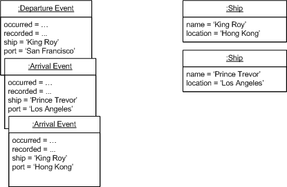
图1｜Martin Fowler《Event Sourcing》Figure 4：左侧保存航运事件，右侧保存目前位置。原GIF内容未修改；作者署名与原文链接见相邻说明。


Martin Fowler在2005年12月12日的《Event Sourcing》草稿中，用船舶到港/离港说明事件与当前状态的区别。图左边有三条事件，右边只有两艘船的目前位置；“King Roy现在在香港”不能单独告诉我们它曾从哪里离开。原图保留了两类时间字段，但本篇不实现双时间语义。

图像来源与署名：© Martin Fowler，[原文Figure 4](https://martinfowler.com/eaaDev/EventSourcing.html)。使用的是原GIF，内容未修改；手机预览仅等比缩小。作者[FAQ的插图使用说明](https://martinfowler.com/faq.html)允许署名、链接并说明改动的图像使用。这里采用该明确图像许可，不把它说成整篇文章可自由再版或公共领域。

## 1．把状态当成一段计算的结果

我们的主实验从0开始，顺序记录四次变化：+10、−4、+2、−3。事件发生过之后，才有资格进入这条流。先暂时不讨论谁来检查命令，只看如何重建。


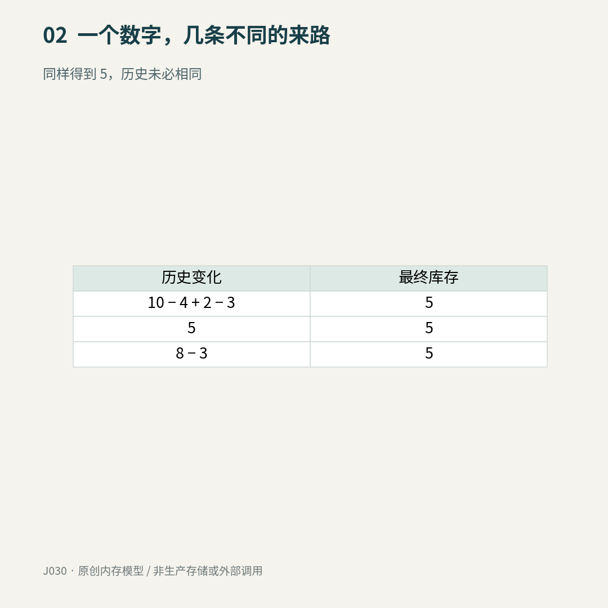
图2｜三种不同事件序列都能到5，单一状态不能唯一恢复历史。


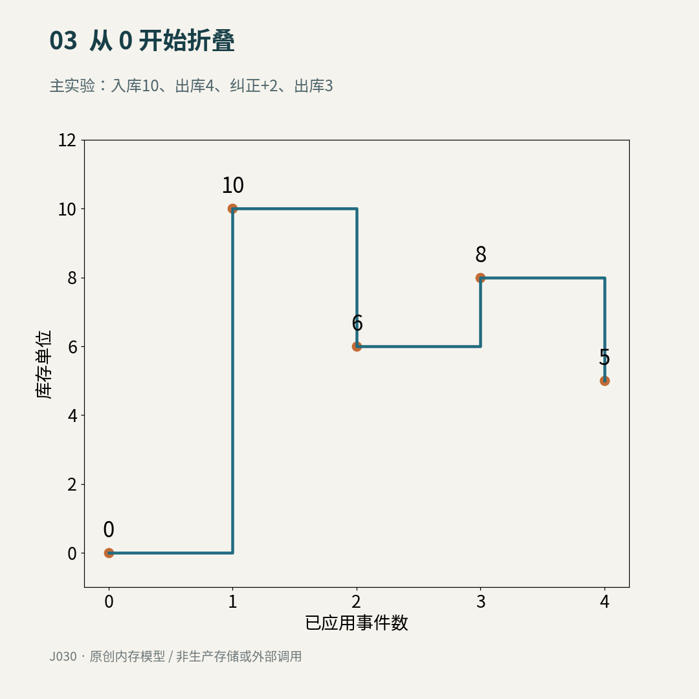
图3｜实际replay的前缀库存为0、10、6、8、5；横轴是日志位置，不是时间戳。


设第i个事件为eᵢ，状态为sᵢ，则

s₀ = 0，sᵢ = apply(sᵢ₋₁, eᵢ)。

本模型的apply很朴素：把事件解释成整数变化d，然后计算s+d，并拒绝变成负数的历史。这种“拿上一个累计结果继续吃下一个元素”的过程叫fold。主实验逐步得到0→10→6→8→5。重放没有神奇的倒带引擎，就是重新走这条计算链。

如果把旧事件顺序弄乱，通常会出问题。虽然整数加法最后的和不随排列改变，但库存约束在每个前缀都要成立：先出库4再入库10，第一步就不合法。更一般的业务事件还可能改变名称、状态阶段或权限，连最终计算结果也未必可交换。

事件流必须说明自己的排序单位。本篇只有一个库存对象、一条流、从1连续增长的位置；这不是所有对象的全球时间顺序，也不靠墙上时钟给并发请求定胜负。

## 2．“请给我7件”和“已经给了7件”不是同一句话

命令表达愿望，事件记录被接纳的结果。若库存只有3，“出库7”应被拒绝，而不是先把“已出库7”写入，再期望重放替你解决矛盾。


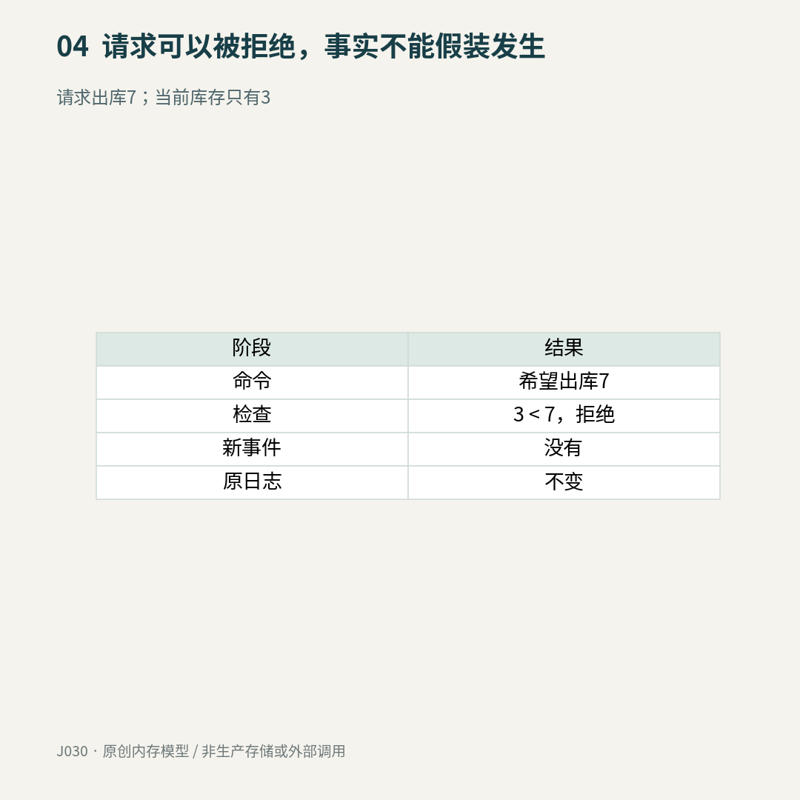
图4｜已记录事实与待决命令不同；拒绝不产生库存变化事件，审计拒绝可另建记录。


Store.append在接受命令时检查库存，并生成事件。拒绝不产生库存变化事件；要审计拒绝、鉴权失败或操作员输入，应另作设计，不要把本模型没有记录的事情叫成“完整审计”。

一条追加式日志也不会自动解决并发。A和B都读到位置1、库存10，都想出库7。若只检查各自看到的旧库存，两者都会认为可以。我们的串行模型要求请求附带expected位置：只有与当前流长度相同，才继续接纳新事件。


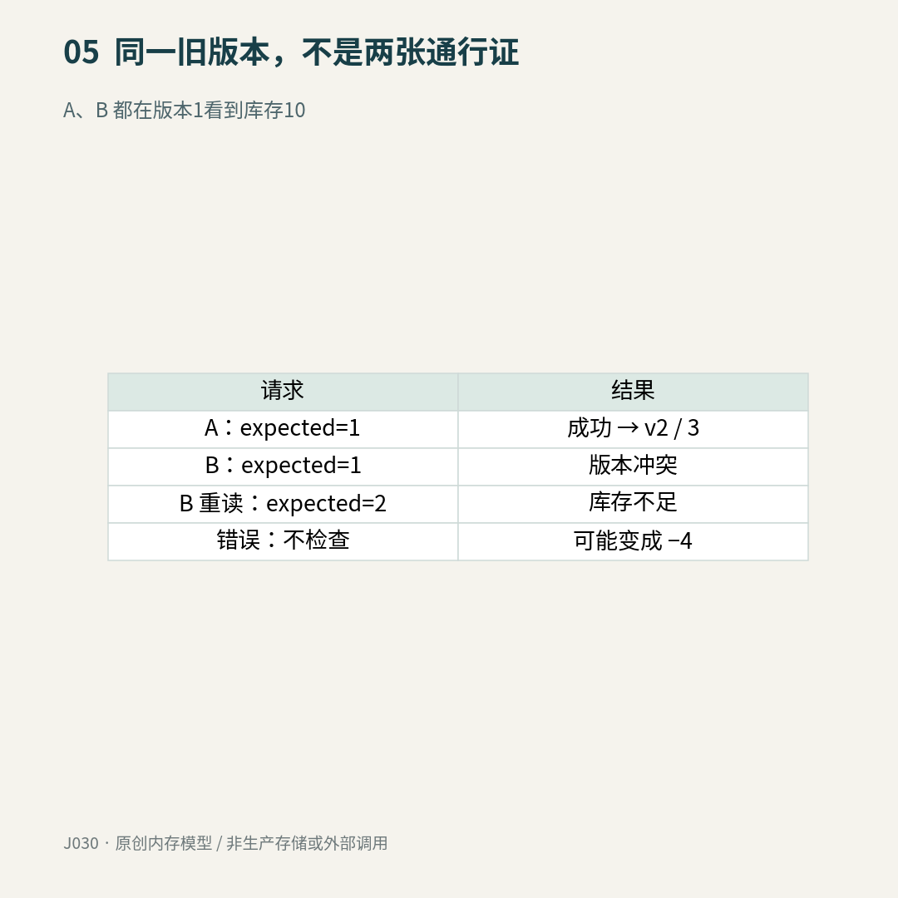
图5｜串行模型实测A成功后B先遇版本冲突，重新判断又因不足被拒；盲加两次会得到−4。


A先成功后，流到了位置2，库存3。B带着expected=1会遇到版本冲突。B即使重读后改成expected=2，仍须重新执行业务检查，这时库存不足，不能盲目重试原来的决策。

注意，这个检查和追加在生产存储中必须是一个原子的、持久化的动作。把Python的两个语句写在一起，并不赋予它们跨线程、跨进程或断电后的原子性。本例只允许顺序调用。

重复请求是另一种问题：A成功了，但客户端没收到答复。若它带同一个request_id和相同change重来，Store会返回旧事件，并标记不是新追加；旧expected不会阻止这种已成功请求的重试。相同ID却改了change会被拒。这里request_id也直接充当事件ID，适用于“一次成功命令只产生一个事件”的教学约定；生产系统可能一命令多事件，不能照搬身份设计。失败请求不进已接受表，因此它以后在新状态下重新提交可能成功，这也是明确的契约而非永久去重。

## 3．错了要留下纠正，不是偷偷改掉过去

假设本来只应出库2，却记录了出库4。追加+2可以把当前库存从6纠正到8，同时保留“先记错、后纠正”的来路。


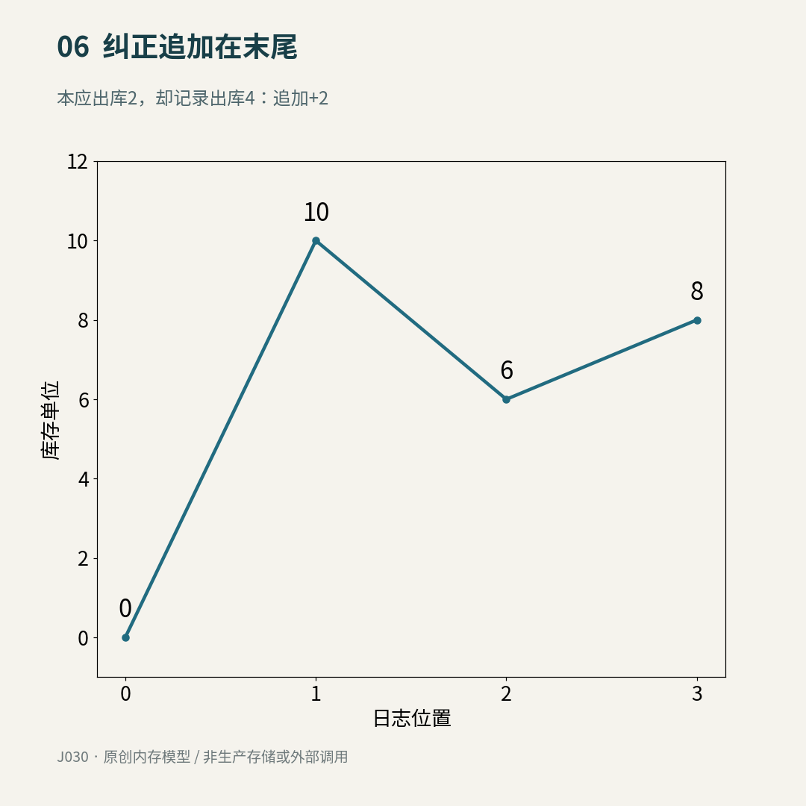
图6｜旧记录−4仍然保留，追加纠正+2后库存由6变8；不是把位置2悄悄改写。


这不意味着所有错误都能靠一个相反数撤销。已经寄出的包裹不会因为库存+2就自动回来，已经发送的通知也不会消失。我们的adjusted事件只说明这个虚构库存的调整，未声称完成现实补偿。

真正的业务事件通常还需要纠正原因、操作者、关联原事件和权限。本程序刻意只保留让计算可检验的最小字段，不是审计字段清单。追加式也不等于防篡改：管理员权限、日志保留、备份恢复、加密与个人信息处理都在本模型之外。

## 4．事件越来越多，难道每次都从第1条读？

可以在位置2存一份快照：reducer=1、position=2、stock=6。恢复时先加载6，再只应用位置3、4，得到5。


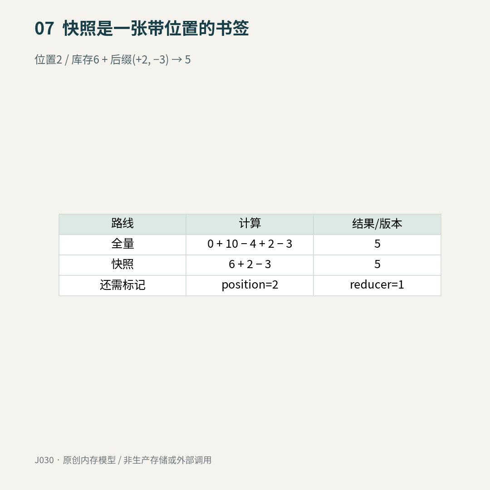
图7｜受信快照与其后缀重放得到同样5；快照必须标识已覆盖到哪里。


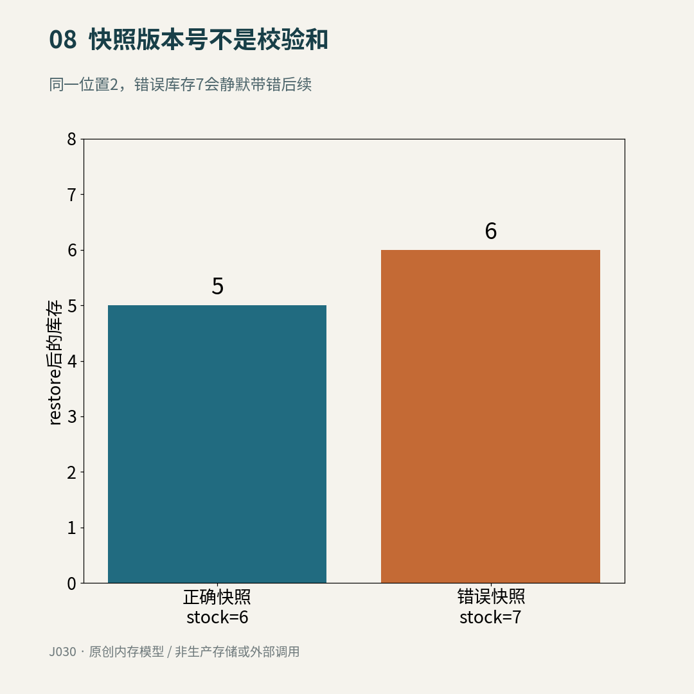
图8｜restore接受受信快照，不认证内容；错误快照把结果从5带成6，验证不能只看版本标签。


快照需要说明覆盖了哪个前缀，以及由哪个状态解释器生成。只存一个6，不存位置，就不知道下一条该从哪里开始。

然而版本标签不是内容真实性证明。把快照stock误写成7，restore仍会算出6；图8就是程序真实得到的反例。restore的输入契约是受信快照与合法后缀，不会遍历被跳过的前缀，也不能检测后缀ID与前缀ID是否重复。若要认证这种关系，必须额外保存、验证完整身份范围、前缀承诺或其他可信元数据；本篇没有实现密码学认证。

快照失效或解释器版本变化时，可以丢弃快照，从保留的原事件重建。不能一边宣称日志是依据，一边只留下某个无法核验的快照。对于需要删除旧数据或归档的系统，还要另订可恢复边界，不能把“永久保留一切”当默认合规答案。

## 5．今天的代码，怎样读懂昨天的格式？

这里放入两个格式：v1用received(10)、issued(4)，v2用adjusted(+2)。delta函数把它们解释成+10、−4、+2。旧Event对象没被改写。


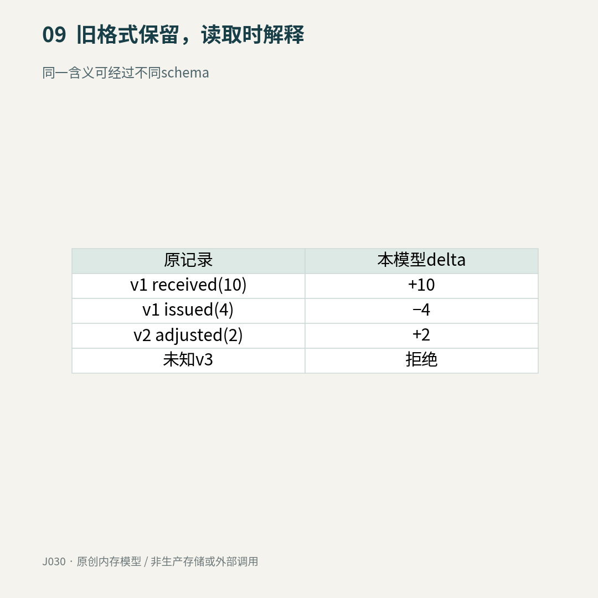
图9｜纯转换delta把旧格式解释为变化量，未修改旧记录；未知版本不猜默认含义。


这只是一个纯格式适配例子。若昨天“出库”意味着已经确认，今天却意味着尚未确认，那是语义改变，不是给字段换个名字就能修复。未知schema拒绝处理比猜一个默认值更诚实。

可重放还依赖确定性。若历史事件只存“使用今天的折扣规则”，一个月后重放时查询了新规则，可能得到不同结果。要么事件带上当时实际决定的结果，要么保留可追溯的规则版本和外部查询结果。更改投影算法以回答新问题，与修正当时已经发生的事实，是两件事。

本例apply只读Event里的整数，不读当前时间、随机数或外部服务。这里的确定性来自这条明确限制，并非事件溯源这个名称自带的保证。

## 6．投影为什么会算重？

事件存好之后，另一个组件可能按流构建查询页面，这份派生状态叫投影。传输系统重试时，同一事件可能到达两次。若每次都+10，显示就会漂移。


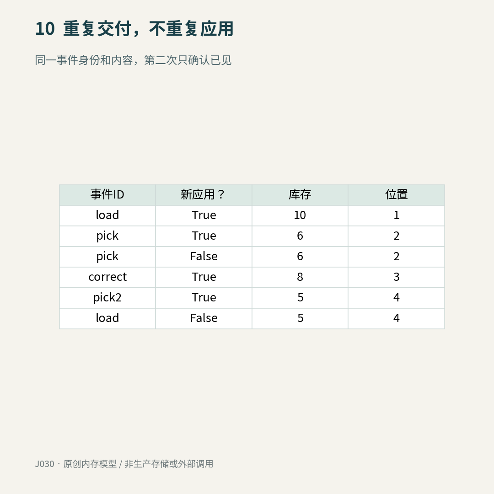
图10｜主序列含两次重复交付，投影最终仍为库存5、位置4；不能只对事件类型去重。


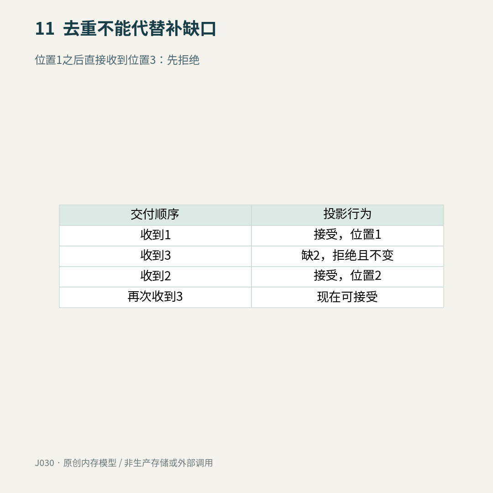
图11｜本模型不缓存乱序事件，位置缺口抛错；上游须安排补发，拒绝不是自动恢复。


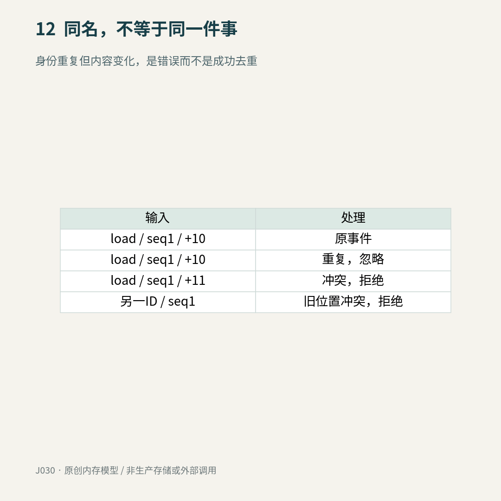
图12｜投影同时校验事件身份、内容与连续位置，避免把冲突载荷吞掉。


Projection保存已见事件ID与完整事件，只有新事件才更新库存；已见同ID但内容不同则报错。它还要求新事件位置恰好等于当前位置+1。主序列含重复事件，但最终仍为位置4、库存5。

这个模型选择“缺口就拒绝”，没有缓冲乱序、请求补发或自动重试。拒绝位置3不代表位置2会自动出现。调用方需要负责重新取得连续流；收到完全相同的旧事件则可以安全忽略。

生产投影还有一个崩溃点：先改库存再写已见ID，还是反过来？如果它们分开持久化，中间崩溃仍会造成重复或丢失。因此投影更新、位置和去重状态需要相应的事务或其他原子协议。Python对象中的顺序赋值不模拟这种崩溃。

投影落后时，页面读到的位置2可能只显示6，而权威事件流已到位置4、应为5。位置能帮助说明“这份视图处理到哪”，却不会自动提供跨对象的线性一致读取。事件溯源、消息驱动、CQRS是可以组合的设计选择，不是三个同义词。

## 7．重建库存，可以顺便把邮件再发一次吗？

不应该让纯状态重放顺手重演现实副作用。四个事件被交付两轮，天真地每次通知就会通知8次。我们另写MemorySink，只在第一次见到事件ID时接受，结果是4次；纯replay函数则完全不调用这个接收器，外部调用计数为0。


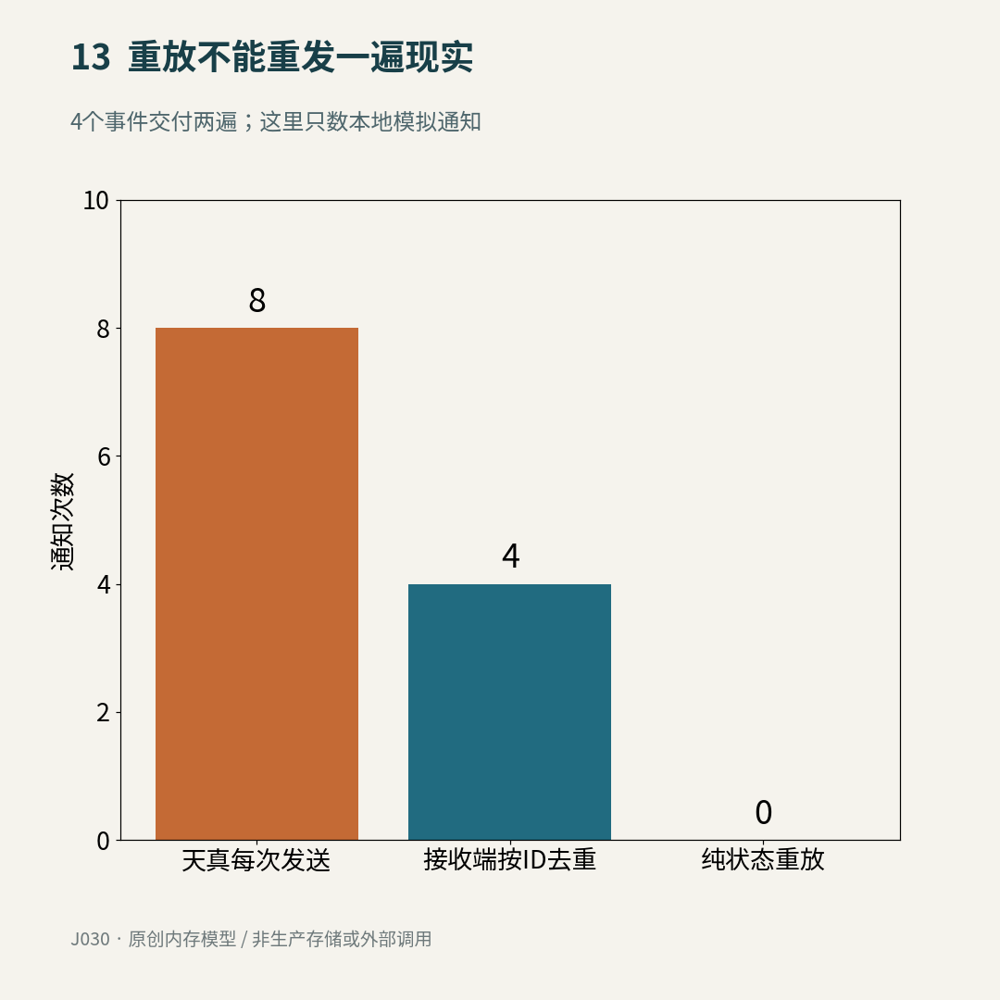
图13｜8次交付的天真副作用有8次，内存接收器只接受4个唯一ID，纯replay的外部调用为0；不代表跨系统恰好一次。


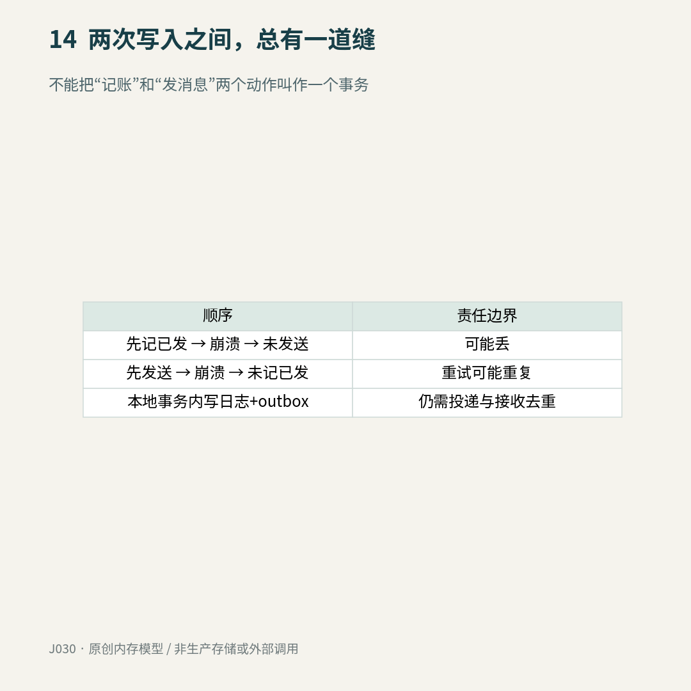
图14｜崩溃窗口是概念反例；本程序未实现持久事务、outbox或网络发送。


MemorySink只是一张内存字典，不是网络服务。它没有持久化、超时或并发，所以“4次”不能当作现实恰好一次投递的证明。

若发送端先记录已发再发送，记录后崩溃可能丢消息；先发送再记录，发送后崩溃可能在重试时重复。事务性outbox把业务日志和待发记录放入同一持久事务，可以处理其中一个本地原子性边界，但仍需要可靠投递、重复处理策略及接收端适当的幂等语义。本文只展示窗口，不实现outbox。这个边界也见Chris Richardson的[Transactional outbox模式说明](https://microservices.io/patterns/data/transactional-outbox.html)：本地事务与后续投递不是同一个动作，转发器仍可能重复发布。

重放模式关闭通知也有边界：这是“重新构建已有状态”的正确选择，不等于所有新增业务都永远不该通知。区分重建、历史修复和新的业务动作，必须由系统协议决定，不能猜。

## 8．成本账要把没实现的部分剔出去

长度N的流，replay逐事件检查，常规哈希与单位整数操作模型下时间O(N)，保存已见ID用O(N)额外空间；状态库存本身只需O(1)个整数。restore对长度L的后缀用O(L)时间与O(L)额外去重空间，不读取前缀。


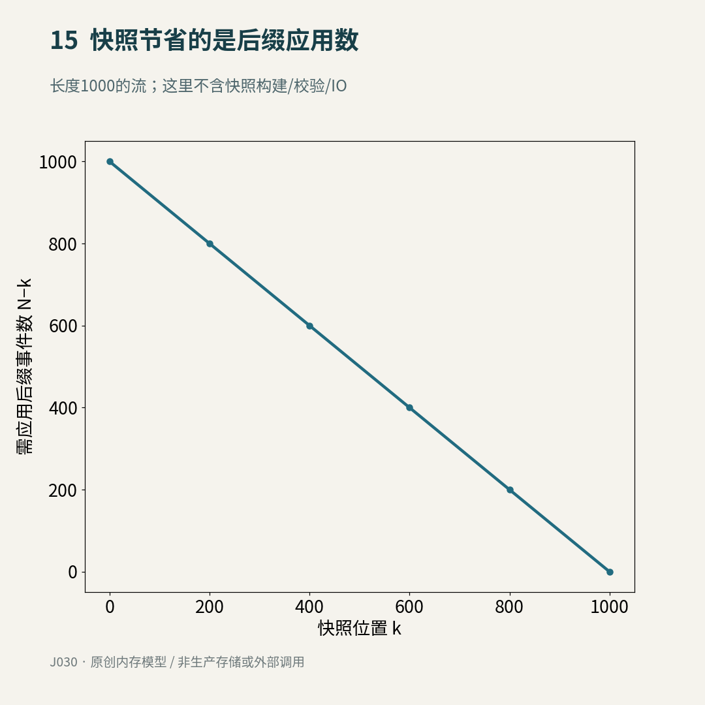
图15｜N=1000时后缀应用数为N−k；不是实测毫秒，也不说明总存储变少。


这里每次接受新命令时，Store.append都会从头replay，还会复制tuple追加。连续接纳N次命令，总工作量是O(N²)，不是生产实现的性能方案。真正系统会按自己的持久化和并发契约缓存状态、批量追加或使用其他索引。

Projection和MemorySink在常规哈希假设下，每次查询/插入期望O(1)，去重状态随唯一事件数增长到O(N)。长ID的哈希、事件比较、任意大整数位运算、哈希碰撞最坏情况、磁盘和网络成本不包含在这些元素级估计里。代码不承诺任意大输入的资源预算。

主实验只检查单条流。多个库存对象之间的转移、跨服务补偿、权限、加密、隐私删除、快照认证和实际事务都没有实现。不要把这段代码包装成库存管理服务。

## 9．让模型接受一些会失败的问题


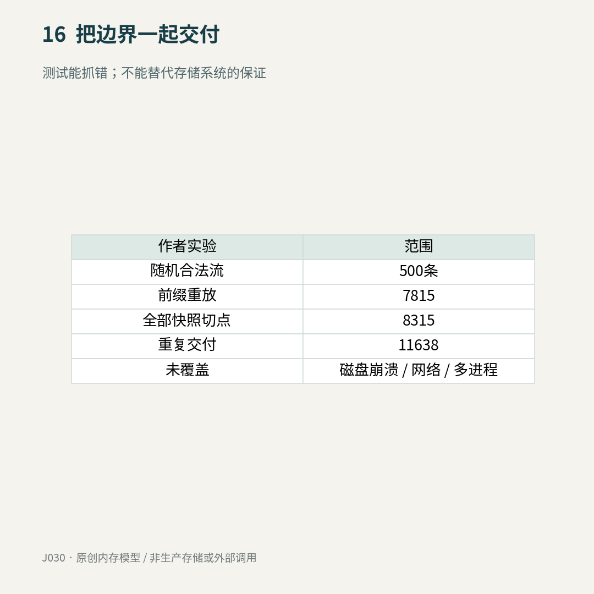
图16｜这些是作者自写实验计数，不是独立审查结论；本模型只覆盖单流、串行调用、内存数据。


作者实验随机生成500条每个前缀都非负的合法流：7,815个前缀重放与直接整数累计一致；8,315个快照切点与全量重放一致；11,638次重复交付不改变投影。另核未知schema、bool冒充整数、序号缺口、负库存、不匹配快照解释器、重复请求载荷冲突等拒绝路径。拒绝后的投影状态也逐项检查未变。

这些是有限程序检查，不是数据库崩溃安全或分布式证明。你可以先运行附录得到stock=5，再把事件位置3改成4，看“日志中有一条正确数字”为什么仍不代表它能被安全应用。

最值得记住的不是“保存事件就什么都有了”，而是分清四件事：事实怎样被接纳，状态怎样由事实算出，派生视图怎样跟上，现实副作用怎样避免错误重演。每一层都有自己的边界。

## 可直接运行的完整核心代码

保存为events_lab.py，Python 3.10+，只用标准库。公开入口面向本文Event/Snapshot和普通字符串、Python整数，不是恶意对象反序列化器。下划线字段不应由调用方修改；内存只读元组与frozen事件不能替代持久存储访问控制。


```python
"""One in-memory stream. Integers are toy inventory units, not production storage."""
from dataclasses import dataclass

class Conflict(ValueError):
    pass

def integer(x):
    if type(x) is not int:
        raise ValueError('integer required; bool excluded')
    return x

@dataclass(frozen=True)
class Event:
    seq: int
    eid: str
    schema: int
    kind: str
    value: int

@dataclass(frozen=True)
class Snapshot:
    reducer: int
    position: int
    stock: int

def delta(e):
    if type(e) is not Event or integer(e.seq) < 1:
        raise ValueError('event/sequence')
    if not isinstance(e.eid, str) or not e.eid:
        raise ValueError('event id')
    integer(e.schema); integer(e.value)
    if e.schema == 1 and e.kind in ('received', 'issued') and e.value > 0:
        return e.value if e.kind == 'received' else -e.value
    if e.schema == 2 and e.kind == 'adjusted' and e.value != 0:
        return e.value
    raise ValueError('unknown schema or invalid payload')

def replay(events):
    stock = 0; seen = set()
    for position, e in enumerate(events, 1):
        d = delta(e)
        if e.seq != position or e.eid in seen or stock + d < 0:
            raise ValueError('gap, duplicate, or impossible recorded history')
        stock += d; seen.add(e.eid)
    return stock

def restore(snapshot, suffix):
    """Trusted snapshot + trusted unique-ID suffix; no prefix authentication."""
    if type(snapshot) is not Snapshot or integer(snapshot.reducer) != 1:
        raise ValueError('snapshot reducer')
    position = integer(snapshot.position); stock = integer(snapshot.stock)
    if position < 0 or stock < 0:
        raise ValueError('snapshot range')
    seen = set()
    for e in suffix:
        d = delta(e)
        if e.seq != position + 1 or e.eid in seen or stock + d < 0:
            raise ValueError('bad suffix')
        position += 1; stock += d; seen.add(e.eid)
    return stock

class Store:
    """Serial calls only. Production check-and-append must be atomic/durable."""
    def __init__(self):
        self._events = ()
        self._accepted = {}

    @property
    def events(self):
        return self._events

    def append(self, request_id, expected, change):
        if not isinstance(request_id, str) or not request_id:
            raise ValueError('request id')
        if integer(expected) < 0 or integer(change) == 0:
            raise ValueError('request values')
        if request_id in self._accepted:
            old_change, event = self._accepted[request_id]
            if old_change != change:
                raise ValueError('same request id, different command')
            return event, False
        if expected != len(self._events):
            raise Conflict('reload and reevaluate; do not blindly retry')
        if replay(self._events) + change < 0:
            raise ValueError('insufficient inventory')
        e = Event(expected + 1, request_id, 2, 'adjusted', change)
        self._events += (e,)
        self._accepted[request_id] = (change, e)
        return e, True

class Projection:
    """One ordered stream, duplicate delivery allowed, gaps rejected."""
    def __init__(self):
        self.position = 0
        self.stock = 0
        self._seen = {}

    def apply(self, event):
        d = delta(event)
        if event.eid in self._seen:
            if self._seen[event.eid] != event:
                raise ValueError('conflicting duplicate')
            return False
        if event.seq != self.position + 1 or self.stock + d < 0:
            raise ValueError('gap or invalid stock')
        self.stock += d
        self.position = event.seq
        self._seen[event.eid] = event
        return True

class MemorySink:
    """Local idempotent receiver model; no network or payment operation."""
    def __init__(self):
        self.receipts = {}

    def send(self, event):
        delta(event)
        if event.eid in self.receipts:
            if self.receipts[event.eid] != event:
                raise ValueError('conflicting notification')
            return False
        self.receipts[event.eid] = event
        return True

def example():
    s = Store()
    for key, value in [('load', 10), ('pick', -4), ('correct', 2), ('pick2', -3)]:
        s.append(key, len(s.events), value)
    return s.events

if __name__ == '__main__':
    events = example()
    assert replay(events) == 5
    assert restore(Snapshot(1, 2, 6), events[2:]) == 5
    p = Projection()
    for e in events + events:
        p.apply(e)
    assert (p.position, p.stock) == (4, 5)
    print('example PASS: stock=5, position=4')
```


---

## 短读版｜事件溯源，不是把日志越攒越多

库存5只能告诉我们现在多少。把+10、−4、+2、−3按顺序保存，再从0逐次计算，就能重建得到5，并查看中间的10、6、8。

但命令是“希望发生”，事件是被接纳后的事实；两个人都读到库存10，不代表可以各出库7。模型用流位置检查冲突，重读后仍必须重新判断库存。

位置2、库存6的快照让我们只重放后两条；位置或内容错了，快照也会把结果带错。旧格式需要明确解释，不能把新规则悄悄套回历史。

重复交付不该重复计算：投影核事件身份、完整内容与连续位置。缺口要处理，去重状态与投影还要面对持久化原子性。纯重建也不应再次发送通知；内存接收器的去重实验不是现实恰好一次证明。

这篇有一幅署名许可的Fowler原图、15幅原创实验/边界图，以及完整标准库代码。它演示单流、顺序调用的虚构整数库存，不是生产数据库、审计系统或跨服务事务。最关键的是把接纳事实、重建状态、更新投影、现实副作用分开想清楚。


## 来源与素材权利

参见[来源、素材权利与 AI 辅助说明](sources.md)。
