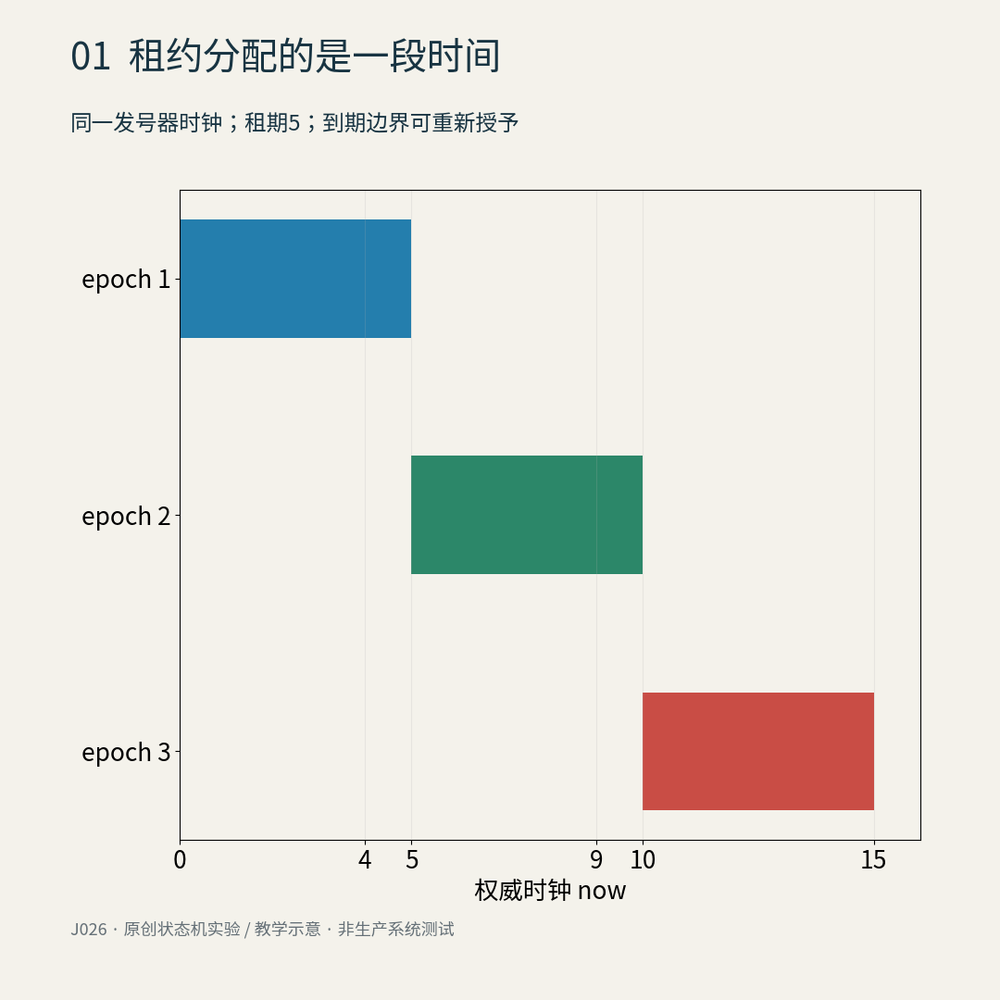
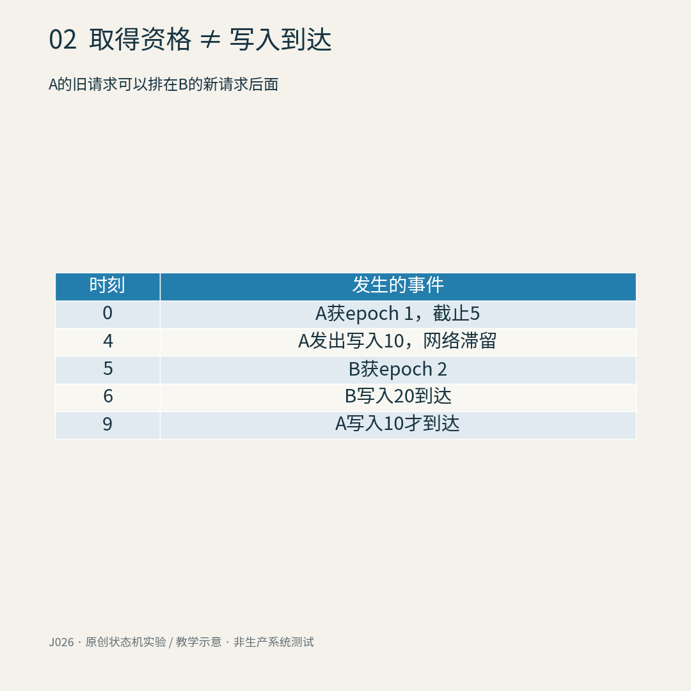
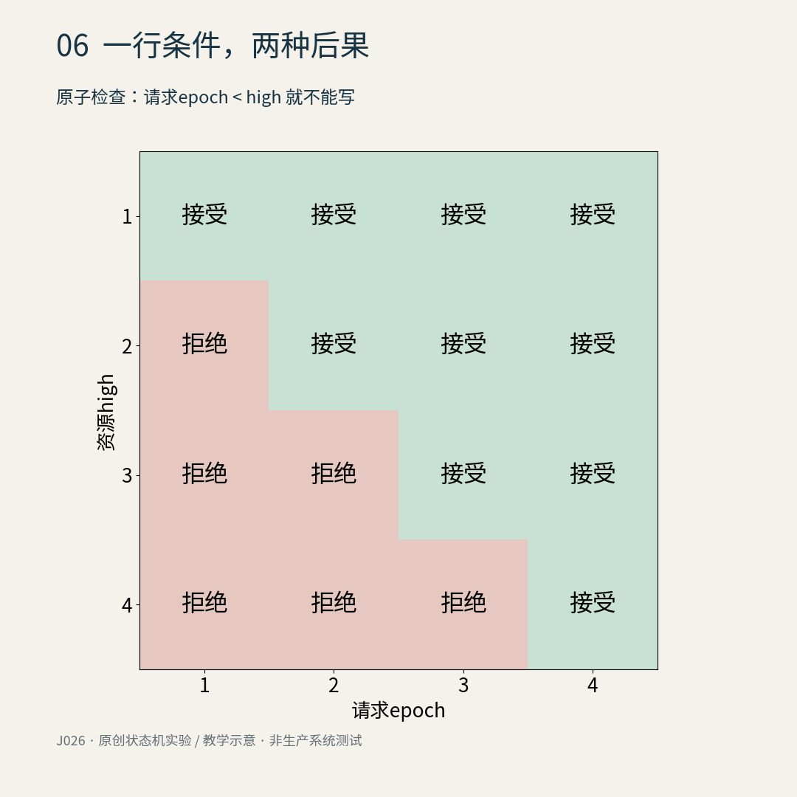
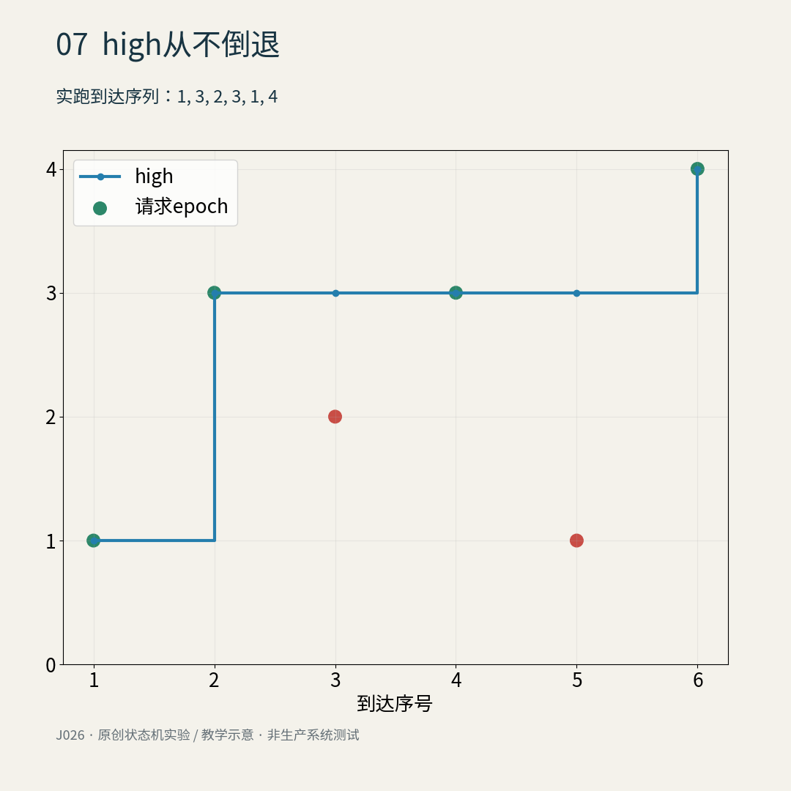
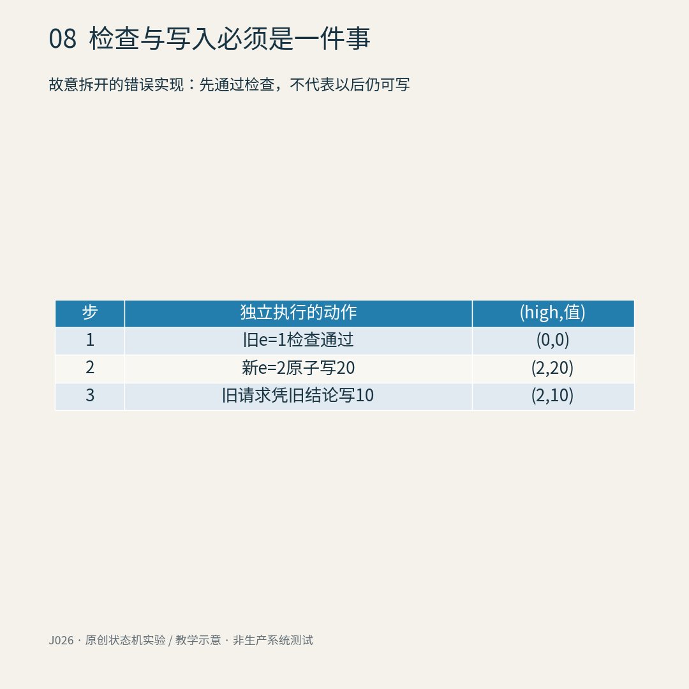
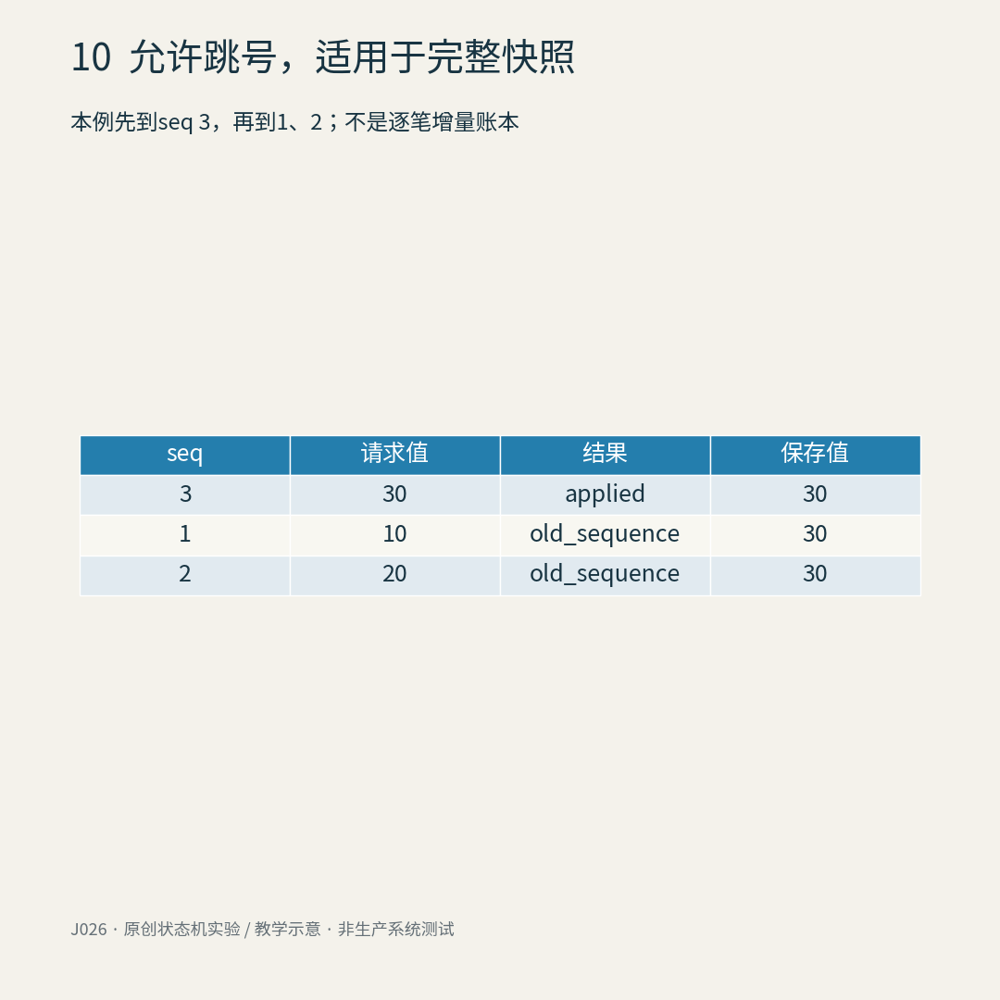
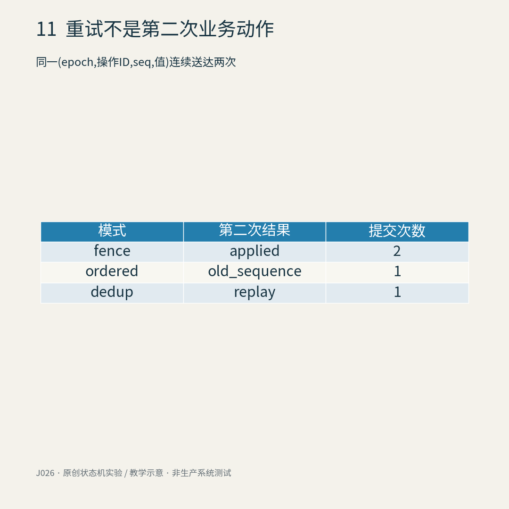
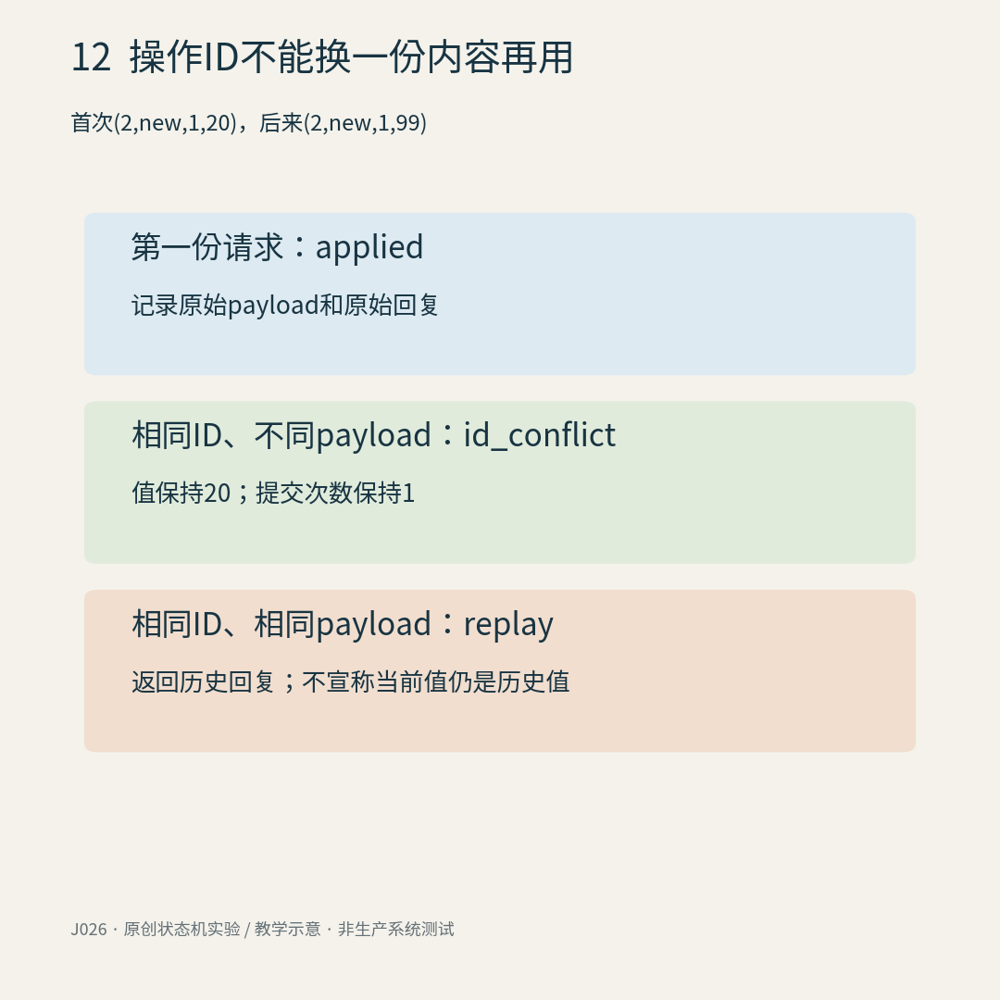
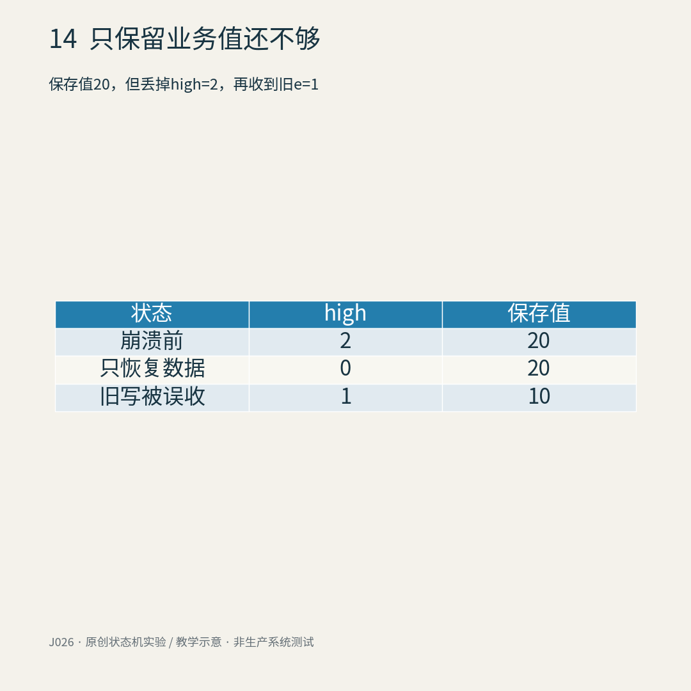
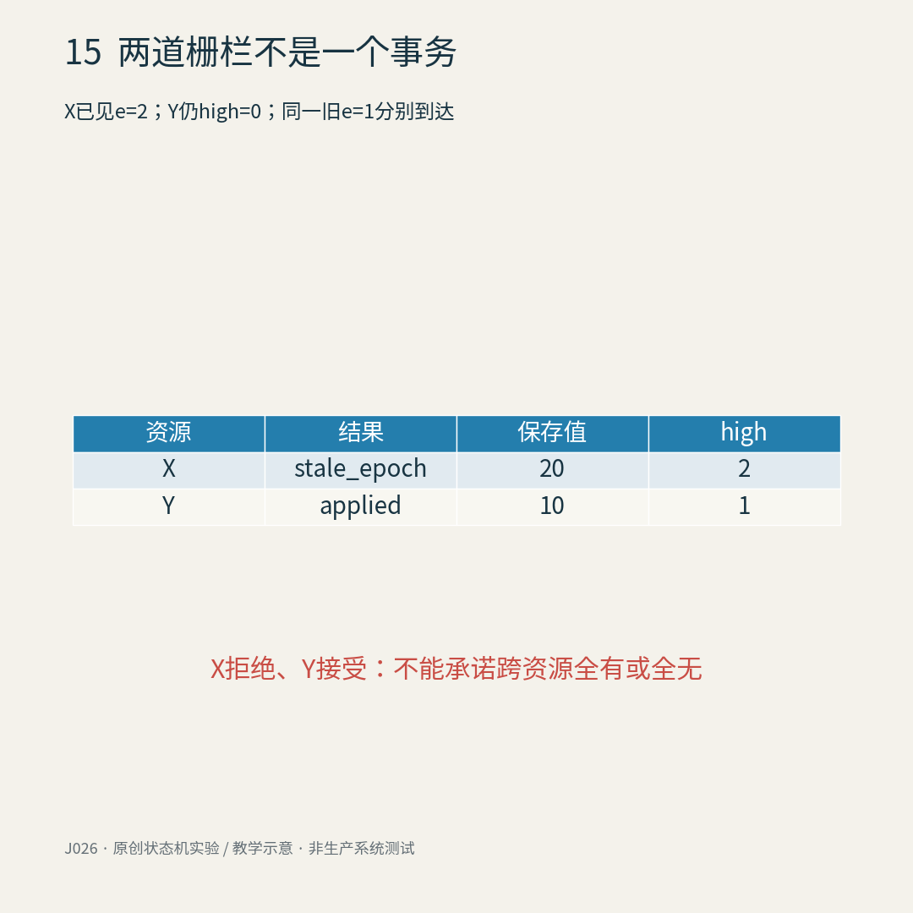

# 旧领导者醒了，为什么不能让它继续写？租约与栅栏令牌

服务器A睡了一小会儿。醒来时，它手里的文件还在，变量还在，连“我已经拿到锁”的布尔值也还在。于是它把算好的结果写回去。

麻烦在于，别人没有陪它一起睡。它暂停期间，租约已经到期，B已经取得新资格，并且写好了更新的结果。A的这次“继续工作”，反而把系统带回了过去。

这篇不讲怎样选举领导者，也不复述Raft日志复制。我们把镜头移到更靠近数据的地方：**真正接受写入的资源，凭什么判断这张工作证已经过时？**

下面是自写的单资源状态机实验。时间、值和编号都选得很小，可以手算。没有启动真实分布式集群，也没有宣称一次Python函数调用能替代数据库事务。

## 1．租约解决了“不能永远等”，没有让旧进程消失

先约定一个理想化发号器：它串行处理申请，拥有自己的整数时钟。每次成功授予资格，编号加一，期限设为当前时刻加5。当前时刻小于期限就拒绝新申请；恰好到期可以重新授予。

因此在0、4、5、9、10申请，得到的是1、失败、2、失败、3。这里的失败表示旧租约仍有效，不代表系统坏了。


图1｜本模型租期为5，半开区间[0,5)、[5,10)、[10,15)对应三个不同epoch；边界时刻可以重新发号。

租约限制的是资格的有效时间，不是进程的物理寿命。A可能崩溃，也可能只是被暂停；一次超时不足以区分这两件事。我们先允许服务继续前进，再另想办法阻止过时请求伤害数据。

读者可以暂时把epoch理解成“任期号”：新取得的资格对应严格更大的整数。它不是随机字符串，不是客户端自己看钟生成的时间戳，也不是用来证明身份的秘密密码。

## 2．危险发生在最后一跳

设A拿到epoch 1，准备写10。它在时刻4把请求发出，但网络留住了这条消息。时刻5，B拿到epoch 2；B的写20先到达。到了时刻9，A的旧写才出现。

注意，A发送时甚至可以仍处于自己的有效期内。问题不需要“客户端明知过期还故意犯错”这个前提。


图2｜两次申请和两次写入的到达顺序不同；先发出的旧请求可以更晚到达资源。

让资源只执行“把值改成请求里的数字”，结果就很直白：先保存20，再保存10。发号器确实没有同时授予有效租约，资源仍然被旧消息覆盖了。


图3｜plain模式故意不检查epoch；真实运行中，先到的新写20被后到的旧写10覆盖。

“发送前再检查一次期限”也没有封住最后一跳：检查之后还能暂停，消息还能延迟。要保护这个写入，判断必须发生在实际产生效果的边界。Kleppmann的原文给出了暂停与迟到写的基本问题；这里的数字轨迹、状态机和后续反例均为本文自建实验。[原文：How to do distributed locking](https://martin.kleppmann.com/2016/02/08/how-to-do-distributed-locking.html)

## 3．资源自己记住：我已经见过哪一任

给资源增加一个字段high，初始为0，意思是已接受过的最大任期号。写入携带epoch，资源在一个原子步骤里执行：

- 请求epoch小于high：拒绝，数据不变。
- 否则：保存新值，并让high变成两者的最大值。

这里故意使用“小于”，不是“小于等于”。同一任期通常不止写一次；后面会讨论怎样管理任期内部的顺序。


图4｜fence模式先接受epoch 2并记住high=2；随后epoch 1得到stale_epoch，保存值保持20。

这就是本篇的栅栏：不是让A收回消息，而是让资源拒绝已经落后的消息。这个整数不负责保密或认证。实验假定请求确由可信发号器授予的持有者发出，攻击者不能随便伪造一个大整数；生产系统仍须认证、授权和可靠绑定资源作用域。

## 4．一个容易被说过头的边界：到期不等于立即挡住

把到达顺序换一下：A的租约已经过期，但B还没有对资源发出任何请求。资源的high仍为0。此时A带epoch 1来写，条件1≥0成立，它会被接受。

因此，**单靠这个high规则，并不实现“租约一到期，所有旧写立即失败”。**它实现的性质更准确：在资源原子接受某个更高epoch以后，再来的较低epoch不能更改该资源。


图5｜资源尚未见过更高epoch时，旧请求仍可能通过；栅栏的生效边界是资源上的接受顺序，而不是客户端墙钟。

如果新领导者的启动步骤需要先封住旧任期，可以在同一个资源上先执行一个原子的“提高high但不改业务值”的屏障，再读状态、开始工作。本文代码没有实现这个独立屏障，只把它作为接口设计方向。对多个资源，逐个屏障仍然不是跨资源事务。

同样，拒绝旧写不代表新写计算依据一定新鲜：B若先读了过时数据，再成功写入，也可能丢更新。需要的可能是版本条件更新、事务内读取，或者明确的接管协议。别把任期比较当作所有一致性问题的总开关。

## 5．为什么这条规则能守住它承诺的事情

把high画成一张表就能看出：右上区域允许，左下区域拒绝。相同epoch在fence模式中允许重复写。


图6｜行是资源high，列是请求epoch；绿色接受、红色拒绝，等号在允许的一侧。

一个很短的不变式证明，比“测试没出错”更有用。初始high=0。拒绝操作不改high；接受操作令high=max(high,epoch)，也不会使它减小。因此high始终不下降。一旦epoch e被接受，之后high始终至少为e；任何小于e的请求都无法通过比较。

证明依赖三件事：所有受保护写都走此检查；检查与写入原子化；high不能在崩溃恢复时遗失。它没有证明租约到期语义、业务结果正确性、请求最终一定能执行，更没有证明真实集群实现没有bug。


图7｜对到达序列1、3、2、3、1、4实跑，high只上升或持平；红点是被拒绝的较小epoch。

## 6．把检查与写入拆开，防线就漏了

假设旧请求先读high=0，检查通过，然后被暂停。新请求在这期间原子写入20，并提高high到2。旧请求恢复后，拿着刚才“已经检查过”的结论直接写10。

最终可以出现high=2而值已经被旧任期改成10。即使那个元数据本身没有倒退，业务数据仍坏了。


图8｜这是一段故意错误的拆分实现轨迹；缓存下来的检查结论不能跨越其他写入继续使用。

本文把Store.apply定义为一个抽象的、原子且持久的状态迁移。普通Python方法并不自动获得这些保证；这里没有实现数据库锁、WAL、复制提交或并发内存模型。真系统需要让条件检查、high更新、业务写入及必要的操作回执在适当的原子持久边界内完成，或者使用能提供等价保证的资源接口。

## 7．同一任期的两条消息，谁来排队？

epoch只能区分任期。B在同一任期内先生成完整快照21，再生成完整快照22。如果第二条先到、第一条后到，二者epoch都等于2，单纯fence都会接受，最终又回到21。

于是可以再带一个任期内序号seq。本文ordered模式按字典序比较(epoch,seq)：新任期可以重新从seq 1开始；同一任期只接受比last_seq更大的序号。


图9｜同一epoch内，fence允许seq 1覆盖先到的seq 2；ordered模式拒绝这个旧序号，最终保留22。

这不是“随便加个数字就万事大吉”。序号分配仍须一致；相同任期内多个发送者若各自从1开始，会发生冲突。本文假设每个任期有一个可信顺序来源，不提供多写者排序服务。

## 8．为什么本文允许跳号，却不拿它记逐笔增量

代码接受seq 3，即使还没见过1和2。因为本例的value是**完整替换快照**：写30的含义就是把寄存器设置为30，较早快照不需要补执行。


图10｜先到seq 3后，seq 1和2均被拒绝；这适合“最新快照获胜”，不等于每条增量都执行过。

如果三条请求分别是“加10”，跳过两条会丢业务动作。需要逐笔处理时，可以要求连续序号、补缺口或把业务事件写入有序日志；那是另一份协议。此处刻意不把赋值寄存器的规则推广到转账、邮件发送或任意外部副作用。

## 9．再试一次，与再做一次不是同一回事

消息是否成功，客户端不总能知道。请求可能已经提交，回复却丢了。客户端重试同一条消息，会发生什么？

我们的寄存器重复写同一个值，表面上看不出差异，所以另记applied计数，表示实际接受的提交次数。fence接受两次；ordered第二次拒绝旧序号，但没有返回第一次的结果；dedup保存操作回执，第二次只回放原答复，提交计数不增加。


图11｜相同请求重复到达两次时，三种模式的第二次响应及提交计数不同；replay不是第二次写入。

操作ID由(epoch,op_id)共同标识，payload包括seq和值。若同一个ID带来了不同内容，返回id_conflict，而不是默默把它当重试。原操作的回复保留原值与当时提交计数；返回旧回复不意味着资源当前值仍等于它。


图12｜重放需要相同操作ID与相同payload；重复ID换内容是冲突，历史回复也不是当前状态查询。

代码先检查回执，所以即使已经进入更新任期，旧操作的精确重试仍可获得replay。它不会更改业务状态，也不会让旧请求重新生效。这里要求回执随效果一起持久提交；只在内存里记一个set，不足以支撑崩溃后的防重。

我们没有宣称“端到端恰好一次”。资源内部的防重不能替没有参与同一事务的外部API、邮件服务或另一张表作保证。回执永久保留还会增长；若要清理，必须定义重试窗口或安全遗忘条件。本文保留所有已提交回执，只用于有限实验。

## 10．重启以后，什么必须记得？

第一件事是发号器不能忘记已发到哪里。旧任期拿到1，重启后新任期又拿到1，资源就没法凭编号区别新旧。让新请求先写20、旧请求后写10，两者都通过“epoch不小于high”。


图13｜把发号器计数错误重置为0，会让两个任期同获epoch 1；同号旧写可以覆盖新写。

代码Issuer(durable_counter)只是显式接收一个已可靠恢复的计数，没有实现可靠恢复。不要把它误读为“只存计数就实现了租约服务”：重启时还要处理尚未到期的租约、服务身份、失败切换等问题。我们的重置例只用于暴露编号复用的危险。

第二件事是资源high必须与数据一同可靠恢复。若只恢复值20，却把high重置成0，旧epoch 1又能进入。旧消息不会因为资源重启就自动从网络消失。


图14｜故意丢失栅栏元数据的恢复实验中，值20先幸存，但旧写随后仍能把它改成10。

不回绕的Python整数只是数学方便。有限宽度计数器要考虑耗尽或回绕；系统替换、备份恢复与命名空间复用也不能让不同世代的票重新变得不可区分。随机唯一ID可以帮助区分，但本身不提供“大于哪个旧世代”的顺序关系。

## 11．每个资源都正确，整体仍可能不完整

让资源X已经见过epoch 2，Y仍没见过。现在同一旧epoch 1分别写两个地方：X拒绝，Y接受。各自都符合前面的局部规则，整体却只更新了一半。


图15｜独立资源X与Y分别执行正确栅栏，仍可能给同一旧请求不同结果；两个局部检查不是跨资源原子事务。

同一业务跨越多个对象时，需要明确事务、补偿、业务版本或其他协调策略。令牌的作用域也须清楚：不同资源的任期号是否可比较，不能靠恰好都叫“2”来猜。

ZooKeeper官方recipe展示了用顺序临时节点组织锁，以及创建成功但回复丢失后的恢复思路。这是协调层机制；不要从“选出了持有者”直接跳到“任意外部资源已替你挡住旧写”。本文没有复刻ZooKeeper，也没有把某个节点序号无条件承诺为永不回绕、跨命名空间通用的票。[ZooKeeper 3.9.3 Recipes](https://zookeeper.apache.org/doc/r3.9.3/recipes.html)

## 12．能跑出反例，也要说清测试看不到什么

附带实验穷举长度0到6、元素为1/2/3的全部epoch流，共1093条，逐步检查6015次。另将6个有身份的消息位置全排列，再跑4种模式，共2880组；其中两条payload相同，仍视为两个到达事件。ordered/dedup的已提交(epoch,seq)严格递增，拒绝或回放不改状态；dedup同一操作键不重复提交。9项非法请求测试检查拒绝前后状态不变。


图16｜计数来自checks/experiments.py实际执行；有限调度范围与不变式推导相互补充，不是生产可靠性证明。

有m条请求时，fence/ordered逐条处理需要O(m)次整数比较及赋值，状态中只保留常数个整数；dedup额外保存u个已提交操作的回执，通常哈希表假设下平均每次查询O(1)，存储O(u)。trace另存m条轨迹，不能称为常数空间。这里按元素和常规整数运算计成本；任意大整数的位成本、长字符串的哈希/比较与实际数据库I/O没有被算成免费。

全排列检查本来就有阶乘成本，只用于六个事件的小实验。代码不包含真实时钟漂移、崩溃一致性、认证、拜占庭攻击、事务实现或外部副作用。读懂这些缺口，比把一个模拟器拷进生产更重要。

最后记住三句话就够了：租约让新工作有机会开始；栅栏让资源在见过新任期后拒绝旧任期；排序、防重、持久化和跨资源原子性仍各有自己的工作。**“我曾拿到锁”是一段历史，不是每一次写入都应被接受的证明。**

## 完整代码附录一｜fencing_lab.py

复制保存为fencing_lab.py，用Python 3运行；只依赖标准库。apply的原子性是模型假设，不是Python并发保证。

```python
"""Atomic, authenticated, single-resource teaching model. Python 3 standard library."""
from dataclasses import dataclass


def natural(x, name, minimum=0):
    if type(x) is not int or x < minimum:
        raise ValueError(name)


@dataclass(frozen=True)
class Request:
    token: int
    seq: int
    op_id: str
    value: int

    def validate(self):
        natural(self.token, 'token', 1)
        natural(self.seq, 'seq', 1)
        if type(self.op_id) is not str or not self.op_id:
            raise ValueError('op_id')
        if type(self.value) is not int:
            raise ValueError('value')


class Issuer:
    """One serialized authority; now is its integer clock, not client time."""
    def __init__(self, durable_counter=0):
        natural(durable_counter, 'counter')
        self.counter = durable_counter
        self.deadline = 0
        self.last_now = 0

    def acquire(self, now, ttl):
        natural(now, 'now')
        natural(ttl, 'ttl', 1)
        if now < self.last_now:
            raise ValueError('clock went backwards')
        self.last_now = now
        if now < self.deadline:
            return None
        self.counter += 1
        self.deadline = now + ttl
        return self.counter


class Store:
    """apply is ONE atomic durable transition, not real concurrent Python code.

    plain: deliberately unsafe; fence: reject smaller epochs;
    ordered: also reject non-increasing seq within an epoch;
    dedup: ordered + retained operation receipts.
    Values are complete replacement snapshots, never increments.
    """
    def __init__(self, mode='fence'):
        if mode not in ('plain', 'fence', 'ordered', 'dedup'):
            raise ValueError('mode')
        self.mode = mode
        self.high = 0
        self.last_seq = 0
        self.value = 0
        self.applied = 0
        self.receipts = {}

    def state(self):
        return (self.high, self.last_seq, self.value, self.applied)

    def apply(self, req):
        if type(req) is not Request:
            raise ValueError('request')
        req.validate()
        key = (req.token, req.op_id)
        payload = (req.seq, req.value)
        # A reply replay never performs another state-changing operation.
        if self.mode == 'dedup' and key in self.receipts:
            previous_payload, reply = self.receipts[key]
            if payload != previous_payload:
                return ('id_conflict', None)
            return ('replay', reply)
        if self.mode != 'plain' and req.token < self.high:
            return ('stale_epoch', None)
        if (self.mode in ('ordered', 'dedup') and
                req.token == self.high and req.seq <= self.last_seq):
            return ('old_sequence', None)
        # Conceptual transaction: token, sequence, value and receipt commit together.
        self.high = max(self.high, req.token)
        self.last_seq = req.seq
        self.value = req.value
        self.applied += 1
        reply = (self.value, self.applied)
        if self.mode == 'dedup':
            self.receipts[key] = (payload, reply)
        return ('applied', reply)


def trace(mode, requests):
    store = Store(mode)
    rows = []
    for req in requests:
        result = store.apply(req)
        rows.append(dict(token=req.token, seq=req.seq, op_id=req.op_id,
                         requested=req.value, result=result[0],
                         state=list(store.state()), reply=result[1]))
    return rows


if __name__ == '__main__':
    old = Request(1, 1, 'old', 10)
    new = Request(2, 1, 'new', 20)
    assert trace('plain', [new, old])[-1]['state'][2] == 10
    assert trace('fence', [new, old])[-1]['state'][2] == 20
    a = Request(2, 2, 'b', 22)
    b = Request(2, 1, 'a', 21)
    assert trace('fence', [a, b])[-1]['state'][2] == 21
    assert trace('ordered', [a, b])[-1]['state'][2] == 22
    assert trace('dedup', [new, new])[-1]['result'] == 'replay'
    print('five core examples passed')
```

## 完整代码附录二｜checks/experiments.py

在fencing_lab.py同级建立checks目录，以下保存为checks/experiments.py，运行python checks/experiments.py即可重新生成本文状态和测试计数，结果写入checks/results.json。下列完整实验只依赖标准库；图像渲染脚本另存本地生产包，不是核心模型依赖。

```python
from pathlib import Path
import sys,json,itertools,random
ROOT=Path(__file__).resolve().parents[1];sys.path.insert(0,str(ROOT))
from fencing_lab import Request,Store,Issuer,trace

def run():
 old=Request(1,1,'old',10);new=Request(2,1,'new',20)
 out={m:trace(m,[new,old]) for m in ['plain','fence']}
 out['same_epoch']={m:trace(m,[Request(2,2,'b',22),Request(2,1,'a',21)]) for m in ['fence','ordered']}
 out['duplicate']={m:trace(m,[new,new]) for m in ['fence','ordered','dedup']}
 out['conflict']=trace('dedup',[new,Request(2,1,'new',99)])
 out['gap']=trace('ordered',[Request(1,3,'c',30),Request(1,1,'a',10),Request(1,2,'b',20)])
 issuer=Issuer(); grants=[issuer.acquire(t,5) for t in [0,4,5,9,10]]
 assert grants==[1,None,2,None,3];out['grants']={'times':[0,4,5,9,10],'tokens':grants}
 # Expiry is not an input to Store. A previously unseen old token still passes.
 out['expiry_boundary']=trace('fence',[old,new]);assert out['expiry_boundary'][0]['result']=='applied'
 # Issuer forgot epoch: the restarted client reuses token 1, and both pass.
 first=Issuer().acquire(0,5);reset=Issuer().acquire(10,5)
 out['issuer_reset']=trace('fence',[Request(reset,1,'new',20),Request(first,1,'old',10)])
 # Resetting store metadata loses fencing, even if the value survives.
 s=Store();s.apply(new);lost=Store();lost.value=s.value
 out['store_reset']={'before':list(s.state()),'result':lost.apply(old)[0],'after':list(lost.state())}
 x=Store();y=Store();x.apply(new);rx=x.apply(old);ry=y.apply(old)
 out['two_resources']={'X':{'result':rx[0],'state':list(x.state())},'Y':{'result':ry[0],'state':list(y.state())}}
 # Every prefix high-water mark must equal maximum accepted epoch.
 streams=0;transitions=0
 for n in range(7):
  for ts in itertools.product(range(1,4),repeat=n):
   s=Store();h=0
   for i,t in enumerate(ts):
    r=s.apply(Request(t,i+1,str(i),i));expect=t>=h
    assert (r[0]=='applied')==expect
    if expect:h=t
    assert s.high==h;transitions+=1
   streams+=1
 requests=[Request(1,1,'a',10),Request(1,2,'b',11),Request(2,1,'c',20),Request(2,2,'d',21),Request(2,2,'d',21),Request(3,1,'e',30)]
 permutations=0
 for perm in itertools.permutations(range(6)):
  for mode in ['plain','fence','ordered','dedup']:
   s=Store(mode);prev=(0,0);seen={}
   for i in perm:
    r=requests[i];before=s.state();ans=s.apply(r)
    if ans[0]=='applied' and mode in ['ordered','dedup']:
     assert (r.token,r.seq)>prev;prev=(r.token,r.seq)
    if ans[0]!='applied':assert s.state()==before
    if mode=='dedup' and ans[0]=='applied':assert (r.token,r.op_id) not in seen;seen[(r.token,r.op_id)]=1
   permutations+=1
 invalid=0
 for req in [Request(True,1,'a',1),Request(0,1,'a',1),Request(1,0,'a',1),Request(1,True,'a',1),Request(1,1,'',1),Request(1,1,3,1),Request(1,1,'a',True),Request(1,1,'a',1.2),None]:
  s=Store('dedup');before=s.state()
  try:s.apply(req)
  except ValueError:invalid+=1
  else:raise AssertionError('invalid accepted')
  assert s.state()==before
 out['tests']={'token_streams':streams,'stream_transitions':transitions,'permutation_modes':permutations,'invalid_requests':invalid}
 return out
if __name__=='__main__':
 r=run();(ROOT/'checks/results.json').write_text(json.dumps(r,ensure_ascii=False,indent=2));print(r['tests'])
```

## 短读版｜锁过期了，旧请求为什么还会写进去？

A拿到租约后暂停；B接班写好新值；A恢复，把旧结果又写回来。发号器可能从未同时授予两份有效租约，数据仍会被迟到消息覆盖。

栅栏令牌让每次新任期拿到更大的epoch，资源记住已经接受的最大值high。每次写入原子地检查：epoch小于high就拒绝。它保护的是“资源见过新任期之后不再接受旧任期”，不是“租约到期瞬间所有旧写自动失败”。

同一任期内部的消息乱序，还要序号；回复丢失后的重试，还要操作ID与持久回执；两个资源一起更新，还要处理跨资源原子性。发号器重启不能复用旧编号，资源恢复也不能只留数据、忘掉high。

本文用16张原创实验图、完整标准库模型和有限穷举，把这些责任逐一拆开。最关键的问题不是“锁库说我拿到锁了吗”，而是：**产生实际效果的那个地方，是否真的会原子拒绝这份过时资格？**


## 来源与素材权利

参见[来源、素材权利与 AI 辅助说明](sources.md)。
