# 节点已经删掉，为什么还不能free？用一台小状态机拆开Hazard Pointers

本文配图全部为自写状态模型、集合实验与原创说明图，不是操作系统或C++库的运行截图。先在小模型里看见错在哪里，再谈协议的边界。

## 1. 先问一个看似多余的问题
一张共享的配置表，入口root指向对象A。读者把A的地址放进自己的局部变量p，准备读里面的字段。就在这时，更新者把root换成空，再把A释放。
入口确实已经清干净了。可读者手里的p没有收到“撤销通知”。它接下来那次访问，可能碰到已归还的存储。这不是“读到旧数据”那么温和，而是对象已经不允许被访问。
因此必须分开三个动作：**移除**是改变共享结构的可达性；**退休**是登记“这个旧对象以后可以考虑回收”；**回收**才是真正释放或销毁。退休列表不是垃圾桶的另一个名字，而是尚待满足安全条件的候车区。

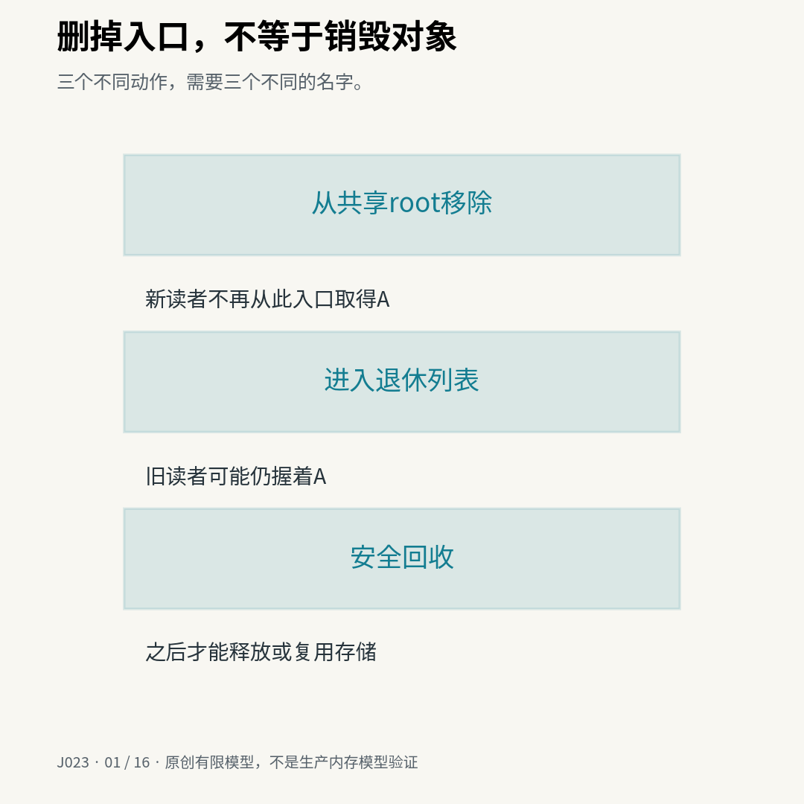

图1｜移除、退休、回收是三个阶段；旧读者的局部引用不会随root改变自动消失。

## 2. 不要先背术语，先把错误排出来
下面所有事件都来自随文Python状态机。它只有一个对象A，root最初指向A；删除者只移除一次，不把A装回去，也不复用地址。一个事件执行完，才轮到下一个事件——这是顺序一致性（SC）的有限教学模型。
先让读者只有两步：L读取root，U访问刚读到的对象。删除者有五步：R移除，T退休，B固定本轮处理批次，S读取保护槽，F按扫描结果决定回收。此时没有保护声明，所以槽始终为空。
两条线程内部次序不能打乱，但可以相互穿插。2步与5步共有C(7,2)=21种完整穿插，程序逐一涵盖。其中1种让读者在回收后访问A。图中不是虚构的示意错误，而是分析器返回的反例。
我们在模型中把这一事件记为UAF（use-after-free）；Python本身没有真的释放并解引用野指针。

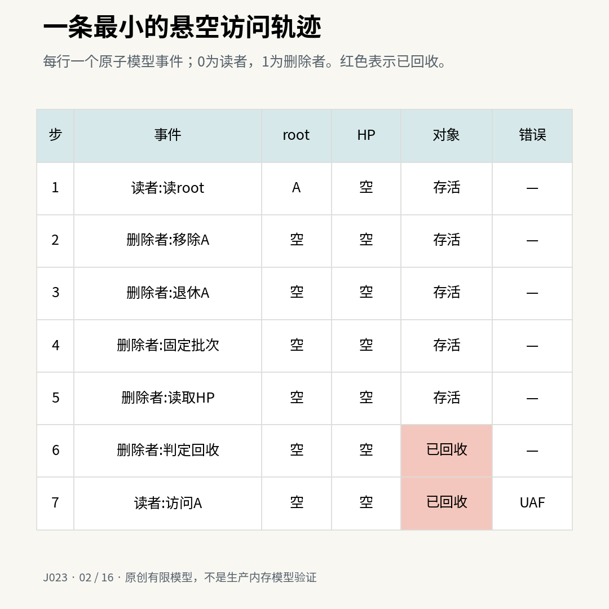

图2｜读者先取得A，删除者完成回收，读者再访问：21种完整交错中有1种触发模型UAF。

## 3. 读者能不能挂一块“我还会用”的牌子？
给每个读者一个保护槽HP。读者只写自己的槽，扫描者可以读大家的槽。槽里放A，意思不是“我独占A”，也不是“root禁止修改”，而是“我正在按协议保护这个对象的存活”。
这种保护声明叫hazard pointer。这里的hazard不是把对象标成坏东西，而是提醒回收者：贸然回收会有危险。
要留意三件事：槽不是自动引用计数；多个槽可以同时指向一个对象；保护生命周期不能解决字段自身的数据竞争。即使A还活着，如果两个线程违规地同时改一个非原子字段，仍然有另一个问题。

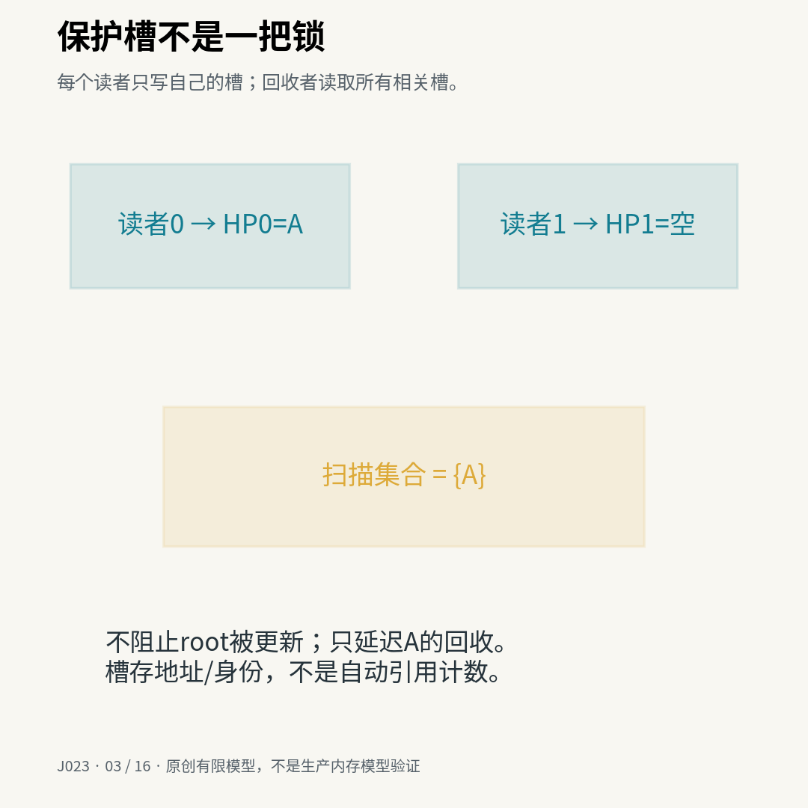

图3｜两个槽由各自读者发布，回收者收集非空值；保护对象不等于锁住共享结构。

## 4. 只写一个地址，居然还不够
试着把读者改为L读入口、P发布保护、U访问、C清槽。看起来已经很慎重了。
反例仍然存在。读者完成L后暂停；删除者移除并退休A，扫描槽时看见空。读者恢复，把A写入槽。删除者沿着已经取得的扫描结果回收A，读者再访问。
迟到的保护声明不能让回收动作自动撤回。模型中这条读者有4步，删除者5步，共C(9,4)=126种穿插，其中2种发生UAF。把P写成“原子写”并不能消灭这段时间窗口；我们这个模型的每一步本来就是原子的。

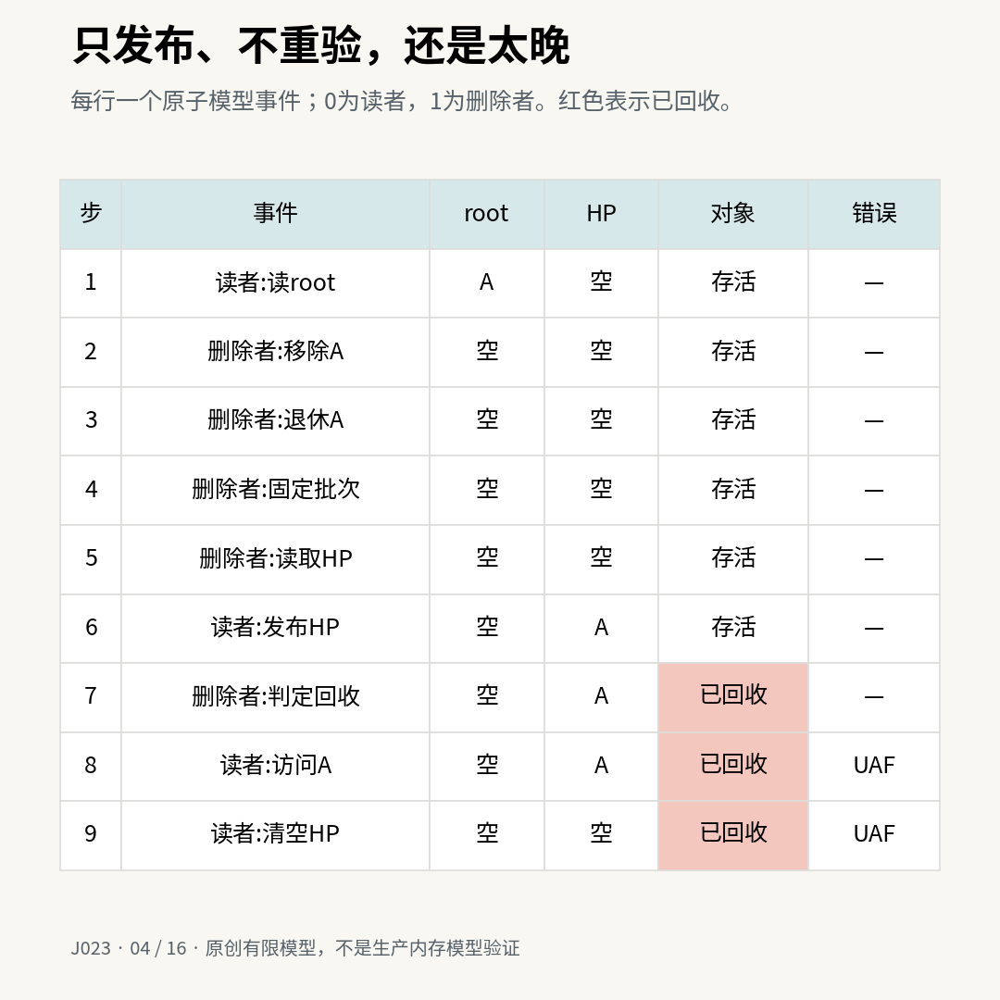

图4｜扫描先读到空槽，读者随后才发布；没有重新验证入口，迟到的声明救不了已决定回收的对象。

## 5. 关键不是“曾经发布”，而是发布之后再验证
把协议补成五步：L读取候选；P把候选发布到自己的HP；V重新读取共享入口；只有入口仍与候选相等，才执行U；最后执行C。
为什么V必须在P后面？因为验证要确认：从我们宣布保护到此刻，候选仍是这个入口所指的对象。在这个不复用地址的模型里，这足以把“太晚了”的尝试识别出来。
不要在L后、V前读A的字段。候选地址还不是一张访问许可证。也别把示意步骤直接翻译成几条C++ relaxed原子操作：真实语言还涉及可见性、排序、对象生命周期和库协议，本文没有验证这些。

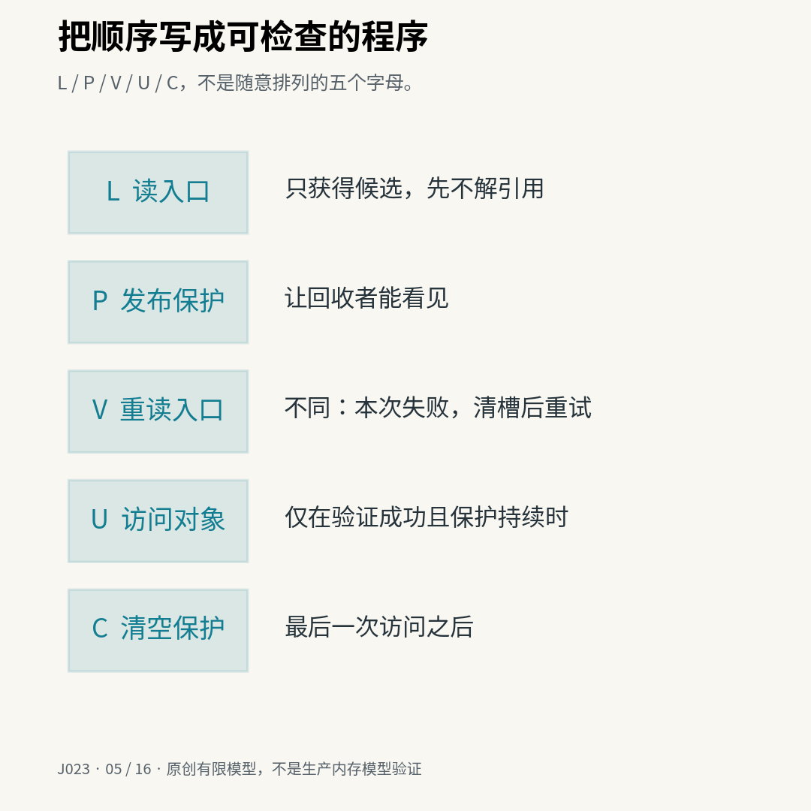

图5｜正确模型次序为读候选、发布、验证、访问、清空；失败尝试不访问对象。

## 6. 验证失败，不是异常，是算法的日常
假设L得到A，P发布A，但删除者已经把root改为空。V比较到A不等于空，这次尝试必须放弃，不访问A的字段。清掉槽之后，真正的保护算法可以重新从入口取候选。
本实验为了把状态空间封闭，只建模**一次尝试**。失败后的U事件仍占一个调度位置，但它是被valid标记挡住的空操作；C仍清槽。这样每条线程脚本长度固定，所有调度数量都能独立计算。
这会多记一些语义等价的空操作穿插。因此表里的数量不是现实发生概率，也不是平均重试次数。它回答的是：在这组明确的事件模型里，是否存在违规访问的穿插？

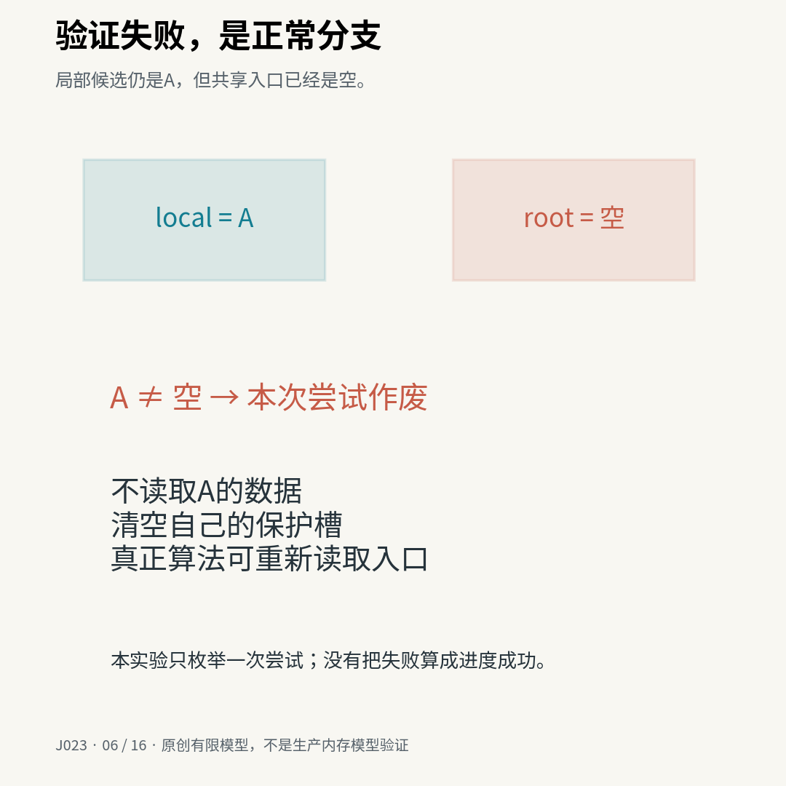

图6｜重验失败时禁止解引用；有限模型结束本次尝试，实际重试循环的进度不由本实验保证。

## 7. 两个字母换一下位置，会怎样？
把正确的L-P-V-U-C改成L-V-P-U-C：先验证，再发布。验证那一刻root确实是A，可发布之前仍有空窗，删除者可以在此期间退休并扫描到空槽。
图中给出分析器找到的完整反例。这个变体与正确版一样，都有5个读者事件，完整调度数也都是252；但它有2种UAF。
这比“多加一层检查总没错”更具体。检查的存在只是第一步，检查位于哪个发布动作之前或之后，才决定它能排除哪类并发轨迹。

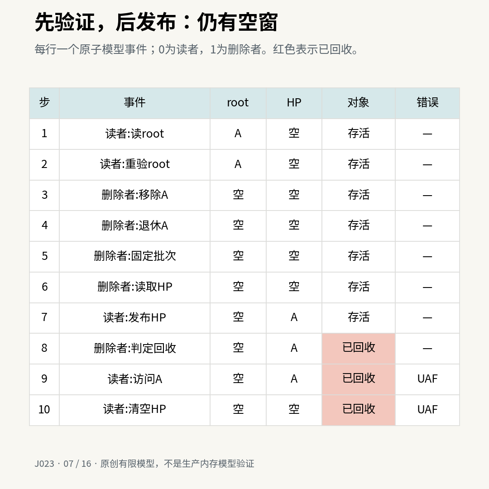

图7｜把验证提前到发布之前，252种完整交错中仍有2种UAF；必须在发布之后重验。

## 8. 保护要持续到最后一次使用之后
再试一个容易出现的错误：L-P-V-C-U。发布和验证都做对了，但为了早点结束保护，在访问之前把槽清了。
这一次有4种坏调度。图中的读者先发布并验证成功，再清空槽；删除者此时看见空槽，回收；读者才访问A。
所以“验证成功”不是永久有效的通行证。正确顺序把U放在C之前，并要求两者之间没有偷偷撤销保护。把指针返回给调用者，却先销毁保护句柄，也可能违背同一条生命周期要求；具体接口必须说清谁负责保持保护。

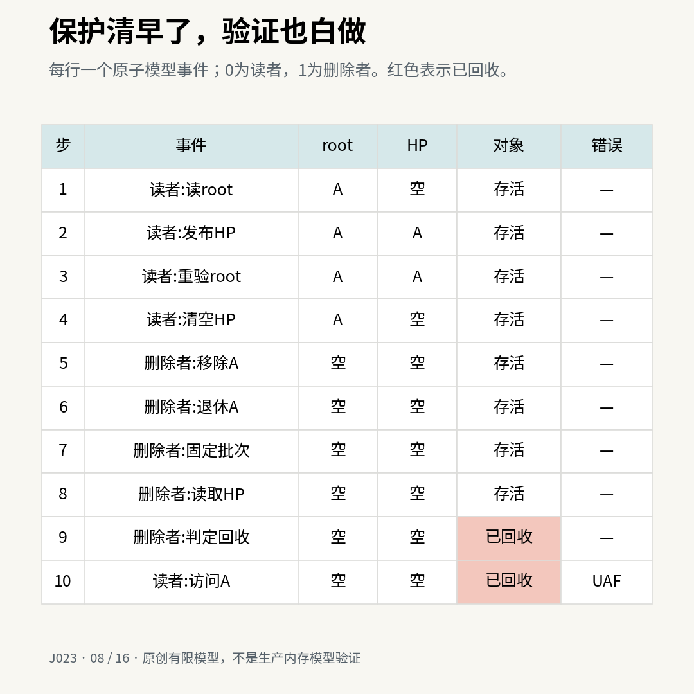

图8｜验证成功并不永久保活；若最后一次访问前清槽，252种交错中有4种UAF。

## 9. 把所有穿插都算出来
程序不靠sleep碰运气，而是从状态出发，选择任意一个尚未完成的线程执行下一步，直到全部脚本完成。不可变State记录程序计数器、入口、存活标志、退休状态、各槽、局部候选、验证结果、本轮扫描值与错误标志。
许多不同前缀会到达同一个状态。带缓存的递归只计算一次该状态之后的后缀结果，但对所有到达分支分别累加，所以保留的是**完整调度条数**，不是仅仅数不同状态。
一个正确读者与一个删除者覆盖252种调度，UAF为0。两个正确读者各5步，删除者要依次读两个槽，因而6步；共有16!/(5!·5!·6!)=2,018,016种调度，UAF仍为0。所有十种配置合计6,266,421条完整调度，由6,241个缓存状态分别完成分析（不同配置的状态各自计数）。
作者另外不使用记忆化计数，枚举全部903条单读者调度，逐条重放核对五种结果；也用多项式系数检查总条数。后文完整代码允许独立重算，不需要相信一张“测试通过”的图片。

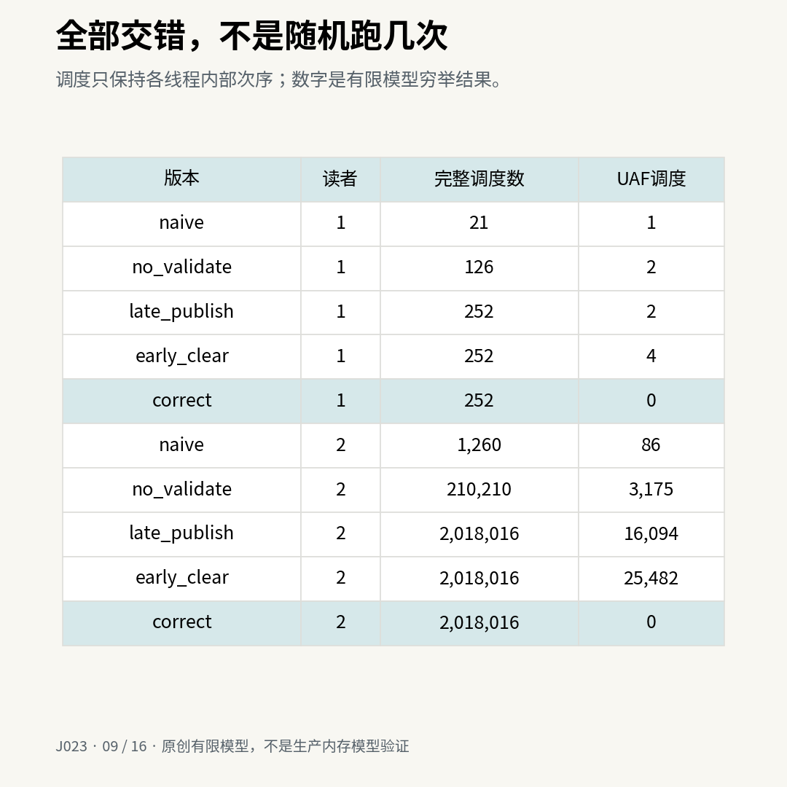

图9｜正确协议在1读者252种及2读者2,018,016种完整SC交错中没有UAF；其他四种变体均出现反例。

## 10. 扫描所有槽，难道必须在同一瞬间？
不必把所有槽打包成一个巨大的原子读。在我们的双读者模型中，S0、S1明确是两个事件，中间可以穿插读者动作。回收者把读到的非空值存入自己的集合，再按集合处理已固定的退休批次。
为何中间发生变化不必然危险？正确读者若还会访问A，它的HP必须从验证之前一直保持到访问结束。扫描若遇到这段持续保护，就会记录A；如果扫描看到槽已清掉，在正确协议中该读者已经结束访问。
但是别倒置批次边界：不能先扫描，之后把刚退休的新对象偷偷加入同一份旧扫描结果里处理。本文B事件发生在S0、S1之前，固定本轮候选。完整库还要处理域、记录管理、线程退出等事情，不能从这段几行集合操作推出“实现很简单”。

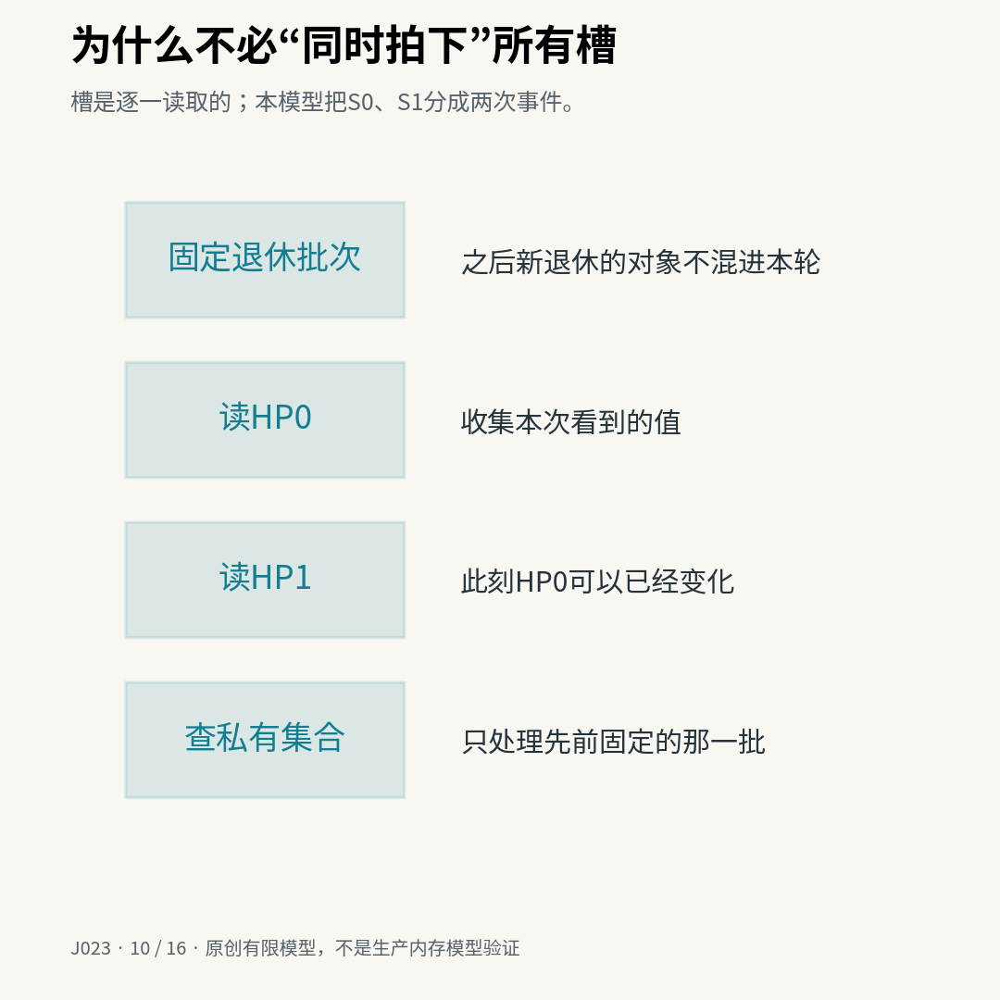

图10｜扫描不要求所有保护槽构成同一瞬间快照；但本轮待处理批次必须先确定，且保护/验证协议正确。

## 11. 退休列表的集合运算
用一组能手算的数据：本轮退休对象身份为[0,1,2,3,4]，三个槽依次是[1,3,空]。扫描集合是{1,3}，于是0、2、4可回收，1、3继续等待。
这是随文scan_batch真正执行出的结果。函数要求退休身份不重复，否则同一个对象被退休两次，可能演变为重复销毁。它只接收整数身份和None，不承担真实指针有效性验证。
作者穷举5个身份的32种退休子集，再枚举3个槽各6种取值，共6,912个集合案例，检查完整可回收/保留列表、顺序与不相交关系。这里测试的是集合分流函数，不是把任意系统安全性简化成几个集合断言。

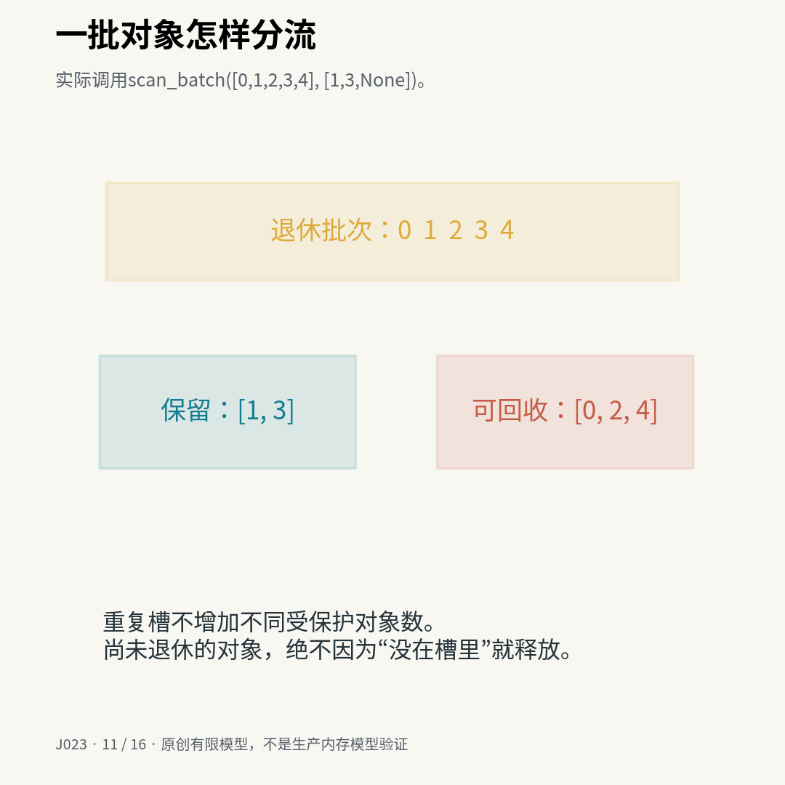

图11｜批次0–4与槽[1,3,空]得到可回收[0,2,4]、保留[1,3]；这只是有限身份集合运算。

## 12. 零反例之外，还要能说清为什么
在本模型中，root只会从A变空，因此验证A成功一定发生在移除之前。正确读者的顺序是P<V<U<C，删除者则R<T<B<S<F。
若V发生在R之后，读者发现入口变了，U不会访问A。若V发生在R之前，则P也在R之前。只要读者尚未完成U，它就尚未执行C；删除者在R之后扫描该槽时，若U还在后面，必能读到保护A的槽，不能回收A。
反过来，如果扫描时槽已被C清掉，U已经执行完，不会再访问A。按这两个时序分支，可以解释枚举结果，而不只说“机器没找到错误”。
这段论证依赖SC、单次移除和不复用地址。真实算法存在更复杂的根可达性、节点交接和回收协议；我们没有用这段有限证明覆盖它们。

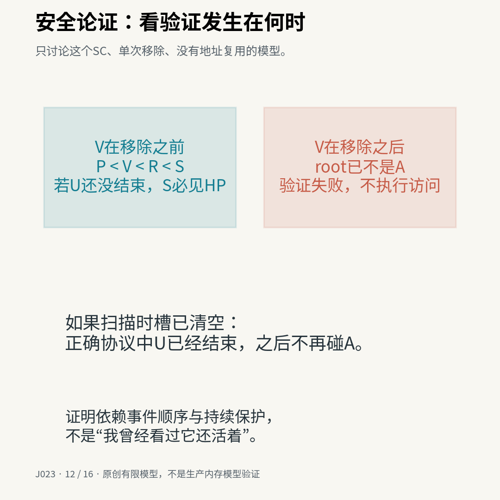

图12｜按验证在移除之前或之后分两类；正确协议保证访问期间槽持续指向A，或直接放弃访问。

## 13. 为什么通常攒一批再扫？
设相关保护槽有H个，本轮固定了R个**不同的**退休对象。先把槽值放进哈希集合，再逐一查询退休对象，通常期望工作量是O(H+R)，额外集合与批次存储按元素计O(H+R)。这是假定通常哈希行为的抽象计数，不是最坏哈希碰撞保证，也没包含析构器费用。
最多H个不同身份能同时出现在H个槽中。对这一次收集结果，若R=2H且H>0，至少R-H=H个对象不在集合里，可以分流到回收一侧。于是同一轮H+R=3H份抽象工作，可摊到至少H个回收对象上。
这只是帮助理解批量处理的一个固定批次算例。真实库的阈值、并发批次管理与记录数量变化，都要额外处理；不能用图里的折线直接预测纳秒或吞吐。

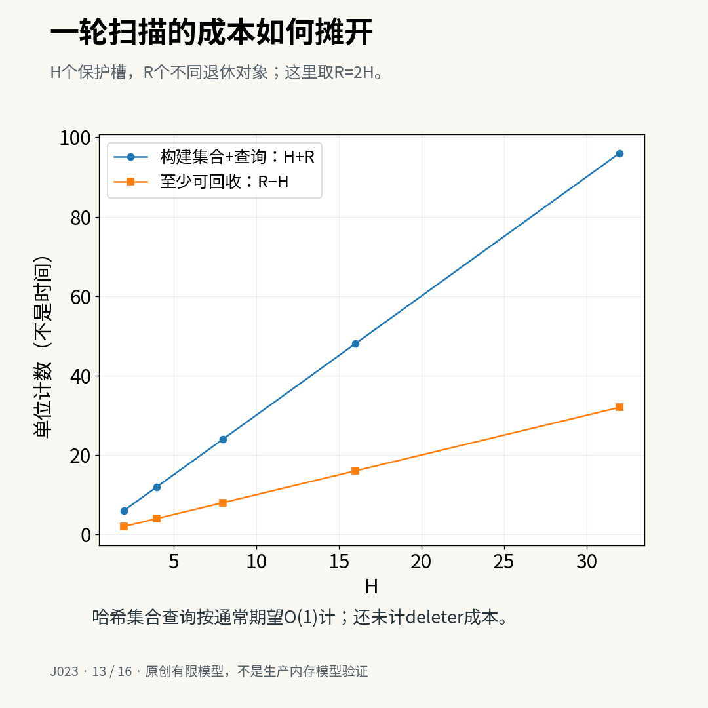

图13｜固定批次R=2H时最多H个不同身份被槽保护，至少H个可回收；H+R是抽象工作量，不是实测耗时。

## 14. 一个读者永久暂停，会把什么挡住？
把20个不同退休身份放进批次，三个槽持续指向2、8、15。集合实验实际保留3个、分出17个。单个槽只能持续保住它所指的那个身份，并不会因此自动保住所有后来退休的对象。
这解释了按对象声明保护的一个吸引力，但不是“内存从不增长”的保证。不运行扫描，退休列表当然可能增长；线程/槽数量动态增长，参数H也在变；仍从其他入口可达的对象不应被当成本批待回收节点；析构器、分配器、记录获取是否阻塞，也要分别审查。
尤其不要把“某个保护机制的某些操作有进度保证”改写成“用了HP的整个数据结构一定锁自由”。我们这份有限状态机不证明无锁进度，也不模拟调度公平性。

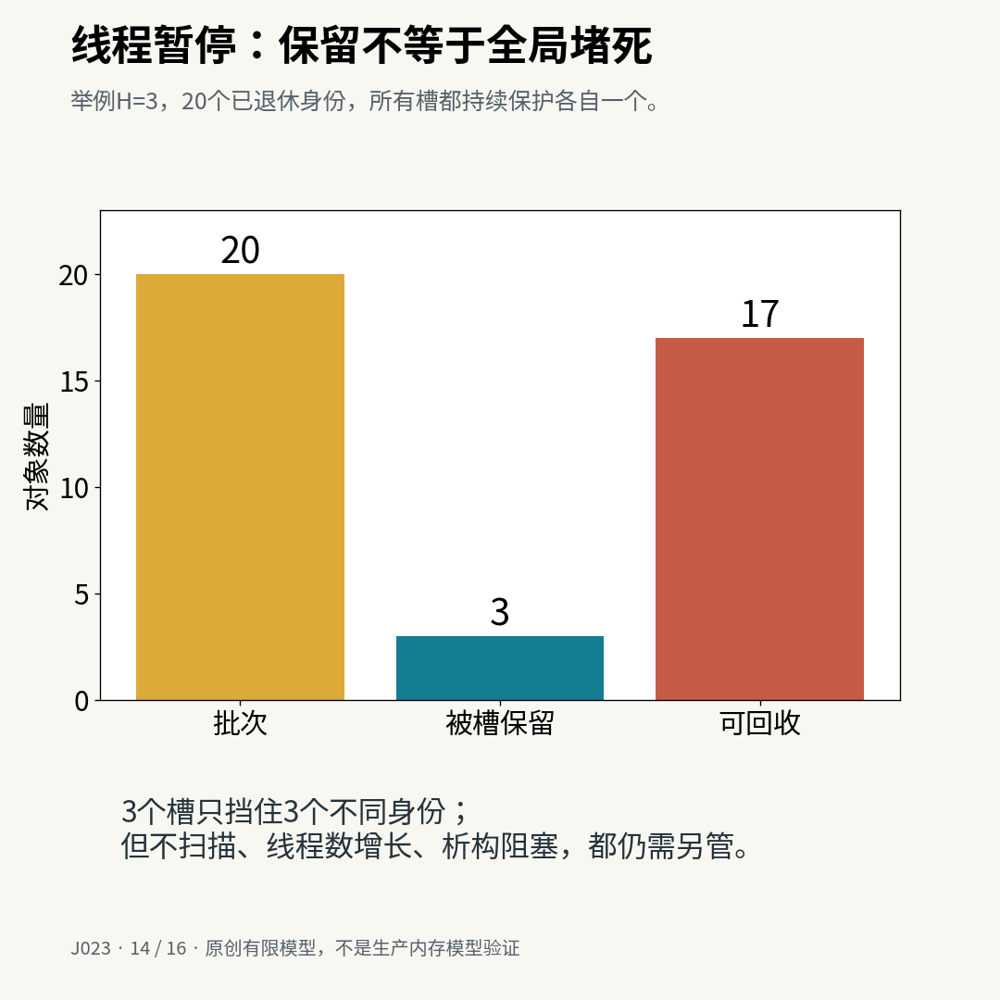

图14｜这个集合例里3个槽保留3个对象，其余17个可回收；并非所有实现的全程序内存上界。

## 15. 地址活着，不等于遍历已经写对
若要从A读取next得到B，读取A.next之前A本身必须可访问；拿到B之后也不能急着撤销A的保护、假定B一定还在。常见设计会给当前节点与候选节点分别安排保护角色，再按照具体结构验证链接并交接。
图15只是角色示意，不是可直接照搬的链表伪代码。不同删除标记、链接更新方式与查找不变式，需要不同验证点。
HP也不是所有ABA现象的统一橡皮擦。防止被保护对象回收后复用，有助于处理由存储重用导致的一类问题；但对象不释放、逻辑上移走再插回的变化，仍可能影响算法。本文完全不复用地址，也没有证明任何ABA修复；那与“此刻能否安全解引用”是不同层次的问题。

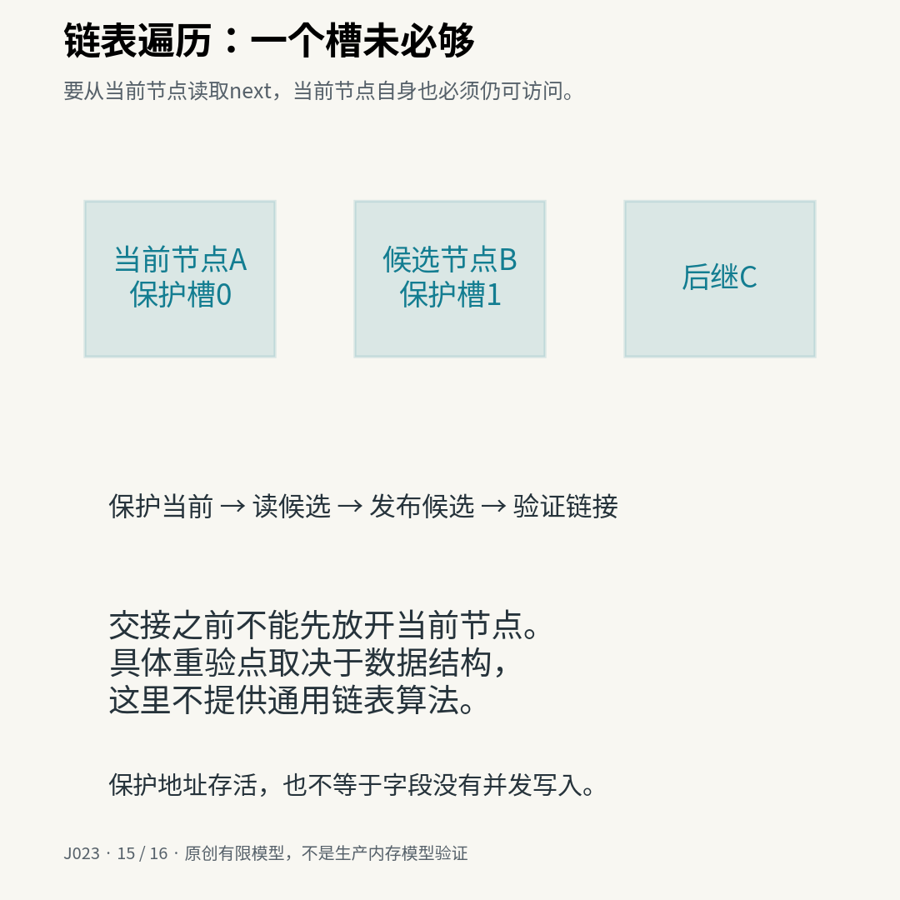

图15｜示意两个保护角色的交接需求；具体遍历与链接验证依赖算法，不是本单入口模型的已证结论。

## 16. 什么时候该停下来，不再外推？
我们的模型里，一次扫描可能因曾看到HP=A而保留A，即使全程结束时所有槽已经清空。正确单读者版有86条这种最终保留轨迹，双读者版有1,005,047条。它们不是内存泄漏的证据：这里只安排了一轮扫描；清槽后再做合规扫描，才能回收先前保留的退休对象。
同样，零UAF只对应已写清楚的模型。真实C++、弱内存硬件、地址复用、多入口、多次更新、动态线程和异常退出不在枚举范围内。不要把Python状态机改几个变量名，当作生产指针库。
真正值得带走的是三个问题：**我何时才有资格解引用？哪条持续保护覆盖了这段访问？回收者依据的是哪个已固定批次与哪些可见性保证？** 能把这些问题回答清楚，才有资格讨论优化扫描开销。

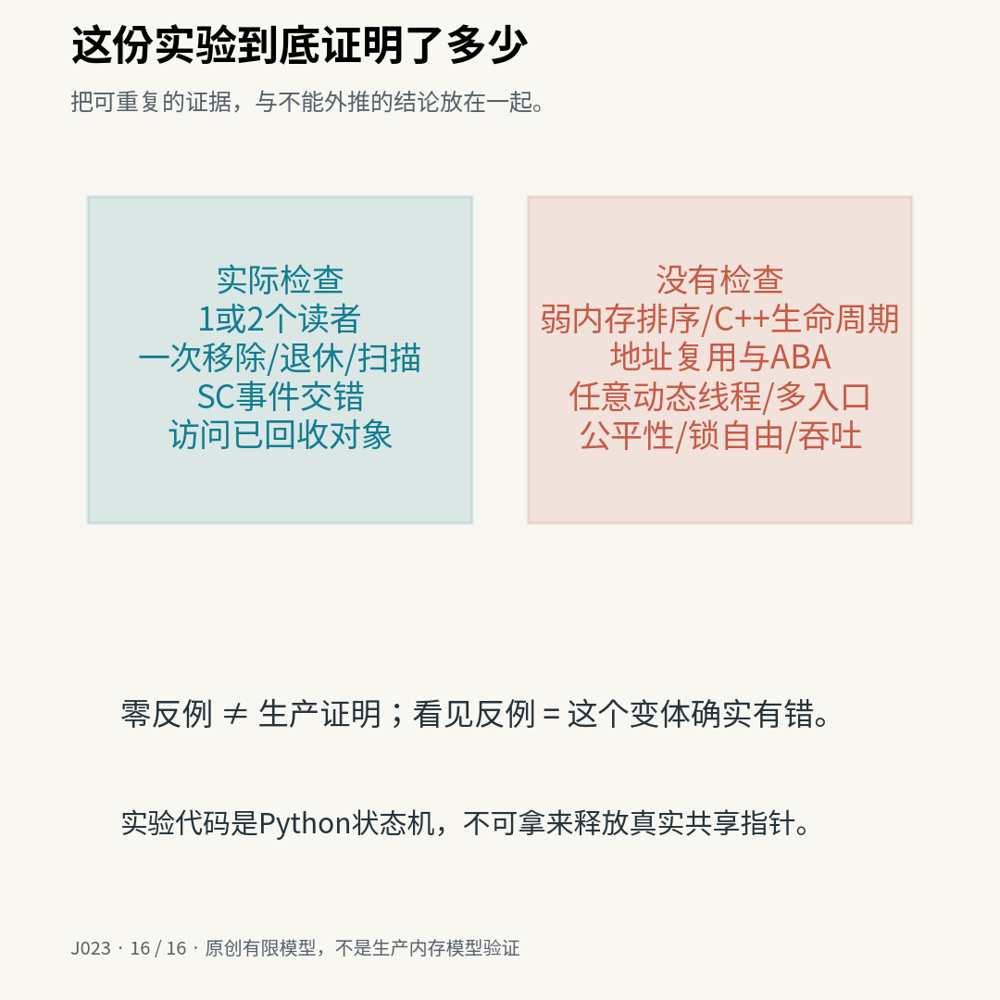

图16｜边界明示：本稿证明有限SC模型的访问安全，不证明生产内存序、地址复用、任意线程数量或性能。

## 可运行附录｜完整有限状态机
保存为hazard_lab.py，Python 3标准库直接运行。默认输出10种配置的精确调度计数；未调用真实并发线程或真实free。

```python
"""Finite SC schedule model, NOT a C++ hazard-pointer implementation."""
from dataclasses import dataclass, replace
from functools import lru_cache

PROGRAMS = {
    'naive': ('L', 'U'),
    'no_validate': ('L', 'P', 'U', 'C'),
    'late_publish': ('L', 'V', 'P', 'U', 'C'),
    'early_clear': ('L', 'P', 'V', 'C', 'U'),
    'correct': ('L', 'P', 'V', 'U', 'C'),
}

@dataclass(frozen=True)
class State:
    pc: tuple
    root: bool
    alive: bool
    retired: bool
    hp: tuple
    local: tuple
    valid: tuple
    batch: bool = False
    seen: tuple = ()
    uaf: bool = False


def initial(n):
    if type(n) is not int or not 1 <= n <= 2:
        raise ValueError('finite model supports one or two readers')
    return State((0,) * (n + 1), True, True, False,
                 (False,) * n, (False,) * n, (True,) * n)


def programs(mode, n):
    if mode not in PROGRAMS:
        raise ValueError('unknown mode')
    initial(n)
    return (PROGRAMS[mode],) * n + (('R', 'T', 'B') +
            tuple('S' + str(i) for i in range(n)) + ('F',),)


def step(state, actor, scripts):
    n = len(state.hp)
    if type(actor) is not int or not 0 <= actor <= n:
        raise ValueError('invalid actor')
    if state.pc[actor] >= len(scripts[actor]):
        raise ValueError('actor finished')
    op = scripts[actor][state.pc[actor]]
    pc = list(state.pc); pc[actor] += 1
    s = replace(state, pc=tuple(pc))
    hp, local, valid = list(s.hp), list(s.local), list(s.valid)
    if actor < n:
        if op == 'L': local[actor] = s.root
        elif op == 'P': hp[actor] = local[actor] and valid[actor]
        elif op == 'V': valid[actor] = local[actor] == s.root
        elif op == 'C': hp[actor] = False
        elif op == 'U':
            if local[actor] and valid[actor] and not s.alive:
                s = replace(s, uaf=True)
        else: raise ValueError('unknown reader operation')
        return replace(s, hp=tuple(hp), local=tuple(local), valid=tuple(valid))
    if op == 'R': return replace(s, root=False)
    if op == 'T': return replace(s, retired=True)
    if op == 'B': return replace(s, batch=s.retired)
    if op.startswith('S'):
        return replace(s, seen=s.seen + (s.hp[int(op[1:])],))
    if op == 'F':
        if s.batch and not any(s.seen):
            return replace(s, alive=False, retired=False)
        return s
    raise ValueError('unknown writer operation')


def analyze(mode='correct', n=1):
    scripts = programs(mode, n)
    @lru_cache(None)
    def count(s):
        children = [count(step(s, a, scripts)) for a in range(n + 1)
                    if s.pc[a] < len(scripts[a])]
        if not children:
            return (1, int(s.uaf), int(s.alive))
        return tuple(sum(c[i] for c in children) for i in range(3))
    start = initial(n)
    total, bad, retained = count(start)
    witness = []
    s = start
    if bad:
        while any(s.pc[a] < len(scripts[a]) for a in range(n + 1)):
            for a in range(n + 1):
                if s.pc[a] == len(scripts[a]): continue
                t = step(s, a, scripts)
                if count(t)[1]:
                    witness.append(a); s = t; break
    return dict(mode=mode, readers=n, schedules=total, unsafe=bad,
                retained=retained, states=count.cache_info().currsize,
                witness=witness)


def trace(mode, n, schedule):
    scripts = programs(mode, n); s = initial(n); out = []
    for a in schedule:
        op = scripts[a][s.pc[a]]
        s = step(s, a, scripts)
        out.append(dict(actor=a, op=op, root=s.root, alive=s.alive,
                        hp=s.hp, valid=s.valid, retired=s.retired,
                        seen=s.seen, uaf=s.uaf))
    return out


def scan_batch(retired, slots):
    """Set model only: unique integer object identities, not pointer lifetimes."""
    if any(type(x) is not int for x in retired):
        raise ValueError('retired identities must be integers')
    if len(set(retired)) != len(retired):
        raise ValueError('retire each identity at most once')
    if any(x is not None and type(x) is not int for x in slots):
        raise ValueError('slot identity or None required')
    protected = {x for x in slots if x is not None}
    return ([x for x in retired if x not in protected],
            [x for x in retired if x in protected])


if __name__ == '__main__':
    import json
    results = [analyze(m, n) for n in (1, 2) for m in PROGRAMS]
    assert all(r['unsafe'] == 0 for r in results if r['mode'] == 'correct')
    assert all(r['unsafe'] > 0 for r in results if r['mode'] != 'correct')
    print(json.dumps(results, indent=2))
```

## 短读版｜不是删了就能free
读者已经把A的地址拿到手。另一个线程把共享入口改掉，并不意味着那个局部地址自动失效。
Hazard pointer让读者声明自己正在保护哪个对象，但只发布还不够：先读取候选，发布保护，再重读入口；验证失败就不访问。访问结束之后，才清空保护。删除者先退休对象，再根据保护槽延后回收。
我们写了一台只有一个对象、一次删除的SC状态机。一个正确读者的252种完整穿插和两个读者的2,018,016种穿插都没有访问已回收对象；少重验、先验后发布、提前清槽，都有实际反例。扫描两个槽也没有被偷合并成一个原子快照。
这些数字不是生产正确性认证，不是发生概率。模型不处理C++弱内存、地址复用或任意线程，也不证明锁自由。它让一个问题变得具体：你那次解引用，究竟被哪段持续保护覆盖了？


## 来源与素材权利

参见[来源、素材权利与 AI 辅助说明](sources.md)。
