# Grace Hopper与早期编译：让电脑替人搬代码，究竟改变了什么？

## 1. 一张封面，先别急着相信它

想象你已经把一段计算程序写对了。下个月另一个任务也要用它，你把代码再抄一遍；摆放位置变了，还要改一些地址。数学没有变，却又多出一轮可能出错的机械劳动。

Grace Hopper（格蕾丝·霍珀）的故事，值得从这里讲起：不是“电脑突然学会听人说话”，而是有人认真追问，能不能让电脑承担一部分写程序时的重复工作。

先看一件真实材料：Computer History Museum 收藏的1957年 FLOW-MATIC 宣传册封面。它把“新语言”和“自动编程”放得很大，右上角的计算机照片却很小。这种版面强调的卖点，不只是硬件，而是怎样表达要做的事。封面是本文要分析的史料，不是装饰；也不要把它误认成1952年的 A-0 文件。

厂商希望读者相信什么？自动化具体替人完成什么？这些是两个问题。我们先把后一个拆清楚，再回头评价前一个。[馆藏目录](https://www.computerhistory.org/brochures/doc-4372956d57d94/)

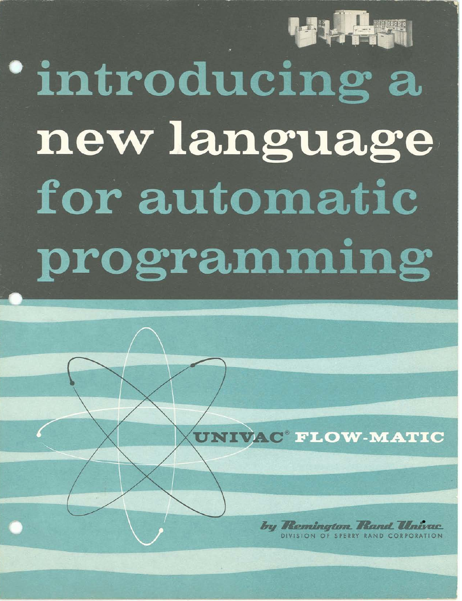

图1：1957年 FLOW-MATIC 宣传册封面，Sperry Rand Corporation, Univac Data Processing Division；Computer History Museum 藏，馆藏号 102646140。仅引用封面用于分析其“新语言／自动编程”表述，不表示开放许可，也不是 A-0 的封面。

## 2. 真正麻烦的，不一定是算式

假设三个项目都需要同一套计算步骤。最笨的办法，是把那段可靠的程序分别抄进三份程序里。即使原稿没有错，抄写时漏掉一条、把一个位置写错，也足以让新程序出问题。

现在提出一个具体目标：把已有代码保存起来，之后按需要找出它、放到合适的位置、接好各段之间的关系。这里还没有要求机器理解任意一句自然语言。它只需要忠实执行我们事先说清楚的规则。

CHM 的展览把早期编程的成本与易错性放在高层语言发展背景里，也把 A-0 描述为帮助编写其他程序的早期工具。这是问题背景，不是对每一台早期机器、每一种工作方式的统一描述。[CHM：Higher Level Languages](https://www.computerhistory.org/revolution/story/117)

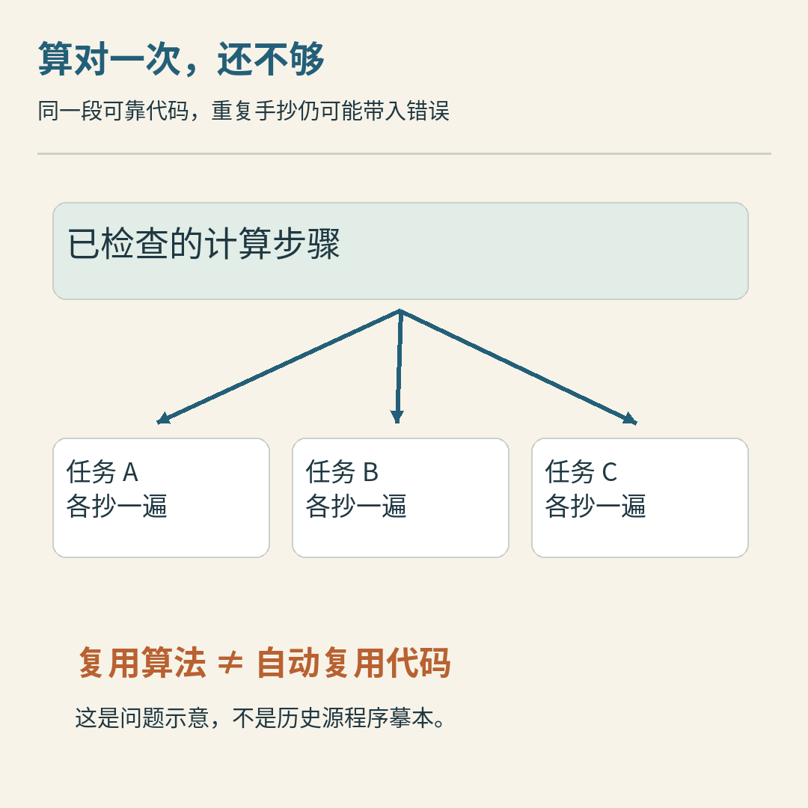

图2：三个任务各手抄一次同一段代码，是本文自造的问题示意；可靠的原稿并不能自动消除抄写错误。

## 3. 先做一盒能重复使用的零件

下面搭一个可以亲手运行的小模型。请记住这条边界：它由本文新写，用来解释例程复用、地址和连接；不是 A-0 的复刻，不采用 UNIVAC 的真实指令、字长或磁带格式。

模型里只有一个正在处理的整数。double 例程把它乘以2，inc 例程把它加1，main 例程规定先调用 double，再调用 inc，然后停机。因此输入3应得到7。

把三个例程分别放进一个字典，就有了一个极小的“库”。main 暂时只写 CALL double、CALL inc，不必知道它们将摆在哪里。名字承载意图，地址留到后面决定。

库也不是魔法：double 内部怎样乘、执行后怎样回来，仍要有人写清楚。把人写好的部件交给工具组合，与让工具自己想出需求，是两回事。

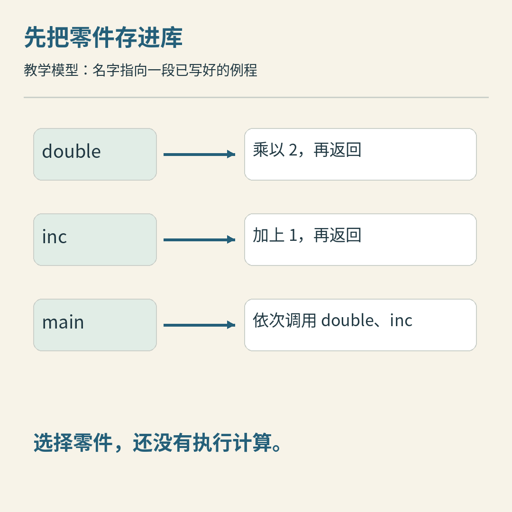

图3：自造库包含三个例程。名字 double、inc、main 以及指令均属本文教学模型，不是 A-0 的实际记号。

## 4. 第一遍：先把位置排好

规定每条模型指令占一个地址单位。从100开始，main 有3条，便占100、101、102；double 有2条，占103、104；inc 也有2条，占105、106。

此时得到一张符号表：main 对应100，double 对应103，inc 对应105。它不是实际机器的物理内存照片，而是这一次构建的地址安排。

为什么不边放边把所有调用填完？因为 main 在最前面时，它调用的 double 可能尚未摆放。先走一遍只计算位置，再走一遍处理引用，是一种清楚、容易检验的办法。本文模型选择显式列出的所有例程，不自动搜索未列出的依赖。

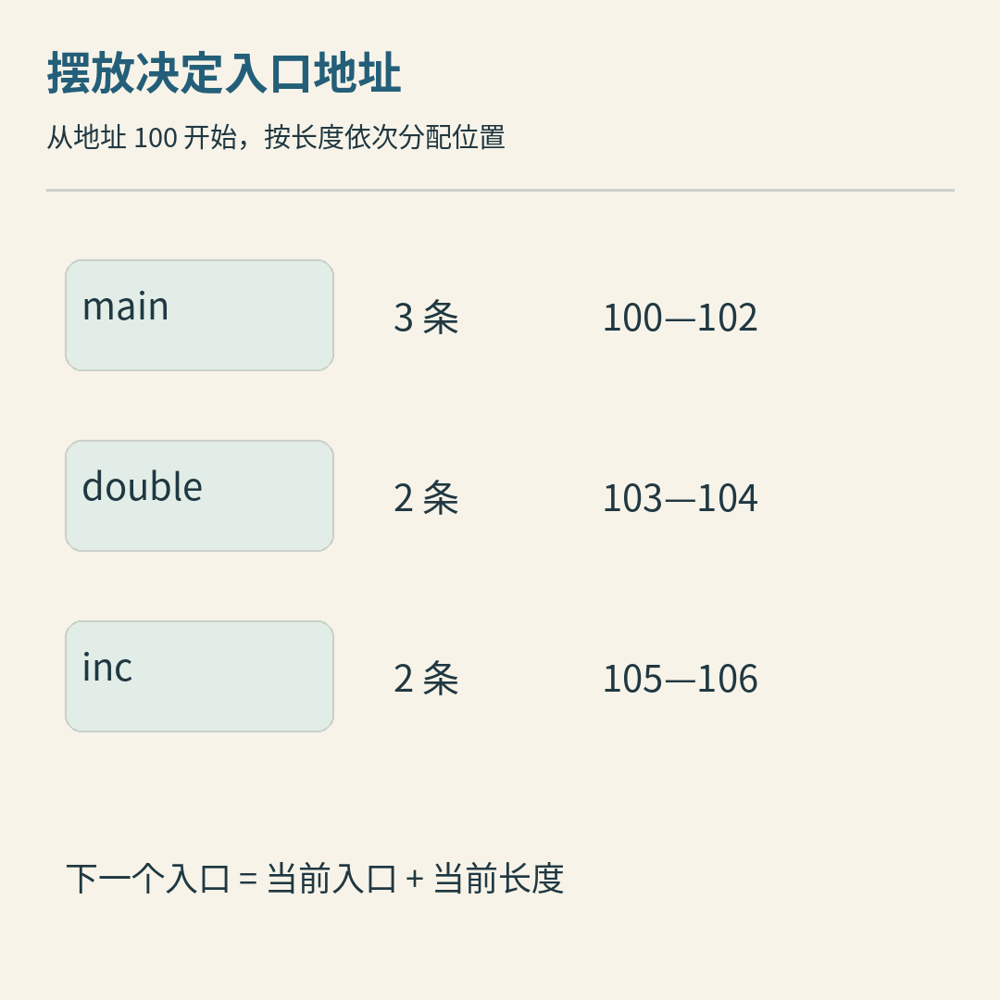

图4：每条模型指令占一个地址单位，故三个入口为100、103、105。这里的单位不是 UNIVAC 的实际字长或机器格式。

## 5. 搬家：哪些数字该改，哪些不该？

设某段模型代码要跳到本例程的第3条指令。用从0开始的编号，目标偏移是2。若例程放在20，实际目标就是22；若移到100，目标就变成102。

这叫地址重定位的一个简化例子。关键不在“把数字统一加上去”，而在识别哪个字段表示位置。

ADD 1 里的1是要加的数。把它也加100，就从“加1”变成“加101”，计算意义立刻改变。JMP 2 里的2，在本文链接前的格式中才是局部位置。

真实目标文件可以用专门的重定位记录说明哪些字段怎样修补。本文没有实现真实目标文件格式，只把这种区别写进指令种类：JMP 处理局部地址，ADD、MUL 的数值保持原样。

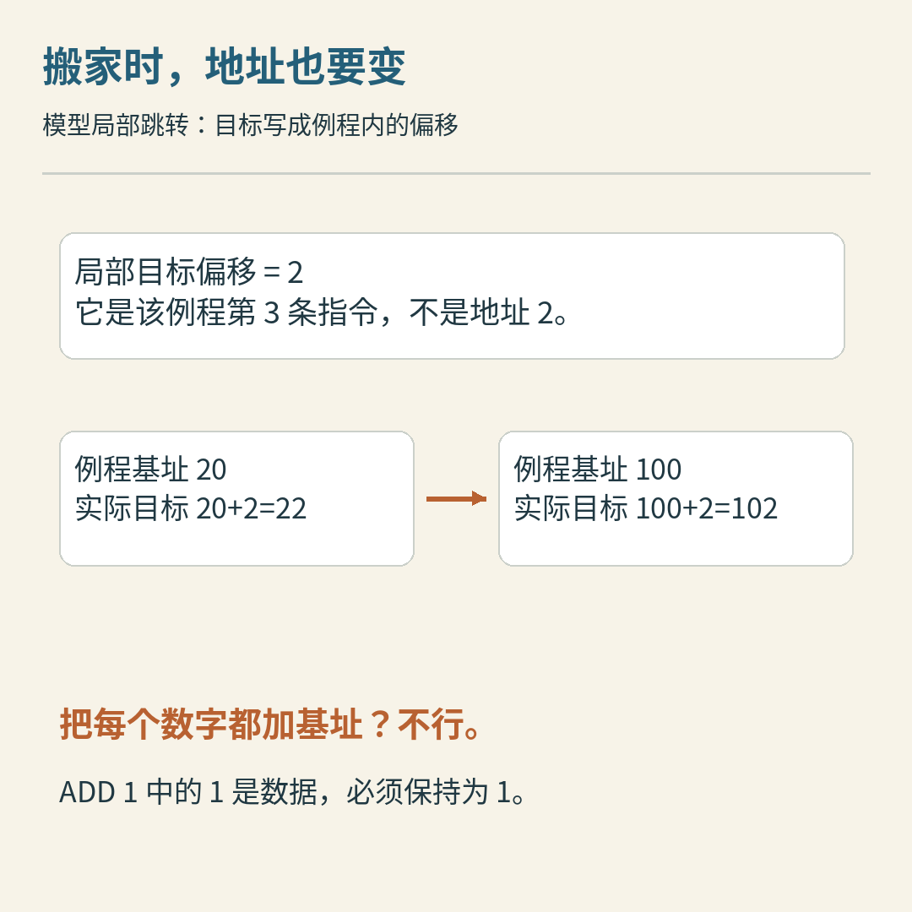

图5：重定位只处理标为地址的字段。JMP 的局部目标需要加例程基址，ADD 的数值常量不能一起平移。

## 6. 第二遍：把名字接上

现在把 CALL double 改写为 CALL 103，把 CALL inc 改写为 CALL 105。这一步是在回答“我要调用的那个部件，这次具体放在哪儿”。

如果把库里各段的顺序改掉，入口地址会变，链接器重新填一次，计算意图仍可以不变。如果根本找不到名字，就应该明确报错，而不是默默跳到0。

这里的“链接器”是我们给教学模型的现代职责名称。IEEE Computer Society 的人物条目特别提醒，霍珀当年的 compiler 概念与今天不完全相同，也提到其库组织、宏式汇编相关性质。因此，理解这种组合工作很有帮助；但不能反过来宣称，图里的两遍算法就是 A-0 的内部实录。[IEEE人物条目](https://history.computer.org/hopper.html)

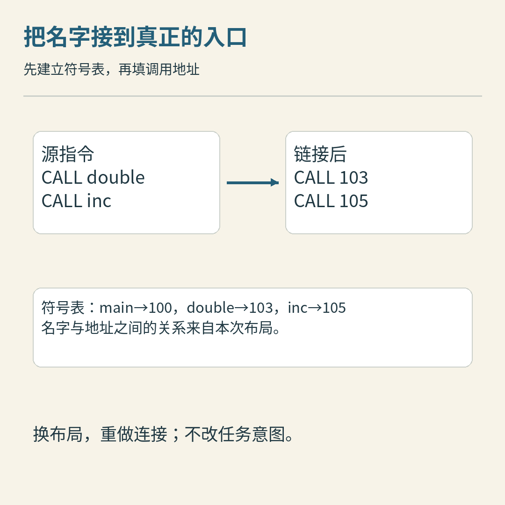

图6：第二遍把 CALL 的名字解析为入口地址。一次构建中的符号表不是跨所有程序永远固定的地址表。

## 7. 写程序的程序，先执行一次

链接器运行时，输入是库、布局顺序与起始地址；输出是一组地址已经确定的指令。它此时并没有把3算成7。

随后让模型虚拟机执行输出程序，才会取出 CALL、MUL、ADD 等指令并改变数值。

这解决了一个常见疑问：“如果程序是程序写出来的，第一个程序又是谁写的？”自动化工具本身仍可用已有的编程手段实现；没有要求它在诞生时就必须由自己生成。工具链可以逐步发展，不需要无穷倒退。

本文链接器用 Python 写，虚拟机也用 Python 写。这不是启动历史第一台机器的方案，只是把两个阶段放在你能看见、能修改的位置。

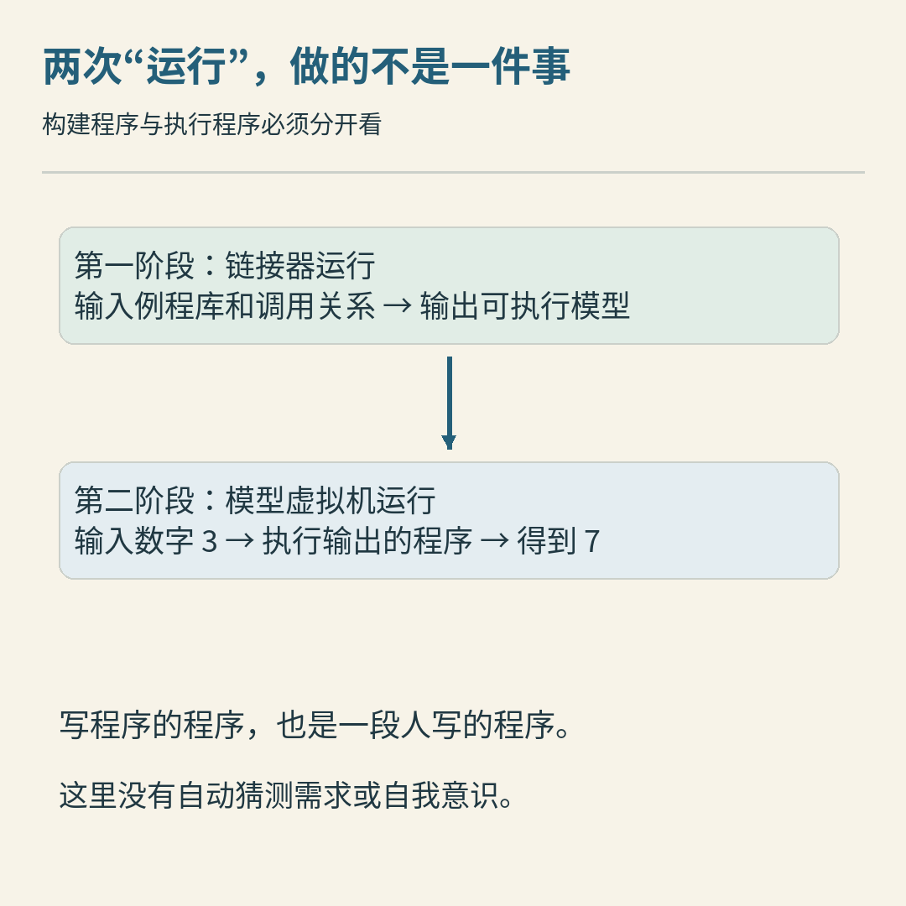

图7：链接阶段只生成地址已确定的模型程序；算出7发生在随后执行阶段。“自动编程”不等于机器自行决定要解决什么问题。

## 8. 为什么要记住返回点？

main 的第一条在100。CALL 103 会先把下一条地址101放进返回栈，再去103。乘法把3变成6；104处的 RET 取出101，于是 main 可以继续。

接着101处 CALL 105 保存返回点102。加法把6变成7；106处 RET 回到102，遇到 HALT 停机。

返回地址不是“永远回到主程序第二行”。同一例程可以由不同位置调用；嵌套调用还需要保留多层返回关系。栈提供了后进先出的记录方式。

图中的七次取指来自附录模型的真实运行。图示只覆盖这一条执行路线，不声称证明任何输入程序都正确或都会结束。

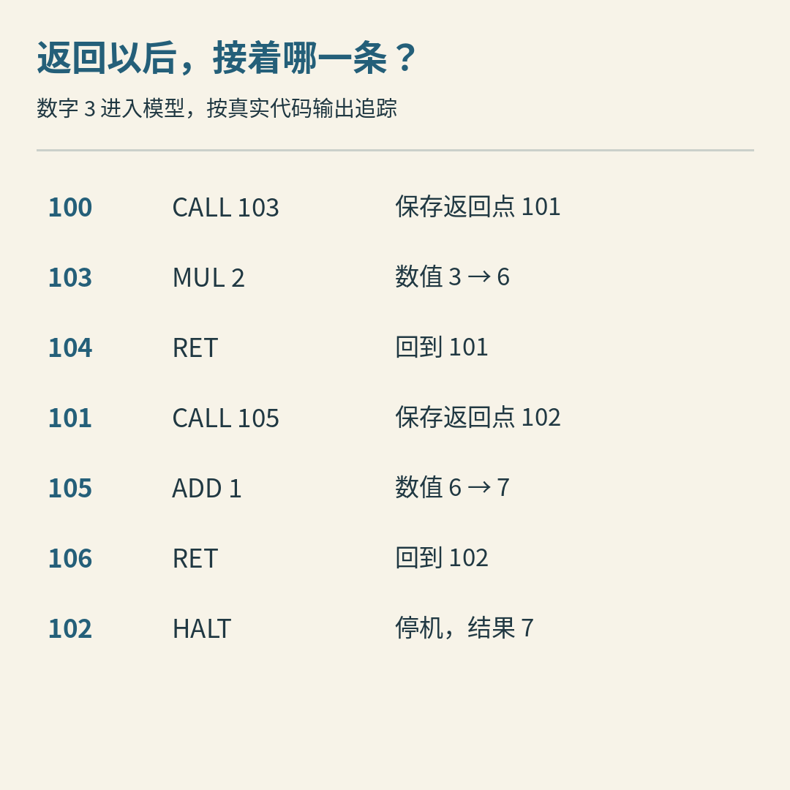

图8：模型真实执行顺序为100、103、104、101、105、106、102。RET 从返回栈取地址；它不是固定跳回某个全局位置。

## 9. 工具替你检查什么，不能检查什么？

链接时能发现 CALL 指向不存在的名字，或局部 JMP 超出例程边界。执行时能发现没有返回地址却执行 RET，或程序计数器离开代码区域。

还有一种错误：程序合法地跳回自己，永远不停。模型用 fuel 限制最多执行多少条指令；达到预算后抛出异常，让实验不会挂住。预算耗尽只是“这次还没停”，并不能证明程序永远不会停，更没有解决一般的停机判定问题。

因此，“自动化”意味着明确分担了一部分工作，不等于工具能判断你的业务要求是否合理。double 写成乘3，指令照样合法，链接照样成功，结果却不符合我们的任务。

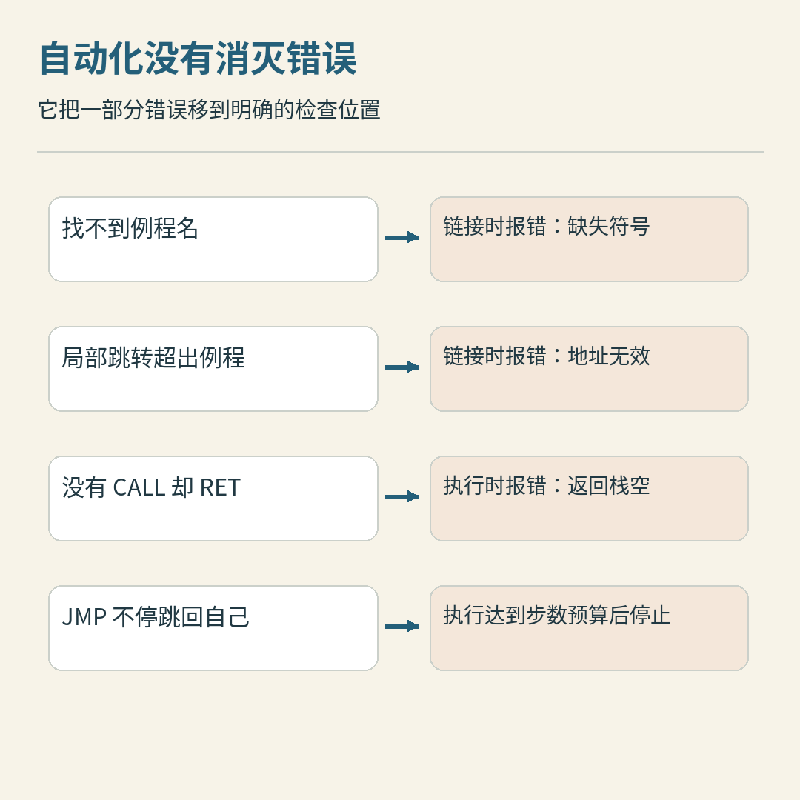

图9：四类模型故障分布在构建期和执行期。步数预算只是实验保护，不证明程序可以自动解决停机问题。

## 10. 那么，今天说的编译器还多做了什么？

假如输入不是 CALL double，而是表达式 2*x+1，工具首先要识别结构：谁是变量、谁是常量、乘法与加法怎样结合。接着才能把结构转换为中间表示或某种目标代码。

LLVM 官方入门教程的目录把词法分析、语法树、生成 LLVM IR、生成目标文件等分开讲。这很好地提醒我们：处理表达式的语义结构，与把已有单元接起来，虽然可以处在同一工具链，却不是同一个问题。[LLVM官方教程](https://llvm.org/docs/tutorial/MyFirstLanguageFrontend/index.html)

图中只是概念管线。实际系统可以合并步骤，可能即时执行，也可能先输出文件；编译器的目标也不一定直接是物理CPU的机器码。不要把一张入门图当成所有工具链的硬性标准。

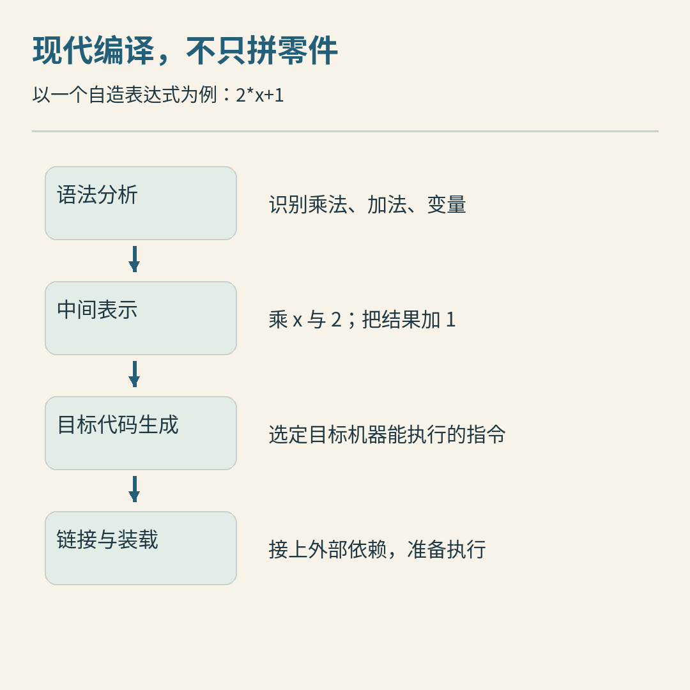

图10：概念管线不是所有现代工具链的固定分层。编译器可能输出汇编、目标码或其他形式，且链接并不等同于语法翻译。

## 11. 别把几个名字挤成一个意思

为了学习，可以暂时这样区分：汇编偏重把符号指令变成机器表示；链接偏重组合单元和解析关系；编译偏重在程序表示之间进行有规则的转换；装载偏重把程序放进能执行它的环境。

这些边界会重叠。一个工具可能承担多种职责，历史名称也可能覆盖今天分属不同环节的工作。

所以，比“到底算不算真正的编译器”更有收获的问题是：这个系统的输入是什么？输出是什么？替人省掉哪一步？仍由谁负责正确性？能把这四件事回答清楚，就不会只剩下围绕一个名词争夺称号。


图11：四类工具可能共享或合并职责。用今天的分工解释 A-0 的某些工作有帮助，但不能据此直接复原它的全部内部实现。

## 12. 回到霍珀：一条路线，不是孤立的奇迹

已读史料给出几个锚点：霍珀1949年加入 Eckert–Mauchly；A-0 是1952年的早期系统，随后有1953年的 A-2。她与同事推动的工作，后来延伸到面向业务的 FLOW-MATIC。[IEEE人物条目](https://history.computer.org/hopper.html)

1957年的馆藏宣传册是这条后续路线的一件可见材料。它不是 A-0 源码，也不能证明两者每个内部机制相同。我们没有借一份后来的广告，替一份未完整读到的早期程序填空。

时间线的作用，是避免把多个系统压成同一天的“发明瞬间”。它不包含编程语言史的全部并行探索，也不把所有进步归因于一个人。

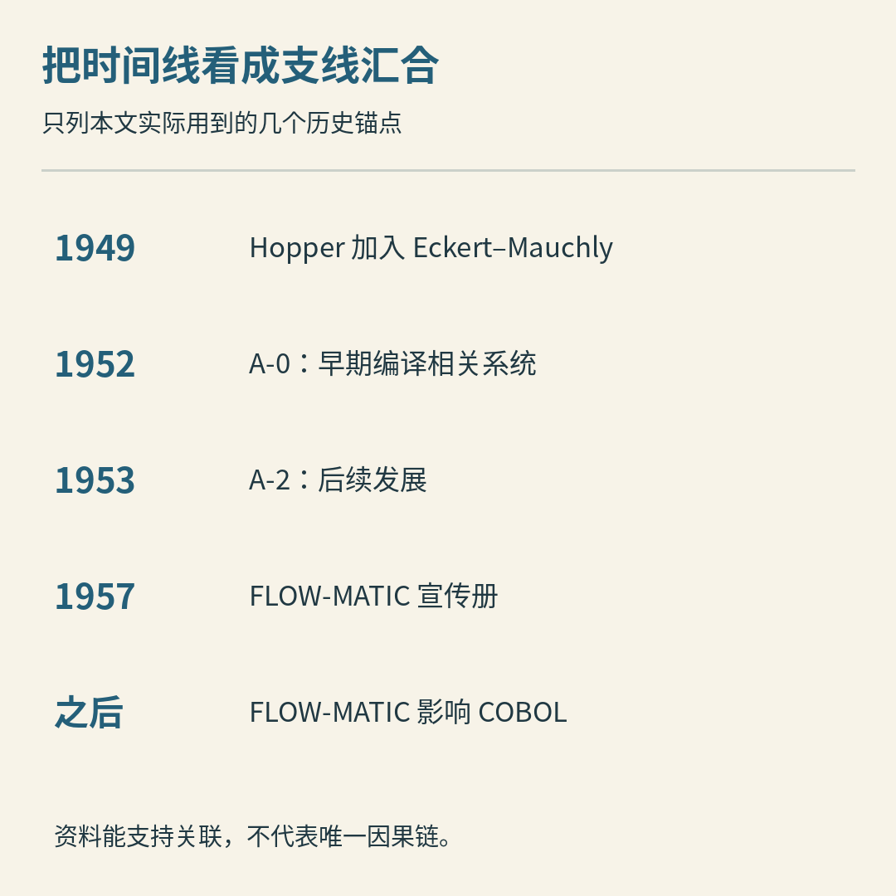

图12：时间锚点来自已读机构史料与1957年宣传册；这不是完整语言史，也没有宣称某一个人独自完成所有阶段。

## 13. 广告里省掉的工作，真的消失了吗？

这份 FLOW-MATIC 宣传册强调用接近业务过程的表达来减轻详细编码负担，并描述从输入说明形成程序、再记录到磁带的过程。它也把节省训练和准备工作作为卖点。[原宣传册](https://d1yx3ys82bpsa0.cloudfront.net/brochures/univac.flowmatic.1957.102646140.pdf)

我们不能把厂商的宣传直接改写为独立验证的性能结论。本文没有做历史机器实测，也没有给出“效率提升几倍”的数字。

真正值得追问的是工作怎样迁移：底层例程由谁维护？业务说明是否完整？错误在哪里暴露？生成程序需要多久？工具让更多人接近计算机，不意味着精确性、测试与协作从此不重要。封面上很大的“自动”二字，不应该把这些工作遮住。

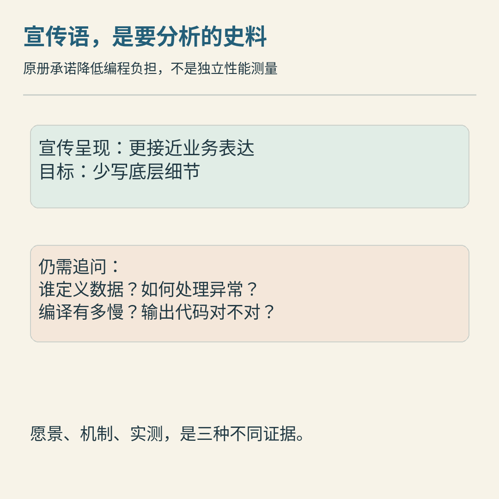

图13：把厂商宣传与机制说明、独立实测分开。本文不把宣传册的节省时间说法变成已验证的效率数字。

## 14. 业务表达为什么仍然需要规矩？

拿一个完全自造的需求试试看：“把每条记录的金额翻倍再加1。”听起来已经很清楚，但1是什么？一元还是一分？金额允许小数吗？遇到缺失记录怎么办？

先规定输入单位为整数分、运算用数学整数，输入列表是[3,8]，逐项计算2*x+1，才得到[7,17]。这是我们的例子，不是 FLOW-MATIC 语法。

如果换成固定宽度的整数，就还要考虑溢出。本文 Python 模型使用其整数运算，不模拟历史机器数值范围。这个简化方便验证地址与控制流，却不能拿来判断旧机器的精度。

接近人读得懂的词，是表达方式的改善；程序含义仍要依靠约定。语言越亲切，越要小心把“我觉得你懂了”当成精确规格。

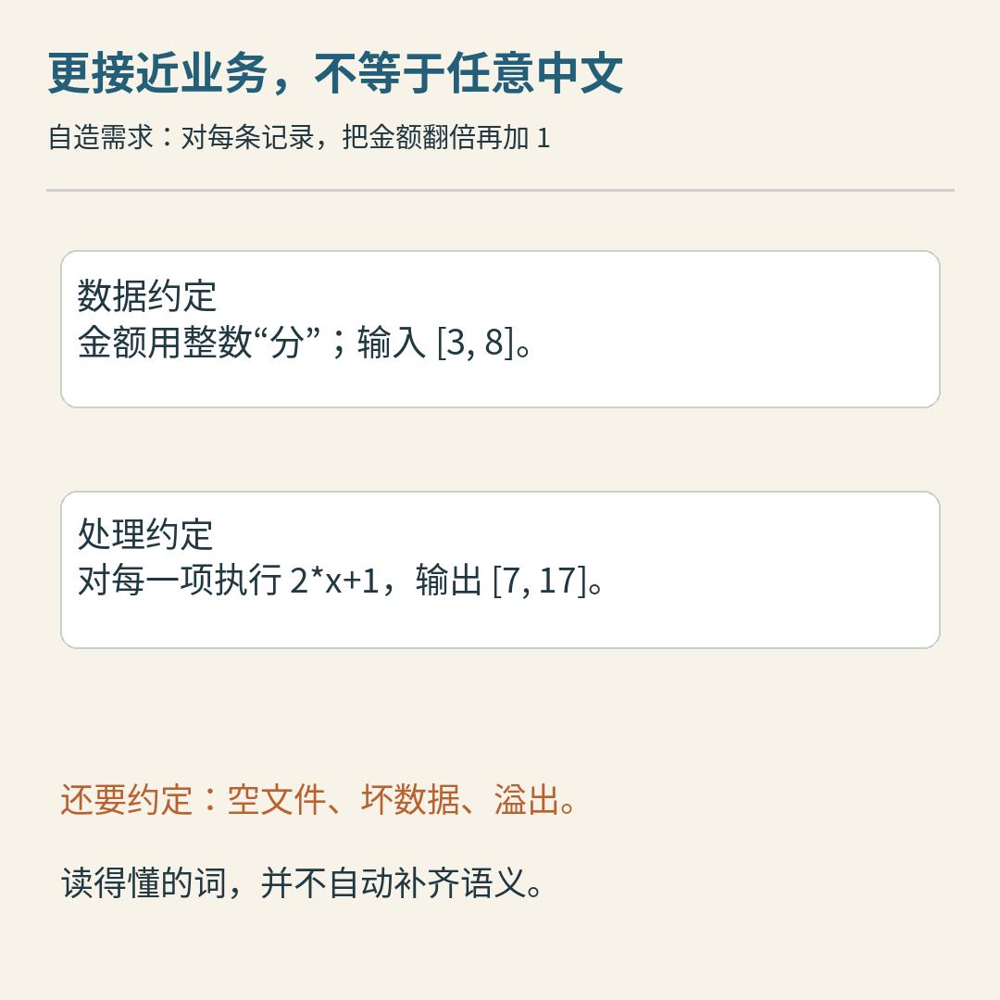

图14：自造业务式例子说明数据与处理规则都要明确。它不是 FLOW-MATIC 的合法源码，也未声称重现其数据描述语言。

## 15. 把贡献讲具体，比说“她独自发明了”更好

CHM 展览强调霍珀对早期工具与 COBOL 的参与和推广；IEEE人物条目更具体地说明 FLOW-MATIC 对 COBOL 的影响，以及通过同事参与后续工作的关系。两份机构叙述的概括方式并不完全一致。稳妥的共同点是：这不是一个人独自完成一门语言、全部标准和所有实现的故事。

本文据此只说霍珀及其团队推进了重要路线，FLOW-MATIC 对 COBOL 有重要影响；不借“母亲”“第一人”一类称号，抹掉其他研究者、实现人员、用户与委员会的劳动。[CHM](https://www.computerhistory.org/revolution/story/117)；[IEEE](https://history.computer.org/hopper.html)

同样，本文不讲未经核实的名言或“发明bug一词”的逸闻。有限篇幅更值得留给那些你可以亲手检验的机制。

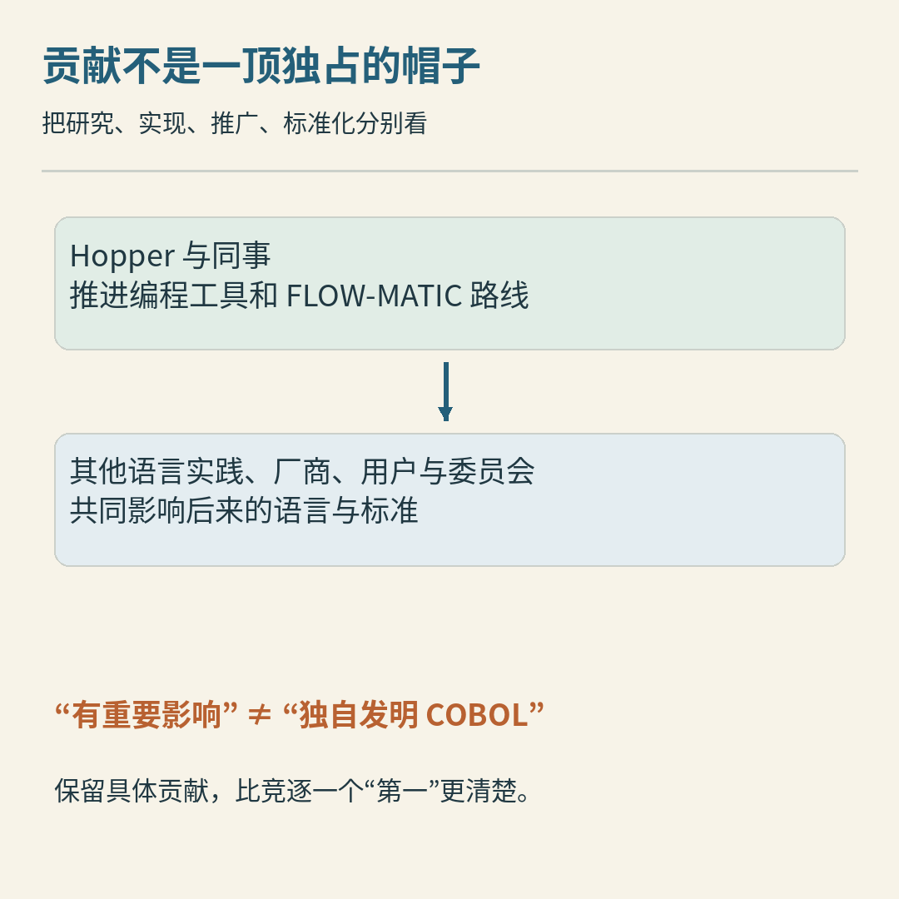

图15：贡献关系示意，不是完整人员或组织名录。已读资料支持 FLOW-MATIC 对 COBOL 的影响，不支持“霍珀独自发明 COBOL”。

## 16. 留四个可以亲手验证的问题

先不改算法，只把起始地址由100换成10000：入口地址都会变，输入3仍应得到7。再把库的摆放顺序改为 inc、main、double：只要重新链接，并从 main 的符号地址开始执行，结果仍应是7。

这两项检查位置无关的意图是否保住了。接着把 inc 改成 ADD 5，结果应变为11：这次改的是运算含义，结果当然应变。

最后，把调用名写成 absent，链接必须失败。若工具默默接受，自动化反而把错误藏深了。

这些小实验不能复现1950年代的全部困难，但能让一个历史问题变得具体：当程序越来越大，哪些繁琐而有规则的工作，可以从人的手上移给工具？霍珀的价值，不必靠把电脑拟人化来说明。


图16：前三项区分位置变化与语义变化，最后一项检验缺失符号。答案对应本文完整附录代码，不是历史 A-0 的测试。

## 附录：完整可运行的教学模型

保存为 linker_lab.py，用 Python 3 运行。仅使用标准库；不执行下载来的历史程序。示例是原创的、刻意简化的模型，非通用链接器、安全沙箱、A-0模拟器或历史机器复原。Image由link生成后应视为只读；不接收任意外部构造的可执行映像。

代码自测覆盖三例程全部6种布局、4个起始地址和101个输入，另含局部跳转与故障用例。这是有限测试，不是对任意程序的形式化证明。

```python
"""Original teaching VM/linker, NOT a reconstruction of A-0 or UNIVAC."""
from dataclasses import dataclass

@dataclass(frozen=True)
class Image:
    code: tuple
    symbols: dict
    base: int

def link(library, order, base=100):
    if type(base) is not int or base < 0:
        raise ValueError('base must be a nonnegative integer')
    if not order or len(set(order)) != len(order):
        raise ValueError('order must contain unique routine names')
    symbols = {}
    cursor = base
    for name in order:
        if name not in library or not library[name]:
            raise ValueError('missing or empty routine')
        symbols[name] = cursor
        cursor += len(library[name])
    code = []
    for name in order:
        routine = library[name]
        for ins in routine:
            if not isinstance(ins, tuple) or not ins:
                raise ValueError('bad instruction')
            op = ins[0]
            if op in ('RET', 'HALT') and len(ins) == 1:
                code.append(ins)
            elif op in ('ADD', 'MUL') and len(ins) == 2 and type(ins[1]) is int:
                code.append(ins)
            elif op == 'JMP' and len(ins) == 2 and type(ins[1]) is int and 0 <= ins[1] < len(routine):
                code.append(('JMP', symbols[name] + ins[1]))
            elif op == 'CALL' and len(ins) == 2 and isinstance(ins[1], str) and ins[1] in symbols:
                code.append(('CALL', symbols[ins[1]]))
            else:
                raise ValueError('invalid operation or unresolved target')
    return Image(tuple(code), symbols, base)

def run(image, entry='main', value=3, fuel=1000):
    if entry not in image.symbols or type(fuel) is not int or fuel <= 0:
        raise ValueError('invalid entry or fuel')
    pc = image.symbols[entry]
    stack, trace = [], []
    for _ in range(fuel):
        i = pc - image.base
        if not 0 <= i < len(image.code):
            raise RuntimeError('PC outside image')
        ins = image.code[i]
        trace.append((pc, ins, value, tuple(stack)))
        op = ins[0]
        if op == 'HALT':
            return value, trace
        if op == 'RET':
            if not stack:
                raise RuntimeError('return stack empty')
            pc = stack.pop()
        elif op == 'CALL':
            stack.append(pc + 1)
            pc = ins[1]
        elif op == 'JMP':
            pc = ins[1]
        elif op in ('ADD', 'MUL'):
            value = value + ins[1] if op == 'ADD' else value * ins[1]
            pc += 1
        else:
            raise RuntimeError('unknown VM instruction')
    raise RuntimeError('step budget exhausted')

LIBRARY = {
    'main': (('CALL', 'double'), ('CALL', 'inc'), ('HALT',)),
    'double': (('MUL', 2), ('RET',)),
    'inc': (('ADD', 1), ('RET',)),
}

if __name__ == '__main__':
    import itertools, json
    count = 0
    for order in itertools.permutations(LIBRARY):
        for base in (0, 20, 100, 10000):
            img = link(LIBRARY, order, base)
            for x in range(-50, 51):
                assert run(img, value=x)[0] == 2*x+1
                count += 1
    lib = {'main': (('CALL','skip'),('HALT',)),
           'skip': (('JMP',2),('ADD',999),('ADD',1),('RET',))}
    for order in itertools.permutations(lib):
        for base in (0, 100):
            assert run(link(lib, order, base), value=3)[0] == 4
            count += 1
    bad = [({'main':(('CALL','missing'),)}, ['main']),
           ({'main':(('JMP',-1),)}, ['main']),
           ({'main':(('JMP',1),)}, ['main']),
           ({'main':()}, ['main']),
           (LIBRARY, ['main','main']),
           ({'main':(('ADD',True),)}, ['main'])]
    for lib, order in bad:
        try: link(lib, order)
        except ValueError: count += 1
        else: raise AssertionError('bad input accepted')
    for lib in ({'main':(('RET',),)}, {'main':(('JMP',0),)}):
        try: run(link(lib,['main']),fuel=10)
        except RuntimeError: count += 1
        else: raise AssertionError('runtime failure missed')
    img=link(LIBRARY,['main','double','inc'])
    out,trace=run(img)
    print(json.dumps({'checks':count,'value':out,'symbols':img.symbols,'trace':trace},ensure_ascii=False,indent=2))
```

## 图片、来源与使用边界

图1是原宣传册封面的有限引用，专用于识别并评论该材料如何呈现“自动编程”；未转载其余7个扫描页面。原作品版权归 Sperry Rand Corporation, Univac Data Processing Division，数字馆藏由 Computer History Museum 提供。原图保留内容与署名，不作开放许可、官方背书或通用商业使用授权声明。CHM条款要求商业用途及超出合理使用的用途取得书面许可；若把本稿用于商业推广、扩展转载原图或脱离本文评论，需另行确认相应许可，不能沿用本稿引用说明。

图2—16为原创程序绘制教学示意，并非历史截图。正文与示意由AI辅助起草和代码制作，历史来源与原创模型明确分开。本文只依据实际读到的机构条目、1957年宣传册及LLVM教程总览；未完整读到 A-0 原程序、1952年论文或霍珀原始口述，故不声称还原其实现。原图与代码的有限检查不等于真实平台预览或历史硬件验证。

主要资料：[CHM馆藏目录](https://www.computerhistory.org/brochures/doc-4372956d57d94/)、[原宣传册](https://d1yx3ys82bpsa0.cloudfront.net/brochures/univac.flowmatic.1957.102646140.pdf)、[CHM展览](https://www.computerhistory.org/revolution/story/117)、[IEEE人物条目](https://history.computer.org/hopper.html)、[LLVM官方教程总览](https://llvm.org/docs/tutorial/MyFirstLanguageFrontend/index.html)、[CHM使用条款](https://computerhistory.org/terms/)。

---

## 短篇导读｜电脑还没“理解人话”，先学会替人搬代码

想象你写对了一段程序，下次还得手抄、改地址、接上调用。算法没变，出错机会却又来了一遍。Grace Hopper推进早期编程工具的意义，可以从这种具体劳动看起，而不是一句“她让机器听懂英语”。

长文先展示1957年 FLOW-MATIC 宣传册的一页真实封面，再用原创小模型解释三个动作：把例程存入库、给它们安排位置、把调用名接到实际地址。输入3，先乘2再加1，得到7；换地址、换摆放顺序，只要重新连接，结果应当不变。

这个模型不是 A-0 的历史复刻。A-0与今天的完整编译工具链不能简单画等号；链接已有部件，也不同于解析任意表达式。长文逐步展示返回栈、重定位、缺失符号、执行错误和可运行代码。

霍珀及其同事的工作影响深远，但不等于她独自发明了 COBOL。厂商宣传中的“自动”也不代表无需精确需求、测试与协作。正文把史料能支持的事实、原创教学简化与尚未核实的部分分开，让你可以自己动手验证，而不是只记住一个传奇称号。

原封面仅随具体史料评论引用，不是开放许可素材；其余图解为AI辅助原创程序绘制。完整来源和使用边界见长文。

---

[来源、AI 辅助与许可范围](sources.md)
