# 只改一行，为什么又构建一遍？把增量构建拆成可检查的计算


## 01｜只改一行，为什么又等了一分钟？


你只想把界面上的一个词改掉。保存，构建，风扇开始转。屏幕上刷出一长串编译命令：这些步骤真的都受那一行影响吗？

反过来还有更危险的一幕：构建瞬间结束，程序里却仍是旧内容。快不一定是好事，它也可能只是漏做了工作。

增量构建要同时守住两件事：该更新的不能遗漏，能复用的别重做。本文用一个完全在内存里运行的小模型，把“根据什么判断可以复用”拆开。它不启动编译器，不读写你的工程，也不模拟完整Make或Bazel。

模型里有三份源字节：a.src是“2 # first”，b.src是“3”，shared.h是“7”。两个clean动作分别读取自己的源和shared.h；最后join动作读取两个中间结果。clean只删掉第一个#及其后的内容、去掉首尾空白，再用竖线连接。工具标识cc1放在输出开头。join用环境中的分隔符连接输入。这里的.o只是名字，不是真实目标文件。


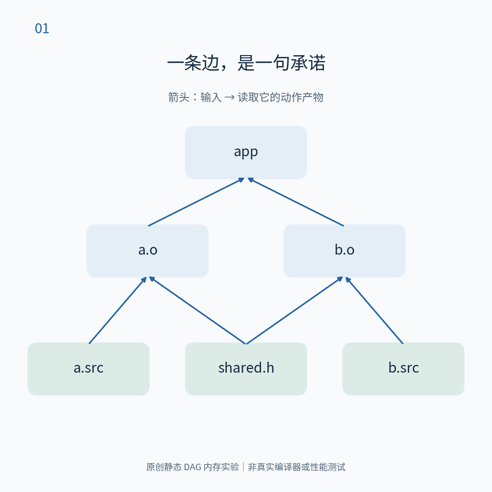


图1｜箭头从输入指向读取它的产物；shared.h 同时影响两个中间结果。


## 02｜先画出谁真正需要谁


图上的一条边不是“两个文件大概有关”，而是一个可检查的承诺：下游计算会读取上游的值。

为了得到app，先取得a.o、b.o；为了得到a.o，又先取得a.src和shared.h。这种递归问下去，直到遇到直接提供的源字节。图没有循环时，依赖先于使用者的排列叫拓扑顺序。

同一份shared.h被两个动作读取，不代表要把文件凭空复制两遍。本模型为这一轮的每个名字记住已得到的值。a.o与b.o没有彼此依赖，先算谁都可以；app却不能在它们之前执行。**调度器决定先后，重建判断决定做不做。**这两件事值得分别思考。


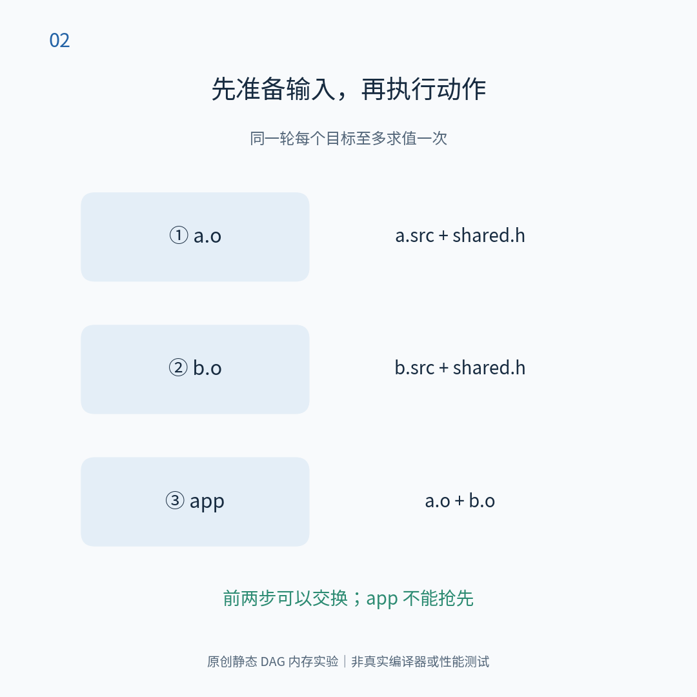


图2｜a.o 与 b.o 的先后可以交换，app 必须等待两者；这是依赖次序，不是缓存策略。


## 03｜把“很快”换成可数的动作


先连续跑六轮：冷启动；不改任何内容再跑；只改a.src的注释；把a.src的数值改为8；把shared.h从7改为9；最后把shared.h恢复成7。

真实执行次数是3、0、1、2、3、0。后面每张图都可以从文末代码复算，而不是凭直觉涂色。

这里“执行一次”只计evaluate动作，不计验证图、扫描依赖、编码缓存键、读取缓存和计算摘要。因此三个命中不等于一纳秒，也不能把3次变1次说成快了三倍。真实系统还有启动进程、磁盘、网络、反序列化和调度成本。


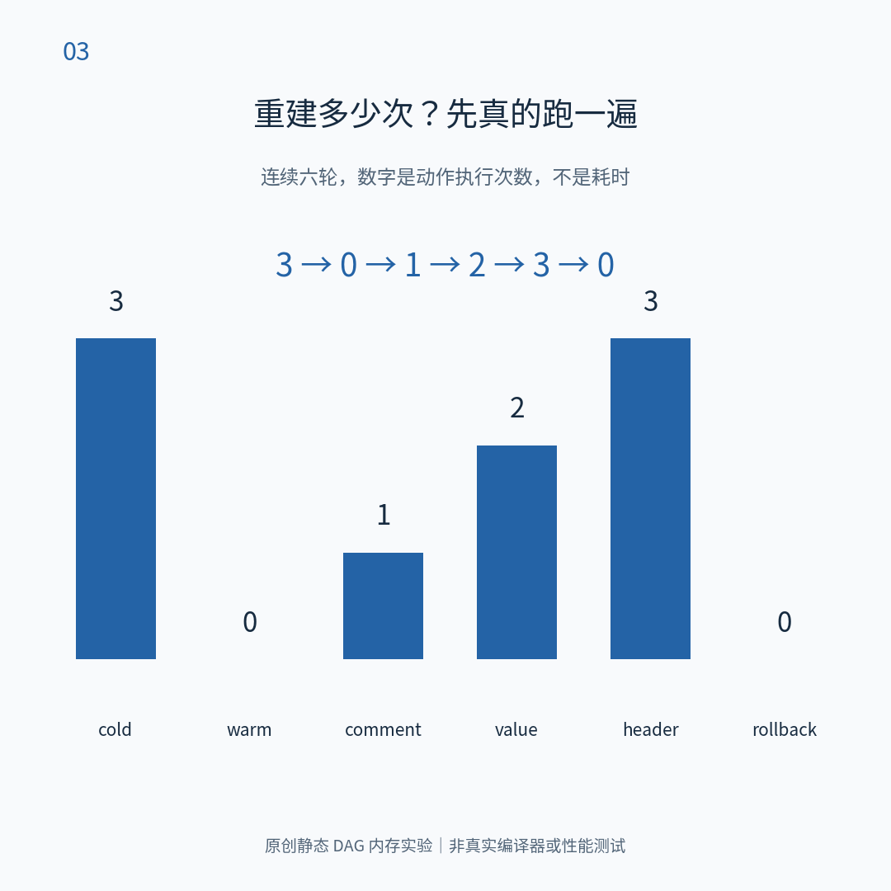


图3｜六轮实际模型执行次数依次为3、0、1、2、3、0；横轴是连续实验情境，不是时间。


## 04｜时间戳：便宜，但它只是一种证据


普通时间戳策略的基本问题是：产物不存在吗？是否有输入比产物更新？只要答案是，就重建。GNU Make手册描述了这种基本判断，同时还有实际规则等完整语义；本文的小函数仅抽出这一步。

假设产物时间为10。输入没有改字节，只touch到11，会重建——这是可能多做。输入字节改了，却让时间仍为10，普通“严格更新”比较不会触发——这是可能漏做。粗粒度时间戳、恢复文件时保留时间、跨设备时钟等都提醒我们：时间与内容不是同一个东西。

这不等于“Make没用”。策略有其成本与前提。关键是别让证据承担它没有表达的信息。接下来换一种证据：内容身份。


图4｜touch 可引发多做，保留旧时间戳可导致漏做；普通时间戳判断本身不比较内容。


## 05｜一个缓存键，究竟应该记住什么？


把一次纯计算写成 y=F(输入字节，操作定义，工具，环境)。若这些有效输入相同，F又是确定的，那么才有理由直接复用y。

模型先组织一个规范JSON数组：模型版本、产物名称、操作类型、有序的[输入名，输入内容摘要]、工具标识、分隔符。再对UTF-8编码取SHA-256。不能直接把两个字符串拼起来：ab+c和a+bc都会变成abc；结构化编码负责保留边界与顺序。

为什么输入名称也在里面？生产工具可能把路径嵌入输出；为什么顺序不能乱？链接或拼接常常对顺序敏感。本模型即使某些配置在特定动作上无效，仍统一记录，可能多重建，但不会因此少算。

SHA-256不是数学上的无碰撞证明。下文结论在忽略摘要碰撞、缓存元数据可信的教学假设下成立。工具标识cc1也只是代号；真实系统若二进制换了却仍用同一代号，键并不会自动发现。


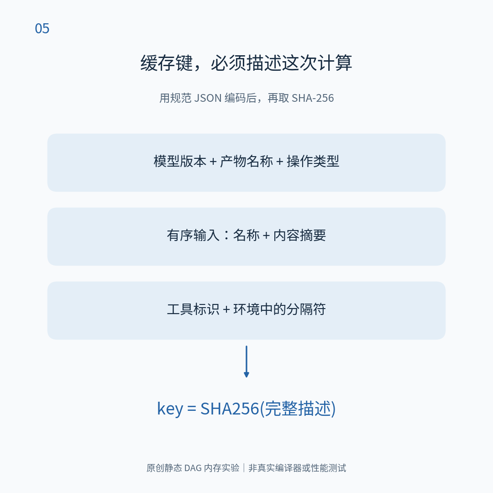


图5｜本模型的动作键包含操作、产物、有序输入名称及摘要、工具与环境；JSON负责边界，SHA-256负责紧凑身份。


## 06｜热构建：命中的是计算，不是文件名


第一次得到三个结果后，第二轮输入、规则与配置不变，三个动作键都曾经出现过，于是全部命中。仅凭“app这个名字已经有文件”远远不够：同名产物可能属于不同源版本、平台或编译选项。

Bazel官方文档把动作缓存与内容寻址存储区分开。我们的玩具也用两个字典：动作键映射到结果摘要，结果摘要映射到字节。它只支持单输出，省略真实系统的输出清单、目录、权限以及远程协议。字典的公开字段只为方便实验，不是安全边界。


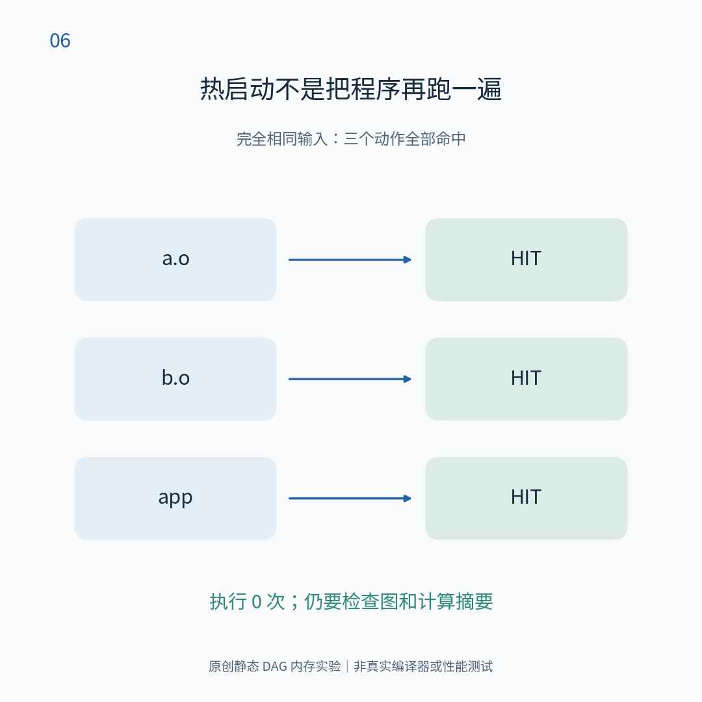


图6｜热构建全部命中，但图检查和内容摘要计算仍在发生；命中不等于零成本。


## 07｜重算过，不代表下游一定要重算


把a.src从“2 # first”改成“2 # changed”。原始输入摘要确实变了，a.o必须重算。但clean删掉注释后得到的仍是cc1:2|7。

app读取的是a.o的**输出字节**，不是“上游是否忙过”这件事。既然a.o与b.o的输出摘要都与过去相同，app的键便相同，可以命中。这就是这里的提前截断：沿依赖传播到输出内容未变化的位置便停住后续执行。

这只是我们定义的clean函数的性质，不能推出真实编译器加注释总不改变二进制。调试信息、路径、时间戳、宏和生成器都可能让结果不同。


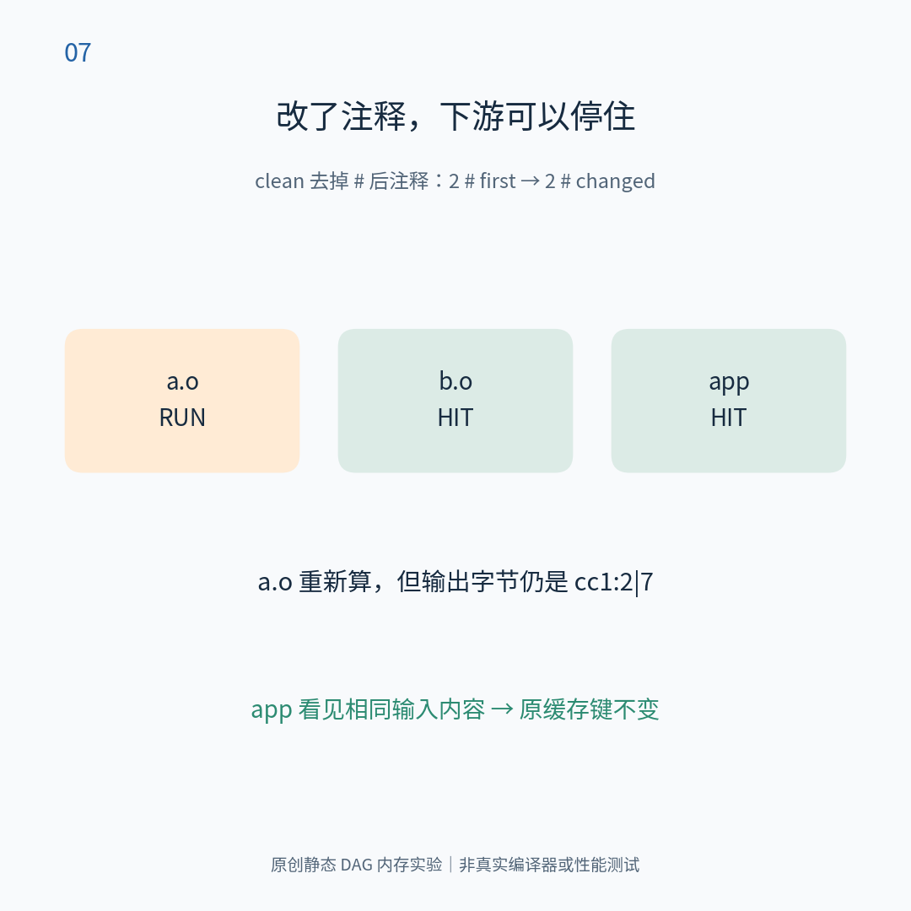


图7｜注释变化使a.o重算，输出却不变，因此app命中；这是输出内容带来的提前截断。


## 08｜修改共享输入，为什么范围突然扩大？


在上一轮a.src数值已经变成8的基础上，把shared.h从7改成9。两个clean动作都读取它，所以二者的键和输出都变化；app看到新的两份输入，也要执行。

“改一行导致全项目重建”未必是工具犯傻。那一行如果位于被大量动作直接或间接使用的公共输入里，影响范围本来就大。能否缩小依赖边，取决于真实计算能否拆开，而不是删掉声明就算优化。后面的反例会展示，删掉真实依赖会发生什么。


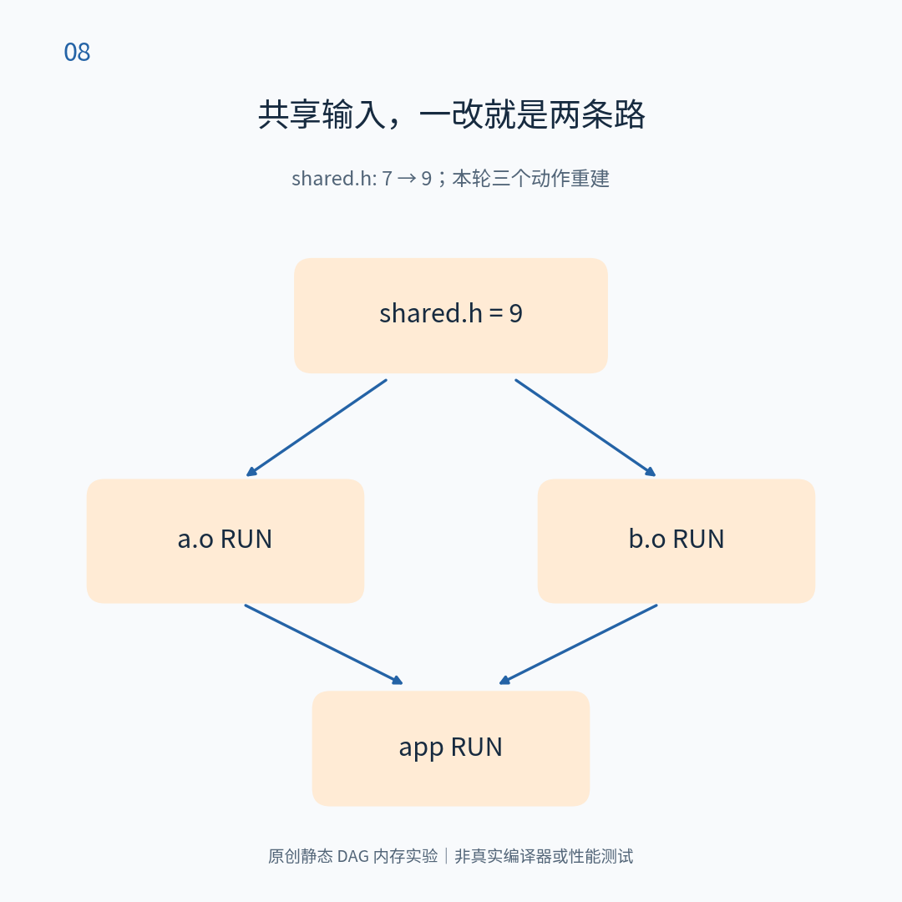


图8｜共享头输入从7变9，两个中间结果及app都改变，本轮执行三次。


## 09｜历史缓存，让“退回去”也不必重算


把shared.h从9恢复成7，保持a.src为8。这个组合在数值修改那一轮出现过，历史动作键还在。因此三个动作都命中。

这与只记“上次产物”的增量状态不同：动作缓存可以保存多个历史组合。缓存若被驱逐，仍应重新计算得到正确结果，只是少了速度收益。我们的字典不驱逐，所以示例容易看清；并不意味着真实缓存无限大。

这里没有回滚用户文件，更没有恢复整个工作目录。变化的只是传给模型的bytes。


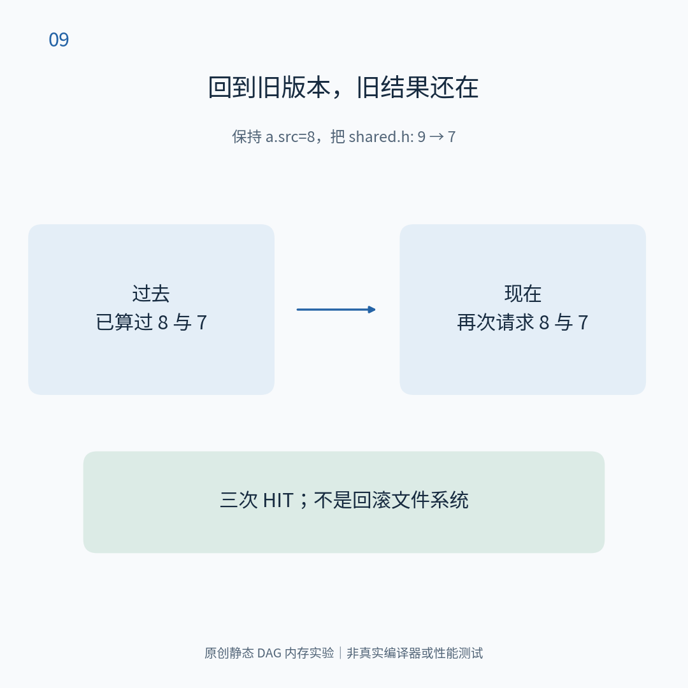


图9｜恢复旧头输入后，历史键仍存在，三个动作都命中；没有删除或回滚真实文件。


## 10｜反例一：漏掉的边，不会被哈希补回来


实验故意把(a.o, shared.h)这条关系从a.o的缓存键里删掉，但实际执行a.o时仍读取shared.h。源图与求值顺序保持原样，错误仅在“我声称依赖了什么”。

先缓存shared.h=7的结果，再改为9。a.o错误命中旧结果cc1:2|7；b.o正确重建为cc1:3|9；app把这一旧一新连接起来。干净重建却应该得到两个9。

哈希很认真地总结了你交给它的材料，但你没有交齐。生产中的隐式头文件、运行时读取的配置、未声明工具，都属于这种风险。沙箱、依赖扫描和跟踪读取有助于把隐藏输入暴露出来；本模型没有实现它们。omit参数就是为了重现错误，绝不是推荐配置。


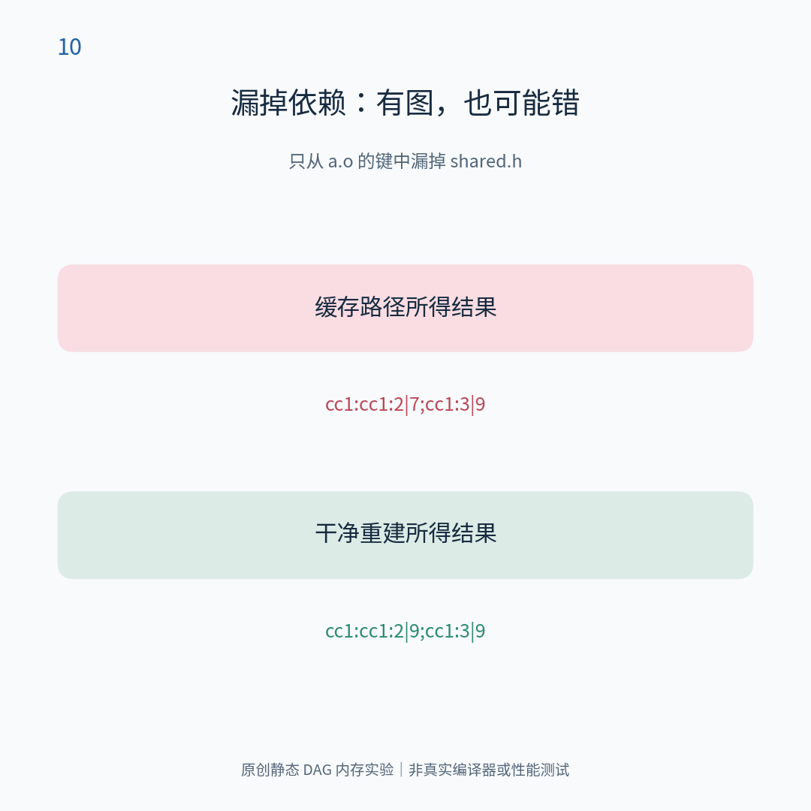


图10｜故意漏掉a.o对shared.h的键依赖，得到一半旧、一半新的混合产物；与干净重建不一致。


## 11｜反例二：环境变量不是空气


把join分隔符从分号换成斜杠，却故意设置track_env=False。键没有变化，缓存里旧的分号结果便被取出；干净重建得到斜杠结果。

实际工程未必用这个分隔符，但区域设置、路径、随机种子、时区、时间、网络响应都可能进入计算。若动作偷偷读系统时钟，即使你记录了全部文件摘要，也未必可复现。

密闭构建的方向是控制可见输入，让工具与依赖版本也成为受管理的材料。这里的环境只有一个显式字符串；没有在模型外偷读进程环境。故障选项只是让它不进键，用来说明为什么会错。


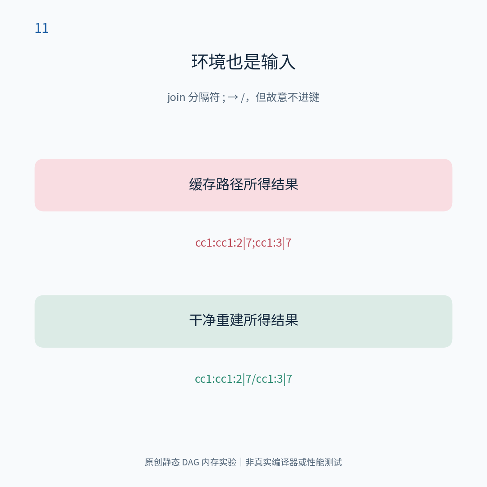


图11｜分隔符改变却不进入键，旧缓存结果仍使用分号；干净重建使用斜杠。


## 12｜反例三：换了工具，旧缓存还说“认识你”


把工具标识cc1改成cc2，却不跟踪它，旧cc1产物仍会命中；干净重建的每层输出都以cc2开头。这是可见的确定性反例，不是实际编译器兼容性测试。

真实键常需要区分工具二进制、参数、库、目标平台及相关运行环境。单写一个“版本号”未必足够。另一方面，不相关的机器信息全部塞进键，也可能让本可共享的结果无法命中。目标不是键越大越好，而是忠实覆盖语义输入。

缓存命中说明“键相同且有记录”，不是来源可信、产物安全或软件正确的证明。缓存写入权限、来源验证与供应链安全仍是另一层责任。


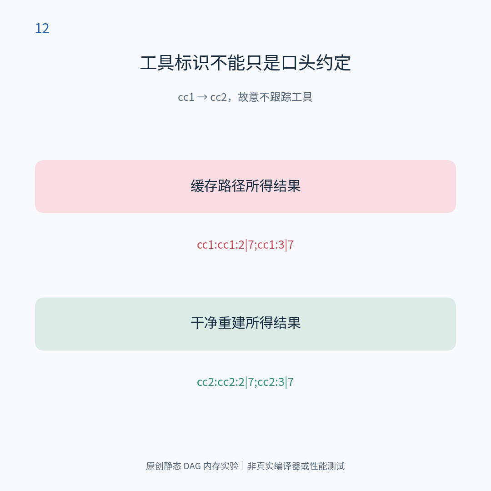


图12｜工具标识改变却不进入键，旧cc1结果被错误复用；干净重建产生cc2结果。


## 13｜摘要对得上，也要知道它证明了什么


本模型从CAS读出字节时再次计算摘要。若对象缺失或字节被改坏，抛出错误，不把它算作成功。真实系统也可以把缺失对象当未命中重算；这里选择报错，便于观察。

但如果攻击者能同时改动作映射和对象，他仍可能提供一份摘要自洽、语义错误的结果。再哈希只能核对字节身份，不能证明这些字节确实由正确动作生成。模型把缓存元数据当可信，不实现认证或隔离。

缓存键、输出摘要、独立干净重建比较，是三种不同证据，不能彼此替代。


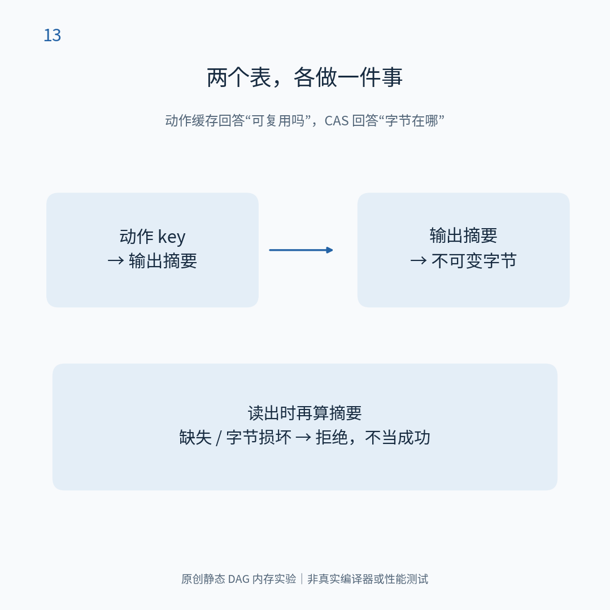


图13｜动作缓存存key到输出摘要，CAS存摘要到字节；模型读回时校验字节摘要，不接受损坏对象。


## 14｜循环与失败：先把契约说清楚


我们的静态图不允许循环。构建前先对**全图**做三色DFS：正在访问的节点又被遇到，就是循环；检查完成的节点可以直接跳过。即使循环不在本次目标可达范围内，也拒绝，且在这项图验证通过前不写缓存。

这是刻意选择的严格教学契约。它不代表所有真实构建系统都如此，也不支持需要不动点求解的循环计算或执行中发现的新依赖。

整次构建不是事务：图验证后，若后续动作因输出过大等原因失败，较早的合法缓存项可能已经留下。不能把“循环拒绝前不写缓存”夸大成“任何失败都回滚所有状态”。


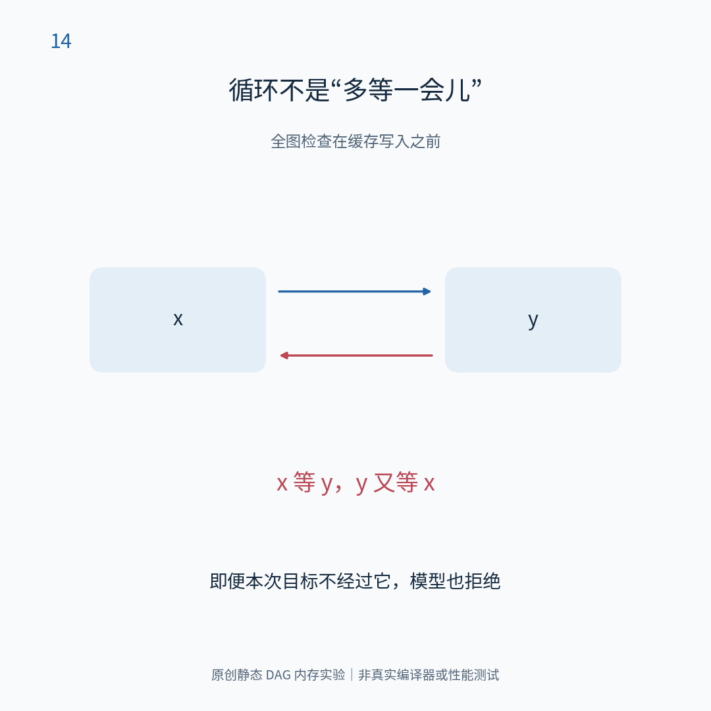


图14｜静态循环在任何缓存写入前被拒绝；这是一条模型契约，不是所有真实构建系统的统一规定。


## 15｜少算与并行，别混成一张成绩单


假设两个独立动作耗时4、6，后续链接耗时2。串行相加是12；资源无限且没有额外成本的理想并行，让前两者同时开始，关键路径是max(4,6)+2=8。

这些是说明调度的假设数字，不是本代码的测量。我们的实现始终串行。即使全部命中，真实系统仍有查找、下载等开销；即使全都要重建，也可能因为并行而更快。要解释某次加速，先问减少了工作量，还是重排了工作次序。

三色图遍历在通常字典访问假设下是O(V+E)；代码还先排序节点名称，所以另有O(V log V)次名称比较（按定长名称计）。之后只求本目标的可达子图，每个动作至多处理一次，但还要支付输入摘要、JSON编码与输出处理的字节成本。反复对被多个动作读取的大输入求摘要会重复扫描；这里没有文件摘要缓存。动作输出可增长，不能只按节点数称总时间线性。完整trace与历史缓存占用也随记录及内容累计增长。


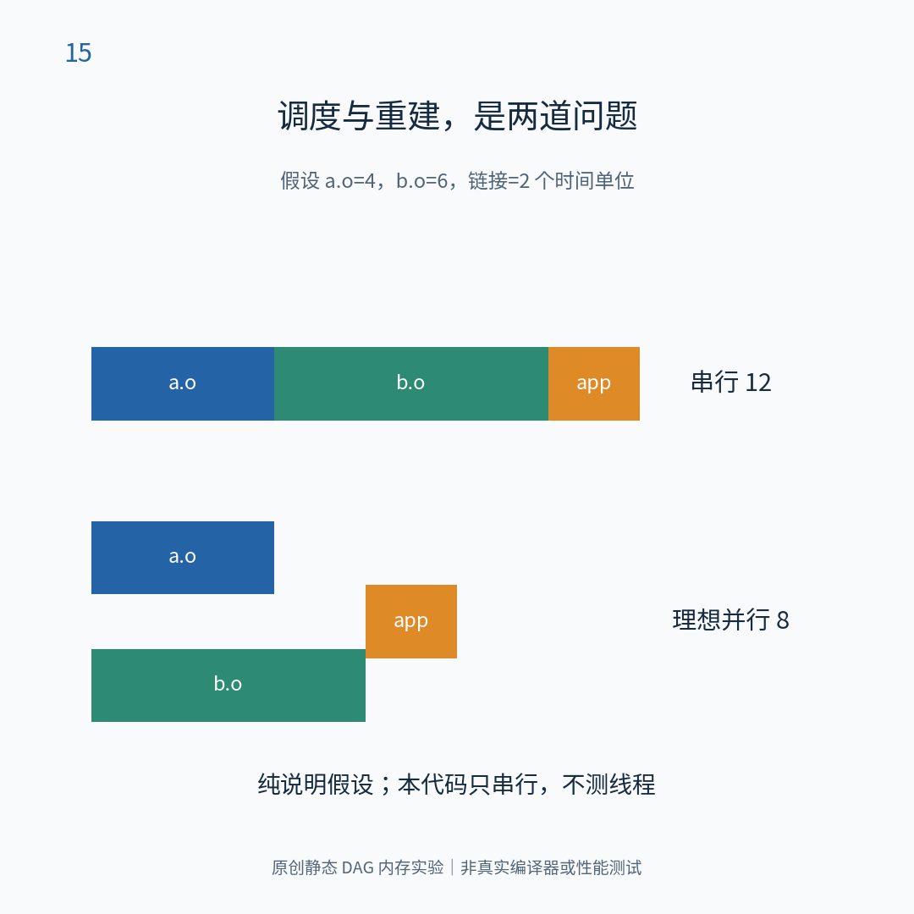


图15｜假设两个独立任务耗时4和6、后续链接2，串行12、理想并行8；这些是说明数字，不是实测。


## 16｜怎样检查“跳过以后仍然对”？


作者把同一目标分别交给有历史缓存的模型和一个无缓存的独立解释器。250个随机小DAG，每个连续16轮变更，计4000次构建；比较全部已求值节点的字节，不只比较一个运行次数。另外穷尽3种输入值的五轮序列，共1215次构建；还有循环在缓存变更前拒绝、4类坏图拒绝和CAS字节损坏拒绝。

这些是有限测试，不是对任意程序的证明。自带操作只有clean与join；源必须是较小的UTF-8 bytes；图至多150个名字、每动作1–8个有序输入、单个新输出不超过100万字节。内部缓存键与内容是本模型自己生成的数据，外部任意恶意Python对象不在接口承诺中。SHA-256碰撞、并发编辑、文件权限、目录、符号链接、动态依赖、网络缓存与真实编译器都没有被模拟。

读完后可以自己做三次实验：删掉错误选项，确认混合新旧结果消失；只改注释，观察下游命中；换目标为a.o，观察只求可达任务，但仍验证全图。比起背一句“构建就是DAG”，能解释一次具体命中为什么可靠，更接近这个工具真正做的工作。


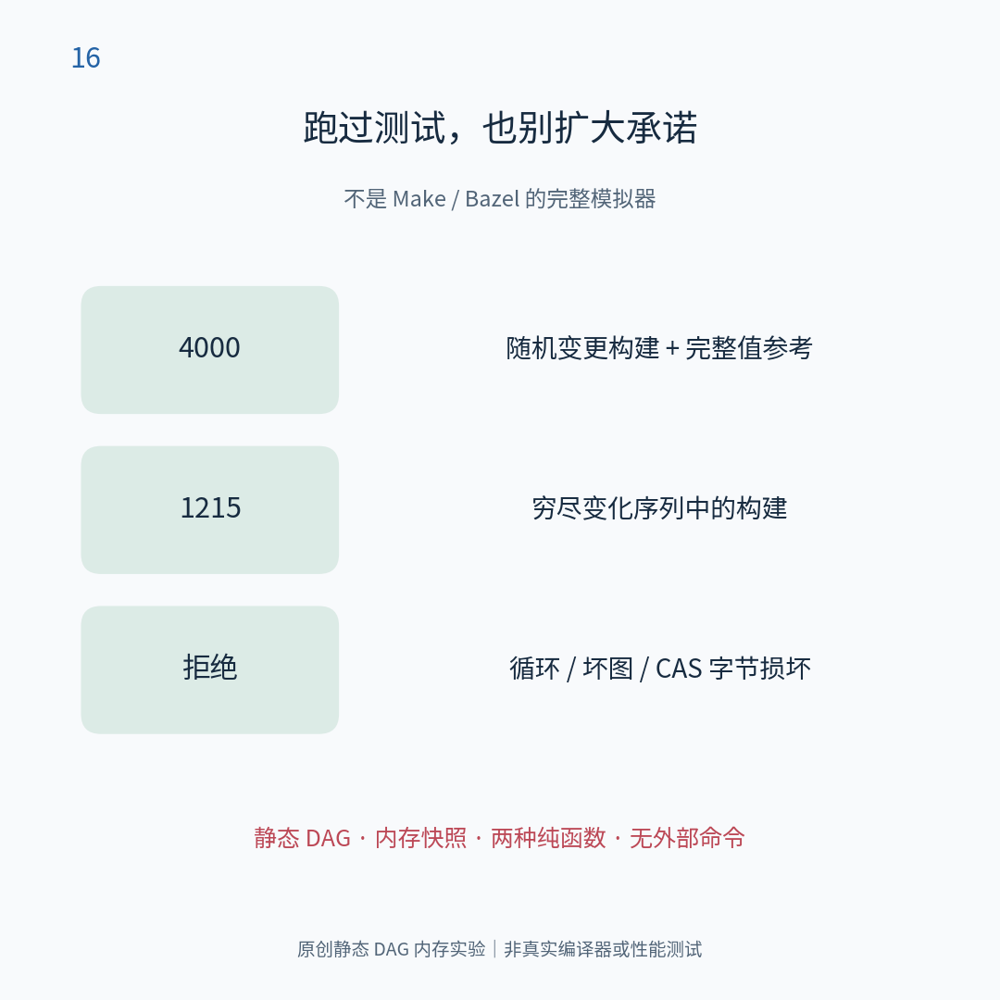


图16｜作者自测包含4000次随机变更构建与1215次穷尽序列构建，并覆盖循环和损坏缓存拒绝；不等于生产正确性证明。


## 短读版｜“没重新执行”不等于“没检查”

增量构建不是简单地发现文件存在就跳过。它要知道每个动作读取了什么、怎样计算，并确认这些有效输入没有改变。

本文三动作内存实验连续六轮执行次数是3、0、1、2、3、0。改注释会让上游重算，却因输出内容相同而停止向下游传播；恢复曾经出现的输入组合，还能命中历史缓存。相反，漏掉头文件、环境或工具身份，就会快而错误。

时间戳是一种便宜的变化证据，内容摘要是另一种；摘要不能补救未声明的输入，也不能证明缓存来源可靠。依赖图负责先后，缓存策略负责是否执行，并行又是另一道问题。

全文附标准库模型与可复现实验说明。它不执行外部命令，不修改真实工程，不声称复原Make/Bazel或验证生产远程缓存。

## 完整可运行核心代码

保存为build_lab.py，使用Python 3.10+标准库运行。末尾会打印冷/热/注释/数值四轮；图中另外两轮与错误选项可按正文在同一Builder上复现。

```python
"""In-memory, sequential, static-DAG teaching model; never runs a shell."""
from dataclasses import dataclass
import hashlib
import json


def digest(data):
    return hashlib.sha256(data).hexdigest()


def encode(value):
    return json.dumps(value, ensure_ascii=False, separators=(',', ':')).encode()


@dataclass(frozen=True)
class Action:
    reads: tuple
    op: str


def evaluate(action, inputs, tool, separator):
    # Only these two fixed, pure operations exist. No callbacks or filesystem.
    if action.op == 'clean':
        pieces = [b.decode().split('#', 1)[0].strip() for b in inputs]
        return (tool + ':' + '|'.join(pieces)).encode()
    return (tool + ':' + separator.join(b.decode() for b in inputs)).encode()


class Builder:
    def __init__(self):
        self.action_cache = {}  # action key -> output content hash
        self.cas = {}           # output content hash -> bytes

    def build(self, sources, rules, target, tool='cc1', separator=';',
              omit=(), track_tool=True, track_env=True):
        """omit/track_* are explicitly UNSOUND experiments, not safe settings."""
        if type(sources) is not dict or type(rules) is not dict:
            raise ValueError('dicts required')
        if any(type(k) is not str or not k for k in sources | rules):
            raise ValueError('nonempty names required')
        if set(sources) & set(rules) or len(sources) + len(rules) > 150:
            raise ValueError('overlap or model size limit')
        if any(type(v) is not bytes or len(v) > 10000 for v in sources.values()):
            raise ValueError('small bytes sources required')
        if type(tool) is not str or type(separator) is not str:
            raise ValueError('string configuration required')
        if type(track_tool) is not bool or type(track_env) is not bool:
            raise ValueError('bool tracking flags required')
        names = set(sources) | set(rules)
        if type(target) is not str or target not in names:
            raise ValueError('unknown target')
        for rule in rules.values():
            if (type(rule) is not Action or type(rule.reads) is not tuple
                or rule.op not in ('clean', 'join') or not 1 <= len(rule.reads) <= 8
                or any(type(d) is not str or d not in names for d in rule.reads)):
                raise ValueError('invalid action/dependency')
        if type(omit) is not tuple or any(type(x) is not tuple or len(x) != 2
            or x[0] not in rules or x[1] not in rules[x[0]].reads for x in omit):
            raise ValueError('invalid omission')
        for data in sources.values():
            data.decode('utf-8')
        # Validate the WHOLE static graph before mutating caches.
        color, order = {}, []
        def visit(name):
            if color.get(name) == 1:
                raise ValueError('cycle')
            if color.get(name) == 2:
                return
            color[name] = 1
            if name in rules:
                for dep in rules[name].reads:
                    visit(dep)
            color[name] = 2
            order.append(name)
        for name in sorted(names):
            visit(name)
        # Immutable snapshot; mutation during a real build is outside this model.
        source_copy = dict(sources)
        values, events = {}, []
        def obtain(name):
            if name in values:
                return values[name]
            if name in source_copy:
                values[name] = source_copy[name]
                return values[name]
            rule = rules[name]
            inputs = [obtain(dep) for dep in rule.reads]
            key = digest(encode(['model-v1', name, rule.op,
                [[dep, digest(b)] for dep, b in zip(rule.reads, inputs)
                 if (name, dep) not in omit],
                tool if track_tool else None,
                separator if track_env else None]))
            hit = key in self.action_cache
            if hit:
                out_hash = self.action_cache[key]
                if out_hash not in self.cas or digest(self.cas[out_hash]) != out_hash:
                    raise ValueError('missing/corrupt CAS object')
                output = self.cas[out_hash]
            else:
                output = evaluate(rule, inputs, tool, separator)
                if len(output) > 1000000:
                    raise ValueError('model output limit')
                out_hash = digest(output)
                self.cas[out_hash] = output
                self.action_cache[key] = out_hash
            values[name] = output
            events.append(dict(name=name, hit=hit, key=key,
                               output_hash=out_hash, output=output.decode()))
            return output
        output = obtain(target)
        return dict(output=output, values=values, events=events)


def needs_timestamp_rebuild(output_time, input_times):
    """Only the ordinary timestamp test, not a complete GNU Make emulator."""
    return output_time is None or any(t > output_time for t in input_times)


def example():
    return ({'a.src': b'2 # first', 'b.src': b'3', 'shared.h': b'7'},
            {'a.o': Action(('a.src', 'shared.h'), 'clean'),
             'b.o': Action(('b.src', 'shared.h'), 'clean'),
             'app': Action(('a.o', 'b.o'), 'join')})


if __name__ == '__main__':
    src, rules = example()
    b = Builder()
    for label, edit in [('cold', None), ('warm', None),
                        ('comment', ('a.src', b'2 # new comment')),
                        ('value', ('a.src', b'8'))]:
        if edit:
            src[edit[0]] = edit[1]
        r = b.build(src, rules, 'app')
        print(label, [(e['name'], 'hit' if e['hit'] else 'run')
                      for e in r['events']], r['output'])
```

## 完整实验与作者自测代码

把下段保存为同目录下checks/experiments.py，运行python checks/experiments.py。它只在这份自建实验包的checks目录写experiments.json，不触碰工程。该测试是作者自校，不冒称独立验收。

```python
from pathlib import Path
import sys,json,random,copy,itertools
sys.path.insert(0,str(Path(__file__).resolve().parents[1]))
from build_lab import *

def brief(r):
 return dict(output=r['output'].decode(),events=r['events'],runs=sum(not e['hit'] for e in r['events']))
def run():
 src,rules=example();b=Builder();seq=[]
 for label,edit in [('cold',None),('warm',None),('comment',('a.src',b'2 # changed')),('value',('a.src',b'8')),('header',('shared.h',b'9')),('rollback',('shared.h',b'7'))]:
  if edit:src[edit[0]]=edit[1]
  seq.append(dict(label=label,**brief(b.build(src,rules,'app'))))
 cases={}
 for what,kw in [('dependency',dict(omit=(('a.o','shared.h'),))),('environment',dict(track_env=False)),('tool',dict(track_tool=False))]:
  s,r=example();cache=Builder();cache.build(s,r,'app',**kw)
  args={}
  if what=='dependency':s['shared.h']=b'9'
  if what=='environment':args['separator']='/'
  if what=='tool':args['tool']='cc2'
  old=cache.build(s,r,'app',**args,**kw);fresh=Builder().build(s,r,'app',**args)
  assert old['output']!=fresh['output']
  cases[what]={'cached':brief(old),'fresh':brief(fresh)}
 rng=random.Random(20261023);comparisons=0
 def oracle(s,r,n,tool,sep):
  # Uncached, explicit interpreter independent of evaluate().
  if n in s:return s[n]
  a=r[n];parts=[oracle(s,r,x,tool,sep).decode() for x in a.reads]
  if a.op=='clean':parts=[x.partition('#')[0].strip() for x in parts];sep='|'
  return (tool+':'+sep.join(parts)).encode()
 for trial in range(250):
  sources={f's{i}':str(rng.randrange(20)).encode() for i in range(3)};rs={}
  for j in range(rng.randint(1,7)):
   names=list(sources)+list(rs);rs[f't{j}']=Action(tuple(rng.sample(names,min(len(names),rng.randint(1,3)))),rng.choice(['clean','join']))
  target=list(rs)[-1];cache=Builder()
  for step in range(16):
   k=rng.choice(list(sources));sources[k]=(str(rng.randrange(20))+rng.choice(['',' # note'])).encode();tool=rng.choice(['cc1','cc2']);sep=rng.choice([';','/'])
   r=cache.build(sources,rs,target,tool,sep)
   assert r['output']==oracle(sources,rs,target,tool,sep)
   for name,value in r['values'].items():assert value==oracle(sources,rs,name,tool,sep)
   warm=cache.build(sources,rs,target,tool,sep);assert all(e['hit'] for e in warm['events'])
   comparisons+=1
 # A tiny exhaustive change sequence exercises version return/reuse.
 exhaustive=0
 for change in itertools.product(range(3),repeat=5):
  s,r=example();cache=Builder()
  for v in change:
   s['a.src']=str(v).encode();got=cache.build(s,r,'app');assert got['output']==oracle(s,r,'app','cc1',';');exhaustive+=1
 s,r=example();c=Builder();c.build(s,r,'app');snapshot=copy.deepcopy((c.action_cache,c.cas));r['x']=Action(('x',),'clean')
 try:c.build(s,r,'app');raise AssertionError('cycle accepted')
 except ValueError:pass
 assert snapshot==(c.action_cache,c.cas)
 bad=[({}, {},'x'),({'x':b'1'},{'x':Action(('x',),'clean')},'x'),({'x':b'1'},{'y':Action(('z',),'clean')},'y'),({'x':b'1'},{'y':Action(('x',),'bad')},'y')]
 for a in bad:
  try:Builder().build(*a);raise AssertionError('invalid accepted')
  except ValueError:pass
 s,r=example();c=Builder();c.build(s,r,'app');first=next(iter(c.cas));c.cas[first]=b'corrupted'
 try:c.build(s,r,'app');raise AssertionError('tamper accepted')
 except ValueError:pass
 return dict(sequence=seq,failures=cases,tests={'random_builds':comparisons,'exhaustive_builds':exhaustive,'cycle_reject_before_mutation':True,'invalid_graphs':4,'tamper_reject':True},timestamp={'touch':needs_timestamp_rebuild(10,[11]),'same_mtime_changed_bytes':needs_timestamp_rebuild(10,[10])})
if __name__=='__main__':
 out=run();Path(__file__).with_name('experiments.json').write_text(json.dumps(out,ensure_ascii=False,indent=2));print(out['tests']);print([(x['label'],x['runs']) for x in out['sequence']])
```


## 来源与素材权利

参见[来源、素材权利与 AI 辅助说明](sources.md)。
