# 迭代加深搜索：为什么宁愿重走几遍，也不把路全记下来？

假设你正在调试一个小解谜游戏。角色每一步可以尝试几个动作，你想找到一条到出口的路线，而且最好步数最少。

最直观的办法是：先列出一步能到的地方，再列出两步能到的地方，依次往外找。可问题还没解出来，等着探索的位置就已经堆满了内存。

另一种办法是沿着一条路一直试，走不通再退回来。这回不需要留下一整片待探索区域，但你可能在左边绕了很久，错过右边几步就能到的出口。

迭代加深搜索提出了一个看起来有些笨的安排：先只许走零步，再从头试一遍只许走一步，然后两步、三步……每轮都重来。它用重新计算，换掉一部分需要长期保存的信息。我们要弄明白的是：这笔交换什么时候划算，什么时候会明显吃亏。

## 1. 先把“深度”说清楚

我们不用复杂地图，先用七个字母表示七个位置。S 是起点，G 是目标。箭头是允许走的方向；同一节点有多个后继时，先试图上左边的那个。

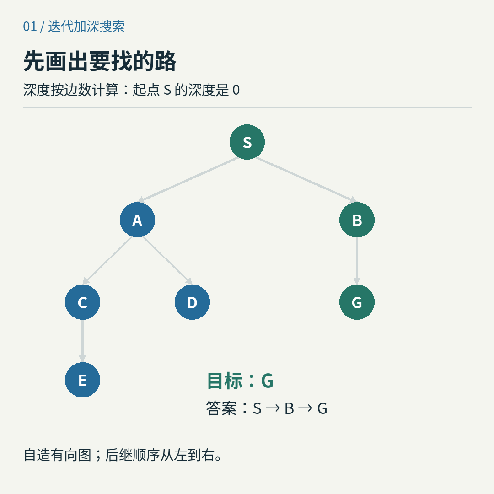

图1：贯穿全文的自造有向树，绿色是两步到目标 G 的路线。E 比 G 更深，但左侧的深搜会先去 E。

从 S 到 S 没走任何边，所以 S 的深度是 0。S→A 深度为 1，S→A→C 深度为 2。要数的是边，不是沿途字母个数。

这个区别会直接影响程序。路径 S、B、G 有三个节点，却只有两步。我们把每一条边的代价暂时都看成一样：每走一步花一个单位。后面再拆掉这个假设，看看哪些结论随之失效。

## 2. 广度优先为什么容易占内存？

广度优先搜索，简称 BFS，使用一个先进先出的队列。取出 S，把 A、B 加入队尾。取出 A，把 C、D 加入队尾。取出 B，再把 G 加进去。

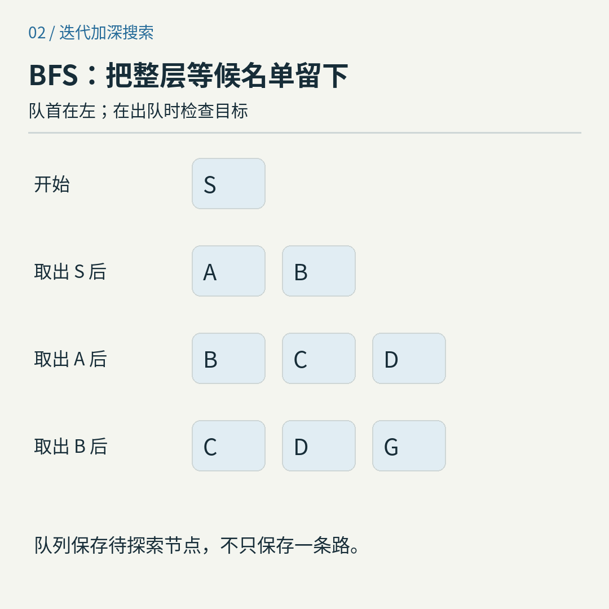

图2：BFS 的四个真实队列快照。G 入队后还排在 C、D 后面；不是所有快照都恰好是一整层。

队列的意义是“这些节点以后还得处理”。它不能只记住当前走过的那条路：A 和 B 都是第一层的候选，A 的后继和 B 的后继也都可能有用。

因为先入队的浅层节点会先被取出，BFS 不会在检查两步能到的全部候选之前，先去检查三步的候选。只要每步代价相同，最早找到的解就有最少步数。

但是，想象每个位置都有十种互不合并的后续选择。第一层有 10 个节点，第二层有 100 个，第六层就有 1,000,000 个。这还只是等候名单的规模，不包括路径恢复、状态对象、容器等额外开销。分叉多起来，记住“所有以后要试的地方”会很昂贵。

这里说的是展开后的搜索树。真实图中两条路线可能汇合到同一个状态，BFS 的去重可以大幅减少工作，不能机械地把十叉树的数字套到每张地图上。

## 3. 深度优先省了什么，又丢了什么？

深度优先搜索，简称 DFS，会先沿一条路向下走。在我们的例子里，它先走 S→A→C→E，走到尽头后退回 C，再退回 A，试另一边的 D，之后才轮到 B 和 G。

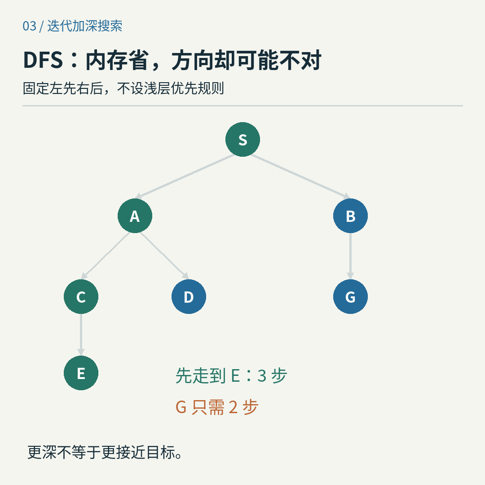

图3：无深度限制的左优先 DFS 会先走 S、A、C、E；此例最后仍能找到 G，但并不按距离逐层寻找。

DFS 不必保存所有待探索的叶子，只要保留当前路径，以及每层走到哪个后继的记录，就能回退后继续。代价是：它把“先走某个方向”放在了“先找较短路线”前面。若左边有无穷长的分支，普通 DFS 甚至可能一直走不到右边。

那就加一个限制：本轮最多走 L 步。到达深度 L，不再继续向下。这个操作叫限深搜索。它解决了单轮无限下钻的问题，但又留下一个问题：L 该设多大？设小了可能看不到出口，设大了又可能花很多时间探索不必要的深层路线。

迭代加深的回答是：先不猜，一点点加。

## 4. 三轮就能手算完整个算法

第一轮 L=0，只看 S。它不是目标，后面仍有路，所以记为“被深度上限截住了”。

第二轮 L=1，重新从 S 出发，看 S、A、B。仍没有 G，但边界上还有未探索的延伸，下一轮值得继续。

第三轮 L=2，再从 S 开始。按左优先顺序进入 S、A、C、D、B、G。在 C 不能走向 E，因为已经用完两步；退回后仍会检查 D。最后从 B 走到 G，返回 S→B→G。

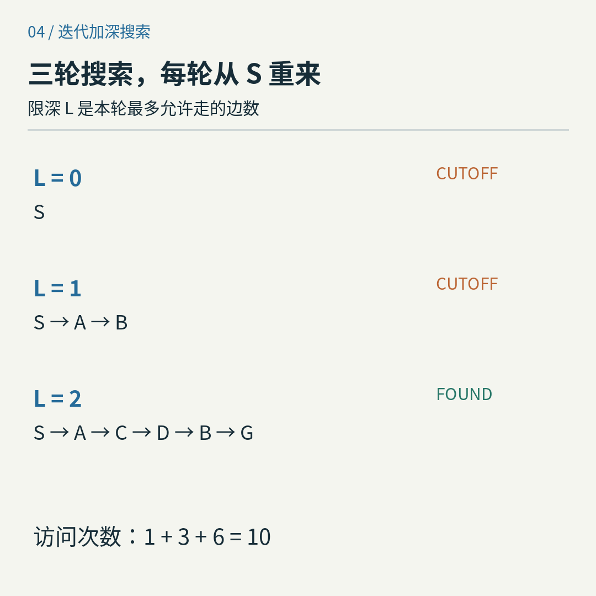

图4：代码中目标检查发生在每次进入节点时。此例三轮分别访问 1、3、6 次；箭头表示访问顺序，不表示相邻节点间一定有边。

这里容易产生一个误会：迭代加深不是在同一轮里按层访问。第三轮刚看完 A，就会看更深的 C，然后才回到浅层的 B。它的浅层优先来自“先完整做过较小深度的轮次”，而不是来自单轮内部的访问顺序。

为什么第一次找到的解不会太长？假如它在深度 d 找到解，而存在一个更短的解，长度为 k<d，那么限深 k 那轮就应当已经找到一个解，与“直到 d 才找到”矛盾。这个论证需要每轮能完成：后继数量有限、生成和检查能结束，搜索对象在过程中不随意改变。下面的路径去重也不能错误剪掉可行解。

Poole 与 Mackworth 的作者教材把这个办法解释为重新计算前沿，并特别区分“深度截断”和“已经穷尽”的失败；那是实现时很有用的提醒。本文接下来用自造例子与代码把两种结果拆开。[作者教材：Iterative Deepening](https://artint.info/html1e/ArtInt_62.html)

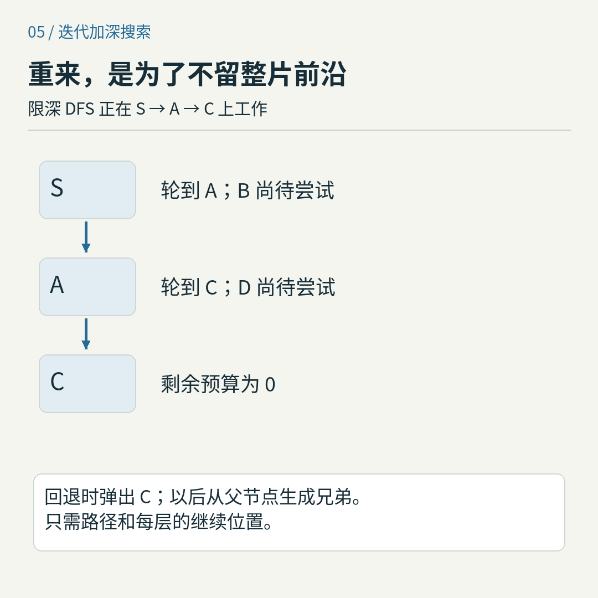

图5：深度上限为 2 时的一次递归栈示意。每层还要保留迭代位置；“只保存路径”不意味着没有控制信息。

## 5. 重走那么多次，为什么还可能划算？

先别讨论秒数，先数一件明确的事情：每进入一个节点，记一次访问。根节点也算；边界节点也算；同一节点在不同轮出现，分别计数。

另造一棵完整三叉树，每个非叶节点恰有三个孩子，最深到第 4 层。为了能准确算账，假设没有提前找到目标，每轮都走完。五层分别有 1、3、9、27、81 个节点。

只遍历一遍，访问数是：

1+3+9+27+81=121。

迭代加深从 L=0 做到 L=4，各轮的访问数分别是 1、4、13、40、121，总数为 179。多做了 58 次，并不是“有五轮，所以一定多做四倍”。

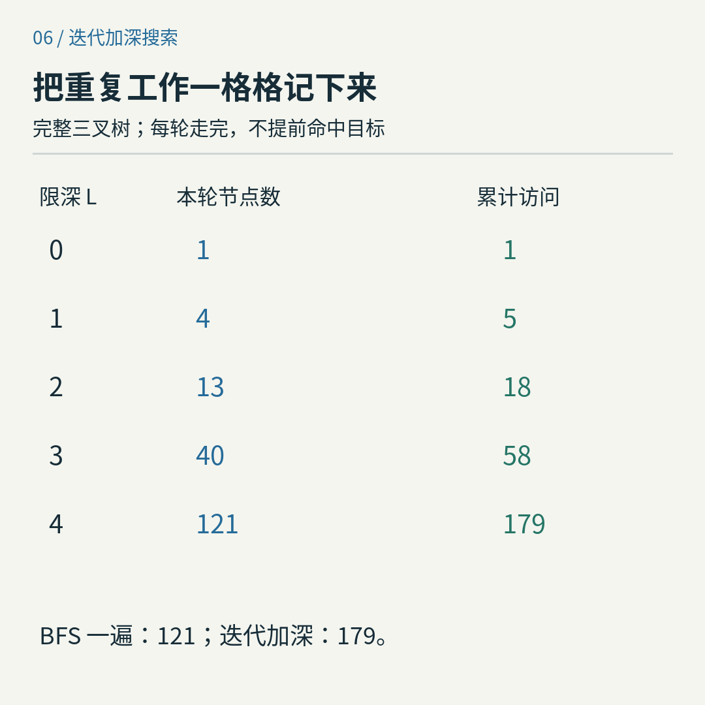

图6：含根的三叉树深度 4 账本。统计的是进入节点次数，不是耗时、边扫描次数或扩展次数。

把账按层重排，会更直观：根被访问五次，第一层的三个节点各四次，第二层各三次，第三层各两次，最深的 81 个节点各一次。

所以同一个 179，也可以写成：

5×1 + 4×3 + 3×9 + 2×27 + 1×81 = 179。

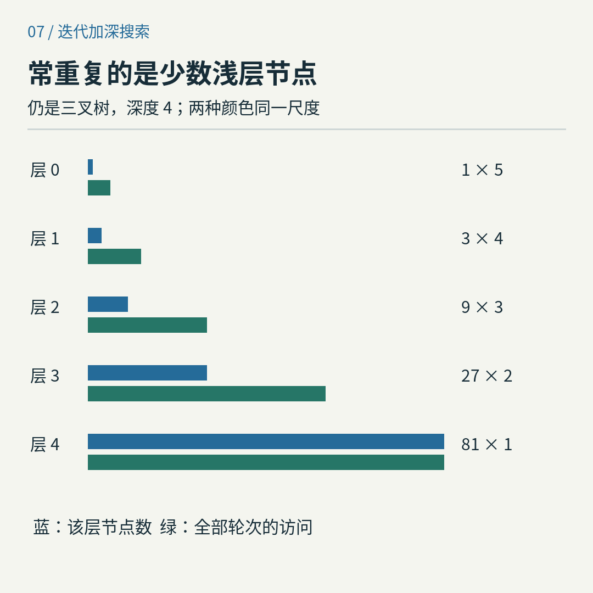

图7：深度 4 的 81 个叶子各访问一次；只有一个根，却访问五次。绿色条长度是节点数乘重访次数。

深层占了节点总数的大头，却没有被多次重复；浅层重复得多，节点却少。这是它能省内存又不至于把时间放大得太离谱的关键条件。

注意，这只是访问次数账本。若生成一个后继需要做昂贵的物理模拟，或每次到边界都要扫描很多边，运行时间会另有成本。我们的程序为了区分截断和穷尽，会查看边界节点的后继；这部分检查没有被伪装成图6的“额外访问”。

## 6. 不背大 O，也能推到一般情况

设完整树每个非叶节点有 b 个孩子，最大深度是 d。第 i 层有 b^i 个节点。把“一次完整遍历”的访问量记作 B：

B = Σ(i=0..d) b^i。

把“逐轮限深直到 d”的访问量记作 I：

I = Σ(i=0..d) (d−i+1)b^i。

这里的乘数不是神秘的修正项。第 i 层会在 L=i、i+1、……、d 这些轮次被访问，正好 d−i+1 次。

如果想算出不带求和号的式子，可以换一种记账：每轮访问数是 (b^(L+1)−1)/(b−1)，再把 L=0 到 d 的所有轮相加。只用等比数列求和，就得到：

B = (b^(d+1)−1)/(b−1)，

I = [b^(d+2)−(d+2)b+(d+1)]/(b−1)^2。

这两个式子要求 b≠1。对固定的 b>1，d 增大时，最高次的幂占主导，所以 I/B 趋向 b/(b−1)。二叉树趋向 2，三叉树趋向 1.5，十叉树趋向约 1.111。

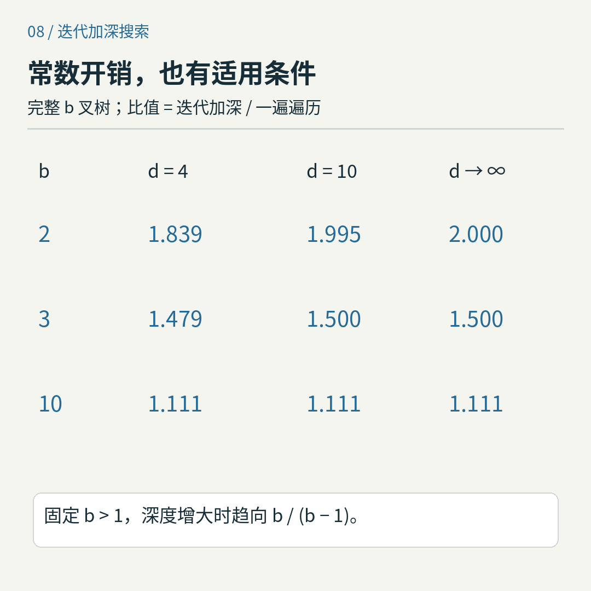

图8：数值由有限求和生成。常数因子比较的是完整遍历到同一深度的访问量，不是承诺所有实际图上的运行时间。

因此，在固定 b>1 的完整树模型里，B 和 I 都按 b^d 的量级增长，通常写成 O(b^d)。这句话只是说重复没有改变增长的阶，不是说重复免费，也不是说二者在任何机器上耗时一样。

真实搜索可能提前碰到目标；每层节点数也可能很不均匀。这时请重新数实际访问，而不是把 1.5 当作随身万能系数。

## 7. 只有一条走廊，反而是明显的反例

把三叉树变成一条链。此时 b=1，每层只有一个节点。

走到深度 d，一次遍历访问 d+1 个节点。迭代加深则需要：

1+2+……+(d+1) = (d+1)(d+2)/2。

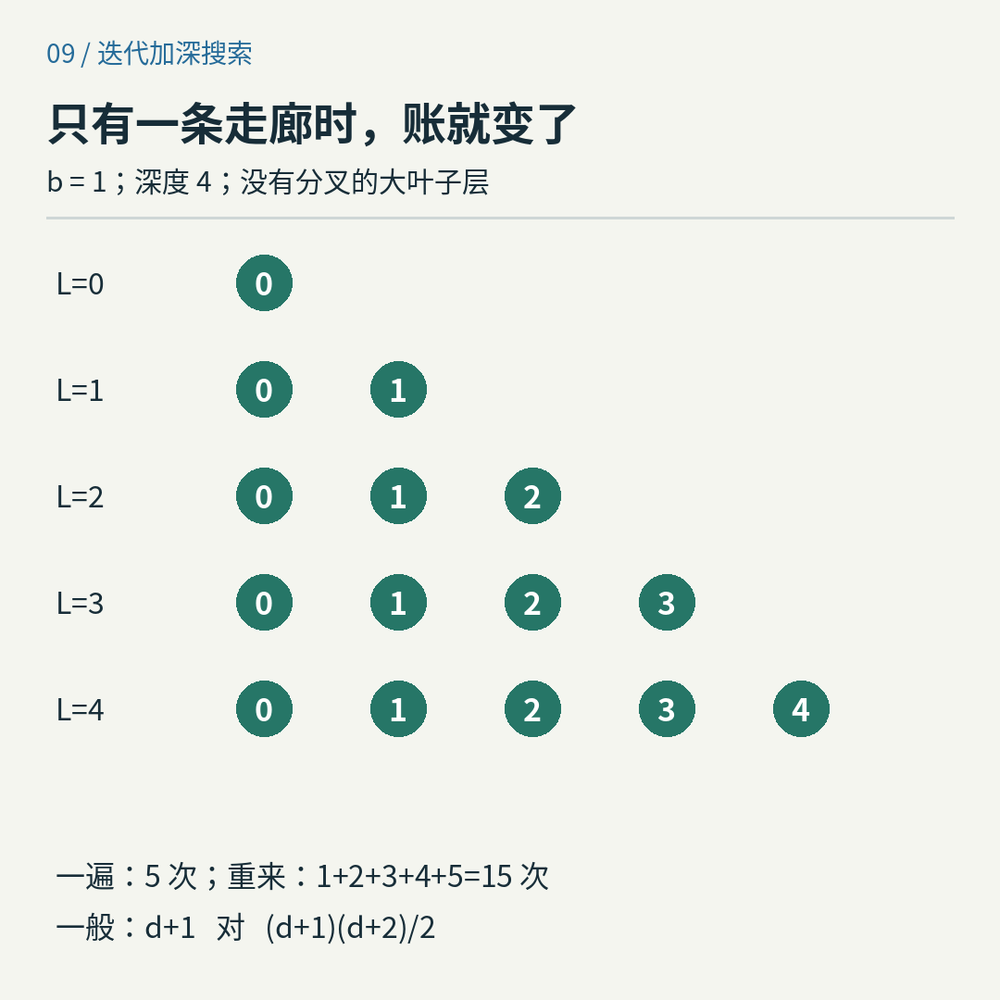

图9：每行是一次从头开始的链式遍历。链上的重复开销随深度增长，不再是与深度无关的常数。

这里最后一层只有一个节点，根本没有一个庞大的叶子层来“摊薄”浅层的重复。d=4 时是一遍 5 次、重复 15 次；d=100 时则是一遍 101 次、重复 5151 次，比例已经变成 51。

这也解释了为什么“只要内存少就选它”太粗糙。如果问题基本沿一条路前进，且可以知道合理的终止条件，反复从头走可能是很不划算的安排。

## 8. 最少步数和最低费用，是两个问题

回到前面的证明，它保证的是边数最少。若所有边都具有同一个正代价，最少边数自然等价于最低总费用。

可如果边权不同呢？造一个只有三个节点的反例：S 直接到 G，费用为 100；S 到 A 费用为 1，A 到 G 也为 1。

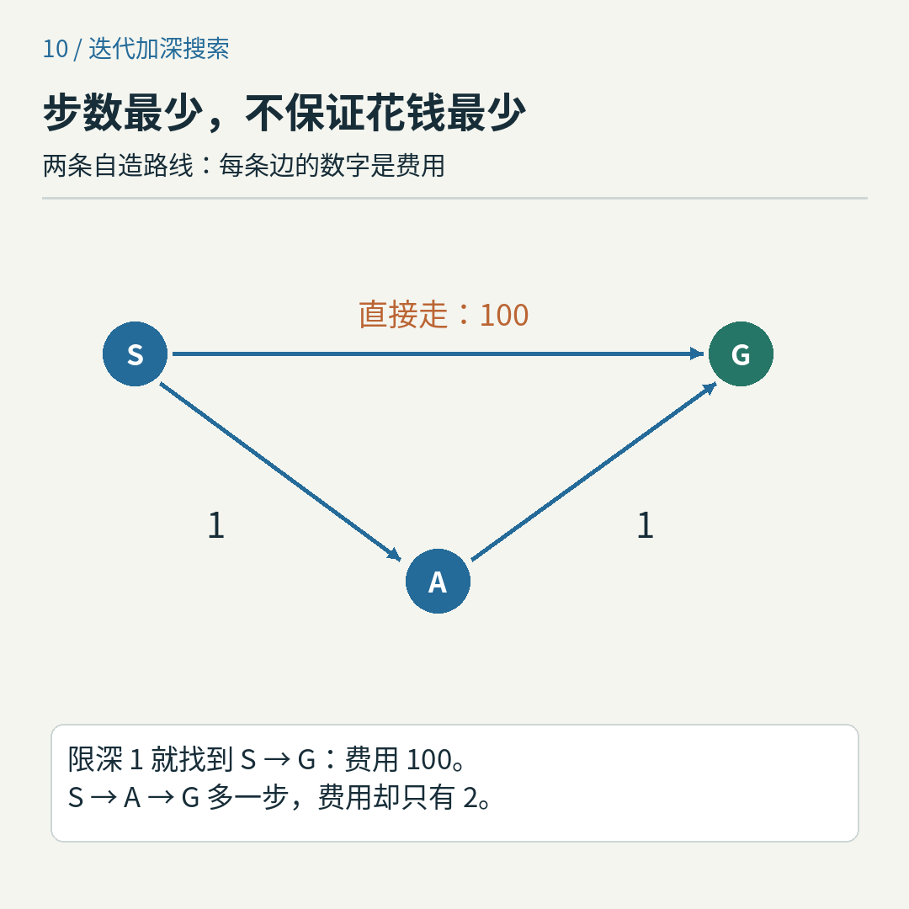

图10：加权反例。深度迭代先找到一条边的路线，不会等到两条边才比较总费用。

限深 1 那轮已经成功，因此普通迭代加深返回费用 100 的路线。但两步路线的费用只有 2。算法没有出错，它只是没有在优化你真正关心的量。

如果问题是非负边权下的最低费用，可以考虑按累计代价组织搜索的方法，而不是给深度搜索的结果贴上“最便宜”。另有名为 IDA* 的算法，把限制放到 g+h 这样的代价估计上；它不是把本文的深度变量改个名字，其保证还依赖代价与启发函数的条件。本文代码没有实现 IDA*。

## 9. 到了有环的图，如何避免绕圈？

游戏地图通常不是树。假设 A 能到 B，B 又能回 A。不做处理，搜索可以不断生成 S→A→B→A→B……即使单轮有上限，也会浪费大量预算。

本文用一个小集合 on_path，记录当前这条路径已经出现的节点。准备进入某个后继时，如果它已经在集合里，就不走这条边。回退时，再把离开的节点从集合移除。

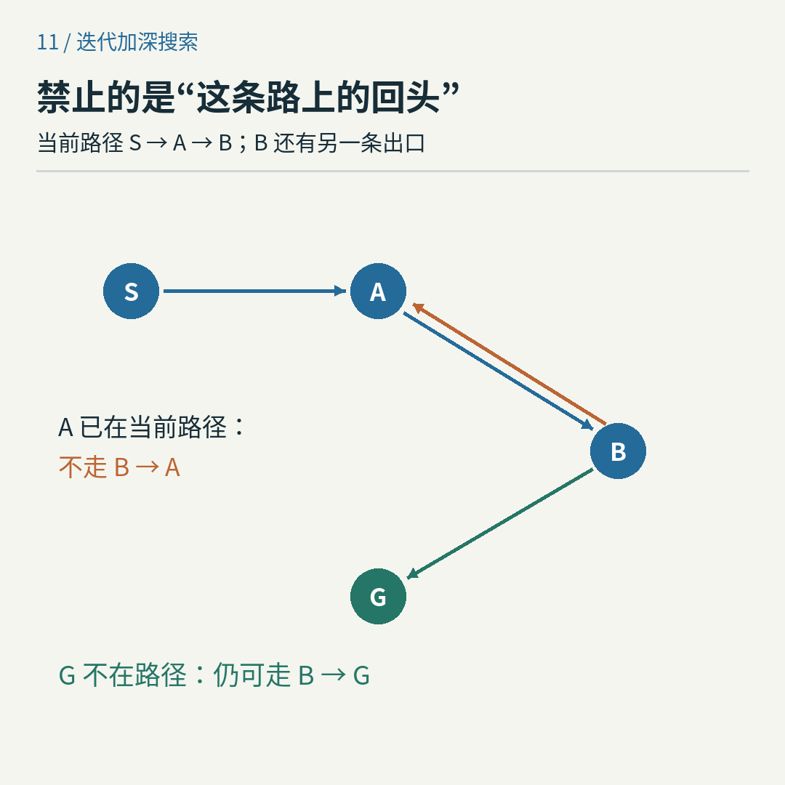

图11：当前路径集合阻止 A、B 间的循环，却不会阻止 B 通向 G。图中两条相反方向的斜边分别表示 A→B 与 B→A。

对于静态图上的目标可达性，绕一圈又回到同一个状态没有必要：可以删掉这个环，得到仍能到达同一目标的更短路线。所以只考虑没有重复节点的简单路径，不会漏掉最少步数的解。

前提是节点真的描述了完整状态。如果钥匙有没有拿、开关有没有打开会改变之后允许的动作，那“同一个房间但钥匙不同”必须算不同状态。只用房间编号去重，会误删真正必要的路线。别让算法替一个不完整的状态模型背锅。

## 10. 为什么不能直接搬来 BFS 的 visited？

BFS 在无权图上第一次到达某个状态时，已经用了最少步数。限深 DFS 没有这个性质。

看一个汇合图：S 的两个后继按顺序是 A、X；A 能到 X，X 能到 G。限深设为 2。

先走 S→A→X，到 X 时已经用完两步，不能再到 G。回到 S 后，第二条路线是 S→X。现在到 X 只花一步，还剩一步，恰好能到 G。

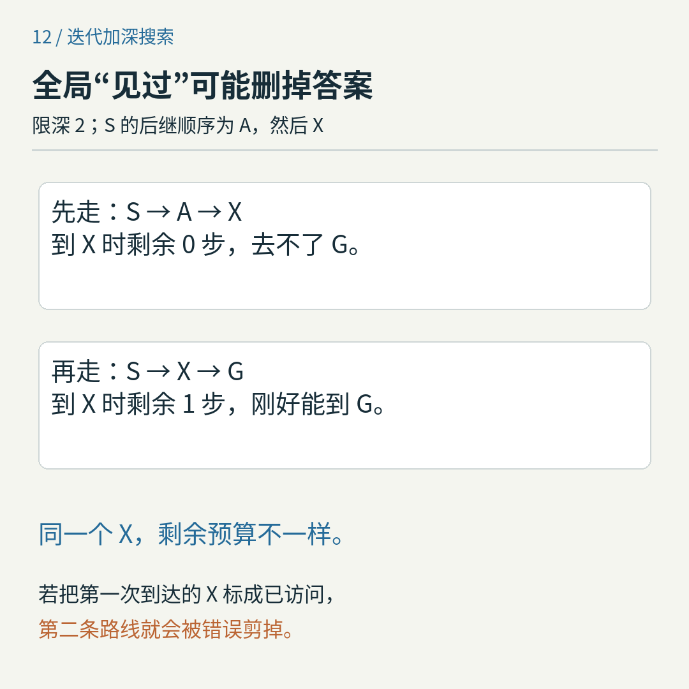

图12：自造汇合图的两条路径。这里指同一次限深搜索中的全局布尔 visited；不能从无权 BFS 生搬过来。

如果第一次看见 X 就永久标成“见过”，第二次到 X 会被跳过，正确答案反而找不到。即使每一轮都重置这个布尔表，轮内仍然会出问题。

更高级的剪枝可以记录到达深度、剩余预算或其他支配信息，但必须重新证明它的适用条件；路径约束、状态表示和缓存生命周期都要一起考虑。本文的教学实现不引入这套额外机制，只做当前路径防环，所以容易检查，却可能重复探索很多条汇合路径。

## 11. “没找到”不能只返回一个 False

一次限深搜索有三种结果。

FOUND：找到目标，同时返回路径。

CUTOFF：目前没有找到，但至少有一条还可能延伸的简单路径被深度限制截住了。增加上限可能有帮助。

FAILURE：在当前路径约束下，这个分支所有可走的简单延伸都已经穷尽，仍没有目标。

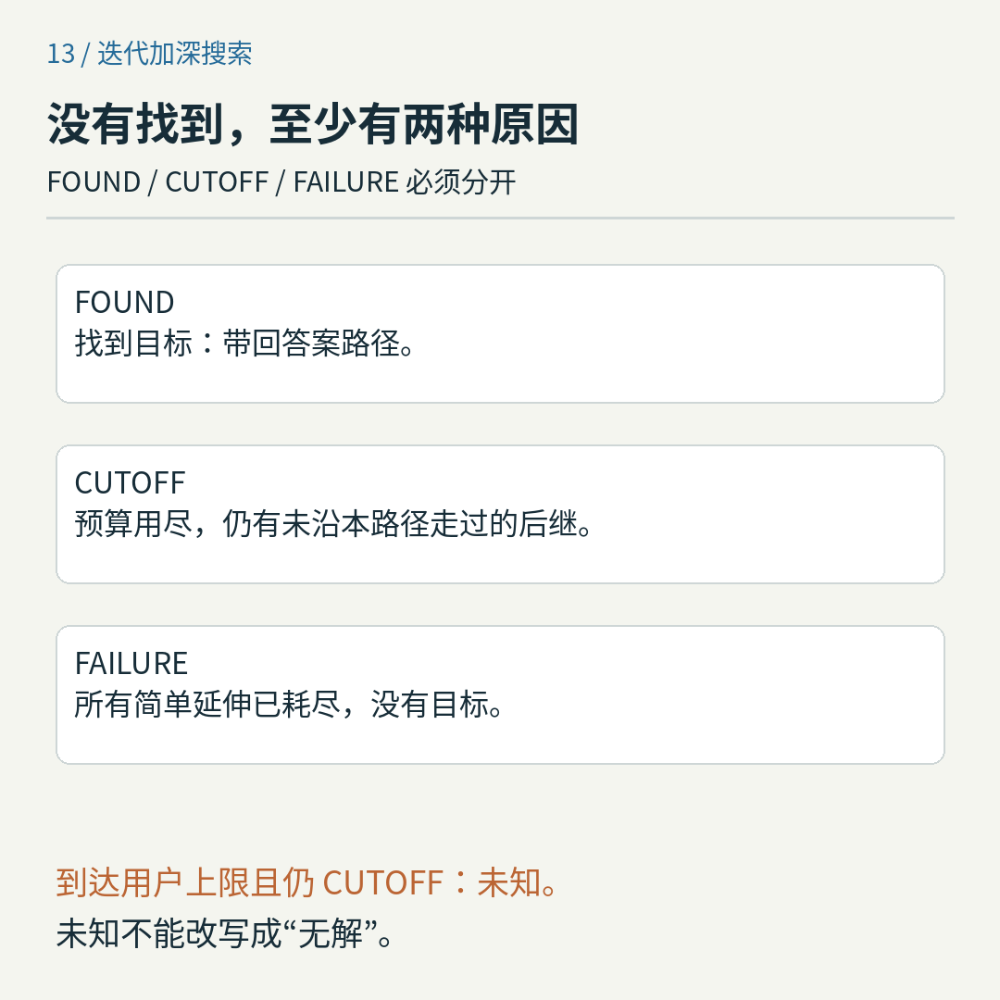

图13：边界节点如果已经是叶子或只有回到当前路径的边，可以返回 FAILURE；某个子分支 CUTOFF 会让父层继续保留未知。

一个细节值得停下来想：到了深度上限，不一定要返回 CUTOFF。如果这个节点根本没有后继，即使再多给十步也没用；如果所有后继都已经在当前路径上，继续走只是在绕圈。本文实现会检查这一点。

父节点合并子节点结果时，找到答案就立即向上返回；没有答案但至少一个分支被截断，就返回 CUTOFF；只有所有分支都穷尽，才返回 FAILURE。

从起点得到 FAILURE，才能说这张静态图中没有可达目标。如果只是到了我们人为设定的 max_depth，结果仍为 CUTOFF，那就只能说“在给定深度内没有找到”。在无限状态空间里，无解也不一定能在有限时间内被证明。

## 12. 原论文提醒的另一面：路径多，不等于节点多

Richard E. Korf 的 1985 年论文系统讨论了深度优先迭代加深，并明确把主要最优性分析放在树搜索条件下。论文开头还说明这个想法曾被多次独立发现，因此不宜把它写成某一天由一个人突然发明的故事。论文也讨论图上的重复路径风险。[Korf 原论文，尤其印刷页 97–102](https://cse.sc.edu/~mgv/csce580sp15/gradPres/korf_IDAStar_1985.pdf)；[作者出版目录](https://web.cs.ucla.edu/~korf/publications.html)

我们另造一个更容易数的例子：上下两个节点之间放一个菱形，从左或从右都能汇合。把这种结构串联 k 次，每个菱形增加三个节点，却使起终路线数翻倍。于是节点数是 3k+1，路径数却是 2^k。

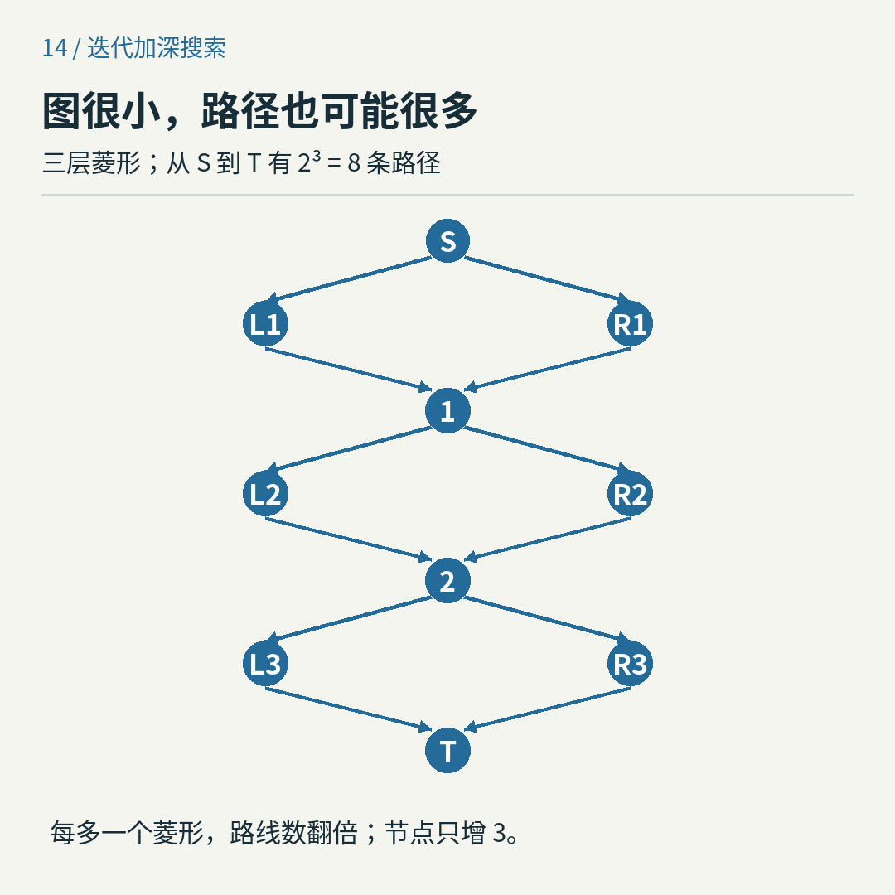

图14：由串联菱形自造的有向无环图，共 10 个节点、8 条起终路径；一般 k 个菱形有 3k+1 个节点和 2^k 条路径。

如果目标不可达，需要穷尽这些延伸，只有路径防环的 DFS 会沿很多不同路线重访汇合点。BFS 配合全局去重则能让每个状态只进入队列一次。因此，本文的完整 b 叉树常数开销分析，不是“迭代加深总能接近图上 BFS”的证明。

这里没有复制论文图，也没有把历史机器上的实验当成现代性能测试。图1至图16均为本文自行构造并程序绘制的教学图；三叉树计数、链和菱形例子可独立复算。

## 13. 空间复杂度里的 O(d) 和 O(bd)，谁对？

你可能在不同材料里见过两种写法。区别常常来自实现：如果每一层把所有 b 个孩子都生成并保留下来，最多 d 层同时在栈上，辅助空间常写成 O(bd)；如果孩子可以逐个生成，每层只保留一个常量大小的迭代状态，路径与控制栈可以是 O(d)。


图15：前沿与路径的结构规模对照。两个数字不是整个程序的精确内存占用，也不把已经存在的输入图从内存中变没。

下面的代码把图作为已经存在的字典传入，每层只是迭代现有邻接表，不复制全部孩子；另存当前路径和集合。在节点大小视为常量、集合操作按常见均摊假设计时的模型下，它的搜索辅助空间随路径深度线性增长。成功时复制一次答案路径也仍是线性的。

但输入图本身仍占 O(V+E) 空间，V 是节点数，E 是边数。如果你先把巨大状态空间完整建成字典，当然没有获得“无需存图”的好处。实际隐式搜索通常按需生成后继。这个教学版本采用显式小图，是为了让例子和测试透明。

Python 递归还有解释器栈深度限制，不能拿这段代码直接跑非常深的路径。工程实现可以改成显式栈，还需要超时、取消和资源预算；本文不会通过无限抬高递归上限来掩盖这个问题。

## 14. 一份能直接运行的小实验

把下方完整代码保存为 iterative_search_lab.py，用 Python 3.10 或更新版本运行。它只用标准库，不需要安装依赖。

程序会打印 S→B→G，以及三轮记录：(0, CUTOFF, 1)、(1, CUTOFF, 3)、(2, FOUND, 6)。最后一个数是进入节点的次数。

测试不仅包括一个成功例子：还检查根就是目标、自环无解、上限不足、轮内全局去重陷阱，并枚举四个节点上所有 4096 张无自环有向图，把 16384 个起终问题与独立的 BFS 参考函数比较。穷举小图不能证明任意程序都正确，但能把很多边界错误变成实际会失败的例子。

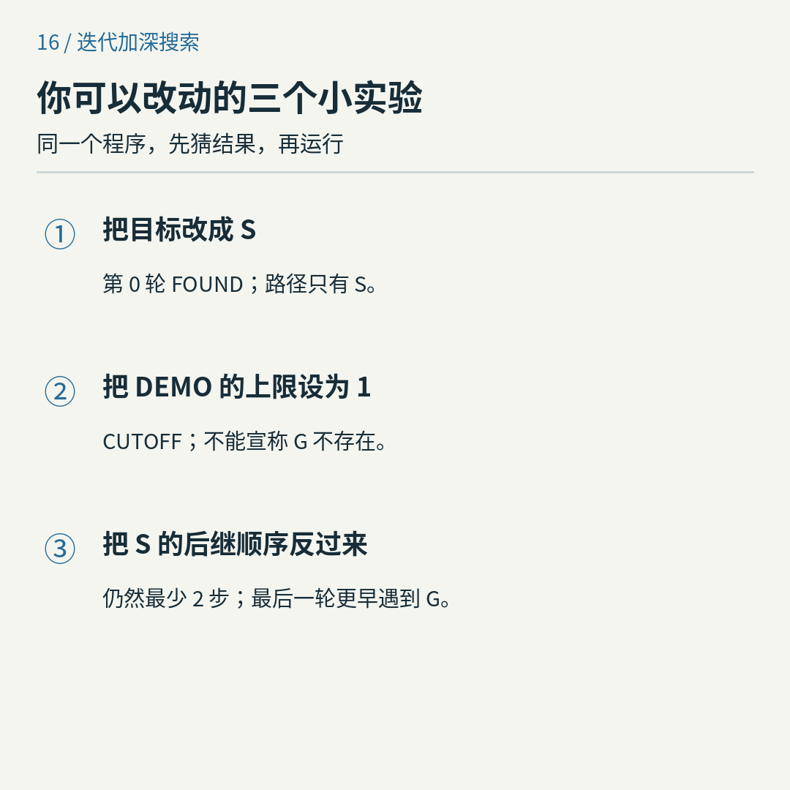

图16：可运行练习及预期结果。后继顺序可改变同深度的搜索工作量，但不会让迭代加深跳过更浅的解。

再做一道不用运行的练习：把三叉树改成二叉树，仍遍历到深度 4。单次访问是 1+2+4+8+16=31；逐轮是 1+3+7+15+31=57。57/31 约为 1.839，还没有到深度趋于无穷时的 2。

如果你已经能说明“为什么三叉树重复得起，单链重复不起”，又能区分 CUTOFF 和 FAILURE，就理解了这个算法最重要的部分。它不是拒绝记忆，而是有选择地忘记：宁可再算一次少量浅层节点，也不把指数增长的整片前沿一直留在内存里。

### 阅读入口与范围

- Poole、Mackworth 的作者教材，3.7.3 Iterative Deepening：本次读取完整该节，使用其算法定义与三态实现提醒，不转载原图或教材伪代码。https://artint.info/html1e/ArtInt_62.html
- Korf，Depth-First Iterative-Deepening: An Optimal Admissible Tree Search，Artificial Intelligence 27 (1985), 97–109：本次重点核对引言、BFS/DFS、迭代加深分析的相关文本；不声称逐一复核全文实验表或后续 IDA* 定理。https://cse.sc.edu/~mgv/csce580sp15/gradPres/korf_IDAStar_1985.pdf
- 作者出版目录用于核对书目信息，不将 1985 年摘要中的“当时唯一已知”改写成今天的现状。https://web.cs.ucla.edu/~korf/publications.html

### 完整教学代码

```python
"""Original teaching code, Python 3.10+. Graph is finite, static, directed.
Adjacency values are reusable tuples/lists; nodes are hashable.
No global visited cache; cycle prevention is current-path only.
"""
from enum import Enum
from collections import deque

class Status(Enum):
    FOUND = 'FOUND'
    CUTOFF = 'CUTOFF'
    FAILURE = 'FAILURE'

def dls(graph, start, goal, limit):
    if limit < 0:
        raise ValueError('limit must be nonnegative')
    path, on_path = [start], {start}
    visits = 0
    def visit(node, left):
        nonlocal visits
        visits += 1  # count entry, including root and boundary
        if node == goal:
            return Status.FOUND, tuple(path)
        if left == 0:
            # A boundary leaf, or only back-edges, needs no deeper round.
            more = any(v not in on_path for v in graph.get(node, ()))
            return (Status.CUTOFF if more else Status.FAILURE), None
        cut = False
        for nxt in graph.get(node, ()):
            if nxt in on_path:
                continue
            path.append(nxt)
            on_path.add(nxt)
            status, answer = visit(nxt, left - 1)
            on_path.remove(nxt)
            path.pop()
            if status is Status.FOUND:
                return status, answer
            cut |= status is Status.CUTOFF
        return (Status.CUTOFF if cut else Status.FAILURE), None
    status, answer = visit(start, limit)
    return status, answer, visits

def iddfs(graph, start, goal, max_depth):
    if max_depth < 0:
        raise ValueError('max_depth must be nonnegative')
    rounds = []
    for limit in range(max_depth + 1):
        status, answer, visits = dls(graph, start, goal, limit)
        rounds.append((limit, status.value, visits))
        if status is not Status.CUTOFF:
            return status, answer, rounds
    return Status.CUTOFF, None, rounds

def bfs(graph, start, goal):
    # Reference implementation; parents are also the global visited set.
    queue, parent = deque([start]), {start: start}
    while queue:
        node = queue.popleft()
        if node == goal:
            answer = []
            while True:
                answer.append(node)
                if node == start:
                    break
                node = parent[node]
            return tuple(reversed(answer))
        for nxt in graph.get(node, ()):
            if nxt not in parent:
                parent[nxt] = node
                queue.append(nxt)
    return None

def complete_tree(b, depth):
    graph = {}
    def make(node, level):
        children = tuple(node + (i,) for i in range(b)) if level < depth else ()
        graph[node] = children
        for child in children:
            make(child, level + 1)
    make((), 0)
    return graph

DEMO = {'S': ('A', 'B'), 'A': ('C', 'D'), 'B': ('G',),
        'C': ('E',), 'D': (), 'E': (), 'G': ()}
TRAP = {'S': ('A', 'X'), 'A': ('X',), 'X': ('G',), 'G': ()}

def self_test():
    status, answer, rounds = iddfs(DEMO, 'S', 'G', 8)
    assert status is Status.FOUND and answer == ('S', 'B', 'G')
    assert rounds == [(0, 'CUTOFF', 1), (1, 'CUTOFF', 3), (2, 'FOUND', 6)]
    assert dls(TRAP, 'S', 'G', 2)[:2] == (Status.FOUND, ('S','X','G'))
    assert iddfs({'S': ('S',)}, 'S', 'G', 4)[0] is Status.FAILURE
    assert iddfs({'S': ('A',), 'A': ('G',)}, 'S', 'G', 1)[0] is Status.CUTOFF
    assert iddfs({}, 'S', 'S', 0)[:2] == (Status.FOUND, ('S',))
    tree = complete_tree(3, 4)
    counts = [dls(tree, (), 'absent', k)[2] for k in range(5)]
    assert counts == [1,4,13,40,121] and sum(counts) == 179
    chain = complete_tree(1, 4)
    assert sum(dls(chain, (), 'absent', k)[2] for k in range(5)) == 15
    # Every directed graph on 4 labeled nodes without self-loops.
    edges = [(a,b) for a in range(4) for b in range(4) if a != b]
    comparisons = 0
    for mask in range(1 << len(edges)):
        graph = {a: [] for a in range(4)}
        for i,(a,b) in enumerate(edges):
            if mask >> i & 1:
                graph[a].append(b)
        for goal in range(4):
            expected = bfs(graph, 0, goal)
            status, actual, _ = iddfs(graph, 0, goal, 3)
            assert (actual is None) == (expected is None)
            if expected is not None:
                assert status is Status.FOUND and len(actual) == len(expected)
                assert all(b in graph[a] for a,b in zip(actual, actual[1:]))
            else:
                assert status is Status.FAILURE
            comparisons += 1
    return {'directed_graphs':4096, 'bfs_comparisons':comparisons,
            'ternary_round_visits':counts, 'ternary_total':sum(counts)}

if __name__ == '__main__':
    print('demo:', iddfs(DEMO, 'S', 'G', 8))
    print('tests:', self_test())
```

---

## 短篇导读｜把重算当作一种省内存的办法

找迷宫出口时，BFS 会把所有待探索的位置排进队列。它按步数向外找，但分叉多时，等候名单很快就膨胀。DFS 只沿一条路深入，内存省，却可能在远处绕很久。

迭代加深让 DFS 分轮工作：先最多走 0 步，再从头试 1 步、2 步……较浅的轮次先完成，因此第一次找到的解具有最少边数。各边代价相同时，这也是最低费用；边权不同则未必。

重来不一定像想象中那么贵。完整三叉树到第 4 层，一遍访问 121 个节点；从限深 0 重做到 4，总计 179 次。最深的 81 个节点只访问一次，反复访问的浅层节点反而很少。

但一条深度 4 的链，一遍只需 5 次，重来要 15 次。常数开销的说法依赖分叉增长，不能照搬到细长链或大量路径汇合的图。

代码也要诚实地区分三种结果：找到、被深度截住、已经穷尽。到达人为上限却仍有路没看，只能说未知，不能说无解。防环用当前路径集合；若把限深 DFS 第一次看见的状态全局封死，可能剪掉后来更短的正确路线。

长文用 16 张自造教学图逐步推演，并附完整标准库 Python 实验：从七个字母的小树，到可手算的重复工作账本，再到四节点图的穷举比较。

---

[来源、AI 辅助与许可范围](sources.md)
